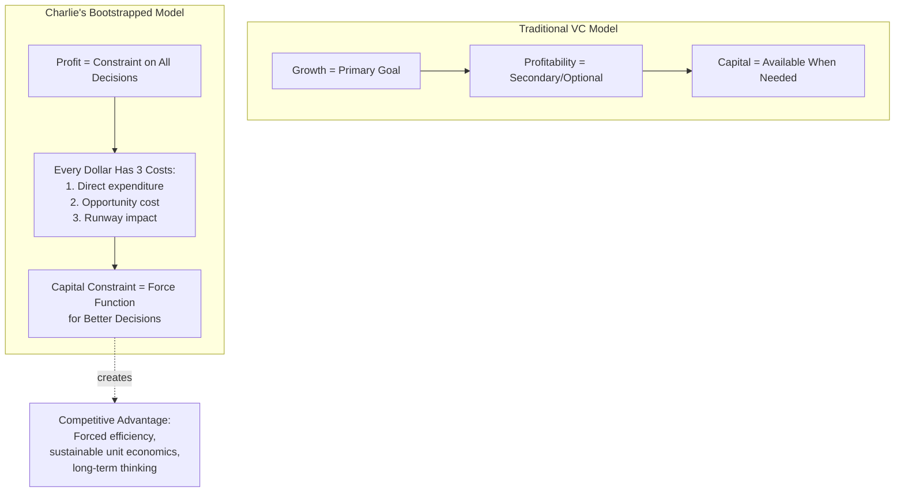
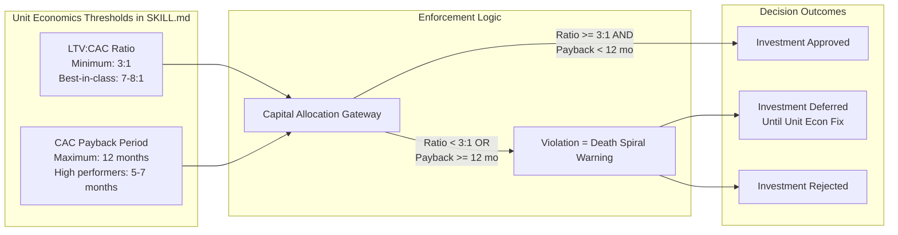
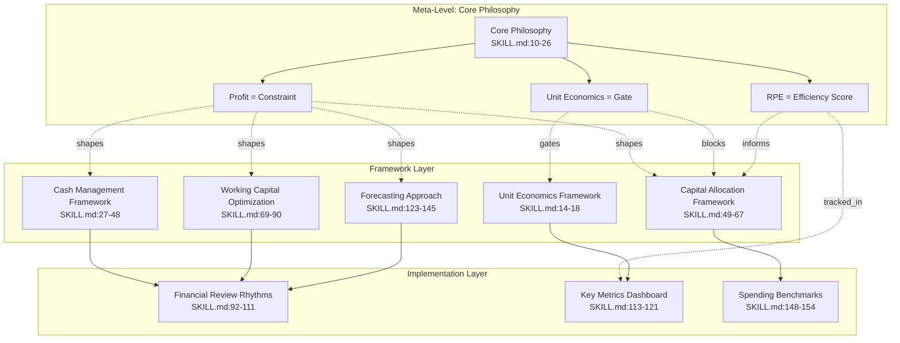
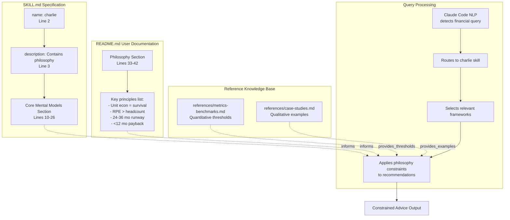
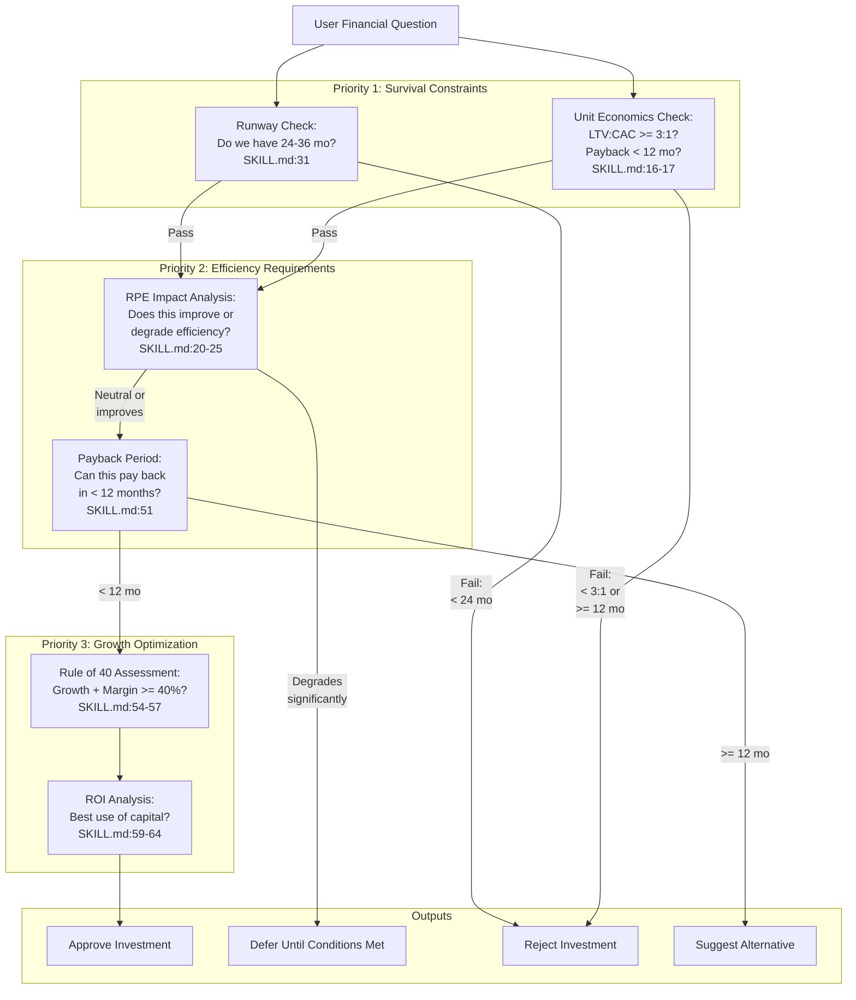
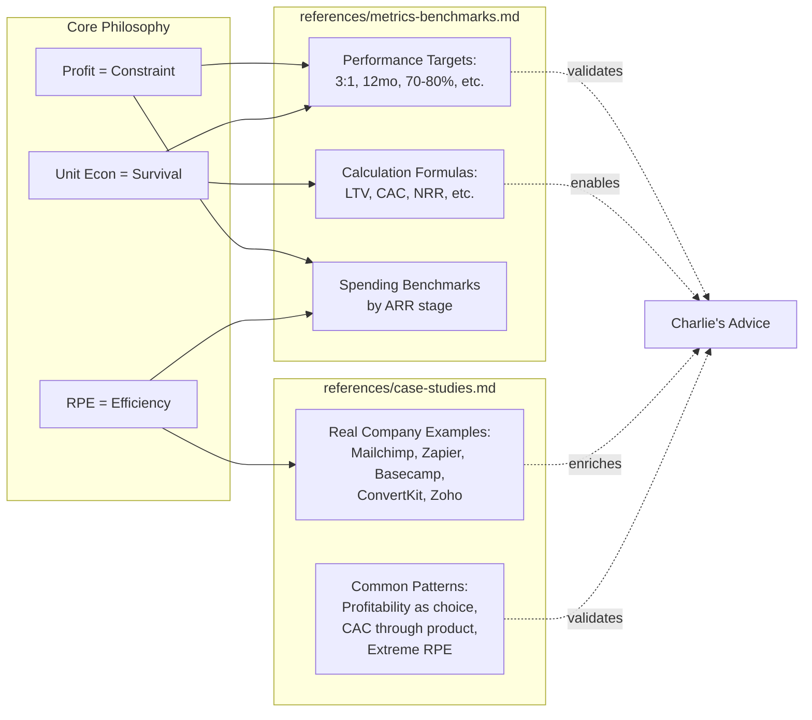

<!-- source: DeepWiki mcp.deepwiki.com · repo EveryInc/charlie-cfo-skill · page 2 Core Philosophy and Mental Models · fetched 2026-10-26 -->

# Core Philosophy and Mental Models

Relevant source files

The following files were used as context for generating this wiki page:

- [README.md](README.md)
- [SKILL.md](SKILL.md)

## Purpose and Scope

This page documents the foundational philosophy and mental models that drive all financial guidance in the Charlie CFO Skill system. It explains the Charlie Munger-inspired capital discipline principles and how they constrain and shape decision-making across all five financial frameworks.

For detailed exploration of specific principles, see:
- [Profit as a Constraint, Not a Goal](#2.1)
- [Unit Economics as Survival Requirements](#2.2)
- [Revenue Per Employee and Efficiency Targets](#2.3)

For practical application of these principles to specific decisions, see [Decision-Making Guides](#4).

**Sources:** [README.md:33-42](), [SKILL.md:6-26]()

---

## Why Charlie Munger?

The skill is named after Charlie Munger, who embodied the principle that **capital discipline is a competitive advantage**. Munger's investment philosophy emphasized that constraints—not abundance—force superior decision-making. Bootstrapped companies operate under permanent capital constraints, which, when properly leveraged, create a structural advantage over capital-abundant competitors.

This naming choice signals the system's core assumption: financial limitation is not a problem to solve but a framework to exploit.

**Sources:** [README.md:5](), [SKILL.md:8]()

---

## The Three Core Mental Models

The Charlie CFO Skill operates on three foundational mental models that permeate every framework, calculation, and recommendation. These are not aspirational goals but hard constraints enforced by the system's logic.

### Mental Model 1: Profit as a Constraint, Not a Goal

**Core Principle:** Capital constraints force better decisions by making every dollar carry three distinct costs:

| Cost Type | Definition | Example |
|-----------|------------|---------|
| **Direct Expenditure** | The cash leaving the bank | $100K salary = $100K spent |
| **Opportunity Cost** | What else could be funded | $100K salary = 2 engineers OR 1 sales rep |
| **Runway Impact** | Time reduction before cash-out | $100K annual = 1.2 months runway reduction (if $1M in bank) |

The system enforces this model by requiring all capital allocation decisions to pass through a payback period filter (<12 months) and runway impact assessment before approval.

**Sources:** [SKILL.md:12](), [README.md:35]()

### Mental Model 2: Unit Economics as Survival Requirements

**Core Principle:** Unit economics are **survival requirements**, not aspirational targets. The system treats these as hard gates:

| Metric | Minimum Threshold | Death Spiral Condition |
|--------|-------------------|------------------------|
| **LTV:CAC Ratio** | ≥ 3:1 | < 3:1 |
| **CAC Payback** | < 12 months | ≥ 12 months |
| **Gross Margin** | 70-80% (SaaS) | Insufficient to recover CAC + overhead |

Violating these thresholds creates what the system calls a "death spiral"—bootstrapped companies cannot survive sustained violations because they cannot raise capital to paper over bad unit economics.

The system implements this by **gating all Capital Allocation Framework decisions** ([#3.3](#3.3)) on passing unit economics thresholds from the Unit Economics Framework ([#3.2](#3.2)). This creates a hard dependency: capital allocation decisions cannot proceed without healthy unit economics.

**Sources:** [SKILL.md:14-18](), [README.md:38]()

### Mental Model 3: Revenue Per Employee as Efficiency Scorecard

| ARR Stage | Revenue Per Employee Target | Benchmark Context |
|-----------|----------------------------|-------------------|
| **$1-5M ARR** | $110-150K | Early efficiency baseline |
| **$10-50M ARR** | $200-250K | Scaling efficiency |
| **Maturity** | $400K+ | World-class efficiency |

**Core Principle:** Revenue per employee (RPE) serves as the primary efficiency scorecard. Bootstrapped companies typically run **40-70% higher RPE** than VC-backed peers because capital constraints prevent overhiring.

The system uses RPE as a counterbalance to headcount growth pressure. Every hiring decision must justify not just its direct ROI but also its impact on overall RPE trajectory.

**Sources:** [SKILL.md:20-25](), [README.md:39]()

---

## How Philosophy Constrains All Frameworks

The three mental models create a hierarchy of constraints that flow through all five financial frameworks:

### Framework Dependency Rules

The philosophy creates specific dependency rules enforced by the system's decision logic:

| Dependency Rule | Implementation | Effect |
|----------------|----------------|--------|
| **Unit Economics Gates Capital Allocation** | F3 cannot approve spending without F2 passing thresholds | Prevents death spiral investments |
| **Profit Constraint Shapes Cash Targets** | F1 runway targets (24-36 months) assume no external capital | Forces conservative reserves |
| **RPE Influences Hiring Decisions** | F3 hiring framework includes RPE impact analysis | Prevents overhiring |
| **Cash Constraints Shape Forecasts** | F5 scenarios always include severe downside | Prevents optimistic planning |

**Sources:** [SKILL.md:10-67]()

---

## Philosophy Implementation in System Architecture

The philosophy is not abstract—it is embedded in the system's specification and activation logic:

### Code Entity Mapping

| Philosophy Concept | Code Implementation | Location |
|-------------------|---------------------|----------|
| **"Profit is a constraint"** | Stated explicitly in mental models | [SKILL.md:12]() |
| **Three costs per dollar** | Described in principle explanation | [SKILL.md:12]() |
| **LTV:CAC ≥ 3:1 threshold** | Hard minimum defined | [SKILL.md:16]() |
| **CAC payback < 12 months** | Hard maximum defined | [SKILL.md:17]() |
| **"Death spiral" warning** | Explicit violation language | [SKILL.md:18]() |
| **RPE targets by stage** | Quantitative table | [SKILL.md:21-24]() |
| **24-36 month runway minimum** | Cash management rule | [SKILL.md:31](), [README.md:40]() |
| **<12 month payback requirement** | Capital allocation rule | [SKILL.md:51](), [README.md:41]() |

**Sources:** [SKILL.md:1-162](), [README.md:1-59]()

---

## Decision-Making Hierarchy

The philosophy creates a hierarchical decision-making system where higher-level principles override lower-level optimizations:

### Priority Enforcement

The system enforces priorities through sequential checks:

1. **Priority 1 (Survival):** Questions that fail runway or unit economics checks receive immediate rejection with "death spiral" warnings. No further analysis proceeds.

2. **Priority 2 (Efficiency):** Questions that pass survival but significantly degrade RPE or exceed 12-month payback receive deferral recommendations with suggestions for improving metrics first.

3. **Priority 3 (Growth):** Only questions that pass all prior checks proceed to growth optimization analysis using Rule of 40 and comparative ROI.

This hierarchy ensures that survival always trumps efficiency, and efficiency always trumps growth optimization.

**Sources:** [SKILL.md:10-67]()

---

## Philosophy vs. Framework Relationship

The philosophy operates at a meta-level above the frameworks, acting as a constraint system rather than a parallel system:

| Dimension | Philosophy Layer | Framework Layer |
|-----------|-----------------|-----------------|
| **Nature** | Immutable principles | Operational tools |
| **Role** | Defines what's acceptable | Calculates what's possible |
| **Output** | Go/no-go gates | Quantitative analysis |
| **Examples** | "Unit econ must be 3:1", "Profit is constraint" | LTV calculation, runway projection |
| **Modification** | Cannot be overridden by user context | Can be adapted to industry specifics |
| **Implementation** | Embedded in [SKILL.md:10-26]() | Detailed in [SKILL.md:27-145]() |

The frameworks (Cash Management, Unit Economics, Capital Allocation, Working Capital, Forecasting) are the **"how"**—they provide methods for calculation and analysis. The philosophy is the **"why"**—it provides the constraints and decision criteria that determine which calculations matter and which outcomes are acceptable.

**Sources:** [SKILL.md:10-162](), [README.md:33-42]()

---

## Connection to Reference Materials

The philosophy is operationalized through two reference documents:

### Reference Integration

| Philosophy Principle | Quantitative Support (Metrics) | Qualitative Support (Cases) |
|---------------------|-------------------------------|----------------------------|
| **Profit as Constraint** | Spending benchmarks showing bootstrapped efficiency | Basecamp's profit distributions, Zoho's 0% advertising spend |
| **Unit Economics = Survival** | LTV:CAC formulas and 3:1 minimum threshold | Mailchimp's <$100 CAC, Zapier's near-zero CAC strategy |
| **RPE as Scorecard** | RPE targets by stage ($110K to $400K+) | Basecamp's $1.4M RPE, bootstrapped 40-70% premium over VC-backed |

The metrics document provides the **"what to calculate"** and the **"what's acceptable"**, while the case studies provide the **"proof of concept"** that these principles work in real companies at scale.

**Sources:** [SKILL.md:159-161](), [README.md:44-48]()

---

## Summary: Philosophy as System Constraint

The Core Philosophy functions as the **constraint system** for the entire Charlie CFO Skill:

1. **Immutability:** Philosophy principles cannot be overridden—they are hard-coded assumptions in [SKILL.md:10-26]()
2. **Hierarchy:** Philosophy sits above frameworks in decision priority
3. **Enforcement:** Violations trigger rejection/deferral, not just warnings
4. **Integration:** Philosophy informs all five frameworks and all reference materials
5. **Operationalization:** Abstract principles are translated to concrete thresholds (3:1, 12 months, 24-36 months)

This design ensures that Charlie's advice is **consistently conservative** and **survival-oriented**—optimizing for long-term viability rather than short-term growth metrics.

For deeper exploration of each principle, see child pages:
- [Profit as a Constraint, Not a Goal](#2.1)
- [Unit Economics as Survival Requirements](#2.2)
- [Revenue Per Employee and Efficiency Targets](#2.3)

**Sources:** [SKILL.md:1-162](), [README.md:1-59]()

---

