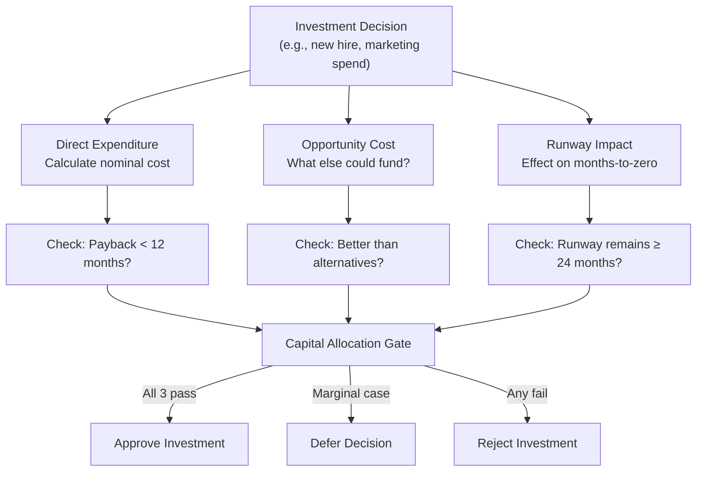
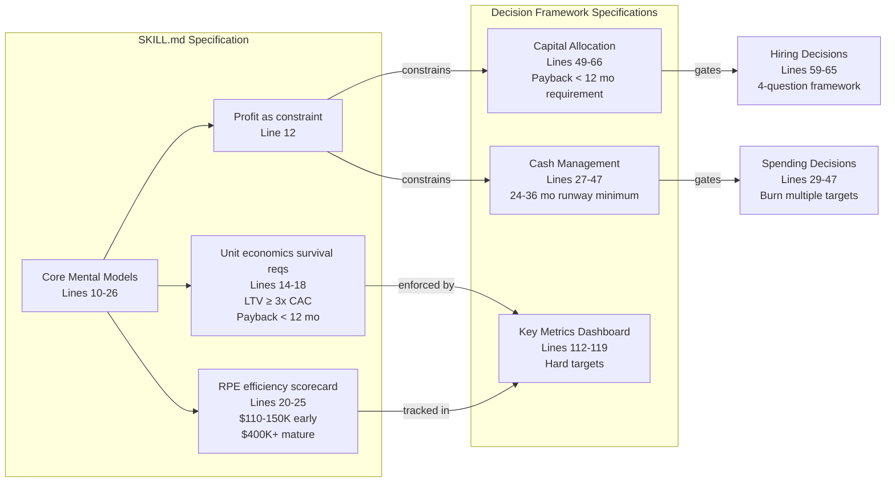
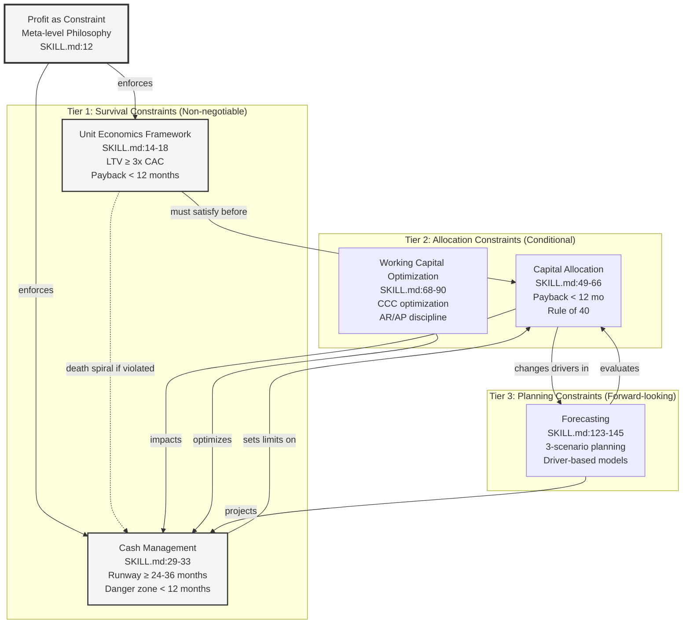
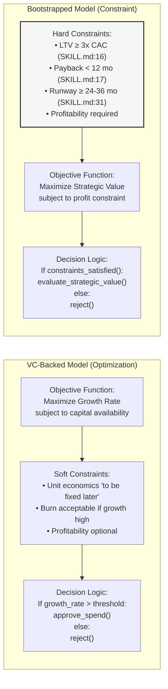
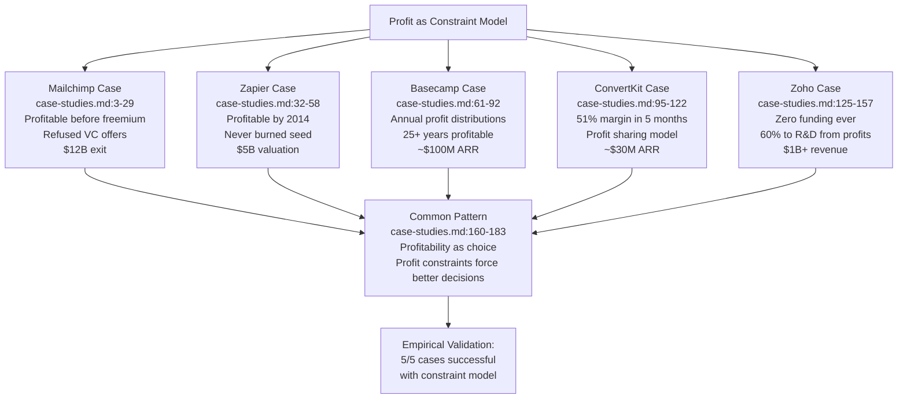

<!-- source: DeepWiki mcp.deepwiki.com · repo EveryInc/charlie-cfo-skill · page 2.1 Profit as a Constraint, Not a Goal · fetched 2026-10-26 -->

# Profit as a Constraint, Not a Goal

Relevant source files

The following files were used as context for generating this wiki page:

- [SKILL.md](SKILL.md)
- [references/case-studies.md](references/case-studies.md)

## Purpose and Scope

This document explains the foundational philosophical principle that underpins all of Charlie CFO Skill's financial frameworks: treating profit as a constraint rather than an objective function. This principle, derived from Charlie Munger's capital discipline philosophy, shapes how the system evaluates investments, makes recommendations, and sets thresholds across all five financial frameworks.

This page covers the conceptual model and its technical implementation in the skill system. For how this principle specifically manifests in unit economics thresholds, see [Unit Economics as Survival Requirements](#2.2). For revenue efficiency implications, see [Revenue Per Employee and Efficiency Targets](#2.3). For the practical frameworks that implement these constraints, see [The Five Financial Frameworks](#3).

## Conceptual Foundation

The "profit as constraint" model inverts the traditional optimization problem. Instead of maximizing profit as an objective function, the system treats profitability as a boundary condition that must be satisfied while optimizing for other strategic goals (market position, product quality, team satisfaction, sustainable growth).

This approach is explicitly stated in [SKILL.md:12]():

> **Profit is a constraint, not a goal.** Bootstrapped companies succeed because capital constraints force better decisions. Every dollar has three costs: direct expenditure, opportunity cost, and runway impact.

The principle manifests technically as hard thresholds and decision gates rather than soft targets or aspirational metrics.

**Sources:** [SKILL.md:10-12]()

## The Three-Cost Framework

Every capital allocation decision in the system evaluates three distinct costs simultaneously:

| Cost Type | Definition | System Implementation |
|-----------|------------|----------------------|
| **Direct Expenditure** | The nominal dollar amount of the transaction | Used in burn rate calculations, cash flow projections |
| **Opportunity Cost** | The alternative uses for the same capital | Compared against <12 month payback threshold (SKILL.md:51) |
| **Runway Impact** | How the expenditure affects time-to-zero-cash | Factored into runway calculations and 24-36 month minimum requirement (SKILL.md:31-32) |

This three-dimensional evaluation prevents myopic decision-making where a hire or investment appears justified on direct ROI alone but fails when runway or opportunity costs are considered.

### Three-Cost Evaluation Flow

**Sources:** [SKILL.md:12](), [SKILL.md:51](), [SKILL.md:29-33]()

## System Implementation: Constraint Encoding

The profit-as-constraint principle is encoded in the system through multiple specification layers:

### Primary Specification Layer

The core mental model is defined in [SKILL.md:10-26]() within the "Core Mental Models" section. This section establishes three constraint categories:

1. **Profit constraint statement** (line 12)
2. **Unit economics survival requirements** (lines 14-18)
3. **Revenue per employee efficiency scorecard** (lines 20-25)

**Sources:** [SKILL.md:10-26](), [SKILL.md:49-66](), [SKILL.md:27-47](), [SKILL.md:112-119]()

### Reference Material Layer

The constraint principle is reinforced through empirical case studies in [references/case-studies.md](). The document provides five examples of companies that succeeded by treating profitability as a non-negotiable constraint:

| Company | Constraint Evidence | Duration | Outcome |
|---------|-------------------|----------|---------|
| Mailchimp | Profitable before freemium pivot; never raised capital despite offers | 20 years | $12B exit |
| Zapier | Profitability reached in 2014, maintained since; never burned seed round | 2012-present | $5B valuation |
| Basecamp | Annual profit distributions for 25+ years; zero external capital | 1999-present | ~$100M ARR |
| ConvertKit | Achieved 51% margin in 5 months during crisis | Crisis turnaround | ~$30M ARR |
| Zoho | Zero external capital; 60% to R&D from profits | 28+ years | $1B+ revenue |

The synthesized pattern from [references/case-studies.md:160-165]() states: "Profitability is a choice, not a destination" - all companies achieved profitability early and maintained it, with profit constraints forcing better decisions.

**Sources:** [references/case-studies.md:1-183](), [references/case-studies.md:160-165]()

## Constraint Propagation Through Frameworks

The profit-as-constraint principle propagates through the system as hard dependencies between frameworks. This creates a hierarchy where certain constraints must be satisfied before others become relevant.

### Framework Constraint Hierarchy

**Critical Dependency:** [SKILL.md:14-18]() establishes unit economics as **survival requirements** that gate capital allocation decisions. The system enforces that LTV:CAC ≥ 3:1 and CAC payback < 12 months must be satisfied before approving growth investments. Violating these "creates a death spiral bootstrapped companies cannot survive."

**Sources:** [SKILL.md:12](), [SKILL.md:14-18](), [SKILL.md:29-33](), [SKILL.md:49-66](), [SKILL.md:68-90](), [SKILL.md:123-145]()

## Manifestation in Decision Rules

The constraint principle manifests as hard thresholds in decision-making logic rather than flexible guidelines. These appear throughout [SKILL.md]() as specific numeric gates.

### Capital Allocation Decision Gates

From [SKILL.md:49-66]():

| Decision Type | Constraint | System Behavior |
|--------------|------------|-----------------|
| **Any investment** | Payback period < 12 months | Reject if payback ≥ 12 months |
| **Hiring decision** | Must pass 4-question framework | All questions must have satisfactory answers |
| **Department growth** | Never grow >50% at once | Hard cap to prevent productivity collapse |
| **Rule of 40** | Growth % + Margin % ≥ 40% | Alert if sum < 40% |

The hiring decision framework from [SKILL.md:59-65]() implements the constraint as four required checks:

1. Direct revenue contribution?
2. Time-to-productivity factored into ROI?
3. Opportunity cost vs. alternative uses?
4. Impact on existing team productivity?

### Cash Management Constraint Gates

From [SKILL.md:27-47]():

| Metric | Minimum | Danger Zone | System Response |
|--------|---------|-------------|-----------------|
| **Runway** | 24-36 months | <12 months | "You've lost control" warning |
| **Burn multiple** | Zero or negative | >2x | Flag as "Concerning" |
| **Operating reserve** | 3-6 months fixed costs | <3 months | Trigger contingency planning |

The [SKILL.md:33]() specification explicitly states: "Never fundraise your way out of a cash crisis" - encoding the philosophy that capital constraints must be solved through operational improvement, not external capital.

**Sources:** [SKILL.md:49-66](), [SKILL.md:59-65](), [SKILL.md:27-47](), [SKILL.md:33]()

## Comparison with Alternative Models

The constraint-based model differs fundamentally from optimization-based approaches common in VC-backed environments:

### Behavioral Differences

| Scenario | VC-Backed Approach | Bootstrapped Constraint Approach |
|----------|-------------------|----------------------------------|
| LTV:CAC = 2.5:1 | Acceptable if growth is high | **Reject** - violates 3:1 minimum (SKILL.md:16) |
| 18-month payback | Acceptable with sufficient runway | **Reject** - exceeds 12-month maximum (SKILL.md:17) |
| 15 months runway | Acceptable if funding round planned | **Danger zone** - "you've lost control" (SKILL.md:32) |
| 150% burn multiple | Acceptable in high-growth phase | **Concerning** - target is zero or negative (SKILL.md:47) |

The system implementation in [SKILL.md:147-154]() makes this distinction explicit through spending benchmarks: bootstrapped companies target ~95% of ARR in total spending, versus 107% for VC-backed companies, creating structural profitability.

**Sources:** [SKILL.md:16-17](), [SKILL.md:31-32](), [SKILL.md:47](), [SKILL.md:147-154]()

## Empirical Validation Through Case Studies

The [references/case-studies.md]() document provides empirical evidence for the constraint model through five detailed case studies. The key validation pattern is that all companies achieved large exits while maintaining profitability constraints throughout their growth:

### Constraint Adherence Across Cases

The synthesized pattern from [references/case-studies.md:162-164]() explicitly states:

> **Profitability is a choice, not a destination**
> - All achieved profitability early and maintained it
> - Profit constraints forced better decisions

This provides the empirical foundation for encoding profit as a hard constraint in the system rather than a soft target.

**Sources:** [references/case-studies.md:3-29](), [references/case-studies.md:32-58](), [references/case-studies.md:61-92](), [references/case-studies.md:95-122](), [references/case-studies.md:125-157](), [references/case-studies.md:160-183]()

## Technical Integration Points

The profit-as-constraint principle integrates with Charlie's query processing through the framework selection and calculation engine described in the system architecture diagrams. When a user asks a capital allocation question (e.g., "Should we make this hire?"), the system:

1. **Intent Recognition** → Routes to Capital Allocation Framework
2. **Constraint Validation** → Checks unit economics thresholds from [SKILL.md:14-18]()
3. **Multi-cost Evaluation** → Applies three-cost framework
4. **Runway Impact** → Calculates effect on [SKILL.md:29-33]() runway targets
5. **Case Study Enrichment** → Pulls relevant examples from [references/case-studies.md]()
6. **Threshold Comparison** → Compares against hard gates in [SKILL.md:49-66]()

The system generates recommendations structured as **approve/defer/reject** rather than probabilistic scores, reflecting the constraint-based rather than optimization-based model.

**Sources:** [SKILL.md:14-18](), [SKILL.md:29-33](), [SKILL.md:49-66](), [references/case-studies.md]()

---

