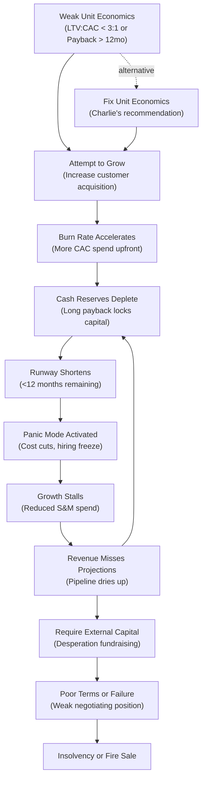
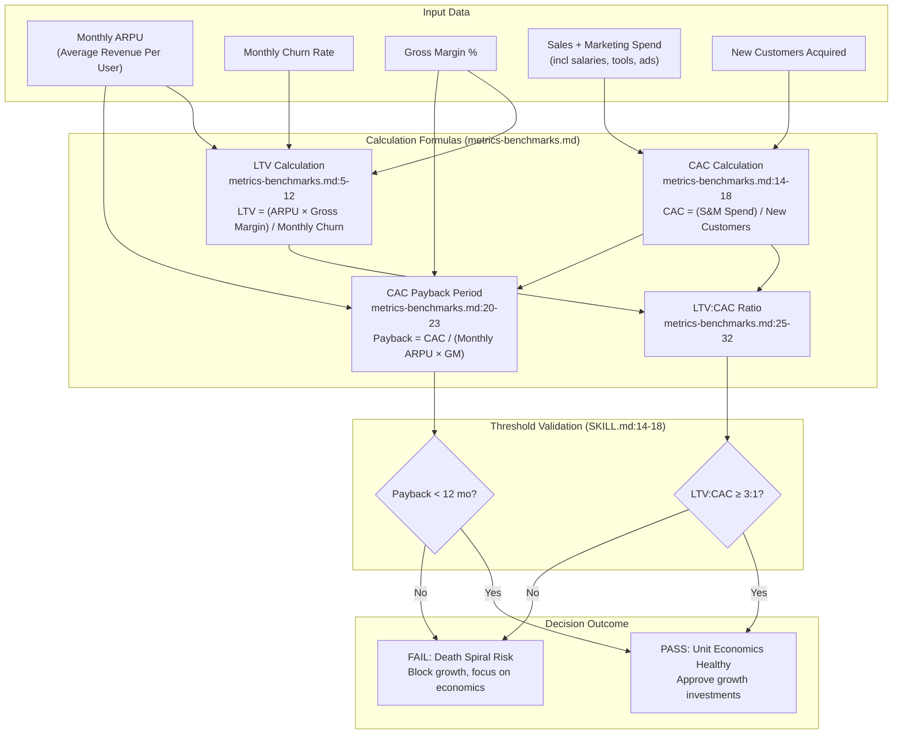
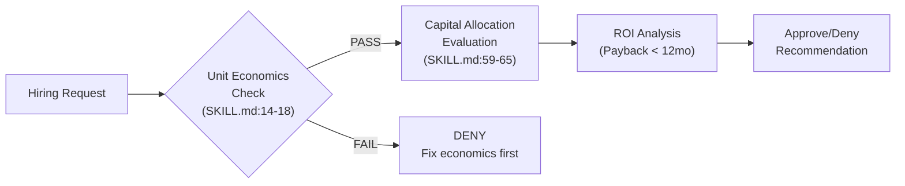
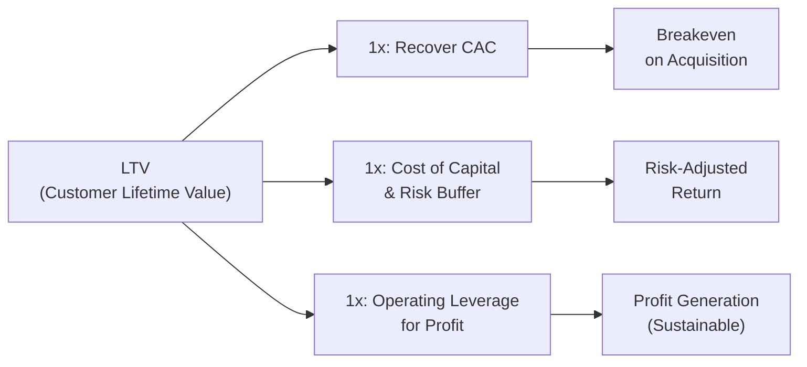
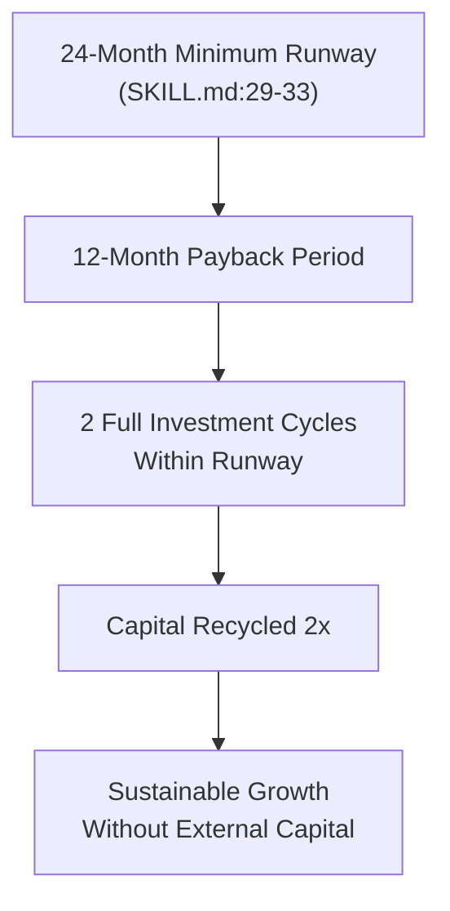

<!-- source: DeepWiki mcp.deepwiki.com · repo EveryInc/charlie-cfo-skill · page 2.2 Unit Economics as Survival Requirements · fetched 2026-10-26 -->

# Unit Economics as Survival Requirements

<details>
<summary>Relevant source files</summary>

The following files were used as context for generating this wiki page:

- [SKILL.md](SKILL.md)
- [references/metrics-benchmarks.md](references/metrics-benchmarks.md)

</details>


## Purpose and Scope

This document explains why Charlie treats LTV:CAC ratios and CAC payback periods as non-negotiable survival thresholds rather than aspirational goals. It details the specific numeric requirements, the mechanism by which violations create death spirals, and how these thresholds are encoded throughout the Charlie CFO Skill system.

For the broader philosophical foundation behind capital discipline, see [Profit as a Constraint, Not a Goal](#2.1). For how unit economics integrate with spending decisions, see [Capital Allocation Framework](#3.3). For detailed calculation formulas and benchmarks, see [Unit Economics Calculations](#5.1.1).

---

## The Bootstrapped Context: Why Unit Economics Matter More

Bootstrapped companies operate under a fundamental constraint that VC-backed companies do not face: **limited access to external capital**. This constraint transforms unit economics from optimization targets into survival requirements.

In a VC-backed model, negative unit economics can be temporarily sustained through successive funding rounds. A company can acquire customers at a loss, betting that future scale or product improvements will eventually achieve profitability. Bootstrapped companies lack this cushion—every unprofitable customer acquisition accelerates the path to insolvency.

Charlie enforces this distinction by treating unit economics violations as blocking conditions for capital allocation decisions. The system will not approve growth investments when fundamental economics are unhealthy, regardless of other positive signals.

**Sources:** [SKILL.md:12-18](), [SKILL.md:50-67]()

---

## Critical Thresholds Defined in SKILL.md

The Charlie CFO Skill encodes two hard thresholds that define the boundary between sustainable and unsustainable business models:

| Metric | Minimum Threshold | High Performance | Best-in-Class |
|--------|-------------------|------------------|---------------|
| **LTV:CAC Ratio** | ≥ 3:1 | 5:1 | 7-8:1 |
| **CAC Payback Period** | < 12 months | 5-7 months | 3-5 months |

These thresholds are declared at [SKILL.md:14-18]() as part of the "Core Mental Models" section, specifically under "Unit economics are survival requirements."

### LTV:CAC Ratio ≥ 3:1

The 3:1 minimum means that the lifetime value of a customer must be at least three times what was spent to acquire them. This ratio accounts for:
- **Operating costs** of servicing the customer (support, infrastructure)
- **Time value of money** (capital locked in CAC before recovery)
- **Risk buffer** (some customers will churn before reaching projected LTV)

Ratios below 3:1 indicate that after accounting for the cost of capital and operational overhead, the business is barely breaking even or losing money on customer acquisition.

### CAC Payback < 12 Months

The 12-month payback requirement means that gross margin dollars from a customer must recover the acquisition cost within one year. This threshold directly ties to cash management requirements:

- Bootstrapped companies typically target 24-36 months of runway ([SKILL.md:29-33]())
- A 12-month payback allows the company to recycle capital twice within minimum runway targets
- Payback periods exceeding 12 months mean cash is locked up for too long relative to available reserves

**Sources:** [SKILL.md:14-18](), [SKILL.md:51](), [references/metrics-benchmarks.md:20-32]()

---

## The Death Spiral Mechanism

The phrase "death spiral" at [SKILL.md:18]() describes a specific failure mode that occurs when bootstrapped companies violate unit economics thresholds while attempting to grow. This diagram illustrates the mechanism:

### Death Spiral Progression in Bootstrapped Companies



The critical insight: **the spiral accelerates because growth compounds the problem rather than solving it**. Each new customer acquired under poor unit economics further strains cash reserves. Unlike VC-backed companies that can raise into the problem, bootstrapped companies hit a hard constraint when cash runs out.

Charlie blocks this path by refusing to approve growth investments (hiring sales reps, increasing marketing spend) when unit economics are below threshold. The system forces founders to fix the fundamental economics before scaling.

**Sources:** [SKILL.md:14-18](), [SKILL.md:29-33]()

---

## Calculating Unit Economics: Formula Mapping

Charlie uses specific formulas defined in the reference materials to calculate and validate unit economics. This section maps the calculation flow from raw inputs to threshold validation.

### Calculation Flow and Code References



**Sources:** [references/metrics-benchmarks.md:5-32](), [SKILL.md:14-18]()

### LTV Calculation Details

The Lifetime Value formula at [references/metrics-benchmarks.md:5-12]() uses the simplified approach:

```
LTV = (ARPU × Gross Margin) / Monthly Churn Rate
```

This assumes:
- Churn rate is constant over time
- Revenue per user remains stable
- Gross margin accurately reflects variable costs of serving the customer

For companies with expansion revenue, a cohort-based approach (also documented at [references/metrics-benchmarks.md:9-12]()) provides higher accuracy by summing actual revenue retention curves.

### CAC Calculation Details

The Customer Acquisition Cost formula at [references/metrics-benchmarks.md:14-18]() includes all customer acquisition expenses:

```
CAC = (Sales + Marketing Spend) / New Customers Acquired
```

Charlie requires including:
- Sales team salaries and commissions
- Marketing salaries
- Advertising spend (paid search, social, display)
- Marketing tools and software
- Events and conferences
- Content production costs

The common error is underestimating CAC by excluding fully-loaded personnel costs or allocated overhead.

### CAC Payback Period Calculation

The payback formula at [references/metrics-benchmarks.md:20-23]() calculates how many months of gross margin revenue are needed to recover CAC:

```
CAC Payback (months) = CAC / (Monthly ARPU × Gross Margin)
```

This formula adjusts for:
- **Gross margin**: Only margin dollars (not total revenue) contribute to CAC recovery
- **Monthly ARPU**: Uses average per-user revenue to normalize across customer tiers

**Sources:** [references/metrics-benchmarks.md:5-23]()

---

## Threshold Interpretation Table

Charlie uses this interpretation framework defined at [references/metrics-benchmarks.md:25-32]():

| LTV:CAC Ratio | Charlie's Interpretation | Action |
|---------------|-------------------------|---------|
| **< 1:1** | Losing money on every customer | BLOCK all growth, urgent fix required |
| **1-2:1** | Unsustainable, need to improve | BLOCK growth investments |
| **3:1** | Healthy minimum threshold | ALLOW growth (with monitoring) |
| **5:1+** | Excellent, may be underinvesting | Recommend increased growth investment |
| **7-8:1** | Best-in-class | Aggressively scale |

The discontinuity at 3:1 is intentional—it represents the minimum viable ratio for bootstrapped sustainability after accounting for:
- Risk (not all customers reach projected LTV)
- Time value (capital locked during payback period)
- Operating leverage (need margin for profit after CAC recovery)

**Sources:** [references/metrics-benchmarks.md:25-32]()

---

## Integration with Capital Allocation Decisions

Unit economics serve as a **prerequisite check** for all capital allocation decisions in Charlie's decision framework. This integration is visible in the hiring evaluation logic at [SKILL.md:59-65]().

### Hiring Decision Gating Logic



The sequence is critical:
1. **First**: Check if LTV:CAC ≥ 3:1 and payback < 12 months
2. **Only if passed**: Proceed to evaluate the specific investment ROI
3. **Then**: Apply the four-question hiring framework

This gating prevents the death spiral by refusing to approve spending that would accelerate customer acquisition when fundamental economics are broken.

**Sources:** [SKILL.md:14-18](), [SKILL.md:51-67]()

---

## Unit Economics Monitoring Cadence

Charlie integrates unit economics into the monitoring rhythms defined at [SKILL.md:92-110](). These metrics appear in:

### Weekly Review (SKILL.md:92-99)
Not typically reviewed weekly unless in crisis mode or during active campaigns.

### Monthly Review (SKILL.md:100-105)
Unit economics are recalculated monthly as part of the full close process. Specifically:
- Update CAC with trailing 30-day S&M spend and new customer counts
- Recalculate LTV using latest churn rates
- Compare to prior month to detect trends

### Quarterly Review (SKILL.md:106-111)
Unit economics receive strategic assessment:
- Cohort analysis to identify if economics are improving or degrading over time
- Segmentation analysis (by customer tier, acquisition channel, geography)
- Scenario modeling of required improvements to hit thresholds

### Key Metrics Dashboard (SKILL.md:112-120)

Unit economics occupy a permanent position in the dashboard:

| Category | Metrics | Targets |
|----------|---------|---------|
| Unit economics | LTV:CAC, CAC payback, gross margin | 3:1+, <12 mo, 70-80% |

This dashboard placement at [SKILL.md:117]() ensures unit economics are visible in every financial review, not just isolated analyses.

**Sources:** [SKILL.md:92-120]()

---

## Relationship to Other Core Principles

Unit economics form part of an integrated philosophy within Charlie's system. The connections:

### Connection to "Profit as a Constraint" (Section 2.1)

Unit economics are the **micro-level expression** of profit as constraint. While profit as constraint governs company-wide capital allocation, unit economics govern customer-level profitability. A company cannot be sustainably profitable if individual customer cohorts are unprofitable.

### Connection to "Revenue Per Employee" (Section 2.3)

High revenue per employee ([SKILL.md:20-25]()) becomes achievable primarily through strong unit economics. Companies with 7-8:1 LTV:CAC ratios can afford to maintain leaner teams because:
- Each customer is highly profitable
- Less spending required on customer acquisition and support
- More revenue generated per dollar of payroll

### Connection to Cash Management (Section 3.1)

The 12-month payback requirement directly links to the 24-36 month runway target at [SKILL.md:29-33](). With 12-month payback:
- Capital deployed in customer acquisition is recycled within half the minimum runway period
- Company can sustain 2x growth within runway constraints
- Cash reserves remain available for opportunistic investments

**Sources:** [SKILL.md:14-25](), [SKILL.md:29-33]()

---

## Why 3:1 and 12 Months Specifically?

These thresholds are not arbitrary—they encode specific mathematical and practical constraints for bootstrapped companies:

### The 3:1 Ratio Breakdown



- **First 1x**: Recovers the original CAC investment
- **Second 1x**: Compensates for time value of money and execution risk (churn variance, market changes)
- **Third 1x**: Generates operating profit that can fund operations, reserves, and reinvestment

Below 3:1, the company is operationally breakeven at best, with no buffer for variability or profit generation.

### The 12-Month Payback Logic



With 24 months of runway and 12-month payback:
- Month 0-12: First cohort acquired, capital locked
- Month 12: First cohort pays back, capital available
- Month 12-24: Second cohort acquired using recycled capital
- Month 24: Second cohort pays back, doubling available capital

This arithmetic enables compounding growth without external funding. Payback periods exceeding 12 months break this cycle—capital is locked too long relative to available runway.

**Sources:** [SKILL.md:14-18](), [SKILL.md:29-33]()

---

## Summary: Unit Economics as Gate Function

In Charlie's architecture, unit economics function as a **gate** rather than a score. They are binary: either they meet the survival thresholds or they don't. This design choice reflects the bootstrapped reality that there is no "acceptable but needs work" zone—violating thresholds while attempting to grow triggers the death spiral mechanism.

The system enforces this through:
1. **Hard thresholds** defined at [SKILL.md:14-18]()
2. **Calculation formulas** specified at [references/metrics-benchmarks.md:5-32]()
3. **Integration as prerequisite** for capital allocation at [SKILL.md:51-67]()
4. **Monitoring cadence** in dashboard at [SKILL.md:117]()

This architectural decision—treating unit economics as survival requirements rather than optimization targets—distinguishes Charlie's approach from traditional CFO frameworks that might present these as "areas for improvement" rather than blocking conditions.

**Sources:** [SKILL.md:14-18](), [SKILL.md:51-67](), [SKILL.md:112-120](), [references/metrics-benchmarks.md:5-32]()

---

