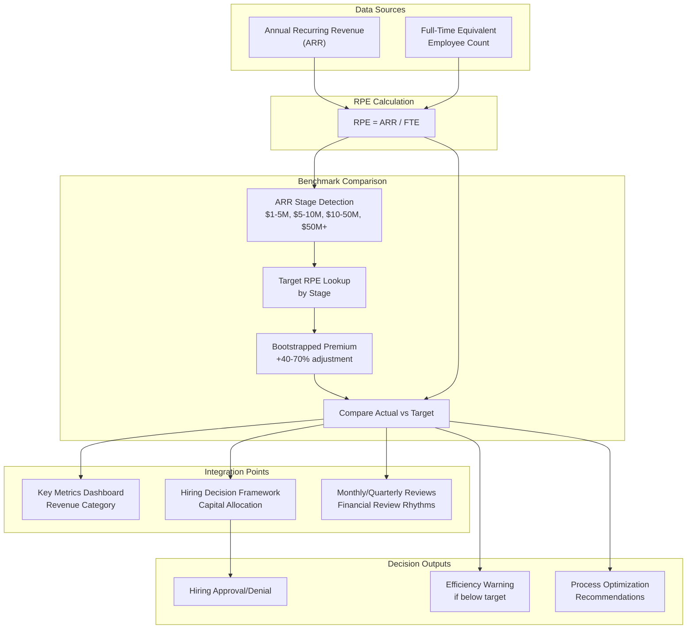
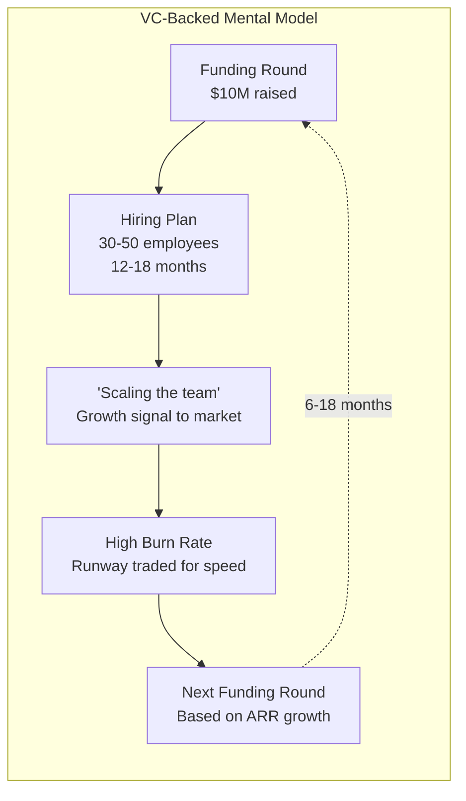
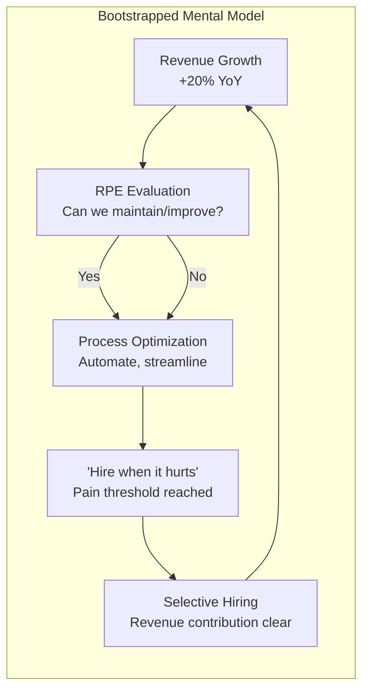
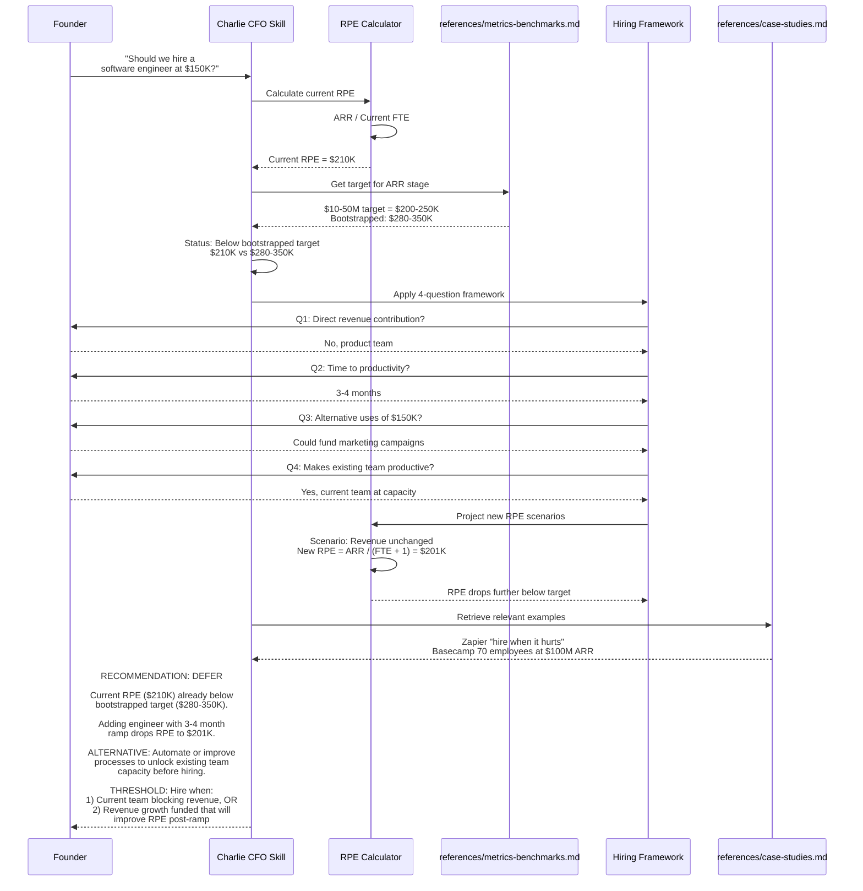
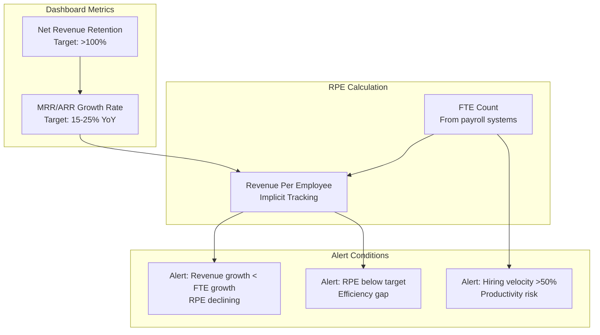

<!-- source: DeepWiki mcp.deepwiki.com · repo EveryInc/charlie-cfo-skill · page 2.3 Revenue Per Employee and Efficiency Targets · fetched 2026-10-26 -->

# Revenue Per Employee and Efficiency Targets

<details>
<summary>Relevant source files</summary>

The following files were used as context for generating this wiki page:

- [SKILL.md](SKILL.md)
- [references/case-studies.md](references/case-studies.md)
- [references/metrics-benchmarks.md](references/metrics-benchmarks.md)

</details>


## Purpose and Scope

This document explains Charlie's emphasis on Revenue Per Employee (RPE) as a primary efficiency metric for bootstrapped startups. It details target benchmarks at different company stages, explains why bootstrapped companies systematically achieve higher RPE than venture-backed peers, and describes how RPE integrates into hiring and capital allocation decisions.

For unit economics requirements that gate growth investments, see [Unit Economics as Survival Requirements](#2.2). For the hiring decision framework that uses RPE as one input, see [Evaluating Hiring Decisions](#4.1). For detailed RPE calculation formulas and industry benchmarks, see [Cash Flow and Efficiency Metrics](#5.1.3).

**Sources:** [SKILL.md:1-162](), [references/metrics-benchmarks.md:102-111]()

## What is Revenue Per Employee

Revenue Per Employee (RPE) measures the annual revenue generated per full-time equivalent employee. Charlie treats RPE as an **efficiency scorecard**—a proxy metric that captures the combined effects of product leverage, operational efficiency, and capital discipline.

```
RPE = Annual Recurring Revenue (ARR) / Full-Time Equivalent Employees
```

Unlike traditional financial metrics that focus on absolute revenue growth or profit margins, RPE reveals **how efficiently a company converts human capital into revenue**. High RPE indicates:

- **Product leverage**: The product does significant work without human intervention
- **Process efficiency**: Operations are streamlined and automated
- **Hiring discipline**: Each new hire is justified by clear revenue contribution
- **Market positioning**: Product commands pricing power relative to delivery costs

Charlie uses RPE as a constraint in capital allocation decisions, particularly hiring. The framework enforces that adding headcount must either: (1) directly increase RPE by driving revenue faster than costs, or (2) maintain RPE by making existing employees more productive.

**Sources:** [SKILL.md:20-26](), [references/metrics-benchmarks.md:102-111]()

## RPE Benchmarks by ARR Stage

Charlie defines stage-specific RPE targets that increase as companies mature. These benchmarks reflect expected efficiency gains from product maturity, process refinement, and customer base expansion.

### Target Ranges

| ARR Stage | Target RPE | Explanation |
|-----------|------------|-------------|
| $1-5M | $110-150K | Early stage, high relative investment in product/market fit |
| $5-10M | $150-200K | Product-market fit achieved, scaling processes |
| $10-50M | $200-250K | Mature product, optimized operations |
| $50M+ | $300-400K+ | Full operational leverage, established market position |

### Bootstrapped Premium

Bootstrapped companies systematically achieve **40-70% higher RPE** than venture-backed companies at the same ARR stage. A $10M ARR bootstrapped company typically runs at $280-350K RPE compared to $200-250K for venture-backed peers.

This premium reflects structural differences in capital constraints:

- **Forced efficiency**: Cannot hire ahead of revenue
- **Profitability requirement**: Must extract maximum value from each employee
- **Process discipline**: Automation and leverage are survival requirements, not optimization targets
- **Compensation structure**: Cash compensation rather than equity dilution encourages lean teams

**Sources:** [SKILL.md:20-26](), [references/metrics-benchmarks.md:102-111]()

## RPE Tracking in the System



**Diagram: RPE Calculation and Integration Flow**

The system tracks RPE through a multi-stage process:

1. **Calculation**: ARR divided by FTE count produces current RPE
2. **Stage Detection**: ARR determines which benchmark range applies
3. **Benchmark Lookup**: System retrieves target range from [references/metrics-benchmarks.md:102-111]()
4. **Premium Adjustment**: Applies 40-70% uplift for bootstrapped context
5. **Comparison**: Actual RPE evaluated against adjusted target
6. **Integration**: Results feed into dashboard, hiring decisions, and reviews

**Sources:** [SKILL.md:112-120](), [references/metrics-benchmarks.md:102-111]()

## RPE vs Headcount Growth Mentality

Charlie's philosophy represents a fundamental divergence from venture-backed growth models that prioritize **headcount expansion** as a primary growth lever. This section contrasts the two approaches.

### Venture-Backed Approach: Headcount as Growth Signal



**Diagram: Venture-Backed Headcount Growth Cycle**

Characteristics:
- Headcount treated as **input to growth** rather than output of revenue
- "Blitzscaling" mentality: hire aggressively to capture market share
- RPE deliberately depressed (often $100-150K even at $50M+ ARR)
- Acceptable because capital is readily available
- Growth rate prioritized over efficiency

### Bootstrapped Approach: RPE as Efficiency Constraint



**Diagram: Bootstrapped RPE-Constrained Growth**

Characteristics:
- Headcount is **output of necessity**, not input to growth
- Revenue growth must precede or justify hiring
- RPE maintained or improved with each hire
- Process optimization and automation are continuous requirements
- "Hire when it hurts" threshold ensures genuine need

**Sources:** [SKILL.md:20-26](), [references/case-studies.md:49-57]()

## Integration with Capital Allocation Framework

RPE functions as a **gating constraint** in Charlie's capital allocation decisions, particularly for hiring. The hiring decision framework uses RPE in two ways:

### 1. Direct RPE Impact Analysis

When evaluating a new hire, the system calculates projected RPE impact:

```
Projected New RPE = (Current ARR + Revenue Contribution) / (Current FTE + 1)
```

The hire is evaluated against three scenarios:
- **Scenario A**: Hire directly drives revenue (sales, customer success expansion)
- **Scenario B**: Hire improves productivity of existing team (engineering enablement, automation)
- **Scenario C**: Hire is necessary infrastructure (finance, operations) but doesn't improve RPE

Scenario A and B hires are preferred. Scenario C hires face stricter scrutiny and must clear the "hire when it hurts" threshold—evidence that lack of this role is causing measurable pain or inefficiency.

### 2. The Four-Question Hiring Framework

From [SKILL.md:59-66](), every hiring decision must answer:

1. **Will this hire directly contribute to revenue?** (Scenario A check)
2. **What's the time-to-productivity?** (Factors into ROI and RPE timeline)
3. **What else could this salary fund?** (Opportunity cost in RPE terms)
4. **Does this make existing team more productive?** (Scenario B check)

Question 3 is particularly RPE-focused: a $120K salary could instead fund:
- Marketing campaigns that might acquire customers at lower CAC
- Product improvements that increase conversion or reduce churn
- Process automation that improves existing team efficiency

The framework forces explicit comparison of RPE impact across alternative uses of capital.

**Sources:** [SKILL.md:49-66]()

### Hiring Velocity Constraint

Charlie enforces a hard rule: **Never grow a department >50% at once**—productivity drops to zero during training. This constraint directly protects RPE from temporary collapse during rapid hiring.

Example: A 10-person engineering team cannot add 6+ engineers simultaneously, even if budget allows. The onboarding burden would reduce productivity of existing engineers, temporarily cratering team-level RPE. The constraint is:

```
Max New Hires per Period = floor(Current Department Size × 0.5)
```

**Sources:** [SKILL.md:66]()

## Decision Flow: Hiring Request with RPE Evaluation



**Diagram: Hiring Decision Sequence with RPE Evaluation**

This sequence demonstrates how Charlie integrates RPE into real-time hiring decisions. The system:

1. Calculates current RPE and compares to benchmarks
2. Identifies efficiency gap (below bootstrapped target)
3. Projects RPE impact of new hire
4. Applies four-question framework to assess necessity
5. Retrieves case study examples of high-RPE companies
6. Generates recommendation with specific RPE reasoning

**Sources:** [SKILL.md:59-66](), [references/metrics-benchmarks.md:102-111](), [references/case-studies.md:49-57]()

## Case Study Examples: Extreme RPE

Charlie's reference knowledge base includes several companies that achieved exceptional RPE through discipline and leverage.

### Basecamp: $1.4M RPE

From [references/case-studies.md:75-77]():

- **Revenue**: ~$100M ARR
- **Employees**: ~70 FTE
- **RPE**: ~$1.4M

**Result**: Among the highest RPE in the software industry. Achieved through:
- Annual profit distributions rather than endless reinvestment
- Extreme focus on single product (shut down 3 of 4 products in 2014)
- Remote-first structure reducing overhead
- Product-focused culture minimizing support burden

Basecamp demonstrates that $1M+ RPE is achievable with product leverage and capital discipline.

### Zapier: "Hire When It Hurts" Philosophy

From [references/case-studies.md:49-57]():

- Maintained profitability from 2014 forward
- 10% monthly revenue growth for 48+ consecutive months
- Kept team "extremely lean during growth phase"
- **Principle**: Each hire must prove necessity through measurable pain

Zapier's approach:
1. Identify constraint or bottleneck
2. Attempt to solve through automation or process improvement
3. Only hire when pain persists and hire directly addresses constraint
4. Result: High RPE maintained throughout growth

This philosophy is embedded in Charlie's hiring framework—the system encourages process optimization before headcount expansion.

### Common Pattern: RPE 2-3x Industry Average

From [references/case-studies.md:170-172](), all successful bootstrapped companies in the reference set achieve RPE **2-3x industry average**:

- Mailchimp: Product-led growth with minimal support burden
- Zapier: Programmatic SEO eliminated large sales/marketing teams
- Basecamp: Single focused product with long customer lifetimes
- ConvertKit: Direct sales model with high ACV
- Zoho: Geographic arbitrage and vertical integration

**Common factors**:
- Product leverage reduces need for human intervention
- Acquisition efficiency (low CAC) reduces sales/marketing headcount
- Long customer lifetimes reduce churn-fighting headcount
- Process discipline and automation across all functions

**Sources:** [references/case-studies.md:61-92](), [references/case-studies.md:170-172]()

## RPE in Review Rhythms

Charlie's financial review system tracks RPE across three time horizons, each serving different purposes:

### Weekly Review (60-90 minutes)

From [SKILL.md:92-99](), weekly reviews do not explicitly track RPE but monitor its inputs:
- **Revenue/bookings**: Numerator of RPE formula
- **Pipeline movement**: Leading indicator of revenue trends

RPE changes slowly—weekly tracking would show minimal movement and create false precision.

### Monthly Review

From [SKILL.md:100-105](), monthly reviews include:
- Full financial close (target 5-7 business days)
- Variance analysis comparing actuals to forecast
- 12-18 month rolling forecast update

**RPE tracking**: Calculate monthly and compare to:
1. Previous month (trend direction)
2. Same month prior year (YoY comparison)
3. Target benchmark for current ARR stage

Trigger investigation if:
- RPE drops >5% month-over-month without corresponding revenue strategy
- RPE remains below target for 3+ consecutive months
- Gap between actual and bootstrapped target is widening

### Quarterly Review

From [SKILL.md:106-111](), quarterly reviews include:
- Strategic recalibration
- Scenario refresh (base/moderate/severe downside)
- 18-24 month outlook

**RPE planning**: Quarterly reviews project RPE under different hiring scenarios:
- Current trajectory (no new hires)
- Approved hiring plan
- Accelerated hiring plan (if revenue scenarios support)

The system models RPE impact in all three scenarios, ensuring hiring plans maintain or improve efficiency.

**Sources:** [SKILL.md:92-111]()

## RPE in the Key Metrics Dashboard

The Key Metrics Dashboard from [SKILL.md:112-120]() does not explicitly list RPE, but it appears implicitly in the **Revenue category** monitoring system:

```
Revenue: MRR/ARR, growth rate, NRR
Target: NRR >100%, growth 15-25% YoY
```

**Implicit RPE tracking**: The dashboard monitors revenue growth rate. To maintain RPE while growing revenue 15-25% YoY, headcount growth must be ≤15-25% YoY (assuming flat RPE) or <15-25% YoY (to improve RPE).

The system generates warnings when:
- Revenue growth rate < Headcount growth rate (RPE declining)
- RPE drops below stage-specific target
- Hiring velocity exceeds 50% department growth constraint

**Dashboard Integration Flow**:



**Diagram: RPE Integration with Dashboard Alerting**

**Sources:** [SKILL.md:112-120]()

## Why RPE Matters for Bootstrapped Companies

RPE is particularly critical for bootstrapped companies because it captures the **efficiency requirement** imposed by capital constraints. Three structural reasons:

### 1. No Dilution Buffer

Venture-backed companies can hire aggressively and accept temporary RPE depression because they can raise additional capital to extend runway. The equity dilution is accepted as the cost of speed.

Bootstrapped companies cannot dilute their way out of inefficiency. Each dollar spent on salary must generate return, or the company runs out of runway with no capital backstop.

**Implication**: RPE must be maintained or improved with each hire—there is no tolerance for "scaling first, efficiency later."

### 2. Profit Requirement

From [SKILL.md:12](): "Profit is a constraint, not a goal." Bootstrapped companies must remain profitable or near-profitable to survive.

High RPE enables profitability by minimizing the largest expense category (payroll) relative to revenue. The formula:

```
Profit Margin = (Revenue - Costs) / Revenue
```

With payroll typically 50-70% of costs for software companies, RPE directly determines achievable profit margin. Companies with $400K RPE can sustain 30-40% margins; companies with $150K RPE struggle to exceed 10% margins.

### 3. Hiring is One-Way Door

Hiring is effectively irreversible for bootstrapped companies:
- Legal/regulatory costs of termination
- Morale impact on remaining team
- Reputation risk in talent market
- No investor buffer to absorb restructuring costs

This irreversibility means **each hire must be correct**. RPE provides a quantitative filter: if hiring would significantly degrade RPE, the hire likely cannot be sustained, and should be deferred until revenue justifies it.

**Sources:** [SKILL.md:12-18](), [SKILL.md:20-26]()

## Summary: RPE as Efficiency Scorecard

Revenue Per Employee functions as Charlie's **primary efficiency metric** because it captures multiple dimensions of company health in a single number:

- **Product leverage**: How much revenue the product generates per human
- **Operational efficiency**: How streamlined processes enable productivity
- **Capital discipline**: Whether hiring decisions are justified by revenue
- **Market position**: Whether pricing/margins support high compensation

Charlie integrates RPE into:
- **Hiring decisions**: Projected impact required for approval
- **Monthly reviews**: Trend monitoring and variance investigation
- **Quarterly planning**: Scenario modeling under different hiring plans
- **Strategic guidance**: Case study examples demonstrating 2-3x industry RPE is achievable

The system enforces that bootstrapped companies must achieve **40-70% higher RPE** than venture-backed peers at the same stage—not as an aspiration, but as a survival requirement imposed by capital constraints.

**Sources:** [SKILL.md:20-26](), [references/metrics-benchmarks.md:102-111](), [references/case-studies.md:170-172]()

---

