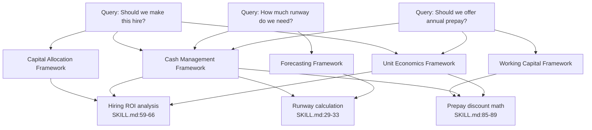
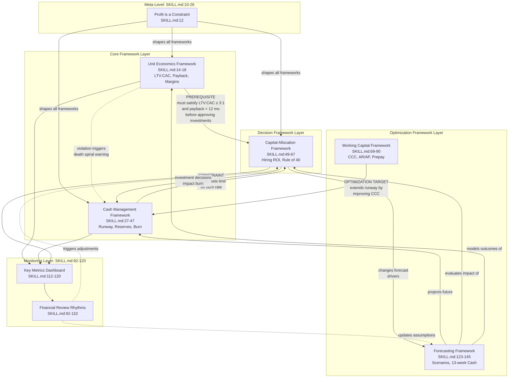
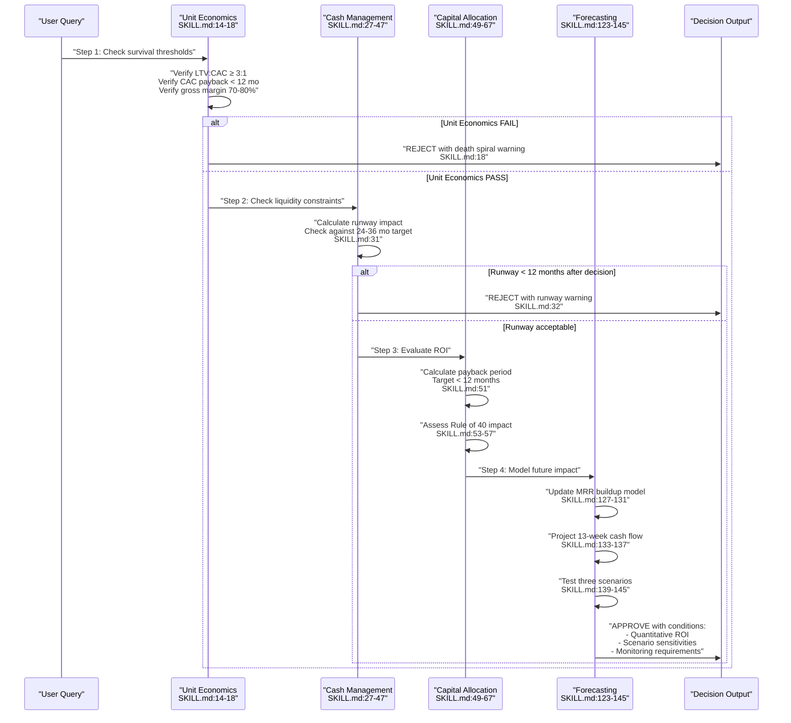
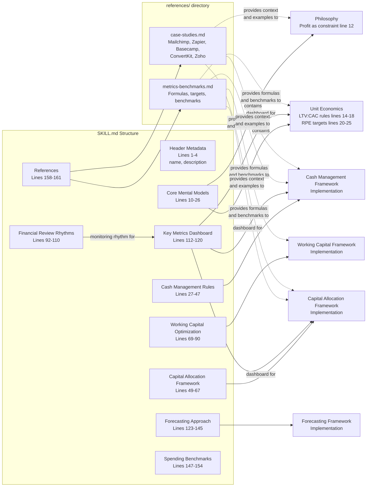
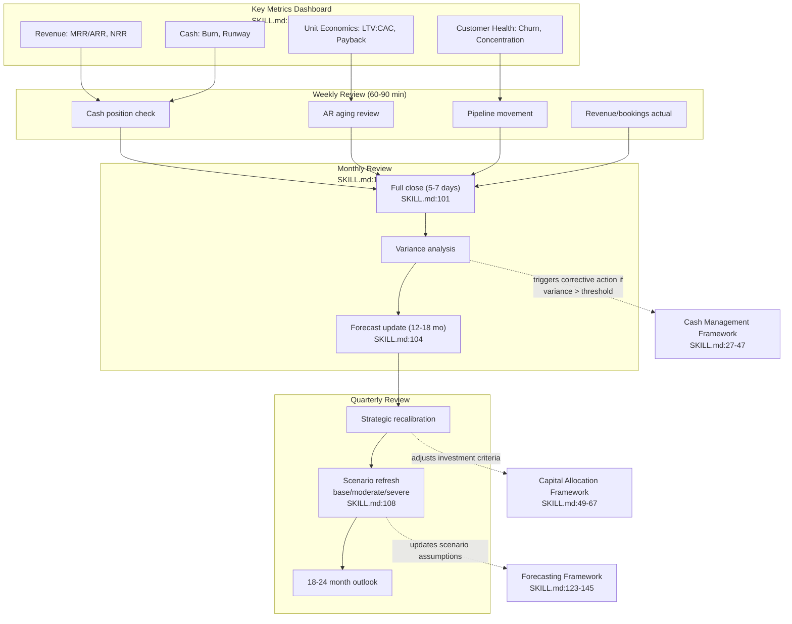

<!-- source: DeepWiki mcp.deepwiki.com · repo EveryInc/charlie-cfo-skill · page 3 The Five Financial Frameworks · fetched 2026-10-26 -->

# The Five Financial Frameworks

<details>
<summary>Relevant source files</summary>

The following files were used as context for generating this wiki page:

- [README.md](README.md)
- [SKILL.md](SKILL.md)

</details>


## Purpose and Scope

This document provides an overview of Charlie's five integrated financial frameworks that form the analytical foundation of the CFO skill. These frameworks are not independent tools but an interconnected system with hard dependencies and feedback loops that ensure coherent financial decision-making for bootstrapped startups.

The five frameworks are:

1. **Cash Management** — Runway, reserves, and burn rate analysis
2. **Unit Economics** — LTV:CAC ratios, payback periods, and margin targets
3. **Capital Allocation** — Investment decisions, hiring ROI, and growth vs. profitability trade-offs
4. **Working Capital Optimization** — Cash conversion cycle, AR/AP management, and prepayment strategies
5. **Forecasting** — Driver-based planning, scenario modeling, and 13-week cash flow

For detailed implementation of each framework, see their respective child pages ([3.1](#3.1), [3.2](#3.2), [3.3](#3.3), [3.4](#3.4), [3.5](#3.5)). For the underlying philosophy that shapes these frameworks, see [Core Philosophy and Mental Models](#2). For practical application guides, see [Decision-Making Guides](#4).

**Sources:** [README.md:11-15](), [SKILL.md:1-4]()

## Framework Overview and Purpose

Each framework serves a distinct analytical purpose while contributing to a unified decision-making system:

| Framework | Primary Function | Key Outputs | SKILL.md Location |
|-----------|------------------|-------------|-------------------|
| **Cash Management** | Survival analysis and liquidity monitoring | Runway calculations, reserve allocation, burn metrics | [SKILL.md:27-47]() |
| **Unit Economics** | Business model viability assessment | LTV:CAC ratio, CAC payback period, gross margin | [SKILL.md:14-18]() |
| **Capital Allocation** | Investment prioritization and ROI analysis | Hiring decisions, Rule of 40 positioning, payback requirements | [SKILL.md:49-67]() |
| **Working Capital** | Cash efficiency optimization | Cash conversion cycle, DSO/DPO targets, prepay strategies | [SKILL.md:69-90]() |
| **Forecasting** | Future state modeling and planning | Driver-based projections, scenario analysis, 13-week cash flow | [SKILL.md:123-145]() |

### Framework Activation Pattern

Charlie selects relevant frameworks based on query intent. A single financial question often activates multiple frameworks simultaneously:



**Sources:** [SKILL.md:3-4](), [README.md:27-31]()

## Framework Integration Architecture

The five frameworks form a dependency graph where certain frameworks act as **prerequisites** for others, while some provide **constraints** and others serve as **optimization targets**.



**Sources:** [SKILL.md:10-145](), [README.md:11-15]()

### Hard Dependencies and Enforcement Rules

Charlie enforces specific precedence relationships between frameworks to prevent financially unsound decisions:

1. **Unit Economics Gates Capital Allocation**: No investment approval without satisfying:
   - LTV:CAC ≥ 3:1 ([SKILL.md:16]())
   - CAC payback < 12 months ([SKILL.md:17]())
   - Violation = "death spiral" that bootstrapped companies cannot survive ([SKILL.md:18]())

2. **Cash Management Constrains All Decisions**: Every decision evaluated against:
   - Minimum 24-36 month runway target ([SKILL.md:31]())
   - Danger zone at <12 months ([SKILL.md:32]())
   - Three-tier reserve structure ([SKILL.md:35-40]())

3. **Working Capital Optimizes Cash**: Improvements in working capital directly extend runway:
   - Every 10-day CCC reduction frees working capital ([SKILL.md:73]())
   - Annual prepay provides 0% financing from customers ([SKILL.md:89]())

4. **Forecasting Integrates All**: The forecasting framework receives inputs from all other frameworks:
   - Driver-based planning uses unit economics assumptions ([SKILL.md:125]())
   - 13-week cash flow reflects burn and capital allocation decisions ([SKILL.md:133-137]())
   - Three scenarios model downside cases ([SKILL.md:139-145]())

**Sources:** [SKILL.md:14-18](), [SKILL.md:29-33](), [SKILL.md:51](), [SKILL.md:69-90](), [SKILL.md:123-145]()

## Decision Flow Through Frameworks

When processing a financial query, Charlie routes the decision through frameworks in a specific sequence based on the dependency architecture:



**Sources:** [SKILL.md:14-18](), [SKILL.md:27-47](), [SKILL.md:49-67](), [SKILL.md:123-145]()

## Framework Implementation Structure

The frameworks are implemented across the SKILL.md specification through distinct sections with specific rule definitions:

### Implementation Map



**Sources:** [SKILL.md:1-161](), [README.md:43-48]()

### Code Entity Mapping

The following table maps conceptual framework names to their actual implementation locations in the codebase:

| Framework | Primary Implementation | Supporting Definitions | Reference Materials |
|-----------|----------------------|------------------------|---------------------|
| **Unit Economics** | [SKILL.md:14-18]() (embedded in Core Mental Models) | [SKILL.md:114-119]() (metrics dashboard row), [SKILL.md:20-25]() (RPE targets) | [references/metrics-benchmarks.md]() (section: LTV, CAC, NRR calculations) |
| **Cash Management** | [SKILL.md:27-47]() (dedicated section) | [SKILL.md:35-40]() (reserve structure table), [SKILL.md:42-47]() (burn multiple) | [references/metrics-benchmarks.md]() (section: Cash Flow Metrics) |
| **Capital Allocation** | [SKILL.md:49-67]() (dedicated section) | [SKILL.md:53-57]() (Rule of 40), [SKILL.md:59-66]() (hiring framework) | [references/case-studies.md]() (hiring examples from Zapier, Basecamp) |
| **Working Capital** | [SKILL.md:69-90]() (dedicated section) | [SKILL.md:70-73]() (CCC formula), [SKILL.md:85-89]() (prepay discount mechanics) | [references/metrics-benchmarks.md]() (section: Working Capital Metrics) |
| **Forecasting** | [SKILL.md:123-145]() (dedicated section) | [SKILL.md:127-131]() (MRR buildup model), [SKILL.md:133-137]() (13-week cash flow) | [references/metrics-benchmarks.md]() (section: Financial Planning) |

**Sources:** [SKILL.md:10-145](), [README.md:43-48]()

## Framework Interaction Patterns

The frameworks interact through three primary patterns:

### Pattern 1: Sequential Gating (Prerequisite Check)

Unit Economics acts as a gate before Capital Allocation decisions. Implementation:

```
Decision Request
    ↓
Check Unit Economics [SKILL.md:14-18]
    ├─ LTV:CAC < 3:1? → REJECT (death spiral warning)
    ├─ CAC payback > 12 mo? → REJECT (death spiral warning)
    └─ Both pass? → Proceed to Capital Allocation [SKILL.md:49-67]
        ↓
    Evaluate payback period [SKILL.md:51]
    Assess Rule of 40 impact [SKILL.md:53-57]
        ↓
    DECISION
```

**Sources:** [SKILL.md:14-18](), [SKILL.md:49-67]()

### Pattern 2: Constraint Enforcement (Boundary Setting)

Cash Management sets hard boundaries that constrain other frameworks. Implementation:

```
Current State:
    Cash balance: $X
    Monthly burn: $Y
    Calculated runway: X/Y months [SKILL.md:31]
    
Constraint Application:
    IF runway < 24 months → Hiring freeze [SKILL.md:31]
    IF runway < 12 months → "Lost control" state [SKILL.md:32]
    
Investment Evaluation:
    Proposed decision would increase burn by $Z
    New runway: X/(Y+Z)
    IF new runway < 24 months → REJECT
```

**Sources:** [SKILL.md:27-47]()

### Pattern 3: Optimization Feedback (Continuous Improvement)

Working Capital improvements feed back into Cash Management. Implementation:

```
Baseline State [SKILL.md:70-73]:
    DSO (Days Sales Outstanding): 60 days
    DPO (Days Payable Outstanding): 30 days
    DIO (Days Inventory Outstanding): 0 days (SaaS)
    CCC = DSO + DIO - DPO = 30 days
    
Optimization Applied [SKILL.md:75-89]:
    Implement AR discipline → DSO reduced to 40 days
    Negotiate AP terms → DPO increased to 45 days
    Offer annual prepay → 30% choose prepay
    
New State:
    CCC = 40 + 0 - 45 = -5 days (negative cycle)
    Working capital freed: 35 days × daily burn rate
    
Impact on Cash Management:
    Freed capital → Runway extended [SKILL.md:31]
    Prepay collected → Growth reserve increased [SKILL.md:35-40]
```

**Sources:** [SKILL.md:69-90](), [SKILL.md:27-47]()

## Monitoring and Feedback Loops

The frameworks are monitored through a structured review rhythm that creates feedback loops for continuous adjustment:



**Sources:** [SKILL.md:92-120]()

## Framework Selection Logic

Charlie automatically selects relevant frameworks based on query keywords and intent recognition. The selection logic (implemented through Claude Code's NLP layer, see [1.2](#1.2)) maps to specific framework combinations:

| Query Pattern | Activated Frameworks | Rationale |
|--------------|---------------------|-----------|
| "Should we hire..." | Capital Allocation + Unit Economics + Cash Management | Hiring is an investment requiring ROI check ([SKILL.md:59-66]()), unit economics validation ([SKILL.md:14-18]()), and runway impact ([SKILL.md:27-47]()) |
| "How much runway..." | Cash Management + Forecasting | Runway calculation ([SKILL.md:31]()) requires current burn and projected cash flow ([SKILL.md:133-137]()) |
| "What's a healthy LTV:CAC..." | Unit Economics | Direct metric interpretation query ([SKILL.md:16]()) |
| "Should we offer prepay..." | Working Capital + Cash Management + Unit Economics | Prepay affects CCC ([SKILL.md:85-89]()), extends runway ([SKILL.md:73]()), and improves LTV ([SKILL.md:87]()) |
| "How do I forecast..." | Forecasting + All Others | Forecasting integrates all framework outputs ([SKILL.md:125]()) |
| "What metrics should I track..." | All Frameworks + Dashboard | Requires comprehensive metrics from dashboard ([SKILL.md:112-120]()) spanning all frameworks |

**Sources:** [SKILL.md:1-4](), [SKILL.md:14-145](), [README.md:27-31]()

## Summary: Framework Integration Principles

The five frameworks operate as an integrated system governed by four key principles:

1. **Hierarchical Gating**: Unit Economics must be satisfied before Capital Allocation decisions can be approved
2. **Constraint Propagation**: Cash Management sets boundaries that constrain all investment and spending decisions
3. **Optimization Feedback**: Working Capital improvements directly extend Cash Management runway
4. **Comprehensive Integration**: Forecasting models the combined output of all frameworks under multiple scenarios

This architecture ensures that Charlie cannot provide advice that violates fundamental financial constraints, even when optimizing for secondary objectives. The system enforces financial discipline through its structure rather than relying solely on LLM reasoning.

For implementation details of each framework, see their respective detailed pages: [Cash Management](#3.1), [Unit Economics](#3.2), [Capital Allocation](#3.3), [Working Capital Optimization](#3.4), [Forecasting](#3.5).

**Sources:** [SKILL.md:10-145](), [README.md:1-58]()

---

