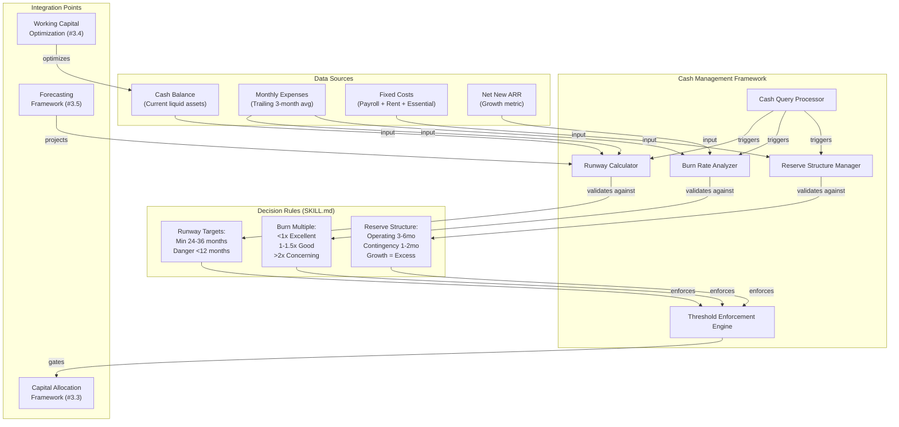
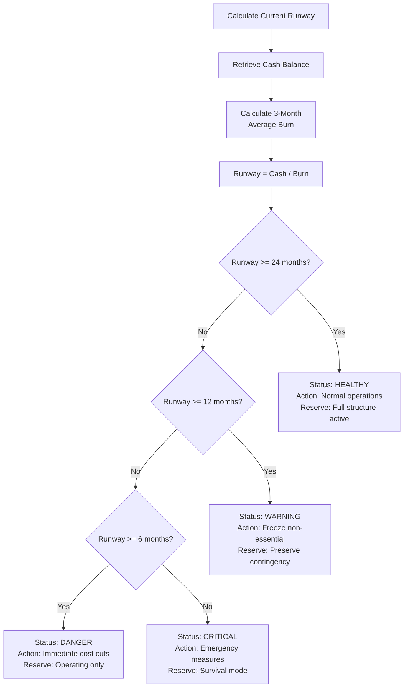
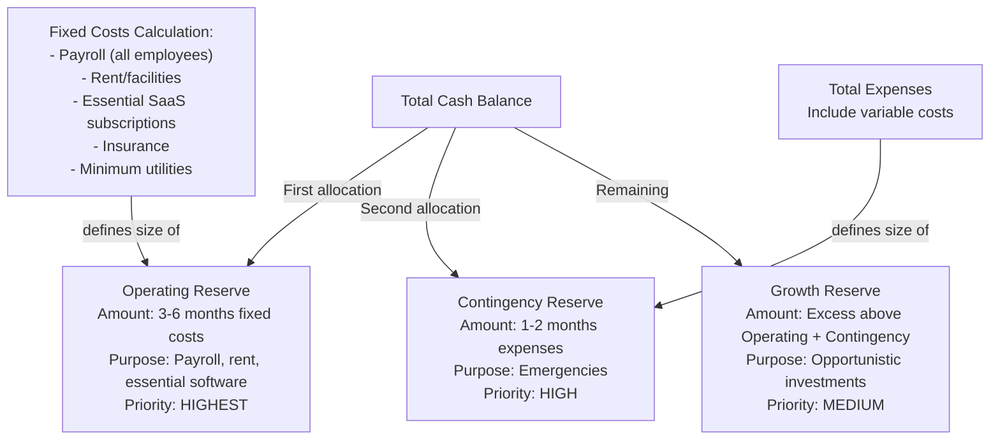
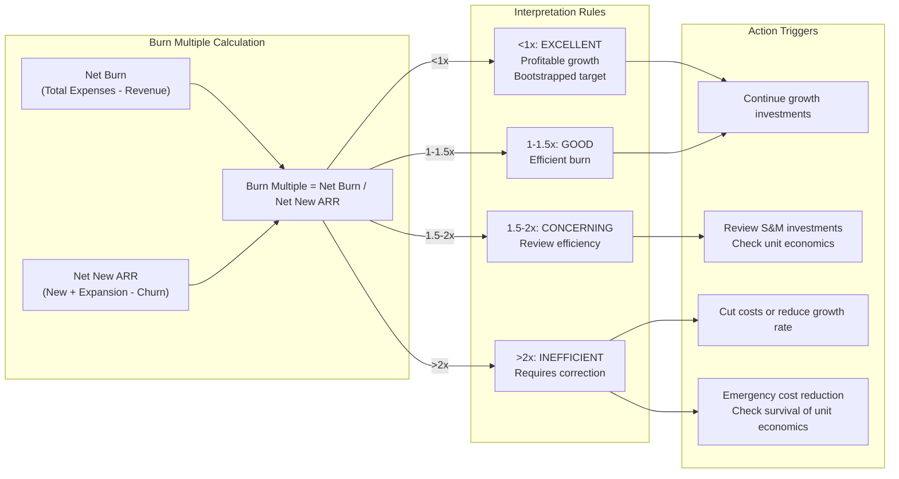
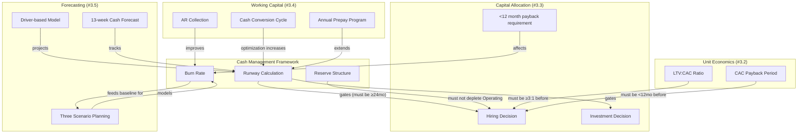
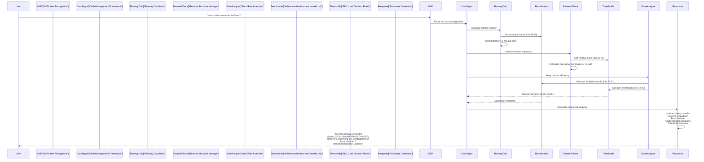

<!-- source: DeepWiki mcp.deepwiki.com · repo EveryInc/charlie-cfo-skill · page 3.1 Cash Management Framework · fetched 2026-10-26 -->

# Cash Management Framework

<details>
<summary>Relevant source files</summary>

The following files were used as context for generating this wiki page:

- [SKILL.md](SKILL.md)
- [references/metrics-benchmarks.md](references/metrics-benchmarks.md)

</details>


## Purpose and Scope

This document provides technical documentation for Charlie's Cash Management Framework, which forms the foundation for all financial decision-making in bootstrapped startups. The framework covers runway calculations, reserve structure management, burn rate analysis, and the burn multiple metric.

For working capital optimization (AR/AP management, cash conversion cycle), see [Working Capital Optimization](#3.4). For long-term cash forecasting and scenario planning, see [Forecasting Approach](#3.5). For how cash management gates investment decisions, see [Capital Allocation Framework](#3.3).

**Sources:** [SKILL.md:27-47](), [references/metrics-benchmarks.md:64-88]()

## Overview

Charlie's Cash Management Framework treats cash preservation as the primary survival constraint for bootstrapped companies. Unlike venture-backed companies that can fundraise out of cash crises, bootstrapped companies must maintain continuous positive cash dynamics or face immediate existential risk.

The framework enforces three core principles defined in [SKILL.md:12]():
1. **Every dollar has three costs:** direct expenditure, opportunity cost, and runway impact
2. **Minimum runway threshold:** 24-36 months for operational control
3. **Danger zone:** <12 months runway indicates lost control

**Key Metrics:**

| Metric | Formula | Target | Danger Zone |
|--------|---------|--------|-------------|
| Runway | Cash Balance / Monthly Burn | 24-36 months | <12 months |
| Burn Multiple | Net Burn / Net New ARR | <1x (negative for bootstrapped) | >2x |
| Operating Reserve | 3-6 months fixed costs | Full coverage | <3 months |

**Sources:** [SKILL.md:29-47](), [references/metrics-benchmarks.md:66-81]()

## System Architecture

### Cash Management Component Structure



**Description:** This diagram shows how Charlie's cash management components interact with data sources, decision rules defined in SKILL.md, and other frameworks. The Threshold Enforcement Engine acts as a gatekeeper for capital allocation decisions based on runway and burn metrics.

**Sources:** [SKILL.md:27-47](), [SKILL.md:49-66](), [references/metrics-benchmarks.md:64-88]()

## Runway Calculations

### Calculation Methodology

Charlie implements runway calculations using a trailing 3-month average for burn rate accuracy, as specified in [references/metrics-benchmarks.md:66-70]():

```
Runway (months) = Cash Balance / Monthly Burn Rate
where Monthly Burn Rate = Average(Last 3 Months Net Burn)
```

### Runway Thresholds and Interpretation



**Description:** Runway calculation flow and threshold-based decision tree. Charlie enforces the principle from [SKILL.md:32]() that <12 months runway means "you've lost control."

**Sources:** [SKILL.md:29-33](), [references/metrics-benchmarks.md:66-70]()

### Runway Tracking in Financial Reviews

Runway is monitored according to the review rhythms defined in [SKILL.md:92-110]():

| Review Frequency | Runway Check | Action Threshold |
|------------------|--------------|------------------|
| Weekly (60-90 min) | Cash position review | <18 months: Flag for monthly review |
| Monthly | Full runway recalculation | <15 months: Scenario planning required |
| Quarterly | 18-24 month outlook | <12 months: Emergency planning |

**Sources:** [SKILL.md:92-110]()

## Reserve Structure Management

### Three-Tier Reserve System

Charlie implements a three-tier reserve structure as defined in [SKILL.md:35-40]():



**Description:** The reserve structure prioritizes survival (Operating), resilience (Contingency), then growth (excess). This hierarchy gates all spending decisions processed by Charlie's Capital Allocation Framework.

**Sources:** [SKILL.md:35-40]()

### Reserve Adequacy Assessment

| Reserve Type | Minimum | Target | Trigger Action If Below Minimum |
|--------------|---------|--------|----------------------------------|
| Operating | 3 months fixed costs | 6 months fixed costs | Immediate hiring freeze + non-essential cost cuts |
| Contingency | 1 month total expenses | 2 months total expenses | Defer all growth investments |
| Growth | $0 | Variable | Evaluate all pending capital allocation decisions |

**Charlie's Rule:** Any capital allocation decision that would reduce Operating or Contingency reserves below minimum triggers automatic rejection or requires explicit override justification.

**Sources:** [SKILL.md:35-40](), [SKILL.md:49-66]()

## Burn Rate Analysis

### Net Burn vs. Gross Burn

Charlie distinguishes between two burn measures:

**Net Burn (Primary Metric):**
```
Net Burn = Total Expenses - Total Revenue
```
Used for runway calculations and burn multiple calculations.

**Gross Burn:**
```
Gross Burn = Total Expenses (regardless of revenue)
```
Used for reserve structure calculations (Operating and Contingency based on gross burn capacity).

**Sources:** [references/metrics-benchmarks.md:66-81]()

### Burn Multiple Metric

The burn multiple measures capital efficiency relative to growth, as defined in [SKILL.md:42-47]() and [references/metrics-benchmarks.md:72-81]():

```
Burn Multiple = Net Burn / Net New ARR
```



**Description:** Burn multiple decision tree showing how Charlie interprets efficiency and triggers actions. For bootstrapped companies, the target is actually negative (profitable growth), as stated in [SKILL.md:47]().

**Sources:** [SKILL.md:42-47](), [references/metrics-benchmarks.md:72-81]()

### Burn Analysis Integration with Unit Economics

Charlie enforces a critical dependency: burn rate analysis must validate unit economics health before approving any growth investments. This is implemented through the principle from [SKILL.md:14-18]():

| Scenario | Unit Economics | Burn Multiple | Charlie's Guidance |
|----------|----------------|---------------|-------------------|
| Healthy growth | LTV:CAC ≥ 3:1, Payback <12mo | <1.5x | Approve growth investments |
| Efficient burn, weak economics | LTV:CAC <3:1 OR Payback >12mo | <1.5x | **Reject growth**—fix unit economics first |
| Death spiral | LTV:CAC <3:1 | >1.5x | **Emergency**: Immediate cost cuts + pricing/product fixes |
| Profitable but slow | LTV:CAC ≥5:1, Payback <6mo | <0 (profitable) | Consider increasing S&M investment |

**Sources:** [SKILL.md:14-18](), [SKILL.md:42-47]()

## Integration with Other Frameworks

### Cross-Framework Dependencies



**Description:** This diagram shows how Cash Management acts as a gating function for Capital Allocation (section 3.3) and receives optimization inputs from Working Capital (section 3.4) and projection inputs from Forecasting (section 3.5). The runway threshold of 24+ months must be maintained before approving investments.

**Sources:** [SKILL.md:27-47](), [SKILL.md:49-66](), [SKILL.md:68-89]()

### Working Capital Impact on Cash Management

Working capital optimization directly extends runway through three mechanisms defined in [SKILL.md:68-89]():

1. **Cash Conversion Cycle (CCC) Reduction**
   - Target: Negative CCC (-30 to -90 days for SaaS)
   - Every 10-day reduction in CCC frees significant working capital
   - Directly increases cash balance numerator in runway calculation

2. **AR Discipline**
   - Target DSO: 30-45 days
   - Collection process defined in [SKILL.md:75-78]()
   - Faster collections reduce cash trapped in receivables

3. **Annual Prepay Programs**
   - 15-20% discount for annual prepay
   - Customers effectively provide 0% interest financing
   - Immediate cash infusion extends runway by 8-12 months for established companies

**Sources:** [SKILL.md:68-89](), [references/metrics-benchmarks.md:113-137]()

## Implementation in Charlie's Query Processing

### Cash Management Query Routing

When Charlie receives financial queries, the NLP layer routes cash-related questions to the Cash Management Framework. Query patterns include:

- "How much runway do we have?"
- "Should we make this hire?" (triggers runway impact analysis)
- "What's our burn rate?"
- "Do we have enough reserves?"
- "Can we afford this investment?"

**Processing Flow:**



**Description:** This sequence diagram shows how Charlie processes a runway query by coordinating between calculation engines, validating against thresholds in SKILL.md, and retrieving formulas from references/metrics-benchmarks.md.

**Sources:** [SKILL.md:27-47](), [references/metrics-benchmarks.md:66-88]()

### Decision Rule Enforcement

Charlie enforces cash management thresholds as **hard constraints** on capital allocation decisions. The enforcement logic operates as follows:

**Hiring Decision Gating Logic:**

```
IF Runway < 24 months:
    REJECT with message: "Insufficient runway. Current: X months, Required: 24+ months"
    
ELSE IF Operating_Reserve < 3 * Fixed_Monthly_Costs:
    REJECT with message: "Operating reserve inadequate. Must maintain 3+ months before new hires"
    
ELSE IF (Runway_After_Hire = Runway - (Annual_Salary/12) / Burn_Rate) < 18 months:
    REJECT with message: "Hire would reduce runway below 18 months. Calculate ROI and time-to-productivity"
    
ELSE:
    PROCEED to Unit Economics validation (see #3.2)
```

**Investment Decision Gating Logic:**

```
IF Runway < 24 months:
    REQUIRE payback < 6 months (stricter than normal <12 months)
    
ELSE IF Investment would deplete Contingency_Reserve:
    REJECT with message: "Investment would compromise contingency reserve"
    
ELSE IF Burn_Multiple > 1.5x:
    REQUIRE Investment to improve burn multiple (e.g., efficiency tooling)
    
ELSE:
    APPLY standard <12 month payback requirement (see #3.3)
```

**Sources:** [SKILL.md:49-66](), [SKILL.md:27-47]()

## Scenario Planning and Stress Testing

### Three-Scenario Runway Analysis

Charlie implements three-scenario planning as defined in [SKILL.md:139-145]() to stress-test runway under different conditions:

| Scenario | Revenue Assumption | Runway Calculation | Action Thresholds |
|----------|-------------------|-------------------|-------------------|
| Base Case | Expected trajectory | Standard runway formula | Monitor at 18 months |
| Moderate Downside | -15-20% revenue | Runway with reduced revenue | Action plan at 15 months |
| Severe Downside | -30-40% revenue | Worst-case runway | Emergency plan at 12 months |

For each scenario, Charlie calculates:
1. **Projected runway** with adjusted revenue
2. **Reserve depletion timeline** (when Operating Reserve runs out)
3. **Action thresholds** for cost reductions
4. **Runway extension options** (AR acceleration, prepay programs, cost cuts)

**Sources:** [SKILL.md:139-145]()

### Quarterly Review Integration

During quarterly reviews ([SKILL.md:106-110]()), Charlie refreshes the three-scenario analysis and updates:
- Burn rate assumptions based on trailing 3-month actuals
- Revenue growth rates based on latest performance
- Cost structure changes from hiring or investment decisions
- Working capital improvements from CCC optimization

**Sources:** [SKILL.md:106-110](), [SKILL.md:139-145]()

## Key Metrics Dashboard Integration

Cash Management metrics appear in the Key Metrics Dashboard defined in [SKILL.md:113-121]():

| Category | Metrics | Targets | Dashboard Frequency |
|----------|---------|---------|---------------------|
| Cash | Burn rate, Runway, Operating cash flow | Runway 24-36 months | Weekly (cash position), Monthly (full analysis) |
| Burn Multiple | Net Burn / Net New ARR | <1x for bootstrapped | Monthly |
| Reserve Status | Operating/Contingency/Growth allocation | Operating ≥3 months, Contingency ≥1 month | Weekly |

**Customer Concentration Warning:** Charlie also monitors customer concentration risk ([SKILL.md:121]()) as it directly impacts cash stability—any customer >10% of revenue or top 5 >25% creates cash flow vulnerability.

**Sources:** [SKILL.md:113-121]()

## Summary of Key Implementation Details

1. **Runway calculation uses trailing 3-month average burn** for accuracy ([references/metrics-benchmarks.md:70]())
2. **Three-tier reserve structure** enforced as hard constraints ([SKILL.md:35-40]())
3. **24-month minimum runway** gates all capital allocation decisions ([SKILL.md:29]())
4. **Burn multiple target <1x** for bootstrapped companies (actual target: negative/profitable) ([SKILL.md:47]())
5. **Weekly cash position reviews** maintain tight feedback loops ([SKILL.md:93-98]())
6. **Integration with unit economics** prevents growth investments with broken economics ([SKILL.md:14-18]())
7. **Working capital optimization** extends runway through CCC reduction and prepay programs ([SKILL.md:68-89]())
8. **Three-scenario planning** provides stress-tested runway projections ([SKILL.md:139-145]())

**Sources:** [SKILL.md:27-145](), [references/metrics-benchmarks.md:66-88]()

---

