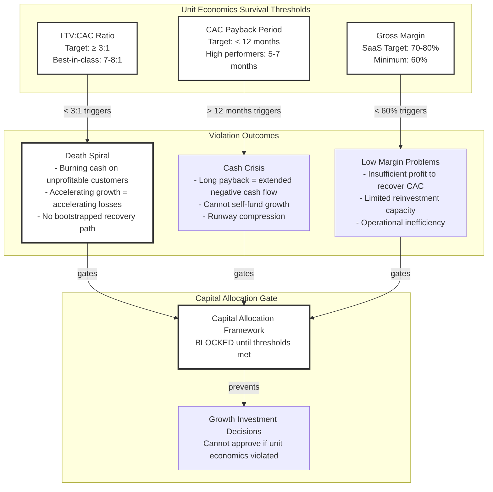
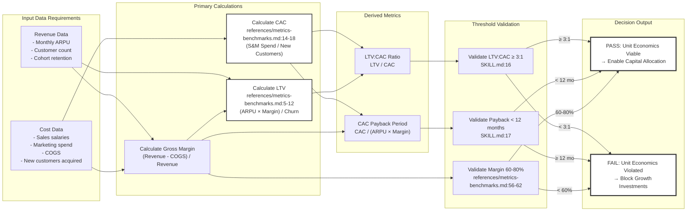
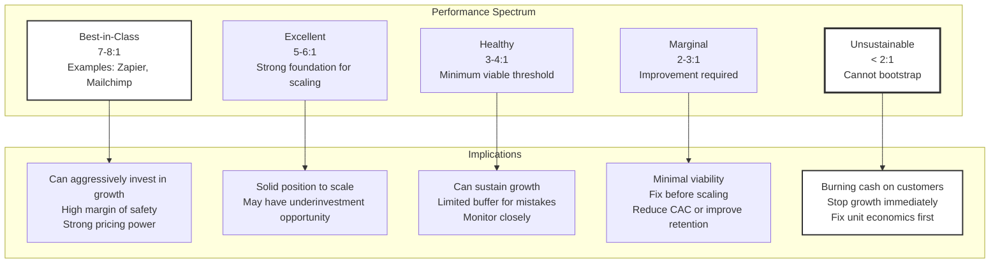
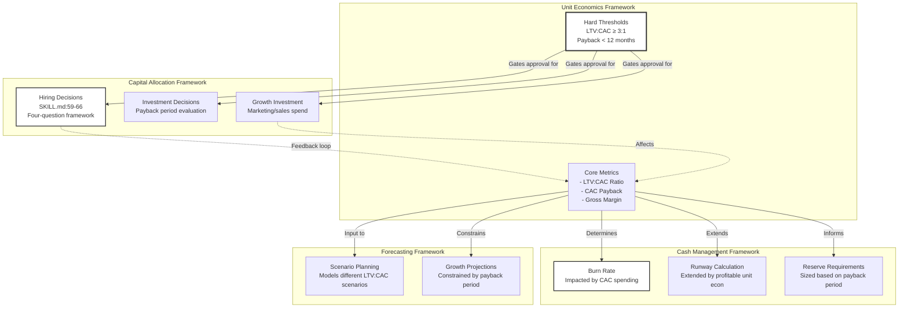

<!-- source: DeepWiki mcp.deepwiki.com · repo EveryInc/charlie-cfo-skill · page 3.2 Unit Economics Framework · fetched 2026-10-26 -->

# Unit Economics Framework

<details>
<summary>Relevant source files</summary>

The following files were used as context for generating this wiki page:

- [SKILL.md](SKILL.md)
- [references/metrics-benchmarks.md](references/metrics-benchmarks.md)

</details>


## Purpose and Scope

This document provides comprehensive technical documentation of the Unit Economics Framework within Charlie CFO Skill. Unit economics quantify the relationship between customer value and customer acquisition cost, determining whether a business model is fundamentally viable. This framework calculates and interprets four core metrics: Lifetime Value (LTV), Customer Acquisition Cost (CAC), LTV:CAC ratio, and CAC Payback Period.

Unit economics serve as **survival requirements** in Charlie's architecture—they gate Capital Allocation decisions and must be satisfied before growth investments are approved. This differs from treating them as aspirational targets. For broader philosophical context on why this constraint-based approach exists, see [Profit as a Constraint, Not a Goal](#2.1) and [Unit Economics as Survival Requirements](#2.2). For applying these metrics to hiring decisions, see [Evaluating Hiring Decisions](#4.1). For detailed formula references, see [Unit Economics Calculations](#5.1.1).

Sources: [SKILL.md:14-18](), [references/metrics-benchmarks.md:3-32]()

---

## Core Metric Definitions and Calculations

The Unit Economics Framework consists of four interdependent metrics that collectively determine business model viability.

### Lifetime Value (LTV)

```
LTV = (ARPU × Gross Margin) / Monthly Churn Rate
```

**Alternative cohort-based calculation:**
```
LTV = Sum of (Monthly Revenue × Retention Rate) over customer lifetime
```

LTV represents the net profit expected from a customer over their entire relationship with the company. The gross margin adjustment is critical—it accounts for only the profit available after direct costs of service delivery.

**Key variables:**
- `ARPU`: Average Revenue Per User (monthly)
- `Gross Margin`: Revenue minus direct costs of goods sold (COGS), expressed as percentage
- `Monthly Churn Rate`: Percentage of customers lost per month

Sources: [references/metrics-benchmarks.md:5-12]()

### Customer Acquisition Cost (CAC)

```
CAC = (Sales + Marketing Spend) / New Customers Acquired
```

**Included costs:**
- Salaries and commissions for sales and marketing personnel
- Advertising spend (paid channels, sponsorships)
- Marketing tools and software (CRM, automation, analytics)
- Events and conferences
- Content production costs

CAC must include **fully loaded costs**—not just direct advertising spend. Failing to include salaries and overhead creates artificially low CAC figures that mask unsustainable economics.

Sources: [references/metrics-benchmarks.md:14-18]()

### CAC Payback Period

```
CAC Payback (months) = CAC / (Monthly ARPU × Gross Margin)
```

This metric answers: "How many months until we recover the cost of acquiring this customer?"

**Why gross margin matters:** Only the profit portion of revenue contributes to recovering CAC. A company with $100/month ARPU but 40% gross margin only generates $40/month in profit to recover acquisition costs.

Sources: [references/metrics-benchmarks.md:20-23]()

### LTV:CAC Ratio

```
LTV:CAC Ratio = LTV / CAC
```

This ratio quantifies the return on investment for customer acquisition. It directly determines growth sustainability.

| Ratio | Interpretation | Action |
|-------|----------------|--------|
| <1:1 | Losing money on every customer | Immediate crisis—stop acquisition or fix unit economics |
| 1-2:1 | Unsustainable for bootstrapped companies | Need fundamental improvement before scaling |
| 3:1 | **Minimum healthy threshold** | Acceptable for growth |
| 5:1+ | Excellent | May indicate underinvestment in growth opportunities |
| 7-8:1 | Best-in-class | Strong foundation for aggressive scaling |

Sources: [SKILL.md:14-18](), [references/metrics-benchmarks.md:25-32]()

---

## Survival Thresholds and Hard Constraints



**Diagram: Unit Economics as Gating Constraints for Capital Allocation**

The thresholds are **hard constraints**, not targets. Charlie treats these as survival requirements because violating them creates unrecoverable situations for bootstrapped companies:

**LTV:CAC < 3:1 Death Spiral:**
- Each customer acquired destroys value
- Growing faster = losing money faster
- No external capital source to subsidize losses
- Only path: fix unit economics or shut down

**Payback > 12 months Cash Crisis:**
- Extended negative cash flow period
- Cannot self-fund growth from customer revenue
- Runway compression with every new customer
- Forces growth slowdown regardless of opportunity

**Low Gross Margin < 60%:**
- Insufficient profit to recover CAC in reasonable timeframe
- Service delivery costs constrain scaling
- Indicates operational or pricing problems

Sources: [SKILL.md:14-18](), Diagram 4 from architecture overview

---

## Metric Calculation Workflow



**Diagram: Unit Economics Calculation and Validation Pipeline**

This workflow demonstrates the dependency chain from raw financial data to actionable pass/fail decisions. Note that gross margin appears in both LTV and payback calculations, making it a critical input variable.

Sources: [references/metrics-benchmarks.md:3-32](), [SKILL.md:14-18]()

---

## Gross Margin Targets by Business Model

Gross margin is a critical component of both LTV and payback calculations. Different business models have different achievable margins due to their cost structures.

| Business Type | Target Gross Margin | Interpretation |
|---------------|---------------------|----------------|
| Pure SaaS | 75-85% | Minimal COGS, highly scalable |
| SaaS + Services | 60-70% | Services drag down margin |
| Marketplace | 40-60% | Transaction costs and support |
| Hardware + Software | 30-50% | Physical goods constrain margin |

**Why margin matters:**

A SaaS company with 80% margin generates $80 profit per $100 revenue. A marketplace with 50% margin generates only $50 profit per $100 revenue. This directly impacts:

1. **LTV calculation:** Lower margin → lower LTV
2. **Payback period:** Lower margin → longer payback
3. **Growth capacity:** Lower margin → less cash to reinvest

Sources: [references/metrics-benchmarks.md:56-62]()

---

## Benchmark Performance Tiers

### LTV:CAC Ratio Performance Tiers



**Diagram: LTV:CAC Performance Tiers and Strategic Implications**

Sources: [references/metrics-benchmarks.md:25-32](), [SKILL.md:16]()

### CAC Payback Period Performance Tiers

| Payback Period | Rating | Strategic Implication |
|----------------|--------|-----------------------|
| 5-7 months | High performers | Can scale quickly, cash flow positive fast |
| 8-10 months | Good | Manageable cash flow impact |
| 10-12 months | Acceptable | At threshold—monitor carefully |
| 12-18 months | Concerning | Extended negative cash flow, slows growth |
| >18 months | Unsustainable | Cannot bootstrap effectively |

**Why 12 months is the threshold:**

Bootstrapped companies must self-fund growth. A 12-month payback means:
- One full year of negative cash flow per customer
- Requires 12 months of cash reserves to fund one cohort
- Growth rate limited by ability to finance extended payback
- Beyond 12 months, cash constraints become binding

Sources: [SKILL.md:17](), [references/metrics-benchmarks.md:20-23]()

---

## Common Calculation Pitfalls

### 1. Incomplete CAC Calculation

**Incorrect:**
```
CAC = Ad Spend / New Customers
```

**Correct:**
```
CAC = (Sales Salaries + Sales Commissions + Marketing Salaries + 
       Ad Spend + Marketing Tools + Events + Content Production) / New Customers
```

Many companies only include direct ad spend, creating artificially low CAC figures that mask unsustainable economics.

### 2. Wrong Churn Rate in LTV

**Problem:** Using annual churn rate in monthly LTV formula

**Incorrect:**
```
LTV = (Monthly ARPU × Gross Margin) / Annual Churn Rate
```

**Correct:**
```
LTV = (Monthly ARPU × Gross Margin) / Monthly Churn Rate
```

Or convert: `Monthly Churn ≈ 1 - (1 - Annual Churn)^(1/12)`

### 3. Ignoring Gross Margin

**Incorrect:**
```
CAC Payback = CAC / Monthly ARPU
```

**Correct:**
```
CAC Payback = CAC / (Monthly ARPU × Gross Margin)
```

Only the profit portion recovers CAC. Without gross margin adjustment, payback appears artificially short.

### 4. Cohort Inconsistency

**Problem:** Calculating CAC from Q1 but LTV from Q4 data

**Solution:** Use matching cohorts. CAC for January customers should pair with LTV calculated from January customer behavior.

Sources: [references/metrics-benchmarks.md:3-32]()

---

## Integration with Other Frameworks



**Diagram: Unit Economics Integration Points with Other Frameworks**

### Capital Allocation Gating

Unit economics must satisfy thresholds **before** Capital Allocation Framework approves:
- New hires in sales/marketing
- Increased marketing spend
- Channel expansion investments

This prevents scaling broken unit economics—a death spiral for bootstrapped companies.

### Cash Management Impact

**Payback period directly affects:**
- **Burn rate:** Longer payback = higher burn during customer acquisition
- **Runway requirements:** 12-month payback requires 12 months of cash reserves per growth cohort
- **Reserve sizing:** Contingency reserves must cover payback-period risk

### Forecasting Inputs

Unit economics provide critical parameters:
- LTV determines long-term revenue per customer
- Churn rate drives retention curves
- CAC determines cost of growth scenarios
- Payback period constrains achievable growth rates

Sources: Diagram 4 from architecture overview, [SKILL.md:49-66]()

---

## Practical Application Example

### Scenario: Evaluating Unit Economics Health

**Company Data:**
- Monthly ARPU: $500
- Monthly Churn: 2%
- Gross Margin: 75%
- Monthly S&M Spend: $50,000
- New Customers per Month: 20

**Step 1: Calculate CAC**
```
CAC = $50,000 / 20 = $2,500 per customer
```

**Step 2: Calculate LTV**
```
LTV = ($500 × 0.75) / 0.02 = $375 / 0.02 = $18,750
```

**Step 3: Calculate LTV:CAC Ratio**
```
LTV:CAC = $18,750 / $2,500 = 7.5:1
```

**Step 4: Calculate CAC Payback**
```
Payback = $2,500 / ($500 × 0.75) = $2,500 / $375 = 6.67 months
```

**Assessment:**

| Metric | Value | Threshold | Status |
|--------|-------|-----------|--------|
| LTV:CAC | 7.5:1 | ≥ 3:1 | ✓ PASS (Best-in-class) |
| CAC Payback | 6.67 months | < 12 months | ✓ PASS (High performer) |
| Gross Margin | 75% | 70-80% | ✓ PASS (Target range) |

**Decision:** Unit economics are strong. Capital Allocation Framework is **unblocked** for growth investments. Company can sustainably scale customer acquisition.

Sources: [references/metrics-benchmarks.md:3-32](), [SKILL.md:14-18]()

---

## Monitoring and Review Cadence

### Weekly Tracking
- New customer acquisition count
- S&M spend (current period)
- Gross margin trends (leading indicator of COGS issues)

### Monthly Deep Dive
- Full CAC calculation with loaded costs
- Cohort-level LTV analysis
- Payback period by channel
- Comparison to prior month and thresholds

### Quarterly Strategic Review
- LTV:CAC trends over 3-6 months
- Cohort retention curves
- Channel-level unit economics
- Benchmark comparison
- Threshold violation analysis and corrective actions

**Dashboard Integration:**

Unit economics appear in Key Metrics Dashboard under "Unit Economics" category:

| Metric | Target | Frequency |
|--------|--------|-----------|
| LTV:CAC | 3:1+ | Monthly |
| CAC Payback | <12 mo | Monthly |
| Gross Margin | 70-80% | Monthly |

Sources: [SKILL.md:112-119]()

---

## Threshold Violation Response Protocol

When unit economics fall below survival thresholds, immediate action is required:

### LTV:CAC < 3:1 Response

**Immediate actions:**
1. Halt all growth marketing spend
2. Freeze sales hiring
3. Diagnose root cause:
   - CAC too high? → Audit acquisition channels, reduce inefficient spend
   - LTV too low? → Analyze churn drivers, improve retention
   - Margin too low? → Review COGS, identify cost reduction opportunities

**Do not:**
- Scale growth to "make up volume"
- Continue spending on unproven channels
- Defer analysis to "gather more data"

### Payback > 12 Months Response

**Immediate actions:**
1. Calculate runway impact of current payback
2. Reduce CAC through channel optimization
3. Accelerate payback through:
   - Pricing adjustments
   - Upsell/cross-sell programs
   - Annual prepay incentives (15-20% discount)

**Cash management implications:**
- Increase reserve requirements
- Reduce growth rate to preserve cash
- Model cash flow impact of extended payback

### Low Gross Margin < 60% Response

**Immediate actions:**
1. Audit COGS components
2. Identify operational inefficiencies
3. Consider:
   - Pricing increase to improve margin
   - Service delivery optimization
   - Automation of high-cost processes

Sources: [SKILL.md:14-18](), Diagram 4 from architecture overview

---

## File References

This framework is primarily specified in:
- Core thresholds: [SKILL.md:14-18]()
- Detailed formulas: [references/metrics-benchmarks.md:3-32]()
- Gross margin targets: [references/metrics-benchmarks.md:56-62]()
- Dashboard integration: [SKILL.md:112-119]()
- Capital allocation gating: [SKILL.md:49-66]()

---

