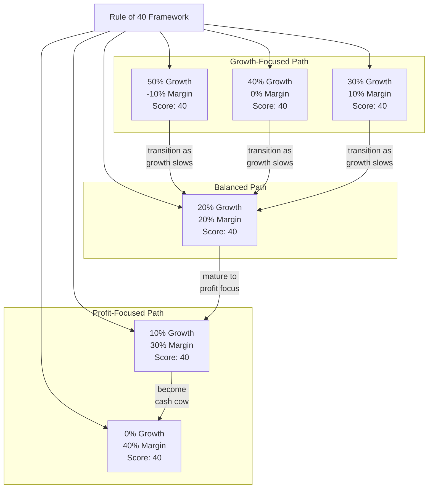
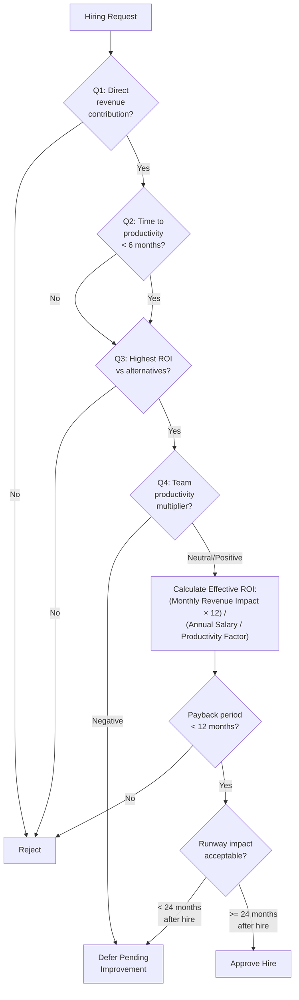
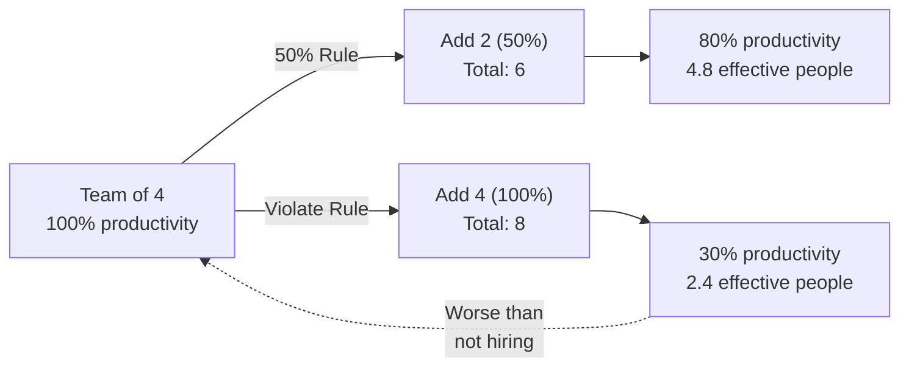
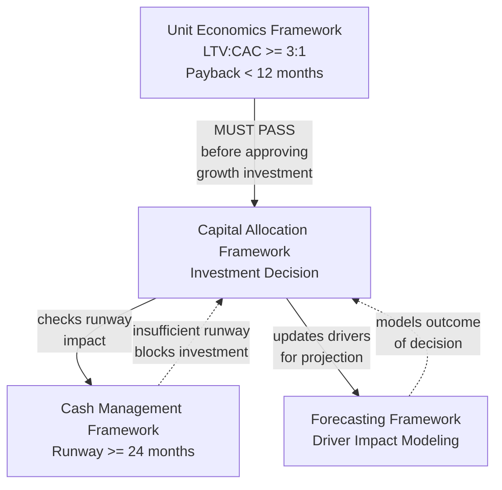
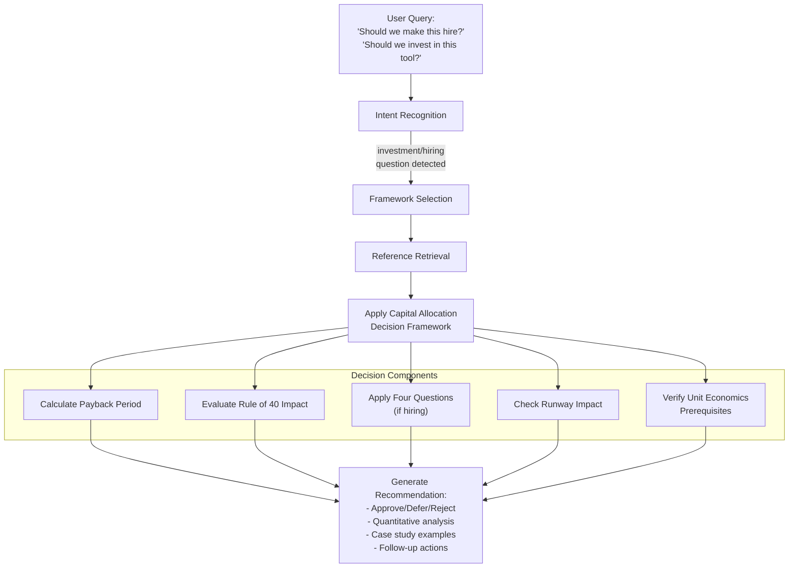

<!-- source: DeepWiki mcp.deepwiki.com · repo EveryInc/charlie-cfo-skill · page 3.3 Capital Allocation Framework · fetched 2026-10-26 -->

# Capital Allocation Framework

<details>
<summary>Relevant source files</summary>

The following files were used as context for generating this wiki page:

- [SKILL.md](SKILL.md)
- [references/metrics-benchmarks.md](references/metrics-benchmarks.md)

</details>


## Purpose and Scope

This document covers Charlie's investment decision framework for evaluating any capital allocation decision in a bootstrapped company. The framework enforces strict payback period requirements, applies the Rule of 40 for balancing growth and profitability, and provides a four-question hiring ROI analysis. This framework is primarily concerned with **investment decisions** (hiring, tooling, marketing spend) rather than day-to-day operational expenses.

For cash preservation and runway calculations, see [Cash Management Framework](#3.1). For the foundational unit economics that gate all investment decisions, see [Unit Economics Framework](#3.2). For ongoing financial review processes that track capital allocation effectiveness, see [Financial Review Rhythms](#4.3).

---

## Core Investment Principle: Payback Period

Every investment question in the Capital Allocation Framework reduces to a single test: **What is the payback period?** The framework enforces a hard threshold of <12 months payback for bootstrapped companies.

### Payback Period Calculation

```
Payback Period (months) = Total Investment / Monthly Benefit
```

Where:
- **Total Investment** = Direct cost + opportunity cost + training/ramp time
- **Monthly Benefit** = Incremental revenue or cost savings per month

### Decision Thresholds

| Payback Period | Decision |
|----------------|----------|
| < 6 months | Strongly approve |
| 6-12 months | Approve with monitoring |
| 12-18 months | Reject unless strategic |
| > 18 months | Reject |

**Rationale:** Bootstrapped companies cannot afford long-term bets. The <12 month requirement ensures each investment returns capital fast enough to fund the next investment, creating a self-sustaining capital allocation engine.

**Sources:** [SKILL.md:49-51]()

---

## Rule of 40

The Rule of 40 provides a unified framework for evaluating the tradeoff between growth and profitability:

```
Rule of 40 Score = Revenue Growth Rate (%) + EBITDA Margin (%)
```

Target: **≥ 40%**

### Strategic Paths

The framework recognizes three valid strategic paths, each achieving the Rule of 40 threshold through different combinations:

| Path | Growth Rate | EBITDA Margin | Total | Stage |
|------|-------------|---------------|-------|-------|
| High Growth | 40% | 0% | 40% | Early stage, market capture |
| Balanced | 20% | 20% | 40% | Growth stage, proving model |
| Profit Focus | 10% | 30% | 40% | Mature stage, cash generation |

### Extended Scenarios

The reference materials provide a comprehensive scenario matrix showing valid combinations:



**Performance Benchmarks:**
- Median SaaS: 34% (most companies fail to hit 40%)
- Top quartile bootstrapped: 50%+
- Bootstrapped advantage: Higher margin tolerance enables sustainable paths

**Sources:** [SKILL.md:53-57](), [references/metrics-benchmarks.md:168-180]()

---

## Hiring ROI Framework

Hiring decisions represent the largest capital allocation decisions for bootstrapped companies. The framework enforces a four-question analysis before any hire approval.

### The Four Questions

#### 1. Will this hire directly contribute to revenue?

Classify hires into three categories:

| Category | Description | Priority | Examples |
|----------|-------------|----------|----------|
| Revenue-generating | Directly closes deals or delivers billable work | High | Sales, customer success, professional services |
| Revenue-enabling | Builds product that attracts/retains customers | Medium | Product, engineering, design |
| Overhead | Necessary but non-revenue | Low | Finance, HR, legal, admin |

**Decision rule:** Revenue-generating and revenue-enabling roles pass this test. Overhead roles require exceptional justification.

#### 2. What's the time-to-productivity?

Account for ramp time in ROI calculation:

```
Effective Monthly Cost = (Annual Salary / 12) / Productivity Factor
```

| Ramp Period | Productivity Factor | Effective Cost Multiplier |
|-------------|--------------------|-----------------------|
| 0-3 months | 30% | 3.3x base monthly cost |
| 3-6 months | 60% | 1.7x base monthly cost |
| 6-12 months | 85% | 1.2x base monthly cost |
| 12+ months | 100% | 1.0x base monthly cost |

**Example:** A $120K/year engineer ($10K/month) with 6-month ramp has an effective cost of $17K/month in months 0-6, not $10K.

#### 3. What else could this salary fund?

Calculate opportunity cost by comparing against alternative investments:

**Example Tradeoff Analysis ($120K engineer hire):**
- 12 months of marketing spend at $10K/month
- 2 senior sales reps at $60K base each
- Product tooling budget for 2 years
- 3-month runway extension for entire company

**Decision rule:** The hire must be the highest ROI option among alternatives.

#### 4. Does this hire make the existing team more productive?

Evaluate force-multiplier effects:

| Hire Type | Team Productivity Impact | Justification |
|-----------|-------------------------|---------------|
| First sales ops hire | +30-50% sales capacity | Removes admin burden from closers |
| First engineering manager | +20-30% eng output | Unblocks senior ICs from process work |
| Additional IC to overloaded team | -10-20% initially | Training overhead dominates |

**Decision rule:** Hire must either generate new capacity OR multiply existing capacity by ≥20%.

### Hiring ROI Calculation Flow



**Sources:** [SKILL.md:59-65]()

---

## Department Growth Constraints

The framework enforces a hard constraint: **Never grow a department by >50% at once.**

### The 50% Rule

| Current Team Size | Maximum Additions | Rationale |
|-------------------|-------------------|-----------|
| 2 people | 1 person (50%) | Maintain training capacity |
| 4 people | 2 people (50%) | Preserve team productivity |
| 10 people | 5 people (50%) | Avoid coordination collapse |
| 20 people | 10 people (50%) | Limit onboarding burden |

**Why this matters:** When a department grows >50%, experienced team members spend >50% of their time training new hires. This drops department productivity to near zero during the training period, creating a revenue/delivery gap.

### Violation Consequences



**Exception:** This rule can be relaxed when hiring into an entirely new department with dedicated onboarding resources.

**Sources:** [SKILL.md:66-67]()

---

## Framework Integration and Dependencies

The Capital Allocation Framework does not operate independently—it enforces dependencies with other frameworks to ensure investment decisions are coherent.

### Hard Dependencies



### Dependency Rules

1. **Unit Economics Gate:** No growth investment (sales, marketing) approved unless LTV:CAC ≥ 3:1 and payback < 12 months. Violating this creates a "death spiral" where each new customer loses money.

2. **Cash Constraint:** No investment approved if it reduces runway below 24 months. Cash preservation overrides all other considerations.

3. **Forecasting Integration:** Every capital allocation decision updates the driver-based forecast. Hiring decisions change headcount drivers, investment decisions change expense drivers, and these propagate through revenue and cash projections.

### Cross-Framework Example: Hiring Decision

| Framework | Check | Pass/Fail |
|-----------|-------|-----------|
| Unit Economics | Current LTV:CAC = 4:1, Payback = 8 months | ✅ Pass (meets thresholds) |
| Capital Allocation | Hire ROI = 15 months payback | ❌ Fail (exceeds 12 months) |
| Cash Management | Current runway = 30 months, post-hire = 26 months | ✅ Pass (stays above 24 months) |
| **Decision** | **REJECT** | All frameworks must pass |

**Sources:** [SKILL.md:14-18](), [SKILL.md:49-67](), Diagrams 2 and 4 from system architecture

---

## Spending Benchmarks by ARR Stage

The framework provides spending allocation benchmarks that vary by company stage. These are derived from bootstrapped company analysis and serve as guardrails for capital allocation.

### $1-3M ARR (Early Stage)

| Category | % of ARR | $ at $2M ARR | Notes |
|----------|----------|--------------|-------|
| Sales | 15-20% | $300-400K | Heavy prospecting, long sales cycles |
| Marketing | 10-15% | $200-300K | Brand building, content foundation |
| R&D | 30-40% | $600-800K | Core product development |
| Customer Success | 10-15% | $200-300K | High-touch onboarding |
| G&A | 15-20% | $300-400K | Building infrastructure |
| **Total** | **80-110%** | **$1.6-2.2M** | May operate at loss to prove model |

### $3-10M ARR (Growth Stage)

| Category | % of ARR | $ at $5M ARR | Notes |
|----------|----------|--------------|-------|
| Sales | 10-15% | $500-750K | Improving efficiency, shorter cycles |
| Marketing | 8-12% | $400-600K | Scaling proven channels |
| R&D | 25-30% | $1.25-1.5M | Feature expansion, tech debt |
| Customer Success | 8-12% | $400-600K | Scaling support model |
| G&A | 12-15% | $600-750K | Maturing operations |
| **Total** | **63-84%** | **$3.15-4.2M** | Moving toward profitability |

### $10M+ ARR (Scale Stage)

| Category | % of ARR | $ at $20M ARR | Notes |
|----------|----------|---------------|-------|
| Sales | 8-12% | $1.6-2.4M | High-efficiency sales motion |
| Marketing | 6-10% | $1.2-2M | Optimized, data-driven |
| R&D | 20-25% | $4-5M | Platform maturity, maintenance |
| Customer Success | 6-10% | $1.2-2M | Self-service + high-value support |
| G&A | 10-12% | $2-2.4M | Operational leverage |
| **Total** | **50-69%** | **$10-13.8M** | Strong profitability |

### Bootstrapped vs VC-Backed Comparison

At $5M ARR:
- **Bootstrapped Total Spend:** ~95% of ARR (~$4.75M)
- **VC-Backed Total Spend:** ~107% of ARR (~$5.35M)
- **Difference:** 12 percentage points = $600K/year = 2.5 months of runway

**Key Insight:** Bootstrapped companies achieve 40-70% higher revenue per employee by maintaining spending discipline. This efficiency compounds—every dollar saved extends runway and creates reinvestment capacity.

**Sources:** [SKILL.md:147-155](), [references/metrics-benchmarks.md:139-167]()

---

## Implementation in Charlie

The Capital Allocation Framework is implemented as a decision tree that Charlie applies when processing investment or hiring queries.

### Query Routing



### Code Integration Points

The framework logic is defined in:
- **Core specification:** [SKILL.md:49-67]()
- **Benchmark data:** [references/metrics-benchmarks.md:139-180]()
- **Philosophy constraints:** [SKILL.md:10-25]()

When Charlie processes a capital allocation query:
1. NLP routes query to Capital Allocation Framework
2. System retrieves relevant benchmarks from `references/metrics-benchmarks.md`
3. Applies decision rules from `SKILL.md:49-67`
4. Validates against Unit Economics thresholds from `SKILL.md:14-18`
5. Checks Cash Management constraints from `SKILL.md:27-47`
6. Generates structured output with recommendation + rationale

**Sources:** [SKILL.md:1-162](), [references/metrics-benchmarks.md:1-199](), Diagram 3 from system architecture

---

## Common Scenarios and Examples

### Scenario 1: Sales Hire Request

**Input:**
- Current ARR: $3M
- Proposed hire: Sales rep, $80K base + $40K commission
- Expected ramp: 3 months to first deal, 6 months to full productivity
- Expected annual bookings: $500K ARR

**Analysis:**

| Question | Answer |
|----------|--------|
| Q1: Direct revenue? | ✅ Yes (sales role) |
| Q2: Time to productivity? | ⚠️ 6 months (acceptable but not ideal) |
| Q3: Highest ROI? | Need comparison—could $120K fund marketing instead? |
| Q4: Team multiplier? | Neutral (IC role) |

**Payback Calculation:**
```
Effective Cost Year 1 = ($10K/month × 3 months at 30%) + ($10K/month × 3 months at 60%) + ($10K/month × 6 months at 85%)
                      = $9K + $18K + $51K = $78K

Expected Revenue Year 1 = $500K × (6 months / 12 months) × 60% ramp factor = $150K

Payback Period = $78K / ($150K / 12 months) = 6.2 months
```

**Decision:** ✅ **APPROVE** (payback < 12 months, runway check passes)

### Scenario 2: Engineering Manager Hire Request

**Input:**
- Current team: 8 engineers
- Proposed hire: Engineering Manager, $180K
- No direct revenue contribution
- Expected impact: 25% productivity increase for existing team

**Analysis:**

| Question | Answer |
|----------|--------|
| Q1: Direct revenue? | ❌ No—but has team multiplier |
| Q2: Time to productivity? | 3 months to establish processes |
| Q3: Highest ROI? | Compare against 2 additional ICs |
| Q4: Team multiplier? | +25% = 2 additional effective engineers |

**Payback Calculation:**
```
Annual Cost = $180K
Team Productivity Gain = 8 engineers × 25% × $150K avg salary × 0.7 productivity factor = $210K equivalent capacity

Payback Period = $180K / ($210K / 12) = 10.3 months
```

**Decision:** ✅ **APPROVE** (payback < 12 months via multiplier effect)

### Scenario 3: Marketing Platform Investment

**Input:**
- Cost: $50K/year
- Expected impact: 20% improvement in conversion rate
- Current monthly visitors: 10,000
- Current conversion rate: 2% = 200 leads/month
- Current lead-to-customer: 10% = 20 customers/month
- Average LTV: $5,000

**Analysis:**

**Payback Calculation:**
```
New conversion rate = 2% × 1.20 = 2.4% = 240 leads/month
Additional leads = 40/month
Additional customers = 40 × 10% = 4/month = 48/year
Revenue impact = 48 customers × $5,000 = $240K

Payback Period = $50K / ($240K / 12) = 2.5 months
```

**Decision:** ✅ **STRONGLY APPROVE** (fast payback, high ROI)

**Sources:** [SKILL.md:49-67](), [references/metrics-benchmarks.md:139-180]()

---

## Summary

The Capital Allocation Framework enforces financial discipline for bootstrapped companies through:

1. **<12 month payback requirement** for all investments
2. **Rule of 40** balancing growth and profitability
3. **Four-question hiring ROI framework** ensuring productive hires
4. **50% department growth limit** preventing productivity collapse
5. **Hard dependencies** on Unit Economics and Cash Management frameworks
6. **Stage-specific spending benchmarks** providing guardrails

These rules are not aspirational—they are survival requirements. Bootstrapped companies that violate these thresholds deplete cash faster than they can generate it, leading to loss of control and eventual failure.

**Sources:** [SKILL.md:49-67](), [references/metrics-benchmarks.md:139-180](), [SKILL.md:10-26]()

---

