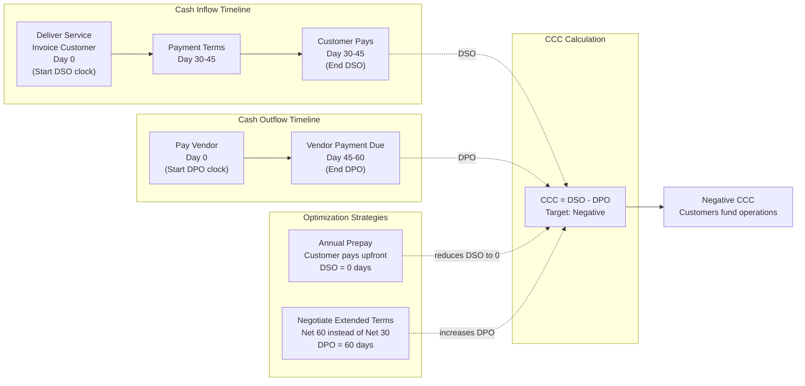
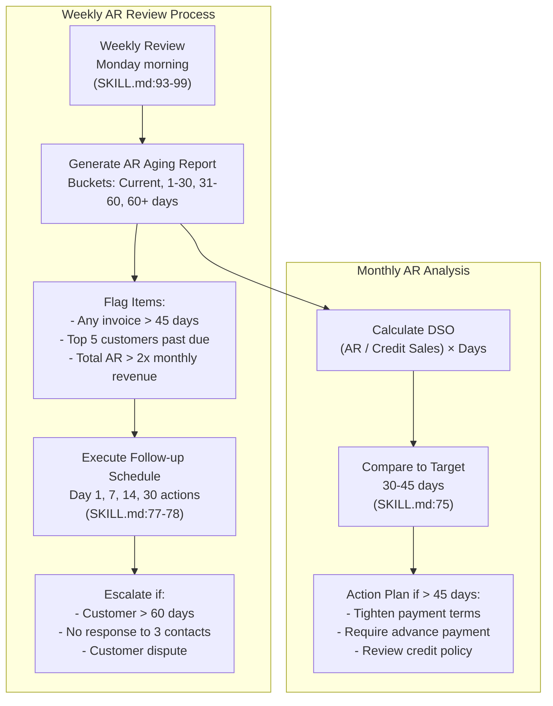
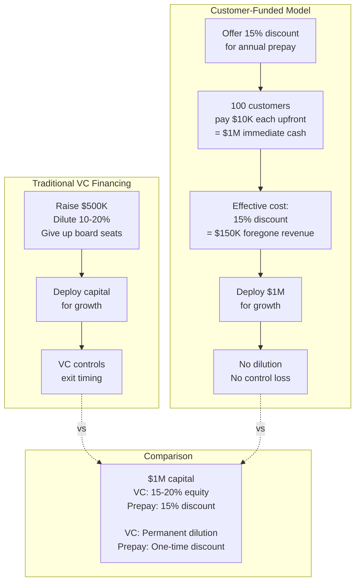
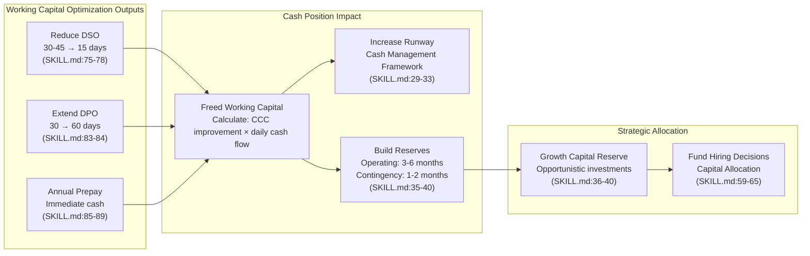

<!-- source: DeepWiki mcp.deepwiki.com · repo EveryInc/charlie-cfo-skill · page 3.4 Working Capital Optimization · fetched 2026-10-26 -->

# Working Capital Optimization

<details>
<summary>Relevant source files</summary>

The following files were used as context for generating this wiki page:

- [SKILL.md](SKILL.md)
- [references/metrics-benchmarks.md](references/metrics-benchmarks.md)

</details>


## Purpose and Scope

This document details the Working Capital Optimization framework within the Charlie CFO Skill system. Working capital optimization focuses on managing the timing of cash inflows and outflows to maximize liquidity and extend runway without raising external capital. For bootstrapped companies, effective working capital management can add 3-6 months of runway without cutting expenses or increasing revenue.

This framework covers Cash Conversion Cycle (CCC) mechanics, Accounts Receivable (AR) management, Accounts Payable (AP) strategies, and annual prepayment discount programs. For related cash management topics like runway calculations and reserve structures, see [3.1](#3.1). For forecasting cash flow impacts, see [3.5](#3.5).

---

## Working Capital Fundamentals for Bootstrapped Companies

Working capital represents the operational cash tied up in business activities before it can be used for growth or reserves. For bootstrapped SaaS companies, optimizing working capital is a zero-cost method to extend runway by accelerating cash collection and delaying cash payments strategically.

The primary goal is to achieve a **negative Cash Conversion Cycle**, meaning customers pay before the company needs to pay its vendors—effectively turning customers into zero-interest lenders who fund operations.

### Key Principle

Every 10-day reduction in the Cash Conversion Cycle frees significant working capital. For a company with $500K monthly revenue and 70% gross margin, reducing CCC by 10 days frees approximately $115K in cash.

**Sources:** [SKILL.md:68-90]()

---

## Cash Conversion Cycle (CCC)

### Definition and Formula

The Cash Conversion Cycle measures the number of days between when a company pays for inputs and when it collects cash from customers.

```
CCC = DIO + DSO - DPO
```

Where:
- **DIO** (Days Inventory Outstanding) = Days capital is tied up in inventory
- **DSO** (Days Sales Outstanding) = Days to collect payment from customers
- **DPO** (Days Payable Outstanding) = Days taken to pay suppliers

For SaaS companies, DIO is typically zero (no physical inventory), simplifying the formula to:

```
CCC = DSO - DPO
```

### SaaS Targets

| CCC Range | Classification |
|-----------|---------------|
| -30 to -90 days | Best-in-class SaaS (annual prepay model) |
| -10 to -30 days | Excellent |
| 0 to 10 days | Good |
| 10 to 30 days | Acceptable |
| > 30 days | Needs improvement |

A negative CCC means customers fund the business—they pay before the company needs to pay vendors, creating float that can be invested in growth or held as reserves.

**Sources:** [SKILL.md:70-73](), [references/metrics-benchmarks.md:131-137]()

---

## Cash Conversion Cycle Flow



**Sources:** [SKILL.md:68-90](), [references/metrics-benchmarks.md:131-137]()

---

## Accounts Receivable (AR) Management

### DSO Targets and Calculation

Days Sales Outstanding (DSO) measures how long it takes to collect payment after invoicing:

```
DSO = (Accounts Receivable / Total Credit Sales) × Days in Period
```

| DSO Range | Rating | Action Required |
|-----------|--------|----------------|
| < 30 days | Excellent | Maintain processes |
| 30-45 days | Good | Monitor aging |
| 45-60 days | Needs attention | Implement aggressive follow-up |
| > 60 days | Problem | Immediate escalation, possible write-off review |

For bootstrapped companies, the target is **30-45 days DSO**. This requires systematic collection processes, not ad-hoc follow-ups.

**Sources:** [SKILL.md:75-78](), [references/metrics-benchmarks.md:114-123]()

### AR Collection Process

The Charlie framework specifies a structured follow-up schedule to minimize DSO:

| Timing | Action |
|--------|--------|
| 7 days before due | Reminder email: "Payment due soon" |
| Day 0 (due date) | Invoice due |
| Day 1 past due | First follow-up: friendly reminder |
| Day 7 past due | Second follow-up: phone call or email |
| Day 14 past due | Third follow-up: escalation notice |
| Day 30 past due | Final follow-up: suspend service warning |

This schedule is documented in [SKILL.md:75-78](). The key principle: **consistent, systematic follow-up prevents AR from aging**.

### AR Aging Analysis

Track AR aging weekly as part of the financial review rhythm:



**Sources:** [SKILL.md:75-78, 93-99](), [references/metrics-benchmarks.md:114-123]()

---

## Accounts Payable (AP) Management

### Core AP Strategy

The fundamental AP rule: **Pay on due date, not early, unless discount > cost of capital**.

This principle treats AP as zero-interest short-term financing. Early payment without a discount effectively gives vendors a free loan, reducing your working capital unnecessarily.

**Sources:** [SKILL.md:80-83]()

### Early Payment Discount Analysis

When vendors offer early payment discounts, evaluate them as annualized returns:

**Example:** 2% discount for paying 20 days early (terms: 2/10 Net 30)

```
Discount period = 30 - 10 = 20 days
Discount rate = 2%
Annual periods = 365 / 20 = 18.25
Annualized return = 2% × 18.25 = 36.5%
```

This 36.5% annualized return far exceeds the cost of capital for any bootstrapped company, making it economically rational to take the discount.

### Early Payment Decision Matrix

| Discount Terms | Days Early | Annualized Return | Decision |
|---------------|------------|-------------------|----------|
| 2/10 Net 30 | 20 days | 36.5% | **Take discount** |
| 1/10 Net 30 | 20 days | 18.3% | **Take discount** |
| 2/15 Net 45 | 30 days | 24.3% | **Take discount** |
| 0.5/10 Net 30 | 20 days | 9.1% | Evaluate vs. other uses |

The formula for annualized return on early payment discounts:

```
Annualized Return = (Discount % / (100 - Discount %)) × (365 / Days Difference)
```

**Sources:** [SKILL.md:80-83]()

### DPO Optimization Strategy

Days Payable Outstanding (DPO) measures how long a company takes to pay vendors:

```
DPO = (Accounts Payable / COGS) × Days in Period
```

**Optimization approach:**
1. Negotiate longest possible terms (Net 45-60) after establishing payment reliability
2. Always pay on the due date (not early, unless discount applies)
3. Prioritize vendors: Pay critical vendors on time, negotiate extensions with flexible vendors
4. Track payment timing to maximize DPO without damaging relationships

The strategy documented in [SKILL.md:83-84]() recommends negotiating Net 45-60 terms after proving reliability with initial Net 30 payments.

**Sources:** [SKILL.md:80-84](), [references/metrics-benchmarks.md:125-130]()

---

## Annual Prepay Discount Program

### Mechanics and Economics

Annual prepayment programs offer customers a 15-20% discount for paying a full year upfront. This strategy is counterintuitive—giving up 15-20% of revenue appears costly, but the benefits far outweigh the discount.

**Discount structure:**
- **Monthly billing:** $100/month = $1,200/year
- **Annual prepay:** $1,020/year (15% discount) or $960/year (20% discount)

### Financial Benefits

| Benefit Category | Impact | Source |
|-----------------|--------|--------|
| Churn reduction | 30% lower annual churn | SKILL.md:87 |
| LTV increase | 27-40% higher LTV | SKILL.md:88 |
| DSO improvement | Reduces DSO to 0 days | Immediate |
| Cash Conversion Cycle | Achieves -30 to -90 day CCC | SKILL.md:72-73 |
| Runway extension | Immediate cash boost | Calculated |

**Why annual prepay reduces churn:**
- Customers make a commitment decision once per year instead of monthly
- Psychological barrier to canceling after upfront payment
- Encourages deeper product adoption to justify the investment

**Sources:** [SKILL.md:85-89]()

### Annual Prepay as Zero-Interest Financing



**Key insight from [SKILL.md:89]():** "Customers finance your growth at 0% interest." The 15-20% discount is a one-time cost, not recurring dilution. Customers effectively lend capital at 0% interest with no control provisions.

**Sources:** [SKILL.md:85-89]()

### Implementation Strategy

To maximize annual prepay adoption:

1. **Offer structure:**
   - 15% discount for annual prepay (standard offer)
   - 20% discount for multi-year commitments
   - Position as "savings" not discount

2. **Timing:**
   - Introduce at new customer signup
   - Offer at renewal time for monthly customers
   - Promote during Q4 budget season for B2B

3. **Conversion targets:**
   - New customers: 40-60% annual prepay rate
   - Existing customers: 25-40% conversion at renewal
   - Enterprise segment: 60-80% annual or multi-year

**Sources:** [SKILL.md:85-89]()

---

## Working Capital Impact on Cash Position

### CCC Improvement Case Study

**Scenario:** SaaS company with $500K monthly revenue, 70% gross margin

**Current state:**
- DSO: 45 days
- DPO: 30 days
- CCC: 45 - 30 = 15 days positive

**Optimized state:**
- DSO: 15 days (annual prepay program reduces average)
- DPO: 60 days (negotiated extended terms)
- CCC: 15 - 60 = -45 days negative

**Cash impact:**
```
Daily cash flow = $500K × 70% / 30 = $11.7K/day
CCC improvement = 15 - (-45) = 60 days
Cash freed = 60 days × $11.7K = $700K
```

This $700K cash improvement translates to **4.7 months of additional runway** assuming $150K monthly burn rate, without cutting costs or increasing revenue.

### Integration with Cash Management Framework

Working capital optimization directly feeds into the Cash Management Framework ([3.1](#3.1)) by:

1. **Extending runway:** CCC improvements add months of runway without external funding
2. **Building reserves:** Freed working capital can be allocated to Operating or Contingency reserves
3. **Enabling growth investments:** Cash from annual prepay programs funds Capital Allocation decisions ([3.3](#3.3))



**Sources:** [SKILL.md:29-40, 59-65, 68-90]()

---

## Working Capital Metrics in Financial Reviews

### Weekly Review (60-90 minutes)

From [SKILL.md:93-99](), the weekly review includes:
- **Cash position:** Track changes from working capital impacts
- **AR aging:** Review DSO trends and execute collection follow-ups
- **Pipeline movement:** Forecast upcoming AR from closed deals

### Monthly Review

Monthly close (target: 5-7 business days) includes working capital analysis:
- Calculate DSO, DPO, and CCC
- Compare to prior month and targets
- Identify trends (improving or deteriorating)
- Update 12-18 month rolling forecast with working capital assumptions

### Quarterly Review

Strategic recalibration includes:
- Review annual prepay conversion rates
- Assess vendor term negotiation opportunities
- Evaluate CCC trends and set improvement targets
- Model working capital impact on three-scenario forecasts ([3.5](#3.5))

**Sources:** [SKILL.md:91-110]()

---

## Working Capital Dashboard Metrics

| Metric | Calculation | Target | Review Frequency |
|--------|-------------|--------|------------------|
| DSO | (AR / Credit Sales) × Days | 30-45 days | Weekly |
| DPO | (AP / COGS) × Days | 45-60 days | Monthly |
| CCC | DSO - DPO | Negative (-30 to -90) | Monthly |
| AR Aging > 60 days | Sum of AR > 60 days / Total AR | < 5% | Weekly |
| Annual prepay % | Annual prepay revenue / Total revenue | 40-60% | Monthly |

These metrics are tracked alongside the Key Metrics Dashboard in [SKILL.md:112-120]() under the Cash category.

**Sources:** [SKILL.md:112-120](), [references/metrics-benchmarks.md:114-137]()

---

## Summary: Working Capital as Runway Extension

For bootstrapped companies, working capital optimization is not optional—it's a survival tool. The three-pronged strategy:

1. **Accelerate AR:** Target 30-45 day DSO through systematic collection
2. **Extend AP:** Negotiate Net 45-60 terms, pay on due date unless discount > cost of capital
3. **Implement annual prepay:** 15-20% discount drives 30% lower churn, 27-40% higher LTV, and immediate cash

**Target outcome:** Negative Cash Conversion Cycle (-30 to -90 days) where customers fund operations, extending runway by 3-6 months without external financing.

**Sources:** [SKILL.md:68-90](), [references/metrics-benchmarks.md:112-137]()

---

