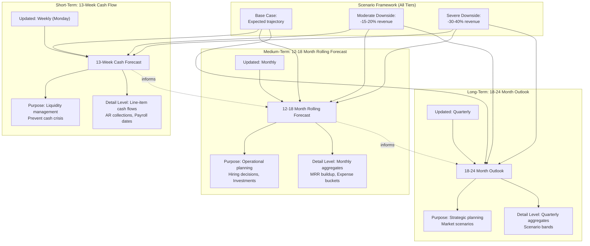
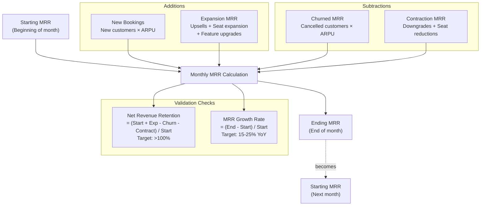
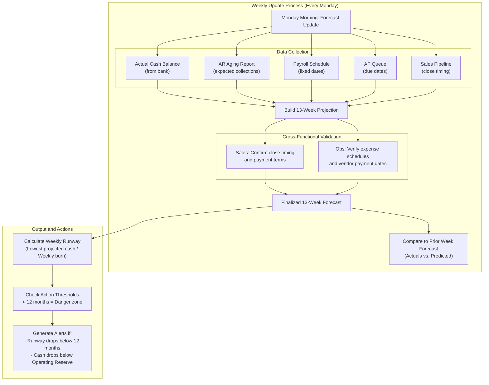
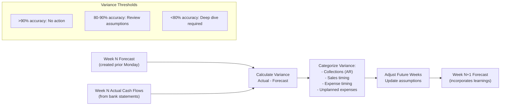
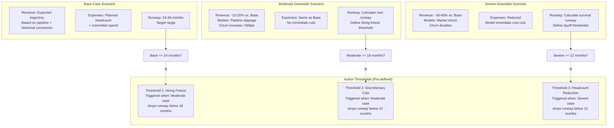
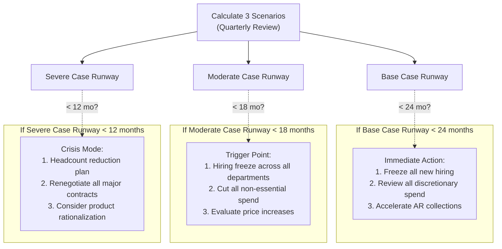
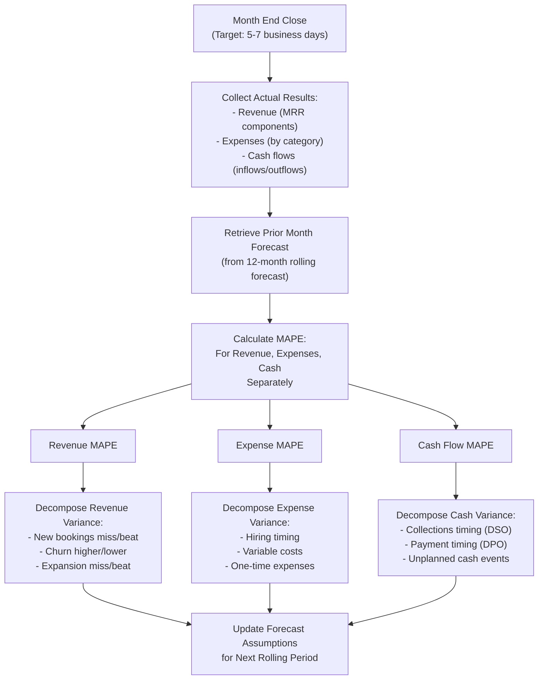
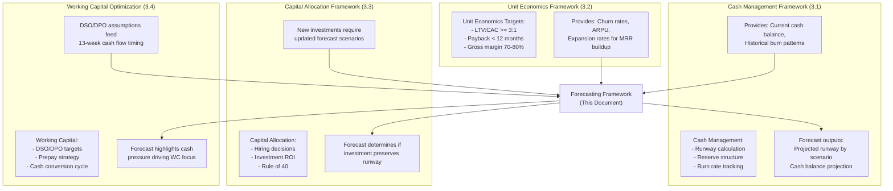
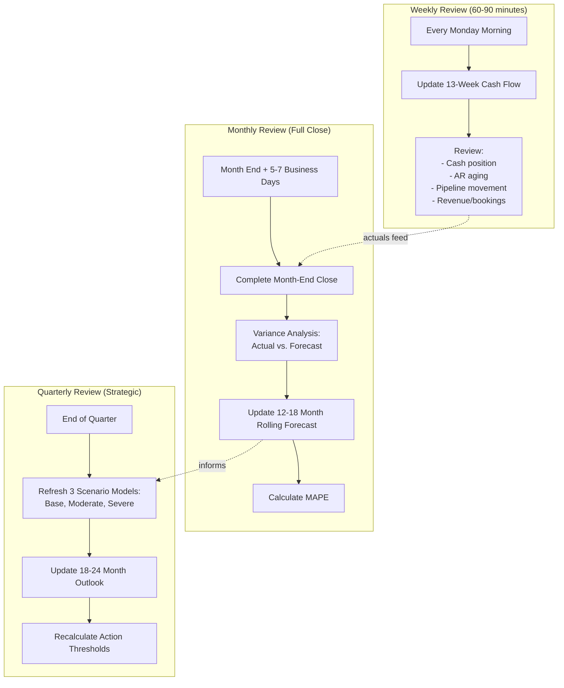

<!-- source: DeepWiki mcp.deepwiki.com · repo EveryInc/charlie-cfo-skill · page 3.5 Forecasting Approach · fetched 2026-10-26 -->

# Forecasting Approach

<details>
<summary>Relevant source files</summary>

The following files were used as context for generating this wiki page:

- [SKILL.md](SKILL.md)
- [references/metrics-benchmarks.md](references/metrics-benchmarks.md)

</details>


## Purpose and Scope

This page documents Charlie's forecasting methodology, which provides operational planning and cash visibility for bootstrapped startups. The approach emphasizes driver-based models built on operational metrics rather than static percentage assumptions, enabling realistic scenario planning and early warning systems for runway threats.

This page covers the technical mechanics of forecasting models, scenario planning, and forecast accuracy tracking. For cash runway calculations and reserve structures, see [Cash Management Framework](#3.1). For the metrics used as forecast inputs, see [Metrics and Benchmarks Reference](#5.1). For the review cadences that trigger forecast updates, see [Financial Review Rhythms](#4.3).

**Sources:** [SKILL.md:123-145]()

---

## Forecasting Architecture Overview

Charlie implements a three-tiered forecasting system with different time horizons and update frequencies. Each tier serves a distinct purpose and feeds into financial decision-making at different levels.

### Three-Tier Forecasting Structure



| Forecast Type | Time Horizon | Update Frequency | Primary Use Case | Detail Level |
|--------------|--------------|------------------|------------------|--------------|
| 13-Week Cash | 3 months | Weekly (Monday) | Liquidity management, AR/AP timing | Line-item cash flows |
| Rolling Forecast | 12-18 months | Monthly | Hiring decisions, capital allocation | Monthly MRR + expenses |
| Strategic Outlook | 18-24 months | Quarterly | Scenario planning, strategic pivots | Quarterly aggregates |

**Sources:** [SKILL.md:100-110](), [SKILL.md:133-145]()

---

## Driver-Based Planning Fundamentals

Charlie's forecasting rejects static percentage-based models in favor of driver-based planning, where forecasts are built from operational drivers that management can directly influence and measure.

### Driver-Based vs. Percentage-Based Models

```mermaid
graph LR
    subgraph "Percentage-Based Model (Rejected)"
        REV_PCT["Revenue Forecast"]
        COGS_PCT["COGS = 20% of Revenue"]
        SM_PCT["S&M = 25% of Revenue"]
        RD_PCT["R&D = 30% of Revenue"]
        
        REV_PCT --> COGS_PCT
        REV_PCT --> SM_PCT
        REV_PCT --> RD_PCT
        
        PROBLEM["Problem: Assumes fixed relationships<br/>Ignores operational reality<br/>Cannot model step functions"]
    end
    
    subgraph "Driver-Based Model (Charlie's Approach)"
        HEADCOUNT["Headcount by Role<br/>(Sales, Eng, CS)"]
        ACQ_RATE["Customer Acquisition Rate<br/>(by channel)"]
        CHURN["Churn Rate<br/>(by cohort)"]
        EXPANSION["Expansion Rate<br/>(existing customers)"]
        
        HEADCOUNT --> PAYROLL["Payroll Expense<br/>Role × Salary"]
        ACQ_RATE --> NEW_MRR["New MRR"]
        CHURN --> CHURNED_MRR["Churned MRR"]
        EXPANSION --> EXPANSION_MRR["Expansion MRR"]
        
        NEW_MRR --> MRR_BUILD["MRR Buildup Model"]
        CHURNED_MRR --> MRR_BUILD
        EXPANSION_MRR --> MRR_BUILD
        
        BENEFIT["Benefit: Models operational reality<br/>Can test 'what-if' scenarios<br/>Explicit about assumptions"]
    end
```



**Operational drivers tracked in driver-based planning:**

| Category | Driver Metrics | Location in SKILL.md |
|----------|---------------|---------------------|
| Revenue | Acquisition rate, Churn rate, Expansion rate | Lines 127-131 |
| Expenses | Headcount by function, Average salary by role | Lines 59-66, 147-154 |
| Working Capital | DSO, DPO, Prepay % | Lines 75-89 |
| Hiring | Time-to-productivity, Ramp time | Lines 62-63 |

**Sources:** [SKILL.md:125](), [SKILL.md:59-66]()

---

## MRR Buildup Model

The MRR buildup model is the core revenue forecasting mechanism. It breaks monthly recurring revenue (MRR) changes into discrete operational components that map directly to business activities.

### MRR Buildup Formula

The formula implemented in Charlie's forecasting framework:

```
Ending MRR = Starting MRR + New Bookings + Expansion - Churn
```

This decomposes into monthly calculations tracked in the 12-18 month rolling forecast.

**Sources:** [SKILL.md:127-131]()

### MRR Component Definitions



**Component calculation details:**

| Component | Calculation Method | Driver Inputs |
|-----------|-------------------|---------------|
| **New Bookings** | Number of new customers × Average ARPU | Acquisition rate by channel, Conversion rates, ARPU by segment |
| **Expansion MRR** | Existing customer count × Expansion rate × Current ARPU | Expansion % (historical), Upsell attach rate, Average expansion size |
| **Churned MRR** | Lost customer count × Their ARPU | Monthly churn rate by cohort, Customer counts by cohort |
| **Contraction MRR** | Downgrading customers × Reduction amount | Downgrade rate, Average downgrade size |

**Sources:** [SKILL.md:127-131](), [references/metrics-benchmarks.md:44-54]()

### MRR Forecast Validation

Charlie enforces validation checks on MRR forecasts to ensure they align with historical performance and benchmark targets:

| Validation Check | Formula | Target Range | Action if Failed |
|-----------------|---------|--------------|-----------------|
| Net Revenue Retention | `(Start + Exp - Churn - Contract) / Start` | >100% | Flag as concern, review churn assumptions |
| Monthly Growth Rate | `(End - Start) / Start` | 1-3% monthly (15-25% YoY) | Validate acquisition assumptions |
| Churn Rate Consistency | `Churned MRR / Start MRR` | <2% monthly | Check if forecasting unrealistic retention |
| Expansion Rate | `Expansion MRR / Start MRR` | 1-3% monthly | Verify upsell pipeline supports assumption |

**Sources:** [SKILL.md:116](), [references/metrics-benchmarks.md:44-54]()

---

## 13-Week Cash Flow Forecast

The 13-week cash flow forecast provides week-by-week visibility into cash movements, enabling proactive management of liquidity. This is the most operationally detailed forecast tier.

### 13-Week Forecast Structure and Update Process



**Sources:** [SKILL.md:133-138]()

### 13-Week Cash Flow Line Items

The forecast tracks cash movements at line-item granularity:

| Cash Inflow Category | Detail Level | Source Data |
|---------------------|--------------|-------------|
| **Collections from AR** | By customer, by invoice, by week | AR aging report, historical DSO patterns |
| **New Sales (Cash)** | By expected close date, by deal | Sales pipeline with probability weighting |
| **Prepayments** | By renewal date | Customer contract database |

| Cash Outflow Category | Detail Level | Source Data |
|----------------------|--------------|-------------|
| **Payroll** | By pay period (bi-weekly/monthly) | HRIS system, fixed schedule |
| **Vendor Payments (AP)** | By vendor, by invoice due date | AP aging, payment terms database |
| **Software/SaaS** | By renewal date | Subscription tracking |
| **Marketing Spend** | By campaign, by payment schedule | Marketing calendar |
| **Tax Payments** | By statutory due date | Tax calendar |

**Comparison to actuals:** Each Monday, compare prior week's actual cash flows to what was forecasted to calculate variance and refine assumptions.

**Sources:** [SKILL.md:133-138](), [SKILL.md:93-98]()

### Weekly Variance Analysis



**Sources:** [SKILL.md:136-137]()

---

## Three-Scenario Planning Methodology

Charlie requires maintaining three scenarios simultaneously across all forecast horizons. This provides early warning of runway threats and enables pre-planned responses to adverse conditions.

### Scenario Definitions and Parameters



**Sources:** [SKILL.md:139-145]()

### Scenario Assumption Drivers

| Driver | Base Case | Moderate Downside | Severe Downside |
|--------|-----------|-------------------|-----------------|
| **Revenue Growth Rate** | Historical trend (e.g., 20% YoY) | -15-20% reduction | -30-40% reduction |
| **Monthly Churn** | Historical rate (e.g., 1.5%) | +50 basis points (e.g., 2.0%) | Double historical (e.g., 3.0%) |
| **Pipeline Conversion** | Historical rate (e.g., 25%) | -20% (e.g., 20% conversion) | -50% (e.g., 12.5% conversion) |
| **Sales Cycle Length** | Historical (e.g., 45 days) | +20% (e.g., 54 days) | +50% (e.g., 68 days) |
| **Expansion Rate** | Historical (e.g., 2% monthly) | -50% (e.g., 1% monthly) | Freeze (0%) |
| **Operating Expenses** | Planned budget | No immediate cuts | Immediate 20-30% reduction |

**Sources:** [SKILL.md:140-145]()

### Pre-Defined Action Thresholds

For each scenario, Charlie defines specific action thresholds that trigger operational responses. These are calculated during quarterly strategy reviews and documented explicitly.



**Action threshold table:**

| Scenario | Runway Threshold | Response Actions | Who Executes | Timeline |
|----------|------------------|------------------|--------------|----------|
| Base Case | < 24 months | Hiring freeze, Discretionary spend review | CEO + CFO | Immediate |
| Moderate Case | < 18 months | All hiring freeze, Cut non-essentials, Price increase evaluation | CEO + Department Heads | Within 30 days |
| Severe Case | < 12 months | Headcount reduction, Contract renegotiation, Product rationalization | CEO + Board | Within 14 days |

**Sources:** [SKILL.md:145]()

---

## Forecast Accuracy Tracking

Charlie tracks forecast accuracy using Mean Absolute Percentage Error (MAPE) to continuously improve forecasting assumptions and identify systematic biases.

### MAPE Calculation and Targets

The MAPE formula implemented:

```
MAPE = (1/n) × Σ |Actual - Forecast| / |Actual| × 100
```

Where `n` is the number of periods being measured (typically 12 months for rolling analysis).

**Target MAPE thresholds by category:**

| Forecast Category | Target MAPE | Interpretation | Location in References |
|------------------|-------------|----------------|----------------------|
| **Revenue** | 5-10% | Revenue is most critical to get right | [references/metrics-benchmarks.md:196]() |
| **Expenses** | 10-15% | More variability acceptable in expenses | [references/metrics-benchmarks.md:197]() |
| **Cash Flow** | 10-15% | Includes timing variability (AR/AP) | [references/metrics-benchmarks.md:198]() |

**Sources:** [references/metrics-benchmarks.md:184-198]()

### MAPE Performance Rating Matrix

| MAPE Range | Performance Rating | Action Required |
|------------|-------------------|-----------------|
| < 5% | Excellent | Maintain current assumptions |
| 5-10% | Good | Minor refinements to assumptions |
| 10-20% | Acceptable | Review driver assumptions quarterly |
| > 20% | Needs Improvement | Deep dive into forecasting methodology |

**Sources:** [references/metrics-benchmarks.md:188-193]()

### Monthly MAPE Tracking Process



**MAPE tracking cadence:**
- **Monthly:** Calculate MAPE for prior month's forecast
- **Quarterly:** Review 12-month rolling MAPE trend
- **Annually:** Audit forecasting methodology if persistent >15% MAPE

**Sources:** [references/metrics-benchmarks.md:182-198](), [SKILL.md:100-104]()

---

## Integration with Other Frameworks

The forecasting approach integrates deeply with Charlie's other financial frameworks, creating feedback loops and dependencies.

### Framework Integration Map



**Sources:** [SKILL.md:49-66](), [SKILL.md:27-47](), [SKILL.md:69-89]()

### Key Integration Points

| Framework | Integration Point | Data Flow Direction | Usage in Forecasting |
|-----------|------------------|---------------------|---------------------|
| **Unit Economics** | MRR buildup components | UE → Forecast | Churn rates, ARPU, expansion rates drive revenue projections |
| **Cash Management** | Runway calculation | Bidirectional | Forecast projects future runway; current runway constrains investments |
| **Capital Allocation** | Investment scenarios | Bidirectional | New hires/investments trigger forecast update; forecast approves/rejects based on runway impact |
| **Working Capital** | 13-week cash timing | WC → Forecast | DSO/DPO assumptions determine cash inflow/outflow timing |

**Validation rule:** Before approving any capital allocation decision (hiring, investment), Charlie requires an updated forecast showing the decision preserves minimum 24-month runway in the base case and 12-month runway in the severe case.

**Sources:** [SKILL.md:49-66](), [SKILL.md:145]()

---

## Review Rhythms and Forecast Update Triggers

Charlie enforces specific cadences for forecast updates tied to financial review processes.

### Forecast Update Schedule



**Sources:** [SKILL.md:92-110]()

### Event-Driven Forecast Updates

Beyond scheduled reviews, certain events trigger immediate forecast updates:

| Trigger Event | Required Forecast Update | Timeline |
|--------------|-------------------------|----------|
| Major deal closes (>10% MRR) | 13-week cash flow + 12-month rolling | Within 1 business day |
| Unexpected churn spike (>1.5x normal) | MRR buildup + revenue scenarios | Within 3 business days |
| Major expense (>$50K unplanned) | 13-week cash flow | Immediate (same day) |
| Hiring approval | 12-month rolling (add salary + ramp) | Before offer letter |
| Strategic pivot decision | All three scenarios + 18-24 month | Within 1 week |

**Sources:** [SKILL.md:93-110]()

---

## Summary

Charlie's forecasting approach implements a multi-tiered system with three time horizons (13-week, 12-18 month, 18-24 month), each updated at different cadences (weekly, monthly, quarterly) and serving distinct purposes (liquidity, operations, strategy). The methodology emphasizes:

1. **Driver-based models** built from operational metrics rather than static percentages
2. **MRR buildup mechanics** decomposing revenue into trackable components (new bookings, expansion, churn)
3. **Weekly 13-week cash flow forecasts** with cross-functional validation providing early warning of liquidity issues
4. **Three-scenario planning** (base, moderate downside, severe downside) with pre-defined action thresholds
5. **Forecast accuracy tracking** via MAPE to continuously improve assumptions
6. **Deep integration** with Unit Economics, Cash Management, Capital Allocation, and Working Capital frameworks

This integrated approach ensures that all financial decisions are evaluated against realistic future states and runway preservation requirements, consistent with Charlie's capital discipline philosophy.

**Sources:** [SKILL.md:123-145](), [references/metrics-benchmarks.md:182-198]()

---

