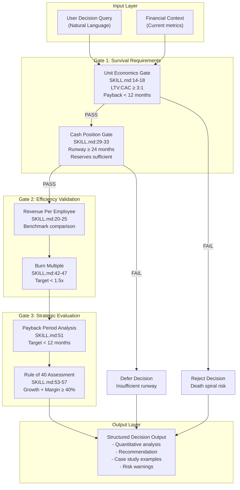
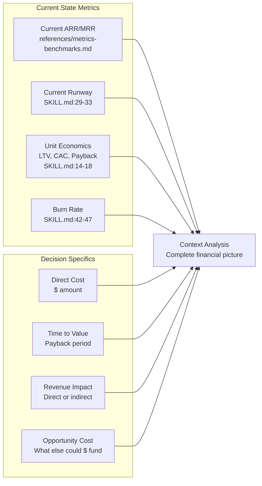
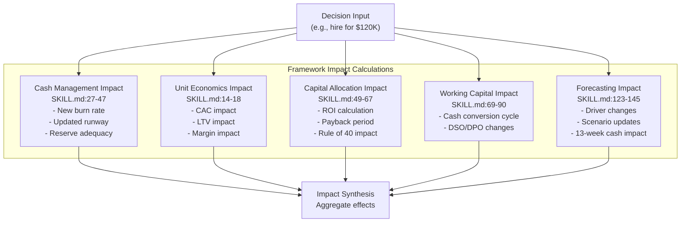
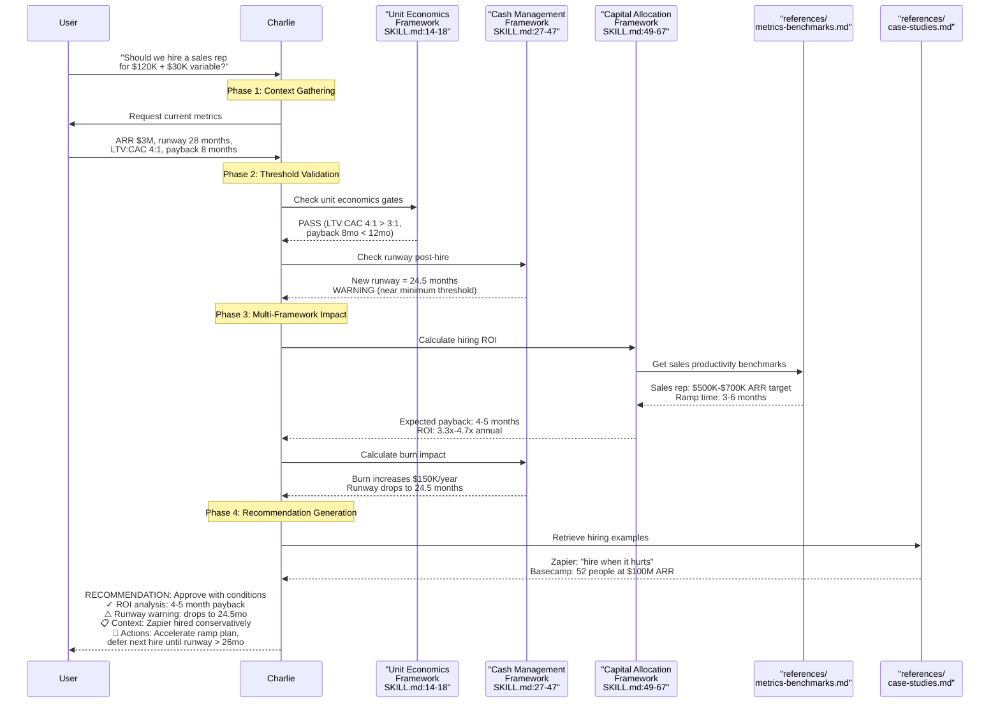

<!-- source: DeepWiki mcp.deepwiki.com · repo EveryInc/charlie-cfo-skill · page 4 Decision-Making Guides · fetched 2026-10-26 -->

# Decision-Making Guides

<details>
<summary>Relevant source files</summary>

The following files were used as context for generating this wiki page:

- [README.md](README.md)
- [SKILL.md](SKILL.md)

</details>


## Purpose and Scope

This section provides practical application guides for applying Charlie's five financial frameworks to common decisions facing bootstrapped startups. While the Core Philosophy ([Section 2](#2)) establishes the underlying principles and the Five Financial Frameworks ([Section 3](#3)) detail the calculation methods, this section focuses on **how to use those frameworks to make actual decisions**.

Each decision type covered here follows a structured process that combines:
- Quantitative analysis using formulas from [references/metrics-benchmarks.md:1-end]()
- Threshold validation against targets defined in [SKILL.md:14-25]()
- Contextual guidance from case studies in [references/case-studies.md:1-end]()
- Multi-framework integration where decisions impact multiple areas

For detailed metric calculations and formulas, see [Metrics and Benchmarks Reference](#5.1). For real-world examples of how successful bootstrapped companies made similar decisions, see [Bootstrapped Company Case Studies](#5.2).

**Sources:** [SKILL.md:1-162](), [README.md:1-59]()

---

## Decision Framework Architecture

Charlie structures all financial decisions through a hierarchical framework system where certain frameworks act as **gates** that must be satisfied before others can be evaluated. This prevents optimization of secondary metrics while violating survival requirements.

### Decision Processing Hierarchy



**Sources:** [SKILL.md:14-67]()

### Framework Integration Matrix

Different decision types activate different combinations of frameworks. This table maps decision categories to the frameworks that evaluate them:

| Decision Type | Primary Framework | Secondary Frameworks | Validation Source | Typical Query |
|--------------|-------------------|---------------------|-------------------|---------------|
| **Hiring** | Capital Allocation ([SKILL.md:59-66]()) | Cash Management, Unit Economics | [SKILL.md:59-66]() | "Should we make this hire?" |
| **Tool/Software Purchase** | Capital Allocation ([SKILL.md:51]()) | Working Capital | [SKILL.md:51]() | "Should we buy this tool?" |
| **Marketing Spend** | Unit Economics ([SKILL.md:14-18]()) | Capital Allocation | [SKILL.md:14-18]() | "Should we increase ad spend?" |
| **Pricing Change** | Unit Economics ([SKILL.md:14-18]()) | Forecasting, Cash | [references/metrics-benchmarks.md]() | "Should we raise prices?" |
| **Payment Terms** | Working Capital ([SKILL.md:69-90]()) | Cash Management | [SKILL.md:82-89]() | "Should we offer prepay discounts?" |
| **Strategic Investment** | Capital Allocation ([SKILL.md:51]()) | All frameworks | [SKILL.md:49-67]() | "Should we build this feature?" |

**Sources:** [SKILL.md:49-90](), [references/metrics-benchmarks.md:1-end]()

---

## The Four-Phase Decision Process

Every decision in Charlie follows a standardized four-phase process that ensures consistency and completeness:

### Phase 1: Context Gathering



**Sources:** [SKILL.md:29-47](), [references/metrics-benchmarks.md:1-end]()

### Phase 2: Threshold Validation

This phase checks the decision against hard thresholds defined in [SKILL.md:14-25](). Violations trigger automatic warnings:

| Threshold Type | Source | Target | Violation Response |
|----------------|--------|--------|-------------------|
| **LTV:CAC Ratio** | [SKILL.md:16]() | ≥ 3:1 | Reject if < 3:1 (death spiral warning) |
| **CAC Payback** | [SKILL.md:17]() | < 12 months | Reject if ≥ 12 months |
| **Runway** | [SKILL.md:31]() | ≥ 24 months | Defer if < 24 months post-decision |
| **Payback Period** | [SKILL.md:51]() | < 12 months | Reject if ≥ 12 months |
| **Burn Multiple** | [SKILL.md:42-46]() | < 1.5x | Warning if > 1.5x |
| **Customer Concentration** | [SKILL.md:121]() | < 10% per customer | Warning if ≥ 10% |

**Sources:** [SKILL.md:14-67](), [SKILL.md:121]()

### Phase 3: Multi-Framework Impact Analysis



**Sources:** [SKILL.md:14-145]()

### Phase 4: Recommendation Generation

The final phase combines quantitative analysis with qualitative context:

1. **Quantitative Summary**: Calculated impacts on key metrics
2. **Threshold Status**: Pass/fail on each validation gate
3. **Case Study Context**: Relevant examples from [references/case-studies.md:1-end]()
4. **Recommendation**: Approve / Approve with conditions / Defer / Reject
5. **Follow-up Actions**: Specific next steps based on decision outcome

**Sources:** [SKILL.md:1-162](), [references/case-studies.md:1-end]()

---

## Decision Type Coverage

This section covers four major decision categories, each detailed in its own subsection:

### Hiring Decisions ([Section 4.1](#4.1))

Evaluates personnel additions through a four-question framework defined in [SKILL.md:59-66]():
- Direct revenue contribution assessment
- Time-to-productivity calculation
- Opportunity cost analysis
- Team productivity multiplier effects

Applies constraints from [SKILL.md:66](): never grow a department >50% at once.

### Investment and Spending Decisions ([Section 4.2](#4.2))

Evaluates any capital expenditure using the <12 month payback rule from [SKILL.md:51](). Covers:
- Software/tool purchases
- Marketing campaigns
- Product development investments
- Strategic initiatives

### Financial Review Rhythms ([Section 4.3](#4.3))

Establishes the review cadences defined in [SKILL.md:92-111]():
- **Weekly (60-90 min)**: Cash, AR, pipeline, revenue
- **Monthly**: Full close, variance analysis, forecast updates
- **Quarterly**: Strategic recalibration, scenario refresh

### Key Metrics Dashboard ([Section 4.4](#4.4))

Implements the monitoring dashboard from [SKILL.md:112-122]() covering:
- Revenue metrics (MRR/ARR, growth, NRR)
- Unit economics (LTV:CAC, payback, margins)
- Cash metrics (burn, runway, operating cash flow)
- Customer health (churn, concentration)

**Sources:** [SKILL.md:59-122]()

---

## Reference Material Integration

Charlie integrates two reference documents into every decision:

### Quantitative References

[references/metrics-benchmarks.md:1-end]() provides:
- **Calculation formulas** for all metrics
- **Industry benchmarks** by company stage
- **Performance targets** for validation
- **Spending allocation guidelines** by ARR level

These are used in Phase 2 (Threshold Validation) and Phase 3 (Multi-Framework Impact Analysis).

### Qualitative References

[references/case-studies.md:1-end]() provides:
- **Mailchimp**: Freemium pivot, viral loops, <$100 CAC
- **Zapier**: Programmatic SEO, near-zero CAC, "hire when it hurts"
- **Basecamp**: Profit distributions, $1.4M revenue per employee
- **ConvertKit**: Crisis turnaround, 51% margin in 5 months
- **Zoho**: 60% to R&D, zero advertising, vertical integration

These are used in Phase 4 (Recommendation Generation) to provide context and proven patterns.

**Sources:** [SKILL.md:159-161](), [references/metrics-benchmarks.md:1-end](), [references/case-studies.md:1-end]()

---

## Decision Flow Example: Hire Evaluation

The following diagram illustrates how a typical hiring decision flows through all four phases:



**Sources:** [SKILL.md:14-67](), [references/metrics-benchmarks.md:1-end](), [references/case-studies.md:1-end]()

---

## Common Decision Patterns

Through analysis of the case studies in [references/case-studies.md:1-end](), several recurring decision patterns emerge:

### Pattern 1: Conservative Hiring (Zapier Model)

- **Trigger**: "Hire when it hurts" - wait until pain is obvious
- **Validation**: LTV:CAC ≥ 3:1, payback < 12 months ([SKILL.md:16-17]())
- **Constraint**: Maintain 24-36 month runway ([SKILL.md:31]())
- **Case**: Zapier grew to $5B valuation with minimal team

### Pattern 2: Profit Distribution (Basecamp/ConvertKit Model)

- **Trigger**: Annual profitability achieved
- **Validation**: Operating reserves 3-6 months ([SKILL.md:38]())
- **Constraint**: Never distribute more than 50% of annual profit
- **Case**: Basecamp distributed profits for 20+ years, ConvertKit implemented after turnaround

### Pattern 3: Product-Led CAC Reduction (Mailchimp/Zapier Model)

- **Trigger**: CAC payback > 9 months
- **Strategy**: Invest in product virality, SEO, free tier
- **Target**: CAC < $100 ([references/case-studies.md]())
- **Case**: Mailchimp's freemium, Zapier's programmatic SEO

### Pattern 4: Crisis Response (ConvertKit Model)

- **Trigger**: Runway < 12 months
- **Response**: 
  1. Immediate cost cuts to reach profitability
  2. Focus on direct sales (higher margins)
  3. Defer all growth investments
- **Target**: 51% margin within 5 months ([references/case-studies.md]())
- **Case**: ConvertKit's 2017 turnaround

**Sources:** [references/case-studies.md:1-end](), [SKILL.md:14-47]()

---

## Decision Output Format

All Charlie decisions follow a standardized output structure:

```
DECISION ANALYSIS: [Decision Type]

CURRENT STATE
├─ Revenue: $X ARR/MRR
├─ Unit Economics: LTV:CAC X:1, Payback X months
├─ Cash Position: X months runway, $X reserves
└─ Burn Rate: $X/month (Burn Multiple: X.Xx)

THRESHOLD VALIDATION
├─ Unit Economics Gate: [PASS/FAIL] (details)
├─ Cash Position Gate: [PASS/FAIL/WARNING] (details)
├─ Payback Period: [PASS/FAIL] (X months vs 12 month target)
└─ Revenue Per Employee: [details vs benchmark]

MULTI-FRAMEWORK IMPACT
├─ Cash Impact: New burn $X/mo, runway drops to X months
├─ Unit Economics Impact: [CAC/LTV/margin changes]
├─ Capital Allocation: ROI X.Xx, payback X months
└─ Rule of 40: [current] → [new] (growth + margin)

CASE STUDY CONTEXT
[1-2 relevant examples from references/case-studies.md]

RECOMMENDATION: [APPROVE / APPROVE WITH CONDITIONS / DEFER / REJECT]

RATIONALE
[2-3 sentence explanation tying metrics to philosophy]

FOLLOW-UP ACTIONS
1. [Specific action item]
2. [Specific action item]
3. [Monitoring requirement]
```

**Sources:** [SKILL.md:1-162]()

---

## Navigation

- **[4.1 Evaluating Hiring Decisions](#4.1)**: Four-question hiring framework with ROI calculation
- **[4.2 Investment and Spending Decisions](#4.2)**: <12 month payback rule application
- **[4.3 Financial Review Rhythms](#4.3)**: Weekly, monthly, quarterly review processes
- **[4.4 Key Metrics Dashboard](#4.4)**: Complete monitoring dashboard with targets

For the underlying frameworks these decisions apply, see [The Five Financial Frameworks](#3).

**Sources:** [SKILL.md:1-162]()

---

