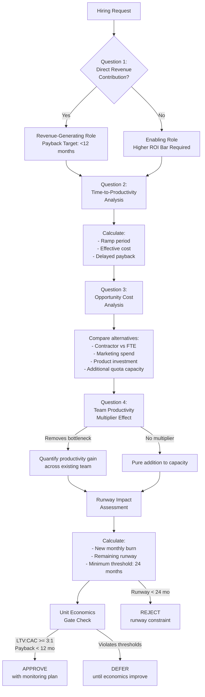
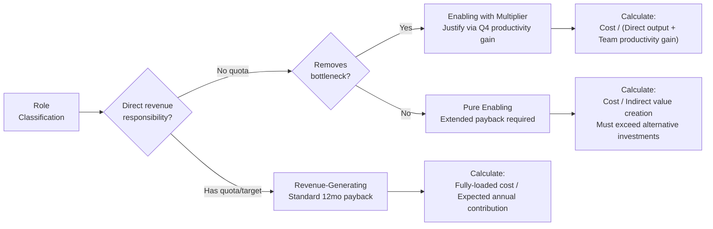
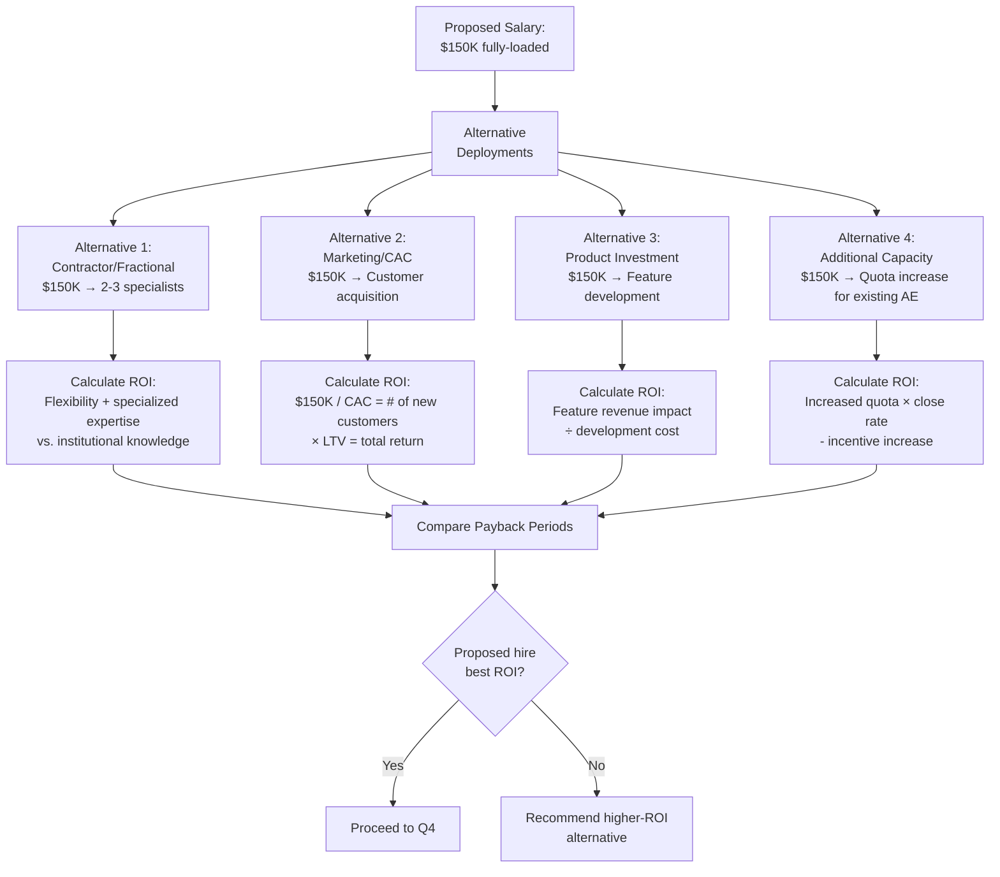
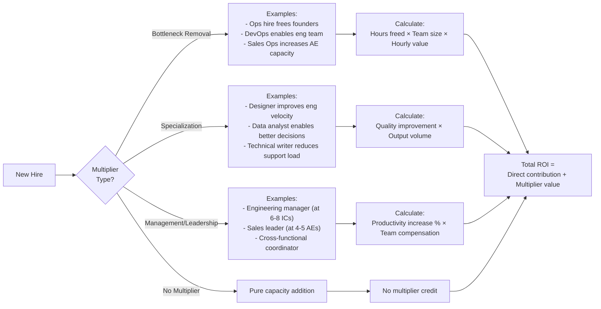
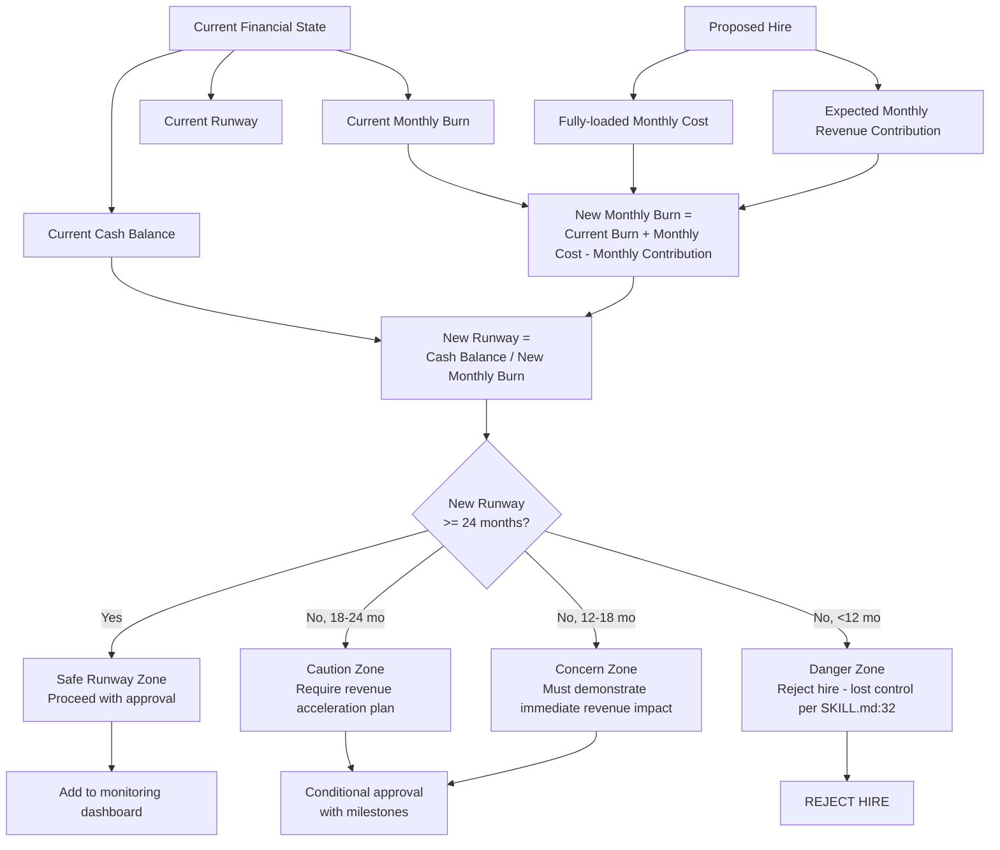
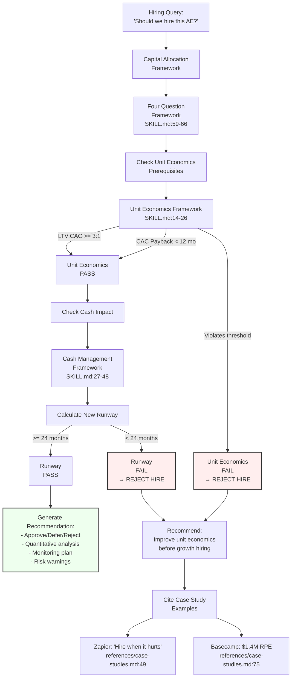

<!-- source: DeepWiki mcp.deepwiki.com · repo EveryInc/charlie-cfo-skill · page 4.1 Evaluating Hiring Decisions · fetched 2026-10-26 -->

# Evaluating Hiring Decisions

<details>
<summary>Relevant source files</summary>

The following files were used as context for generating this wiki page:

- [SKILL.md](SKILL.md)
- [references/case-studies.md](references/case-studies.md)

</details>


## Purpose and Scope

This document provides a comprehensive guide to Charlie's hiring evaluation framework, which applies capital allocation principles to staffing decisions. The framework consists of four sequential questions that assess revenue contribution, productivity timeline, opportunity cost, and team productivity impact. This page details the decision logic, ROI calculation methodology, and runway impact assessment that Charlie uses when processing hiring-related queries.

For broader capital allocation principles beyond hiring, see [Investment and Spending Decisions](#4.2). For the underlying unit economics requirements that gate hiring decisions, see [Unit Economics Framework](#3.2). For cash impact calculations, see [Cash Management Framework](#3.1).

## The Four-Question Hiring Framework

Charlie evaluates every hiring decision through a mandatory four-question sequence defined in [SKILL.md:59-66](). These questions must be answered in order, as each builds on the previous analysis.

### Framework Structure

| Question # | Question | Purpose | Output |
|------------|----------|---------|--------|
| 1 | Will this hire directly contribute to revenue? | Classify role type and set payback expectations | Revenue-generating vs. enabling role classification |
| 2 | What's the time-to-productivity? | Calculate effective cost and payback delay | Adjusted payback period factoring ramp time |
| 3 | What else could this salary fund? | Evaluate opportunity cost | List of alternative investments with ROI comparison |
| 4 | Does this make existing team more productive? | Assess force multiplier effect | Quantified productivity gain or bottleneck removal |



**Sources:** [SKILL.md:59-66]()

## Question 1: Revenue Contribution Analysis

Charlie classifies roles into two categories based on their relationship to revenue generation, which determines the ROI threshold and payback requirements.

### Revenue-Generating Roles

Directly contribute to revenue acquisition or expansion:
- **Sales roles**: Account Executives, SDRs, Account Managers
- **Customer Success** (when tied to expansion/renewal): CSMs with expansion quotas
- **Growth/Marketing** (when directly measurable): Performance marketers with CAC targets

**ROI Threshold:** Standard <12 month payback period as defined in [SKILL.md:51]()

### Enabling Roles

Support revenue generation indirectly or enable future capabilities:
- **Engineering**: Product development, infrastructure, platform
- **Operations**: Finance, HR, legal, administrative
- **Customer Support**: Reactive ticket handling without expansion mandate
- **Marketing** (brand/content): Non-performance focused initiatives

**ROI Threshold:** Must demonstrate clear productivity multiplier effect (Question 4) or have extended payback justification

### Classification Logic



**Sources:** [SKILL.md:59-66](), [SKILL.md:14-18]()

## Question 2: Time-to-Productivity Analysis

Charlie factors ramp time into ROI calculations to determine the effective payback period, which includes both the salary cost during ramp and the delayed revenue contribution.

### Time-to-Productivity by Role Type

| Role Category | Typical Ramp Period | Productivity Curve | Full Cost Impact |
|---------------|---------------------|-------------------|------------------|
| Sales (SMB/Mid-market) | 3-6 months | Linear 0% → 100% | 3-6 months at 50% productivity + full salary |
| Sales (Enterprise) | 6-12 months | Stepped (0% → 30% → 70% → 100%) | 6-12 months at 40% avg productivity + full salary |
| Engineering | 2-4 months | Exponential (slow → fast) | 2-4 months at 60% productivity + full salary |
| Customer Success | 1-3 months | Linear 0% → 100% | 1-3 months at 50% productivity + full salary |
| Support | 2-6 weeks | Linear 0% → 100% | 2-6 weeks at 50% productivity + full salary |

### Adjusted Payback Calculation

```
Effective Payback Period = Standard Payback + (Ramp Period × Productivity Loss Factor)

Where:
- Standard Payback = Fully-loaded Annual Cost / Expected Annual Contribution
- Ramp Period = Months to full productivity
- Productivity Loss Factor = (1 - Average Productivity During Ramp)
```

### Example Calculation

**Scenario:** Account Executive hire, $120K salary + $30K benefits/overhead = $150K fully-loaded

- Expected annual bookings at full productivity: $500K
- Standard payback: $150K / $500K = 3.6 months
- Ramp period: 4 months at 40% average productivity
- Productivity loss: 4 months × 0.6 = 2.4 months
- **Adjusted payback: 3.6 + 2.4 = 6 months** ✓ (within 12-month threshold)

### System Processing

When Charlie receives a hiring query with role details, it extracts:
1. Fully-loaded compensation (salary + benefits + taxes + overhead)
2. Role classification from Question 1
3. Expected contribution metrics (quota, ticket volume, feature velocity)
4. Industry-standard ramp period for role type

Charlie then calculates the adjusted payback and compares against the <12 month threshold from [SKILL.md:51]().

**Sources:** [SKILL.md:59-66](), [SKILL.md:49-66]()

## Question 3: Opportunity Cost Analysis

Charlie evaluates what alternative investments could be made with the proposed salary budget, comparing ROI across different deployment options.

### Alternative Investment Framework



### Standard Alternative Comparisons

| Alternative | Calculation Method | Typical ROI Range | Best Use Case |
|-------------|-------------------|-------------------|---------------|
| **Contractor/Fractional** | (Output/Cost) vs. (FTE Output/FTE Cost) | 0.7-1.3x FTE productivity | Variable workload, specialized skills, testing role |
| **Marketing Spend** | (Customers × LTV) / Investment | Depends on CAC, typically 3-8x over customer lifetime | Strong unit economics (LTV:CAC > 3:1) |
| **Product Investment** | (Feature Revenue - Dev Cost) / Dev Cost | 1.5-5x over 12 months | Clear customer demand, expansion opportunity |
| **Quota Increase** | (Additional Bookings - Incentive Increase) / Incentive Increase | 3-10x | Existing AE underutilized, territory capacity available |

### Example Comparison Table

**Scenario:** Considering $150K Customer Success Manager hire

| Option | Investment | Expected Return (12 months) | Payback Period | ROI |
|--------|-----------|----------------------------|----------------|-----|
| **FTE CSM** | $150K | Reduce churn by 2% = $180K retained ARR | 10 months | 1.2x |
| **Fractional CSM (3 days/week)** | $90K | Reduce churn by 1.5% = $135K retained ARR | 8 months | 1.5x |
| **Automated Onboarding** | $75K | Reduce time-to-value, estimated 1.5% churn reduction = $135K retained ARR | 6.7 months | 1.8x |
| **Enhanced Product Features** | $100K | Reduce churn driver, estimated 2.5% churn reduction = $225K retained ARR | 5.3 months | 2.25x |

**Charlie's Recommendation:** Investigate product feature approach first; if infeasible, proceed with fractional CSM to test before FTE commitment.

**Sources:** [SKILL.md:59-66]()

## Question 4: Team Productivity Multiplier

Charlie assesses whether the hire creates a force multiplier effect by removing bottlenecks or enabling existing team members to be more productive.

### Multiplier Categories



### Multiplier Calculation Methodology

**Bottleneck Removal Example:**
```
Operations Manager hire: $120K fully-loaded
Removes bottleneck: Founders spending 15 hours/week on ops tasks
Founder hourly value: $300/hour (based on revenue responsibility)
Annual multiplier value: 15 hours × 52 weeks × $300 × 2 founders = $468K
Total ROI: Direct ops value + $468K multiplier = $468K+ return on $120K
Payback: ~3 months
```

**Specialization Example:**
```
UX Designer hire: $140K fully-loaded
Engineering team: 5 engineers @ $150K average = $750K total comp
Estimated productivity gain: 15% (less rework, better specs, faster implementation)
Annual multiplier value: $750K × 0.15 = $112.5K
Plus direct output: Improved user experience → estimated 5% conversion increase = $200K
Total return: $312.5K on $140K
Payback: 5.4 months
```

### When to Hire Management

Charlie applies the rule from [SKILL.md:66]() that departments should not grow >50% at once due to training overhead. Management hires are evaluated at specific team size thresholds:

| Role Type | Hire Management At | Rationale | Risk If Too Early |
|-----------|-------------------|-----------|-------------------|
| Engineering Manager | 6-8 individual contributors | Manager can effectively mentor and coordinate | Overhead without value; slows technical execution |
| Sales Manager | 4-5 Account Executives | Manager can coach and optimize process | Reduces agility; adds process overhead |
| Customer Success Lead | 8-10 CSMs | Standardization and best practice sharing becomes valuable | Premature process; individual contributors more effective |

**Sources:** [SKILL.md:59-66](), [SKILL.md:66]()

## Runway Impact Assessment

After passing through Questions 1-4, Charlie calculates the impact on cash runway using the framework from [SKILL.md:29-47]().

### Runway Calculation Integration



### Runway Zones and Actions

| Runway After Hire | Zone | Charlie's Response | Required Actions |
|------------------|------|-------------------|------------------|
| **> 36 months** | Excellent | Approve with standard monitoring | Track actual vs. projected contribution |
| **24-36 months** | Target Zone | Approve; runway meets threshold from [SKILL.md:31]() | Quarterly review of hire's contribution |
| **18-24 months** | Caution | Conditional approval with revenue acceleration plan | Monthly ROI tracking, 90-day checkpoint |
| **12-18 months** | Concern | Defer unless immediate revenue impact proven | Weekly tracking, 30-day checkpoint, contingency plan |
| **< 12 months** | Danger | Reject per "lost control" threshold [SKILL.md:32]() | Focus on cash generation, not growth hires |

### Example Scenario

**Current State:**
- Cash balance: $2.4M
- Monthly burn: $85K
- Current runway: 28.2 months

**Proposed Hire:**
- Sales AE at $150K fully-loaded = $12.5K/month
- Expected contribution: $42K/month in bookings (at full productivity, month 4+)
- Ramp period: 3 months at $0 contribution

**Runway Calculation:**
```
Months 1-3 (ramp):
New burn = $85K + $12.5K = $97.5K
Runway impact = $2.4M / $97.5K = 24.6 months

Months 4+ (full productivity):
Net impact = $12.5K cost - $42K contribution = -$29.5K (reduces burn)
New burn = $85K - $29.5K = $55.5K
Runway = $2.4M / $55.5K = 43.2 months (extends runway)

Conservative assessment: 24.6 months worst-case
```

**Charlie's Decision:** APPROVE - Stays above 24-month threshold; expected to extend runway significantly once productive.

**Sources:** [SKILL.md:29-47](), [SKILL.md:31-33]()

## Integration with Financial Frameworks

Charlie's hiring evaluation integrates three core frameworks to ensure consistent decision-making across the system.

### Framework Dependencies



### Gate Conditions

Charlie enforces hard gates that must pass before approving any hiring decision:

1. **Unit Economics Gate** ([SKILL.md:14-18]()):
   - LTV:CAC ≥ 3:1 (minimum)
   - CAC payback < 12 months
   - Gross margin 70-80% for SaaS
   - **Rationale:** "Violating these creates a death spiral bootstrapped companies cannot survive"

2. **Runway Gate** ([SKILL.md:29-33]()):
   - Post-hire runway ≥ 24 months (minimum)
   - Never enter <12 month "danger zone"
   - **Rationale:** Maintain control; never "fundraise your way out of a cash crisis"

3. **Payback Gate** ([SKILL.md:51]()):
   - Investment payback < 12 months
   - Applies to fully-loaded cost including ramp period
   - **Rationale:** Capital allocation discipline for bootstrapped constraints

### Cross-Framework Validation Flow

When processing a hiring query, Charlie executes this validation sequence:

```
1. Extract hire details (role, compensation, expected contribution)
2. Apply Question 1-4 framework → Calculate ROI
3. Query Unit Economics Framework → Validate LTV:CAC and payback thresholds
4. Query Cash Management Framework → Calculate runway impact
5. Check Rule of 40 impact (growth vs. margin trade-off)
6. Compare to spending benchmarks (SKILL.md:148-154)
7. Generate recommendation with framework citations
8. Include relevant case study examples (references/case-studies.md)
```

**Sources:** [SKILL.md:14-18](), [SKILL.md:27-48](), [SKILL.md:49-66]()

## Query Processing and System Response

Charlie's NLP layer routes hiring-related queries to the Capital Allocation Framework, which invokes the four-question evaluation sequence.

### Query Recognition Patterns

Charlie identifies hiring queries through these patterns:
- "Should we hire [role]?"
- "Can we afford to bring on [role]?"
- "What's the ROI of hiring [role]?"
- "Evaluating [role] hire at [compensation]"
- "Need help deciding on [role] headcount increase"

### Processing Pipeline

```mermaid
sequenceDiagram
    participant User as User
    participant NLP as NLP Intent Recognition
    participant Charlie as Charlie CFO Skill
    participant CapAlloc as Capital Allocation Framework
    participant UnitEcon as Unit Economics Framework
    participant Cash as Cash Management Framework
    participant Refs as Reference Knowledge Base
    
    User->>NLP: "Should we hire a $150K AE<br/>expecting $500K annual bookings?"
    NLP->>NLP: Identify as hiring decision
    NLP->>Charlie: Route to Charlie with context
    
    Charlie->>CapAlloc: Invoke hiring evaluation
    CapAlloc->>CapAlloc: Parse: Role=AE, Cost=$150K, Contribution=$500K
    
    CapAlloc->>CapAlloc: Question 1: Revenue-generating role ✓
    CapAlloc->>CapAlloc: Question 2: Calculate payback with ramp<br/>3.6 months + 2.4 months ramp = 6 months
    
    CapAlloc->>Refs: Request alternative investment data
    Refs-->>CapAlloc: Marketing ROI, contractor rates, product investment returns
    CapAlloc->>CapAlloc: Question 3: Compare alternatives<br/>AE hire = 6mo payback vs. alternatives
    
    CapAlloc->>CapAlloc: Question 4: Multiplier effect?<br/>Sales Ops bottleneck removal?
    
    CapAlloc->>UnitEcon: Validate current LTV:CAC
    UnitEcon-->>CapAlloc: LTV:CAC = 4.2:1 ✓, Payback = 8 months ✓
    
    CapAlloc->>Cash: Calculate runway impact
    Cash->>Cash: Current runway: 28 months<br/>New burn with hire: 24.6 months during ramp
    Cash-->>CapAlloc: Runway impact: 24.6 months ✓ (meets threshold)
    
    CapAlloc->>Refs: Retrieve relevant case studies
    Refs-->>CapAlloc: Zapier "hire when it hurts",<br/>Basecamp RPE targets
    
    CapAlloc->>Charlie: Compiled analysis with recommendation
    
    Charlie->>User: Structured Response:<br/>✓ APPROVE hire<br/>✓ Payback: 6 months (within 12mo target)<br/>✓ Runway: 24.6 months (meets 24mo threshold)<br/>✓ Monitoring: Track monthly bookings vs. $42K target<br/>✓ Context: Zapier maintained lean teams,<br/>&nbsp;&nbsp;&nbsp;&nbsp;hired only "when it hurt"<br/>⚠ Caution: Assumes 4-month ramp to full productivity
```

### Response Structure

Charlie's hiring decision responses follow this template:

```markdown
## Hiring Decision: [Role] at [Compensation]

### RECOMMENDATION: [APPROVE / DEFER / REJECT]

### Quantitative Analysis
- **Payback Period**: [X] months ([within/exceeds] 12-month target)
- **Runway Impact**: [Current] → [New] months ([meets/violates] 24-month threshold)
- **ROI Calculation**: 
  - Fully-loaded cost: [amount]
  - Expected contribution: [amount]
  - Net return Year 1: [amount] ([X]x)

### Framework Validation
✓/✗ Unit Economics: LTV:CAC = [X]:[Y] (threshold: 3:1)
✓/✗ Payback: [X] months (threshold: <12 months)
✓/✗ Runway: [X] months (threshold: ≥24 months)
✓/✗ Rule of 40: [Growth%] + [Margin%] = [X]% (threshold: ≥40%)

### Alternative Investments Considered
[Table comparing this hire to alternatives]

### Team Productivity Impact
[Multiplier effect analysis or "none" if pure capacity add]

### Real-World Context
[Relevant case study excerpt from references/case-studies.md]

### Monitoring & Milestones
- [30-day checkpoint]: [Expected outcome]
- [90-day checkpoint]: [Expected outcome]
- [Monthly tracking]: [KPIs to monitor]

### Risk Warnings
[Any threshold violations or concerns]
```

**Sources:** [SKILL.md:59-66](), [SKILL.md:1-4]()

## Common Scenarios and Charlie's Logic

### Scenario 1: First Sales Hire

**Query:** "Should we hire our first Account Executive at $120K + $30K OTE?"

**Charlie's Analysis:**
- Role classification: Revenue-generating
- Payback calculation: ($120K + $30K + $30K overhead) / $600K expected = 3.6 months
- Ramp consideration: 4-6 months to first deals = extended payback to ~8 months
- Opportunity cost: Founder-led sales vs. AE
- Multiplier effect: Frees founder for product/strategy
- Unit economics check: Must already have proven LTV:CAC from founder sales
- Runway impact: Critical that current runway > 30 months to absorb ramp period

**Typical Recommendation:** APPROVE if unit economics proven and runway > 30 months. Defer if founders haven't validated sales process (would waste hire ramping on unproven model).

### Scenario 2: Engineering Manager Hire

**Query:** "Team of 5 engineers, considering $180K Engineering Manager"

**Charlie's Analysis:**
- Role classification: Enabling (no direct revenue)
- Team size check: 5 engineers at lower end of 6-8 threshold
- Payback calculation: Must demonstrate productivity multiplier
- Multiplier analysis: 
  - If team is blocked on coordination: Clear multiplier value
  - If team is executing well: Premature hire, overhead cost
- Alternative: Senior IC who can mentor while contributing technically
- Runway impact: Pure cost with no revenue offset

**Typical Recommendation:** DEFER until team reaches 6-7 engineers unless clear productivity bottleneck documented. Suggest senior IC as alternative.

### Scenario 3: Hire During Growth Phase

**Query:** "Growing 40% YoY, $5M ARR, hiring 3 AEs simultaneously at $450K total"

**Charlie's Analysis:**
- Growth rate check: 40% growth validates capacity need
- Simultaneous hires: 3 AEs violates 50% growth rule [SKILL.md:66]()
- Training overhead: Onboarding 3 simultaneously reduces productivity to near-zero
- Runway calculation: $450K annualized = $37.5K monthly burn increase
- Alternative: Staged hiring (hire #1, wait 60-90 days, hire #2, etc.)

**Typical Recommendation:** REJECT simultaneous hiring. Approve staged approach: Hire 1 now, next after 60 days, third after another 60 days. Cite [references/case-studies.md:49]() - Zapier's "hire when it hurts" philosophy.

### Scenario 4: Non-Revenue Hire with Multiplier

**Query:** "Hire $110K Operations Manager to remove bottleneck; founders spending 20hrs/week on ops"

**Charlie's Analysis:**
- Role classification: Enabling role
- Multiplier calculation:
  - Founders: 20 hrs/week × 2 founders = 40 hrs/week × 52 weeks = 2,080 hours annually
  - Founder value: $200-300/hour based on revenue responsibility
  - Annual multiplier value: 2,080 × $250 = $520K
- ROI: $520K return on $110K cost = 2.5 months payback
- Runway impact: $9.2K monthly cost, but frees founders for revenue activities
- Net effect: Likely accelerates revenue, reduces effective burn

**Typical Recommendation:** STRONG APPROVE. Clear bottleneck removal with quantified multiplier. Monitor founder time reallocation to ensure redirected to revenue activities.

**Sources:** [SKILL.md:59-66](), [SKILL.md:66](), [references/case-studies.md:1-183]()

## Monitoring and Post-Hire Validation

After approving a hire, Charlie recommends adding tracking to the Key Metrics Dashboard defined in [SKILL.md:112-121]().

### Standard Monitoring Framework

| Checkpoint | Timeline | Metrics | Action Threshold |
|------------|----------|---------|------------------|
| **Onboarding** | Weeks 1-4 | - Role setup completion<br/>- Training milestones<br/>- Initial productivity | If behind schedule, escalate ramp timeline concerns |
| **Initial Productivity** | Month 2-3 | - Output vs. expected<br/>- First revenue contribution (if applicable)<br/>- Team feedback | If <50% of expected productivity, evaluate fit or training gaps |
| **Ramp Validation** | Month 4-6 | - Achievement of ramp milestones<br/>- Revenue contribution<br/>- Payback tracking | If payback extending beyond 12 months, evaluate role or market conditions |
| **Full Productivity** | Month 6-12 | - Full output vs. projections<br/>- ROI realization<br/>- Multiplier effects | If not hitting projections, decide continue/restructure/exit |
| **Annual Review** | Month 12 | - Total ROI calculation<br/>- Runway impact actual vs. projected<br/>- Continued value assessment | Compare to alternatives; determine retention strategy |

### Dashboard Integration

Charlie recommends adding hire-specific metrics to the appropriate dashboard category:

**For Revenue-Generating Roles:**
- Add to Revenue dashboard: Individual bookings/quota attainment
- Track contribution to NRR and growth targets
- Monitor against Unit Economics: CAC impact, LTV:CAC ratio maintenance

**For Enabling Roles:**
- Add to efficiency tracking: Team productivity metrics
- Monitor runway impact: Actual burn vs. projected
- Track multiplier realization: Hours freed, bottleneck removal validation

**Weekly Review Items** ([SKILL.md:93-99]()):
- Revenue roles: Pipeline movement, bookings progress
- All roles: Cash impact validation

**Monthly Review Items** ([SKILL.md:100-104]()):
- ROI tracking vs. projection
- Payback timeline validation
- Variance analysis if underperforming

**Sources:** [SKILL.md:92-121](), [SKILL.md:112-121]()

## Case Study Applications

Charlie cites specific examples from [references/case-studies.md]() to provide context for hiring decisions.

### Zapier: "Hire When It Hurts"

**Application:** Validates extreme selectivity in hiring decisions

From [references/case-studies.md:49]():
> "Hire when it hurts" philosophy: Kept team extremely lean during growth phase. Each hire had to prove necessity through pain.

**Charlie's Usage:** When user proposes preemptive hiring (before clear need), cites Zapier's discipline of waiting until productivity bottleneck clearly documented. Example: "Zapier waited until pain was evident before hiring, ensuring each role was justified by proven need rather than projected growth."

### Basecamp: $1.4M Revenue Per Employee

**Application:** Sets RPE benchmark for efficiency assessment

From [references/case-studies.md:75]():
> Revenue per employee: ~$1.4M. Among highest in software industry. Proves lean teams can build massive value.

**Charlie's Usage:** When evaluating headcount expansion, compares user's current RPE to Basecamp's $1.4M target. If user at $200K RPE with $5M ARR, highlights 7x gap and suggests focus on productivity over headcount. Validates that 25-person team could theoretically support $35M ARR at Basecamp efficiency levels.

### ConvertKit: 51% Margin Turnaround

**Application:** Demonstrates that cost discipline can be implemented rapidly

From [references/case-studies.md:103-116]():
> Crisis response: When rapid growth nearly depleted cash: 1. Aggressive cost cuts across all departments... Result: 51% profit margin achieved in 5 months.

**Charlie's Usage:** When user proposes hiring while runway concerning, cites ConvertKit's rapid margin improvement to emphasize that if hire doesn't materialize value, course correction is possible but disruptive. Encourages higher confidence threshold before hiring in marginal runway situations.

### Zoho: 60% R&D Investment

**Application:** Justifies non-standard allocation patterns when strategic

From [references/case-studies.md:135]():
> R&D investment: 60% of revenue into R&D. 3.5x industry average. Builds long-term moat through product breadth.

**Charlie's Usage:** When user proposes engineering hire that seems high relative to benchmarks ([SKILL.md:152]()), validates if strategic R&D investment with long-term moat-building rationale. Distinguishes between "undisciplined R&D spend" and "Zoho-style strategic product investment."

**Sources:** [references/case-studies.md:1-183]()

---

This document provides the complete framework Charlie uses to evaluate hiring decisions, integrating capital allocation principles, unit economics constraints, and cash management discipline into a systematic decision process that maintains the financial health of bootstrapped startups.

---

