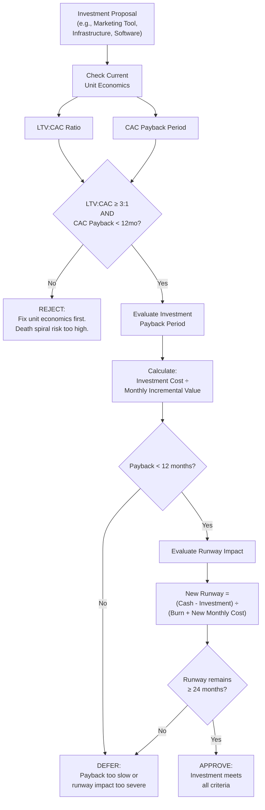
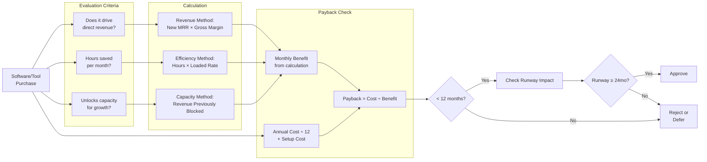
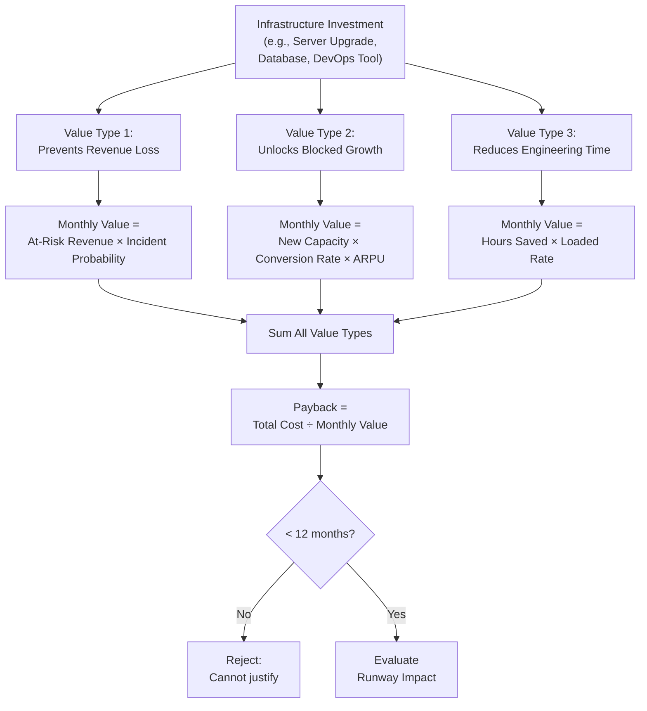
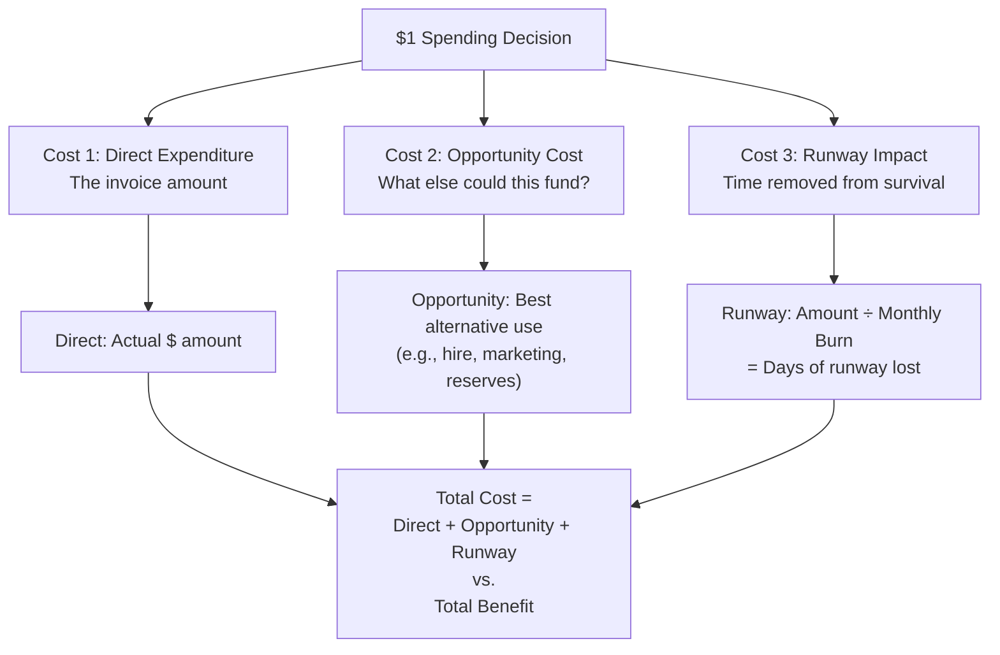
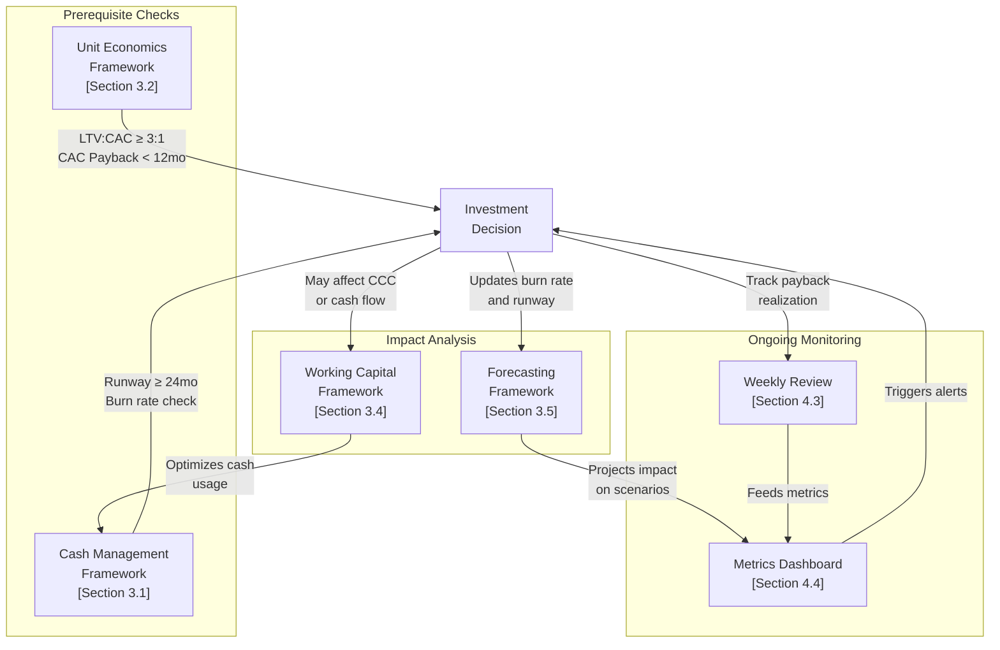
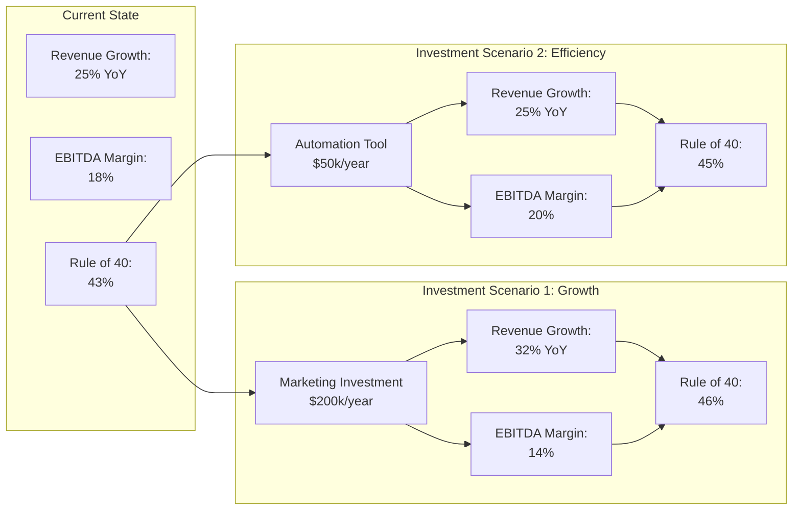

<!-- source: DeepWiki mcp.deepwiki.com · repo EveryInc/charlie-cfo-skill · page 4.2 Investment and Spending Decisions · fetched 2026-10-26 -->

# Investment and Spending Decisions

<details>
<summary>Relevant source files</summary>

The following files were used as context for generating this wiki page:

- [SKILL.md](SKILL.md)
- [references/metrics-benchmarks.md](references/metrics-benchmarks.md)

</details>


## Purpose and Scope

This page provides a practical guide for evaluating any capital investment or spending decision at a bootstrapped startup using Charlie's capital allocation framework. The focus is on applying the **<12 month payback period rule** and **unit economics constraints** to decisions like software purchases, marketing campaigns, infrastructure investments, contractor engagements, or any non-hiring expenditure.

For hiring-specific decisions, see [4.1 Evaluating Hiring Decisions](#4.1). For the theoretical foundation of the capital allocation framework, see [3.3 Capital Allocation Framework](#3.3). For unit economics theory and calculations, see [3.2 Unit Economics Framework](#3.2).

---

## The Fundamental Investment Question

Charlie enforces a single critical question for every investment decision: **What is the payback period?** The target is **<12 months**.

This constraint appears in [SKILL.md:51]() as: `**Every investment question:** What is the payback period? Target <12 months.`

The payback period represents the time required for an investment to generate enough incremental value to recover its cost. For bootstrapped companies operating under capital constraints, this threshold ensures that:

1. **Capital remains available** - Slow-payback investments tie up cash needed for runway
2. **Optionality is preserved** - Quick returns allow redeployment to better opportunities
3. **Risk is minimized** - Shorter exposure windows reduce uncertainty

**Sources:** [SKILL.md:49-67]()

---

## Unit Economics as Investment Gates

Before evaluating any investment's payback period, Charlie enforces that **unit economics must be healthy**. These are survival requirements, not aspirational goals, as stated in [SKILL.md:14-18]():

```
**Unit economics are survival requirements:**

- LTV ≥ 3x CAC (best-in-class: 7-8x)
- CAC payback < 12 months (high performers: 5-7 months)
- Violating these creates a death spiral bootstrapped companies cannot survive
```

### The Gate Logic



**Diagram:** Investment Decision Gate Flow

This diagram shows the hard gate enforced by unit economics. If LTV:CAC or CAC payback violate thresholds, no investment should be approved regardless of its own merits—the company is in a "death spiral" state where any additional cash burn accelerates failure.

**Sources:** [SKILL.md:14-18](), [SKILL.md:49-67](), [SKILL.md:29-47]()

---

## Investment Decision Framework

Charlie applies a structured five-step framework to evaluate any investment:

### Step 1: Define the Incremental Value

What measurable value does this investment generate? Common value types:

| Value Type | Measurement | Example |
|------------|-------------|---------|
| **Direct Revenue** | Incremental MRR/ARR | Sales tool that increases conversion rate |
| **Cost Reduction** | Monthly savings | Automation replacing manual process |
| **Efficiency Gain** | Time saved × hourly value | Tool that reduces engineering hours |
| **Risk Mitigation** | Expected loss prevented | Security investment preventing breach |
| **Capacity Unlock** | Revenue previously blocked | Infrastructure supporting growth |

**Critical Rule:** If value cannot be quantified, the investment cannot be properly evaluated and should default to rejection.

### Step 2: Calculate Monthly Benefit

Convert the incremental value to a monthly financial benefit:

```
Monthly Benefit = Monthly Revenue Increase + Monthly Cost Savings + Monthly Value Created
```

For efficiency gains:
```
Monthly Benefit = Hours Saved per Month × Fully-Loaded Hourly Rate
```

The fully-loaded hourly rate should include salary, benefits, overhead (typically 1.3-1.5x base salary), then divide by 160 working hours per month.

### Step 3: Calculate Payback Period

```
Payback Period (months) = Total Investment Cost / Monthly Benefit
```

Where:
- **Total Investment Cost** = Upfront cost + Implementation cost + Training cost + Monthly recurring cost × 12
- **Monthly Benefit** = From Step 2

**Threshold:** Must be < 12 months to proceed.

### Step 4: Evaluate Runway Impact

Calculate the impact on runway using the methodology from [SKILL.md:29-33]():

```
Current Runway = Current Cash Balance / Current Monthly Burn

New Monthly Burn = Current Monthly Burn + New Recurring Costs

Investment Impact on Cash = Current Cash - Upfront Investment Cost

New Runway = Investment Impact on Cash / New Monthly Burn
```

**Threshold:** New Runway must remain ≥ 24 months (per [SKILL.md:31]()).

### Step 5: Check Burn Multiple Impact

If the investment affects revenue generation (e.g., marketing spend), evaluate its efficiency using the Burn Multiple from [SKILL.md:42-47]():

```
Burn Multiple = Net Burn / Net New ARR
```

For a proposed marketing investment:
```
Projected Burn Multiple = (Current Burn + Marketing Spend) / Expected ARR Increase
```

**Threshold:** 
- <1x: Excellent (profitable growth)
- 1-1.5x: Good
- >2x: Concerning, reject

**Sources:** [SKILL.md:49-67](), [SKILL.md:42-47](), [references/metrics-benchmarks.md:66-81]()

---

## Investment Type Evaluation Matrix

Different investment types require different evaluation approaches:

### Software and Tools



**Diagram:** Software Investment Evaluation Flow

**Example Calculation:**

Consider a $500/month CRM tool that sales team claims will improve close rate from 15% to 18% on $50k monthly pipeline:

```
Incremental Revenue = $50,000 × (18% - 15%) = $1,500/month
Gross Margin = 75% (from SKILL.md line 119 target)
Monthly Benefit = $1,500 × 0.75 = $1,125

Annual Cost = $500 × 12 = $6,000
Setup Cost = $1,000 (training, data migration)
Total Cost = $7,000

Payback Period = $7,000 / $1,125 = 6.2 months ✓ (< 12 months)
```

### Marketing Campaigns

Marketing investments must satisfy both payback and unit economics constraints:

| Metric | Calculation | Threshold |
|--------|-------------|-----------|
| **CAC with campaign** | (Existing S&M + Campaign) / Customers | Must maintain CAC < LTV/3 |
| **CAC Payback** | New CAC / (Monthly ARPU × Gross Margin) | < 12 months |
| **Campaign ROI** | Campaign Cost / (New ARR × Gross Margin) | < 12 month payback |
| **Burn Multiple Impact** | (Burn + Campaign) / New ARR from campaign | < 1.5x |

**Example:** A $10,000 advertising campaign projects 25 new customers at $200 ARPU:

```
New ARR = 25 customers × $200 × 12 = $60,000
Gross Margin = 75%
Annual Gross Profit = $60,000 × 0.75 = $45,000
Monthly Gross Profit = $3,750

Payback Period = $10,000 / $3,750 = 2.7 months ✓

CAC for campaign = $10,000 / 25 = $400
LTV = ($200 × 0.75) / 0.02 churn = $7,500 (using benchmarks)
LTV:CAC = $7,500 / $400 = 18.75:1 ✓ (well above 3:1 minimum)
```

### Infrastructure and Capacity

Infrastructure investments often have indirect value requiring careful estimation:



**Diagram:** Infrastructure Investment Value Calculation

**Example:** Database upgrade costing $15,000 that:
- Prevents monthly outages currently losing $2,000 in revenue
- Saves 40 engineering hours/month at $100/hr loaded rate
- Unlocks ability to onboard 10 more customers/month at $200 ARPU

```
Value 1: $2,000/month (prevented loss)
Value 2: 40 hrs × $100 = $4,000/month (efficiency)
Value 3: 10 × $200 = $2,000/month (capacity)

Total Monthly Value = $8,000
Payback = $15,000 / $8,000 = 1.9 months ✓
```

### Professional Services and Contractors

Contractor engagements require comparing against internal capacity and opportunity cost:

```
Monthly Contractor Cost = Rate × Hours
Monthly Value Delivered = Output Value / Delivery Time

Payback = (Onboarding Cost + First Month Cost) / (Monthly Value - Monthly Cost)
```

**Key Question from [SKILL.md:63]():** "What else could this salary fund?"

For a contractor at $10,000/month, that represents:
- 2 months of runway extension at $5,000 burn
- A software tool that might provide similar value
- Cash reserves against uncertainty

**Sources:** [SKILL.md:49-67](), [references/metrics-benchmarks.md:1-33]()

---

## Trade-Off Analysis and Opportunity Cost

Charlie enforces consideration of opportunity cost per [SKILL.md:12](): "Every dollar has three costs: direct expenditure, opportunity cost, and runway impact."

### The Three-Cost Framework



**Diagram:** Three-Cost Investment Framework

### Opportunity Cost Comparison Table

When evaluating a $50,000 investment, compare against alternatives:

| Alternative Use | Value Generated | Payback | Comparison |
|-----------------|-----------------|---------|------------|
| **Proposed Investment** | $5,000/month | 10 months | Baseline |
| **Marketing Campaign** | $8,000/month | 6.25 months | Better payback |
| **Sales Hire** | $12,000/month | 4.2 months | Much better, but increases burn |
| **Cash Reserve** | 10 months runway | N/A | Option value + risk mitigation |
| **Infrastructure** | $3,000/month | 16.7 months | Worse payback |

**Decision Logic:** Choose the option with:
1. Best payback period (< 12 months)
2. Highest monthly value generation
3. Lowest ongoing burn increase
4. Best alignment with strategic priorities

**Sources:** [SKILL.md:12](), [SKILL.md:49-67]()

---

## Red Flags and Automatic Rejections

Charlie enforces automatic rejection for investments that violate critical thresholds:

### Hard Rejection Criteria

```mermaid
graph LR
    Investment["Investment Proposal"]
    
    Check1{"Unit Economics<br/>Healthy?<br/>(LTV:CAC ≥ 3:1)"}
    Check2{"Payback<br/>< 12 months?"}
    Check3{"Runway remains<br/>≥ 24 months?"}
    Check4{"Can quantify<br/>value?"}
    Check5{"Burn Multiple<br/>< 2x?"}
    
    Investment --> Check1
    Check1 -->|No| Reject1["REJECT: Death spiral risk"]
    Check1 -->|Yes| Check2
    
    Check2 -->|No| Reject2["REJECT: Too slow payback"]
    Check2 -->|Yes| Check3
    
    Check3 -->|No| Reject3["REJECT: Runway danger zone"]
    Check3 -->|Yes| Check4
    
    Check4 -->|No| Reject4["REJECT: Cannot measure value"]
    Check4 -->|Yes| Check5
    
    Check5 -->|No| Reject5["REJECT: Inefficient burn"]
    Check5 -->|Yes| Approve["APPROVE"]
    
    style Reject1 fill:#000,stroke:#333
    style Reject2 fill:#000,stroke:#333
    style Reject3 fill:#000,stroke:#333
    style Reject4 fill:#000,stroke:#333
    style Reject5 fill:#000,stroke:#333
```



**Diagram:** Investment Rejection Gate Sequence

### Red Flag Categories

| Red Flag | Threshold | Source | Action |
|----------|-----------|--------|--------|
| **Poor Unit Economics** | LTV:CAC < 3:1 | [SKILL.md:16]() | Fix unit economics before any investment |
| **Slow CAC Payback** | > 12 months | [SKILL.md:17]() | No new customer acquisition spend |
| **Low Runway** | < 24 months | [SKILL.md:31]() | Preserve cash, reject non-critical |
| **Danger Zone Runway** | < 12 months | [SKILL.md:32]() | "You've lost control" - emergency mode |
| **High Burn Multiple** | > 2x | [SKILL.md:46]() | Inefficient growth, cut spending |
| **Unquantifiable Value** | Cannot calculate payback | — | Default to rejection |
| **Department Growth** | > 50% headcount increase | [SKILL.md:66]() | Productivity drops to zero |

### Warning Signals

Investments that should trigger additional scrutiny:

```
⚠️ "Strategic" or "long-term" justifications without specific metrics
⚠️ Payback period 9-12 months (technically passes but close to threshold)
⚠️ Value dependent on multiple uncertain assumptions
⚠️ Recurring cost that compounds (e.g., per-seat pricing as team grows)
⚠️ "Everyone else is using this" without unit economics analysis
⚠️ Vendor-provided ROI calculations without independent verification
⚠️ Investments justified by "we might need this later"
```

**Sources:** [SKILL.md:14-18](), [SKILL.md:29-33](), [SKILL.md:42-47](), [SKILL.md:66]()

---

## Decision Matrix and Recommendation Outputs

Charlie structures investment recommendations using this decision matrix:

### Investment Decision Matrix

| Criteria | Excellent | Good | Acceptable | Concerning | Reject |
|----------|-----------|------|------------|------------|--------|
| **Payback Period** | < 6 months | 6-9 months | 9-12 months | 12-18 months | > 18 months |
| **LTV:CAC Impact** | Improves ratio | No impact | Slight degradation | Near 3:1 threshold | Violates 3:1 |
| **Runway Impact** | +runway (saves cash) | Neutral | 0-6 mo reduction | 6-12 mo reduction | > 12 mo reduction |
| **Value Quantification** | Direct revenue | Time savings | Capacity unlock | Risk mitigation | Unquantifiable |
| **Burn Multiple Impact** | Improves | Neutral | Slight increase | Approaches 2x | Exceeds 2x |

### Recommendation Output Format

When Charlie evaluates an investment, it structures guidance as:

```
INVESTMENT: [Description]
COST: [Upfront + Annual Recurring]

FINANCIAL ANALYSIS:
✓/✗ Unit Economics Status: [LTV:CAC ratio and payback period]
✓/✗ Investment Payback: [X months] (Target: < 12)
✓/✗ Runway Impact: [Current → New runway] (Target: ≥ 24 months)
✓/✗ Burn Multiple Impact: [Current → New] (Target: < 1.5x)

QUANTIFIED VALUE:
- [Value Type 1]: $X/month
- [Value Type 2]: $Y/month
Total Monthly Benefit: $Z/month

OPPORTUNITY COST:
This $[amount] could alternatively fund:
- [Alternative 1] with [X] months payback
- [Alternative 2] with [Y] months payback
- [Runway extension] of [Z] months

RECOMMENDATION: [APPROVE / DEFER / REJECT]
Rationale: [Specific reasons based on thresholds]

FOLLOW-UP:
- [Action item 1 if approved]
- [Metric to track]
- [Review timeline]
```

### Scenario Example Output

```
INVESTMENT: Marketing automation platform
COST: $2,000 setup + $800/month ($11,600 first year)

FINANCIAL ANALYSIS:
✓ Unit Economics Status: LTV:CAC = 5.2:1, CAC Payback = 8 months (healthy)
✓ Investment Payback: 7.3 months (Target: < 12) ✓
✗ Runway Impact: 28 months → 26 months (Target: ≥ 24 months) ⚠️
✓ Burn Multiple Impact: 1.2x → 1.25x (Target: < 1.5x) ✓

QUANTIFIED VALUE:
- Email conversion improvement: +$800/month in MRR
- Sales team efficiency: 20 hrs/month × $100 = $2,000/month
- Lead nurturing automation: +$400/month in MRR
Total Monthly Benefit: $3,200/month (after $800 subscription = $2,400 net)

Payback Calculation: $11,600 / $2,400 = 4.8 months initial, then 7.3 months blended

OPPORTUNITY COST:
This $11,600 could alternatively fund:
- Junior sales hire for 2 months (likely better long-term value)
- Marketing campaign with projected 6-month payback
- Runway extension of 2.3 months

RECOMMENDATION: APPROVE with conditions

Rationale: 
- Payback period comfortably under 12-month threshold
- Unit economics remain healthy
- Runway impact minimal (2 months reduction but stays above 24-month minimum)
- Quantifiable efficiency gains in sales process

CONDITIONS:
- Track actual conversion rate improvement monthly
- Review at 6 months: if value not materializing, cancel
- Do not add additional marketing tools for 12 months (one at a time)

FOLLOW-UP METRICS:
- Email → Demo conversion rate (target: +3% improvement)
- Sales hours spent on manual lead management (target: -20 hrs/month)
- Marketing qualified leads → Sales qualified leads ratio
```

**Sources:** [SKILL.md:49-67](), [references/metrics-benchmarks.md:1-199]()

---

## Integration with Other Frameworks

Investment decisions integrate with Charlie's other frameworks as shown in the dependency structure:



**Diagram:** Investment Decision Framework Integration

### Framework Cross-References

| Framework | Integration Point | Reference |
|-----------|-------------------|-----------|
| **Unit Economics** | LTV:CAC must be ≥ 3:1 before approving growth investments | [3.2 Unit Economics Framework](#3.2) |
| **Cash Management** | Investment must preserve ≥ 24 month runway | [3.1 Cash Management Framework](#3.1) |
| **Forecasting** | Investment outcomes modeled in three scenarios | [3.5 Forecasting Approach](#3.5) |
| **Working Capital** | Payment terms affect CCC and cash flow timing | [3.4 Working Capital Optimization](#3.4) |
| **Hiring Decisions** | "What else could this fund?" often means a hire | [4.1 Evaluating Hiring Decisions](#4.1) |
| **Financial Reviews** | Investment payback tracked in weekly reviews | [4.3 Financial Review Rhythms](#4.3) |

**Sources:** [SKILL.md:49-67](), [SKILL.md:14-18](), [SKILL.md:29-33](), [SKILL.md:92-110]()

---

## Spending Benchmarks by ARR Stage

Charlie uses spending benchmarks from [references/metrics-benchmarks.md:139-167]() to provide context for investment decisions at different company stages:

### Benchmark Comparison Table

| Category | $1-3M ARR | $3-10M ARR | $10M+ ARR | Your Company |
|----------|-----------|------------|-----------|--------------|
| **Sales** | 15-20% | 10-15% | 8-12% | _[Calculate]_ |
| **Marketing** | 10-15% | 8-12% | 6-10% | _[Calculate]_ |
| **R&D** | 30-40% | 25-30% | 20-25% | _[Calculate]_ |
| **Customer Success** | 10-15% | 8-12% | 6-10% | _[Calculate]_ |
| **G&A** | 15-20% | 12-15% | 10-12% | _[Calculate]_ |
| **Total** | 80-110% | 63-84% | 50-69% | _[Calculate]_ |

**Context from [SKILL.md:147-154]():**
```
## Spending Benchmarks ($3-5M ARR)

- Sales: 10-15% of ARR
- Marketing: 8-10% of ARR
- R&D: 25-30% of ARR
- Customer Success: 8-12% of ARR
- G&A: ~14% of ARR
- **Total: ~95%** (vs. 107% for VC-backed)
```

### Using Benchmarks in Investment Decisions

When evaluating an investment, Charlie compares current spending allocation to these benchmarks:

**Example Analysis:**
```
Company: $5M ARR, considering $100k/year marketing tool

Current Marketing Spend: $450k (9% of ARR) → Within benchmark range
Proposed Marketing Spend: $550k (11% of ARR) → Approaching upper limit
Investment: Would push to top of benchmark range

Context: Marketing efficiency (Magic Number = 0.6) suggests underinvestment
Recommendation: Approve if payback < 12 months, as currently below optimal spend
```

This prevents over-spending in any single category while identifying under-investment opportunities.

**Sources:** [SKILL.md:147-154](), [references/metrics-benchmarks.md:139-167]()

---

## Rule of 40 Considerations

Investment decisions affect the **Rule of 40** balance per [SKILL.md:53-57]():

```
Rule of 40: Revenue Growth % + EBITDA Margin % ≥ 40%
```

### Investment Impact on Rule of 40



**Diagram:** Investment Impact on Rule of 40 Balance

### Decision Logic by Rule of 40 Position

| Current Position | Investment Type to Favor | Rationale |
|------------------|--------------------------|-----------|
| **High growth, low margin** (e.g., 35% + 8%) | Efficiency investments | Improve margin without sacrificing growth |
| **High margin, low growth** (e.g., 12% + 30%) | Growth investments | Have margin cushion to invest in growth |
| **Balanced** (e.g., 20% + 22%) | Either, based on payback | Maintain balance while optimizing |
| **Below Rule of 40** (e.g., 18% + 15%) | Efficiency first, then growth | Fix operations before scaling |

From [references/metrics-benchmarks.md:168-180]():
```
Median SaaS: 34% (most don't hit 40)
Top quartile bootstrapped: 50%+
```

Charlie targets the bootstrapped top quartile (50%+) rather than the VC-backed median.

**Sources:** [SKILL.md:53-57](), [references/metrics-benchmarks.md:168-180]()

---

## Summary: Investment Decision Checklist

Charlie's investment evaluation follows this checklist:

### Pre-Decision Checklist

- [ ] **Unit Economics Health**
  - [ ] LTV:CAC ≥ 3:1 (from [SKILL.md:16]())
  - [ ] CAC payback < 12 months (from [SKILL.md:17]())
  
- [ ] **Value Quantification**
  - [ ] Revenue impact calculated in $/month
  - [ ] Cost savings calculated in $/month
  - [ ] Efficiency gains converted to $ value
  - [ ] Total monthly benefit determined

- [ ] **Payback Calculation**
  - [ ] Total investment cost (upfront + recurring × 12)
  - [ ] Monthly benefit (net of new recurring costs)
  - [ ] Payback period = Cost / Benefit
  - [ ] Payback < 12 months

- [ ] **Runway Impact**
  - [ ] Current runway calculated
  - [ ] Post-investment runway calculated
  - [ ] Post-investment runway ≥ 24 months

- [ ] **Burn Multiple Check** (if revenue-related)
  - [ ] Current burn multiple calculated
  - [ ] Post-investment burn multiple calculated
  - [ ] Post-investment burn multiple < 2x

- [ ] **Opportunity Cost Analysis**
  - [ ] Best alternative use identified
  - [ ] Alternative payback calculated
  - [ ] Comparative analysis completed

- [ ] **Benchmark Context**
  - [ ] Current category spend % of ARR
  - [ ] Post-investment category spend % of ARR
  - [ ] Within benchmark range for company stage

### Post-Decision Tracking

- [ ] Payback realization metrics defined
- [ ] Weekly tracking in financial review (from [SKILL.md:93-98]())
- [ ] Review milestone at 6 months
- [ ] Cancellation criteria if value not realized

**Sources:** [SKILL.md:49-67](), [SKILL.md:14-18](), [SKILL.md:29-33](), [SKILL.md:93-98]()

---

