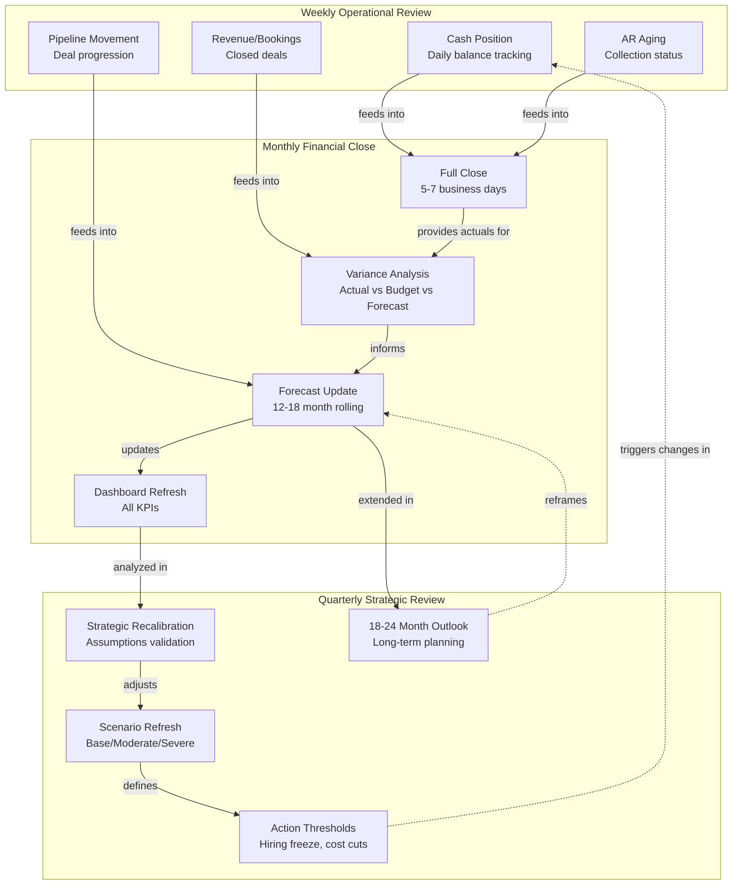
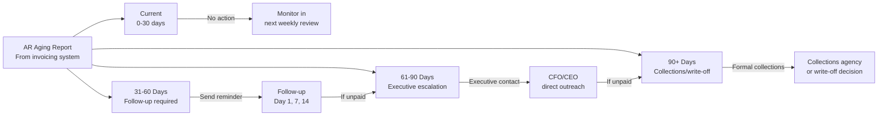
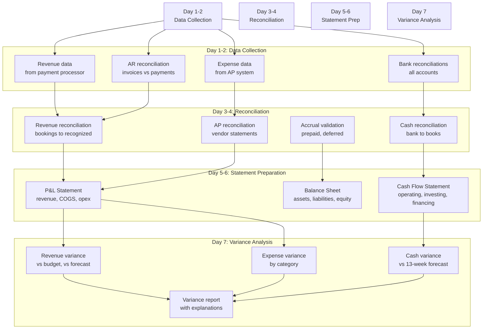
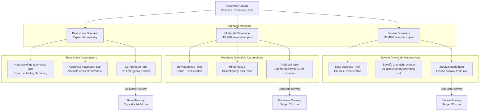
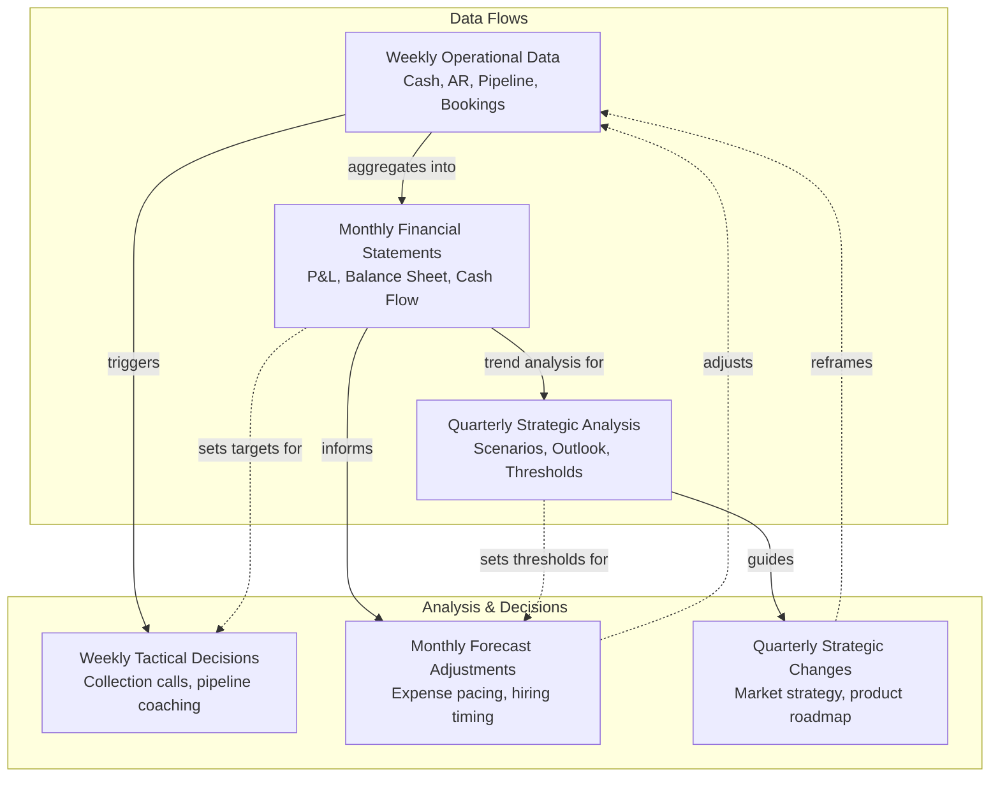
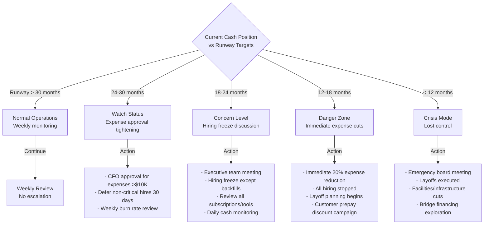

<!-- source: DeepWiki mcp.deepwiki.com · repo EveryInc/charlie-cfo-skill · page 4.3 Financial Review Rhythms · fetched 2026-10-26 -->

# Financial Review Rhythms

<details>
<summary>Relevant source files</summary>

The following files were used as context for generating this wiki page:

- [SKILL.md](SKILL.md)

</details>


## Purpose and Scope

This document details the three-tier financial review system used by Charlie CFO Skill: weekly operational reviews (60-90 minutes), monthly financial closes (5-7 business days), and quarterly strategic recalibrations. Each review tier has specific objectives, metrics to track, and escalation thresholds. This page covers the mechanics of conducting each review type, the data sources required, and the feedback loops between review cadences.

For guidance on which specific metrics to track in your dashboard, see [Key Metrics Dashboard](#4.4). For details on the forecasting models updated during these reviews, see [Forecasting Approach](#3.5). For cash management targets referenced in escalation thresholds, see [Cash Management Framework](#3.1).

Sources: [SKILL.md:91-110]()

---

## Three-Tier Review Architecture

The financial review system operates on three nested cadences, each with increasing scope and strategic depth. Weekly reviews focus on operational metrics and immediate cash visibility. Monthly reviews perform full financial closes with variance analysis. Quarterly reviews recalibrate strategic assumptions and refresh scenario models.



**Diagram: Three-Tier Financial Review Cadence System**

Each tier consumes outputs from the tier below and produces inputs for strategic decision-making. The architecture ensures that operational data (weekly) informs tactical adjustments (monthly), which in turn validate or challenge strategic assumptions (quarterly).

Sources: [SKILL.md:91-110]()

---

## Weekly Review Process

The weekly review is a 60-90 minute operational checkpoint focused on liquidity, collections, sales pipeline, and revenue realization. This review does not attempt financial statement preparation but tracks leading indicators that predict monthly performance.

### Review Structure

| Time Block | Duration | Activity | Data Source |
|------------|----------|----------|-------------|
| 0-15 min | 15 min | Cash position review | Bank account balances, scheduled payments |
| 15-35 min | 20 min | AR aging analysis | Invoicing system, payment processor |
| 35-55 min | 20 min | Pipeline movement review | CRM pipeline reports, deal stage changes |
| 55-75 min | 20 min | Revenue/bookings validation | Closed deals, contract signatures |
| 75-90 min | 15 min | Escalation decisions | Threshold checks, action items |

### Cash Position Tracking

The cash position review examines current balances against runway targets defined in [Cash Management Rules](#3.1). The goal is to detect deviations from planned burn before they become critical.

**Tracked Metrics:**
- Current cash balance (all accounts)
- Scheduled outflows (payroll, AP, debt service) in next 7 days
- Expected inflows (AR collections, new bookings) in next 7 days
- Net change vs. prior week
- Projected runway in months

**Escalation Triggers:**
- Cash balance drops below Operating Reserve threshold (3-6 months fixed costs) → immediate review of discretionary spending
- Unexpected outflow >5% of monthly burn → investigate cause and adjust forecast
- Runway falls below 18 months → activate cost containment protocols

Sources: [SKILL.md:93-98](), [SKILL.md:27-47]()

### AR Aging Analysis

AR aging tracks the collection status of outstanding invoices to identify cash flow risks and customer health issues. The target DSO (Days Sales Outstanding) for bootstrapped SaaS is 30-45 days.

**Tracked Metrics:**
- Total AR balance
- Aging buckets: Current (0-30 days), 31-60 days, 61-90 days, >90 days
- DSO calculation: (AR Balance / Revenue) × Days in Period
- Past due invoices with contact status

**Escalation Triggers:**
- Any invoice >60 days past due without active payment plan → executive escalation
- DSO exceeds 50 days → review payment terms and collection procedures
- Single customer with >$10K past due → risk to revenue recognition



**Diagram: AR Aging Escalation Workflow**

Sources: [SKILL.md:75-78]()

### Pipeline Movement Review

Pipeline review examines deal progression through sales stages to forecast near-term bookings. This provides early warning of revenue shortfalls before they impact monthly results.

**Tracked Metrics:**
- Total pipeline value by stage
- Week-over-week stage progression (deals moving forward/backward)
- Weighted pipeline value (pipeline × stage win probability)
- Expected close dates for deals >90% probability
- New pipeline added this week

**Escalation Triggers:**
- Weighted pipeline for next 30 days falls below monthly target → adjust expense pacing
- >3 deals slip close dates by >2 weeks → sales process health check
- New pipeline addition rate drops >30% week-over-week for 2+ weeks → lead generation issue

### Revenue and Bookings Validation

This section validates that closed deals are properly documented, contracts are signed, and revenue recognition criteria are met.

**Tracked Metrics:**
- Bookings closed this week (contract value)
- Revenue recognized this week (per GAAP/accrual basis)
- Bookings vs. weekly target
- Contract signatures pending
- Implementation delays affecting revenue recognition

**Escalation Triggers:**
- Bookings <75% of weekly target for 2+ consecutive weeks → monthly forecast adjustment required
- Signed contract missing for revenue recognition → legal/compliance review
- Implementation delays pushing revenue >30 days → capacity planning issue

Sources: [SKILL.md:95-98]()

---

## Monthly Review Process

The monthly review centers on the full financial close, producing a complete P&L, balance sheet, and cash flow statement. Target completion is 5-7 business days after month-end. This process includes variance analysis (actual vs. budget vs. forecast) and a 12-18 month rolling forecast update.

### Monthly Close Workflow



**Diagram: Monthly Close Process (5-7 Business Days)**

Sources: [SKILL.md:100-104]()

### Variance Analysis Methodology

Variance analysis compares actuals against three baselines: annual budget, prior month forecast, and prior year same month (if available). Variances >10% or >$10K (whichever is lower) require written explanations.

**Variance Categories:**

| Category | Comparison | Threshold | Action Required |
|----------|------------|-----------|-----------------|
| Revenue variance | Actual vs. monthly forecast | >5% or >$10K | Explain cause, update forecast assumptions |
| COGS variance | Actual vs. budget % of revenue | >3% margin points | Identify cost drivers, evaluate unit economics |
| Opex variance | Actual vs. budget by department | >10% or >$10K per dept | Department head explanation, approve overruns |
| Cash variance | Actual vs. 13-week forecast | >$25K or >10% | Identify timing vs. structural issues, adjust forecast |

**Variance Root Cause Analysis:**
- **Timing variances**: Expected expenses that hit different period (accrual issue, invoice timing)
- **Volume variances**: More/fewer customers, higher/lower usage than forecasted
- **Rate variances**: Price changes, wage increases, vendor rate changes
- **One-time items**: Non-recurring expenses or windfalls

**Output Format:**
```
Revenue Variance: +$15K (+8%)
- Timing: +$5K (2 annual contracts renewed early)
- Volume: +$12K (3 additional new customers)
- Rate: -$2K (promotional discount)
Forecast adjustment: +$10K to baseline monthly recurring
```

Sources: [SKILL.md:103]()

### Forecast Update Process

The monthly review updates the 12-18 month rolling forecast based on actual performance and revised assumptions. This uses the driver-based planning approach detailed in [Forecasting Approach](#3.5).

**Update Procedure:**
1. Roll forward: Drop oldest month, add new month at the end
2. Adjust baseline: Update MRR starting point with actual ending MRR
3. Revise drivers: Update churn rate, new bookings rate, expansion rate based on trailing 3-month actuals
4. Validate assumptions: Check pipeline weighted forecast for next 90 days
5. Recalculate runway: Apply new burn rate to current cash balance

**Key Driver Adjustments:**

| Driver | Calculation Method | When to Adjust |
|--------|-------------------|----------------|
| New bookings rate | Average of trailing 3 months | If variance >15% from prior forecast |
| Churn rate | Trailing 3-month average | Monthly update always |
| Expansion rate | Existing customer upsells / Starting MRR | Quarterly adjustment |
| Headcount plan | Approved hires with start dates | When hire decisions made |
| Variable COGS | Actual % of revenue trailing 3 months | If margin variance >2% |

**MRR Buildup Model Update:**
```
Month N+1 MRR = Month N ending MRR (actual)
              + New bookings (pipeline-based forecast)
              + Expansion (trailing 3-mo avg rate × MRR)
              - Churn (trailing 3-mo avg rate × MRR)
```

Sources: [SKILL.md:104](), [SKILL.md:127-131]()

### Dashboard Refresh

At monthly close, all metrics in the Key Metrics Dashboard [SKILL.md:112-119]() are recalculated with actual data and compared to targets:

**Revenue Metrics:**
- MRR/ARR: Actual ending balance
- Growth rate: (Current MRR - Prior MRR) / Prior MRR × 12 (annualized)
- NRR: (Starting MRR + Expansion - Churn) / Starting MRR (cohort-based)
- Target: NRR >100%, growth 15-25% YoY

**Unit Economics:**
- LTV:CAC ratio: Calculate using actuals for new cohort (see [Unit Economics Framework](#3.2))
- CAC payback: Months to recover fully-loaded CAC from gross margin
- Gross margin: (Revenue - COGS) / Revenue
- Target: 3:1+ ratio, <12 months payback, 70-80% margin

**Cash Metrics:**
- Burn rate: Net cash change over past 30 days
- Runway: Current cash / monthly burn rate
- Operating cash flow: From cash flow statement
- Target: Runway 24-36 months

**Customer Health:**
- Churn rate: Lost customers / Starting customers (monthly and annual)
- Customer concentration: Largest customer % of ARR, Top 5 % of ARR
- Target: Monthly churn <2%, no customer >10% revenue

Sources: [SKILL.md:112-119]()

---

## Quarterly Review Process

Quarterly reviews are strategic planning sessions focused on validating assumptions, refreshing scenario models, and extending the planning horizon to 18-24 months. These reviews inform capital allocation decisions for the next quarter.

### Strategic Recalibration

Strategic recalibration examines whether the business model assumptions underlying the forecast remain valid. This is a hypothesis-testing exercise.

**Assumptions to Validate:**

| Assumption | Test Method | Data Source |
|------------|-------------|-------------|
| Target market size remains addressable | Compare pipeline volume to 12 months prior | CRM pipeline data |
| Pricing strategy remains competitive | Analyze win rates and discount patterns | Sales data, competitor intel |
| Unit economics thresholds maintained | Recalculate LTV:CAC and payback for trailing 6 months | Financial data |
| Churn drivers stable or improving | Cohort analysis of churn by tenure | Customer data |
| Operational efficiency trending correctly | Revenue per employee, gross margin trends | Financial + HR data |

**Output:** Document of validated assumptions (green), challenged assumptions (yellow), and invalidated assumptions (red). Red items trigger strategic pivot discussions.

Sources: [SKILL.md:108]()

### Scenario Refresh

Scenario planning maintains three financial models: Base Case (expected trajectory), Moderate Downside (-15-20% revenue), and Severe Downside (-30-40% revenue). Quarterly reviews update all three scenarios with current actuals and revised assumptions.



**Diagram: Three-Scenario Planning Model**

Each scenario calculates month-by-month cash flow for 18-24 months, identifying the month when cash reaches critical thresholds. This defines action trigger points.

Sources: [SKILL.md:109](), [SKILL.md:139-145]()

### Action Threshold Definition

For each scenario, define specific action thresholds—the leading indicators that would trigger moving from one scenario to another, and the operational changes required.

**Action Threshold Framework:**

| Trigger Condition | Scenario Activation | Required Actions |
|-------------------|---------------------|------------------|
| Pipeline velocity -15% for 2 consecutive months | Move to Moderate Downside | Hiring freeze, review all unapproved expenses >$5K |
| Net new MRR negative for any month | Move to Moderate Downside | Executive team expense review, defer non-critical projects |
| Cash drops below 18 months runway | Move to Severe Downside | Hiring freeze + layoff planning, cut discretionary by 50% |
| Churn rate >3% monthly for 2 consecutive months | Move to Severe Downside | Product/support emergency audit, customer success surge |
| LTV:CAC falls below 2:1 for new cohort | Immediate review | Pause marketing spend, diagnose CAC or churn issue |

**Documentation Output:** A one-page action plan for each scenario stating:
- Leading indicators to monitor weekly
- Threshold values that trigger activation
- Pre-approved operational changes (no additional approval needed when triggered)
- Executive owners for each action item

Sources: [SKILL.md:145]()

### 18-24 Month Outlook

The extended outlook models the business trajectory beyond the normal 12-month forecast horizon, focusing on strategic questions:

**Strategic Planning Questions:**
- What ARR do we reach in 24 months under Base Case?
- What revenue per employee target by end of Year 2?
- When do we cross breakeven / Rule of 40 threshold?
- What hiring plan is required to support forecasted growth?
- When would we need to raise capital (if at all)?

**Long-term Planning Assumptions:**
- Assume churn and new bookings rates stabilize at trailing 6-month averages
- Model headcount growth at 70% of revenue growth rate (bootstrapped efficiency target)
- Include planned product launches with estimated revenue impact
- Factor in any known customer concentrations reaching renewal dates

Sources: [SKILL.md:110]()

---

## Review Cadence Dependencies

The three review tiers form a hierarchical dependency graph where each tier both consumes and produces data for the others.



**Diagram: Review Cadence Data and Decision Dependencies**

**Weekly → Monthly:**
- Weekly cash tracking accumulates into monthly cash flow statement
- Weekly AR aging informs monthly DSO calculation and bad debt reserves
- Weekly pipeline movement validates monthly revenue forecast
- Weekly bookings aggregate into monthly revenue recognition

**Monthly → Quarterly:**
- Monthly variance trends identify systematic vs. random deviations
- Monthly forecast updates feed into quarterly scenario base cases
- Monthly dashboard metrics provide trend data for strategic recalibration
- Monthly runway calculations validate quarterly action thresholds

**Quarterly → Monthly (Feedback):**
- Quarterly scenario updates revise monthly forecast assumptions
- Quarterly threshold definitions change monthly escalation triggers
- Quarterly strategic decisions redirect monthly capital allocation

**Quarterly → Weekly (Feedback):**
- New action thresholds from quarterly review become weekly monitoring targets
- Strategic pivots change which weekly metrics receive priority attention

Sources: [SKILL.md:91-110]()

---

## Escalation Framework

The escalation framework defines when issues detected in regular reviews require immediate attention, executive involvement, or strategic intervention. Escalation decisions follow a threshold-based decision tree.

### Cash and Runway Escalations



**Diagram: Cash and Runway Escalation Decision Tree**

Sources: [SKILL.md:29-33](), [SKILL.md:145]()

### Unit Economics Escalations

Unit economics violations create compounding problems because poor unit economics multiply as the business scales. Escalation is immediate when thresholds are breached.

**Escalation Thresholds:**

| Metric | Target | Warning Level | Critical Level | Escalation Action |
|--------|--------|---------------|----------------|-------------------|
| LTV:CAC ratio | ≥3:1 | 2.5-3:1 | <2.5:1 | Warning: Monthly review focus<br/>Critical: Pause marketing spend, root cause analysis |
| CAC payback | <12 months | 12-15 months | >15 months | Warning: Review sales efficiency<br/>Critical: Halt new sales hires, diagnose CAC bloat |
| Gross margin | 70-80% | 65-70% | <65% | Warning: COGS optimization project<br/>Critical: Pricing review, service delivery audit |
| Churn rate | <2% monthly | 2-3% monthly | >3% monthly | Warning: Customer success intervention<br/>Critical: Product emergency, NPS deep dive |

**Unit Economics Escalation Protocol:**
1. Calculate metric with actual data from closed financial month
2. If Warning Level: Add to monthly review agenda, assign owner for 30-day improvement plan
3. If Critical Level: Immediate CEO/CFO meeting, halt related spending, daily monitoring
4. Critical Level sustained >60 days: Trigger Severe Downside scenario, begin strategic pivot discussions

Sources: [SKILL.md:14-18](), [SKILL.md:114-119]()

### Revenue and Pipeline Escalations

Revenue shortfalls and pipeline deterioration require escalation before they impact cash position. Leading indicators provide 30-90 day advance warning.

**Pipeline Health Escalation:**

| Indicator | Normal Range | Warning | Critical | Action |
|-----------|--------------|---------|----------|--------|
| Weighted pipeline (next 30 days) | ≥100% of monthly target | 80-100% | <80% | Warning: Sales manager review<br/>Critical: Executive pipeline review, lead gen surge |
| Pipeline velocity (week-over-week) | Stable or growing | -10 to -15% | <-15% | Warning: Marketing effectiveness review<br/>Critical: Channel mix audit, lead quality analysis |
| Average deal size | Stable | -10 to -15% | >-15% | Warning: Pricing pressure investigation<br/>Critical: Competitor analysis, value prop refresh |
| Win rate | ≥25% | 20-25% | <20% | Warning: Sales process review<br/>Critical: Product-market fit validation |

**Revenue Shortfall Escalation:**
- Actual revenue <90% of monthly forecast for 1 month → Monthly review deep dive
- Actual revenue <90% of monthly forecast for 2 consecutive months → Activate Moderate Downside scenario
- Actual revenue <80% of monthly forecast for any month → Immediate executive team meeting, expense freeze

Sources: [SKILL.md:95-98]()

### Customer Concentration Escalations

Customer concentration creates existential risk for bootstrapped companies with limited runway. Concentration triggers require immediate risk mitigation.

**Concentration Thresholds:**

| Concentration Type | Warning Level | Critical Level | Mitigation Required |
|-------------------|---------------|----------------|---------------------|
| Single customer % of ARR | 10-15% | >15% | Warning: Diversification focus, no mission-critical dependencies<br/>Critical: Formal risk assessment, contract review, succession planning |
| Top 5 customers % of ARR | 25-35% | >35% | Warning: New market development, reduce dependency<br/>Critical: Emergency sales focus on base broadening |
| Single industry % of ARR | 40-50% | >50% | Warning: Adjacent market exploration<br/>Critical: Industry risk assessment, hedging strategy |

**Concentration Risk Actions:**
1. Monthly monitoring of concentration ratios in dashboard
2. Warning Level: Quarterly review of customer health for concentrated customers
3. Critical Level: Executive risk committee, weekly monitoring, proactive customer success engagement

Sources: [SKILL.md:121]()

---

## Review Outputs and Deliverables

Each review tier produces specific deliverables that inform decision-making and ensure organizational alignment.

### Weekly Review Deliverables

| Deliverable | Format | Distribution | Retention |
|-------------|--------|--------------|-----------|
| Cash position summary | 1-page PDF | CFO, CEO, Finance team | 90 days |
| AR aging report | Spreadsheet | CFO, AR manager, CEO | 12 months |
| Pipeline snapshot | CRM export + commentary | Sales, Executive team | 30 days |
| Revenue/bookings summary | Dashboard screenshot + notes | Executive team | 12 months |
| Escalation log | Email or Slack summary | Relevant stakeholders | Indefinite |

### Monthly Review Deliverables

| Deliverable | Format | Distribution | Retention |
|-------------|--------|--------------|-----------|
| Financial statements (P&L, BS, CF) | PDF package | Executive team, Board | Indefinite (legal requirement) |
| Variance report | PowerPoint or PDF | Executive team, Department heads | 36 months |
| Updated 12-18 month forecast | Spreadsheet model | Executive team, Board | 24 months |
| Key metrics dashboard | PDF or dashboard link | All employees (transparency) | 24 months |
| Month-end close memo | Written summary | Executive team | 24 months |

### Quarterly Review Deliverables

| Deliverable | Format | Distribution | Retention |
|-------------|--------|--------------|-----------|
| Strategic recalibration report | PowerPoint presentation | Executive team, Board | Indefinite |
| Three-scenario financial models | Spreadsheet package | Executive team | 24 months |
| 18-24 month outlook | Written narrative + model | Executive team, Board | 24 months |
| Action threshold decision tree | One-page reference | All managers | Until next quarterly review |
| Quarterly board deck | PowerPoint | Board of Directors | Indefinite |

Sources: [SKILL.md:91-110]()

---

## Review Calendar and Preparation

### Weekly Review Schedule

**Recommended Timing:** Monday or Tuesday morning, 60-90 minutes

**Preparation Requirements (30 minutes before meeting):**
- Export bank balances from all accounts
- Generate AR aging report from invoicing system
- Pull pipeline report from CRM (filtered for active opportunities)
- Export closed deals from prior week
- Review scheduled payments for next 7 days

**Participants:** CFO (lead), CEO, Controller/Finance Manager

### Monthly Review Schedule

**Close Timeline:**
- Day 1-2 (1st-2nd business day of month): Data collection
- Day 3-4 (3rd-4th business day): Reconciliations
- Day 5-6 (5th-6th business day): Statement preparation
- Day 7 (7th business day): Variance analysis and review meeting

**Review Meeting:** 90-120 minutes, typically 7-10 business days after month-end

**Preparation Requirements (2-3 days before meeting):**
- Completed financial statements
- Variance analysis with explanations >10% / >$10K
- Updated forecast model with new assumptions documented
- Dashboard metrics calculated
- Month-end close memo drafted

**Participants:** CFO (lead), CEO, Executive team, Department heads (for their variance explanations)

### Quarterly Review Schedule

**Timing:** 2-3 weeks after quarter-end (allows time for monthly close + deep analysis)

**Duration:** Half-day session (4 hours), typically includes lunch

**Preparation Requirements (1 week before meeting):**
- Completed monthly close for final month of quarter
- Quarterly trend analysis (13-week charts for all key metrics)
- Refreshed three-scenario models
- Customer cohort analysis
- Competitive intelligence brief
- Draft strategic recalibration document

**Participants:** CFO (lead), CEO, Full executive team, Board members (observers or participants)

Sources: [SKILL.md:91-110]()

---

## Integration with Other Frameworks

The Financial Review Rhythms integrate with all five financial frameworks, providing the operational structure for monitoring and adjusting strategic plans.

### Cash Management Integration

Weekly reviews track [Cash Management Framework](#3.1) metrics:
- Runway calculation: Current cash ÷ monthly burn rate
- Burn multiple: Net Burn ÷ Net New ARR (monthly calculation)
- Reserve structure validation: Ensure 3-6 months in Operating Reserve

Monthly reviews update cash flow forecasts and recalculate runway with actual burn rates.

### Unit Economics Integration

Monthly reviews recalculate [Unit Economics Framework](#3.2) metrics for new customer cohorts:
- LTV:CAC ratio for customers acquired this month
- CAC payback period for new cohort
- Gross margin percentage actual vs. target

Quarterly reviews perform cohort analysis to validate LTV assumptions (churn rates, expansion rates) and identify trends.

### Capital Allocation Integration

Quarterly reviews inform [Capital Allocation Framework](#3.3) decisions:
- Rule of 40 tracking: Revenue Growth % + EBITDA Margin %
- Hiring ROI validation: Did recent hires meet productivity assumptions?
- Investment payback analysis: Track actual payback vs. <12 month target

### Working Capital Integration

Weekly AR aging directly supports [Working Capital Optimization](#3.4):
- DSO tracking vs. 30-45 day target
- Collection follow-up timing per [SKILL.md:77-78]()

Monthly reviews calculate Cash Conversion Cycle (DIO + DSO - DPO) and identify opportunities to extend DPO or reduce DSO.

### Forecasting Integration

Monthly forecast updates implement the [Forecasting Approach](#3.5):
- Driver-based planning: Update churn, new bookings, expansion drivers
- MRR buildup model: Recalculate with actual ending MRR
- 13-week cash flow forecast: Roll forward and compare to actuals

Quarterly scenario refresh extends forecasts to 18-24 months using three scenarios (Base, Moderate Downside, Severe Downside).

Sources: [SKILL.md:91-145]()

---

## Summary

The Financial Review Rhythms establish a disciplined three-tier monitoring system:

1. **Weekly Reviews (60-90 min)**: Operational focus on cash position, AR aging, pipeline movement, and revenue realization. Provides early warning of tactical issues before they impact monthly results.

2. **Monthly Reviews (5-7 business days)**: Full financial close with P&L, balance sheet, and cash flow statements. Includes variance analysis (actual vs. budget vs. forecast) and rolling 12-18 month forecast updates. Refreshes Key Metrics Dashboard.

3. **Quarterly Reviews (half-day session)**: Strategic recalibration of assumptions, three-scenario planning refresh (Base/Moderate/Severe), and 18-24 month outlook. Defines action thresholds that trigger operational changes.

Each tier feeds the next: weekly data accumulates into monthly actuals, monthly trends inform quarterly strategy, and quarterly decisions reset weekly monitoring priorities. The escalation framework ensures that threshold breaches (runway <18 months, LTV:CAC <2.5:1, churn >3%) trigger immediate action rather than waiting for the next scheduled review.

This rhythmic structure transforms financial management from reactive crisis response into proactive strategic execution, aligned with Charlie's Munger-inspired capital discipline philosophy.

Sources: [SKILL.md:91-110](), [SKILL.md:112-145]()

---

