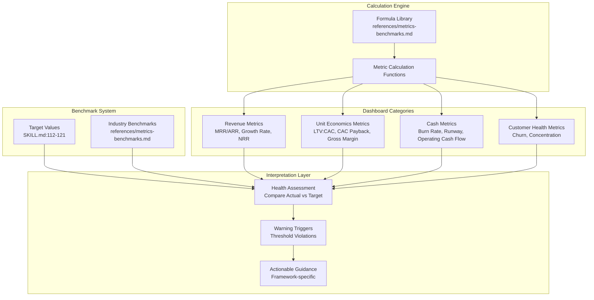
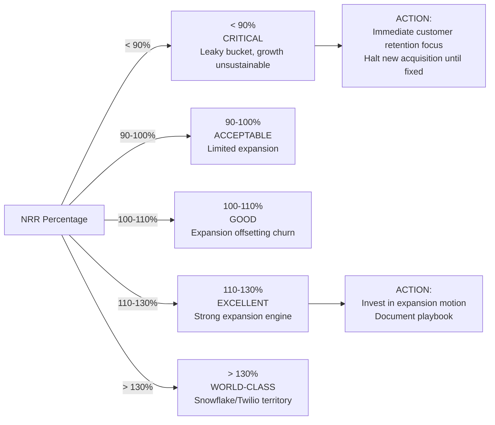
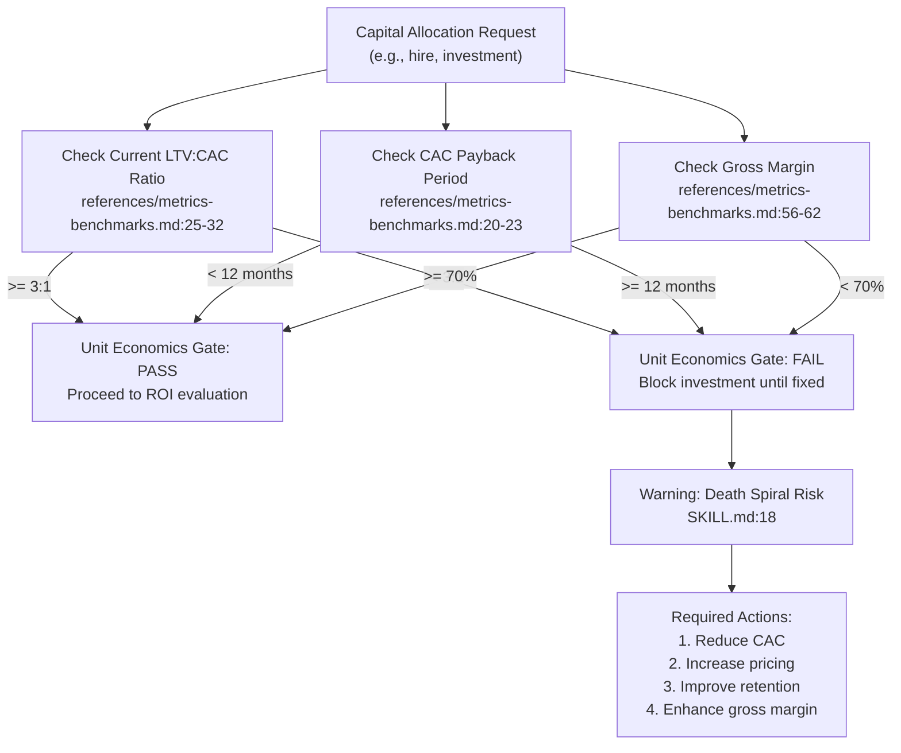
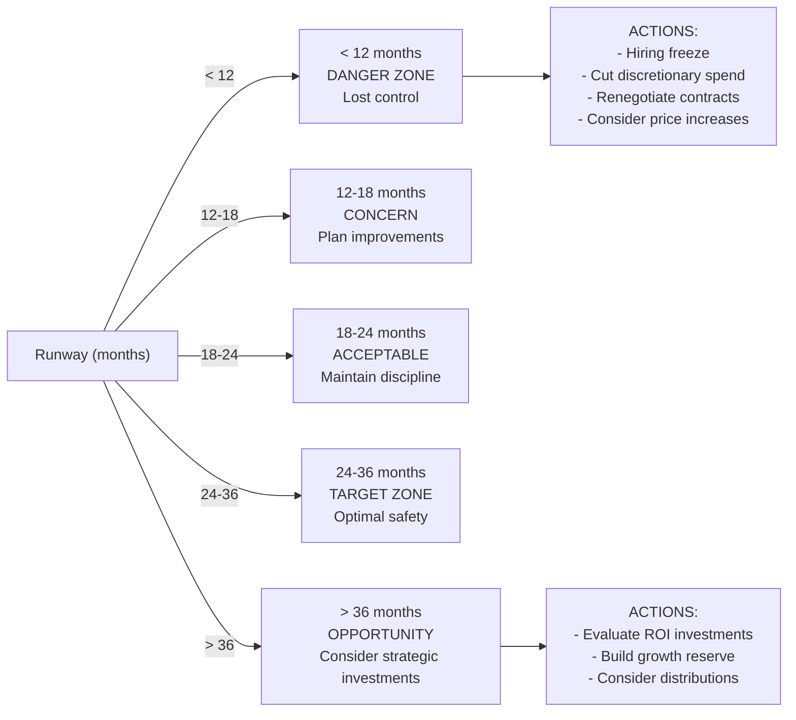
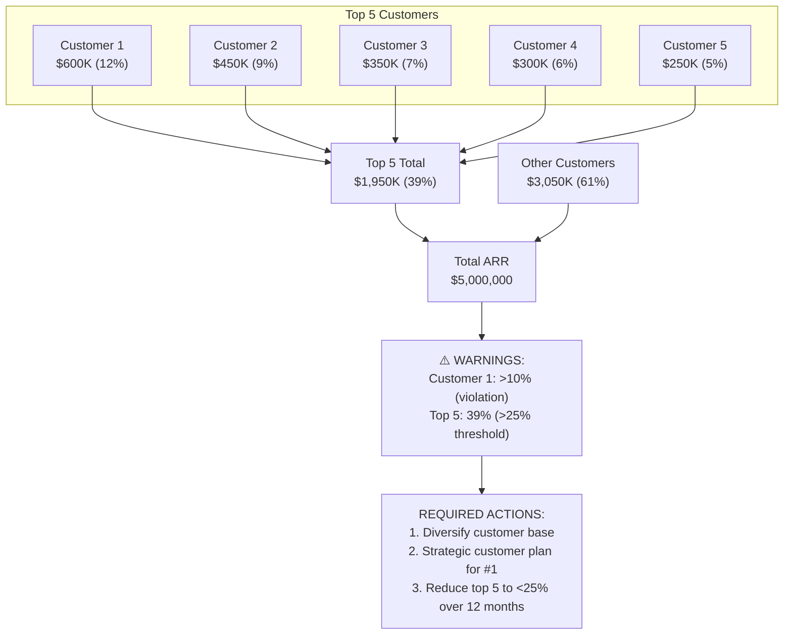
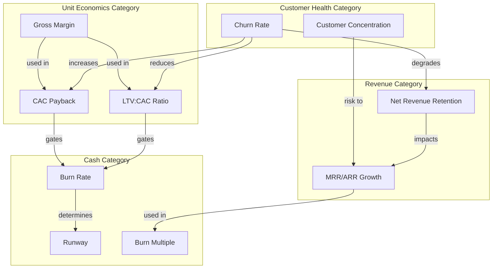
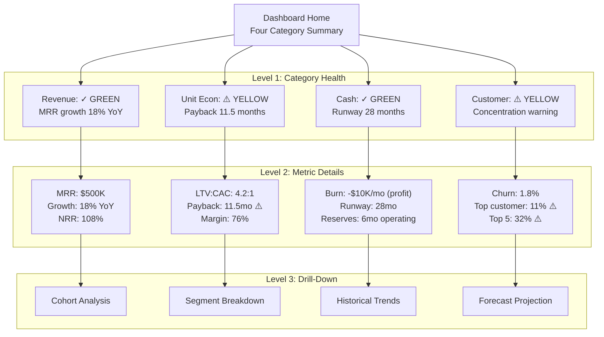
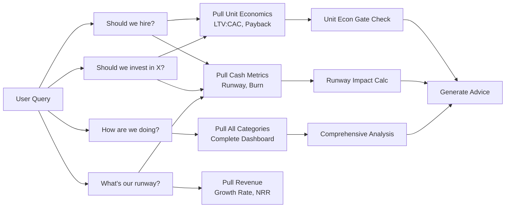

<!-- source: DeepWiki mcp.deepwiki.com · repo EveryInc/charlie-cfo-skill · page 4.4 Key Metrics Dashboard · fetched 2026-10-26 -->

# Key Metrics Dashboard

<details>
<summary>Relevant source files</summary>

The following files were used as context for generating this wiki page:

- [SKILL.md](SKILL.md)
- [references/metrics-benchmarks.md](references/metrics-benchmarks.md)

</details>


## Purpose and Scope

This document provides a complete specification of Charlie's Key Metrics Dashboard, the centralized monitoring system for bootstrapped startup financial health. The dashboard organizes essential metrics into four categories—Revenue, Unit Economics, Cash, and Customer Health—each with specific formulas, target values, and interpretation guidelines.

For detailed calculation formulas and industry benchmarks, see [Metrics and Benchmarks Reference](#5.1). For guidance on when and how to review these metrics, see [Financial Review Rhythms](#4.3). For the frameworks that use these metrics in decision-making, see sections [3.1](#3.1) through [3.5](#3.5).

## Dashboard Overview

The Key Metrics Dashboard serves as the primary health monitoring interface for bootstrapped companies, providing real-time visibility into the four critical dimensions of financial performance. Unlike VC-backed companies that may prioritize growth metrics, this dashboard enforces Charlie's philosophy that survival metrics (unit economics and cash) are non-negotiable prerequisites before optimizing for growth.

The dashboard is structured as a four-category hierarchy, with each category containing 2-4 core metrics. All metrics are evaluated against bootstrapped-specific targets derived from successful companies like Mailchimp, Zapier, and Basecamp (see [Bootstrapped Company Case Studies](#5.2)).

**Sources:** [SKILL.md:112-121](), [SKILL.md:10-26]()

### Dashboard Architecture



**Sources:** [SKILL.md:112-121](), [references/metrics-benchmarks.md:1-199]()

## Revenue Metrics Category

The Revenue category tracks growth trajectory and revenue quality, focusing on recurring revenue sustainability rather than vanity metrics.

### Core Revenue Metrics

| Metric | Formula | Target | Interpretation |
|--------|---------|--------|----------------|
| **MRR/ARR** | Sum of all recurring revenue (monthly or annualized) | Consistent growth | Foundation metric for all other calculations |
| **Growth Rate** | `(Current Period ARR - Prior Period ARR) / Prior Period ARR × 100` | 15-25% YoY | Balanced growth without burning cash |
| **Net Revenue Retention (NRR)** | `(Starting MRR + Expansion - Churn - Contraction) / Starting MRR × 100` | >100% | Must exceed 100% to grow without new customers |

**Sources:** [SKILL.md:116](), [references/metrics-benchmarks.md:44-54]()

### NRR Interpretation Thresholds



**Calculation Details:**
- NRR is calculated cohort-by-cohort, typically using a 12-month rolling period
- Expansion includes upsells, cross-sells, and price increases
- Churn includes full cancellations only (not downgrades, which are "Contraction")
- Target >100% means revenue from existing customers must grow organically

**Sources:** [references/metrics-benchmarks.md:44-54](), [SKILL.md:116]()

### MRR Growth Components

The dashboard should decompose MRR growth into its constituent parts to identify which lever is driving (or dragging) performance:

```
Ending MRR = Starting MRR + New Bookings + Expansion - Churn - Contraction
```

This is the "MRR buildup model" referenced in [SKILL.md:127-131](). Each component should be tracked as both absolute dollars and percentage of starting MRR.

**Sources:** [SKILL.md:127-131]()

## Unit Economics Metrics Category

Unit Economics metrics are treated as survival requirements, not aspirational goals. Charlie enforces hard thresholds based on the principle that violating these creates death spirals (see [Unit Economics as Survival Requirements](#2.2)).

### Core Unit Economics Metrics

| Metric | Formula | Minimum Target | Best-in-Class | Violation Threshold |
|--------|---------|----------------|---------------|---------------------|
| **LTV:CAC Ratio** | `LTV / CAC` | 3:1 | 7-8:1 | <3:1 triggers warning |
| **CAC Payback Period** | `CAC / (Monthly ARPU × Gross Margin)` | <12 months | 5-7 months | >12 months triggers warning |
| **Gross Margin** | `(Revenue - COGS) / Revenue × 100` | 70-80% (SaaS) | 75-85% | <70% requires investigation |

**Sources:** [SKILL.md:14-18](), [SKILL.md:117](), [references/metrics-benchmarks.md:3-33]()

### LTV Calculation

The dashboard uses the simplified LTV formula for ongoing monitoring:

```
LTV = (ARPU × Gross Margin) / Monthly Churn Rate
```

**Where:**
- ARPU = Average Revenue Per User (monthly)
- Gross Margin = expressed as decimal (e.g., 0.75 for 75%)
- Monthly Churn Rate = expressed as decimal (e.g., 0.02 for 2%)

**Example:**
- ARPU = $500/month
- Gross Margin = 75% (0.75)
- Monthly Churn = 2% (0.02)
- LTV = ($500 × 0.75) / 0.02 = $18,750

**Sources:** [references/metrics-benchmarks.md:5-12]()

### CAC Calculation

```
CAC = (Total Sales + Marketing Spend) / New Customers Acquired
```

**Included in Sales + Marketing Spend:**
- Salaries and commissions for sales and marketing personnel
- Advertising spend (paid search, social, display)
- Marketing tools and software subscriptions
- Events, conferences, and sponsorships
- Content production costs
- Agency fees

**Excluded:**
- Customer success costs (attributed to retention, not acquisition)
- General overhead not directly attributable to customer acquisition

**Sources:** [references/metrics-benchmarks.md:14-18]()

### Unit Economics Enforcement Flow



This enforcement pattern is referenced in the [Capital Allocation Framework](#3.3) and ensures that growth investments are only approved when unit economics are healthy.

**Sources:** [SKILL.md:14-18](), [SKILL.md:49-67]()

## Cash Metrics Category

Cash metrics directly measure survival time and liquidity health. These metrics drive the [Cash Management Framework](#3.1) and are reviewed weekly (see [Financial Review Rhythms](#4.3)).

### Core Cash Metrics

| Metric | Formula | Target | Critical Threshold |
|--------|---------|--------|-------------------|
| **Burn Rate** | `(Starting Cash - Ending Cash) / Number of Months` | Zero or negative (profitable) | Positive burn requires runway calculation |
| **Runway** | `Cash Balance / Monthly Burn Rate` | 24-36 months | <12 months = danger zone |
| **Operating Cash Flow** | `Cash from Operations (not GAAP profit)` | Positive | Negative OCF despite profit = working capital issue |

**Sources:** [SKILL.md:29-47](), [SKILL.md:118](), [references/metrics-benchmarks.md:64-88]()

### Runway Calculation Detail

The dashboard uses a trailing 3-month average for burn rate to smooth out monthly volatility:

```
Runway (months) = Current Cash Balance / Avg Monthly Burn (last 3 months)
```

**Example:**
- Current cash: $1,200,000
- Burn last 3 months: $40K, $45K, $35K
- Average burn: $40K
- Runway: $1,200,000 / $40,000 = 30 months

**Runway Zones:**



The principle "Never fundraise your way out of a cash crisis" [SKILL.md:33]() means that runway below 12 months indicates operational problems, not capital structure problems.

**Sources:** [references/metrics-benchmarks.md:66-70](), [SKILL.md:29-33]()

### Burn Multiple

The Burn Multiple measures capital efficiency of growth:

```
Burn Multiple = Net Burn / Net New ARR
```

This metric connects the Cash and Revenue categories, showing how many dollars of cash burned per dollar of ARR added.

| Burn Multiple | Rating | Action |
|---------------|--------|--------|
| <1x | Excellent efficiency | Continue current strategy |
| 1-1.5x | Good | Monitor for degradation |
| 1.5-2x | Concerning | Audit S&M efficiency |
| >2x | Inefficient | Require correction before further spend |

**Bootstrapped Target:** Zero or negative (profitable growth means no burn, infinite efficiency)

**Sources:** [SKILL.md:42-47](), [references/metrics-benchmarks.md:72-81]()

### Cash Reserve Structure

The dashboard should display cash allocation across three reserve types defined in [SKILL.md:35-41]():

| Reserve Type | Target Amount | Purpose | Dashboard Display |
|--------------|---------------|---------|-------------------|
| Operating Reserve | 3-6 months fixed costs | Payroll, rent, essential software | Show months of coverage |
| Contingency Reserve | 1-2 months expenses | Emergency buffer | Show months of coverage |
| Growth Reserve | Excess above reserves | Opportunistic investments | Show dollar amount available |

**Sources:** [SKILL.md:35-41]()

## Customer Health Metrics Category

Customer health metrics predict future revenue stability and identify concentration risks that could endanger the business.

### Core Customer Health Metrics

| Metric | Formula | Target | Warning Threshold |
|--------|---------|--------|-------------------|
| **Monthly Churn Rate** | `Customers Lost / Starting Customers × 100` | <2% monthly | >3% triggers investigation |
| **Customer Concentration** | Individual customer as % of total ARR | No customer >10% ARR | Any customer >10% flagged |
| **Top 5 Concentration** | Top 5 customers as % of total ARR | <25% combined | >25% flagged as risk |

**Sources:** [SKILL.md:119-121](), [references/metrics-benchmarks.md:36-42]()

### Churn Rate Segmentation

The dashboard should segment churn by customer type, as targets vary significantly:

| Segment | Monthly Churn Target | Annual Churn Target | Dashboard Treatment |
|---------|---------------------|---------------------|---------------------|
| SMB | 3-5% | 30-50% | Expected; focus on volume |
| Mid-Market | 1-2% | 10-20% | Monitor; optimize onboarding |
| Enterprise | 0.5-1% | 5-10% | Critical; each loss reviewed |
| **Blended Target** | **<2%** | **<20%** | **Dashboard headline metric** |

**Sources:** [references/metrics-benchmarks.md:36-42]()

### Customer Concentration Dashboard



The concentration warning in [SKILL.md:121]() states: "Any customer >10% revenue OR top 5 >25% revenue" triggers risk management protocols.

**Sources:** [SKILL.md:121]()

## Dashboard Integration Patterns

The four categories interconnect to provide holistic health assessment. Changes in one category typically propagate to others.

### Cross-Category Dependencies



**Key Dependency Rules:**

1. **Churn impacts everything:** Higher churn degrades NRR, reduces LTV, increases effective CAC payback, and threatens MRR stability
2. **Unit economics gates cash burn:** Cannot approve burn-increasing investments if LTV:CAC <3:1 or payback >12 months
3. **Gross margin amplifies everything:** Appears in both LTV and payback calculations, making it a leverage point
4. **Concentration risks future revenue:** High concentration means MRR is fragile regardless of current health

**Sources:** [SKILL.md:14-18](), [SKILL.md:112-121]()

## Interpreting Dashboard Signals

### Red Flag Patterns

Certain metric combinations signal critical situations requiring immediate action:

| Pattern | Metrics Involved | Interpretation | Action Required |
|---------|------------------|----------------|-----------------|
| **Death Spiral** | LTV:CAC <2:1 + Burn >$0 | Losing money on growth | Stop growth spend immediately |
| **Revenue Quality Issue** | NRR <90% + Churn >3% | Leaky bucket | Fix product/retention before growth |
| **Liquidity Crisis** | Runway <12mo + Burn increasing | Lost control | Emergency cost reduction |
| **Concentration Bomb** | Customer >15% + Churn risk signals | Single point of failure | Diversification required |
| **Margin Compression** | Gross Margin <65% + Burn positive | Unsustainable unit econ | Raise prices or cut COGS |

**Sources:** [SKILL.md:14-18](), [SKILL.md:29-33]()

### Green Light Indicators

Strong performance across multiple categories indicates readiness for investment:

| Pattern | Metrics Involved | Interpretation | Opportunity |
|---------|------------------|----------------|-------------|
| **Profitable Growth** | LTV:CAC >5:1 + Payback <6mo + Burn negative | Highly efficient growth | Consider accelerating growth |
| **Expansion Engine** | NRR >120% + Churn <1% | Revenue compounds | Invest in customer success |
| **Cash Fortress** | Runway >36mo + OCF positive | Excess safety | Strategic investments or distributions |
| **Balanced Excellence** | Rule of 40 >50% | Top quartile | Maintain discipline |

**Sources:** [SKILL.md:54-57](), [references/metrics-benchmarks.md:168-180]()

## Dashboard Implementation Structure

### Data Sources and Refresh Cadence

| Metric Category | Primary Data Source | Refresh Frequency | Review Rhythm |
|-----------------|---------------------|-------------------|---------------|
| Revenue | Billing system, subscription management | Real-time | Weekly [SKILL.md:93-99]() |
| Unit Economics | CRM + billing + accounting | Monthly | Monthly [SKILL.md:100-105]() |
| Cash | Bank accounts, accounting system | Daily | Weekly [SKILL.md:93-99]() |
| Customer Health | CRM, subscription management | Real-time | Weekly [SKILL.md:93-99]() |

The [Financial Review Rhythms](#4.3) section details when each metric should be reviewed in depth versus monitored passively.

**Sources:** [SKILL.md:91-110]()

### Dashboard Display Hierarchy



**Display Conventions:**
- ✓ GREEN: All metrics within target ranges
- ⚠️ YELLOW: One or more metrics approaching threshold
- ❌ RED: One or more metrics violating critical threshold
- Each category rolls up to single status indicator for dashboard home

**Sources:** [SKILL.md:112-121]()

## Usage in Charlie's Advice Generation

When Charlie responds to financial queries, the dashboard metrics inform context and recommendations:

### Query Routing to Dashboard



The dashboard serves as the "source of truth" for Charlie's decision framework enforcement. For example, when evaluating hiring decisions ([Evaluating Hiring Decisions](#4.1)), Charlie first checks current unit economics dashboard values before proceeding to ROI analysis.

**Sources:** [SKILL.md:59-66](), [SKILL.md:112-121]()

---

**Complete Dashboard Reference Table (from SKILL.md)**

| Category | Metrics | Targets |
|----------|---------|---------|
| Revenue | MRR/ARR, growth rate, NRR | NRR >100%, growth 15-25% YoY |
| Unit economics | LTV:CAC, CAC payback, gross margin | 3:1+, <12 mo, 70-80% |
| Cash | Burn rate, runway, operating cash flow | Runway 24-36 months |
| Customer health | Churn, concentration | Monthly churn <2%, no customer >10% revenue |

**Sources:** [SKILL.md:112-121]()

---

