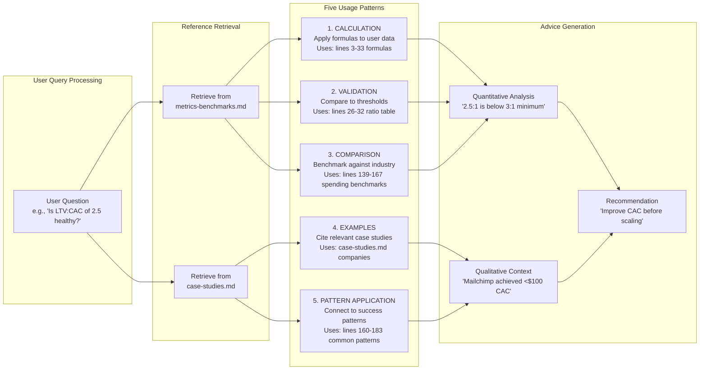

<!-- source: DeepWiki mcp.deepwiki.com · repo EveryInc/charlie-cfo-skill · page 5 Reference Materials · fetched 2026-10-26 -->

# Reference Materials

Relevant source files

The following files were used as context for generating this wiki page:

- [README.md](README.md)
- [references/case-studies.md](references/case-studies.md)
- [references/metrics-benchmarks.md](references/metrics-benchmarks.md)

## Purpose and Scope

The Charlie CFO Skill grounds its financial advice in two comprehensive reference documents that provide the quantitative formulas and qualitative wisdom necessary for bootstrapped startup guidance. These references serve as the knowledge base that Charlie queries during advice generation, ensuring recommendations are both numerically sound and contextually rich with proven success patterns.

This page provides an overview of the reference materials architecture and how Charlie integrates these documents into its decision-making process. For detailed coverage of specific metrics and formulas, see [Metrics and Benchmarks Reference](#5.1). For the complete case study analysis, see [Bootstrapped Company Case Studies](#5.2).

**Sources:** [README.md:43-48](), [references/metrics-benchmarks.md:1-199](), [references/case-studies.md:1-183]()

## The Two-Document Architecture

Charlie's knowledge base consists of two complementary reference documents that provide different types of grounding for financial advice:

| Document | File Path | Primary Content | Purpose |
|----------|-----------|----------------|---------|
| **Metrics & Benchmarks** | `references/metrics-benchmarks.md` | Calculation formulas, performance targets, industry benchmarks, spending allocations | Provides quantitative foundation for metric validation and comparison |
| **Case Studies** | `references/case-studies.md` | Five bootstrapped company stories, synthesized common patterns | Provides qualitative context and proven success examples |

This dual architecture ensures that Charlie's advice combines numerical rigor with strategic wisdom—avoiding the "hollow metrics" problem where numbers lack interpretive context.

```mermaid
graph TB
    subgraph "Reference Materials System"
        METRICS["references/metrics-benchmarks.md<br/>Quantitative Knowledge"]
        CASES["references/case-studies.md<br/>Qualitative Knowledge"]
    end
    
    subgraph "Metrics Document Structure"
        UNIT_CALC["Unit Economics Calculations<br/>LTV, CAC, Payback formulas"]
        SAAS_BENCH["SaaS Metrics Benchmarks<br/>Churn, NRR, Margins"]
        CASH_METRICS["Cash Flow Metrics<br/>Runway, Burn Multiple, CCS"]
        WORK_CAP_RULE40["Working Capital + Rule of 40<br/>DSO, DPO, CCC, Spending by ARR"]
    end
    
    subgraph "Case Studies Document Structure"
        MAILCHIMP["Mailchimp Case Study<br/>$12B exit, freemium strategy"]
        ZAPIER["Zapier Case Study<br/>$5B valuation, SEO strategy"]
        BASECAMP["Basecamp Case Study<br/>25+ years, profit distributions"]
        CONVERTKIT["ConvertKit Case Study<br/>Crisis turnaround, 51% margins"]
        ZOHO["Zoho Case Study<br/>$1B+ revenue, 60% R&D"]
        PATTERNS["Common Patterns<br/>Synthesized lessons"]
    end
    
    METRICS --> UNIT_CALC
    METRICS --> SAAS_BENCH
    METRICS --> CASH_METRICS
    METRICS --> WORK_CAP_RULE40
    
    CASES --> MAILCHIMP
    CASES --> ZAPIER
    CASES --> BASECAMP
    CASES --> CONVERTKIT
    CASES --> ZOHO
    CASES --> PATTERNS
    
    UNIT_CALC -.formula source.-> CHARLIE[Charlie CFO Skill]
    SAAS_BENCH -.benchmark source.-> CHARLIE
    CASH_METRICS -.validation source.-> CHARLIE
    WORK_CAP_RULE40 -.target source.-> CHARLIE
    
    MAILCHIMP -.example source.-> CHARLIE
    ZAPIER -.example source.-> CHARLIE
    BASECAMP -.example source.-> CHARLIE
    CONVERTKIT -.example source.-> CHARLIE
    ZOHO -.example source.-> CHARLIE
    PATTERNS -.pattern source.-> CHARLIE
```

**Diagram: Reference Materials File Structure and Content Hierarchy**

**Sources:** [README.md:43-48](), [references/metrics-benchmarks.md:1-199](), [references/case-studies.md:1-183]()

## Metrics & Benchmarks Reference Structure

The `references/metrics-benchmarks.md` document provides comprehensive quantitative foundation across multiple financial domains:

| Section | Coverage | Key Components |
|---------|----------|----------------|
| **Unit Economics Calculations** | Lines 3-33 | LTV formula, CAC formula, CAC Payback Period, LTV:CAC ratio interpretation table |
| **SaaS Metrics Benchmarks** | Lines 34-63 | Churn rates by segment, Net Revenue Retention formula and thresholds, Gross Margin targets by business type |
| **Cash Flow Metrics** | Lines 64-88 | Runway calculation, Burn Multiple formula and ratings, Cash Conversion Score |
| **Revenue Efficiency** | Lines 89-111 | Magic Number (sales efficiency), Revenue per Employee by ARR stage |
| **Working Capital Metrics** | Lines 112-138 | DSO, DPO, Cash Conversion Cycle formulas and targets |
| **Spending Benchmarks by ARR** | Lines 139-167 | Department spending percentages for $1-3M, $3-10M, $10M+ ARR stages |
| **Rule of 40 Scenarios** | Lines 168-181 | Growth rate vs. required margin matrix |
| **Forecast Accuracy Metrics** | Lines 182-199 | MAPE calculation and accuracy targets |

Each section provides both the **calculation method** (formulas) and **performance thresholds** (what constitutes healthy vs. problematic values).

**Sources:** [references/metrics-benchmarks.md:1-199]()

## Case Studies Reference Structure

The `references/case-studies.md` document provides detailed stories of five bootstrapped companies that achieved exceptional outcomes:

| Company | Lines | Key Metrics | Primary Lesson |
|---------|-------|-------------|----------------|
| **Mailchimp** | 3-29 | $12B exit, $800M ARR, 20 years, <$100 CAC | Freemium can increase profits when unit economics are strong |
| **Zapier** | 31-58 | $5B valuation, $310M+ ARR, $1.4M funding | Treating seed as final round forces discipline |
| **Basecamp** | 60-92 | ~$100M ARR, ~70 employees, ~$1.4M RPE | Profit distributions reduce risk over time |
| **ConvertKit** | 94-122 | ~$30M ARR, 51% margin in 5 months | Turnarounds can happen fast with decisive action |
| **Zoho** | 124-157 | $1B+ revenue, 100M+ users, 60% to R&D | Massive R&D investment sustainable when bootstrapped |
| **Common Patterns** | 160-183 | Synthesized from all five companies | Five universal patterns of bootstrapped success |

Each case study includes **timeline**, **key financial decisions**, and **lessons learned**. The Common Patterns section (lines 160-183) synthesizes these into actionable principles that Charlie applies across contexts.

**Sources:** [references/case-studies.md:1-183]()

## How Charlie Uses Reference Materials

Charlie integrates the reference documents through five distinct usage patterns during query processing:

**Diagram: Reference Materials Usage in Query Processing Pipeline**

### 1. Calculation Pattern

Charlie applies formulas from [references/metrics-benchmarks.md:3-33]() to compute metrics from user-provided data. For example, when a user provides monthly revenue, churn rate, and gross margin, Charlie calculates LTV using the formula on line 6-8.

### 2. Validation Pattern

After calculation, Charlie compares results to performance thresholds. The LTV:CAC ratio table on [references/metrics-benchmarks.md:26-32]() provides explicit interpretation rules (e.g., <1:1 = "Losing money on every customer", 3:1 = "Healthy minimum threshold").

### 3. Comparison Pattern

Charlie contextualizes metrics by comparing to industry benchmarks. For instance, when evaluating R&D spending, Charlie retrieves the appropriate spending benchmark from [references/metrics-benchmarks.md:139-167]() based on the company's ARR stage.

### 4. Examples Pattern

Charlie enriches advice with relevant case studies. When discussing CAC efficiency, it might cite Mailchimp's <$100 CAC achievement from [references/case-studies.md:16-19]() or Zapier's near-zero CAC strategy from [references/case-studies.md:44-47]().

### 5. Pattern Application

Charlie connects user situations to synthesized success patterns from [references/case-studies.md:160-183](). For example, if a user is considering taking on debt, Charlie references pattern #5 ("Profit distribution, not endless reinvestment") to provide strategic context.

**Sources:** [references/metrics-benchmarks.md:1-199](), [references/case-studies.md:1-183]()

## Integration with Financial Frameworks

The reference materials directly support each of Charlie's five financial frameworks:

```mermaid
graph TB
    subgraph "Financial Frameworks"
        CASH_FW["Cash Management Framework"]
        UNIT_FW["Unit Economics Framework"]
        CAP_FW["Capital Allocation Framework"]
        WORK_FW["Working Capital Framework"]
        FORE_FW["Forecasting Framework"]
    end
    
    subgraph "Metrics Document Sections"
        UNIT_CALC["Unit Economics Calculations<br/>lines 3-33"]
        SAAS_BENCH["SaaS Metrics Benchmarks<br/>lines 34-63"]
        CASH_METRICS["Cash Flow Metrics<br/>lines 64-88"]
        REV_EFF["Revenue Efficiency<br/>lines 89-111"]
        WORK_METRICS["Working Capital Metrics<br/>lines 112-138"]
        SPEND_BENCH["Spending Benchmarks<br/>lines 139-167"]
        RULE40["Rule of 40 Scenarios<br/>lines 168-181"]
        FORECAST_ACC["Forecast Accuracy<br/>lines 182-199"]
    end
    
    subgraph "Case Studies"
        CASE_PATTERNS["Common Patterns<br/>lines 160-183"]
        COMPANY_EXAMPLES["5 Company Stories<br/>lines 3-157"]
    end
    
    UNIT_FW --> UNIT_CALC
    UNIT_FW --> SAAS_BENCH
    UNIT_FW --> CASE_PATTERNS
    
    CASH_FW --> CASH_METRICS
    CASH_FW --> SPEND_BENCH
    CASH_FW --> COMPANY_EXAMPLES
    
    CAP_FW --> REV_EFF
    CAP_FW --> RULE40
    CAP_FW --> SPEND_BENCH
    CAP_FW --> CASE_PATTERNS
    
    WORK_FW --> WORK_METRICS
    WORK_FW --> COMPANY_EXAMPLES
    
    FORE_FW --> FORECAST_ACC
    FORE_FW --> SAAS_BENCH
    FORE_FW --> CASE_PATTERNS
    
    style UNIT_CALC fill:#e1f5ff
    style SAAS_BENCH fill:#e1f5ff
    style CASH_METRICS fill:#e1f5ff
    style REV_EFF fill:#e1f5ff
    style WORK_METRICS fill:#e1f5ff
    style SPEND_BENCH fill:#e1f5ff
    style RULE40 fill:#e1f5ff
    style FORECAST_ACC fill:#e1f5ff
    style CASE_PATTERNS fill:#c8e6c9
    style COMPANY_EXAMPLES fill:#c8e6c9
```

**Diagram: Reference Materials Integration with Financial Frameworks**

| Framework | Primary Metrics Source | Primary Case Study Usage |
|-----------|----------------------|--------------------------|
| **Unit Economics** | [references/metrics-benchmarks.md:3-63]() - Formulas, benchmarks, margin targets | Pattern #2: "CAC efficiency through product" [references/case-studies.md:166-168]() |
| **Cash Management** | [references/metrics-benchmarks.md:64-88]() - Runway, burn multiple, cash conversion | Pattern #5: "Profit distribution" [references/case-studies.md:180-182](), Basecamp distributions [references/case-studies.md:70-73]() |
| **Capital Allocation** | [references/metrics-benchmarks.md:89-111]() - Magic number, RPE, [references/metrics-benchmarks.md:168-181]() - Rule of 40 | Pattern #3: "Extreme revenue per employee" [references/case-studies.md:170-172](), Zapier's "hire when it hurts" [references/case-studies.md:49-52]() |
| **Working Capital** | [references/metrics-benchmarks.md:112-138]() - DSO, DPO, CCC calculations | All companies' cash efficiency strategies [references/case-studies.md:1-183]() |
| **Forecasting** | [references/metrics-benchmarks.md:182-199]() - MAPE accuracy targets, [references/metrics-benchmarks.md:34-63]() - Churn/NRR for projections | Pattern #4: "Long time horizons" [references/case-studies.md:174-178]() |

**Sources:** [README.md:9-15](), [references/metrics-benchmarks.md:1-199](), [references/case-studies.md:1-183]()

## Benchmark Thresholds and Decision Rules

The reference materials establish hard thresholds that Charlie enforces during decision-making:

| Metric | Threshold Source | Decision Impact |
|--------|-----------------|-----------------|
| **LTV:CAC Ratio** | [references/metrics-benchmarks.md:26-32]() | Minimum 3:1 required before scaling; gates Capital Allocation decisions |
| **CAC Payback** | Implied from [README.md:41]() + [references/case-studies.md:160-183]() patterns | <12 months required for investment approval |
| **Runway** | [README.md:40]() | 24-36 months minimum required |
| **Gross Margin** | [references/metrics-benchmarks.md:56-63]() | 70-85% target for pure SaaS; affects unit economics validation |
| **Net Revenue Retention** | [references/metrics-benchmarks.md:48-54]() | >100% target; <90% triggers "leaky bucket" warning |
| **Revenue per Employee** | [references/metrics-benchmarks.md:102-111]() | Stage-specific targets; bootstrapped should be 40-70% higher |
| **Rule of 40** | [references/metrics-benchmarks.md:168-181]() | Growth + Margin ≥ 40%; used in capital allocation decisions |
| **DSO** | [references/metrics-benchmarks.md:118-123]() | <30 days excellent, >60 days triggers immediate action |

These thresholds are not aspirational—they are **constraints** that reflect Charlie's core philosophy (see [Profit as a Constraint, Not a Goal](#2.1)) and unit economics survival requirements (see [Unit Economics as Survival Requirements](#2.2)).

**Sources:** [README.md:33-42](), [references/metrics-benchmarks.md:26-32](), [references/metrics-benchmarks.md:48-54](), [references/metrics-benchmarks.md:56-63](), [references/metrics-benchmarks.md:102-111](), [references/metrics-benchmarks.md:118-123](), [references/metrics-benchmarks.md:168-181]()

## Reference Material Updates and Maintenance

While the reference documents are relatively stable knowledge artifacts, they can be updated to reflect:

1. **New Industry Benchmarks**: As SaaS metrics evolve, the benchmark tables in [references/metrics-benchmarks.md]() can be updated with new targets
2. **Additional Case Studies**: New bootstrapped success stories can be added to [references/case-studies.md]() following the existing format
3. **Pattern Refinement**: The Common Patterns section [references/case-studies.md:160-183]() can be refined as more case studies are added

The MIT license [README.md:56-58]() permits community contributions to expand and improve these reference materials while maintaining Charlie's core philosophy.

**Sources:** [README.md:56-58](), [references/metrics-benchmarks.md:1-199](), [references/case-studies.md:1-183]()

## Related Documentation

For detailed exploration of the reference materials content:
- **Metrics formulas and targets**: [Metrics and Benchmarks Reference](#5.1)
- **Company success stories**: [Bootstrapped Company Case Studies](#5.2)
- **How frameworks use these references**: [The Five Financial Frameworks](#3)
- **Core philosophy behind the benchmarks**: [Core Philosophy and Mental Models](#2)

---

