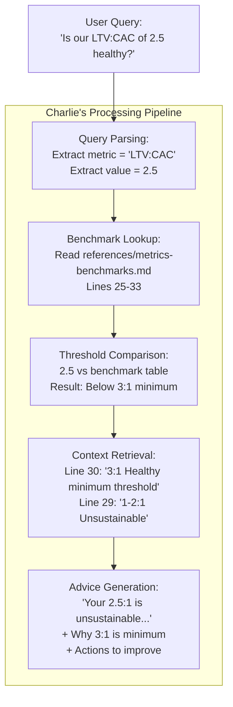
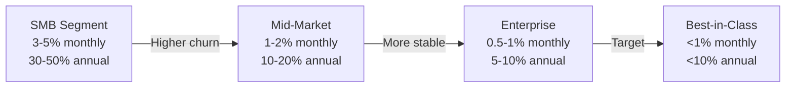
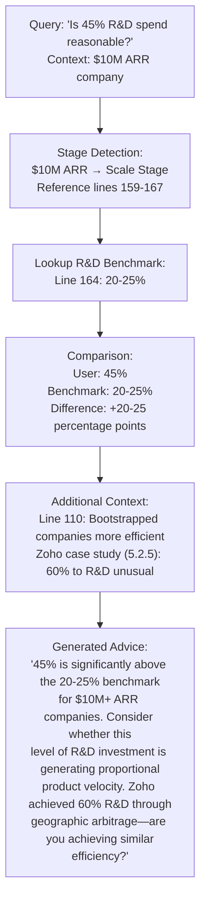
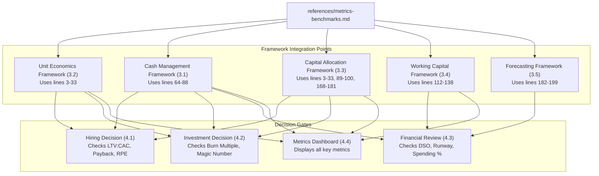

<!-- source: DeepWiki mcp.deepwiki.com · repo EveryInc/charlie-cfo-skill · page 5.1 Metrics and Benchmarks Reference · fetched 2026-10-26 -->

# Metrics and Benchmarks Reference

<details>
<summary>Relevant source files</summary>

The following files were used as context for generating this wiki page:

- [references/metrics-benchmarks.md](references/metrics-benchmarks.md)

</details>


## Purpose and Scope

This document provides the complete reference specification for `references/metrics-benchmarks.md`, which serves as Charlie's quantitative foundation for all financial analysis and decision-making. This file contains calculation formulas, performance benchmarks, industry targets, and threshold values that Charlie uses to validate metrics, perform calculations, compare company performance against standards, and trigger warnings when thresholds are violated.

The reference is organized into nine major categories covering unit economics, SaaS-specific metrics, cash flow analysis, revenue efficiency, working capital management, spending allocations by ARR stage, Rule of 40 scenarios, and forecast accuracy tracking. Each metric includes both the calculation formula and interpretation guidelines with specific thresholds.

For detailed explanations and worked examples of specific metric categories, see:
- [5.1.1](#5.1.1) Unit Economics Calculations
- [5.1.2](#5.1.2) SaaS Metrics and Benchmarks
- [5.1.3](#5.1.3) Cash Flow and Efficiency Metrics
- [5.1.4](#5.1.4) Working Capital and Rule of 40

For qualitative context and real-world examples, see [5.2](#5.2) Bootstrapped Company Case Studies.

**Sources:** [references/metrics-benchmarks.md:1-199]()

## File Structure and Organization

The `metrics-benchmarks.md` file is structured as a hierarchical reference document with formulas, threshold tables, and interpretation guidelines organized by metric category.

```mermaid
graph TB
    FILE["references/metrics-benchmarks.md"]
    
    subgraph "Line 3-33: Unit Economics"
        LTV["LTV Calculation<br/>Lines 5-12"]
        CAC["CAC Calculation<br/>Lines 14-18"]
        PAYBACK["CAC Payback Period<br/>Lines 20-23"]
        RATIO["LTV:CAC Ratio Table<br/>Lines 25-33"]
    end
    
    subgraph "Line 34-63: SaaS Metrics"
        CHURN["Churn Rates by Segment<br/>Lines 36-42"]
        NRR["Net Revenue Retention<br/>Lines 44-54"]
        MARGIN["Gross Margin Targets<br/>Lines 56-63"]
    end
    
    subgraph "Line 64-88: Cash Flow"
        RUNWAY["Runway Calculation<br/>Lines 66-70"]
        BURN_MULT["Burn Multiple<br/>Lines 72-81"]
        CCS["Cash Conversion Score<br/>Lines 83-88"]
    end
    
    subgraph "Line 89-111: Revenue Efficiency"
        MAGIC["Magic Number<br/>Lines 91-100"]
        RPE["Revenue per Employee<br/>Lines 102-111"]
    end
    
    subgraph "Line 112-138: Working Capital"
        DSO["Days Sales Outstanding<br/>Lines 114-123"]
        DPO["Days Payable Outstanding<br/>Lines 125-129"]
        CCC["Cash Conversion Cycle<br/>Lines 131-138"]
    end
    
    subgraph "Line 139-167: Spending by ARR"
        EARLY["$1-3M ARR Stage<br/>Lines 141-148"]
        GROWTH["$3-10M ARR Stage<br/>Lines 150-157"]
        SCALE["$10M+ ARR Stage<br/>Lines 159-167"]
    end
    
    subgraph "Line 168-181: Rule of 40"
        R40["Rule of 40 Matrix<br/>Lines 168-181"]
    end
    
    subgraph "Line 182-199: Forecast Accuracy"
        MAPE["MAPE Calculation<br/>Lines 184-199"]
    end
    
    FILE --> LTV
    FILE --> CAC
    FILE --> PAYBACK
    FILE --> RATIO
    FILE --> CHURN
    FILE --> NRR
    FILE --> MARGIN
    FILE --> RUNWAY
    FILE --> BURN_MULT
    FILE --> CCS
    FILE --> MAGIC
    FILE --> RPE
    FILE --> DSO
    FILE --> DPO
    FILE --> CCC
    FILE --> EARLY
    FILE --> GROWTH
    FILE --> SCALE
    FILE --> R40
    FILE --> MAPE
```



**Sources:** [references/metrics-benchmarks.md:1-199]()

## How Charlie Uses This Reference

Charlie integrates the metrics benchmarks file through five distinct usage patterns, each serving a specific role in the advice generation pipeline.



### Five Core Usage Patterns

| Pattern | Description | Example | File Lines Referenced |
|---------|-------------|---------|---------------------|
| **Calculation** | Apply formula to user data | User provides CAC=$500, ARPU=$50, Margin=80% → Calculate Payback = 12.5 months | [21-23]() |
| **Validation** | Check if metric meets threshold | Is NRR=95% healthy? → Look up line 50-51 → "Acceptable but limited expansion" | [44-54]() |
| **Comparison** | Benchmark against industry | User's 45% R&D spend at $10M ARR → Lines 159-167 → "High, typical is 20-25%" | [159-167]() |
| **Warning Trigger** | Alert when thresholds violated | DSO=65 days → Lines 118-123 → "Problem requiring immediate action" | [118-123]() |
| **Interpretation** | Provide context for values | Burn Multiple=1.8x → Lines 72-81 → "Concerning, requires correction" | [72-81]() |

**Sources:** [references/metrics-benchmarks.md:1-199]()

## Metric Categories and Threshold Specifications

### Unit Economics Section

The Unit Economics section [lines 3-33]() provides the foundational survival metrics that gate all Capital Allocation decisions per the Core Philosophy ([2.2](#2.2)).

**Key Formulas:**

```
LTV = (ARPU × Gross Margin) / Monthly Churn Rate
CAC = (Sales + Marketing Spend) / New Customers Acquired  
CAC Payback (months) = CAC / (Monthly ARPU × Gross Margin)
```

**Critical Thresholds:**

| Metric | Threshold | Action Required |
|--------|-----------|-----------------|
| LTV:CAC < 3:1 | HARD STOP | Block all growth investments |
| LTV:CAC 3:1 | MINIMUM | Allows controlled growth |
| CAC Payback > 12 months | RED FLAG | Reassess acquisition channels |
| LTV:CAC 5:1+ | OPTIMIZE | Consider increasing investment |

The LTV:CAC ratio table at [lines 26-33]() serves as Charlie's gating mechanism—Capital Allocation Framework ([3.3](#3.3)) queries this table before approving any hiring or marketing spend decisions.

**Sources:** [references/metrics-benchmarks.md:3-33]()

### SaaS Metrics Section

Churn rates [lines 36-42](), Net Revenue Retention [lines 44-54](), and gross margin targets [lines 56-63]() provide segment-specific benchmarks that Charlie uses to contextualize performance by customer segment and business model.

**Churn Interpretation Matrix:**



**NRR Thresholds:**
- < 90%: Leaky bucket, growth unsustainable
- 90-100%: Acceptable but limited expansion
- 100-110%: Good, expansion offsetting churn
- 110-130%: Excellent
- \> 130%: World-class

These thresholds inform Charlie's Forecasting Framework ([3.5](#3.5)) retention assumptions and trigger warnings when churn rates exceed segment norms.

**Sources:** [references/metrics-benchmarks.md:34-63]()

### Cash Flow Metrics Section

The Cash Flow section [lines 64-88]() provides the calculations for runway, burn efficiency, and cash conversion that directly feed Charlie's Cash Management Framework ([3.1](#3.1)).

**Burn Multiple Calculation:**

```
Burn Multiple = Net Burn / Net New ARR
```

This metric is critical for evaluating capital efficiency. Charlie uses the threshold table at [lines 76-81]():

| Multiple | Rating | Charlie's Response |
|----------|--------|-------------------|
| < 1x | Excellent efficiency | Approve controlled growth investments |
| 1-1.5x | Good | Monitor closely, allow selective hires |
| 1.5-2x | Concerning | Trigger spending review, defer non-critical hires |
| > 2x | Inefficient | Immediate action required, freeze non-essential spend |

The runway calculation [line 66-70]() uses trailing 3-month average burn for accuracy, which Charlie applies in weekly cash reviews ([4.3](#4.3)).

**Sources:** [references/metrics-benchmarks.md:64-88]()

### Revenue Efficiency Section

The Magic Number [lines 91-100]() and Revenue per Employee [lines 102-111]() metrics assess sales efficiency and operational leverage.

**Magic Number Formula:**

```
Magic Number = (QoQ ARR Growth) / (Prior Quarter S&M Spend)
```

**Interpretation Thresholds:**

| Score | Interpretation | Action |
|-------|----------------|--------|
| < 0.5 | Inefficient | Reduce S&M spend or improve conversion |
| 0.5-0.75 | Acceptable | Maintain current spend |
| 0.75-1.0 | Good | Continue strategy |
| > 1.0 | Excellent | Consider increasing investment |

**Revenue per Employee Targets by Stage:**

The RPE table [lines 103-109]() provides stage-specific benchmarks:

| ARR Stage | Target RPE |
|-----------|------------|
| $1-5M | $110-150K |
| $5-10M | $150-200K |
| $10-50M | $200-250K |
| $50M+ | $300-400K+ |

Note at [line 110](): "Bootstrapped companies typically achieve 40-70% higher RPE than VC-backed at same stage." This informs Charlie's emphasis on operational efficiency per the Core Philosophy ([2.3](#2.3)).

**Sources:** [references/metrics-benchmarks.md:89-111]()

### Working Capital Metrics Section

The Working Capital section [lines 112-138]() supports Charlie's Working Capital Optimization Framework ([3.4](#3.4)) with DSO, DPO, and CCC calculations.

**Days Sales Outstanding (DSO):**

```
DSO = (Accounts Receivable / Total Credit Sales) × Days in Period
```

**DSO Threshold Table [lines 118-123]():**

| DSO | Rating | Alert Level |
|-----|--------|-------------|
| < 30 days | Excellent | None |
| 30-45 days | Good | Monitor |
| 45-60 days | Needs attention | Weekly review |
| > 60 days | Problem | Immediate action required |

**Cash Conversion Cycle:**

```
CCC = DIO + DSO - DPO
```

Charlie uses the insight at [line 137](): "SaaS with annual prepay can achieve CCC of -30 to -90 days" to recommend prepayment discount strategies in Working Capital optimization queries.

**Sources:** [references/metrics-benchmarks.md:112-138]()

## Spending Benchmarks by ARR Stage

The spending allocation tables [lines 139-167]() provide stage-specific percentage targets for R&D, Sales, Marketing, Customer Success, and G&A spending as a percentage of ARR.



### Stage Transitions and Benchmark Application

Charlie uses ARR thresholds to determine which spending table to apply:

| Company ARR | Table Used | Lines |
|-------------|------------|-------|
| $1M - $2.99M | Early Stage | [141-148]() |
| $3M - $9.99M | Growth Stage | [150-157]() |
| $10M+ | Scale Stage | [159-167]() |

As companies cross ARR thresholds, expected spending ratios change. For example, R&D as % of ARR should decline from 30-40% (early) to 20-25% (scale) as revenue scales faster than engineering headcount.

**Sources:** [references/metrics-benchmarks.md:139-167]()

## Rule of 40 Scenarios Matrix

The Rule of 40 matrix [lines 168-181]() provides scenarios balancing growth rate and profit margin to achieve combined performance ≥ 40%.

**Formula:**
```
Rule of 40 Score = Growth Rate + Profit Margin
```

**Scenario Table [lines 170-177]():**

| Growth Rate | Required Margin | Interpretation |
|-------------|-----------------|----------------|
| 50% | -10% (can burn) | Hypergrowth mode |
| 40% | 0% | Breakeven growth |
| 30% | 10% | Balanced |
| 20% | 20% | Profitable growth |
| 10% | 30% | Mature, profitable |
| 0% | 40% | Cash cow |

**Benchmarks:**
- Median SaaS: 34% (most don't hit 40) [line 179]()
- Top quartile bootstrapped: 50%+ [line 180]()

Charlie uses this matrix in Capital Allocation decisions to assess whether growth investments are justified by current profitability position, or whether profitability improvements are required before accelerating growth.

**Sources:** [references/metrics-benchmarks.md:168-181]()

## Forecast Accuracy Tracking

The final section [lines 182-199]() provides MAPE (Mean Absolute Percentage Error) calculation and accuracy targets for tracking forecast quality.

**MAPE Formula:**

```
MAPE = (1/n) × Σ |Actual - Forecast| / |Actual| × 100
```

**Accuracy Thresholds [lines 188-193]():**

| MAPE | Rating |
|------|--------|
| < 5% | Excellent |
| 5-10% | Good |
| 10-20% | Acceptable |
| > 20% | Needs improvement |

**Category-Specific Targets [lines 195-198]():**
- Revenue: target 5-10% MAPE
- Expenses: target 10-15% MAPE
- Cash flow: target 10-15% MAPE

Charlie uses these targets in monthly financial reviews ([4.3](#4.3)) to assess whether forecasting models need recalibration. Consistent MAPE > 20% triggers a review of driver-based assumptions in the Forecasting Framework ([3.5](#3.5)).

**Sources:** [references/metrics-benchmarks.md:182-199]()

## Integration with Charlie's Framework System

The metrics-benchmarks file serves as the quantitative backbone for all five financial frameworks.



### Hard Dependencies

Certain framework operations have hard dependencies on specific metrics:

1. **Capital Allocation Framework** cannot approve hiring/investment if:
   - LTV:CAC < 3:1 [lines 26-31]()
   - CAC Payback > 12 months [lines 20-23]()
   - Runway < 24 months [lines 66-70]()

2. **Cash Management Framework** triggers warnings if:
   - Burn Multiple > 2x [lines 76-81]()
   - DSO > 60 days [lines 118-123]()
   - Runway < 12 months [lines 66-70]()

3. **Forecasting Framework** requires:
   - Historical MAPE < 20% for confidence [lines 188-193]()
   - Segment-specific churn rates [lines 36-42]()
   - NRR benchmarks for retention modeling [lines 44-54]()

**Sources:** [references/metrics-benchmarks.md:1-199]()

## Maintenance and Updates

The `metrics-benchmarks.md` file is static reference content that requires periodic updates as industry benchmarks evolve. Typical update scenarios include:

1. **Annual Benchmark Refresh**: Update spending percentages, RPE targets, and Rule of 40 medians based on latest industry surveys
2. **Threshold Adjustments**: Modify warning thresholds if market conditions change (e.g., acceptable burn multiples during recession vs. boom)
3. **New Metrics Addition**: Add emerging metrics like Net Dollar Retention cohort curves or ARR per sales rep
4. **Segment Expansion**: Add benchmarks for new business models (usage-based, consumption pricing)

Changes to threshold values in this file directly impact Charlie's advice generation, so modifications should be tested against historical queries to ensure consistency.

**Sources:** [references/metrics-benchmarks.md:1-199]()

## Usage Example: Complete Query Flow

To illustrate complete integration, here's how Charlie processes a hiring decision query using multiple sections of the metrics benchmarks file:

**Query:** "Should we hire a salesperson? We're at $5M ARR, current team of 30, LTV:CAC is 4:1, CAC payback is 10 months, we have $1.5M cash, burn is $150K/month."

**Charlie's Processing:**

1. **Unit Economics Check** [lines 25-33]():
   - LTV:CAC = 4:1 → Above 3:1 minimum ✓
   - CAC Payback = 10 months → Below 12 month threshold ✓

2. **Runway Check** [lines 66-70]():
   - Runway = $1.5M / $150K = 10 months
   - Below 24-month target, but above 12-month critical ⚠

3. **RPE Benchmark** [lines 103-109]():
   - Current RPE = $5M / 30 = $167K
   - Target for $5-10M = $150-200K → Within range ✓

4. **Spending Allocation** [lines 150-157]():
   - At $5M ARR (Growth Stage)
   - Sales should be 10-15% of ARR = $500-750K annually
   - Current annual sales spend needs assessment

5. **Burn Multiple** [lines 72-81]():
   - Would need to know net new ARR to calculate
   - Request additional data

**Generated Advice:** "Your unit economics support this hire (4:1 LTV:CAC, 10-month payback). However, your 10-month runway is concerning—target is 24-36 months. Before hiring, either: (1) extend runway through revenue acceleration or cost reduction, or (2) ensure this salesperson has <6 month ramp to positive contribution. Your current RPE of $167K is healthy for your stage. Verify total sales spend remains within 10-15% of ARR benchmark."

**Sources:** [references/metrics-benchmarks.md:25-33](), [references/metrics-benchmarks.md:66-70](), [references/metrics-benchmarks.md:103-109](), [references/metrics-benchmarks.md:150-157](), [references/metrics-benchmarks.md:72-81]()

---

