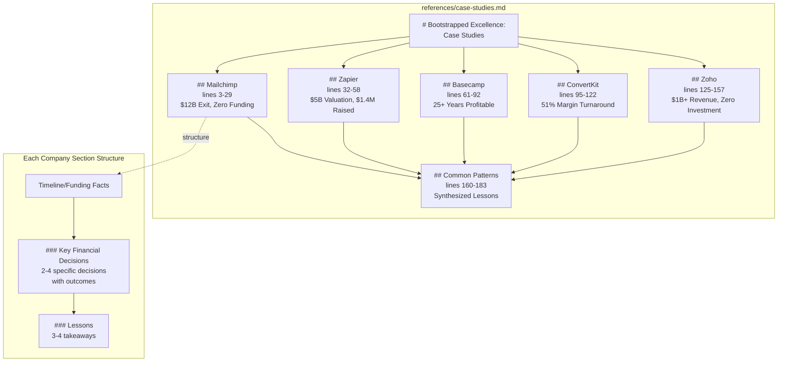
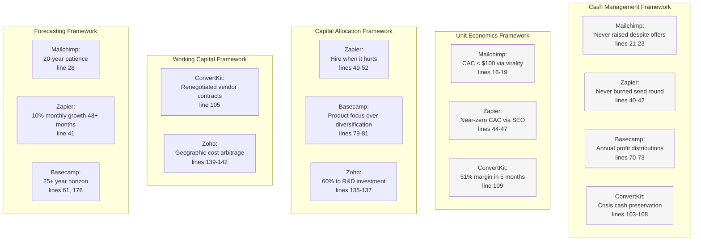
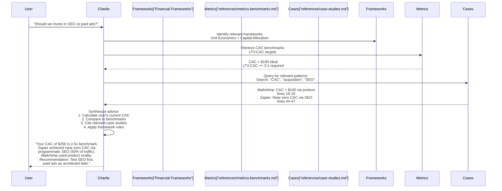
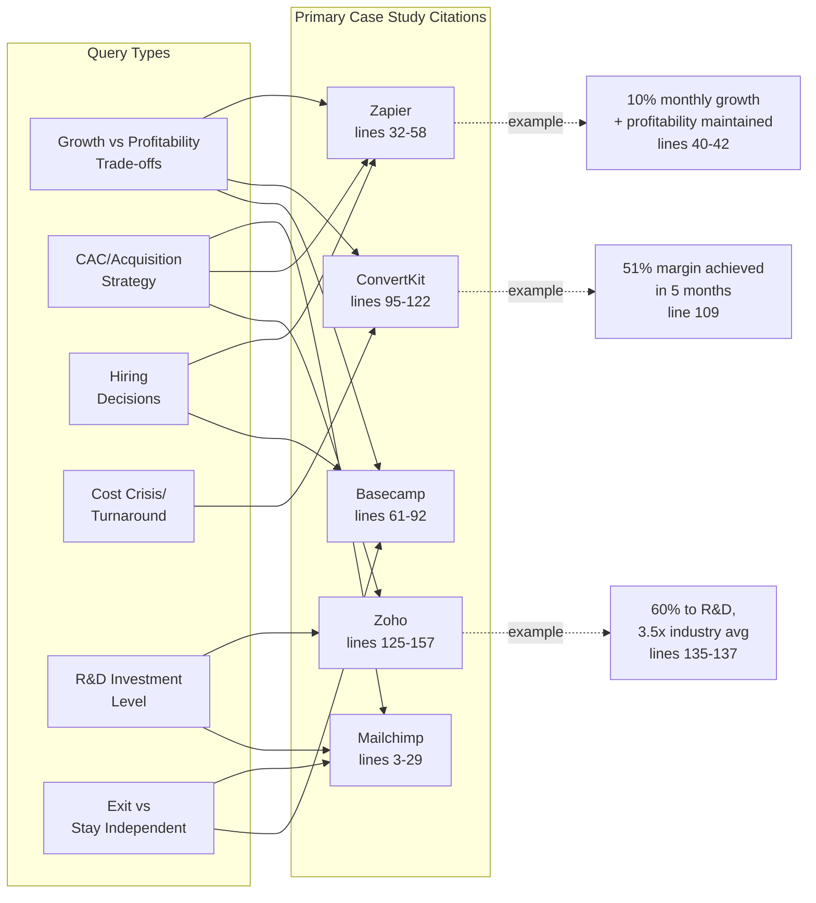
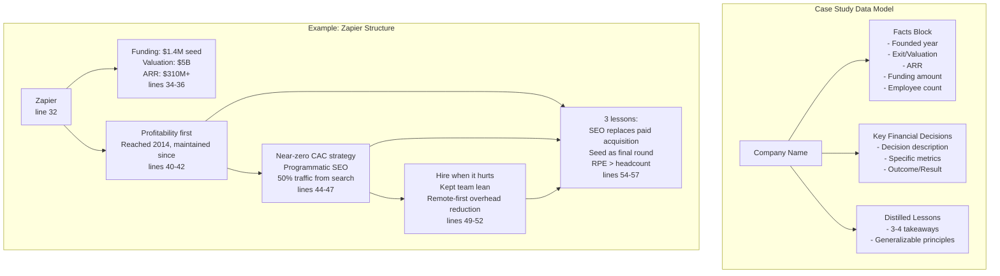
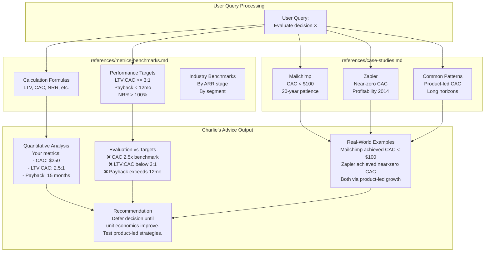

<!-- source: DeepWiki mcp.deepwiki.com · repo EveryInc/charlie-cfo-skill · page 5.2 Bootstrapped Company Case Studies · fetched 2026-10-26 -->

# Bootstrapped Company Case Studies

Relevant source files

The following files were used as context for generating this wiki page:

- [references/case-studies.md](references/case-studies.md)

## Purpose and Scope

This document provides an overview of the bootstrapped company case studies that form part of Charlie CFO Skill's reference knowledge base. These case studies serve as qualitative wisdom that enriches Charlie's financial advice by grounding recommendations in proven real-world success patterns.

The case studies provide concrete examples of how bootstrapped companies achieved significant scale and profitability through disciplined financial decision-making. Charlie uses these examples to contextualize advice, validate recommendations against proven strategies, and illustrate abstract financial principles with real outcomes.

For detailed analysis of individual companies, see:
- Mailchimp: [5.2.1](#5.2.1)
- Zapier: [5.2.2](#5.2.2)
- Basecamp: [5.2.3](#5.2.3)
- ConvertKit: [5.2.4](#5.2.4)
- Zoho: [5.2.5](#5.2.5)

For synthesized common patterns across all companies, see [5.2.6](#5.2.6).

For quantitative metrics and benchmarks that complement these qualitative studies, see [5.1](#5.1).

**Sources:** [references/case-studies.md:1-183]()

## Case Studies Knowledge Base Structure

The case studies knowledge base is stored in a single reference document that Charlie accesses during advice generation. The document is structured into five individual company studies followed by a synthesized patterns section.

**Figure 1: Case Studies File Structure**

Each company section follows a consistent format: timeline and funding facts, key financial decisions with specific outcomes, and distilled lessons. This structure enables Charlie to quickly locate relevant examples based on query context.

**Sources:** [references/case-studies.md:1-183]()

## Company Overview and Key Metrics

The five case studies represent diverse paths to bootstrapped success across different scales, business models, and strategies. The following table summarizes their key characteristics:

| Company | Founded | Exit/Valuation | Final ARR | Funding | Employees | Revenue/Employee | Time to Exit |
|---------|---------|----------------|-----------|---------|-----------|------------------|--------------|
| **Mailchimp** | 2001 | $12B (Intuit) | $800M | $0 | ~1,200 | ~$667K | 20 years |
| **Zapier** | 2012 | $5B valuation | $310M+ | $1.4M | ~500 | ~$620K | 9 years |
| **Basecamp** | 1999 | Ongoing | ~$100M | $0 | ~70 | ~$1.4M | N/A (25+ years) |
| **ConvertKit** | 2013 | Ongoing | ~$30M | $0 | ~100 | ~$300K | N/A (11+ years) |
| **Zoho** | 1996 | Ongoing | $1B+ | $0 | ~13,000 | ~$77K | N/A (28+ years) |

**Table 1: Bootstrapped Company Comparison Metrics**

Key observations from this comparison:
- **Revenue per employee** ranges from $77K (Zoho's geographic arbitrage strategy) to $1.4M (Basecamp's extreme efficiency)
- **Time horizons** span 9-28+ years, demonstrating patience as a common thread
- **Capital efficiency** varies from truly zero-funded (Mailchimp, Basecamp, Zoho) to minimal seed funding treated as final round (Zapier $1.4M)
- **Scale diversity** proves bootstrapped strategies work from $30M to $1B+ ARR

**Sources:** [references/case-studies.md:3-8](), [references/case-studies.md:32-36](), [references/case-studies.md:61-66](), [references/case-studies.md:95-99](), [references/case-studies.md:125-131]()

## Strategic Decision Patterns by Framework

Each case study highlights specific financial decisions that align with Charlie's five frameworks. Charlie uses these as reference points when providing guidance within each framework.

**Figure 2: Case Study Examples Mapped to Charlie's Frameworks**

When Charlie processes a query related to a specific framework, it can retrieve relevant case study examples from the corresponding section. For instance, a hiring decision query (Capital Allocation Framework) might cite Zapier's "hire when it hurts" philosophy [references/case-studies.md:49-52]() or Basecamp's 70-person efficiency [references/case-studies.md:65]().

**Sources:** [references/case-studies.md:3-157]()

## Case Study Usage in Charlie's Advice Pipeline

Charlie integrates case studies into its advice generation through a multi-stage process that combines quantitative analysis with qualitative context.

**Figure 3: Case Study Integration in Query Processing**

This sequence demonstrates how case studies complement quantitative metrics:
1. **Metrics provide the "what"**: Target CAC < $100, LTV:CAC ≥ 3:1
2. **Case studies provide the "how"**: Specific strategies that achieved those targets
3. **Charlie synthesizes**: Combines user's metrics, benchmarks, and relevant examples into actionable advice

**Sources:** [references/case-studies.md:16-19](), [references/case-studies.md:44-47]()

## Common Patterns as Meta-Framework

The synthesized common patterns [references/case-studies.md:160-183]() function as a meta-framework that transcends individual company specifics. Charlie uses these patterns to validate advice across all frameworks.

### Five Core Patterns

The case studies reveal five consistent patterns that Charlie treats as validated principles:

| Pattern | Description | Evidence Count | Representative Examples |
|---------|-------------|----------------|-------------------------|
| **Profitability as Choice** | All achieved profitability early and maintained it | 5/5 companies | Zapier profitable 2014 [line 40]() ConvertKit 51% margin [line 109]() |
| **Product-Led CAC** | CAC efficiency through product/SEO, not paid ads | 5/5 companies | Mailchimp freemium [lines 11-14]() Zapier programmatic SEO [lines 44-47]() |
| **Extreme RPE** | Revenue per employee 2-3x industry average | 5/5 companies | Basecamp $1.4M RPE [lines 75-77]() Zapier $620K RPE (calculated) |
| **Long Time Horizons** | Patience enabling compounding over 9-28+ years | 5/5 companies | Mailchimp 20 years [line 5]() Zoho 28 years [line 127]() |
| **Profit Distribution** | Taking risk off table annually vs endless reinvestment | 3/5 companies | Basecamp annual distributions [lines 70-73]() ConvertKit 92% distributed [lines 111-115]() |

**Table 2: Common Patterns Across All Case Studies**

Charlie uses these patterns to:
1. **Validate recommendations**: Does advice align with proven patterns?
2. **Challenge assumptions**: Does user's strategy deviate from successful patterns? Why?
3. **Provide reassurance**: "This approach has worked for companies like X"
4. **Set realistic expectations**: Long time horizons are normal (9-28 years)

**Sources:** [references/case-studies.md:160-183]()

## Mapping User Queries to Relevant Case Studies

Charlie maintains implicit mappings between query types and the most relevant case studies. This enables fast retrieval of contextual examples.

**Figure 4: Query-to-Case-Study Mapping**

When Charlie receives a query about acquisition strategy, it prioritizes Mailchimp (freemium virality), Zapier (programmatic SEO), and Zoho (zero advertising) as the most relevant examples. This mapping is based on the specific financial decisions documented in each case study.

**Sources:** [references/case-studies.md:1-183]()

## Case Study Data Structure and Accessibility

Each case study follows a consistent internal structure that enables Charlie to extract specific data points:

**Figure 5: Case Study Internal Data Structure**

This consistent structure across all five companies enables Charlie to:
1. **Extract comparable metrics** across companies (e.g., all ARR figures, all employee counts)
2. **Locate specific decisions** by scanning "Key Financial Decisions" sections
3. **Retrieve lessons** for high-level pattern matching
4. **Calculate derived metrics** like revenue per employee from provided facts

**Sources:** [references/case-studies.md:32-58]()

## Integration with Metrics and Benchmarks

Case studies work in tandem with the quantitative metrics and benchmarks reference [5.1](#5.1). Together, they provide both the "numbers" and the "narratives."

**Figure 6: Dual Knowledge Base Integration**

The metrics provide the **thresholds** (what's good/bad), while the case studies provide the **strategies** (how to achieve good metrics). This dual approach prevents:
- **Hollow metrics**: Numbers without context on how to improve them
- **Vague advice**: "Reduce CAC" without concrete examples of how others did it
- **Unrealistic expectations**: Case studies ground targets in real timelines (9-28 years)

**Sources:** [references/case-studies.md:1-183]()

## Case Study Selection Criteria

Not documented explicitly in code, but implied by the five companies selected, Charlie's case study knowledge base prioritizes companies that demonstrate:

1. **Capital efficiency**: Zero to minimal funding (<$2M)
2. **Sustained profitability**: Multi-year profitable operations
3. **Significant scale**: $30M+ ARR at minimum
4. **Diverse strategies**: Different paths to success (freemium, SEO, product focus, R&D investment, etc.)
5. **Documented decisions**: Publicly available details on specific financial choices and outcomes
6. **Recent relevance**: All operated or exited within last 5 years, proving models work in modern SaaS era

This selection ensures the advice is grounded in companies that:
- Are comparable to Charlie's target users (bootstrapped startups)
- Achieved outcomes that users aspire to ($30M-$12B scale)
- Provide actionable strategies, not just aspirational stories
- Represent diverse approaches, not a single "right way"

**Sources:** [references/case-studies.md:1-183]()

## Future Case Study Expansion

The current case studies file [references/case-studies.md]() is structured to accommodate additional companies without breaking Charlie's reference system. To add new case studies:

1. Follow the existing format: Facts Block → Key Financial Decisions → Lessons
2. Include specific metrics: ARR, employee count, funding, timeline
3. Document 2-4 specific decisions with quantified outcomes
4. Synthesize 3-4 generalizable lessons
5. Update the Common Patterns section if new patterns emerge

The file structure supports unlimited additional companies as long as the consistent heading hierarchy is maintained:
- `## [Company Name]` for each company (H2 level)
- `### Key Financial Decisions` (H3 level)
- `### Lessons` (H3 level)

This enables Charlie to continue scanning and extracting relevant examples as the knowledge base grows.

**Sources:** [references/case-studies.md:1-183]()

---

