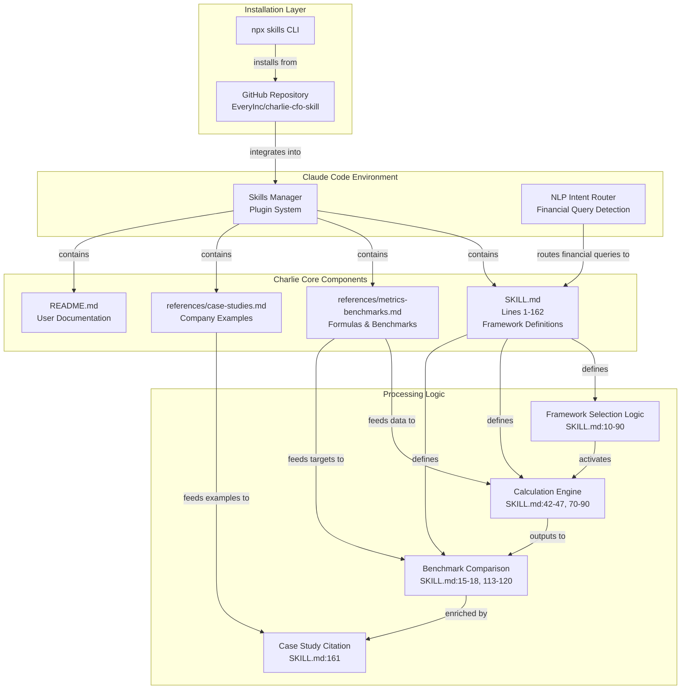
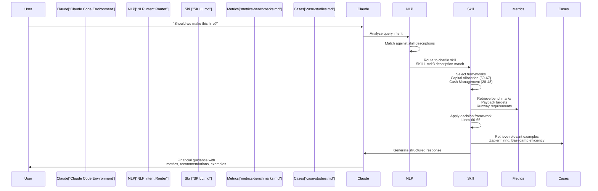
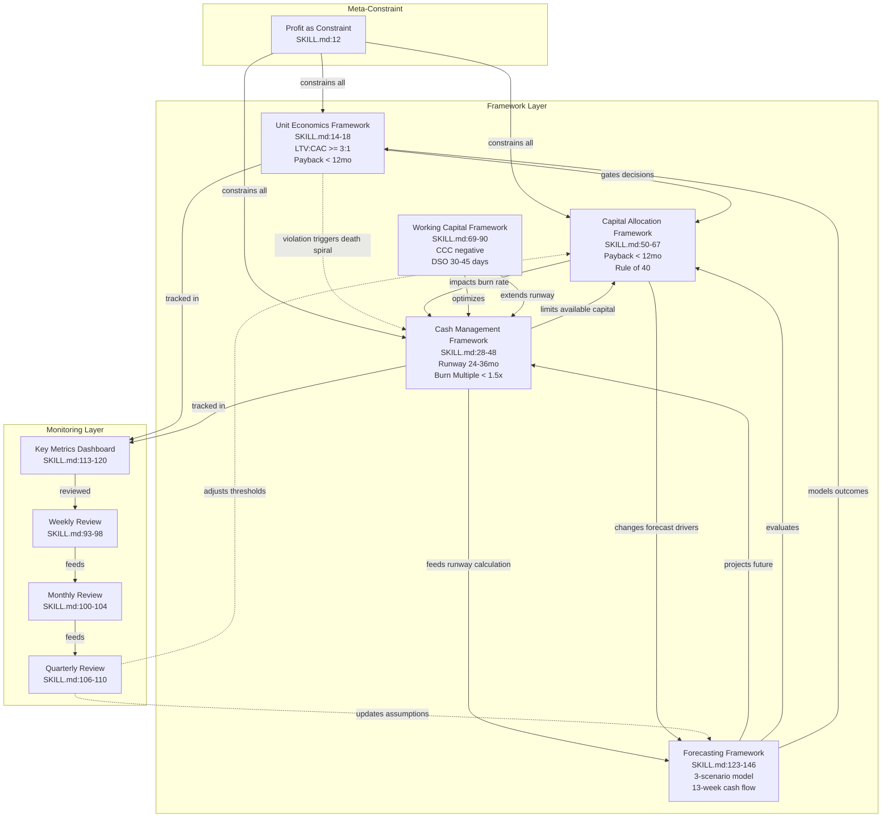
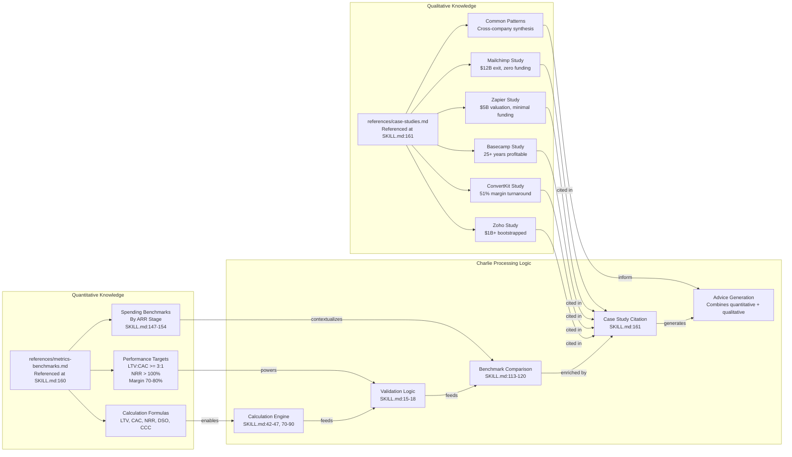
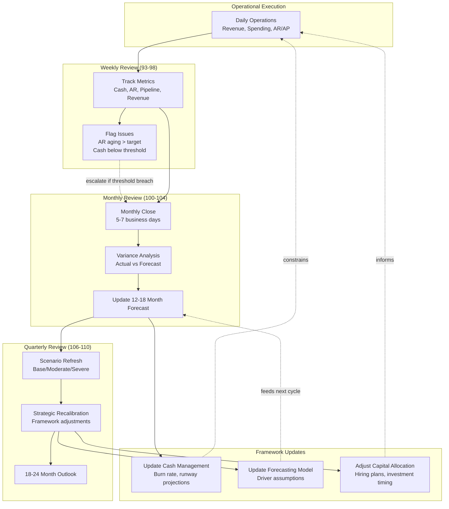
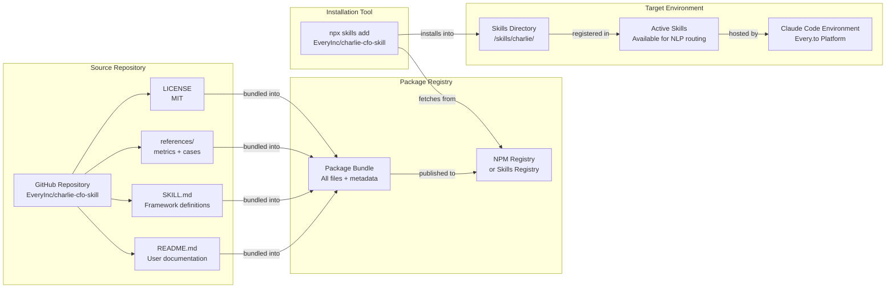

<!-- source: DeepWiki mcp.deepwiki.com · repo EveryInc/charlie-cfo-skill · page 6 System Architecture and Design · fetched 2026-10-26 -->

# System Architecture and Design

<details>
<summary>Relevant source files</summary>

The following files were used as context for generating this wiki page:

- [README.md](README.md)
- [SKILL.md](SKILL.md)

</details>


This document provides technical documentation of Charlie CFO Skill's component architecture, including how the five financial frameworks integrate with each other, how knowledge flows from reference materials into decision-making logic, and how the skill activates and processes queries within the Claude Code environment.

**Scope:** This page covers the structural design and component interactions. For conceptual frameworks and financial logic, see [Core Philosophy and Mental Models](#2). For practical usage patterns, see [Decision-Making Guides](#4). For reference material content, see [Reference Materials](#5).

---

## Component Overview and File Structure

Charlie CFO Skill is implemented as a document-based AI skill consisting of three primary components:

| Component | File Path | Purpose | Lines |
|-----------|-----------|---------|-------|
| **Skill Specification** | `SKILL.md` | Core financial frameworks, decision rules, and calculation formulas | 1-162 |
| **Metrics Reference** | `references/metrics-benchmarks.md` | Quantitative benchmarks, calculation formulas, industry targets | Referenced in [SKILL.md:160]() |
| **Case Studies Reference** | `references/case-studies.md` | Qualitative examples from bootstrapped companies | Referenced in [SKILL.md:161]() |
| **User Documentation** | `README.md` | Installation, usage, and philosophy overview | 1-59 |

### Component Architecture Diagram



**Sources:** [SKILL.md:1-162](), [README.md:1-59]()

---

## Skill Activation Specification

Charlie activates automatically via Claude Code's NLP intent recognition when users ask financial questions. The skill definition in `SKILL.md` includes a natural language description that the NLP router uses for pattern matching.

### Activation Triggers

The skill description field [SKILL.md:3]() specifies activation patterns:

- Cash management queries: "runway", "burn rate", "reserves"
- Unit economics queries: "LTV:CAC", "CAC payback", "gross margin"
- Capital allocation queries: "should we make this hire", "investment ROI"
- Working capital queries: "cash conversion", "AR/AP optimization"
- Forecasting queries: "how do I forecast revenue", "scenario planning"

### Activation Flow



**Sources:** [SKILL.md:3](), [SKILL.md:59-67](), [README.md:25-31]()

---

## Framework Integration Architecture

The five financial frameworks defined in `SKILL.md` form an interconnected system with explicit dependencies and constraints. This section documents how frameworks reference and constrain each other.

### Framework Definitions and Dependencies

| Framework | Lines | Key Constraints | Dependencies |
|-----------|-------|-----------------|--------------|
| **Cash Management** | [SKILL.md:28-48]() | Runway ≥ 24-36 months | Constrains all investments |
| **Unit Economics** | [SKILL.md:14-18]() | LTV:CAC ≥ 3:1, Payback < 12 mo | Gates Capital Allocation |
| **Capital Allocation** | [SKILL.md:50-67]() | ROI < 12 months | Depends on Unit Economics |
| **Working Capital** | [SKILL.md:69-90]() | CCC negative (-30 to -90 days) | Optimizes Cash Management |
| **Forecasting** | [SKILL.md:123-146]() | 3-scenario planning | Integrates all frameworks |

### Framework Dependency Graph



**Sources:** [SKILL.md:12-18](), [SKILL.md:28-48](), [SKILL.md:50-67](), [SKILL.md:69-90](), [SKILL.md:123-146]()

### Hard Dependencies

The architecture enforces specific precedence rules:

1. **Unit Economics Gates Capital Allocation** ([SKILL.md:14-18](), [SKILL.md:50-51]()): Capital allocation decisions require satisfying unit economics thresholds. A hiring decision ([SKILL.md:59-65]()) cannot proceed if LTV:CAC < 3:1 or CAC payback > 12 months, as these conditions indicate a "death spiral" that bootstrapped companies cannot survive.

2. **Cash Management Constrains All Investments** ([SKILL.md:28-33]()): The minimum runway requirement of 24-36 months acts as a hard constraint on all capital allocation. No investment can reduce runway below this threshold.

3. **Working Capital Optimizes Cash** ([SKILL.md:69-90]()): The working capital framework specifically targets cash management improvement through three mechanisms:
   - Reducing Days Sales Outstanding (DSO) target of 30-45 days ([SKILL.md:75-78]())
   - Extending Days Payable Outstanding (DPO) via Net 45-60 terms ([SKILL.md:80-83]())
   - Implementing annual prepay discounts to pull forward cash ([SKILL.md:85-89]())

4. **Forecasting Integrates All Frameworks** ([SKILL.md:123-146]()): The driver-based planning model ([SKILL.md:125]()) combines:
   - MRR buildup from unit economics ([SKILL.md:127-131]())
   - Cash flow projections from cash management ([SKILL.md:133-138]())
   - Scenario planning for capital allocation decisions ([SKILL.md:140-146]())

---

## Knowledge Base Architecture

Charlie's decision-making combines quantitative benchmarks with qualitative case studies through a dual-reference system. The knowledge base architecture is explicitly referenced in [SKILL.md:158-161]().

### Dual-Reference System



**Sources:** [SKILL.md:158-161](), [SKILL.md:147-154](), [README.md:45-48]()

### Knowledge Flow Patterns

The skill applies reference materials through five distinct usage patterns embedded in the framework definitions:

#### 1. Calculation (Formulas → Metrics)
- **Burn Multiple Formula** [SKILL.md:42](): `Net Burn ÷ Net New ARR`
- **Cash Conversion Cycle** [SKILL.md:70](): `DIO + DSO - DPO`
- **MRR Buildup** [SKILL.md:127-131](): `Starting MRR + New Bookings + Expansion - Churn`

#### 2. Validation (Targets → Pass/Fail)
- **LTV:CAC Threshold** [SKILL.md:15](): Must be ≥ 3:1, violations trigger death spiral warning
- **CAC Payback Threshold** [SKILL.md:16](): Must be < 12 months for high performers
- **Runway Threshold** [SKILL.md:30](): Minimum 24-36 months, < 12 months = "lost control"

#### 3. Comparison (Benchmarks → Context)
- **Revenue Per Employee** [SKILL.md:20-25](): Compares against $110-150K (early) to $400K+ (mature) targets
- **Spending Benchmarks** [SKILL.md:147-154](): Compares departmental spend against ARR stage targets
- **Rule of 40** [SKILL.md:53-57](): Maps growth + margin against 40% combined threshold

#### 4. Example Citation (Case Studies → Analogies)
Referenced via [SKILL.md:161]() for concrete examples:
- Hiring decisions → Zapier's "hire when it hurts" philosophy
- Efficiency targets → Basecamp's $1.4M revenue per employee
- Turnaround strategies → ConvertKit's 51% margin achievement in 5 months

#### 5. Pattern Application (Synthesis → Principles)
Common patterns extracted from case studies inform framework application:
- Profitability is a choice, not a milestone
- CAC efficiency through product, not paid acquisition
- Extreme revenue per employee as competitive advantage
- Long time horizons (20+ years) enable compounding
- Regular profit distribution maintains discipline

**Sources:** [SKILL.md:42](), [SKILL.md:70](), [SKILL.md:127-131](), [SKILL.md:15-16](), [SKILL.md:30](), [SKILL.md:20-25](), [SKILL.md:147-154](), [SKILL.md:53-57](), [SKILL.md:161]()

---

## Query Processing Pipeline

The skill processes queries through a multi-stage pipeline defined by framework selection logic, calculation sequences, and response structuring.

### End-to-End Processing Flow

```mermaid
graph TB
    QUERY["User Query<br/>Example: 'Should we make this hire?'"]
    
    INTENT["Intent Analysis<br/>Claude Code NLP<br/>Matches SKILL.md:3 description"]
    
    ROUTE["Route to Charlie<br/>Skill Manager activation"]
    
    FRAMEWORK_ID["Framework Identification<br/>Line 60-65: Hiring Questions<br/>Activates:<br/>- Capital Allocation<br/>- Cash Management"]
    
    BENCHMARK_FETCH["Benchmark Retrieval<br/>From references/metrics-benchmarks.md<br/>- Payback period targets<br/>- Revenue per employee<br/>- Runway requirements"]
    
    DECISION_FRAMEWORK["Apply Decision Framework<br/>4 Questions (SKILL.md:60-65)<br/>1. Revenue contribution?<br/>2. Time-to-productivity?<br/>3. Opportunity cost?<br/>4. Team productivity impact?"]
    
    CALC["Calculate Impact<br/>- Salary → Burn rate impact<br/>- Burn rate → Runway change<br/>- Revenue/employee impact<br/>- Rule of 40 effect"]
    
    VALIDATE["Validate Against Thresholds<br/>- Unit economics satisfied? (15-18)<br/>- Payback < 12 months? (51)<br/>- Runway > 24 months? (30)"]
    
    CASE_LOOKUP["Case Study Lookup<br/>From references/case-studies.md<br/>- Zapier hiring philosophy<br/>- Basecamp efficiency<br/>- ConvertKit lean team"]
    
    SYNTHESIZE["Synthesize Response<br/>- Quantitative analysis<br/>- Recommendation<br/>- Case examples<br/>- Risk warnings<br/>- Follow-up actions"]
    
    OUTPUT["Structured Output to User"]
    
    QUERY --> INTENT
    INTENT --> ROUTE
    ROUTE --> FRAMEWORK_ID
    FRAMEWORK_ID --> BENCHMARK_FETCH
    BENCHMARK_FETCH --> DECISION_FRAMEWORK
    DECISION_FRAMEWORK --> CALC
    CALC --> VALIDATE
    VALIDATE --> CASE_LOOKUP
    CASE_LOOKUP --> SYNTHESIZE
    SYNTHESIZE --> OUTPUT
```



**Sources:** [SKILL.md:3](), [SKILL.md:60-65](), [SKILL.md:15-18](), [SKILL.md:30](), [SKILL.md:51]()

### Framework Selection Logic

The skill specification does not contain explicit routing code but instead relies on natural language pattern matching in framework descriptions. Each framework section contains keyword-rich text that Claude Code's NLP uses for routing:

| Query Type | Matching Keywords | Activated Frameworks | Lines |
|------------|-------------------|----------------------|-------|
| Hiring decisions | "hire", "headcount", "team growth" | Capital Allocation + Cash Management | 59-67, 28-48 |
| Cash questions | "runway", "burn", "reserves", "cash position" | Cash Management + Working Capital | 28-48, 69-90 |
| Metric questions | "LTV:CAC", "CAC payback", "gross margin", "NRR" | Unit Economics + Dashboard | 14-18, 113-120 |
| Forecasting | "forecast", "scenario", "projection", "planning" | Forecasting + All frameworks | 123-146, all |
| Investment ROI | "investment", "ROI", "payback", "return" | Capital Allocation + Unit Economics | 50-67, 14-18 |

### Response Structure

Responses follow a consistent structure implied by the review rhythms [SKILL.md:92-110]() and metrics dashboard [SKILL.md:113-120]():

1. **Quantitative Analysis**: Calculated metrics with formulas shown
2. **Benchmark Comparison**: User metrics vs. targets from [SKILL.md:15-18](), [SKILL.md:113-120]()
3. **Recommendation**: Approve/defer/reject with rationale
4. **Case Study Context**: Relevant examples from `references/case-studies.md`
5. **Risk Warnings**: If thresholds violated (e.g., runway < 24 months)
6. **Follow-up Actions**: Next steps aligned with review rhythms

**Sources:** [SKILL.md:59-67](), [SKILL.md:28-48](), [SKILL.md:14-18](), [SKILL.md:113-120](), [SKILL.md:123-146](), [SKILL.md:92-110]()

---

## Cross-Framework Calculation Dependencies

Certain calculations require inputs from multiple frameworks, creating computational dependencies.

### Rule of 40 Calculation

The Rule of 40 metric [SKILL.md:53-57]() depends on:
- **Revenue Growth %**: Calculated from forecasting framework [SKILL.md:127-131]()
- **EBITDA Margin %**: Derived from cash management burn analysis [SKILL.md:42-47]()

```
Rule of 40 = Revenue Growth % + EBITDA Margin %
Target: ≥ 40%
```

### Burn Multiple Calculation

The Burn Multiple [SKILL.md:42-47]() requires:
- **Net Burn**: From cash management framework [SKILL.md:28-48]()
- **Net New ARR**: From unit economics and forecasting [SKILL.md:127-131]()

```
Burn Multiple = Net Burn ÷ Net New ARR
Targets: <1x excellent, 1-1.5x good, >2x concerning
```

### Payback Period Calculation

Hiring ROI [SKILL.md:60-65]() requires:
- **Fully-loaded compensation**: From capital allocation framework
- **Time-to-productivity**: From capital allocation framework [SKILL.md:62]()
- **Revenue contribution**: From unit economics framework [SKILL.md:61]()

```
Payback Period = (Salary × Time-to-Productivity) ÷ Monthly Revenue Contribution
Target: < 12 months
```

### Cash Conversion Cycle Calculation

CCC [SKILL.md:70]() aggregates:
- **DIO** (Days Inventory Outstanding): Working capital framework
- **DSO** (Days Sales Outstanding): AR management [SKILL.md:75-78]()
- **DPO** (Days Payable Outstanding): AP strategy [SKILL.md:80-83]()

```
CCC = DIO + DSO - DPO
SaaS Target: Negative (-30 to -90 days)
```

**Sources:** [SKILL.md:53-57](), [SKILL.md:42-47](), [SKILL.md:127-131](), [SKILL.md:60-65](), [SKILL.md:70](), [SKILL.md:75-83]()

---

## Review Rhythm Architecture

The monitoring layer [SKILL.md:92-110]() creates feedback loops between operational execution and framework updates.

### Review Frequency and Scope

| Frequency | Duration | Metrics Reviewed | Line Reference |
|-----------|----------|------------------|----------------|
| **Weekly** | 60-90 min | Cash position, AR aging, pipeline, revenue/bookings | [SKILL.md:93-98]() |
| **Monthly** | Full close (5-7 days) | Complete financials, variance analysis, rolling forecast | [SKILL.md:100-104]() |
| **Quarterly** | Strategic session | Scenario refresh, 18-24 month outlook, strategic recalibration | [SKILL.md:106-110]() |

### Feedback Loop Architecture



**Sources:** [SKILL.md:92-110]()

### Escalation Triggers

The review rhythms define specific thresholds that trigger escalation from weekly to monthly or quarterly reviews:

1. **Weekly → Monthly Escalation**:
   - AR aging exceeds DSO target of 30-45 days [SKILL.md:75]()
   - Cash position drops toward minimum runway threshold [SKILL.md:30-33]()
   - Pipeline conversion rates deviate significantly from forecast

2. **Monthly → Quarterly Escalation**:
   - Variance analysis shows >10% deviation from forecast [SKILL.md:103]()
   - Unit economics deteriorate below thresholds [SKILL.md:15-18]()
   - Burn multiple exceeds 2x [SKILL.md:42-47]()

3. **Immediate Action Triggers** (bypass rhythm):
   - Runway falls below 12 months [SKILL.md:32]()
   - Customer concentration exceeds 10% for single customer [SKILL.md:121]()
   - LTV:CAC ratio falls below 3:1 [SKILL.md:15]()

**Sources:** [SKILL.md:92-110](), [SKILL.md:75](), [SKILL.md:30-33](), [SKILL.md:15-18](), [SKILL.md:42-47](), [SKILL.md:121]()

---

## Installation and Distribution Architecture

Charlie is distributed as an NPM-style package installed via the NPX Skills CLI into the Claude Code environment.

### Distribution Components



**Sources:** [README.md:17-21](), [README.md:50-54]()

### Installation Command Flow

The installation process referenced in [README.md:19-21]():

```bash
npx skills add EveryInc/charlie-cfo-skill
```

This command:
1. Resolves `EveryInc/charlie-cfo-skill` against the skills registry
2. Downloads the package bundle containing all four files
3. Extracts files into the Claude Code skills directory
4. Registers the skill name (`charlie` from [SKILL.md:2]()) with the NLP router
5. Indexes the skill description [SKILL.md:3]() for query matching

### Skill Metadata

The YAML frontmatter in [SKILL.md:1-4]() provides metadata for skill registration:

```yaml
name: charlie
description: Your AI CFO for bootstrapped startups...
```

- **name**: Used as skill identifier in the Skills Manager
- **description**: Indexed by NLP for intent matching and routing

**Sources:** [README.md:17-21](), [SKILL.md:1-4]()

---

## Integration Points and Extension Mechanisms

While Charlie is a self-contained skill, the architecture allows for specific integration and extension patterns.

### Data Input Mechanisms

Charlie accepts financial data through natural language queries that include:
- Current metrics: "Our LTV is $5,000 and CAC is $1,200"
- Financial statements: "Here's our P&L for Q3"
- Scenario parameters: "If we hire 3 engineers at $150K each"

The skill does not directly access databases or APIs; all data flows through conversational input.

### Reference Material Update Pattern

The reference documents [SKILL.md:158-161]() can be updated independently of the core framework logic:

1. **Metrics Benchmarks Updates**: Industry targets and formulas in `references/metrics-benchmarks.md` can be refreshed with new data
2. **Case Study Additions**: New bootstrapped company examples can be added to `references/case-studies.md`
3. **Backward Compatibility**: Framework logic in `SKILL.md` references documents generically, so updates don't break existing logic

### Extensibility via Skill Composition

The Claude Code Skills Manager allows multiple skills to coexist [README.md:50-54](). Charlie can compose with:
- Accounting skills for GL-level financial data processing
- Legal skills for equity structure and fundraising advice
- Sales skills for go-to-market strategy aligned with unit economics

The NLP router handles skill coordination, routing queries to appropriate specialists while preserving context across skill invocations.

**Sources:** [SKILL.md:158-161](), [README.md:50-54]()

---

## Summary: Architectural Properties

The Charlie CFO Skill architecture exhibits several key properties:

| Property | Implementation | Benefit |
|----------|----------------|---------|
| **Document-Based** | Logic encoded in `SKILL.md` specification | Human-readable, version-controlled, easily auditable |
| **Declarative Frameworks** | Frameworks defined as rules and thresholds | Consistent application of financial principles |
| **Hard Dependencies** | Unit economics gates capital allocation | Prevents death spirals from unchecked growth |
| **Dual Knowledge System** | Quantitative metrics + qualitative case studies | Numerically sound advice with contextual wisdom |
| **Multi-Stage Processing** | Framework selection → calculation → validation → synthesis | Structured reasoning with clear decision trail |
| **Feedback Loops** | Weekly/monthly/quarterly reviews update forecasts | Self-correcting system that learns from variance |
| **Modular References** | Separate benchmark and case study documents | Knowledge updates without logic changes |
| **NLP-Activated** | Automatic routing via skill description | Zero configuration for end users |

This architecture enables Charlie to function as a specialized financial advisor that combines the rigor of quantitative analysis with the wisdom of proven bootstrapped success patterns, all accessible through natural language interaction.

**Sources:** [SKILL.md:1-162](), [README.md:1-59]()

---

