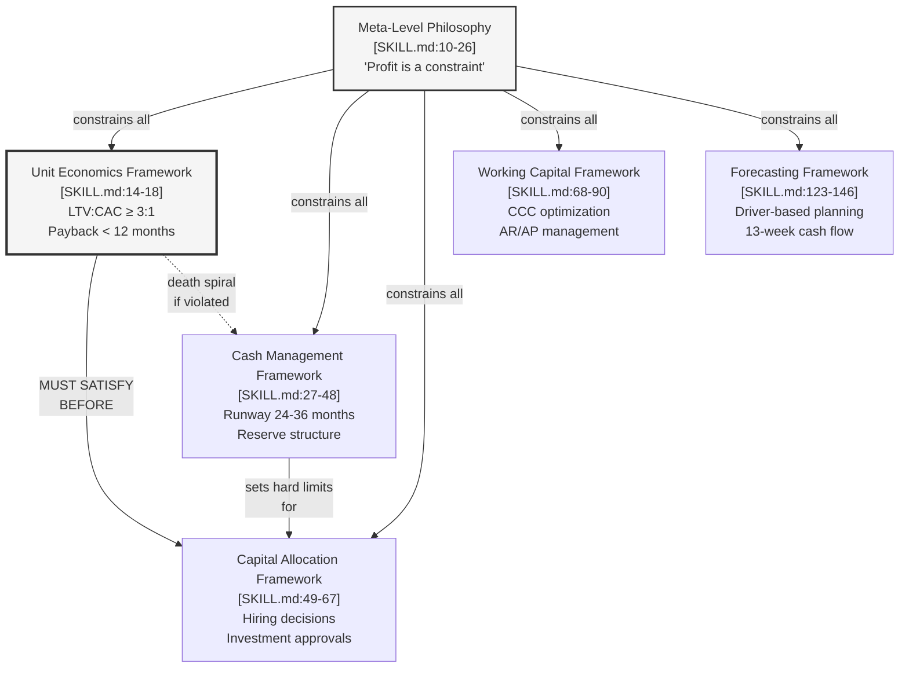
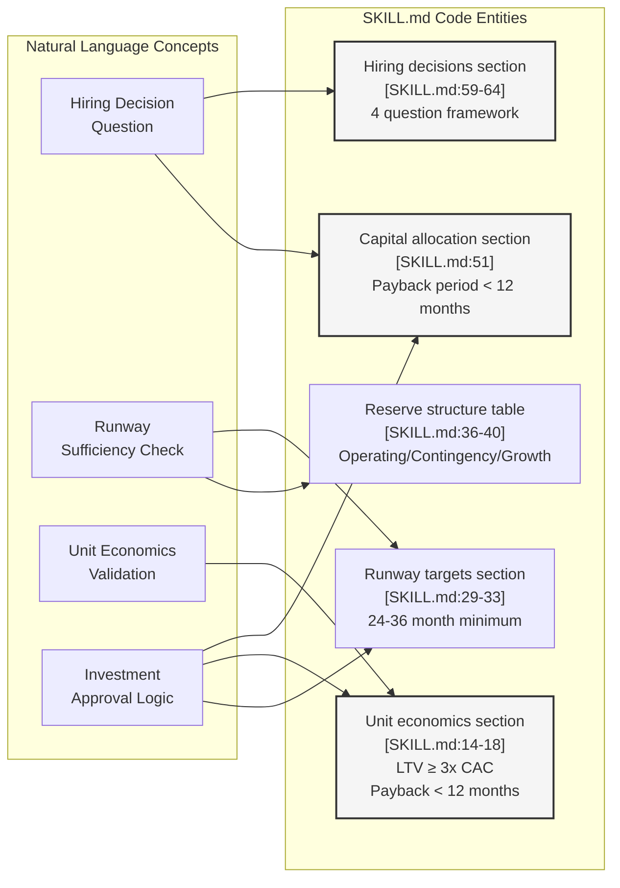
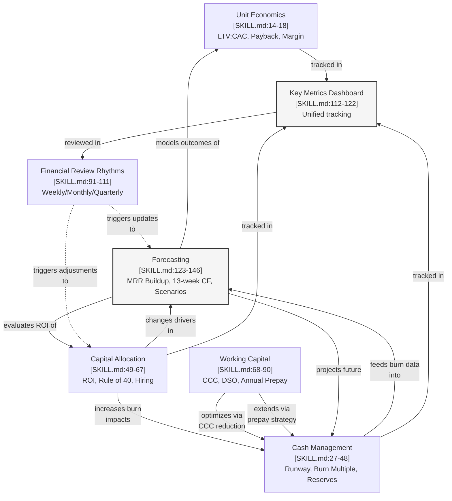
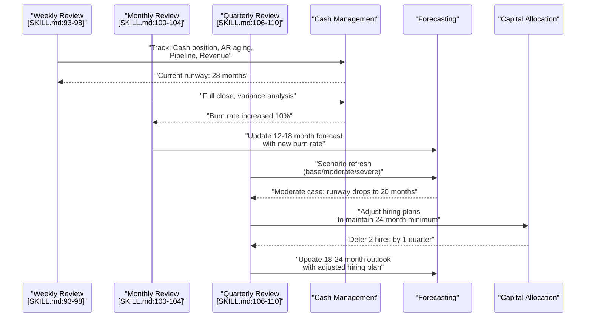
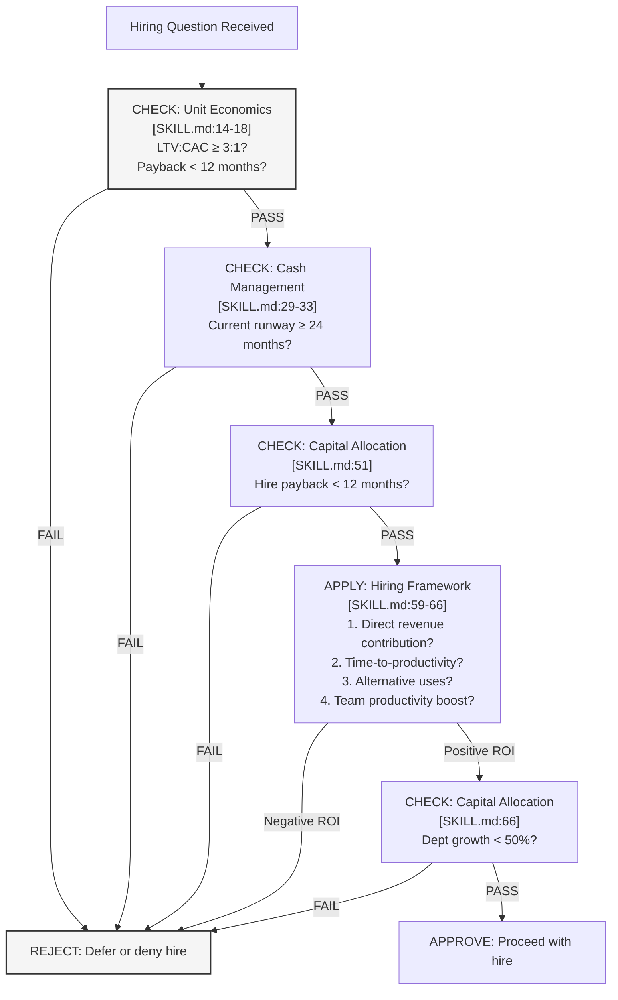

<!-- source: DeepWiki mcp.deepwiki.com · repo EveryInc/charlie-cfo-skill · page 6.1 Framework Integration and Dependencies · fetched 2026-10-26 -->

# Framework Integration and Dependencies

Relevant source files

The following files were used as context for generating this wiki page:

- [SKILL.md](SKILL.md)

## Purpose and Scope

This document explains how Charlie's five financial frameworks—Cash Management, Unit Economics, Capital Allocation, Working Capital Optimization, and Forecasting—interconnect and depend on each other to form an integrated decision-making system. It details the hard dependencies that enforce prerequisite checks, the soft interactions that create feedback loops, and the meta-level philosophy that constrains all framework application.

For detailed explanations of each individual framework's mechanics and calculations, see [The Five Financial Frameworks](#3). For how the frameworks draw on reference data, see [Knowledge Base Architecture](#6.2). For practical application of these integrated frameworks to specific decisions, see [Decision-Making Guides](#4).

## Framework Specification Structure in Code

The five frameworks are specified within [SKILL.md](SKILL.md), organized into distinct sections that define rules, thresholds, and decision logic:

| Framework | Location in SKILL.md | Key Components |
|-----------|---------------------|----------------|
| **Core Philosophy** | [SKILL.md:10-26]() | Meta-level constraints that shape all frameworks |
| **Cash Management** | [SKILL.md:27-48]() | Runway rules, reserve structure, burn multiple thresholds |
| **Capital Allocation** | [SKILL.md:49-67]() | Investment decision logic, Rule of 40, hiring framework |
| **Working Capital** | [SKILL.md:68-90]() | CCC optimization, AR/AP strategies, annual prepay mechanics |
| **Forecasting** | [SKILL.md:123-146]() | Driver-based planning, MRR buildup, 13-week cash flow, scenarios |
| **Unit Economics** | [SKILL.md:14-18]() + [SKILL.md:115]() | LTV:CAC thresholds, payback requirements embedded in metrics dashboard |
| **Review Rhythms** | [SKILL.md:91-111]() | Weekly/monthly/quarterly feedback loops that connect frameworks |

**Sources:** [SKILL.md:1-162]()

## Dependency Architecture

### Hard Dependencies: Prerequisite Enforcement

The frameworks enforce a strict dependency hierarchy where certain frameworks **must** be satisfied before others can be applied. This prevents common failure modes like investing in growth with broken unit economics.

**Dependency Rules:**

1. **Unit Economics → Capital Allocation**: The system enforces that [SKILL.md:14-18]() thresholds (LTV ≥ 3x CAC, CAC payback < 12 months) must be satisfied before any growth investment is approved via the Capital Allocation framework [SKILL.md:49-67](). Violating unit economics creates a "death spiral bootstrapped companies cannot survive" [SKILL.md:18]().

2. **Cash Management → Capital Allocation**: Runway requirements [SKILL.md:29-33]() act as absolute constraints on spending decisions. If runway < 24 months, no discretionary investments are approved regardless of ROI calculations [SKILL.md:51]().

3. **Meta-Philosophy → All Frameworks**: The principle that "Profit is a constraint, not a goal" [SKILL.md:12]() shapes how all frameworks are applied—every decision must account for direct expenditure, opportunity cost, and runway impact.

**Sources:** [SKILL.md:10-26](), [SKILL.md:14-18](), [SKILL.md:27-48](), [SKILL.md:49-67]()

### Framework Specification to Code Entity Mapping

The following diagram maps high-level framework concepts to their specific manifestations in the SKILL.md specification:

**Sources:** [SKILL.md:14-18](), [SKILL.md:29-40](), [SKILL.md:49-67]()

## Cross-Framework Interactions and Feedback Loops

Beyond hard dependencies, frameworks interact through data flows, mutual influence, and feedback mechanisms.

### Interaction Patterns

#### 1. Capital Allocation → Cash Management

Every capital allocation decision directly impacts cash position:
- **Hiring**: Each new hire increases burn rate [SKILL.md:59-64]()
- **Runway Impact**: Calculated as: New Monthly Burn ÷ Current Cash = Months of runway consumed
- **Reserve Allocation**: Spending depletes Growth reserve first [SKILL.md:36-40]()

#### 2. Working Capital → Cash Management

Working capital optimization extends runway without reducing burn:
- **CCC Reduction**: Every 10-day CCC improvement frees working capital [SKILL.md:73]()
- **Annual Prepay**: 15-20% discounts generate immediate cash influx [SKILL.md:85-89]()
- **DSO Improvement**: 30-45 day target [SKILL.md:75]() reduces AR balance

#### 3. Forecasting → All Frameworks

Forecasting integrates and projects all other frameworks:
- **Cash Projection**: 13-week cash flow forecast [SKILL.md:133-137]() uses burn rate from Cash Management
- **Investment Evaluation**: Three-scenario planning [SKILL.md:139-145]() models Capital Allocation decisions
- **Unit Economics Modeling**: MRR buildup model [SKILL.md:127-131]() incorporates churn and CAC payback

**Sources:** [SKILL.md:27-146]()

## Integration Mechanisms

### Metrics Dashboard as Integration Point

The Key Metrics Dashboard [SKILL.md:112-122]() serves as the primary integration mechanism, tracking outputs from all five frameworks in a unified view:

| Dashboard Category | Framework Source | Metrics Tracked | Decision Triggers |
|-------------------|------------------|-----------------|-------------------|
| **Revenue** | Forecasting | MRR/ARR, growth rate, NRR | Growth < 15% → review Capital Allocation |
| **Unit Economics** | Unit Economics | LTV:CAC, payback, margin | Ratio < 3:1 → halt growth spending |
| **Cash** | Cash Management | Burn rate, runway, OCF | Runway < 24 months → freeze hiring |
| **Customer Health** | Unit Economics + Forecasting | Churn, concentration | Churn > 2% → investigate cohorts |

**Sources:** [SKILL.md:112-122]()

### Review Rhythms as Feedback Loops

The Financial Review Rhythms [SKILL.md:91-111]() create temporal feedback loops that propagate changes across frameworks:

**Review Cycle Integration Logic:**

1. **Weekly** [SKILL.md:93-98](): Tracks operational metrics that feed Cash Management (cash position, AR aging, bookings)

2. **Monthly** [SKILL.md:100-104](): Performs variance analysis that triggers Forecasting updates when actuals deviate from plan

3. **Quarterly** [SKILL.md:106-110](): Strategic recalibration that adjusts Capital Allocation plans based on Forecasting scenarios

**Sources:** [SKILL.md:91-111]()

## Meta-Level Philosophy Constraints

The "Profit is a constraint, not a goal" philosophy [SKILL.md:10-12]() imposes design constraints on all frameworks:

### Three-Cost Accounting

Every framework decision must evaluate:

1. **Direct Expenditure**: Explicit dollar cost
2. **Opportunity Cost**: Alternative uses of capital
3. **Runway Impact**: Effect on survival duration

This is explicitly encoded in the hiring framework [SKILL.md:63](): "What else could this salary fund?" forces opportunity cost consideration.

### Survival Thresholds vs. Aspirational Goals

Frameworks distinguish between non-negotiable survival requirements and optimization targets:

| Framework | Survival Threshold | Aspirational Target |
|-----------|-------------------|---------------------|
| Unit Economics | LTV:CAC ≥ 3:1 [SKILL.md:16]() | LTV:CAC 7-8x (best-in-class) [SKILL.md:16]() |
| Cash Management | Runway ≥ 24 months [SKILL.md:31]() | Runway 36 months [SKILL.md:31]() |
| Capital Allocation | Payback < 12 months [SKILL.md:51]() | Payback 5-7 months [SKILL.md:17]() |
| Working Capital | CCC negative [SKILL.md:72]() | CCC -90 days [SKILL.md:72]() |

Survival thresholds trigger **hard stops** in dependent frameworks (e.g., LTV:CAC < 3:1 blocks all growth spending), while aspirational targets are used for benchmarking.

**Sources:** [SKILL.md:10-26](), [SKILL.md:49-67]()

## Dependency Enforcement in Decision Logic

### Hiring Decision Integration Example

The hiring framework [SKILL.md:59-66]() demonstrates multi-framework integration:

**Decision Flow:**

1. **Unit Economics Gate** [SKILL.md:14-18](): If violated, immediately reject—no growth investments allowed
2. **Runway Gate** [SKILL.md:29-33](): If < 24 months, reject to preserve survival
3. **Payback Gate** [SKILL.md:51](): If > 12 months, reject as too slow
4. **Hiring-Specific Analysis** [SKILL.md:59-64](): Four-question ROI framework
5. **Growth Constraint** [SKILL.md:66](): Department growth limit to prevent productivity collapse

**Sources:** [SKILL.md:14-18](), [SKILL.md:29-33](), [SKILL.md:49-67]()

## Spending Benchmarks Integration

The spending benchmarks [SKILL.md:147-155]() represent the output of integrated framework application at specific scale:

| Department | % of ARR | Derived From |
|------------|----------|--------------|
| Sales | 10-15% | Capital Allocation payback requirements + Unit Economics CAC constraints |
| Marketing | 8-10% | Unit Economics CAC efficiency targets |
| R&D | 25-30% | Capital Allocation product velocity requirements |
| Customer Success | 8-12% | Unit Economics churn/NRR targets + Working Capital efficiency |
| G&A | ~14% | Cash Management overhead constraints |
| **Total** | **~95%** | Philosophy: 5% buffer for profitability constraint |

The ~95% total [SKILL.md:154]() directly implements "Profit is a constraint" [SKILL.md:12]()—spending must stay below 100% of revenue to maintain bootstrapped viability.

**Sources:** [SKILL.md:10-12](), [SKILL.md:147-155]()

## Framework Interaction Summary

| Framework Pair | Interaction Type | Mechanism | Code Location |
|----------------|------------------|-----------|---------------|
| Unit Economics → Capital Allocation | **Hard Dependency** | LTV:CAC gate on spending | [SKILL.md:14-18](), [SKILL.md:49-67]() |
| Cash Management → Capital Allocation | **Hard Constraint** | Runway minimum enforcement | [SKILL.md:29-33](), [SKILL.md:51]() |
| Working Capital → Cash Management | **Optimization** | CCC reduction, prepay strategy | [SKILL.md:68-90](), [SKILL.md:27-48]() |
| Forecasting → Cash Management | **Projection** | 13-week cash flow modeling | [SKILL.md:133-137](), [SKILL.md:27-48]() |
| Forecasting → Capital Allocation | **Scenario Analysis** | ROI modeling under 3 scenarios | [SKILL.md:139-145](), [SKILL.md:49-67]() |
| All Frameworks → Dashboard | **Integration Point** | Unified metric tracking | [SKILL.md:112-122]() |
| Reviews → All Frameworks | **Feedback Loops** | Weekly/monthly/quarterly updates | [SKILL.md:91-111]() |

**Sources:** [SKILL.md:10-155]()

---

