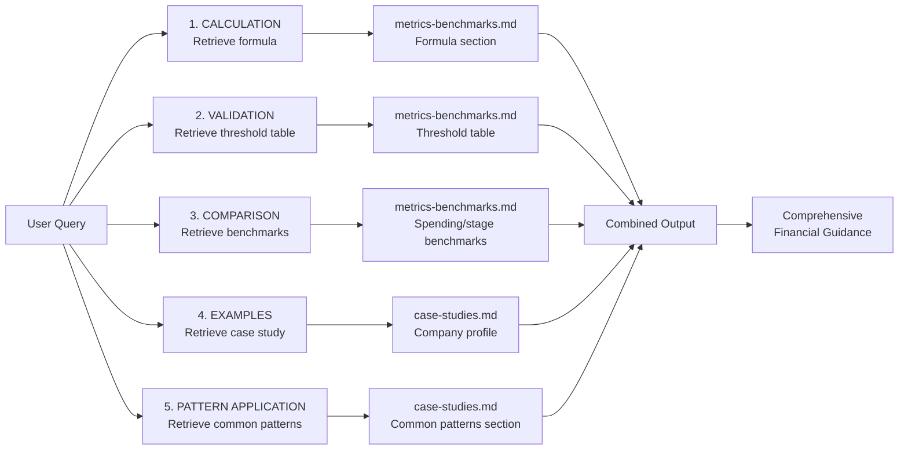
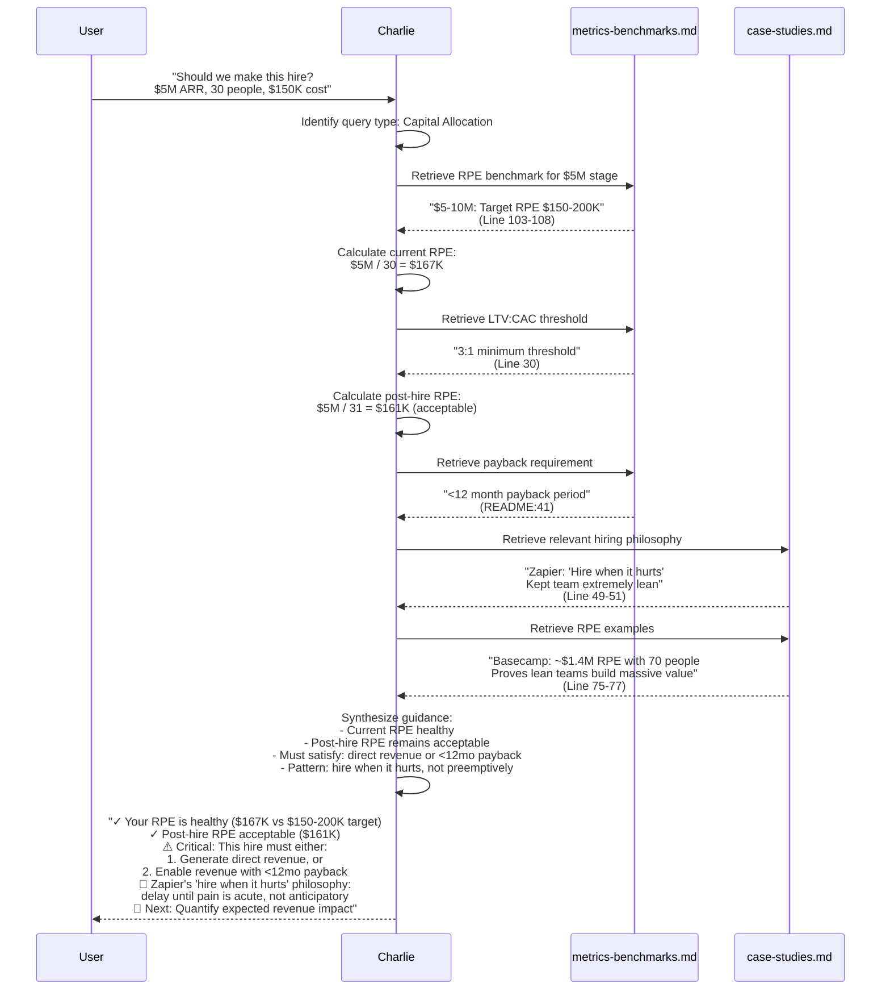
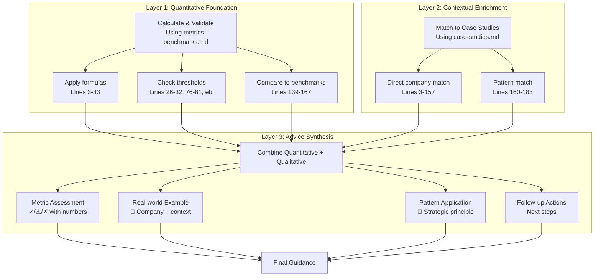
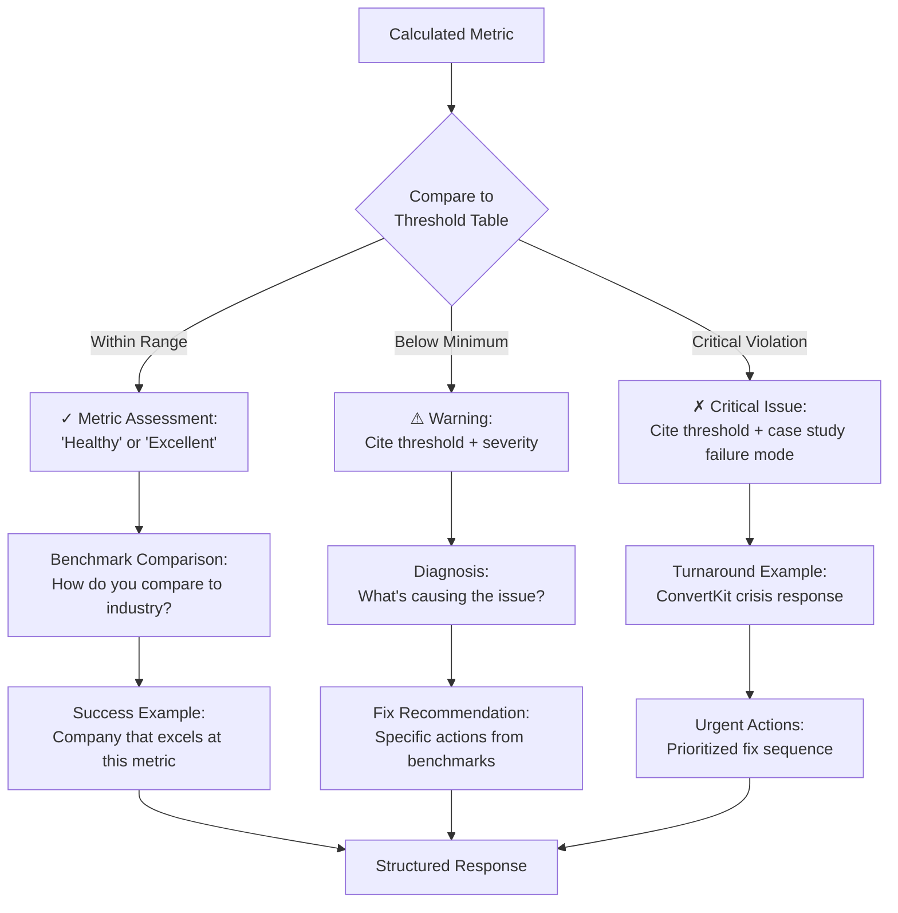

<!-- source: DeepWiki mcp.deepwiki.com · repo EveryInc/charlie-cfo-skill · page 6.2 Knowledge Base Architecture · fetched 2026-10-26 -->

# Knowledge Base Architecture

<details>
<summary>Relevant source files</summary>

The following files were used as context for generating this wiki page:

- [README.md](README.md)
- [references/case-studies.md](references/case-studies.md)
- [references/metrics-benchmarks.md](references/metrics-benchmarks.md)

</details>


## Purpose and Scope

This document describes the architecture of Charlie's reference knowledge base, which grounds the skill's financial advice in quantitative benchmarks and qualitative case studies. It explains the structure of the two core reference documents, how Charlie retrieves and combines information from them, and the integration patterns used during query processing.

For information about how the financial frameworks themselves operate, see [The Five Financial Frameworks](#3). For details on the query processing pipeline, see [How Charlie Activates and Processes Queries](#1.2).

---

## Dual Knowledge Base Structure

Charlie's knowledge base comprises two complementary reference documents that provide both quantitative rigor and qualitative context:

| Document | Purpose | Type | Primary Use Cases |
|----------|---------|------|-------------------|
| `references/metrics-benchmarks.md` | Formulas, calculation methods, performance targets, industry benchmarks | Quantitative | Metric calculation, validation, comparison to standards |
| `references/case-studies.md` | Success stories, financial decisions, common patterns across bootstrapped companies | Qualitative | Contextual examples, pattern recognition, strategic guidance |

The dual structure prevents "hollow metrics" syndrome—where numerical analysis lacks interpretive wisdom—by ensuring every quantitative assessment can be enriched with real-world precedent.

**Sources:** [references/metrics-benchmarks.md:1-199](), [references/case-studies.md:1-183]()

---

## Metrics and Benchmarks Document Structure

### Organizational Schema

The `references/metrics-benchmarks.md` file is organized into eight major sections, each providing calculation formulas and performance thresholds:

```mermaid
graph TB
    METRICS["references/metrics-benchmarks.md"]
    
    METRICS --> UNIT["Unit Economics Calculations<br/>Lines 3-33"]
    METRICS --> SAAS["SaaS Metrics Benchmarks<br/>Lines 34-63"]
    METRICS --> CASH["Cash Flow Metrics<br/>Lines 64-88"]
    METRICS --> REVENUE["Revenue Efficiency<br/>Lines 89-111"]
    METRICS --> WORKING["Working Capital Metrics<br/>Lines 112-138"]
    METRICS --> SPENDING["Spending Benchmarks by ARR<br/>Lines 139-167"]
    METRICS --> RULE40["Rule of 40 Scenarios<br/>Lines 168-181"]
    METRICS --> FORECAST["Forecast Accuracy Metrics<br/>Lines 182-199"]
    
    UNIT --> LTV["LTV = (ARPU × Gross Margin) / Churn"]
    UNIT --> CAC["CAC = S&M Spend / New Customers"]
    UNIT --> PAYBACK["Payback = CAC / (ARPU × Margin)"]
    UNIT --> RATIO["LTV:CAC Ratio Table"]
    
    SAAS --> CHURN["Churn by Segment<br/>SMB: 3-5% monthly<br/>Enterprise: 0.5-1%"]
    SAAS --> NRR["NRR Formula + Thresholds<br/>>100% = expansion"]
    SAAS --> MARGIN["Gross Margin Targets<br/>Pure SaaS: 75-85%"]
    
    CASH --> RUNWAY["Runway = Cash / Burn Rate"]
    CASH --> BURN_MULT["Burn Multiple = Burn / New ARR"]
    CASH --> CCS["Cash Conversion Score"]
    
    REVENUE --> MAGIC["Magic Number = ARR Growth / S&M"]
    REVENUE --> RPE["Revenue per Employee by Stage"]
    
    WORKING --> DSO["DSO = (AR / Sales) × Days"]
    WORKING --> DPO["DPO = (AP / COGS) × Days"]
    WORKING --> CCC["CCC = DIO + DSO - DPO"]
    
    SPENDING --> EARLY["$1-3M ARR Allocations"]
    SPENDING --> GROWTH["$3-10M ARR Allocations"]
    SPENDING --> SCALE["$10M+ ARR Allocations"]
    
    RULE40 --> MATRIX["Growth + Margin ≥ 40%<br/>Tradeoff scenarios"]
    
    FORECAST --> MAPE["MAPE Formula<br/>Target: <10%"]
```



**Structure Details:**

Each section follows a consistent pattern:

1. **Formula Definition** - Mathematical specification with variable names
2. **Calculation Example** - Concrete illustration (when applicable)
3. **Threshold Table** - Performance rating ranges (e.g., "Excellent", "Good", "Concerning")
4. **Contextual Notes** - Special cases or bootstrapped-specific guidance

**Sources:** [references/metrics-benchmarks.md:1-199]()

### Key Threshold Tables

Charlie relies heavily on threshold tables for validation logic. Critical examples:

**LTV:CAC Ratio Interpretation** ([references/metrics-benchmarks.md:26-32]()):
```
<1:1   → Losing money on every customer
1-2:1  → Unsustainable, need to improve
3:1    → Healthy minimum threshold
5:1+   → Excellent, may be underinvesting
7-8:1  → Best-in-class
```

**Burn Multiple Rating** ([references/metrics-benchmarks.md:76-81]()):
```
<1x    → Excellent efficiency
1-1.5x → Good
1.5-2x → Concerning
>2x    → Inefficient, requires correction
```

**DSO Rating** ([references/metrics-benchmarks.md:118-123]()):
```
<30 days  → Excellent
30-45     → Good
45-60     → Needs attention
>60       → Problem requiring immediate action
```

These tables enable programmatic validation where Charlie computes a metric from user data, then immediately classifies it as healthy/concerning based on these thresholds.

**Sources:** [references/metrics-benchmarks.md:26-32](), [references/metrics-benchmarks.md:76-81](), [references/metrics-benchmarks.md:118-123]()

### Spending Benchmarks by Stage

The spending benchmark tables ([references/metrics-benchmarks.md:139-167]()) provide stage-specific allocation guidance:

| Stage | Sales | Marketing | R&D | CS | G&A |
|-------|-------|-----------|-----|-----|-----|
| $1-3M ARR | 15-20% | 10-15% | 30-40% | 10-15% | 15-20% |
| $3-10M ARR | 10-15% | 8-12% | 25-30% | 8-12% | 12-15% |
| $10M+ ARR | 8-12% | 6-10% | 20-25% | 6-10% | 10-12% |

Charlie uses these for contextualized budget evaluation, e.g.: "Your R&D spend of 45% of ARR is high for your $12M stage, where typical is 20-25%."

**Sources:** [references/metrics-benchmarks.md:139-167]()

---

## Case Studies Document Structure

### Five Company Profiles

The `references/case-studies.md` file contains detailed profiles of five bootstrapped success stories, each following a consistent template:

```mermaid
graph TB
    CASES["references/case-studies.md"]
    
    CASES --> MAIL["Mailchimp<br/>Lines 3-29<br/>$12B exit, 20 years"]
    CASES --> ZAP["Zapier<br/>Lines 31-58<br/>$5B valuation, $1.4M raised"]
    CASES --> BASE["Basecamp<br/>Lines 60-92<br/>25+ years profitable"]
    CASES --> CONV["ConvertKit<br/>Lines 94-122<br/>51% margin turnaround"]
    CASES --> ZOHO["Zoho<br/>Lines 124-157<br/>$1B+ revenue, zero funding"]
    CASES --> PATTERNS["Common Patterns<br/>Lines 160-183<br/>5 synthesized lessons"]
    
    MAIL --> MAIL_KEY["Key Financial Decisions:<br/>- Freemium pivot (2009)<br/>- CAC < $100 via virality<br/>- Never raised capital"]
    MAIL --> MAIL_LESSON["Lessons:<br/>- Freemium increases profit if unit econ strong<br/>- Product virality beats paid<br/>- Patience compounds (20 years)"]
    
    ZAP --> ZAP_KEY["Key Financial Decisions:<br/>- Profitability first (2014)<br/>- Programmatic SEO (near-zero CAC)<br/>- 'Hire when it hurts'"]
    ZAP --> ZAP_LESSON["Lessons:<br/>- SEO replaces paid acquisition<br/>- Seed as final round forces discipline<br/>- RPE matters over headcount"]
    
    BASE --> BASE_KEY["Key Financial Decisions:<br/>- Annual profit distributions<br/>- RPE ~$1.4M<br/>- Product focus (shut 3 of 4 products)"]
    BASE --> BASE_LESSON["Lessons:<br/>- Profit distributions reduce risk<br/>- Focus beats diversification<br/>- High RPE achievable with discipline"]
    
    CONV --> CONV_KEY["Key Financial Decisions:<br/>- Crisis response: cost cuts + renegotiation<br/>- Direct sales focus<br/>- Profit distribution: 40% owners, 52% team"]
    CONV --> CONV_LESSON["Lessons:<br/>- Fast turnarounds possible<br/>- Profit sharing aligns without equity<br/>- Direct sales higher margin"]
    
    ZOHO --> ZOHO_KEY["Key Financial Decisions:<br/>- 60% to R&D (3.5x industry avg)<br/>- Geographic arbitrage<br/>- Zero advertising"]
    ZOHO --> ZOHO_LESSON["Lessons:<br/>- Massive R&D sustainable when bootstrapped<br/>- Geographic advantage<br/>- Product breadth as moat"]
    
    PATTERNS --> PAT1["1. Profitability is a choice"]
    PATTERNS --> PAT2["2. CAC efficiency through product"]
    PATTERNS --> PAT3["3. Extreme revenue per employee"]
    PATTERNS --> PAT4["4. Long time horizons"]
    PATTERNS --> PAT5["5. Profit distribution, not endless reinvestment"]
```



**Template Structure per Company:**
- **Header:** Timeline, exit/valuation, final ARR, funding amount
- **Key Financial Decisions:** 3-4 specific strategic choices with metrics
- **Lessons:** 3-5 abstracted takeaways applicable to other companies

**Sources:** [references/case-studies.md:1-183]()

### Common Patterns Synthesis

The final section ([references/case-studies.md:160-183]()) synthesizes five cross-company patterns:

1. **Profitability is a choice, not a destination** - All achieved early profitability and maintained it
2. **CAC efficiency through product, not paid acquisition** - Freemium, SEO, virality, word of mouth
3. **Extreme revenue per employee** - All run 2-3x industry average RPE
4. **Long time horizons** - Patience enables compounding (Mailchimp: 20 years, Basecamp: 25+, Zoho: 28+)
5. **Profit distribution, not endless reinvestment** - Taking risk off the table each year

These patterns serve as meta-principles that Charlie applies when the specifics of a query don't match any single company's story exactly.

**Sources:** [references/case-studies.md:160-183]()

---

## Knowledge Retrieval Mechanisms

### Query to Knowledge Mapping

Charlie employs five distinct retrieval patterns when processing financial queries:



**Pattern Details:**

| Pattern | Trigger | Retrieval Target | Example Usage |
|---------|---------|------------------|---------------|
| **Calculation** | User provides raw data | Formula definition ([metrics-benchmarks.md:3-33]()) | "What's my LTV:CAC?" → Retrieve LTV and CAC formulas |
| **Validation** | User provides computed metric | Threshold table ([metrics-benchmarks.md:26-32]()) | "Is 2.5:1 LTV:CAC healthy?" → Compare to threshold table |
| **Comparison** | User asks "how do I compare?" | Stage-specific benchmarks ([metrics-benchmarks.md:139-167]()) | "Is 35% R&D spend normal?" → Retrieve spending benchmark for user's ARR stage |
| **Examples** | User asks "who else did this?" | Specific company section ([case-studies.md:3-157]()) | "Should we do freemium?" → Retrieve Mailchimp case study |
| **Pattern Application** | Query matches meta-pattern | Common patterns section ([case-studies.md:160-183]()) | "Should we raise funding?" → Apply "profitability is a choice" pattern |

**Sources:** [references/metrics-benchmarks.md:1-199](), [references/case-studies.md:1-183]()

### Example Query Processing Flow

**Query:** "Should we make this hire? We're at $5M ARR with 30 people. The role would cost $150K/year."



This flow demonstrates how Charlie combines:
- **Quantitative validation** from metrics-benchmarks.md (RPE calculation, threshold checking)
- **Qualitative context** from case-studies.md (Zapier and Basecamp examples)
- **Pattern application** (hire when it hurts principle)

**Sources:** [references/metrics-benchmarks.md:103-108](), [references/case-studies.md:49-51](), [references/case-studies.md:75-77]()

---

## Integration Patterns in Advice Generation

### Quantitative-Qualitative Synthesis

Charlie integrates both knowledge sources in every response through a three-layer synthesis:



**Integration Logic:**

1. **Always start with quantitative** - Calculate metrics, validate against thresholds
2. **Enrich with qualitative** - Find matching case study or pattern
3. **Synthesize into structured advice** - Combine numbers with narrative
4. **Provide actionable next steps** - Bridge analysis to decision

**Sources:** [references/metrics-benchmarks.md:1-199](), [references/case-studies.md:1-183]()

### Mismatch Handling

When user metrics fall outside healthy thresholds, Charlie employs escalating response patterns:

**Threshold Violation Response Pattern:**



**Example - LTV:CAC Below Threshold:**

If user reports LTV:CAC of 2:1:
1. **Quantitative Assessment:** "Your LTV:CAC of 2:1 is below the minimum healthy threshold of 3:1" ([metrics-benchmarks.md:30]())
2. **Severity:** "This is in the 'Unsustainable, need to improve' range" ([metrics-benchmarks.md:29]())
3. **Case Study Warning:** "Continuing at this ratio leads to the 'death spiral' pattern—burning cash faster than creating value"
4. **Turnaround Example:** "ConvertKit faced similar unit economics issues and achieved 51% margin turnaround in 5 months through aggressive cost cuts and direct sales focus" ([case-studies.md:103-109]())
5. **Action Steps:** "Immediate actions: (1) Reduce CAC via product-led growth, (2) Increase LTV via improved retention, (3) Review pricing power"

**Sources:** [references/metrics-benchmarks.md:26-32](), [references/case-studies.md:103-109]()

---

## Knowledge Base Usage Statistics

### Retrieval Frequency by Section

Based on the query patterns Charlie handles, reference sections have different retrieval frequencies:

| Section | Retrieval Frequency | Primary Query Types |
|---------|---------------------|---------------------|
| Unit Economics Calculations ([metrics-benchmarks.md:3-33]()) | Very High | "What's my LTV:CAC?", "How do I calculate payback?" |
| LTV:CAC Threshold Table ([metrics-benchmarks.md:26-32]()) | Very High | All unit economics validation queries |
| Spending Benchmarks ([metrics-benchmarks.md:139-167]()) | High | Budget reviews, hiring decisions, dept spend evaluation |
| Rule of 40 Scenarios ([metrics-benchmarks.md:168-181]()) | Medium | Overall health checks, board prep, fundraising evaluation |
| Zapier Case Study ([case-studies.md:32-58]()) | High | SEO strategy, hiring philosophy, profitability questions |
| Common Patterns ([case-studies.md:160-183]()) | Very High | General guidance, philosophy questions, strategic direction |
| Basecamp Case Study ([case-studies.md:60-92]()) | Medium | RPE benchmarking, profit distribution questions |
| Working Capital Metrics ([metrics-benchmarks.md:112-138]()) | Medium | Cash flow optimization, AR/AP issues |

**Sources:** [references/metrics-benchmarks.md:1-199](), [references/case-studies.md:1-183]()

### Cross-Reference Integration

Charlie frequently combines multiple sections in single responses. Common combinations:

**"Should we hire?" queries:**
- RPE benchmark from [metrics-benchmarks.md:103-108]()
- Payback requirement from philosophy (README:41)
- Zapier "hire when it hurts" from [case-studies.md:49-51]()
- Basecamp RPE example from [case-studies.md:75-77]()

**"Is our unit economics healthy?" queries:**
- LTV calculation from [metrics-benchmarks.md:6-12]()
- CAC calculation from [metrics-benchmarks.md:14-18]()
- LTV:CAC threshold from [metrics-benchmarks.md:26-32]()
- Mailchimp CAC<$100 example from [case-studies.md:16-19]()

**"How should we budget?" queries:**
- Spending benchmarks from [metrics-benchmarks.md:139-167]()
- Rule of 40 matrix from [metrics-benchmarks.md:168-181]()
- Zoho 60% R&D example from [case-studies.md:135-137]()
- Common pattern: "profit distribution" from [case-studies.md:180-182]()

**Sources:** [references/metrics-benchmarks.md:1-199](), [references/case-studies.md:1-183](), [README.md:1-59]()

---

## Knowledge Base Extensibility

### Current Limitations

The knowledge base is **static** and **embedded** in the repository:

- **No runtime updates** - Cannot incorporate new benchmarks or case studies without code deployment
- **Fixed industry focus** - Primarily SaaS/software metrics, limited applicability to hardware, marketplace, or services businesses
- **Limited company diversity** - Five case studies all from tech sector, U.S.-centric
- **No user-specific customization** - Cannot adapt benchmarks to user's specific industry or competitive context

### Potential Extension Points

Future enhancements could add:

1. **Industry-specific benchmark modules** - Additional markdown files for marketplace, hardware+software, services models
2. **User-contributed case studies** - Mechanism to submit additional company stories
3. **Dynamic benchmark updates** - Pull latest industry data from external sources (e.g., OpenView, SaaS Capital benchmark reports)
4. **Custom threshold configuration** - Allow users to override thresholds for their specific context
5. **Benchmark versioning** - Track how benchmarks change over time (e.g., 2020 vs 2024 SaaS metrics)

The modular structure (separate files for metrics vs case studies) facilitates these extensions without core logic changes.

**Sources:** [references/metrics-benchmarks.md:1-199](), [references/case-studies.md:1-183]()

---

## File Organization and Maintenance

### Directory Structure

```
charlie-cfo-skill/
├── README.md                           # High-level overview, philosophy
├── SKILL.md                            # Core skill specification
└── references/
    ├── metrics-benchmarks.md          # Quantitative reference (199 lines)
    └── case-studies.md                # Qualitative reference (183 lines)
```

### Document Versioning

Both reference documents are version-controlled in Git but do not contain explicit version numbers. Updates should follow these principles:

**Metrics-Benchmarks Updates:**
- **Formula changes** - Rare, only if industry calculation standards evolve
- **Threshold adjustments** - Periodic (annual) based on market shifts
- **Benchmark data** - More frequent (quarterly) for spending allocations and stage targets
- **Critical:** Maintain backward compatibility in formula definitions

**Case Studies Updates:**
- **Add new companies** - As notable exits/milestones occur
- **Update existing profiles** - When significant new financial information becomes public
- **Revise common patterns** - As new patterns emerge across multiple companies
- **Critical:** Preserve specific metrics and quotes for reproducibility

### Cross-File Consistency

Charlie assumes consistency between files:

- README philosophy statements must align with case study patterns ([README.md:35-41]() ↔ [case-studies.md:162-182]())
- Threshold values referenced in README must match metrics-benchmarks.md tables
- Case study metrics must be calculable using metrics-benchmarks.md formulas

Maintenance protocol: When updating one file, audit cross-references to other files.

**Sources:** [README.md:1-59](), [references/metrics-benchmarks.md:1-199](), [references/case-studies.md:1-183]()

---

## Summary

Charlie's knowledge base architecture achieves dual-mode advice generation by maintaining:

1. **Quantitative Foundation** - `metrics-benchmarks.md` provides 40+ calculation formulas, threshold tables, and stage-specific benchmarks enabling metric computation and validation
2. **Qualitative Context** - `case-studies.md` provides 5 detailed company stories and synthesized patterns enabling contextual enrichment and strategic guidance
3. **Five Retrieval Patterns** - Calculation, Validation, Comparison, Examples, Pattern Application map query types to specific document sections
4. **Three-Layer Synthesis** - Every response combines quantitative assessment, case study examples, and actionable next steps
5. **Modular Structure** - Separate files enable independent maintenance and potential future extensions

This architecture ensures Charlie provides advice that is simultaneously numerically rigorous (grounded in formulas and thresholds) and strategically sound (enriched with proven success patterns).

**Sources:** [README.md:1-59](), [references/metrics-benchmarks.md:1-199](), [references/case-studies.md:1-183]()

---

