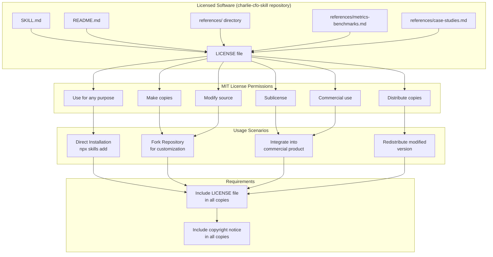
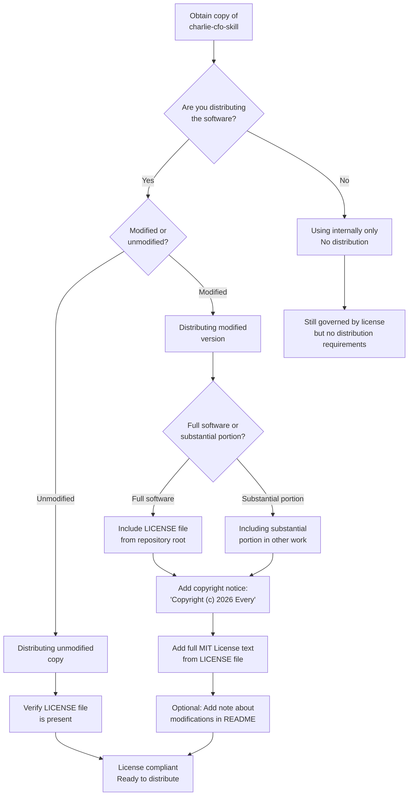
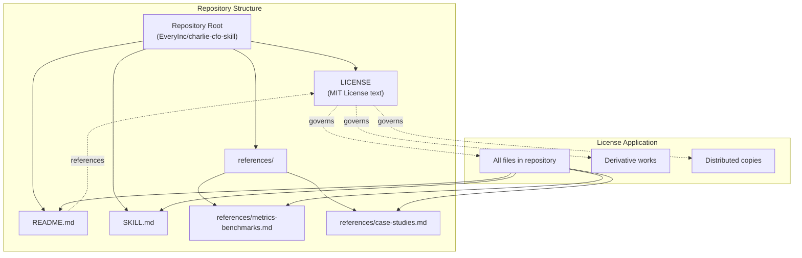

<!-- source: DeepWiki mcp.deepwiki.com · repo EveryInc/charlie-cfo-skill · page 7 License and Legal · fetched 2026-10-26 -->

# License and Legal

<details>
<summary>Relevant source files</summary>

The following files were used as context for generating this wiki page:

- [LICENSE](LICENSE)

</details>


## Purpose and Scope

This page documents the licensing terms and legal conditions governing the Charlie CFO Skill codebase. It covers the MIT License text, copyright ownership, permissions granted, conditions for use, and warranty disclaimers. This information is relevant to anyone who uses, modifies, or distributes the Charlie CFO Skill software.

For information about how to install and use the skill, see [Installation and Setup](#1.1). For information about the system architecture, see [System Architecture and Design](#6).

## License Overview

The Charlie CFO Skill is released under the **MIT License**, one of the most permissive open-source software licenses. The complete license text is located in [LICENSE:1-22]().

| **License Attribute** | **Details** |
|-----------------------|-------------|
| License Type | MIT License |
| Copyright Holder | Every |
| Copyright Year | 2026 |
| File Location | `LICENSE` (repository root) |
| OSI Approved | Yes |
| SPDX Identifier | MIT |

Sources: [LICENSE:1-22]()

## Copyright and Ownership

The copyright for the Charlie CFO Skill is held by **Every**, as specified in [LICENSE:3](). This establishes Every as the legal owner of the intellectual property contained in the codebase.

```
Copyright (c) 2026 Every
```

This copyright notice applies to:
- All source code and documentation files in the repository
- The SKILL.md specification and core logic
- Reference materials (metrics-benchmarks.md, case-studies.md)
- README and installation instructions
- Any derivative works created from the original software

Sources: [LICENSE:3]()

## Permissions Granted

The MIT License grants broad permissions to anyone who obtains a copy of the software. These permissions are explicitly stated in [LICENSE:5-10]().

### Rights Included

The license grants the following rights **without restriction**:

| **Permission** | **Description** |
|----------------|-----------------|
| **Use** | Run the software for any purpose, commercial or non-commercial |
| **Copy** | Create copies of the software |
| **Modify** | Alter the source code, including frameworks, philosophy, or reference materials |
| **Merge** | Combine with other software projects |
| **Publish** | Make the software publicly available |
| **Distribute** | Share copies with others, via NPM registry or other channels |
| **Sublicense** | Grant these same rights to recipients of your modified version |
| **Sell** | Distribute copies commercially or incorporate into paid products |

Sources: [LICENSE:5-10]()

### License Application Scope

The following diagram illustrates how the MIT License applies across different components and usage scenarios:



Sources: [LICENSE:1-22]()

## Conditions for Use

While the MIT License is highly permissive, it does impose **two mandatory conditions** that must be met by anyone who uses or distributes the software. These conditions are specified in [LICENSE:12-13]().

### Mandatory Requirements

1. **Include the copyright notice**: The text `Copyright (c) 2026 Every` must be included in all copies or substantial portions of the software.

2. **Include the license text**: The full MIT License text from [LICENSE:1-22]() must be included in all copies or substantial portions of the software.

### What "Copies or Substantial Portions" Means

| **Scenario** | **License Required?** | **Explanation** |
|--------------|----------------------|-----------------|
| Install via `npx skills add` | No action required | LICENSE file is automatically included in the package |
| Fork GitHub repository | No action required | LICENSE file is included in the fork |
| Copy SKILL.md into your project | Yes | Must include LICENSE and copyright notice |
| Extract frameworks into your own codebase | Yes | This constitutes a "substantial portion" |
| Copy individual formulas from references | Recommended but debatable | Single formulas may fall under fair use; full documents require attribution |
| Distribute modified version via NPM | Yes | Must include LICENSE and copyright in your package |
| Integrate into commercial product | Yes | Must include LICENSE and copyright in your product's legal notices |

Sources: [LICENSE:12-13]()

### Compliance Workflow

The following diagram shows the required steps to comply with the MIT License when using or distributing the Charlie CFO Skill:



Sources: [LICENSE:5-13]()

## Warranty Disclaimer

The MIT License includes comprehensive warranty disclaimers and liability limitations, specified in [LICENSE:15-21](). These clauses protect the copyright holder (Every) from legal liability.

### No Warranty Statement

The software is provided **"AS IS"** without any warranties. Specifically, the license disclaims:

| **Warranty Type** | **Status** |
|-------------------|-----------|
| **Express Warranty** | None provided |
| **Implied Warranty** | None provided |
| **MERCHANTABILITY** | Explicitly disclaimed |
| **FITNESS FOR PARTICULAR PURPOSE** | Explicitly disclaimed |
| **NON-INFRINGEMENT** | Explicitly disclaimed |

This means:
- **No guarantee of correctness**: The financial advice, calculations, formulas, benchmarks, and case studies may contain errors or be inappropriate for your specific situation.
- **No guarantee of suitability**: Even if Charlie's frameworks work well for one bootstrapped startup, they may not work for yours.
- **No guarantee of performance**: The system may fail, produce incorrect results, or cause financial harm.
- **No guarantee of security**: The software may contain vulnerabilities or security flaws.

Sources: [LICENSE:15-17]()

### Limitation of Liability

The MIT License explicitly limits the liability of the authors and copyright holders. According to [LICENSE:18-21](), **Every and the contributors shall not be liable** for:

| **Liability Type** | **Coverage** |
|-------------------|--------------|
| **Claims** | Any legal claims arising from the software |
| **Damages** | Any type of damages (direct, indirect, incidental) |
| **Other Liability** | Any other liability related to the software |
| **Contract Claims** | Even if arising from a contract |
| **Tort Claims** | Including negligence |
| **Other Liability** | Any other legal theory |
| **Connection to Software** | Even if arising from use of or inability to use the software |

### Practical Implications

This means if you use Charlie's frameworks to make financial decisions (e.g., "Should we make this hire?") and those decisions result in financial harm, **you cannot sue Every or the contributors** for:
- Lost revenue from bad hiring decisions
- Cash flow problems from following Charlie's runway calculations
- Customer churn from pricing decisions based on Charlie's unit economics advice
- Business failure resulting from reliance on Charlie's forecasting frameworks

**The user assumes all risk** when using the software.

Sources: [LICENSE:18-21]()

## How to Comply with the License

This section provides practical guidance for common use cases.

### Scenario 1: Installing and Using Charlie Internally

If you install Charlie via `npx skills add EveryInc/charlie-cfo-skill` for your own internal use:

**Required actions**: None. The LICENSE file is automatically included in the installed package.

**Best practice**: Keep the LICENSE file that comes with the installation. Do not remove it.

### Scenario 2: Forking the Repository

If you fork the GitHub repository `EveryInc/charlie-cfo-skill` to create your own customized version:

**Required actions**: None immediately. The LICENSE file is automatically included in your fork.

**Best practice**: If you modify the code and distribute your fork, add a note to the README explaining your changes while preserving the original copyright notice.

### Scenario 3: Extracting Components for Your Own Project

If you extract substantial portions (e.g., the entire Cash Management Framework from [SKILL.md](), or all metrics formulas from [references/metrics-benchmarks.md]()) to include in your own project:

**Required actions**:
1. Copy the LICENSE file from [LICENSE:1-22]() into your project
2. Include the copyright notice `Copyright (c) 2026 Every` in your project's legal documentation
3. Clearly indicate that these components are derived from Charlie CFO Skill

**Best practice**: Add a section to your README like this:

```markdown
## License Attributions

This project includes components from Charlie CFO Skill
Copyright (c) 2026 Every
Licensed under the MIT License

See LICENSE-CHARLIE.txt for full license text.
```

### Scenario 4: Integrating into a Commercial Product

If you integrate Charlie CFO Skill (or substantial portions) into a commercial product that you sell:

**Required actions**:
1. Include the LICENSE file from [LICENSE:1-22]() in your product distribution (e.g., in a `licenses/` directory)
2. Include the copyright notice in your product's "About" or "Legal Notices" section
3. Ensure customers who receive your product also receive the MIT License text

**Best practice**: Maintain a comprehensive third-party licenses document that includes Charlie's license alongside others.

### Scenario 5: Redistributing via NPM or Other Package Manager

If you publish a modified version of Charlie CFO Skill to NPM or another package registry:

**Required actions**:
1. Include the LICENSE file in your package (ensure it's not excluded by `.npmignore`)
2. Preserve the original copyright notice
3. In your `package.json`, add a `license` field: `"license": "MIT"`

**Best practice**: In your README, add a clear statement:

```markdown
This package is a modified version of Charlie CFO Skill.
Original work Copyright (c) 2026 Every
Licensed under the MIT License.
```

Sources: [LICENSE:1-22]()

## License File Location Diagram



Sources: [LICENSE:1-22]()

## Frequently Asked Questions

### Can I use Charlie CFO Skill commercially?

**Yes.** The MIT License explicitly allows commercial use [LICENSE:8](). You can use Charlie to advise paying clients, integrate it into a paid product, or use it internally in a for-profit business.

### Do I need to open-source my modifications?

**No.** The MIT License does not require you to share your modifications. You can create a private fork and keep your changes proprietary.

### Can I remove the MIT License and release under a different license?

**No.** You cannot remove the original copyright and license from the files you received. However, you can dual-license your modifications under additional licenses if you wish.

### What if I only use the reference materials (metrics and case studies)?

The reference materials in [references/]() are part of the licensed software. If you copy substantial portions, you should include the license and copyright notice. Individual metric formulas or brief excerpts may fall under fair use, but copying entire documents requires compliance.

### Does Every provide any warranty or support?

**No.** As stated in [LICENSE:15-17](), the software is provided "as is" with no warranties. Every is not obligated to provide support, updates, or fixes.

### What if Charlie's advice causes financial harm?

Every and contributors are not liable for any damages arising from use of the software, as specified in [LICENSE:18-21](). Users assume all risk when making financial decisions based on Charlie's guidance.

Sources: [LICENSE:1-22]()

## Summary

The Charlie CFO Skill is released under the MIT License with the following key points:

| **Aspect** | **Summary** |
|------------|-------------|
| **License Type** | MIT License (highly permissive) |
| **Copyright** | Copyright (c) 2026 Every |
| **Permissions** | Use, copy, modify, merge, publish, distribute, sublicense, sell - all without restriction |
| **Conditions** | Must include copyright notice and license text in all copies/distributions |
| **Warranty** | None. Software provided "AS IS" |
| **Liability** | Authors/copyright holders not liable for any damages |
| **File Location** | [LICENSE:1-22]() in repository root |

For any legal questions beyond the scope of this documentation, consult with a qualified attorney.

Sources: [LICENSE:1-22]()