# Page: Charlie CFO Skill Overview

# Charlie CFO Skill Overview

<details>
<summary>Relevant source files</summary>

The following files were used as context for generating this wiki page:

- [README.md](README.md)
- [SKILL.md](SKILL.md)

</details>


## Purpose and Scope

This document provides a high-level introduction to the Charlie CFO Skill system, an AI-powered financial advisor for bootstrapped, high-growth startups. It covers the skill's purpose, core components, installation architecture, and how it integrates into the Claude Code environment.

For detailed information on specific topics, see:
- Installation procedures: [Installation and Setup](#1.1)
- Query processing mechanics: [How Charlie Activates and Processes Queries](#1.2)
- Philosophical foundations: [Core Philosophy and Mental Models](#2)
- Financial frameworks: [The Five Financial Frameworks](#3)
- Reference documentation: [Reference Materials](#5)
- Technical architecture: [System Architecture and Design](#6)

## What is Charlie CFO Skill?

Charlie CFO Skill is a Claude Code skill that provides financial frameworks, benchmarks, and decision-making guidance specifically designed for bootstrapped startups. Named after Charlie Munger, the skill embodies the principle that capital discipline is a competitive advantage.

The skill provides structured guidance across five financial domains:

| Domain | Capabilities |
|--------|--------------|
| **Cash Management** | Runway calculations, reserve structures (Operating/Contingency/Growth), burn analysis |
| **Unit Economics** | LTV:CAC ratios, CAC payback periods, gross margin targets |
| **Capital Allocation** | Hiring ROI frameworks, Rule of 40 analysis, investment payback evaluation |
| **Working Capital** | Cash conversion cycle optimization, AR/AP management, prepay discount strategies |
| **Forecasting** | Driver-based planning, scenario modeling, 13-week cash flow projections |

**Sources:** [README.md:7-15](), [SKILL.md:6-8]()

## System Architecture and File Structure

The Charlie CFO Skill is packaged as a repository with the following core components:

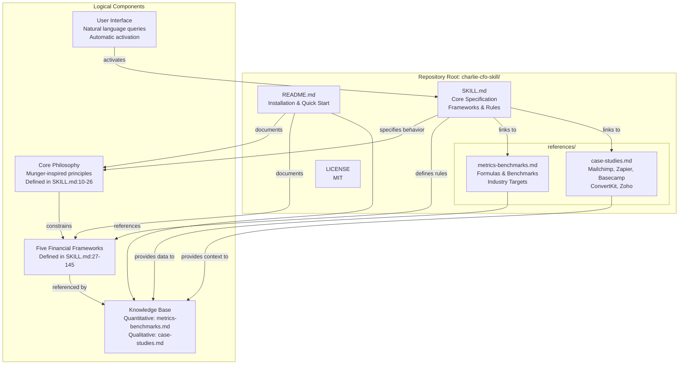

**Diagram: Repository Structure and Component Mapping**

The skill's file structure maps directly to its logical architecture:

- **README.md** [README.md:1-58](): User-facing documentation including installation instructions, philosophy summary, and usage examples
- **SKILL.md** [SKILL.md:1-162](): Core specification file containing the complete framework definitions, decision rules, benchmarks, and review rhythms. This is the authoritative source for Charlie's behavior
- **references/metrics-benchmarks.md** [SKILL.md:160](): Detailed metric formulas, calculation methodologies, and industry benchmarks (referenced but not included in provided files)
- **references/case-studies.md** [SKILL.md:161](): Case studies of five bootstrapped companies (Mailchimp, Zapier, Basecamp, ConvertKit, Zoho) with synthesized patterns (referenced but not included in provided files)

**Sources:** [README.md:1-58](), [SKILL.md:1-162]()

## Core Components

### 1. Philosophy Layer

The skill is built on a Munger-inspired philosophy of capital discipline defined in [SKILL.md:10-26](). Three core mental models constrain all framework decisions:

| Principle | Definition | Impact |
|-----------|------------|--------|
| **Profit as Constraint** | "Profit is a constraint, not a goal. Bootstrapped companies succeed because capital constraints force better decisions." [SKILL.md:12]() | Every expenditure evaluated against direct cost, opportunity cost, and runway impact |
| **Unit Economics as Survival** | LTV ≥ 3x CAC, CAC payback < 12 months [SKILL.md:16-17]() | Treated as non-negotiable thresholds; violations create "death spiral" |
| **Revenue Per Employee** | $110-150K at $1-5M ARR, scaling to $400K+ at maturity [SKILL.md:22-24]() | Efficiency scorecard; bootstrapped companies run 40-70% higher than VC-backed peers |

**Sources:** [SKILL.md:10-26]()

### 2. Five Financial Frameworks

Each framework is defined in SKILL.md with specific rules, targets, and decision criteria:

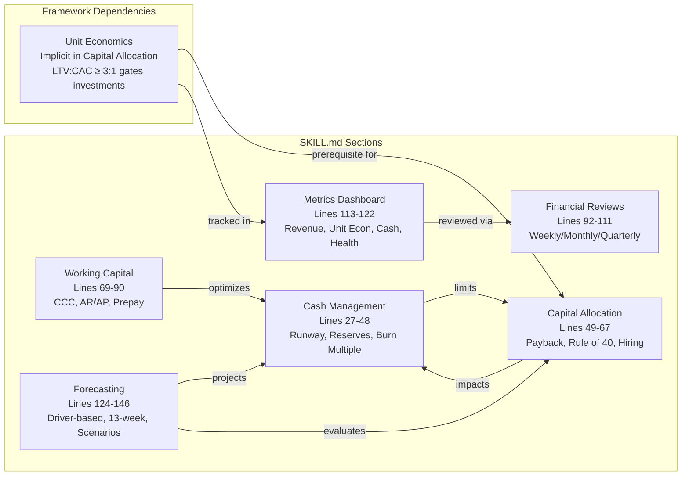

**Diagram: Framework Integration in SKILL.md**

The frameworks are not independent—they form an integrated decision system with explicit dependencies:

- **Unit Economics** (defined implicitly throughout [SKILL.md:14-18]() and explicitly in dashboard [SKILL.md:118]()) acts as a gating function for Capital Allocation decisions
- **Cash Management** [SKILL.md:27-48]() defines runway targets (24-36 months minimum) and reserve structures that constrain spending decisions
- **Capital Allocation** [SKILL.md:49-67]() requires <12 month payback periods and applies the four-question hiring framework
- **Working Capital** [SKILL.md:69-90]() optimizes cash through CCC management, targeting negative cash conversion cycles for SaaS
- **Financial Reviews** [SKILL.md:92-111]() establishes weekly (60-90 min), monthly (full close in 5-7 days), and quarterly (strategic recalibration) rhythms
- **Forecasting** [SKILL.md:124-146]() uses driver-based planning with MRR buildup models and maintains three scenarios (base, moderate downside, severe downside)

**Sources:** [SKILL.md:27-146]()

### 3. Knowledge Base

The skill references two external knowledge documents that provide both quantitative and qualitative grounding:

| Document | Content Type | Purpose |
|----------|--------------|---------|
| **metrics-benchmarks.md** [SKILL.md:160]() | Quantitative | Metric formulas (LTV, CAC, NRR, DSO, CCC, etc.), calculation methodologies, industry benchmarks, performance targets, spending allocations by ARR stage, Rule of 40 matrix |
| **case-studies.md** [SKILL.md:161]() | Qualitative | Five detailed bootstrapped company stories (Mailchimp $12B exit, Zapier $5B valuation, Basecamp 25+ years profitable, ConvertKit crisis turnaround, Zoho $1B+ zero funding) with synthesized common patterns |

**Sources:** [SKILL.md:160-161](), [README.md:45-48]()

## Installation and Distribution Architecture

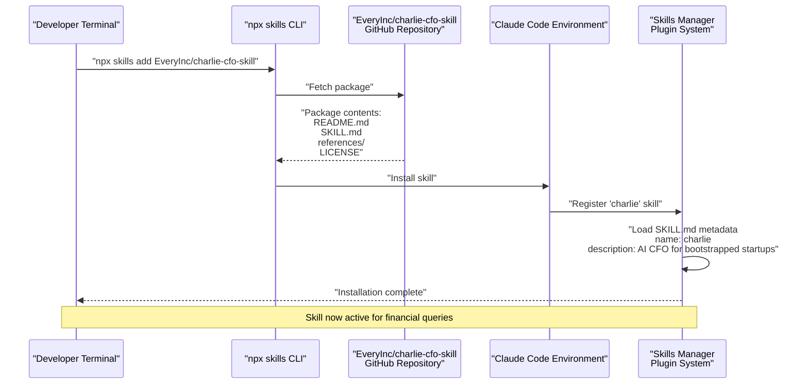

**Diagram: Installation Flow via NPX**

The skill is distributed through a standard NPX-based installation flow:

1. **Command invocation**: Developer runs `npx skills add EveryInc/charlie-cfo-skill` [README.md:19-21]()
2. **Package fetch**: NPX retrieves the repository from GitHub at `github.com/EveryInc/charlie-cfo-skill`
3. **Skill registration**: The Claude Code environment's Skills Manager reads the metadata from [SKILL.md:1-4](), specifically:
   - `name: charlie` [SKILL.md:2]()
   - `description: Your AI CFO for bootstrapped startups...` [SKILL.md:3]()
4. **Activation ready**: The skill automatically activates on financial queries

**Sources:** [README.md:17-21](), [SKILL.md:1-4]()

## Automatic Activation on Financial Queries

Once installed, Charlie activates automatically when users ask financial questions. The skill definition specifies activation triggers in [SKILL.md:3]():

**Example activation queries** [README.md:27-31]():
- "Should we make this hire?"
- "How much runway do we need?"
- "What metrics should I track?"
- "How do I forecast revenue?"
- "What's a healthy LTV:CAC ratio?"

The Claude Code environment uses NLP intent recognition to route these queries to the `charlie` skill based on the description field: `"Use for questions like 'should we make this hire?', 'how much runway do we need?', 'what metrics should I track?', 'how do I forecast revenue?', or any strategic financial decision at a self-funded company."` [SKILL.md:3]()

For detailed query processing mechanics, see [How Charlie Activates and Processes Queries](#1.2).

**Sources:** [README.md:24-31](), [SKILL.md:3]()

## Target Audience and Use Cases

Charlie is designed for bootstrapped, high-growth startups in the following scenarios:

| Stakeholder | Primary Use Cases |
|-------------|-------------------|
| **Founders** | Strategic decisions (hiring, investments, growth vs. profitability trade-offs), understanding financial health, runway management |
| **CFOs** | Framework application, metric tracking dashboard setup, financial review rhythm implementation, forecasting model design |
| **Operators** | Evaluating department spending, understanding unit economics requirements, working capital optimization |

The skill explicitly targets **bootstrapped companies** with different constraints than VC-backed startups:

- Prioritizes profitability and runway extension over growth-at-all-costs [SKILL.md:12]()
- Enforces stricter efficiency metrics (40-70% higher revenue per employee) [SKILL.md:25-26]()
- Requires lower spending ratios (~95% of ARR vs. 107% for VC-backed) [SKILL.md:154]()
- Emphasizes cash conversion cycle optimization and annual prepay strategies [SKILL.md:69-90]()

**Sources:** [README.md:1-5](), [SKILL.md:3](), [SKILL.md:148-155]()

## Key Differentiators

Charlie differs from generic financial advice tools in several ways:

1. **Philosophy-Constrained Frameworks**: All five frameworks are constrained by Munger-inspired principles [SKILL.md:10-26](), ensuring consistent capital discipline across all decisions

2. **Hard Thresholds as Survival Requirements**: Metrics like LTV:CAC ≥ 3:1 and CAC payback < 12 months are treated as non-negotiable survival thresholds, not aspirational goals [SKILL.md:14-18]()

3. **Bootstrapped-Specific Benchmarks**: Spending allocations, revenue per employee targets, and efficiency metrics are calibrated for self-funded companies [SKILL.md:20-26](), [SKILL.md:148-155]()

4. **Integrated Framework Dependencies**: Unit Economics explicitly gates Capital Allocation decisions—investments cannot be approved without satisfying unit economics constraints first [SKILL.md:14-18](), [SKILL.md:49-67]()

5. **Case Study Grounding**: Advice is enriched with real-world examples from successful bootstrapped companies (Mailchimp, Zapier, Basecamp, ConvertKit, Zoho) [README.md:48](), [SKILL.md:161]()

**Sources:** [SKILL.md:10-26](), [SKILL.md:148-155](), [README.md:45-48]()

## Licensing and Open Source

The Charlie CFO Skill is released under the MIT License [README.md:56-58](), making it freely available for use, modification, and distribution. The repository is hosted at `https://github.com/EveryInc/charlie-cfo-skill`.

For detailed licensing terms, see [License and Legal](#7).

**Sources:** [README.md:56-58]()

## Relationship to Every Platform

The skill is published by EveryInc as part of the Every subscription platform [README.md:50-54](). Every provides:
- The Claude Code environment where Charlie runs
- The Skills infrastructure and NPX-based distribution
- AI-focused content, apps, and training bundled with skill access

Trial access: `https://every.to/subscribe` [README.md:54]()

**Sources:** [README.md:50-54]()

## Navigation to Detailed Documentation

This overview provides the foundational understanding of Charlie CFO Skill. For deeper dives into specific topics, navigate to:

| Topic | Wiki Page |
|-------|-----------|
| Installation procedures and setup | [Installation and Setup](#1.1) |
| Query processing pipeline | [How Charlie Activates and Processes Queries](#1.2) |
| Philosophical foundations | [Core Philosophy and Mental Models](#2) |
| Individual framework details | [The Five Financial Frameworks](#3) |
| Hiring decision guide | [Evaluating Hiring Decisions](#4.1) |
| Metric formulas and benchmarks | [Metrics and Benchmarks Reference](#5.1) |
| Bootstrapped company case studies | [Bootstrapped Company Case Studies](#5.2) |
| Framework integration architecture | [Framework Integration and Dependencies](#6.1) |

---

# Page: Installation and Setup

# Installation and Setup

<details>
<summary>Relevant source files</summary>

The following files were used as context for generating this wiki page:

- [README.md](README.md)

</details>


**Purpose**: This document provides step-by-step instructions for installing the Charlie CFO Skill into your Claude Code environment, explains the package structure that gets installed, and details the automatic activation mechanism. For information on how Charlie processes queries once activated, see [How Charlie Activates and Processes Queries](#1.2).

---

## Prerequisites

Charlie CFO Skill operates within the Claude Code environment, which requires an active Every subscription. The skill is distributed as an NPM-style package and installed via the `npx skills` CLI tool.

| Requirement | Description | Notes |
|-------------|-------------|-------|
| **Every Subscription** | Paid subscription to Every platform | Provides access to Claude Code environment |
| **Claude Code** | AI development platform with Skills Manager | Hosts installed skills and routes queries |
| **NPX** | Node Package Executor | Standard with Node.js installations |
| **Terminal Access** | Command-line interface | For running installation commands |

**Sources**: [README.md:1-58]()

---

## Installation Command

The installation process uses a single NPX command that pulls the skill package from the registry and integrates it into your Claude Code environment:

```bash
npx skills add EveryInc/charlie-cfo-skill
```

This command:
1. Resolves the package identifier `EveryInc/charlie-cfo-skill` against the NPM registry
2. Downloads the skill package including all reference materials
3. Registers the skill with Claude Code's Skills Manager
4. Configures automatic activation for financial query patterns

**Sources**: [README.md:17-21]()

---

## Package Structure

The Charlie CFO Skill package contains four primary components that get installed into your Claude Code environment:

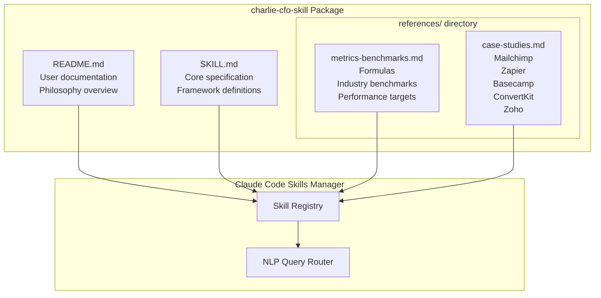

**Diagram 1: Installed Package Structure and Integration**

**Sources**: [README.md:1-58]()

---

## File Components

### Core Documentation Files

| File Path | Purpose | Content Type |
|-----------|---------|--------------|
| `README.md` | User-facing documentation | Philosophy, key principles, quick-start examples |
| `SKILL.md` | Skill specification | Framework definitions, decision rules, activation patterns |

### Reference Knowledge Base

| File Path | Purpose | Usage |
|-----------|---------|-------|
| `references/metrics-benchmarks.md` | Quantitative foundation | Calculation formulas (LTV, CAC, NRR, DSO, CCC), performance targets (LTV:CAC ≥ 3:1, runway 24-36 months), spending benchmarks by ARR stage, Rule of 40 matrix |
| `references/case-studies.md` | Qualitative wisdom | Five bootstrapped company case studies (Mailchimp, Zapier, Basecamp, ConvertKit, Zoho), common success patterns, strategic examples |

**Sources**: [README.md:43-48]()

---

## Installation Flow

The following diagram shows the complete installation pipeline from command execution to skill activation:

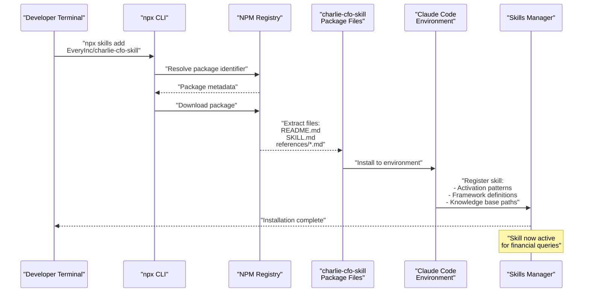

**Diagram 2: Installation Process Flow**

**Sources**: [README.md:17-21]()

---

## Activation Mechanism

Charlie activates automatically when Claude Code's NLP layer detects financial intent in user queries. No explicit invocation is required.

### Query Pattern Recognition

The Skills Manager uses NLP intent recognition to route queries to Charlie based on financial keywords and question patterns:

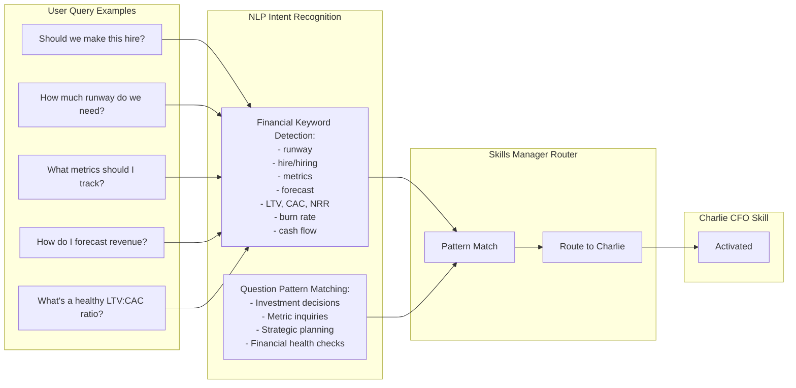

**Diagram 3: Automatic Activation via Query Pattern Recognition**

### Example Activation Queries

The following table shows example queries that automatically activate Charlie:

| Query Category | Example Query | Activates Charlie? |
|----------------|---------------|-------------------|
| **Hiring Decisions** | "Should we make this hire?" | ✓ Yes |
| **Cash Management** | "How much runway do we need?" | ✓ Yes |
| **Metrics** | "What metrics should I track?" | ✓ Yes |
| **Forecasting** | "How do I forecast revenue?" | ✓ Yes |
| **Unit Economics** | "What's a healthy LTV:CAC ratio?" | ✓ Yes |
| **General Development** | "How do I write a React component?" | ✗ No (routes to different skill) |

**Sources**: [README.md:24-31]()

---

## Post-Installation Verification

After installation completes, verify Charlie is properly activated by asking a test financial question through your Claude Code interface:

### Verification Test

**Test Query**: 
```
What's the minimum acceptable LTV:CAC ratio for a SaaS startup?
```

**Expected Response Indicators**:
- Reference to LTV:CAC ≥ 3:1 threshold
- Citation of benchmark data from `metrics-benchmarks.md`
- Explanation rooted in unit economics framework
- Possible case study example (e.g., Mailchimp CAC < $100)

If the response includes these elements, Charlie is correctly installed and activated.

---

## Integration with Claude Code Environment

Charlie operates as one skill within Claude Code's multi-skill ecosystem. The Skills Manager handles:

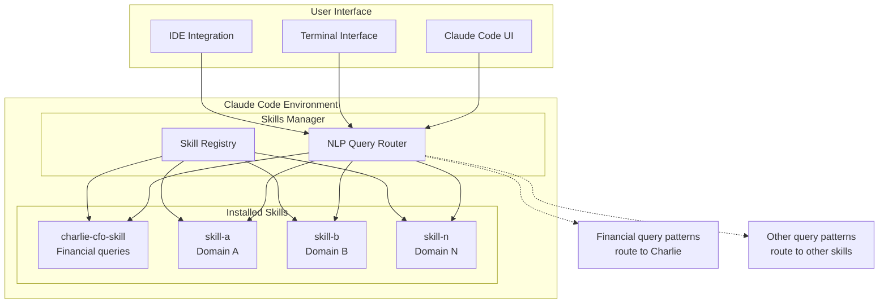

**Diagram 4: Multi-Skill Ecosystem Integration**

### Skill Isolation

Each skill operates independently:
- **Query routing**: NLP layer routes queries to the most appropriate skill based on intent
- **Knowledge isolation**: Each skill maintains its own reference materials
- **No cross-contamination**: Charlie only activates for financial queries; other query types route elsewhere

**Sources**: [README.md:1-58]()

---

## Repository and License

Charlie CFO Skill is open-source software published by EveryInc:

| Property | Value |
|----------|-------|
| **Repository** | `github.com/EveryInc/charlie-cfo-skill` |
| **Publisher** | EveryInc |
| **License** | MIT License |
| **Package Name** | `EveryInc/charlie-cfo-skill` |

The MIT License permits modification and redistribution while the skill remains maintained in the public GitHub repository.

**Sources**: [README.md:56-58]()

---

## Troubleshooting Installation

### Common Issues

| Issue | Cause | Resolution |
|-------|-------|------------|
| **"Package not found"** | NPX cannot resolve package identifier | Verify NPX version, check network connectivity |
| **"Skills Manager not available"** | Not using Claude Code environment | Ensure Every subscription is active and Claude Code is accessible |
| **Charlie doesn't activate** | Query pattern not recognized as financial | Rephrase query with explicit financial terms (e.g., "runway", "LTV:CAC", "hire") |

### Installation Location

The skill package is installed into the Claude Code environment's Skills Manager registry, not your local file system. Files are accessible to Claude Code but are not stored as traditional npm packages in `node_modules/`.

---

## Next Steps

After successful installation:
1. Review [How Charlie Activates and Processes Queries](#1.2) to understand the query processing pipeline
2. Explore the [Five Financial Frameworks](#3) to learn what guidance Charlie provides
3. Consult the [Metrics and Benchmarks Reference](#5.1) for calculation formulas and targets

**Sources**: [README.md:1-58]()

---

# Page: How Charlie Activates and Processes Queries

# How Charlie Activates and Processes Queries

<details>
<summary>Relevant source files</summary>

The following files were used as context for generating this wiki page:

- [README.md](README.md)
- [SKILL.md](SKILL.md)

</details>


## Purpose and Scope

This document explains the technical mechanisms by which Charlie CFO Skill activates in response to user queries and processes them into actionable financial guidance. It covers the automatic activation system, NLP intent recognition, query processing pipeline, framework selection logic, knowledge retrieval patterns, and response generation.

For information about installing Charlie, see [Installation and Setup](#1.1). For details on the underlying philosophy and frameworks Charlie applies, see [Core Philosophy and Mental Models](#2) and [The Five Financial Frameworks](#3).

## Activation Mechanism

Charlie uses Claude Code's skill system to automatically activate when users ask financial questions. The activation is controlled through the skill definition file rather than manual invocation.

### Skill Definition Structure

The skill definition is specified in [SKILL.md:1-4](), which contains frontmatter metadata that Claude's environment uses for automatic routing:

| Field | Value | Purpose |
|-------|-------|---------|
| `name` | `charlie` | Unique skill identifier in Claude's skill registry |
| `description` | Multi-line description of capabilities and example queries | NLP intent matching specification |

The `description` field [SKILL.md:3]() serves as the primary activation trigger. It contains:

1. **Identity and purpose**: "Your AI CFO for bootstrapped startups"
2. **Capability list**: Cash management, runway calculations, unit economics, capital allocation, etc.
3. **Example query patterns**: "should we make this hire?", "how much runway do we need?", "what metrics should I track?"
4. **Context specifiers**: "bootstrapped startups", "self-funded company", "strategic financial decision"

When a user query is received by Claude Code, the environment's NLP system matches the query intent against all installed skills' description fields. Financial terms, decision patterns, and context keywords trigger routing to Charlie.

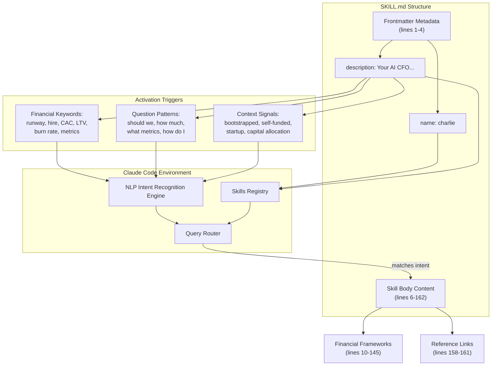

**Sources**: [SKILL.md:1-4](), [README.md:25-31]()

### Example Activation Patterns

The following user queries demonstrate automatic activation:

| Query | Trigger Mechanism | Activated Frameworks |
|-------|-------------------|---------------------|
| "Should we make this hire?" | Pattern match: "should we", "hire" | Capital Allocation, Cash Management |
| "How much runway do we need?" | Keyword: "runway" | Cash Management |
| "What's a healthy LTV:CAC ratio?" | Keyword: "LTV:CAC" | Unit Economics |
| "How do I forecast revenue?" | Pattern: "how do I", keyword: "forecast revenue" | Forecasting |
| "What metrics should I track?" | Pattern: "what metrics" | All frameworks (dashboard) |

**Sources**: [README.md:27-31](), [SKILL.md:3]()

## Query Processing Pipeline

Once activated, Charlie processes queries through a multi-stage pipeline that analyzes intent, retrieves relevant knowledge, performs calculations, and generates structured guidance.

### Complete Processing Sequence

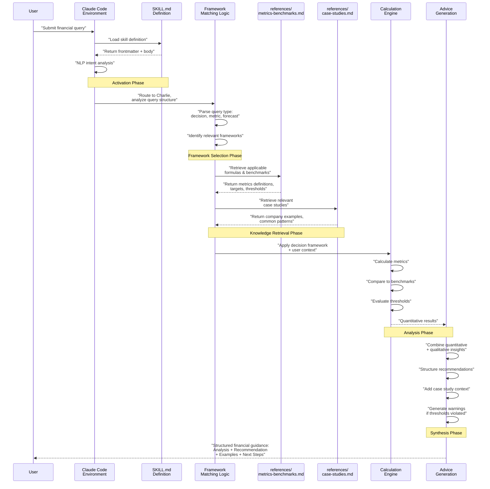

**Sources**: [SKILL.md:1-162](), Diagram 3 from system architecture overview

### Pipeline Stages in Detail

#### Stage 1: Intent Analysis and Framework Selection

The framework matching logic examines the query to determine which of the five financial frameworks apply. This is implemented through the structured content in [SKILL.md:10-145]().

**Decision tree for framework selection**:

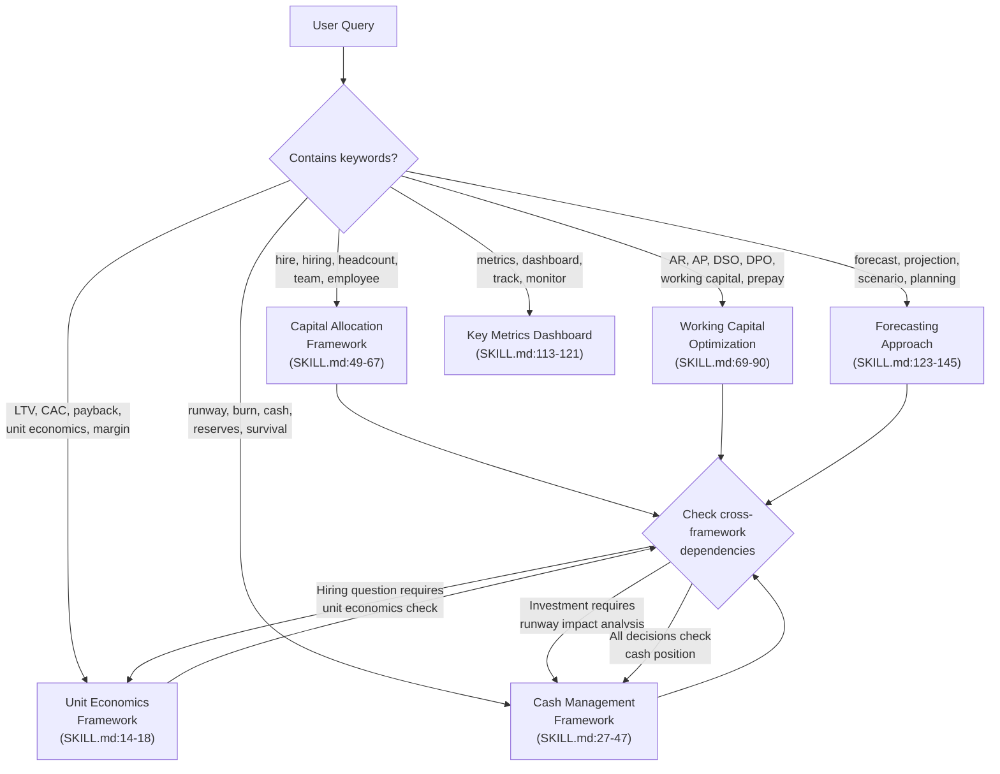

**Sources**: [SKILL.md:10-162]()

#### Stage 2: Knowledge Retrieval

Charlie retrieves relevant information from two reference documents based on the selected frameworks:

| Reference Document | Content Type | Usage Pattern |
|-------------------|--------------|---------------|
| `references/metrics-benchmarks.md` | Quantitative formulas, targets, industry benchmarks | Provides calculation methods and validation thresholds |
| `references/case-studies.md` | Qualitative examples from 5 bootstrapped companies | Provides context, patterns, and precedents |

**Retrieval logic**:

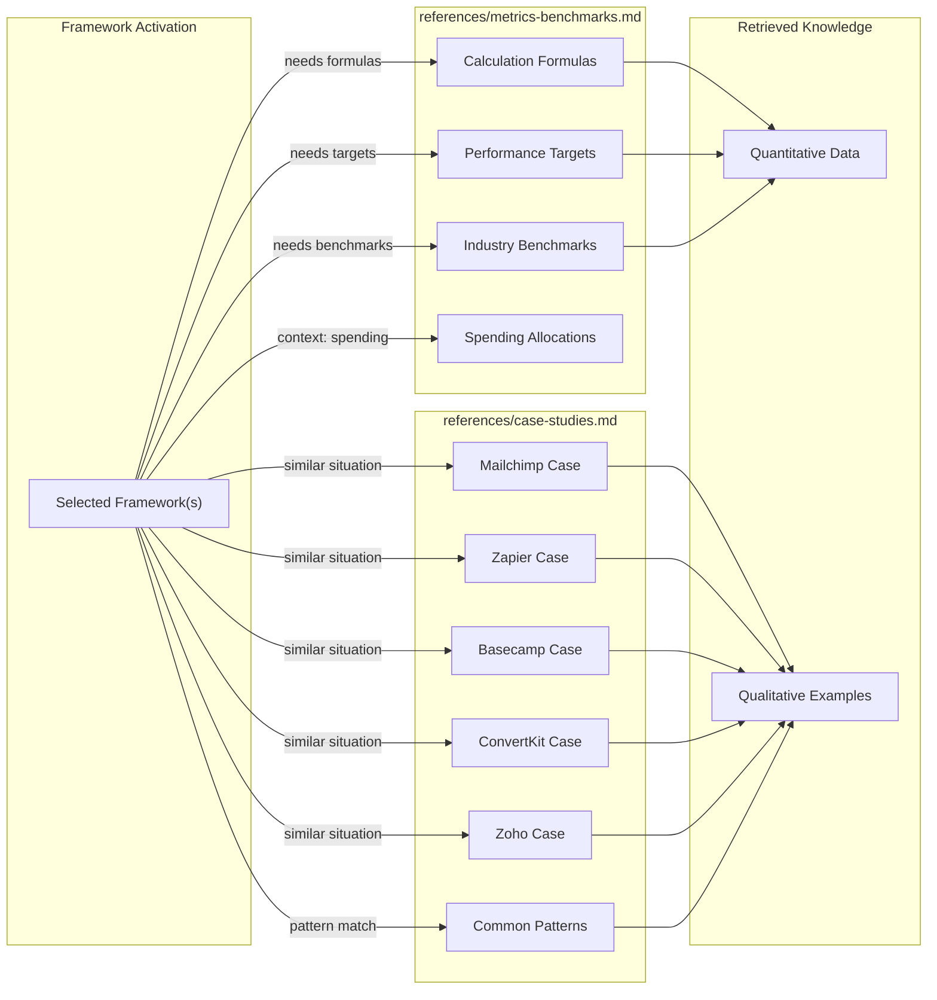

**Sources**: [SKILL.md:158-161](), [README.md:45-48]()

#### Stage 3: Calculation and Analysis

The calculation engine applies formulas from the metrics reference document and compares results to benchmark thresholds defined in [SKILL.md:14-18, 29-47, 49-67, 69-90]().

**Example: Hiring Decision Calculation Flow**

When processing "Should we make this hire?":

1. **Retrieve salary input** from user context
2. **Apply Capital Allocation framework** [SKILL.md:59-64]():
   - Will hire directly contribute to revenue?
   - Time-to-productivity analysis
   - Opportunity cost calculation
   - Team productivity impact
3. **Calculate runway impact** [SKILL.md:29-47]():
   - Current burn rate
   - Projected burn with new hire
   - New runway calculation
   - Check against 24-36 month minimum [SKILL.md:30-32]()
4. **Validate unit economics** [SKILL.md:14-18]():
   - Current LTV:CAC ratio
   - Projected impact if sales/marketing hire
   - Check against 3:1 minimum threshold
5. **Check payback requirement** [SKILL.md:51]():
   - Expected revenue contribution
   - Payback period calculation
   - Validate <12 month target

**Threshold violation handling**:

| Metric | Threshold | Source | Violation Action |
|--------|-----------|--------|------------------|
| LTV:CAC ratio | ≥ 3:1 | [SKILL.md:16]() | Generate warning: "Death spiral risk" [SKILL.md:18]() |
| CAC payback | < 12 months | [SKILL.md:17]() | Generate warning: "Violates survival requirement" |
| Runway | ≥ 24 months | [SKILL.md:30]() | Generate alert: "Minimum threshold" |
| Runway | < 12 months | [SKILL.md:32]() | Generate critical warning: "Lost control" |
| Payback period | < 12 months | [SKILL.md:51]() | Reject investment if violated |
| Customer concentration | ≤ 10% per customer | [SKILL.md:121]() | Generate risk warning |

**Sources**: [SKILL.md:14-18](), [SKILL.md:27-67](), [SKILL.md:113-121]()

#### Stage 4: Advice Generation and Response Structuring

The final stage synthesizes quantitative analysis with qualitative insights to produce structured guidance.

**Response structure**:

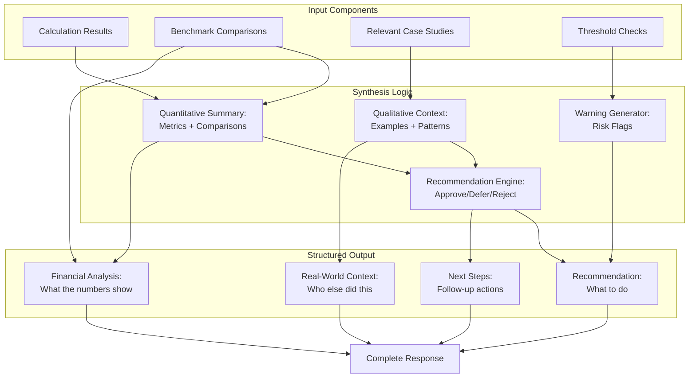

**Example response components for "Should we hire a sales rep at $120K?**:

| Component | Content | Source |
|-----------|---------|--------|
| **Analysis** | Salary: $120K<br/>Current burn: $50K/mo → $60K/mo<br/>Runway: 36 months → 30 months<br/>Expected contribution: $300K ARR in 12 months<br/>Payback: 4.8 months | [SKILL.md:59-64](), [SKILL.md:29-47]() |
| **Recommendation** | ✓ APPROVE<br/>Meets <12 month payback requirement<br/>Maintains >24 month runway threshold<br/>Direct revenue contribution | [SKILL.md:51](), [SKILL.md:30]() |
| **Context** | Similar to Zapier's "hire when it hurts" principle<br/>ConvertKit turned around with direct sales focus | `references/case-studies.md` |
| **Next Steps** | 1. Define 90-day ramp plan<br/>2. Set pipeline targets<br/>3. Update 13-week cash forecast<br/>4. Monitor progress weekly | [SKILL.md:92-98](), [SKILL.md:133-137]() |

**Sources**: [SKILL.md:1-162](), Diagram 2 from system architecture overview

## Framework Cross-Dependencies

Charlie enforces hard dependencies between frameworks to prevent inconsistent advice. These dependencies are encoded in the skill logic through conditional checks.

### Dependency Rules

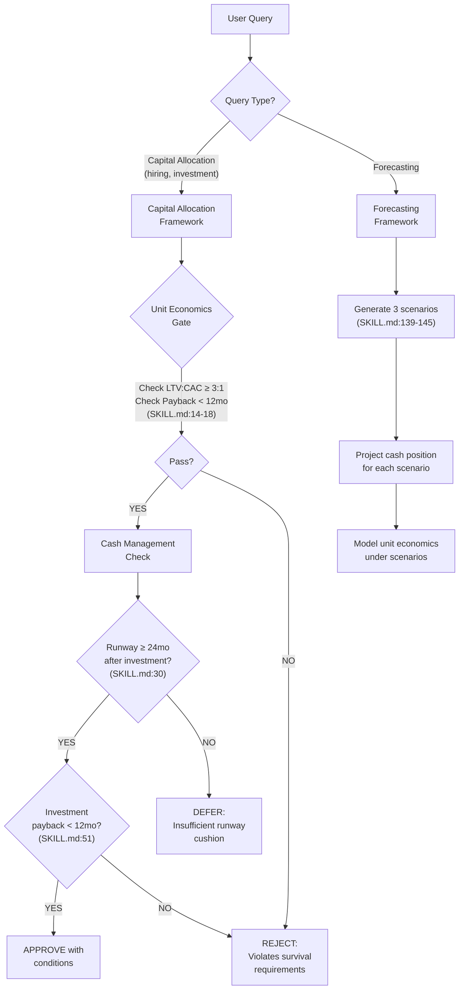

**Key enforcement points**:

1. **Unit Economics gates Capital Allocation** [SKILL.md:14-18]() - LTV:CAC and payback thresholds must be satisfied before approving growth investments
2. **Cash Management constrains all decisions** [SKILL.md:29-32]() - Every decision checks runway impact
3. **Forecasting integrates all frameworks** [SKILL.md:123-145]() - Scenarios model combined effects

**Sources**: [SKILL.md:14-18](), [SKILL.md:27-67](), [SKILL.md:123-145](), Diagram 4 from system architecture overview

## Query-to-Framework Mapping Reference

The following table maps common query patterns to their primary and secondary frameworks:

| Query Pattern | Primary Framework | Secondary Frameworks | Key Thresholds Checked |
|---------------|-------------------|----------------------|------------------------|
| "Should we hire..." | Capital Allocation [SKILL.md:49-67]() | Cash Management, Unit Economics | Payback <12mo, Runway ≥24mo, LTV:CAC ≥3:1 |
| "How much runway..." | Cash Management [SKILL.md:27-47]() | - | 24-36 month target |
| "What's our LTV:CAC..." | Unit Economics [SKILL.md:14-18]() | - | ≥3:1 minimum, 7-8x best-in-class |
| "Should we invest in..." | Capital Allocation [SKILL.md:49-67]() | Cash Management | Payback <12mo, Runway impact |
| "How should we forecast..." | Forecasting [SKILL.md:123-145]() | All frameworks | 3-scenario requirement |
| "Can we afford annual prepay..." | Working Capital [SKILL.md:69-90]() | Cash Management | 15-20% discount offer |
| "What metrics to track..." | Dashboard [SKILL.md:113-121]() | All frameworks | All threshold values |
| "Is our burn rate..." | Cash Management [SKILL.md:42-47]() | Unit Economics | Burn multiple <1.5x, ideally negative |

**Sources**: [SKILL.md:1-162](), [README.md:25-31]()

## Performance and Timing Characteristics

The query processing pipeline is synchronous and completes in a single interaction. Response time depends on:

1. **Query complexity** - Number of frameworks activated
2. **Calculation depth** - Number of metrics to compute
3. **Reference retrieval** - Number of case studies matched
4. **Context length** - Amount of user-provided financial data

Charlie prioritizes comprehensive analysis over speed, as financial decisions require complete context rather than rapid responses.

**Sources**: Diagram 3 from system architecture overview

---

# Page: Core Philosophy and Mental Models

# Core Philosophy and Mental Models

<details>
<summary>Relevant source files</summary>

The following files were used as context for generating this wiki page:

- [README.md](README.md)
- [SKILL.md](SKILL.md)

</details>


## Purpose and Scope

This page documents the foundational philosophy and mental models that drive all financial guidance in the Charlie CFO Skill system. It explains the Charlie Munger-inspired capital discipline principles and how they constrain and shape decision-making across all five financial frameworks.

For detailed exploration of specific principles, see:
- [Profit as a Constraint, Not a Goal](#2.1)
- [Unit Economics as Survival Requirements](#2.2)
- [Revenue Per Employee and Efficiency Targets](#2.3)

For practical application of these principles to specific decisions, see [Decision-Making Guides](#4).

**Sources:** [README.md:33-42](), [SKILL.md:6-26]()

---

## Why Charlie Munger?

The skill is named after Charlie Munger, who embodied the principle that **capital discipline is a competitive advantage**. Munger's investment philosophy emphasized that constraints—not abundance—force superior decision-making. Bootstrapped companies operate under permanent capital constraints, which, when properly leveraged, create a structural advantage over capital-abundant competitors.

This naming choice signals the system's core assumption: financial limitation is not a problem to solve but a framework to exploit.

**Sources:** [README.md:5](), [SKILL.md:8]()

---

## The Three Core Mental Models

The Charlie CFO Skill operates on three foundational mental models that permeate every framework, calculation, and recommendation. These are not aspirational goals but hard constraints enforced by the system's logic.

### Mental Model 1: Profit as a Constraint, Not a Goal

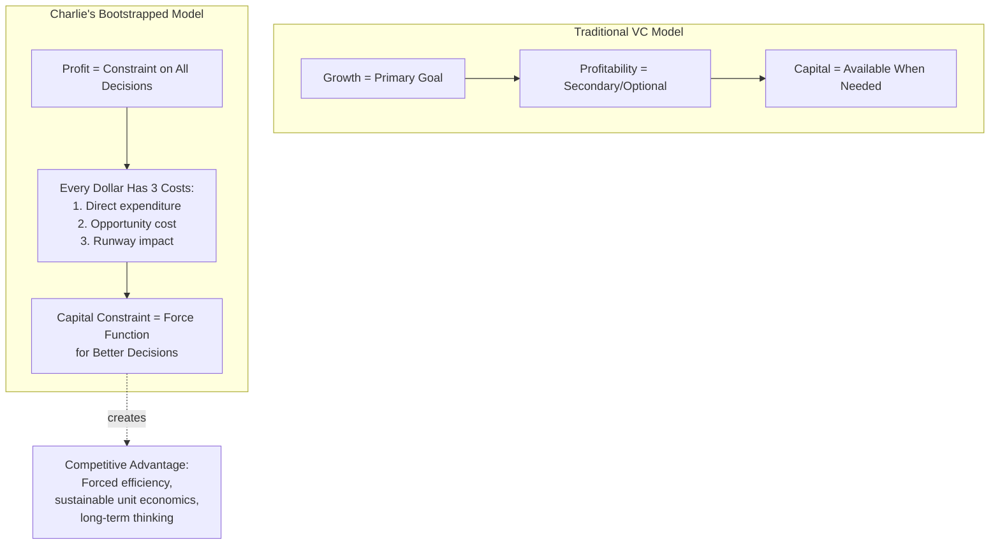

**Core Principle:** Capital constraints force better decisions by making every dollar carry three distinct costs:

| Cost Type | Definition | Example |
|-----------|------------|---------|
| **Direct Expenditure** | The cash leaving the bank | $100K salary = $100K spent |
| **Opportunity Cost** | What else could be funded | $100K salary = 2 engineers OR 1 sales rep |
| **Runway Impact** | Time reduction before cash-out | $100K annual = 1.2 months runway reduction (if $1M in bank) |

The system enforces this model by requiring all capital allocation decisions to pass through a payback period filter (<12 months) and runway impact assessment before approval.

**Sources:** [SKILL.md:12](), [README.md:35]()

### Mental Model 2: Unit Economics as Survival Requirements

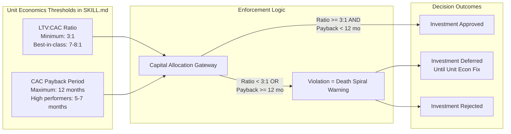

**Core Principle:** Unit economics are **survival requirements**, not aspirational targets. The system treats these as hard gates:

| Metric | Minimum Threshold | Death Spiral Condition |
|--------|-------------------|------------------------|
| **LTV:CAC Ratio** | ≥ 3:1 | < 3:1 |
| **CAC Payback** | < 12 months | ≥ 12 months |
| **Gross Margin** | 70-80% (SaaS) | Insufficient to recover CAC + overhead |

Violating these thresholds creates what the system calls a "death spiral"—bootstrapped companies cannot survive sustained violations because they cannot raise capital to paper over bad unit economics.

The system implements this by **gating all Capital Allocation Framework decisions** ([#3.3](#3.3)) on passing unit economics thresholds from the Unit Economics Framework ([#3.2](#3.2)). This creates a hard dependency: capital allocation decisions cannot proceed without healthy unit economics.

**Sources:** [SKILL.md:14-18](), [README.md:38]()

### Mental Model 3: Revenue Per Employee as Efficiency Scorecard

| ARR Stage | Revenue Per Employee Target | Benchmark Context |
|-----------|----------------------------|-------------------|
| **$1-5M ARR** | $110-150K | Early efficiency baseline |
| **$10-50M ARR** | $200-250K | Scaling efficiency |
| **Maturity** | $400K+ | World-class efficiency |

**Core Principle:** Revenue per employee (RPE) serves as the primary efficiency scorecard. Bootstrapped companies typically run **40-70% higher RPE** than VC-backed peers because capital constraints prevent overhiring.

The system uses RPE as a counterbalance to headcount growth pressure. Every hiring decision must justify not just its direct ROI but also its impact on overall RPE trajectory.

**Sources:** [SKILL.md:20-25](), [README.md:39]()

---

## How Philosophy Constrains All Frameworks

The three mental models create a hierarchy of constraints that flow through all five financial frameworks:

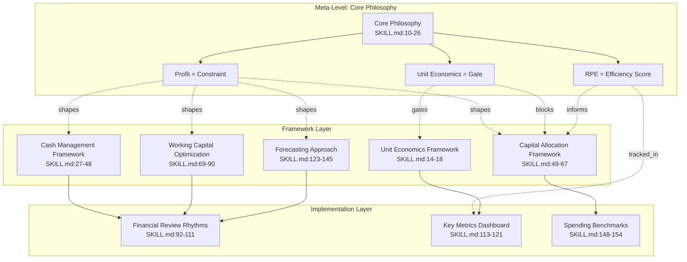

### Framework Dependency Rules

The philosophy creates specific dependency rules enforced by the system's decision logic:

| Dependency Rule | Implementation | Effect |
|----------------|----------------|--------|
| **Unit Economics Gates Capital Allocation** | F3 cannot approve spending without F2 passing thresholds | Prevents death spiral investments |
| **Profit Constraint Shapes Cash Targets** | F1 runway targets (24-36 months) assume no external capital | Forces conservative reserves |
| **RPE Influences Hiring Decisions** | F3 hiring framework includes RPE impact analysis | Prevents overhiring |
| **Cash Constraints Shape Forecasts** | F5 scenarios always include severe downside | Prevents optimistic planning |

**Sources:** [SKILL.md:10-67]()

---

## Philosophy Implementation in System Architecture

The philosophy is not abstract—it is embedded in the system's specification and activation logic:

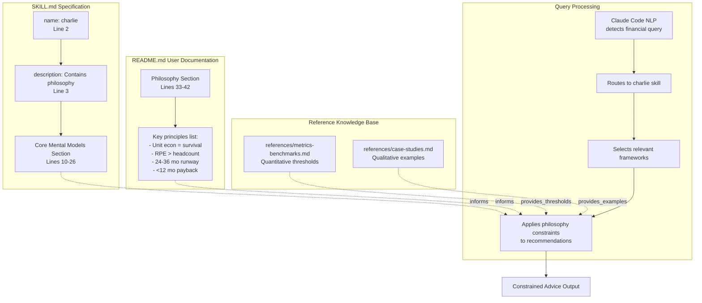

### Code Entity Mapping

| Philosophy Concept | Code Implementation | Location |
|-------------------|---------------------|----------|
| **"Profit is a constraint"** | Stated explicitly in mental models | [SKILL.md:12]() |
| **Three costs per dollar** | Described in principle explanation | [SKILL.md:12]() |
| **LTV:CAC ≥ 3:1 threshold** | Hard minimum defined | [SKILL.md:16]() |
| **CAC payback < 12 months** | Hard maximum defined | [SKILL.md:17]() |
| **"Death spiral" warning** | Explicit violation language | [SKILL.md:18]() |
| **RPE targets by stage** | Quantitative table | [SKILL.md:21-24]() |
| **24-36 month runway minimum** | Cash management rule | [SKILL.md:31](), [README.md:40]() |
| **<12 month payback requirement** | Capital allocation rule | [SKILL.md:51](), [README.md:41]() |

**Sources:** [SKILL.md:1-162](), [README.md:1-59]()

---

## Decision-Making Hierarchy

The philosophy creates a hierarchical decision-making system where higher-level principles override lower-level optimizations:

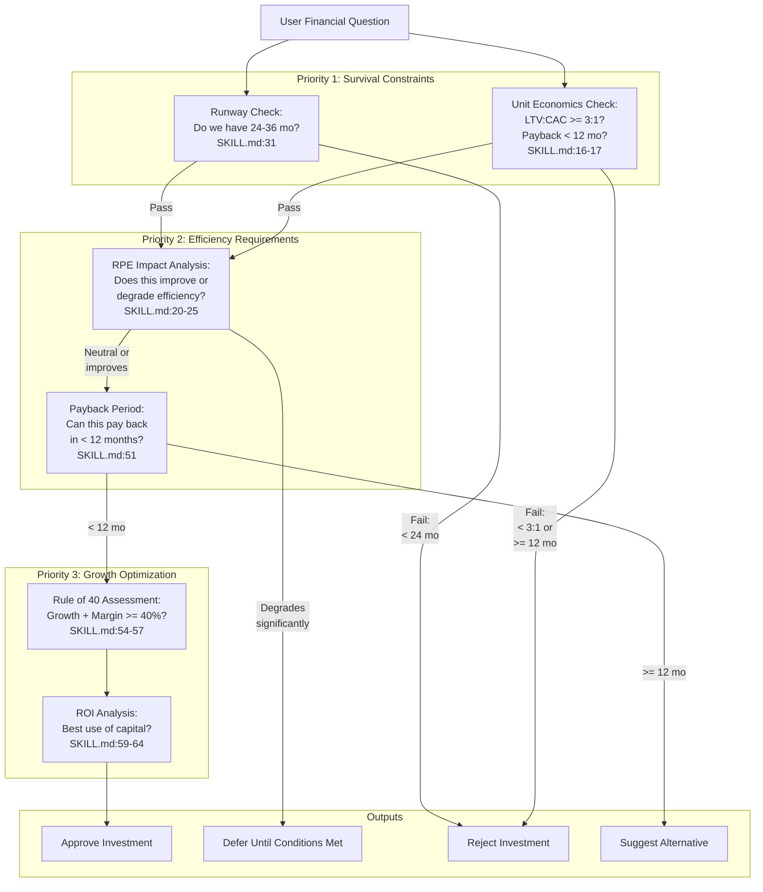

### Priority Enforcement

The system enforces priorities through sequential checks:

1. **Priority 1 (Survival):** Questions that fail runway or unit economics checks receive immediate rejection with "death spiral" warnings. No further analysis proceeds.

2. **Priority 2 (Efficiency):** Questions that pass survival but significantly degrade RPE or exceed 12-month payback receive deferral recommendations with suggestions for improving metrics first.

3. **Priority 3 (Growth):** Only questions that pass all prior checks proceed to growth optimization analysis using Rule of 40 and comparative ROI.

This hierarchy ensures that survival always trumps efficiency, and efficiency always trumps growth optimization.

**Sources:** [SKILL.md:10-67]()

---

## Philosophy vs. Framework Relationship

The philosophy operates at a meta-level above the frameworks, acting as a constraint system rather than a parallel system:

| Dimension | Philosophy Layer | Framework Layer |
|-----------|-----------------|-----------------|
| **Nature** | Immutable principles | Operational tools |
| **Role** | Defines what's acceptable | Calculates what's possible |
| **Output** | Go/no-go gates | Quantitative analysis |
| **Examples** | "Unit econ must be 3:1", "Profit is constraint" | LTV calculation, runway projection |
| **Modification** | Cannot be overridden by user context | Can be adapted to industry specifics |
| **Implementation** | Embedded in [SKILL.md:10-26]() | Detailed in [SKILL.md:27-145]() |

The frameworks (Cash Management, Unit Economics, Capital Allocation, Working Capital, Forecasting) are the **"how"**—they provide methods for calculation and analysis. The philosophy is the **"why"**—it provides the constraints and decision criteria that determine which calculations matter and which outcomes are acceptable.

**Sources:** [SKILL.md:10-162](), [README.md:33-42]()

---

## Connection to Reference Materials

The philosophy is operationalized through two reference documents:

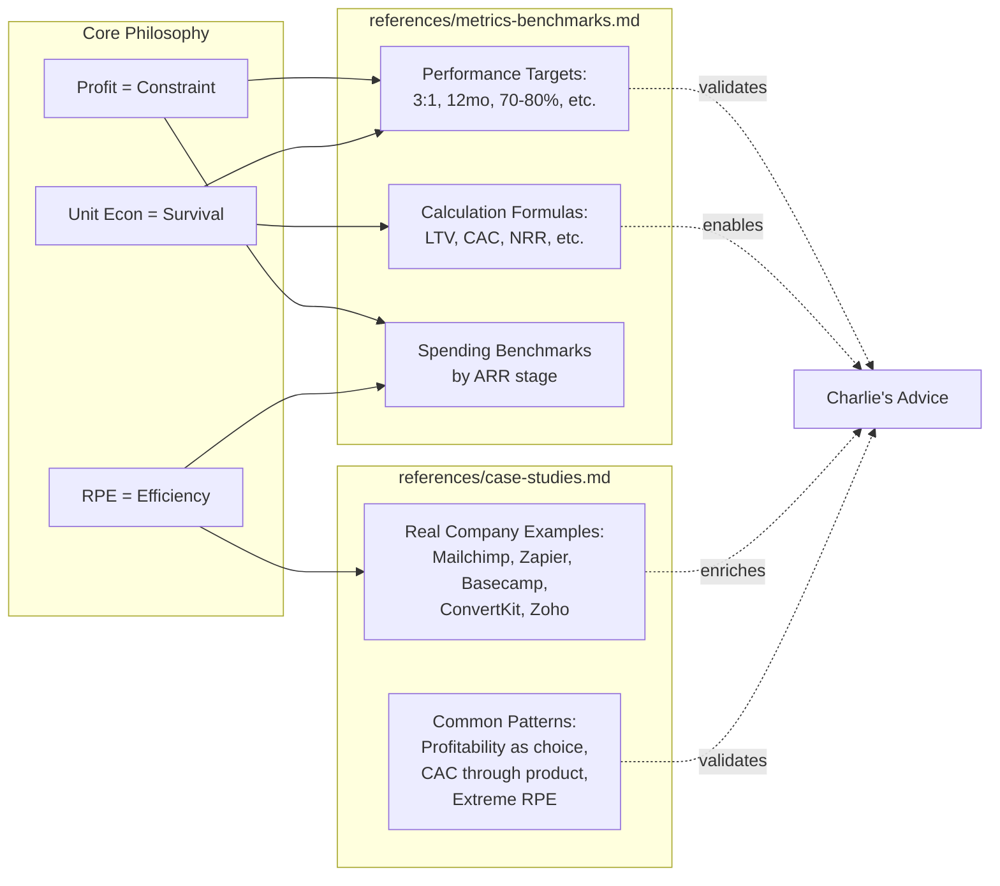

### Reference Integration

| Philosophy Principle | Quantitative Support (Metrics) | Qualitative Support (Cases) |
|---------------------|-------------------------------|----------------------------|
| **Profit as Constraint** | Spending benchmarks showing bootstrapped efficiency | Basecamp's profit distributions, Zoho's 0% advertising spend |
| **Unit Economics = Survival** | LTV:CAC formulas and 3:1 minimum threshold | Mailchimp's <$100 CAC, Zapier's near-zero CAC strategy |
| **RPE as Scorecard** | RPE targets by stage ($110K to $400K+) | Basecamp's $1.4M RPE, bootstrapped 40-70% premium over VC-backed |

The metrics document provides the **"what to calculate"** and the **"what's acceptable"**, while the case studies provide the **"proof of concept"** that these principles work in real companies at scale.

**Sources:** [SKILL.md:159-161](), [README.md:44-48]()

---

## Summary: Philosophy as System Constraint

The Core Philosophy functions as the **constraint system** for the entire Charlie CFO Skill:

1. **Immutability:** Philosophy principles cannot be overridden—they are hard-coded assumptions in [SKILL.md:10-26]()
2. **Hierarchy:** Philosophy sits above frameworks in decision priority
3. **Enforcement:** Violations trigger rejection/deferral, not just warnings
4. **Integration:** Philosophy informs all five frameworks and all reference materials
5. **Operationalization:** Abstract principles are translated to concrete thresholds (3:1, 12 months, 24-36 months)

This design ensures that Charlie's advice is **consistently conservative** and **survival-oriented**—optimizing for long-term viability rather than short-term growth metrics.

For deeper exploration of each principle, see child pages:
- [Profit as a Constraint, Not a Goal](#2.1)
- [Unit Economics as Survival Requirements](#2.2)
- [Revenue Per Employee and Efficiency Targets](#2.3)

**Sources:** [SKILL.md:1-162](), [README.md:1-59]()

---

# Page: Profit as a Constraint, Not a Goal

# Profit as a Constraint, Not a Goal

<details>
<summary>Relevant source files</summary>

The following files were used as context for generating this wiki page:

- [SKILL.md](SKILL.md)
- [references/case-studies.md](references/case-studies.md)

</details>


## Purpose and Scope

This document explains the foundational philosophical principle that underpins all of Charlie CFO Skill's financial frameworks: treating profit as a constraint rather than an objective function. This principle, derived from Charlie Munger's capital discipline philosophy, shapes how the system evaluates investments, makes recommendations, and sets thresholds across all five financial frameworks.

This page covers the conceptual model and its technical implementation in the skill system. For how this principle specifically manifests in unit economics thresholds, see [Unit Economics as Survival Requirements](#2.2). For revenue efficiency implications, see [Revenue Per Employee and Efficiency Targets](#2.3). For the practical frameworks that implement these constraints, see [The Five Financial Frameworks](#3).

## Conceptual Foundation

The "profit as constraint" model inverts the traditional optimization problem. Instead of maximizing profit as an objective function, the system treats profitability as a boundary condition that must be satisfied while optimizing for other strategic goals (market position, product quality, team satisfaction, sustainable growth).

This approach is explicitly stated in [SKILL.md:12]():

> **Profit is a constraint, not a goal.** Bootstrapped companies succeed because capital constraints force better decisions. Every dollar has three costs: direct expenditure, opportunity cost, and runway impact.

The principle manifests technically as hard thresholds and decision gates rather than soft targets or aspirational metrics.

**Sources:** [SKILL.md:10-12]()

## The Three-Cost Framework

Every capital allocation decision in the system evaluates three distinct costs simultaneously:

| Cost Type | Definition | System Implementation |
|-----------|------------|----------------------|
| **Direct Expenditure** | The nominal dollar amount of the transaction | Used in burn rate calculations, cash flow projections |
| **Opportunity Cost** | The alternative uses for the same capital | Compared against <12 month payback threshold (SKILL.md:51) |
| **Runway Impact** | How the expenditure affects time-to-zero-cash | Factored into runway calculations and 24-36 month minimum requirement (SKILL.md:31-32) |

This three-dimensional evaluation prevents myopic decision-making where a hire or investment appears justified on direct ROI alone but fails when runway or opportunity costs are considered.

### Three-Cost Evaluation Flow

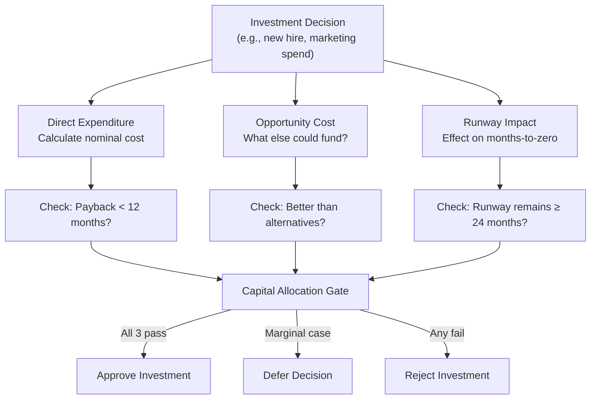

**Sources:** [SKILL.md:12](), [SKILL.md:51](), [SKILL.md:29-33]()

## System Implementation: Constraint Encoding

The profit-as-constraint principle is encoded in the system through multiple specification layers:

### Primary Specification Layer

The core mental model is defined in [SKILL.md:10-26]() within the "Core Mental Models" section. This section establishes three constraint categories:

1. **Profit constraint statement** (line 12)
2. **Unit economics survival requirements** (lines 14-18)
3. **Revenue per employee efficiency scorecard** (lines 20-25)

```mermaid
graph LR
    subgraph "SKILL.md Specification"
        MENTAL_MODELS["Core Mental Models<br/>Lines 10-26"]
        
        PROFIT_CONSTRAINT["Profit as constraint<br/>Line 12"]
        UNIT_ECON_REQS["Unit economics survival reqs<br/>Lines 14-18<br/>LTV ≥ 3x CAC<br/>Payback < 12 mo"]
        RPE_SCORECARD["RPE efficiency scorecard<br/>Lines 20-25<br/>$110-150K early<br/>$400K+ mature"]
    end
    
    subgraph "Decision Framework Specifications"
        CAP_ALLOC["Capital Allocation<br/>Lines 49-66<br/>Payback < 12 mo requirement"]
        CASH_MGMT["Cash Management<br/>Lines 27-47<br/>24-36 mo runway minimum"]
        METRICS_DASH["Key Metrics Dashboard<br/>Lines 112-119<br/>Hard targets"]
    end
    
    MENTAL_MODELS --> PROFIT_CONSTRAINT
    MENTAL_MODELS --> UNIT_ECON_REQS
    MENTAL_MODELS --> RPE_SCORECARD
    
    PROFIT_CONSTRAINT -->|"constrains"| CAP_ALLOC
    PROFIT_CONSTRAINT -->|"constrains"| CASH_MGMT
    
    UNIT_ECON_REQS -->|"enforced by"| METRICS_DASH
    RPE_SCORECARD -->|"tracked in"| METRICS_DASH
    
    CAP_ALLOC -->|"gates"| HIRING["Hiring Decisions<br/>Lines 59-65<br/>4-question framework"]
    CASH_MGMT -->|"gates"| SPENDING["Spending Decisions<br/>Lines 29-47<br/>Burn multiple targets"]
```

**Sources:** [SKILL.md:10-26](), [SKILL.md:49-66](), [SKILL.md:27-47](), [SKILL.md:112-119]()

### Reference Material Layer

The constraint principle is reinforced through empirical case studies in [references/case-studies.md](). The document provides five examples of companies that succeeded by treating profitability as a non-negotiable constraint:

| Company | Constraint Evidence | Duration | Outcome |
|---------|-------------------|----------|---------|
| Mailchimp | Profitable before freemium pivot; never raised capital despite offers | 20 years | $12B exit |
| Zapier | Profitability reached in 2014, maintained since; never burned seed round | 2012-present | $5B valuation |
| Basecamp | Annual profit distributions for 25+ years; zero external capital | 1999-present | ~$100M ARR |
| ConvertKit | Achieved 51% margin in 5 months during crisis | Crisis turnaround | ~$30M ARR |
| Zoho | Zero external capital; 60% to R&D from profits | 28+ years | $1B+ revenue |

The synthesized pattern from [references/case-studies.md:160-165]() states: "Profitability is a choice, not a destination" - all companies achieved profitability early and maintained it, with profit constraints forcing better decisions.

**Sources:** [references/case-studies.md:1-183](), [references/case-studies.md:160-165]()

## Constraint Propagation Through Frameworks

The profit-as-constraint principle propagates through the system as hard dependencies between frameworks. This creates a hierarchy where certain constraints must be satisfied before others become relevant.

### Framework Constraint Hierarchy

```mermaid
graph TB
    CONSTRAINT["Profit as Constraint<br/>Meta-level Philosophy<br/>SKILL.md:12"]
    
    subgraph "Tier 1: Survival Constraints (Non-negotiable)"
        UNIT_ECON["Unit Economics Framework<br/>SKILL.md:14-18<br/>LTV ≥ 3x CAC<br/>Payback < 12 months"]
        
        CASH_RUNWAY["Cash Management<br/>SKILL.md:29-33<br/>Runway ≥ 24-36 months<br/>Danger zone < 12 months"]
    end
    
    subgraph "Tier 2: Allocation Constraints (Conditional)"
        CAP_ALLOC["Capital Allocation<br/>SKILL.md:49-66<br/>Payback < 12 mo<br/>Rule of 40"]
        
        WORK_CAP["Working Capital Optimization<br/>SKILL.md:68-90<br/>CCC optimization<br/>AR/AP discipline"]
    end
    
    subgraph "Tier 3: Planning Constraints (Forward-looking)"
        FORECAST["Forecasting<br/>SKILL.md:123-145<br/>3-scenario planning<br/>Driver-based models"]
    end
    
    CONSTRAINT -->|"enforces"| UNIT_ECON
    CONSTRAINT -->|"enforces"| CASH_RUNWAY
    
    UNIT_ECON -->|"must satisfy before"| CAP_ALLOC
    CASH_RUNWAY -->|"sets limits on"| CAP_ALLOC
    
    UNIT_ECON -.->|"death spiral if violated"| CASH_RUNWAY
    
    CAP_ALLOC -->|"impacts"| CASH_RUNWAY
    CAP_ALLOC -->|"changes drivers in"| FORECAST
    
    WORK_CAP -->|"optimizes"| CASH_RUNWAY
    
    FORECAST -->|"projects"| CASH_RUNWAY
    FORECAST -->|"evaluates"| CAP_ALLOC
    
    style CONSTRAINT fill:#f5f5f5,stroke:#333,stroke-width:3px
    style UNIT_ECON fill:#f5f5f5,stroke:#333,stroke-width:2px
    style CASH_RUNWAY fill:#f5f5f5,stroke:#333,stroke-width:2px
```

**Critical Dependency:** [SKILL.md:14-18]() establishes unit economics as **survival requirements** that gate capital allocation decisions. The system enforces that LTV:CAC ≥ 3:1 and CAC payback < 12 months must be satisfied before approving growth investments. Violating these "creates a death spiral bootstrapped companies cannot survive."

**Sources:** [SKILL.md:12](), [SKILL.md:14-18](), [SKILL.md:29-33](), [SKILL.md:49-66](), [SKILL.md:68-90](), [SKILL.md:123-145]()

## Manifestation in Decision Rules

The constraint principle manifests as hard thresholds in decision-making logic rather than flexible guidelines. These appear throughout [SKILL.md]() as specific numeric gates.

### Capital Allocation Decision Gates

From [SKILL.md:49-66]():

| Decision Type | Constraint | System Behavior |
|--------------|------------|-----------------|
| **Any investment** | Payback period < 12 months | Reject if payback ≥ 12 months |
| **Hiring decision** | Must pass 4-question framework | All questions must have satisfactory answers |
| **Department growth** | Never grow >50% at once | Hard cap to prevent productivity collapse |
| **Rule of 40** | Growth % + Margin % ≥ 40% | Alert if sum < 40% |

The hiring decision framework from [SKILL.md:59-65]() implements the constraint as four required checks:

1. Direct revenue contribution?
2. Time-to-productivity factored into ROI?
3. Opportunity cost vs. alternative uses?
4. Impact on existing team productivity?

### Cash Management Constraint Gates

From [SKILL.md:27-47]():

| Metric | Minimum | Danger Zone | System Response |
|--------|---------|-------------|-----------------|
| **Runway** | 24-36 months | <12 months | "You've lost control" warning |
| **Burn multiple** | Zero or negative | >2x | Flag as "Concerning" |
| **Operating reserve** | 3-6 months fixed costs | <3 months | Trigger contingency planning |

The [SKILL.md:33]() specification explicitly states: "Never fundraise your way out of a cash crisis" - encoding the philosophy that capital constraints must be solved through operational improvement, not external capital.

**Sources:** [SKILL.md:49-66](), [SKILL.md:59-65](), [SKILL.md:27-47](), [SKILL.md:33]()

## Comparison with Alternative Models

The constraint-based model differs fundamentally from optimization-based approaches common in VC-backed environments:

```mermaid
graph LR
    subgraph "VC-Backed Model (Optimization)"
        VC_OBJECTIVE["Objective Function:<br/>Maximize Growth Rate<br/>subject to capital availability"]
        
        VC_CONSTRAINTS["Soft Constraints:<br/>• Unit economics 'to be fixed later'<br/>• Burn acceptable if growth high<br/>• Profitability optional"]
        
        VC_DECISION["Decision Logic:<br/>If growth_rate > threshold:<br/>  approve_spend()<br/>else:<br/>  reject()"]
    end
    
    subgraph "Bootstrapped Model (Constraint)"
        BS_CONSTRAINTS["Hard Constraints:<br/>• LTV ≥ 3x CAC (SKILL.md:16)<br/>• Payback < 12 mo (SKILL.md:17)<br/>• Runway ≥ 24-36 mo (SKILL.md:31)<br/>• Profitability required"]
        
        BS_OBJECTIVE["Objective Function:<br/>Maximize Strategic Value<br/>subject to profit constraint"]
        
        BS_DECISION["Decision Logic:<br/>If constraints_satisfied():<br/>  evaluate_strategic_value()<br/>else:<br/>  reject()"]
    end
    
    VC_OBJECTIVE --> VC_CONSTRAINTS
    VC_CONSTRAINTS --> VC_DECISION
    
    BS_CONSTRAINTS --> BS_OBJECTIVE
    BS_OBJECTIVE --> BS_DECISION
    
    style BS_CONSTRAINTS fill:#f5f5f5,stroke:#333,stroke-width:2px
```

### Behavioral Differences

| Scenario | VC-Backed Approach | Bootstrapped Constraint Approach |
|----------|-------------------|----------------------------------|
| LTV:CAC = 2.5:1 | Acceptable if growth is high | **Reject** - violates 3:1 minimum (SKILL.md:16) |
| 18-month payback | Acceptable with sufficient runway | **Reject** - exceeds 12-month maximum (SKILL.md:17) |
| 15 months runway | Acceptable if funding round planned | **Danger zone** - "you've lost control" (SKILL.md:32) |
| 150% burn multiple | Acceptable in high-growth phase | **Concerning** - target is zero or negative (SKILL.md:47) |

The system implementation in [SKILL.md:147-154]() makes this distinction explicit through spending benchmarks: bootstrapped companies target ~95% of ARR in total spending, versus 107% for VC-backed companies, creating structural profitability.

**Sources:** [SKILL.md:16-17](), [SKILL.md:31-32](), [SKILL.md:47](), [SKILL.md:147-154]()

## Empirical Validation Through Case Studies

The [references/case-studies.md]() document provides empirical evidence for the constraint model through five detailed case studies. The key validation pattern is that all companies achieved large exits while maintaining profitability constraints throughout their growth:

### Constraint Adherence Across Cases

```mermaid
graph TB
    CONSTRAINT_MODEL["Profit as Constraint Model"]
    
    MAILCHIMP["Mailchimp Case<br/>case-studies.md:3-29<br/>Profitable before freemium<br/>Refused VC offers<br/>$12B exit"]
    
    ZAPIER["Zapier Case<br/>case-studies.md:32-58<br/>Profitable by 2014<br/>Never burned seed<br/>$5B valuation"]
    
    BASECAMP["Basecamp Case<br/>case-studies.md:61-92<br/>Annual profit distributions<br/>25+ years profitable<br/>~$100M ARR"]
    
    CONVERTKIT["ConvertKit Case<br/>case-studies.md:95-122<br/>51% margin in 5 months<br/>Profit sharing model<br/>~$30M ARR"]
    
    ZOHO["Zoho Case<br/>case-studies.md:125-157<br/>Zero funding ever<br/>60% to R&D from profits<br/>$1B+ revenue"]
    
    PATTERN["Common Pattern<br/>case-studies.md:160-183<br/>Profitability as choice<br/>Profit constraints force better decisions"]
    
    CONSTRAINT_MODEL --> MAILCHIMP
    CONSTRAINT_MODEL --> ZAPIER
    CONSTRAINT_MODEL --> BASECAMP
    CONSTRAINT_MODEL --> CONVERTKIT
    CONSTRAINT_MODEL --> ZOHO
    
    MAILCHIMP --> PATTERN
    ZAPIER --> PATTERN
    BASECAMP --> PATTERN
    CONVERTKIT --> PATTERN
    ZOHO --> PATTERN
    
    PATTERN --> VALIDATION["Empirical Validation:<br/>5/5 cases successful<br/>with constraint model"]
```

The synthesized pattern from [references/case-studies.md:162-164]() explicitly states:

> **Profitability is a choice, not a destination**
> - All achieved profitability early and maintained it
> - Profit constraints forced better decisions

This provides the empirical foundation for encoding profit as a hard constraint in the system rather than a soft target.

**Sources:** [references/case-studies.md:3-29](), [references/case-studies.md:32-58](), [references/case-studies.md:61-92](), [references/case-studies.md:95-122](), [references/case-studies.md:125-157](), [references/case-studies.md:160-183]()

## Technical Integration Points

The profit-as-constraint principle integrates with Charlie's query processing through the framework selection and calculation engine described in the system architecture diagrams. When a user asks a capital allocation question (e.g., "Should we make this hire?"), the system:

1. **Intent Recognition** → Routes to Capital Allocation Framework
2. **Constraint Validation** → Checks unit economics thresholds from [SKILL.md:14-18]()
3. **Multi-cost Evaluation** → Applies three-cost framework
4. **Runway Impact** → Calculates effect on [SKILL.md:29-33]() runway targets
5. **Case Study Enrichment** → Pulls relevant examples from [references/case-studies.md]()
6. **Threshold Comparison** → Compares against hard gates in [SKILL.md:49-66]()

The system generates recommendations structured as **approve/defer/reject** rather than probabilistic scores, reflecting the constraint-based rather than optimization-based model.

**Sources:** [SKILL.md:14-18](), [SKILL.md:29-33](), [SKILL.md:49-66](), [references/case-studies.md]()

---

# Page: Unit Economics as Survival Requirements

# Unit Economics as Survival Requirements

<details>
<summary>Relevant source files</summary>

The following files were used as context for generating this wiki page:

- [SKILL.md](SKILL.md)
- [references/metrics-benchmarks.md](references/metrics-benchmarks.md)

</details>


## Purpose and Scope

This document explains why Charlie treats LTV:CAC ratios and CAC payback periods as non-negotiable survival thresholds rather than aspirational goals. It details the specific numeric requirements, the mechanism by which violations create death spirals, and how these thresholds are encoded throughout the Charlie CFO Skill system.

For the broader philosophical foundation behind capital discipline, see [Profit as a Constraint, Not a Goal](#2.1). For how unit economics integrate with spending decisions, see [Capital Allocation Framework](#3.3). For detailed calculation formulas and benchmarks, see [Unit Economics Calculations](#5.1.1).

---

## The Bootstrapped Context: Why Unit Economics Matter More

Bootstrapped companies operate under a fundamental constraint that VC-backed companies do not face: **limited access to external capital**. This constraint transforms unit economics from optimization targets into survival requirements.

In a VC-backed model, negative unit economics can be temporarily sustained through successive funding rounds. A company can acquire customers at a loss, betting that future scale or product improvements will eventually achieve profitability. Bootstrapped companies lack this cushion—every unprofitable customer acquisition accelerates the path to insolvency.

Charlie enforces this distinction by treating unit economics violations as blocking conditions for capital allocation decisions. The system will not approve growth investments when fundamental economics are unhealthy, regardless of other positive signals.

**Sources:** [SKILL.md:12-18](), [SKILL.md:50-67]()

---

## Critical Thresholds Defined in SKILL.md

The Charlie CFO Skill encodes two hard thresholds that define the boundary between sustainable and unsustainable business models:

| Metric | Minimum Threshold | High Performance | Best-in-Class |
|--------|-------------------|------------------|---------------|
| **LTV:CAC Ratio** | ≥ 3:1 | 5:1 | 7-8:1 |
| **CAC Payback Period** | < 12 months | 5-7 months | 3-5 months |

These thresholds are declared at [SKILL.md:14-18]() as part of the "Core Mental Models" section, specifically under "Unit economics are survival requirements."

### LTV:CAC Ratio ≥ 3:1

The 3:1 minimum means that the lifetime value of a customer must be at least three times what was spent to acquire them. This ratio accounts for:
- **Operating costs** of servicing the customer (support, infrastructure)
- **Time value of money** (capital locked in CAC before recovery)
- **Risk buffer** (some customers will churn before reaching projected LTV)

Ratios below 3:1 indicate that after accounting for the cost of capital and operational overhead, the business is barely breaking even or losing money on customer acquisition.

### CAC Payback < 12 Months

The 12-month payback requirement means that gross margin dollars from a customer must recover the acquisition cost within one year. This threshold directly ties to cash management requirements:

- Bootstrapped companies typically target 24-36 months of runway ([SKILL.md:29-33]())
- A 12-month payback allows the company to recycle capital twice within minimum runway targets
- Payback periods exceeding 12 months mean cash is locked up for too long relative to available reserves

**Sources:** [SKILL.md:14-18](), [SKILL.md:51](), [references/metrics-benchmarks.md:20-32]()

---

## The Death Spiral Mechanism

The phrase "death spiral" at [SKILL.md:18]() describes a specific failure mode that occurs when bootstrapped companies violate unit economics thresholds while attempting to grow. This diagram illustrates the mechanism:

### Death Spiral Progression in Bootstrapped Companies

```mermaid
graph TD
    WEAK_UE["Weak Unit Economics<br/>(LTV:CAC < 3:1 or Payback > 12mo)"]
    GROWTH_ATT["Attempt to Grow<br/>(Increase customer acquisition)"]
    BURN_ACC["Burn Rate Accelerates<br/>(More CAC spend upfront)"]
    CASH_DEP["Cash Reserves Deplete<br/>(Long payback locks capital)"]
    RUNWAY_SHORT["Runway Shortens<br/>(<12 months remaining)"]
    PANIC_MODE["Panic Mode Activated<br/>(Cost cuts, hiring freeze)"]
    GROWTH_STALL["Growth Stalls<br/>(Reduced S&M spend)"]
    REV_MISS["Revenue Misses Projections<br/>(Pipeline dries up)"]
    INVESTOR_REQ["Require External Capital<br/>(Desperation fundraising)"]
    BAD_TERMS["Poor Terms or Failure<br/>(Weak negotiating position)"]
    DEATH["Insolvency or Fire Sale"]
    
    WEAK_UE --> GROWTH_ATT
    GROWTH_ATT --> BURN_ACC
    BURN_ACC --> CASH_DEP
    CASH_DEP --> RUNWAY_SHORT
    RUNWAY_SHORT --> PANIC_MODE
    PANIC_MODE --> GROWTH_STALL
    GROWTH_STALL --> REV_MISS
    REV_MISS --> CASH_DEP
    REV_MISS --> INVESTOR_REQ
    INVESTOR_REQ --> BAD_TERMS
    BAD_TERMS --> DEATH
    
    WEAK_UE -.alternative.-> FIX_ECON["Fix Unit Economics<br/>(Charlie's recommendation)"]
    FIX_ECON --> GROWTH_ATT
```

The critical insight: **the spiral accelerates because growth compounds the problem rather than solving it**. Each new customer acquired under poor unit economics further strains cash reserves. Unlike VC-backed companies that can raise into the problem, bootstrapped companies hit a hard constraint when cash runs out.

Charlie blocks this path by refusing to approve growth investments (hiring sales reps, increasing marketing spend) when unit economics are below threshold. The system forces founders to fix the fundamental economics before scaling.

**Sources:** [SKILL.md:14-18](), [SKILL.md:29-33]()

---

## Calculating Unit Economics: Formula Mapping

Charlie uses specific formulas defined in the reference materials to calculate and validate unit economics. This section maps the calculation flow from raw inputs to threshold validation.

### Calculation Flow and Code References

```mermaid
graph TB
    subgraph "Input Data"
        ARPU["Monthly ARPU<br/>(Average Revenue Per User)"]
        CHURN["Monthly Churn Rate"]
        GM["Gross Margin %"]
        SM_SPEND["Sales + Marketing Spend<br/>(incl salaries, tools, ads)"]
        NEW_CUST["New Customers Acquired"]
    end
    
    subgraph "Calculation Formulas (metrics-benchmarks.md)"
        LTV_CALC["LTV Calculation<br/>metrics-benchmarks.md:5-12<br/>LTV = (ARPU × Gross Margin) / Monthly Churn"]
        CAC_CALC["CAC Calculation<br/>metrics-benchmarks.md:14-18<br/>CAC = (S&M Spend) / New Customers"]
        RATIO_CALC["LTV:CAC Ratio<br/>metrics-benchmarks.md:25-32"]
        PAYBACK_CALC["CAC Payback Period<br/>metrics-benchmarks.md:20-23<br/>Payback = CAC / (Monthly ARPU × GM)"]
    end
    
    subgraph "Threshold Validation (SKILL.md:14-18)"
        RATIO_CHECK{"LTV:CAC ≥ 3:1?"}
        PAYBACK_CHECK{"Payback < 12 mo?"}
    end
    
    subgraph "Decision Outcome"
        PASS["PASS: Unit Economics Healthy<br/>Approve growth investments"]
        FAIL["FAIL: Death Spiral Risk<br/>Block growth, focus on economics"]
    end
    
    ARPU --> LTV_CALC
    CHURN --> LTV_CALC
    GM --> LTV_CALC
    
    SM_SPEND --> CAC_CALC
    NEW_CUST --> CAC_CALC
    
    LTV_CALC --> RATIO_CALC
    CAC_CALC --> RATIO_CALC
    
    CAC_CALC --> PAYBACK_CALC
    ARPU --> PAYBACK_CALC
    GM --> PAYBACK_CALC
    
    RATIO_CALC --> RATIO_CHECK
    PAYBACK_CALC --> PAYBACK_CHECK
    
    RATIO_CHECK -->|Yes| PASS
    PAYBACK_CHECK -->|Yes| PASS
    
    RATIO_CHECK -->|No| FAIL
    PAYBACK_CHECK -->|No| FAIL
```

**Sources:** [references/metrics-benchmarks.md:5-32](), [SKILL.md:14-18]()

### LTV Calculation Details

The Lifetime Value formula at [references/metrics-benchmarks.md:5-12]() uses the simplified approach:

```
LTV = (ARPU × Gross Margin) / Monthly Churn Rate
```

This assumes:
- Churn rate is constant over time
- Revenue per user remains stable
- Gross margin accurately reflects variable costs of serving the customer

For companies with expansion revenue, a cohort-based approach (also documented at [references/metrics-benchmarks.md:9-12]()) provides higher accuracy by summing actual revenue retention curves.

### CAC Calculation Details

The Customer Acquisition Cost formula at [references/metrics-benchmarks.md:14-18]() includes all customer acquisition expenses:

```
CAC = (Sales + Marketing Spend) / New Customers Acquired
```

Charlie requires including:
- Sales team salaries and commissions
- Marketing salaries
- Advertising spend (paid search, social, display)
- Marketing tools and software
- Events and conferences
- Content production costs

The common error is underestimating CAC by excluding fully-loaded personnel costs or allocated overhead.

### CAC Payback Period Calculation

The payback formula at [references/metrics-benchmarks.md:20-23]() calculates how many months of gross margin revenue are needed to recover CAC:

```
CAC Payback (months) = CAC / (Monthly ARPU × Gross Margin)
```

This formula adjusts for:
- **Gross margin**: Only margin dollars (not total revenue) contribute to CAC recovery
- **Monthly ARPU**: Uses average per-user revenue to normalize across customer tiers

**Sources:** [references/metrics-benchmarks.md:5-23]()

---

## Threshold Interpretation Table

Charlie uses this interpretation framework defined at [references/metrics-benchmarks.md:25-32]():

| LTV:CAC Ratio | Charlie's Interpretation | Action |
|---------------|-------------------------|---------|
| **< 1:1** | Losing money on every customer | BLOCK all growth, urgent fix required |
| **1-2:1** | Unsustainable, need to improve | BLOCK growth investments |
| **3:1** | Healthy minimum threshold | ALLOW growth (with monitoring) |
| **5:1+** | Excellent, may be underinvesting | Recommend increased growth investment |
| **7-8:1** | Best-in-class | Aggressively scale |

The discontinuity at 3:1 is intentional—it represents the minimum viable ratio for bootstrapped sustainability after accounting for:
- Risk (not all customers reach projected LTV)
- Time value (capital locked during payback period)
- Operating leverage (need margin for profit after CAC recovery)

**Sources:** [references/metrics-benchmarks.md:25-32]()

---

## Integration with Capital Allocation Decisions

Unit economics serve as a **prerequisite check** for all capital allocation decisions in Charlie's decision framework. This integration is visible in the hiring evaluation logic at [SKILL.md:59-65]().

### Hiring Decision Gating Logic

```mermaid
graph LR
    HIRE_REQ["Hiring Request"]
    UE_CHECK{"Unit Economics<br/>Check<br/>(SKILL.md:14-18)"}
    CAP_EVAL["Capital Allocation<br/>Evaluation<br/>(SKILL.md:59-65)"]
    ROI_CALC["ROI Analysis<br/>(Payback < 12mo)"]
    DECISION["Approve/Deny<br/>Recommendation"]
    
    HIRE_REQ --> UE_CHECK
    UE_CHECK -->|FAIL| DENY["DENY<br/>Fix economics first"]
    UE_CHECK -->|PASS| CAP_EVAL
    CAP_EVAL --> ROI_CALC
    ROI_CALC --> DECISION
```

The sequence is critical:
1. **First**: Check if LTV:CAC ≥ 3:1 and payback < 12 months
2. **Only if passed**: Proceed to evaluate the specific investment ROI
3. **Then**: Apply the four-question hiring framework

This gating prevents the death spiral by refusing to approve spending that would accelerate customer acquisition when fundamental economics are broken.

**Sources:** [SKILL.md:14-18](), [SKILL.md:51-67]()

---

## Unit Economics Monitoring Cadence

Charlie integrates unit economics into the monitoring rhythms defined at [SKILL.md:92-110](). These metrics appear in:

### Weekly Review (SKILL.md:92-99)
Not typically reviewed weekly unless in crisis mode or during active campaigns.

### Monthly Review (SKILL.md:100-105)
Unit economics are recalculated monthly as part of the full close process. Specifically:
- Update CAC with trailing 30-day S&M spend and new customer counts
- Recalculate LTV using latest churn rates
- Compare to prior month to detect trends

### Quarterly Review (SKILL.md:106-111)
Unit economics receive strategic assessment:
- Cohort analysis to identify if economics are improving or degrading over time
- Segmentation analysis (by customer tier, acquisition channel, geography)
- Scenario modeling of required improvements to hit thresholds

### Key Metrics Dashboard (SKILL.md:112-120)

Unit economics occupy a permanent position in the dashboard:

| Category | Metrics | Targets |
|----------|---------|---------|
| Unit economics | LTV:CAC, CAC payback, gross margin | 3:1+, <12 mo, 70-80% |

This dashboard placement at [SKILL.md:117]() ensures unit economics are visible in every financial review, not just isolated analyses.

**Sources:** [SKILL.md:92-120]()

---

## Relationship to Other Core Principles

Unit economics form part of an integrated philosophy within Charlie's system. The connections:

### Connection to "Profit as a Constraint" (Section 2.1)

Unit economics are the **micro-level expression** of profit as constraint. While profit as constraint governs company-wide capital allocation, unit economics govern customer-level profitability. A company cannot be sustainably profitable if individual customer cohorts are unprofitable.

### Connection to "Revenue Per Employee" (Section 2.3)

High revenue per employee ([SKILL.md:20-25]()) becomes achievable primarily through strong unit economics. Companies with 7-8:1 LTV:CAC ratios can afford to maintain leaner teams because:
- Each customer is highly profitable
- Less spending required on customer acquisition and support
- More revenue generated per dollar of payroll

### Connection to Cash Management (Section 3.1)

The 12-month payback requirement directly links to the 24-36 month runway target at [SKILL.md:29-33](). With 12-month payback:
- Capital deployed in customer acquisition is recycled within half the minimum runway period
- Company can sustain 2x growth within runway constraints
- Cash reserves remain available for opportunistic investments

**Sources:** [SKILL.md:14-25](), [SKILL.md:29-33]()

---

## Why 3:1 and 12 Months Specifically?

These thresholds are not arbitrary—they encode specific mathematical and practical constraints for bootstrapped companies:

### The 3:1 Ratio Breakdown

```mermaid
graph LR
    LTV["LTV<br/>(Customer Lifetime Value)"]
    THIRD1["1x: Recover CAC"]
    THIRD2["1x: Cost of Capital<br/>& Risk Buffer"]
    THIRD3["1x: Operating Leverage<br/>for Profit"]
    
    LTV --> THIRD1
    LTV --> THIRD2
    LTV --> THIRD3
    
    THIRD1 --> BREAK_EVEN["Breakeven<br/>on Acquisition"]
    THIRD2 --> RISK_ADJ["Risk-Adjusted<br/>Return"]
    THIRD3 --> PROFIT_GEN["Profit Generation<br/>(Sustainable)"]
```

- **First 1x**: Recovers the original CAC investment
- **Second 1x**: Compensates for time value of money and execution risk (churn variance, market changes)
- **Third 1x**: Generates operating profit that can fund operations, reserves, and reinvestment

Below 3:1, the company is operationally breakeven at best, with no buffer for variability or profit generation.

### The 12-Month Payback Logic

```mermaid
graph TB
    RUNWAY["24-Month Minimum Runway<br/>(SKILL.md:29-33)"]
    PAYBACK["12-Month Payback Period"]
    CYCLES["2 Full Investment Cycles<br/>Within Runway"]
    RECYCLED["Capital Recycled 2x"]
    GROWTH["Sustainable Growth<br/>Without External Capital"]
    
    RUNWAY --> PAYBACK
    PAYBACK --> CYCLES
    CYCLES --> RECYCLED
    RECYCLED --> GROWTH
```

With 24 months of runway and 12-month payback:
- Month 0-12: First cohort acquired, capital locked
- Month 12: First cohort pays back, capital available
- Month 12-24: Second cohort acquired using recycled capital
- Month 24: Second cohort pays back, doubling available capital

This arithmetic enables compounding growth without external funding. Payback periods exceeding 12 months break this cycle—capital is locked too long relative to available runway.

**Sources:** [SKILL.md:14-18](), [SKILL.md:29-33]()

---

## Summary: Unit Economics as Gate Function

In Charlie's architecture, unit economics function as a **gate** rather than a score. They are binary: either they meet the survival thresholds or they don't. This design choice reflects the bootstrapped reality that there is no "acceptable but needs work" zone—violating thresholds while attempting to grow triggers the death spiral mechanism.

The system enforces this through:
1. **Hard thresholds** defined at [SKILL.md:14-18]()
2. **Calculation formulas** specified at [references/metrics-benchmarks.md:5-32]()
3. **Integration as prerequisite** for capital allocation at [SKILL.md:51-67]()
4. **Monitoring cadence** in dashboard at [SKILL.md:117]()

This architectural decision—treating unit economics as survival requirements rather than optimization targets—distinguishes Charlie's approach from traditional CFO frameworks that might present these as "areas for improvement" rather than blocking conditions.

**Sources:** [SKILL.md:14-18](), [SKILL.md:51-67](), [SKILL.md:112-120](), [references/metrics-benchmarks.md:5-32]()

---

# Page: Revenue Per Employee and Efficiency Targets

# Revenue Per Employee and Efficiency Targets

<details>
<summary>Relevant source files</summary>

The following files were used as context for generating this wiki page:

- [SKILL.md](SKILL.md)
- [references/case-studies.md](references/case-studies.md)
- [references/metrics-benchmarks.md](references/metrics-benchmarks.md)

</details>


## Purpose and Scope

This document explains Charlie's emphasis on Revenue Per Employee (RPE) as a primary efficiency metric for bootstrapped startups. It details target benchmarks at different company stages, explains why bootstrapped companies systematically achieve higher RPE than venture-backed peers, and describes how RPE integrates into hiring and capital allocation decisions.

For unit economics requirements that gate growth investments, see [Unit Economics as Survival Requirements](#2.2). For the hiring decision framework that uses RPE as one input, see [Evaluating Hiring Decisions](#4.1). For detailed RPE calculation formulas and industry benchmarks, see [Cash Flow and Efficiency Metrics](#5.1.3).

**Sources:** [SKILL.md:1-162](), [references/metrics-benchmarks.md:102-111]()

## What is Revenue Per Employee

Revenue Per Employee (RPE) measures the annual revenue generated per full-time equivalent employee. Charlie treats RPE as an **efficiency scorecard**—a proxy metric that captures the combined effects of product leverage, operational efficiency, and capital discipline.

```
RPE = Annual Recurring Revenue (ARR) / Full-Time Equivalent Employees
```

Unlike traditional financial metrics that focus on absolute revenue growth or profit margins, RPE reveals **how efficiently a company converts human capital into revenue**. High RPE indicates:

- **Product leverage**: The product does significant work without human intervention
- **Process efficiency**: Operations are streamlined and automated
- **Hiring discipline**: Each new hire is justified by clear revenue contribution
- **Market positioning**: Product commands pricing power relative to delivery costs

Charlie uses RPE as a constraint in capital allocation decisions, particularly hiring. The framework enforces that adding headcount must either: (1) directly increase RPE by driving revenue faster than costs, or (2) maintain RPE by making existing employees more productive.

**Sources:** [SKILL.md:20-26](), [references/metrics-benchmarks.md:102-111]()

## RPE Benchmarks by ARR Stage

Charlie defines stage-specific RPE targets that increase as companies mature. These benchmarks reflect expected efficiency gains from product maturity, process refinement, and customer base expansion.

### Target Ranges

| ARR Stage | Target RPE | Explanation |
|-----------|------------|-------------|
| $1-5M | $110-150K | Early stage, high relative investment in product/market fit |
| $5-10M | $150-200K | Product-market fit achieved, scaling processes |
| $10-50M | $200-250K | Mature product, optimized operations |
| $50M+ | $300-400K+ | Full operational leverage, established market position |

### Bootstrapped Premium

Bootstrapped companies systematically achieve **40-70% higher RPE** than venture-backed companies at the same ARR stage. A $10M ARR bootstrapped company typically runs at $280-350K RPE compared to $200-250K for venture-backed peers.

This premium reflects structural differences in capital constraints:

- **Forced efficiency**: Cannot hire ahead of revenue
- **Profitability requirement**: Must extract maximum value from each employee
- **Process discipline**: Automation and leverage are survival requirements, not optimization targets
- **Compensation structure**: Cash compensation rather than equity dilution encourages lean teams

**Sources:** [SKILL.md:20-26](), [references/metrics-benchmarks.md:102-111]()

## RPE Tracking in the System

```mermaid
graph TB
    subgraph "Data Sources"
        ARR["Annual Recurring Revenue<br/>(ARR)"]
        FTE["Full-Time Equivalent<br/>Employee Count"]
    end
    
    subgraph "RPE Calculation"
        CALC["RPE = ARR / FTE"]
    end
    
    subgraph "Benchmark Comparison"
        STAGE["ARR Stage Detection<br/>$1-5M, $5-10M, $10-50M, $50M+"]
        TARGET["Target RPE Lookup<br/>by Stage"]
        PREMIUM["Bootstrapped Premium<br/>+40-70% adjustment"]
        COMPARE["Compare Actual vs Target"]
    end
    
    subgraph "Integration Points"
        DASHBOARD["Key Metrics Dashboard<br/>Revenue Category"]
        HIRING["Hiring Decision Framework<br/>Capital Allocation"]
        REVIEW["Monthly/Quarterly Reviews<br/>Financial Review Rhythms"]
    end
    
    subgraph "Decision Outputs"
        APPROVAL["Hiring Approval/Denial"]
        WARNING["Efficiency Warning<br/>if below target"]
        OPTIMIZATION["Process Optimization<br/>Recommendations"]
    end
    
    ARR --> CALC
    FTE --> CALC
    
    CALC --> STAGE
    STAGE --> TARGET
    TARGET --> PREMIUM
    PREMIUM --> COMPARE
    CALC --> COMPARE
    
    COMPARE --> DASHBOARD
    COMPARE --> HIRING
    COMPARE --> REVIEW
    
    HIRING --> APPROVAL
    COMPARE --> WARNING
    COMPARE --> OPTIMIZATION
```

**Diagram: RPE Calculation and Integration Flow**

The system tracks RPE through a multi-stage process:

1. **Calculation**: ARR divided by FTE count produces current RPE
2. **Stage Detection**: ARR determines which benchmark range applies
3. **Benchmark Lookup**: System retrieves target range from [references/metrics-benchmarks.md:102-111]()
4. **Premium Adjustment**: Applies 40-70% uplift for bootstrapped context
5. **Comparison**: Actual RPE evaluated against adjusted target
6. **Integration**: Results feed into dashboard, hiring decisions, and reviews

**Sources:** [SKILL.md:112-120](), [references/metrics-benchmarks.md:102-111]()

## RPE vs Headcount Growth Mentality

Charlie's philosophy represents a fundamental divergence from venture-backed growth models that prioritize **headcount expansion** as a primary growth lever. This section contrasts the two approaches.

### Venture-Backed Approach: Headcount as Growth Signal

```mermaid
graph LR
    subgraph "VC-Backed Mental Model"
        FUNDING["Funding Round<br/>$10M raised"]
        HIRE_PLAN["Hiring Plan<br/>30-50 employees<br/>12-18 months"]
        SCALE["'Scaling the team'<br/>Growth signal to market"]
        BURN["High Burn Rate<br/>Runway traded for speed"]
        NEXT_ROUND["Next Funding Round<br/>Based on ARR growth"]
    end
    
    FUNDING --> HIRE_PLAN
    HIRE_PLAN --> SCALE
    SCALE --> BURN
    BURN --> NEXT_ROUND
    NEXT_ROUND -.6-18 months.-> FUNDING
```

**Diagram: Venture-Backed Headcount Growth Cycle**

Characteristics:
- Headcount treated as **input to growth** rather than output of revenue
- "Blitzscaling" mentality: hire aggressively to capture market share
- RPE deliberately depressed (often $100-150K even at $50M+ ARR)
- Acceptable because capital is readily available
- Growth rate prioritized over efficiency

### Bootstrapped Approach: RPE as Efficiency Constraint

```mermaid
graph LR
    subgraph "Bootstrapped Mental Model"
        REVENUE["Revenue Growth<br/>+20% YoY"]
        RPE_CHECK["RPE Evaluation<br/>Can we maintain/improve?"]
        PROCESS["Process Optimization<br/>Automate, streamline"]
        HIRE_PAIN["'Hire when it hurts'<br/>Pain threshold reached"]
        SELECTIVE["Selective Hiring<br/>Revenue contribution clear"]
    end
    
    REVENUE --> RPE_CHECK
    RPE_CHECK -->|"Yes"| PROCESS
    PROCESS --> HIRE_PAIN
    HIRE_PAIN --> SELECTIVE
    SELECTIVE --> REVENUE
    
    RPE_CHECK -->|"No"| PROCESS
```

**Diagram: Bootstrapped RPE-Constrained Growth**

Characteristics:
- Headcount is **output of necessity**, not input to growth
- Revenue growth must precede or justify hiring
- RPE maintained or improved with each hire
- Process optimization and automation are continuous requirements
- "Hire when it hurts" threshold ensures genuine need

**Sources:** [SKILL.md:20-26](), [references/case-studies.md:49-57]()

## Integration with Capital Allocation Framework

RPE functions as a **gating constraint** in Charlie's capital allocation decisions, particularly for hiring. The hiring decision framework uses RPE in two ways:

### 1. Direct RPE Impact Analysis

When evaluating a new hire, the system calculates projected RPE impact:

```
Projected New RPE = (Current ARR + Revenue Contribution) / (Current FTE + 1)
```

The hire is evaluated against three scenarios:
- **Scenario A**: Hire directly drives revenue (sales, customer success expansion)
- **Scenario B**: Hire improves productivity of existing team (engineering enablement, automation)
- **Scenario C**: Hire is necessary infrastructure (finance, operations) but doesn't improve RPE

Scenario A and B hires are preferred. Scenario C hires face stricter scrutiny and must clear the "hire when it hurts" threshold—evidence that lack of this role is causing measurable pain or inefficiency.

### 2. The Four-Question Hiring Framework

From [SKILL.md:59-66](), every hiring decision must answer:

1. **Will this hire directly contribute to revenue?** (Scenario A check)
2. **What's the time-to-productivity?** (Factors into ROI and RPE timeline)
3. **What else could this salary fund?** (Opportunity cost in RPE terms)
4. **Does this make existing team more productive?** (Scenario B check)

Question 3 is particularly RPE-focused: a $120K salary could instead fund:
- Marketing campaigns that might acquire customers at lower CAC
- Product improvements that increase conversion or reduce churn
- Process automation that improves existing team efficiency

The framework forces explicit comparison of RPE impact across alternative uses of capital.

**Sources:** [SKILL.md:49-66]()

### Hiring Velocity Constraint

Charlie enforces a hard rule: **Never grow a department >50% at once**—productivity drops to zero during training. This constraint directly protects RPE from temporary collapse during rapid hiring.

Example: A 10-person engineering team cannot add 6+ engineers simultaneously, even if budget allows. The onboarding burden would reduce productivity of existing engineers, temporarily cratering team-level RPE. The constraint is:

```
Max New Hires per Period = floor(Current Department Size × 0.5)
```

**Sources:** [SKILL.md:66]()

## Decision Flow: Hiring Request with RPE Evaluation

```mermaid
sequenceDiagram
    participant User as Founder
    participant Charlie as Charlie CFO Skill
    participant RPE_Calc as RPE Calculator
    participant Benchmarks as references/metrics-benchmarks.md
    participant Hiring_FW as Hiring Framework
    participant Cases as references/case-studies.md
    
    User->>Charlie: "Should we hire a<br/>software engineer at $150K?"
    
    Charlie->>RPE_Calc: Calculate current RPE
    RPE_Calc->>RPE_Calc: ARR / Current FTE
    RPE_Calc-->>Charlie: Current RPE = $210K
    
    Charlie->>Benchmarks: Get target for ARR stage
    Benchmarks-->>Charlie: $10-50M target = $200-250K<br/>Bootstrapped: $280-350K
    
    Charlie->>Charlie: Status: Below bootstrapped target<br/>$210K vs $280-350K
    
    Charlie->>Hiring_FW: Apply 4-question framework
    Hiring_FW->>User: Q1: Direct revenue contribution?
    User-->>Hiring_FW: No, product team
    Hiring_FW->>User: Q2: Time to productivity?
    User-->>Hiring_FW: 3-4 months
    Hiring_FW->>User: Q3: Alternative uses of $150K?
    User-->>Hiring_FW: Could fund marketing campaigns
    Hiring_FW->>User: Q4: Makes existing team productive?
    User-->>Hiring_FW: Yes, current team at capacity
    
    Hiring_FW->>RPE_Calc: Project new RPE scenarios
    RPE_Calc->>RPE_Calc: Scenario: Revenue unchanged<br/>New RPE = ARR / (FTE + 1) = $201K
    RPE_Calc-->>Hiring_FW: RPE drops further below target
    
    Charlie->>Cases: Retrieve relevant examples
    Cases-->>Charlie: Zapier "hire when it hurts"<br/>Basecamp 70 employees at $100M ARR
    
    Charlie-->>User: RECOMMENDATION: DEFER<br/><br/>Current RPE ($210K) already below<br/>bootstrapped target ($280-350K).<br/><br/>Adding engineer with 3-4 month<br/>ramp drops RPE to $201K.<br/><br/>ALTERNATIVE: Automate or improve<br/>processes to unlock existing team<br/>capacity before hiring.<br/><br/>THRESHOLD: Hire when:<br/>1) Current team blocking revenue, OR<br/>2) Revenue growth funded that will<br/>   improve RPE post-ramp
```

**Diagram: Hiring Decision Sequence with RPE Evaluation**

This sequence demonstrates how Charlie integrates RPE into real-time hiring decisions. The system:

1. Calculates current RPE and compares to benchmarks
2. Identifies efficiency gap (below bootstrapped target)
3. Projects RPE impact of new hire
4. Applies four-question framework to assess necessity
5. Retrieves case study examples of high-RPE companies
6. Generates recommendation with specific RPE reasoning

**Sources:** [SKILL.md:59-66](), [references/metrics-benchmarks.md:102-111](), [references/case-studies.md:49-57]()

## Case Study Examples: Extreme RPE

Charlie's reference knowledge base includes several companies that achieved exceptional RPE through discipline and leverage.

### Basecamp: $1.4M RPE

From [references/case-studies.md:75-77]():

- **Revenue**: ~$100M ARR
- **Employees**: ~70 FTE
- **RPE**: ~$1.4M

**Result**: Among the highest RPE in the software industry. Achieved through:
- Annual profit distributions rather than endless reinvestment
- Extreme focus on single product (shut down 3 of 4 products in 2014)
- Remote-first structure reducing overhead
- Product-focused culture minimizing support burden

Basecamp demonstrates that $1M+ RPE is achievable with product leverage and capital discipline.

### Zapier: "Hire When It Hurts" Philosophy

From [references/case-studies.md:49-57]():

- Maintained profitability from 2014 forward
- 10% monthly revenue growth for 48+ consecutive months
- Kept team "extremely lean during growth phase"
- **Principle**: Each hire must prove necessity through measurable pain

Zapier's approach:
1. Identify constraint or bottleneck
2. Attempt to solve through automation or process improvement
3. Only hire when pain persists and hire directly addresses constraint
4. Result: High RPE maintained throughout growth

This philosophy is embedded in Charlie's hiring framework—the system encourages process optimization before headcount expansion.

### Common Pattern: RPE 2-3x Industry Average

From [references/case-studies.md:170-172](), all successful bootstrapped companies in the reference set achieve RPE **2-3x industry average**:

- Mailchimp: Product-led growth with minimal support burden
- Zapier: Programmatic SEO eliminated large sales/marketing teams
- Basecamp: Single focused product with long customer lifetimes
- ConvertKit: Direct sales model with high ACV
- Zoho: Geographic arbitrage and vertical integration

**Common factors**:
- Product leverage reduces need for human intervention
- Acquisition efficiency (low CAC) reduces sales/marketing headcount
- Long customer lifetimes reduce churn-fighting headcount
- Process discipline and automation across all functions

**Sources:** [references/case-studies.md:61-92](), [references/case-studies.md:170-172]()

## RPE in Review Rhythms

Charlie's financial review system tracks RPE across three time horizons, each serving different purposes:

### Weekly Review (60-90 minutes)

From [SKILL.md:92-99](), weekly reviews do not explicitly track RPE but monitor its inputs:
- **Revenue/bookings**: Numerator of RPE formula
- **Pipeline movement**: Leading indicator of revenue trends

RPE changes slowly—weekly tracking would show minimal movement and create false precision.

### Monthly Review

From [SKILL.md:100-105](), monthly reviews include:
- Full financial close (target 5-7 business days)
- Variance analysis comparing actuals to forecast
- 12-18 month rolling forecast update

**RPE tracking**: Calculate monthly and compare to:
1. Previous month (trend direction)
2. Same month prior year (YoY comparison)
3. Target benchmark for current ARR stage

Trigger investigation if:
- RPE drops >5% month-over-month without corresponding revenue strategy
- RPE remains below target for 3+ consecutive months
- Gap between actual and bootstrapped target is widening

### Quarterly Review

From [SKILL.md:106-111](), quarterly reviews include:
- Strategic recalibration
- Scenario refresh (base/moderate/severe downside)
- 18-24 month outlook

**RPE planning**: Quarterly reviews project RPE under different hiring scenarios:
- Current trajectory (no new hires)
- Approved hiring plan
- Accelerated hiring plan (if revenue scenarios support)

The system models RPE impact in all three scenarios, ensuring hiring plans maintain or improve efficiency.

**Sources:** [SKILL.md:92-111]()

## RPE in the Key Metrics Dashboard

The Key Metrics Dashboard from [SKILL.md:112-120]() does not explicitly list RPE, but it appears implicitly in the **Revenue category** monitoring system:

```
Revenue: MRR/ARR, growth rate, NRR
Target: NRR >100%, growth 15-25% YoY
```

**Implicit RPE tracking**: The dashboard monitors revenue growth rate. To maintain RPE while growing revenue 15-25% YoY, headcount growth must be ≤15-25% YoY (assuming flat RPE) or <15-25% YoY (to improve RPE).

The system generates warnings when:
- Revenue growth rate < Headcount growth rate (RPE declining)
- RPE drops below stage-specific target
- Hiring velocity exceeds 50% department growth constraint

**Dashboard Integration Flow**:

```mermaid
graph TB
    subgraph "Dashboard Metrics"
        ARR_GROWTH["MRR/ARR Growth Rate<br/>Target: 15-25% YoY"]
        NRR["Net Revenue Retention<br/>Target: >100%"]
    end
    
    subgraph "RPE Calculation"
        RPE_TRACK["Revenue Per Employee<br/>Implicit Tracking"]
        FTE_TRACK["FTE Count<br/>From payroll systems"]
    end
    
    subgraph "Alert Conditions"
        ALERT1["Alert: Revenue growth < FTE growth<br/>RPE declining"]
        ALERT2["Alert: RPE below target<br/>Efficiency gap"]
        ALERT3["Alert: Hiring velocity >50%<br/>Productivity risk"]
    end
    
    ARR_GROWTH --> RPE_TRACK
    FTE_TRACK --> RPE_TRACK
    
    RPE_TRACK --> ALERT1
    RPE_TRACK --> ALERT2
    FTE_TRACK --> ALERT3
    
    NRR --> ARR_GROWTH
```

**Diagram: RPE Integration with Dashboard Alerting**

**Sources:** [SKILL.md:112-120]()

## Why RPE Matters for Bootstrapped Companies

RPE is particularly critical for bootstrapped companies because it captures the **efficiency requirement** imposed by capital constraints. Three structural reasons:

### 1. No Dilution Buffer

Venture-backed companies can hire aggressively and accept temporary RPE depression because they can raise additional capital to extend runway. The equity dilution is accepted as the cost of speed.

Bootstrapped companies cannot dilute their way out of inefficiency. Each dollar spent on salary must generate return, or the company runs out of runway with no capital backstop.

**Implication**: RPE must be maintained or improved with each hire—there is no tolerance for "scaling first, efficiency later."

### 2. Profit Requirement

From [SKILL.md:12](): "Profit is a constraint, not a goal." Bootstrapped companies must remain profitable or near-profitable to survive.

High RPE enables profitability by minimizing the largest expense category (payroll) relative to revenue. The formula:

```
Profit Margin = (Revenue - Costs) / Revenue
```

With payroll typically 50-70% of costs for software companies, RPE directly determines achievable profit margin. Companies with $400K RPE can sustain 30-40% margins; companies with $150K RPE struggle to exceed 10% margins.

### 3. Hiring is One-Way Door

Hiring is effectively irreversible for bootstrapped companies:
- Legal/regulatory costs of termination
- Morale impact on remaining team
- Reputation risk in talent market
- No investor buffer to absorb restructuring costs

This irreversibility means **each hire must be correct**. RPE provides a quantitative filter: if hiring would significantly degrade RPE, the hire likely cannot be sustained, and should be deferred until revenue justifies it.

**Sources:** [SKILL.md:12-18](), [SKILL.md:20-26]()

## Summary: RPE as Efficiency Scorecard

Revenue Per Employee functions as Charlie's **primary efficiency metric** because it captures multiple dimensions of company health in a single number:

- **Product leverage**: How much revenue the product generates per human
- **Operational efficiency**: How streamlined processes enable productivity
- **Capital discipline**: Whether hiring decisions are justified by revenue
- **Market position**: Whether pricing/margins support high compensation

Charlie integrates RPE into:
- **Hiring decisions**: Projected impact required for approval
- **Monthly reviews**: Trend monitoring and variance investigation
- **Quarterly planning**: Scenario modeling under different hiring plans
- **Strategic guidance**: Case study examples demonstrating 2-3x industry RPE is achievable

The system enforces that bootstrapped companies must achieve **40-70% higher RPE** than venture-backed peers at the same stage—not as an aspiration, but as a survival requirement imposed by capital constraints.

**Sources:** [SKILL.md:20-26](), [references/metrics-benchmarks.md:102-111](), [references/case-studies.md:170-172]()

---

# Page: The Five Financial Frameworks

# The Five Financial Frameworks

<details>
<summary>Relevant source files</summary>

The following files were used as context for generating this wiki page:

- [README.md](README.md)
- [SKILL.md](SKILL.md)

</details>


## Purpose and Scope

This document provides an overview of Charlie's five integrated financial frameworks that form the analytical foundation of the CFO skill. These frameworks are not independent tools but an interconnected system with hard dependencies and feedback loops that ensure coherent financial decision-making for bootstrapped startups.

The five frameworks are:

1. **Cash Management** — Runway, reserves, and burn rate analysis
2. **Unit Economics** — LTV:CAC ratios, payback periods, and margin targets
3. **Capital Allocation** — Investment decisions, hiring ROI, and growth vs. profitability trade-offs
4. **Working Capital Optimization** — Cash conversion cycle, AR/AP management, and prepayment strategies
5. **Forecasting** — Driver-based planning, scenario modeling, and 13-week cash flow

For detailed implementation of each framework, see their respective child pages ([3.1](#3.1), [3.2](#3.2), [3.3](#3.3), [3.4](#3.4), [3.5](#3.5)). For the underlying philosophy that shapes these frameworks, see [Core Philosophy and Mental Models](#2). For practical application guides, see [Decision-Making Guides](#4).

**Sources:** [README.md:11-15](), [SKILL.md:1-4]()

## Framework Overview and Purpose

Each framework serves a distinct analytical purpose while contributing to a unified decision-making system:

| Framework | Primary Function | Key Outputs | SKILL.md Location |
|-----------|------------------|-------------|-------------------|
| **Cash Management** | Survival analysis and liquidity monitoring | Runway calculations, reserve allocation, burn metrics | [SKILL.md:27-47]() |
| **Unit Economics** | Business model viability assessment | LTV:CAC ratio, CAC payback period, gross margin | [SKILL.md:14-18]() |
| **Capital Allocation** | Investment prioritization and ROI analysis | Hiring decisions, Rule of 40 positioning, payback requirements | [SKILL.md:49-67]() |
| **Working Capital** | Cash efficiency optimization | Cash conversion cycle, DSO/DPO targets, prepay strategies | [SKILL.md:69-90]() |
| **Forecasting** | Future state modeling and planning | Driver-based projections, scenario analysis, 13-week cash flow | [SKILL.md:123-145]() |

### Framework Activation Pattern

Charlie selects relevant frameworks based on query intent. A single financial question often activates multiple frameworks simultaneously:

```mermaid
graph TB
    Q1["Query: Should we make this hire?"]
    Q2["Query: How much runway do we need?"]
    Q3["Query: Should we offer annual prepay?"]
    
    F1["Capital Allocation Framework"]
    F2["Cash Management Framework"]
    F3["Unit Economics Framework"]
    F4["Working Capital Framework"]
    F5["Forecasting Framework"]
    
    Q1 --> F1
    Q1 --> F2
    Q1 --> F3
    
    Q2 --> F2
    Q2 --> F5
    
    Q3 --> F4
    Q3 --> F2
    Q3 --> F3
    
    F1 --> R1["Hiring ROI analysis<br/>SKILL.md:59-66"]
    F2 --> R1
    F3 --> R1
    
    F2 --> R2["Runway calculation<br/>SKILL.md:29-33"]
    F5 --> R2
    
    F4 --> R3["Prepay discount math<br/>SKILL.md:85-89"]
    F2 --> R3
    F3 --> R3
```

**Sources:** [SKILL.md:3-4](), [README.md:27-31]()

## Framework Integration Architecture

The five frameworks form a dependency graph where certain frameworks act as **prerequisites** for others, while some provide **constraints** and others serve as **optimization targets**.

```mermaid
graph TB
    subgraph Philosophy["Meta-Level: SKILL.md:10-26"]
        CONSTRAINT["Profit is a Constraint<br/>SKILL.md:12"]
    end
    
    subgraph CoreFrameworks["Core Framework Layer"]
        UNIT["Unit Economics Framework<br/>SKILL.md:14-18<br/>LTV:CAC, Payback, Margins"]
        CASH["Cash Management Framework<br/>SKILL.md:27-47<br/>Runway, Reserves, Burn"]
    end
    
    subgraph DecisionFrameworks["Decision Framework Layer"]
        CAP["Capital Allocation Framework<br/>SKILL.md:49-67<br/>Hiring ROI, Rule of 40"]
    end
    
    subgraph OptimizationFrameworks["Optimization Framework Layer"]
        WORK["Working Capital Framework<br/>SKILL.md:69-90<br/>CCC, AR/AP, Prepay"]
        FORE["Forecasting Framework<br/>SKILL.md:123-145<br/>Scenarios, 13-week Cash"]
    end
    
    subgraph Monitoring["Monitoring Layer: SKILL.md:92-120"]
        REVIEW["Financial Review Rhythms<br/>SKILL.md:92-110"]
        DASH["Key Metrics Dashboard<br/>SKILL.md:112-120"]
    end
    
    CONSTRAINT -->|"shapes all frameworks"| UNIT
    CONSTRAINT -->|"shapes all frameworks"| CASH
    CONSTRAINT -->|"shapes all frameworks"| CAP
    
    UNIT -->|"PREREQUISITE<br/>must satisfy LTV:CAC ≥ 3:1<br/>and payback < 12 mo<br/>before approving investments"| CAP
    
    UNIT -.->|"violation triggers<br/>death spiral warning"| CASH
    
    CASH -->|"CONSTRAINT<br/>runway sets limit<br/>on burn rate"| CAP
    
    CAP -->|"investment decisions<br/>impact burn"| CASH
    CAP -->|"changes forecast<br/>drivers"| FORE
    
    WORK -->|"OPTIMIZATION TARGET<br/>extends runway by<br/>improving CCC"| CASH
    
    FORE -->|"projects future"| CASH
    FORE -->|"evaluates impact of"| CAP
    FORE -->|"models outcomes of"| UNIT
    
    UNIT --> DASH
    CASH --> DASH
    CAP --> DASH
    
    DASH --> REVIEW
    REVIEW -.->|"updates assumptions"| FORE
    REVIEW -.->|"triggers adjustments"| CAP
```

**Sources:** [SKILL.md:10-145](), [README.md:11-15]()

### Hard Dependencies and Enforcement Rules

Charlie enforces specific precedence relationships between frameworks to prevent financially unsound decisions:

1. **Unit Economics Gates Capital Allocation**: No investment approval without satisfying:
   - LTV:CAC ≥ 3:1 ([SKILL.md:16]())
   - CAC payback < 12 months ([SKILL.md:17]())
   - Violation = "death spiral" that bootstrapped companies cannot survive ([SKILL.md:18]())

2. **Cash Management Constrains All Decisions**: Every decision evaluated against:
   - Minimum 24-36 month runway target ([SKILL.md:31]())
   - Danger zone at <12 months ([SKILL.md:32]())
   - Three-tier reserve structure ([SKILL.md:35-40]())

3. **Working Capital Optimizes Cash**: Improvements in working capital directly extend runway:
   - Every 10-day CCC reduction frees working capital ([SKILL.md:73]())
   - Annual prepay provides 0% financing from customers ([SKILL.md:89]())

4. **Forecasting Integrates All**: The forecasting framework receives inputs from all other frameworks:
   - Driver-based planning uses unit economics assumptions ([SKILL.md:125]())
   - 13-week cash flow reflects burn and capital allocation decisions ([SKILL.md:133-137]())
   - Three scenarios model downside cases ([SKILL.md:139-145]())

**Sources:** [SKILL.md:14-18](), [SKILL.md:29-33](), [SKILL.md:51](), [SKILL.md:69-90](), [SKILL.md:123-145]()

## Decision Flow Through Frameworks

When processing a financial query, Charlie routes the decision through frameworks in a specific sequence based on the dependency architecture:

```mermaid
sequenceDiagram
    participant Query as "User Query"
    participant UnitEcon as "Unit Economics<br/>SKILL.md:14-18"
    participant Cash as "Cash Management<br/>SKILL.md:27-47"
    participant CapAlloc as "Capital Allocation<br/>SKILL.md:49-67"
    participant Forecast as "Forecasting<br/>SKILL.md:123-145"
    participant Output as "Decision Output"
    
    Query->>UnitEcon: "Step 1: Check survival thresholds"
    UnitEcon->>UnitEcon: "Verify LTV:CAC ≥ 3:1<br/>Verify CAC payback < 12 mo<br/>Verify gross margin 70-80%"
    
    alt Unit Economics FAIL
        UnitEcon->>Output: "REJECT with death spiral warning<br/>SKILL.md:18"
    else Unit Economics PASS
        UnitEcon->>Cash: "Step 2: Check liquidity constraints"
        Cash->>Cash: "Calculate runway impact<br/>Check against 24-36 mo target<br/>SKILL.md:31"
        
        alt Runway < 12 months after decision
            Cash->>Output: "REJECT with runway warning<br/>SKILL.md:32"
        else Runway acceptable
            Cash->>CapAlloc: "Step 3: Evaluate ROI"
            CapAlloc->>CapAlloc: "Calculate payback period<br/>Target < 12 months<br/>SKILL.md:51"
            CapAlloc->>CapAlloc: "Assess Rule of 40 impact<br/>SKILL.md:53-57"
            
            CapAlloc->>Forecast: "Step 4: Model future impact"
            Forecast->>Forecast: "Update MRR buildup model<br/>SKILL.md:127-131"
            Forecast->>Forecast: "Project 13-week cash flow<br/>SKILL.md:133-137"
            Forecast->>Forecast: "Test three scenarios<br/>SKILL.md:139-145"
            
            Forecast->>Output: "APPROVE with conditions:<br/>- Quantitative ROI<br/>- Scenario sensitivities<br/>- Monitoring requirements"
        end
    end
```

**Sources:** [SKILL.md:14-18](), [SKILL.md:27-47](), [SKILL.md:49-67](), [SKILL.md:123-145]()

## Framework Implementation Structure

The frameworks are implemented across the SKILL.md specification through distinct sections with specific rule definitions:

### Implementation Map

```mermaid
graph LR
    subgraph SKILL_MD["SKILL.md Structure"]
        direction TB
        
        HEADER["Header Metadata<br/>Lines 1-4<br/>name, description"]
        
        MENTAL["Core Mental Models<br/>Lines 10-26"]
        
        CASH_SECTION["Cash Management Rules<br/>Lines 27-47"]
        
        CAP_SECTION["Capital Allocation Framework<br/>Lines 49-67"]
        
        WORK_SECTION["Working Capital Optimization<br/>Lines 69-90"]
        
        REVIEW_SECTION["Financial Review Rhythms<br/>Lines 92-110"]
        
        METRICS_SECTION["Key Metrics Dashboard<br/>Lines 112-120"]
        
        FORECAST_SECTION["Forecasting Approach<br/>Lines 123-145"]
        
        BENCH_SECTION["Spending Benchmarks<br/>Lines 147-154"]
        
        REFS_SECTION["References<br/>Lines 158-161"]
    end
    
    subgraph REFS["references/ directory"]
        METRICS_FILE["metrics-benchmarks.md<br/>Formulas, targets, benchmarks"]
        CASES_FILE["case-studies.md<br/>Mailchimp, Zapier, Basecamp,<br/>ConvertKit, Zoho"]
    end
    
    MENTAL -->|"contains"| UE_IMPL["Unit Economics<br/>LTV:CAC rules lines 14-18<br/>RPE targets lines 20-25"]
    MENTAL -->|"contains"| PHIL["Philosophy<br/>Profit as constraint line 12"]
    
    CASH_SECTION --> CF1["Cash Management Framework<br/>Implementation"]
    CAP_SECTION --> CF2["Capital Allocation Framework<br/>Implementation"]
    WORK_SECTION --> CF3["Working Capital Framework<br/>Implementation"]
    FORECAST_SECTION --> CF4["Forecasting Framework<br/>Implementation"]
    
    METRICS_SECTION -->|"dashboard for"| CF1
    METRICS_SECTION -->|"dashboard for"| UE_IMPL
    METRICS_SECTION -->|"dashboard for"| CF2
    
    REVIEW_SECTION -->|"monitoring rhythm for"| METRICS_SECTION
    
    REFS_SECTION --> METRICS_FILE
    REFS_SECTION --> CASES_FILE
    
    METRICS_FILE -.->|"provides formulas<br/>and benchmarks to"| UE_IMPL
    METRICS_FILE -.->|"provides formulas<br/>and benchmarks to"| CF1
    METRICS_FILE -.->|"provides formulas<br/>and benchmarks to"| CF2
    METRICS_FILE -.->|"provides formulas<br/>and benchmarks to"| CF3
    
    CASES_FILE -.->|"provides context<br/>and examples to"| PHIL
    CASES_FILE -.->|"provides context<br/>and examples to"| CF1
    CASES_FILE -.->|"provides context<br/>and examples to"| CF2
```

**Sources:** [SKILL.md:1-161](), [README.md:43-48]()

### Code Entity Mapping

The following table maps conceptual framework names to their actual implementation locations in the codebase:

| Framework | Primary Implementation | Supporting Definitions | Reference Materials |
|-----------|----------------------|------------------------|---------------------|
| **Unit Economics** | [SKILL.md:14-18]() (embedded in Core Mental Models) | [SKILL.md:114-119]() (metrics dashboard row), [SKILL.md:20-25]() (RPE targets) | [references/metrics-benchmarks.md]() (section: LTV, CAC, NRR calculations) |
| **Cash Management** | [SKILL.md:27-47]() (dedicated section) | [SKILL.md:35-40]() (reserve structure table), [SKILL.md:42-47]() (burn multiple) | [references/metrics-benchmarks.md]() (section: Cash Flow Metrics) |
| **Capital Allocation** | [SKILL.md:49-67]() (dedicated section) | [SKILL.md:53-57]() (Rule of 40), [SKILL.md:59-66]() (hiring framework) | [references/case-studies.md]() (hiring examples from Zapier, Basecamp) |
| **Working Capital** | [SKILL.md:69-90]() (dedicated section) | [SKILL.md:70-73]() (CCC formula), [SKILL.md:85-89]() (prepay discount mechanics) | [references/metrics-benchmarks.md]() (section: Working Capital Metrics) |
| **Forecasting** | [SKILL.md:123-145]() (dedicated section) | [SKILL.md:127-131]() (MRR buildup model), [SKILL.md:133-137]() (13-week cash flow) | [references/metrics-benchmarks.md]() (section: Financial Planning) |

**Sources:** [SKILL.md:10-145](), [README.md:43-48]()

## Framework Interaction Patterns

The frameworks interact through three primary patterns:

### Pattern 1: Sequential Gating (Prerequisite Check)

Unit Economics acts as a gate before Capital Allocation decisions. Implementation:

```
Decision Request
    ↓
Check Unit Economics [SKILL.md:14-18]
    ├─ LTV:CAC < 3:1? → REJECT (death spiral warning)
    ├─ CAC payback > 12 mo? → REJECT (death spiral warning)
    └─ Both pass? → Proceed to Capital Allocation [SKILL.md:49-67]
        ↓
    Evaluate payback period [SKILL.md:51]
    Assess Rule of 40 impact [SKILL.md:53-57]
        ↓
    DECISION
```

**Sources:** [SKILL.md:14-18](), [SKILL.md:49-67]()

### Pattern 2: Constraint Enforcement (Boundary Setting)

Cash Management sets hard boundaries that constrain other frameworks. Implementation:

```
Current State:
    Cash balance: $X
    Monthly burn: $Y
    Calculated runway: X/Y months [SKILL.md:31]
    
Constraint Application:
    IF runway < 24 months → Hiring freeze [SKILL.md:31]
    IF runway < 12 months → "Lost control" state [SKILL.md:32]
    
Investment Evaluation:
    Proposed decision would increase burn by $Z
    New runway: X/(Y+Z)
    IF new runway < 24 months → REJECT
```

**Sources:** [SKILL.md:27-47]()

### Pattern 3: Optimization Feedback (Continuous Improvement)

Working Capital improvements feed back into Cash Management. Implementation:

```
Baseline State [SKILL.md:70-73]:
    DSO (Days Sales Outstanding): 60 days
    DPO (Days Payable Outstanding): 30 days
    DIO (Days Inventory Outstanding): 0 days (SaaS)
    CCC = DSO + DIO - DPO = 30 days
    
Optimization Applied [SKILL.md:75-89]:
    Implement AR discipline → DSO reduced to 40 days
    Negotiate AP terms → DPO increased to 45 days
    Offer annual prepay → 30% choose prepay
    
New State:
    CCC = 40 + 0 - 45 = -5 days (negative cycle)
    Working capital freed: 35 days × daily burn rate
    
Impact on Cash Management:
    Freed capital → Runway extended [SKILL.md:31]
    Prepay collected → Growth reserve increased [SKILL.md:35-40]
```

**Sources:** [SKILL.md:69-90](), [SKILL.md:27-47]()

## Monitoring and Feedback Loops

The frameworks are monitored through a structured review rhythm that creates feedback loops for continuous adjustment:

```mermaid
graph TB
    subgraph Weekly["Weekly Review (60-90 min)<br/>SKILL.md:93-98"]
        W1["Cash position check"]
        W2["AR aging review"]
        W3["Pipeline movement"]
        W4["Revenue/bookings actual"]
    end
    
    subgraph Monthly["Monthly Review<br/>SKILL.md:100-104"]
        M1["Full close (5-7 days)<br/>SKILL.md:101"]
        M2["Variance analysis"]
        M3["Forecast update (12-18 mo)<br/>SKILL.md:104"]
    end
    
    subgraph Quarterly["Quarterly Review<br/>SKILL.md:106-110"]
        Q1["Strategic recalibration"]
        Q2["Scenario refresh<br/>base/moderate/severe<br/>SKILL.md:108"]
        Q3["18-24 month outlook"]
    end
    
    subgraph Dashboard["Key Metrics Dashboard<br/>SKILL.md:112-120"]
        D1["Revenue: MRR/ARR, NRR"]
        D2["Unit Economics: LTV:CAC, Payback"]
        D3["Cash: Burn, Runway"]
        D4["Customer Health: Churn, Concentration"]
    end
    
    W1 --> M1
    W2 --> M1
    W3 --> M1
    W4 --> M1
    
    M1 --> M2
    M2 --> M3
    
    M3 --> Q1
    Q1 --> Q2
    Q2 --> Q3
    
    D1 --> W1
    D2 --> W2
    D3 --> W1
    D4 --> W3
    
    Q2 -.->|"updates scenario assumptions"| FORECAST["Forecasting Framework<br/>SKILL.md:123-145"]
    Q1 -.->|"adjusts investment criteria"| CAPALLOC["Capital Allocation Framework<br/>SKILL.md:49-67"]
    M2 -.->|"triggers corrective action if<br/>variance > threshold"| CASH["Cash Management Framework<br/>SKILL.md:27-47"]
```

**Sources:** [SKILL.md:92-120]()

## Framework Selection Logic

Charlie automatically selects relevant frameworks based on query keywords and intent recognition. The selection logic (implemented through Claude Code's NLP layer, see [1.2](#1.2)) maps to specific framework combinations:

| Query Pattern | Activated Frameworks | Rationale |
|--------------|---------------------|-----------|
| "Should we hire..." | Capital Allocation + Unit Economics + Cash Management | Hiring is an investment requiring ROI check ([SKILL.md:59-66]()), unit economics validation ([SKILL.md:14-18]()), and runway impact ([SKILL.md:27-47]()) |
| "How much runway..." | Cash Management + Forecasting | Runway calculation ([SKILL.md:31]()) requires current burn and projected cash flow ([SKILL.md:133-137]()) |
| "What's a healthy LTV:CAC..." | Unit Economics | Direct metric interpretation query ([SKILL.md:16]()) |
| "Should we offer prepay..." | Working Capital + Cash Management + Unit Economics | Prepay affects CCC ([SKILL.md:85-89]()), extends runway ([SKILL.md:73]()), and improves LTV ([SKILL.md:87]()) |
| "How do I forecast..." | Forecasting + All Others | Forecasting integrates all framework outputs ([SKILL.md:125]()) |
| "What metrics should I track..." | All Frameworks + Dashboard | Requires comprehensive metrics from dashboard ([SKILL.md:112-120]()) spanning all frameworks |

**Sources:** [SKILL.md:1-4](), [SKILL.md:14-145](), [README.md:27-31]()

## Summary: Framework Integration Principles

The five frameworks operate as an integrated system governed by four key principles:

1. **Hierarchical Gating**: Unit Economics must be satisfied before Capital Allocation decisions can be approved
2. **Constraint Propagation**: Cash Management sets boundaries that constrain all investment and spending decisions
3. **Optimization Feedback**: Working Capital improvements directly extend Cash Management runway
4. **Comprehensive Integration**: Forecasting models the combined output of all frameworks under multiple scenarios

This architecture ensures that Charlie cannot provide advice that violates fundamental financial constraints, even when optimizing for secondary objectives. The system enforces financial discipline through its structure rather than relying solely on LLM reasoning.

For implementation details of each framework, see their respective detailed pages: [Cash Management](#3.1), [Unit Economics](#3.2), [Capital Allocation](#3.3), [Working Capital Optimization](#3.4), [Forecasting](#3.5).

**Sources:** [SKILL.md:10-145](), [README.md:1-58]()

---

# Page: Cash Management Framework

# Cash Management Framework

<details>
<summary>Relevant source files</summary>

The following files were used as context for generating this wiki page:

- [SKILL.md](SKILL.md)
- [references/metrics-benchmarks.md](references/metrics-benchmarks.md)

</details>


## Purpose and Scope

This document provides technical documentation for Charlie's Cash Management Framework, which forms the foundation for all financial decision-making in bootstrapped startups. The framework covers runway calculations, reserve structure management, burn rate analysis, and the burn multiple metric.

For working capital optimization (AR/AP management, cash conversion cycle), see [Working Capital Optimization](#3.4). For long-term cash forecasting and scenario planning, see [Forecasting Approach](#3.5). For how cash management gates investment decisions, see [Capital Allocation Framework](#3.3).

**Sources:** [SKILL.md:27-47](), [references/metrics-benchmarks.md:64-88]()

## Overview

Charlie's Cash Management Framework treats cash preservation as the primary survival constraint for bootstrapped companies. Unlike venture-backed companies that can fundraise out of cash crises, bootstrapped companies must maintain continuous positive cash dynamics or face immediate existential risk.

The framework enforces three core principles defined in [SKILL.md:12]():
1. **Every dollar has three costs:** direct expenditure, opportunity cost, and runway impact
2. **Minimum runway threshold:** 24-36 months for operational control
3. **Danger zone:** <12 months runway indicates lost control

**Key Metrics:**

| Metric | Formula | Target | Danger Zone |
|--------|---------|--------|-------------|
| Runway | Cash Balance / Monthly Burn | 24-36 months | <12 months |
| Burn Multiple | Net Burn / Net New ARR | <1x (negative for bootstrapped) | >2x |
| Operating Reserve | 3-6 months fixed costs | Full coverage | <3 months |

**Sources:** [SKILL.md:29-47](), [references/metrics-benchmarks.md:66-81]()

## System Architecture

### Cash Management Component Structure

```mermaid
graph TB
    subgraph "Cash Management Framework"
        CashQuery["Cash Query Processor"]
        RunwayCalc["Runway Calculator"]
        BurnAnalyzer["Burn Rate Analyzer"]
        ReserveManager["Reserve Structure Manager"]
        ThresholdEngine["Threshold Enforcement Engine"]
    end
    
    subgraph "Data Sources"
        CashBalance["Cash Balance<br/>(Current liquid assets)"]
        MonthlyExpenses["Monthly Expenses<br/>(Trailing 3-month avg)"]
        FixedCosts["Fixed Costs<br/>(Payroll + Rent + Essential)"]
        NewARR["Net New ARR<br/>(Growth metric)"]
    end
    
    subgraph "Decision Rules (SKILL.md)"
        RunwayTargets["Runway Targets:<br/>Min 24-36 months<br/>Danger <12 months"]
        ReserveRules["Reserve Structure:<br/>Operating 3-6mo<br/>Contingency 1-2mo<br/>Growth = Excess"]
        BurnMultipleRules["Burn Multiple:<br/><1x Excellent<br/>1-1.5x Good<br/>>2x Concerning"]
    end
    
    subgraph "Integration Points"
        CapAlloc["Capital Allocation<br/>Framework (#3.3)"]
        WorkingCap["Working Capital<br/>Optimization (#3.4)"]
        Forecast["Forecasting<br/>Framework (#3.5)"]
    end
    
    CashQuery -->|"triggers"| RunwayCalc
    CashQuery -->|"triggers"| BurnAnalyzer
    CashQuery -->|"triggers"| ReserveManager
    
    CashBalance -->|"input"| RunwayCalc
    MonthlyExpenses -->|"input"| RunwayCalc
    FixedCosts -->|"input"| ReserveManager
    MonthlyExpenses -->|"input"| BurnAnalyzer
    NewARR -->|"input"| BurnAnalyzer
    
    RunwayCalc -->|"validates against"| RunwayTargets
    ReserveManager -->|"validates against"| ReserveRules
    BurnAnalyzer -->|"validates against"| BurnMultipleRules
    
    RunwayTargets -->|"enforces"| ThresholdEngine
    ReserveRules -->|"enforces"| ThresholdEngine
    BurnMultipleRules -->|"enforces"| ThresholdEngine
    
    ThresholdEngine -->|"gates"| CapAlloc
    WorkingCap -->|"optimizes"| CashBalance
    Forecast -->|"projects"| RunwayCalc
```

**Description:** This diagram shows how Charlie's cash management components interact with data sources, decision rules defined in SKILL.md, and other frameworks. The Threshold Enforcement Engine acts as a gatekeeper for capital allocation decisions based on runway and burn metrics.

**Sources:** [SKILL.md:27-47](), [SKILL.md:49-66](), [references/metrics-benchmarks.md:64-88]()

## Runway Calculations

### Calculation Methodology

Charlie implements runway calculations using a trailing 3-month average for burn rate accuracy, as specified in [references/metrics-benchmarks.md:66-70]():

```
Runway (months) = Cash Balance / Monthly Burn Rate
where Monthly Burn Rate = Average(Last 3 Months Net Burn)
```

### Runway Thresholds and Interpretation

```mermaid
graph TD
    Start["Calculate Current Runway"]
    GetCash["Retrieve Cash Balance"]
    GetBurn["Calculate 3-Month<br/>Average Burn"]
    CalcRunway["Runway = Cash / Burn"]
    
    CheckThreshold{"Runway >= 24 months?"}
    CheckDanger{"Runway >= 12 months?"}
    CheckCritical{"Runway >= 6 months?"}
    
    Healthy["Status: HEALTHY<br/>Action: Normal operations<br/>Reserve: Full structure active"]
    Warning["Status: WARNING<br/>Action: Freeze non-essential<br/>Reserve: Preserve contingency"]
    Danger["Status: DANGER<br/>Action: Immediate cost cuts<br/>Reserve: Operating only"]
    Critical["Status: CRITICAL<br/>Action: Emergency measures<br/>Reserve: Survival mode"]
    
    Start --> GetCash
    GetCash --> GetBurn
    GetBurn --> CalcRunway
    CalcRunway --> CheckThreshold
    
    CheckThreshold -->|"Yes"| Healthy
    CheckThreshold -->|"No"| CheckDanger
    CheckDanger -->|"Yes"| Warning
    CheckDanger -->|"No"| CheckCritical
    CheckCritical -->|"Yes"| Danger
    CheckCritical -->|"No"| Critical
```

**Description:** Runway calculation flow and threshold-based decision tree. Charlie enforces the principle from [SKILL.md:32]() that <12 months runway means "you've lost control."

**Sources:** [SKILL.md:29-33](), [references/metrics-benchmarks.md:66-70]()

### Runway Tracking in Financial Reviews

Runway is monitored according to the review rhythms defined in [SKILL.md:92-110]():

| Review Frequency | Runway Check | Action Threshold |
|------------------|--------------|------------------|
| Weekly (60-90 min) | Cash position review | <18 months: Flag for monthly review |
| Monthly | Full runway recalculation | <15 months: Scenario planning required |
| Quarterly | 18-24 month outlook | <12 months: Emergency planning |

**Sources:** [SKILL.md:92-110]()

## Reserve Structure Management

### Three-Tier Reserve System

Charlie implements a three-tier reserve structure as defined in [SKILL.md:35-40]():

```mermaid
graph TB
    TotalCash["Total Cash Balance"]
    
    OpReserve["Operating Reserve<br/>Amount: 3-6 months fixed costs<br/>Purpose: Payroll, rent, essential software<br/>Priority: HIGHEST"]
    
    ContReserve["Contingency Reserve<br/>Amount: 1-2 months expenses<br/>Purpose: Emergencies<br/>Priority: HIGH"]
    
    GrowthReserve["Growth Reserve<br/>Amount: Excess above Operating + Contingency<br/>Purpose: Opportunistic investments<br/>Priority: MEDIUM"]
    
    FixedCosts["Fixed Costs Calculation:<br/>- Payroll (all employees)<br/>- Rent/facilities<br/>- Essential SaaS subscriptions<br/>- Insurance<br/>- Minimum utilities"]
    
    TotalExpenses["Total Expenses<br/>Include variable costs"]
    
    TotalCash -->|"First allocation"| OpReserve
    TotalCash -->|"Second allocation"| ContReserve
    TotalCash -->|"Remaining"| GrowthReserve
    
    FixedCosts -->|"defines size of"| OpReserve
    TotalExpenses -->|"defines size of"| ContReserve
```

**Description:** The reserve structure prioritizes survival (Operating), resilience (Contingency), then growth (excess). This hierarchy gates all spending decisions processed by Charlie's Capital Allocation Framework.

**Sources:** [SKILL.md:35-40]()

### Reserve Adequacy Assessment

| Reserve Type | Minimum | Target | Trigger Action If Below Minimum |
|--------------|---------|--------|----------------------------------|
| Operating | 3 months fixed costs | 6 months fixed costs | Immediate hiring freeze + non-essential cost cuts |
| Contingency | 1 month total expenses | 2 months total expenses | Defer all growth investments |
| Growth | $0 | Variable | Evaluate all pending capital allocation decisions |

**Charlie's Rule:** Any capital allocation decision that would reduce Operating or Contingency reserves below minimum triggers automatic rejection or requires explicit override justification.

**Sources:** [SKILL.md:35-40](), [SKILL.md:49-66]()

## Burn Rate Analysis

### Net Burn vs. Gross Burn

Charlie distinguishes between two burn measures:

**Net Burn (Primary Metric):**
```
Net Burn = Total Expenses - Total Revenue
```
Used for runway calculations and burn multiple calculations.

**Gross Burn:**
```
Gross Burn = Total Expenses (regardless of revenue)
```
Used for reserve structure calculations (Operating and Contingency based on gross burn capacity).

**Sources:** [references/metrics-benchmarks.md:66-81]()

### Burn Multiple Metric

The burn multiple measures capital efficiency relative to growth, as defined in [SKILL.md:42-47]() and [references/metrics-benchmarks.md:72-81]():

```
Burn Multiple = Net Burn / Net New ARR
```

```mermaid
graph LR
    subgraph "Burn Multiple Calculation"
        NetBurn["Net Burn<br/>(Total Expenses - Revenue)"]
        NewARR["Net New ARR<br/>(New + Expansion - Churn)"]
        BurnMult["Burn Multiple = Net Burn / Net New ARR"]
    end
    
    subgraph "Interpretation Rules"
        Excellent["<1x: EXCELLENT<br/>Profitable growth<br/>Bootstrapped target"]
        Good["1-1.5x: GOOD<br/>Efficient burn"]
        Concerning["1.5-2x: CONCERNING<br/>Review efficiency"]
        Inefficient[">2x: INEFFICIENT<br/>Requires correction"]
    end
    
    subgraph "Action Triggers"
        ContinueGrowth["Continue growth investments"]
        ReviewInvest["Review S&M investments<br/>Check unit economics"]
        CutCosts["Cut costs or reduce growth rate"]
        Emergency["Emergency cost reduction<br/>Check survival of unit economics"]
    end
    
    NetBurn --> BurnMult
    NewARR --> BurnMult
    
    BurnMult -->|"<1x"| Excellent
    BurnMult -->|"1-1.5x"| Good
    BurnMult -->|"1.5-2x"| Concerning
    BurnMult -->|">2x"| Inefficient
    
    Excellent --> ContinueGrowth
    Good --> ContinueGrowth
    Concerning --> ReviewInvest
    Inefficient --> CutCosts
    Inefficient --> Emergency
```

**Description:** Burn multiple decision tree showing how Charlie interprets efficiency and triggers actions. For bootstrapped companies, the target is actually negative (profitable growth), as stated in [SKILL.md:47]().

**Sources:** [SKILL.md:42-47](), [references/metrics-benchmarks.md:72-81]()

### Burn Analysis Integration with Unit Economics

Charlie enforces a critical dependency: burn rate analysis must validate unit economics health before approving any growth investments. This is implemented through the principle from [SKILL.md:14-18]():

| Scenario | Unit Economics | Burn Multiple | Charlie's Guidance |
|----------|----------------|---------------|-------------------|
| Healthy growth | LTV:CAC ≥ 3:1, Payback <12mo | <1.5x | Approve growth investments |
| Efficient burn, weak economics | LTV:CAC <3:1 OR Payback >12mo | <1.5x | **Reject growth**—fix unit economics first |
| Death spiral | LTV:CAC <3:1 | >1.5x | **Emergency**: Immediate cost cuts + pricing/product fixes |
| Profitable but slow | LTV:CAC ≥5:1, Payback <6mo | <0 (profitable) | Consider increasing S&M investment |

**Sources:** [SKILL.md:14-18](), [SKILL.md:42-47]()

## Integration with Other Frameworks

### Cross-Framework Dependencies

```mermaid
graph TB
    subgraph "Cash Management Framework"
        Runway["Runway Calculation"]
        Reserves["Reserve Structure"]
        BurnRate["Burn Rate"]
    end
    
    subgraph "Unit Economics (#3.2)"
        LTVCAC["LTV:CAC Ratio"]
        Payback["CAC Payback Period"]
    end
    
    subgraph "Capital Allocation (#3.3)"
        HiringDecision["Hiring Decision"]
        InvestmentDecision["Investment Decision"]
        PaybackReq["<12 month payback requirement"]
    end
    
    subgraph "Working Capital (#3.4)"
        CCC["Cash Conversion Cycle"]
        ARManagement["AR Collection"]
        PrepayDiscount["Annual Prepay Program"]
    end
    
    subgraph "Forecasting (#3.5)"
        ThreeScenario["Three Scenario Planning"]
        WeeklyCash["13-week Cash Forecast"]
        DriverModel["Driver-based Model"]
    end
    
    Runway -->|"gates (must be ≥24mo)"| HiringDecision
    Runway -->|"gates"| InvestmentDecision
    Reserves -->|"must not deplete Operating"| HiringDecision
    
    LTVCAC -->|"must be ≥3:1 before"| HiringDecision
    Payback -->|"must be <12mo before"| HiringDecision
    
    PaybackReq -->|"affects"| BurnRate
    
    CCC -->|"optimization increases"| Runway
    ARManagement -->|"improves"| BurnRate
    PrepayDiscount -->|"extends"| Runway
    
    DriverModel -->|"projects"| Runway
    ThreeScenario -->|"models"| BurnRate
    WeeklyCash -->|"tracks"| Runway
    
    BurnRate -->|"feeds baseline for"| ThreeScenario
```

**Description:** This diagram shows how Cash Management acts as a gating function for Capital Allocation (section 3.3) and receives optimization inputs from Working Capital (section 3.4) and projection inputs from Forecasting (section 3.5). The runway threshold of 24+ months must be maintained before approving investments.

**Sources:** [SKILL.md:27-47](), [SKILL.md:49-66](), [SKILL.md:68-89]()

### Working Capital Impact on Cash Management

Working capital optimization directly extends runway through three mechanisms defined in [SKILL.md:68-89]():

1. **Cash Conversion Cycle (CCC) Reduction**
   - Target: Negative CCC (-30 to -90 days for SaaS)
   - Every 10-day reduction in CCC frees significant working capital
   - Directly increases cash balance numerator in runway calculation

2. **AR Discipline**
   - Target DSO: 30-45 days
   - Collection process defined in [SKILL.md:75-78]()
   - Faster collections reduce cash trapped in receivables

3. **Annual Prepay Programs**
   - 15-20% discount for annual prepay
   - Customers effectively provide 0% interest financing
   - Immediate cash infusion extends runway by 8-12 months for established companies

**Sources:** [SKILL.md:68-89](), [references/metrics-benchmarks.md:113-137]()

## Implementation in Charlie's Query Processing

### Cash Management Query Routing

When Charlie receives financial queries, the NLP layer routes cash-related questions to the Cash Management Framework. Query patterns include:

- "How much runway do we have?"
- "Should we make this hire?" (triggers runway impact analysis)
- "What's our burn rate?"
- "Do we have enough reserves?"
- "Can we afford this investment?"

**Processing Flow:**

```mermaid
sequenceDiagram
    participant User
    participant NLP["NLP Intent Recognition"]
    participant CashMgmt["Cash Management Framework"]
    participant RunwayCalc["Runway Calculator"]
    participant ReserveCheck["Reserve Structure Manager"]
    participant BurnAnalyzer["Burn Rate Analyzer"]
    participant Benchmarks["references/metrics-benchmarks.md"]
    participant Thresholds["SKILL.md Decision Rules"]
    participant Response["Response Generator"]
    
    User->>NLP: "How much runway do we have?"
    NLP->>CashMgmt: Route to Cash Management
    
    CashMgmt->>RunwayCalc: Calculate current runway
    RunwayCalc->>Benchmarks: Get runway formula (line 66-70)
    RunwayCalc->>RunwayCalc: Cash Balance / 3-mo avg burn
    
    CashMgmt->>ReserveCheck: Assess reserve adequacy
    ReserveCheck->>Thresholds: Get reserve rules (line 35-40)
    ReserveCheck->>ReserveCheck: Calculate Operating, Contingency, Growth
    
    CashMgmt->>BurnAnalyzer: Analyze burn efficiency
    BurnAnalyzer->>Benchmarks: Get burn multiple formula (line 72-81)
    BurnAnalyzer->>Thresholds: Get burn thresholds (line 42-47)
    
    Thresholds-->>CashMgmt: Runway targets: 24-36 months
    Benchmarks-->>CashMgmt: Calculation complete
    
    CashMgmt->>Response: Generate structured analysis
    Response->>Response: Include runway months<br/>Reserve breakdown<br/>Burn multiple<br/>Action recommendations<br/>Threshold warnings
    
    Response-->>User: "Current runway: X months<br/>Status: [HEALTHY/WARNING/DANGER]<br/>Reserves: Operating $X, Contingency $Y<br/>Burn Multiple: Z<br/>Recommendations: [actions]"
```

**Description:** This sequence diagram shows how Charlie processes a runway query by coordinating between calculation engines, validating against thresholds in SKILL.md, and retrieving formulas from references/metrics-benchmarks.md.

**Sources:** [SKILL.md:27-47](), [references/metrics-benchmarks.md:66-88]()

### Decision Rule Enforcement

Charlie enforces cash management thresholds as **hard constraints** on capital allocation decisions. The enforcement logic operates as follows:

**Hiring Decision Gating Logic:**

```
IF Runway < 24 months:
    REJECT with message: "Insufficient runway. Current: X months, Required: 24+ months"
    
ELSE IF Operating_Reserve < 3 * Fixed_Monthly_Costs:
    REJECT with message: "Operating reserve inadequate. Must maintain 3+ months before new hires"
    
ELSE IF (Runway_After_Hire = Runway - (Annual_Salary/12) / Burn_Rate) < 18 months:
    REJECT with message: "Hire would reduce runway below 18 months. Calculate ROI and time-to-productivity"
    
ELSE:
    PROCEED to Unit Economics validation (see #3.2)
```

**Investment Decision Gating Logic:**

```
IF Runway < 24 months:
    REQUIRE payback < 6 months (stricter than normal <12 months)
    
ELSE IF Investment would deplete Contingency_Reserve:
    REJECT with message: "Investment would compromise contingency reserve"
    
ELSE IF Burn_Multiple > 1.5x:
    REQUIRE Investment to improve burn multiple (e.g., efficiency tooling)
    
ELSE:
    APPLY standard <12 month payback requirement (see #3.3)
```

**Sources:** [SKILL.md:49-66](), [SKILL.md:27-47]()

## Scenario Planning and Stress Testing

### Three-Scenario Runway Analysis

Charlie implements three-scenario planning as defined in [SKILL.md:139-145]() to stress-test runway under different conditions:

| Scenario | Revenue Assumption | Runway Calculation | Action Thresholds |
|----------|-------------------|-------------------|-------------------|
| Base Case | Expected trajectory | Standard runway formula | Monitor at 18 months |
| Moderate Downside | -15-20% revenue | Runway with reduced revenue | Action plan at 15 months |
| Severe Downside | -30-40% revenue | Worst-case runway | Emergency plan at 12 months |

For each scenario, Charlie calculates:
1. **Projected runway** with adjusted revenue
2. **Reserve depletion timeline** (when Operating Reserve runs out)
3. **Action thresholds** for cost reductions
4. **Runway extension options** (AR acceleration, prepay programs, cost cuts)

**Sources:** [SKILL.md:139-145]()

### Quarterly Review Integration

During quarterly reviews ([SKILL.md:106-110]()), Charlie refreshes the three-scenario analysis and updates:
- Burn rate assumptions based on trailing 3-month actuals
- Revenue growth rates based on latest performance
- Cost structure changes from hiring or investment decisions
- Working capital improvements from CCC optimization

**Sources:** [SKILL.md:106-110](), [SKILL.md:139-145]()

## Key Metrics Dashboard Integration

Cash Management metrics appear in the Key Metrics Dashboard defined in [SKILL.md:113-121]():

| Category | Metrics | Targets | Dashboard Frequency |
|----------|---------|---------|---------------------|
| Cash | Burn rate, Runway, Operating cash flow | Runway 24-36 months | Weekly (cash position), Monthly (full analysis) |
| Burn Multiple | Net Burn / Net New ARR | <1x for bootstrapped | Monthly |
| Reserve Status | Operating/Contingency/Growth allocation | Operating ≥3 months, Contingency ≥1 month | Weekly |

**Customer Concentration Warning:** Charlie also monitors customer concentration risk ([SKILL.md:121]()) as it directly impacts cash stability—any customer >10% of revenue or top 5 >25% creates cash flow vulnerability.

**Sources:** [SKILL.md:113-121]()

## Summary of Key Implementation Details

1. **Runway calculation uses trailing 3-month average burn** for accuracy ([references/metrics-benchmarks.md:70]())
2. **Three-tier reserve structure** enforced as hard constraints ([SKILL.md:35-40]())
3. **24-month minimum runway** gates all capital allocation decisions ([SKILL.md:29]())
4. **Burn multiple target <1x** for bootstrapped companies (actual target: negative/profitable) ([SKILL.md:47]())
5. **Weekly cash position reviews** maintain tight feedback loops ([SKILL.md:93-98]())
6. **Integration with unit economics** prevents growth investments with broken economics ([SKILL.md:14-18]())
7. **Working capital optimization** extends runway through CCC reduction and prepay programs ([SKILL.md:68-89]())
8. **Three-scenario planning** provides stress-tested runway projections ([SKILL.md:139-145]())

**Sources:** [SKILL.md:27-145](), [references/metrics-benchmarks.md:66-88]()

---

# Page: Unit Economics Framework

# Unit Economics Framework

<details>
<summary>Relevant source files</summary>

The following files were used as context for generating this wiki page:

- [SKILL.md](SKILL.md)
- [references/metrics-benchmarks.md](references/metrics-benchmarks.md)

</details>


## Purpose and Scope

This document provides comprehensive technical documentation of the Unit Economics Framework within Charlie CFO Skill. Unit economics quantify the relationship between customer value and customer acquisition cost, determining whether a business model is fundamentally viable. This framework calculates and interprets four core metrics: Lifetime Value (LTV), Customer Acquisition Cost (CAC), LTV:CAC ratio, and CAC Payback Period.

Unit economics serve as **survival requirements** in Charlie's architecture—they gate Capital Allocation decisions and must be satisfied before growth investments are approved. This differs from treating them as aspirational targets. For broader philosophical context on why this constraint-based approach exists, see [Profit as a Constraint, Not a Goal](#2.1) and [Unit Economics as Survival Requirements](#2.2). For applying these metrics to hiring decisions, see [Evaluating Hiring Decisions](#4.1). For detailed formula references, see [Unit Economics Calculations](#5.1.1).

Sources: [SKILL.md:14-18](), [references/metrics-benchmarks.md:3-32]()

---

## Core Metric Definitions and Calculations

The Unit Economics Framework consists of four interdependent metrics that collectively determine business model viability.

### Lifetime Value (LTV)

```
LTV = (ARPU × Gross Margin) / Monthly Churn Rate
```

**Alternative cohort-based calculation:**
```
LTV = Sum of (Monthly Revenue × Retention Rate) over customer lifetime
```

LTV represents the net profit expected from a customer over their entire relationship with the company. The gross margin adjustment is critical—it accounts for only the profit available after direct costs of service delivery.

**Key variables:**
- `ARPU`: Average Revenue Per User (monthly)
- `Gross Margin`: Revenue minus direct costs of goods sold (COGS), expressed as percentage
- `Monthly Churn Rate`: Percentage of customers lost per month

Sources: [references/metrics-benchmarks.md:5-12]()

### Customer Acquisition Cost (CAC)

```
CAC = (Sales + Marketing Spend) / New Customers Acquired
```

**Included costs:**
- Salaries and commissions for sales and marketing personnel
- Advertising spend (paid channels, sponsorships)
- Marketing tools and software (CRM, automation, analytics)
- Events and conferences
- Content production costs

CAC must include **fully loaded costs**—not just direct advertising spend. Failing to include salaries and overhead creates artificially low CAC figures that mask unsustainable economics.

Sources: [references/metrics-benchmarks.md:14-18]()

### CAC Payback Period

```
CAC Payback (months) = CAC / (Monthly ARPU × Gross Margin)
```

This metric answers: "How many months until we recover the cost of acquiring this customer?"

**Why gross margin matters:** Only the profit portion of revenue contributes to recovering CAC. A company with $100/month ARPU but 40% gross margin only generates $40/month in profit to recover acquisition costs.

Sources: [references/metrics-benchmarks.md:20-23]()

### LTV:CAC Ratio

```
LTV:CAC Ratio = LTV / CAC
```

This ratio quantifies the return on investment for customer acquisition. It directly determines growth sustainability.

| Ratio | Interpretation | Action |
|-------|----------------|--------|
| <1:1 | Losing money on every customer | Immediate crisis—stop acquisition or fix unit economics |
| 1-2:1 | Unsustainable for bootstrapped companies | Need fundamental improvement before scaling |
| 3:1 | **Minimum healthy threshold** | Acceptable for growth |
| 5:1+ | Excellent | May indicate underinvestment in growth opportunities |
| 7-8:1 | Best-in-class | Strong foundation for aggressive scaling |

Sources: [SKILL.md:14-18](), [references/metrics-benchmarks.md:25-32]()

---

## Survival Thresholds and Hard Constraints

```mermaid
graph TB
    subgraph "Unit Economics Survival Thresholds"
        LTV_CAC["LTV:CAC Ratio<br/>Target: ≥ 3:1<br/>Best-in-class: 7-8:1"]
        PAYBACK["CAC Payback Period<br/>Target: < 12 months<br/>High performers: 5-7 months"]
        MARGIN["Gross Margin<br/>SaaS Target: 70-80%<br/>Minimum: 60%"]
    end
    
    subgraph "Violation Outcomes"
        DEATH_SPIRAL["Death Spiral<br/>- Burning cash on unprofitable customers<br/>- Accelerating growth = accelerating losses<br/>- No bootstrapped recovery path"]
        
        CASH_CRISIS["Cash Crisis<br/>- Long payback = extended negative cash flow<br/>- Cannot self-fund growth<br/>- Runway compression"]
        
        LOW_MARGIN["Low Margin Problems<br/>- Insufficient profit to recover CAC<br/>- Limited reinvestment capacity<br/>- Operational inefficiency"]
    end
    
    subgraph "Capital Allocation Gate"
        CAP_ALLOC_BLOCKED["Capital Allocation Framework<br/>BLOCKED until thresholds met"]
        GROWTH_INVEST["Growth Investment Decisions<br/>Cannot approve if unit economics violated"]
    end
    
    LTV_CAC -->|"< 3:1 triggers"| DEATH_SPIRAL
    PAYBACK -->|"> 12 months triggers"| CASH_CRISIS
    MARGIN -->|"< 60% triggers"| LOW_MARGIN
    
    DEATH_SPIRAL -->|"gates"| CAP_ALLOC_BLOCKED
    CASH_CRISIS -->|"gates"| CAP_ALLOC_BLOCKED
    LOW_MARGIN -->|"gates"| CAP_ALLOC_BLOCKED
    
    CAP_ALLOC_BLOCKED -->|"prevents"| GROWTH_INVEST
    
    style LTV_CAC fill:#fff,stroke:#333,stroke-width:2px
    style PAYBACK fill:#fff,stroke:#333,stroke-width:2px
    style MARGIN fill:#fff,stroke:#333,stroke-width:2px
    style DEATH_SPIRAL fill:#fff,stroke:#333,stroke-width:3px
    style CAP_ALLOC_BLOCKED fill:#fff,stroke:#333,stroke-width:3px
```

**Diagram: Unit Economics as Gating Constraints for Capital Allocation**

The thresholds are **hard constraints**, not targets. Charlie treats these as survival requirements because violating them creates unrecoverable situations for bootstrapped companies:

**LTV:CAC < 3:1 Death Spiral:**
- Each customer acquired destroys value
- Growing faster = losing money faster
- No external capital source to subsidize losses
- Only path: fix unit economics or shut down

**Payback > 12 months Cash Crisis:**
- Extended negative cash flow period
- Cannot self-fund growth from customer revenue
- Runway compression with every new customer
- Forces growth slowdown regardless of opportunity

**Low Gross Margin < 60%:**
- Insufficient profit to recover CAC in reasonable timeframe
- Service delivery costs constrain scaling
- Indicates operational or pricing problems

Sources: [SKILL.md:14-18](), Diagram 4 from architecture overview

---

## Metric Calculation Workflow

```mermaid
graph LR
    subgraph "Input Data Requirements"
        REV_DATA["Revenue Data<br/>- Monthly ARPU<br/>- Customer count<br/>- Cohort retention"]
        
        COST_DATA["Cost Data<br/>- Sales salaries<br/>- Marketing spend<br/>- COGS<br/>- New customers acquired"]
    end
    
    subgraph "Primary Calculations"
        CALC_CAC["Calculate CAC<br/>references/metrics-benchmarks.md:14-18<br/>(S&M Spend / New Customers)"]
        
        CALC_MARGIN["Calculate Gross Margin<br/>(Revenue - COGS) / Revenue"]
        
        CALC_LTV["Calculate LTV<br/>references/metrics-benchmarks.md:5-12<br/>(ARPU × Margin) / Churn"]
    end
    
    subgraph "Derived Metrics"
        CALC_RATIO["LTV:CAC Ratio<br/>LTV / CAC"]
        
        CALC_PAYBACK["CAC Payback Period<br/>CAC / (ARPU × Margin)"]
    end
    
    subgraph "Threshold Validation"
        CHECK_RATIO["Validate LTV:CAC ≥ 3:1<br/>SKILL.md:16"]
        CHECK_PAYBACK["Validate Payback < 12 months<br/>SKILL.md:17"]
        CHECK_MARGIN["Validate Margin 60-80%<br/>references/metrics-benchmarks.md:56-62"]
    end
    
    subgraph "Decision Output"
        PASS["PASS: Unit Economics Viable<br/>→ Enable Capital Allocation"]
        FAIL["FAIL: Unit Economics Violated<br/>→ Block Growth Investments"]
    end
    
    REV_DATA --> CALC_MARGIN
    REV_DATA --> CALC_LTV
    COST_DATA --> CALC_CAC
    COST_DATA --> CALC_MARGIN
    
    CALC_CAC --> CALC_RATIO
    CALC_CAC --> CALC_PAYBACK
    CALC_LTV --> CALC_RATIO
    CALC_MARGIN --> CALC_LTV
    CALC_MARGIN --> CALC_PAYBACK
    
    CALC_RATIO --> CHECK_RATIO
    CALC_PAYBACK --> CHECK_PAYBACK
    CALC_MARGIN --> CHECK_MARGIN
    
    CHECK_RATIO -->|"≥ 3:1"| PASS
    CHECK_RATIO -->|"< 3:1"| FAIL
    CHECK_PAYBACK -->|"< 12 mo"| PASS
    CHECK_PAYBACK -->|"≥ 12 mo"| FAIL
    CHECK_MARGIN -->|"60-80%"| PASS
    CHECK_MARGIN -->|"< 60%"| FAIL
    
    style CALC_CAC fill:#fff,stroke:#333,stroke-width:2px
    style CALC_LTV fill:#fff,stroke:#333,stroke-width:2px
    style PASS fill:#fff,stroke:#333,stroke-width:3px
    style FAIL fill:#fff,stroke:#333,stroke-width:3px
```

**Diagram: Unit Economics Calculation and Validation Pipeline**

This workflow demonstrates the dependency chain from raw financial data to actionable pass/fail decisions. Note that gross margin appears in both LTV and payback calculations, making it a critical input variable.

Sources: [references/metrics-benchmarks.md:3-32](), [SKILL.md:14-18]()

---

## Gross Margin Targets by Business Model

Gross margin is a critical component of both LTV and payback calculations. Different business models have different achievable margins due to their cost structures.

| Business Type | Target Gross Margin | Interpretation |
|---------------|---------------------|----------------|
| Pure SaaS | 75-85% | Minimal COGS, highly scalable |
| SaaS + Services | 60-70% | Services drag down margin |
| Marketplace | 40-60% | Transaction costs and support |
| Hardware + Software | 30-50% | Physical goods constrain margin |

**Why margin matters:**

A SaaS company with 80% margin generates $80 profit per $100 revenue. A marketplace with 50% margin generates only $50 profit per $100 revenue. This directly impacts:

1. **LTV calculation:** Lower margin → lower LTV
2. **Payback period:** Lower margin → longer payback
3. **Growth capacity:** Lower margin → less cash to reinvest

Sources: [references/metrics-benchmarks.md:56-62]()

---

## Benchmark Performance Tiers

### LTV:CAC Ratio Performance Tiers

```mermaid
graph TB
    subgraph "Performance Spectrum"
        TIER1["Best-in-Class<br/>7-8:1<br/>Examples: Zapier, Mailchimp"]
        TIER2["Excellent<br/>5-6:1<br/>Strong foundation for scaling"]
        TIER3["Healthy<br/>3-4:1<br/>Minimum viable threshold"]
        TIER4["Marginal<br/>2-3:1<br/>Improvement required"]
        TIER5["Unsustainable<br/>< 2:1<br/>Cannot bootstrap"]
    end
    
    subgraph "Implications"
        IMPLIC1["Can aggressively invest in growth<br/>High margin of safety<br/>Strong pricing power"]
        IMPLIC2["Solid position to scale<br/>May have underinvestment opportunity"]
        IMPLIC3["Can sustain growth<br/>Limited buffer for mistakes<br/>Monitor closely"]
        IMPLIC4["Minimal viability<br/>Fix before scaling<br/>Reduce CAC or improve retention"]
        IMPLIC5["Burning cash on customers<br/>Stop growth immediately<br/>Fix unit economics first"]
    end
    
    TIER1 --> IMPLIC1
    TIER2 --> IMPLIC2
    TIER3 --> IMPLIC3
    TIER4 --> IMPLIC4
    TIER5 --> IMPLIC5
    
    style TIER1 fill:#fff,stroke:#333,stroke-width:2px
    style TIER5 fill:#fff,stroke:#333,stroke-width:3px
    style IMPLIC5 fill:#fff,stroke:#333,stroke-width:2px
```

**Diagram: LTV:CAC Performance Tiers and Strategic Implications**

Sources: [references/metrics-benchmarks.md:25-32](), [SKILL.md:16]()

### CAC Payback Period Performance Tiers

| Payback Period | Rating | Strategic Implication |
|----------------|--------|-----------------------|
| 5-7 months | High performers | Can scale quickly, cash flow positive fast |
| 8-10 months | Good | Manageable cash flow impact |
| 10-12 months | Acceptable | At threshold—monitor carefully |
| 12-18 months | Concerning | Extended negative cash flow, slows growth |
| >18 months | Unsustainable | Cannot bootstrap effectively |

**Why 12 months is the threshold:**

Bootstrapped companies must self-fund growth. A 12-month payback means:
- One full year of negative cash flow per customer
- Requires 12 months of cash reserves to fund one cohort
- Growth rate limited by ability to finance extended payback
- Beyond 12 months, cash constraints become binding

Sources: [SKILL.md:17](), [references/metrics-benchmarks.md:20-23]()

---

## Common Calculation Pitfalls

### 1. Incomplete CAC Calculation

**Incorrect:**
```
CAC = Ad Spend / New Customers
```

**Correct:**
```
CAC = (Sales Salaries + Sales Commissions + Marketing Salaries + 
       Ad Spend + Marketing Tools + Events + Content Production) / New Customers
```

Many companies only include direct ad spend, creating artificially low CAC figures that mask unsustainable economics.

### 2. Wrong Churn Rate in LTV

**Problem:** Using annual churn rate in monthly LTV formula

**Incorrect:**
```
LTV = (Monthly ARPU × Gross Margin) / Annual Churn Rate
```

**Correct:**
```
LTV = (Monthly ARPU × Gross Margin) / Monthly Churn Rate
```

Or convert: `Monthly Churn ≈ 1 - (1 - Annual Churn)^(1/12)`

### 3. Ignoring Gross Margin

**Incorrect:**
```
CAC Payback = CAC / Monthly ARPU
```

**Correct:**
```
CAC Payback = CAC / (Monthly ARPU × Gross Margin)
```

Only the profit portion recovers CAC. Without gross margin adjustment, payback appears artificially short.

### 4. Cohort Inconsistency

**Problem:** Calculating CAC from Q1 but LTV from Q4 data

**Solution:** Use matching cohorts. CAC for January customers should pair with LTV calculated from January customer behavior.

Sources: [references/metrics-benchmarks.md:3-32]()

---

## Integration with Other Frameworks

```mermaid
graph TB
    subgraph "Unit Economics Framework"
        UE_METRICS["Core Metrics<br/>- LTV:CAC Ratio<br/>- CAC Payback<br/>- Gross Margin"]
        
        UE_THRESHOLDS["Hard Thresholds<br/>LTV:CAC ≥ 3:1<br/>Payback < 12 months"]
    end
    
    subgraph "Capital Allocation Framework"
        HIRING["Hiring Decisions<br/>SKILL.md:59-66<br/>Four-question framework"]
        
        INVEST["Investment Decisions<br/>Payback period evaluation"]
        
        GROWTH["Growth Investment<br/>Marketing/sales spend"]
    end
    
    subgraph "Cash Management Framework"
        BURN["Burn Rate<br/>Impacted by CAC spending"]
        
        RUNWAY["Runway Calculation<br/>Extended by profitable unit econ"]
        
        RESERVES["Reserve Requirements<br/>Sized based on payback period"]
    end
    
    subgraph "Forecasting Framework"
        SCENARIO["Scenario Planning<br/>Models different LTV:CAC scenarios"]
        
        GROWTH_MODEL["Growth Projections<br/>Constrained by payback period"]
    end
    
    UE_THRESHOLDS -->|"Gates approval for"| HIRING
    UE_THRESHOLDS -->|"Gates approval for"| INVEST
    UE_THRESHOLDS -->|"Gates approval for"| GROWTH
    
    UE_METRICS -->|"Determines"| BURN
    UE_METRICS -->|"Extends"| RUNWAY
    UE_METRICS -->|"Informs"| RESERVES
    
    UE_METRICS -->|"Input to"| SCENARIO
    UE_METRICS -->|"Constrains"| GROWTH_MODEL
    
    HIRING -.Feedback loop.-> UE_METRICS
    GROWTH -.Affects.-> UE_METRICS
    
    style UE_THRESHOLDS fill:#fff,stroke:#333,stroke-width:3px
    style HIRING fill:#fff,stroke:#333,stroke-width:2px
    style BURN fill:#fff,stroke:#333,stroke-width:2px
```

**Diagram: Unit Economics Integration Points with Other Frameworks**

### Capital Allocation Gating

Unit economics must satisfy thresholds **before** Capital Allocation Framework approves:
- New hires in sales/marketing
- Increased marketing spend
- Channel expansion investments

This prevents scaling broken unit economics—a death spiral for bootstrapped companies.

### Cash Management Impact

**Payback period directly affects:**
- **Burn rate:** Longer payback = higher burn during customer acquisition
- **Runway requirements:** 12-month payback requires 12 months of cash reserves per growth cohort
- **Reserve sizing:** Contingency reserves must cover payback-period risk

### Forecasting Inputs

Unit economics provide critical parameters:
- LTV determines long-term revenue per customer
- Churn rate drives retention curves
- CAC determines cost of growth scenarios
- Payback period constrains achievable growth rates

Sources: Diagram 4 from architecture overview, [SKILL.md:49-66]()

---

## Practical Application Example

### Scenario: Evaluating Unit Economics Health

**Company Data:**
- Monthly ARPU: $500
- Monthly Churn: 2%
- Gross Margin: 75%
- Monthly S&M Spend: $50,000
- New Customers per Month: 20

**Step 1: Calculate CAC**
```
CAC = $50,000 / 20 = $2,500 per customer
```

**Step 2: Calculate LTV**
```
LTV = ($500 × 0.75) / 0.02 = $375 / 0.02 = $18,750
```

**Step 3: Calculate LTV:CAC Ratio**
```
LTV:CAC = $18,750 / $2,500 = 7.5:1
```

**Step 4: Calculate CAC Payback**
```
Payback = $2,500 / ($500 × 0.75) = $2,500 / $375 = 6.67 months
```

**Assessment:**

| Metric | Value | Threshold | Status |
|--------|-------|-----------|--------|
| LTV:CAC | 7.5:1 | ≥ 3:1 | ✓ PASS (Best-in-class) |
| CAC Payback | 6.67 months | < 12 months | ✓ PASS (High performer) |
| Gross Margin | 75% | 70-80% | ✓ PASS (Target range) |

**Decision:** Unit economics are strong. Capital Allocation Framework is **unblocked** for growth investments. Company can sustainably scale customer acquisition.

Sources: [references/metrics-benchmarks.md:3-32](), [SKILL.md:14-18]()

---

## Monitoring and Review Cadence

### Weekly Tracking
- New customer acquisition count
- S&M spend (current period)
- Gross margin trends (leading indicator of COGS issues)

### Monthly Deep Dive
- Full CAC calculation with loaded costs
- Cohort-level LTV analysis
- Payback period by channel
- Comparison to prior month and thresholds

### Quarterly Strategic Review
- LTV:CAC trends over 3-6 months
- Cohort retention curves
- Channel-level unit economics
- Benchmark comparison
- Threshold violation analysis and corrective actions

**Dashboard Integration:**

Unit economics appear in Key Metrics Dashboard under "Unit Economics" category:

| Metric | Target | Frequency |
|--------|--------|-----------|
| LTV:CAC | 3:1+ | Monthly |
| CAC Payback | <12 mo | Monthly |
| Gross Margin | 70-80% | Monthly |

Sources: [SKILL.md:112-119]()

---

## Threshold Violation Response Protocol

When unit economics fall below survival thresholds, immediate action is required:

### LTV:CAC < 3:1 Response

**Immediate actions:**
1. Halt all growth marketing spend
2. Freeze sales hiring
3. Diagnose root cause:
   - CAC too high? → Audit acquisition channels, reduce inefficient spend
   - LTV too low? → Analyze churn drivers, improve retention
   - Margin too low? → Review COGS, identify cost reduction opportunities

**Do not:**
- Scale growth to "make up volume"
- Continue spending on unproven channels
- Defer analysis to "gather more data"

### Payback > 12 Months Response

**Immediate actions:**
1. Calculate runway impact of current payback
2. Reduce CAC through channel optimization
3. Accelerate payback through:
   - Pricing adjustments
   - Upsell/cross-sell programs
   - Annual prepay incentives (15-20% discount)

**Cash management implications:**
- Increase reserve requirements
- Reduce growth rate to preserve cash
- Model cash flow impact of extended payback

### Low Gross Margin < 60% Response

**Immediate actions:**
1. Audit COGS components
2. Identify operational inefficiencies
3. Consider:
   - Pricing increase to improve margin
   - Service delivery optimization
   - Automation of high-cost processes

Sources: [SKILL.md:14-18](), Diagram 4 from architecture overview

---

## File References

This framework is primarily specified in:
- Core thresholds: [SKILL.md:14-18]()
- Detailed formulas: [references/metrics-benchmarks.md:3-32]()
- Gross margin targets: [references/metrics-benchmarks.md:56-62]()
- Dashboard integration: [SKILL.md:112-119]()
- Capital allocation gating: [SKILL.md:49-66]()

---

# Page: Capital Allocation Framework

# Capital Allocation Framework

<details>
<summary>Relevant source files</summary>

The following files were used as context for generating this wiki page:

- [SKILL.md](SKILL.md)
- [references/metrics-benchmarks.md](references/metrics-benchmarks.md)

</details>


## Purpose and Scope

This document covers Charlie's investment decision framework for evaluating any capital allocation decision in a bootstrapped company. The framework enforces strict payback period requirements, applies the Rule of 40 for balancing growth and profitability, and provides a four-question hiring ROI analysis. This framework is primarily concerned with **investment decisions** (hiring, tooling, marketing spend) rather than day-to-day operational expenses.

For cash preservation and runway calculations, see [Cash Management Framework](#3.1). For the foundational unit economics that gate all investment decisions, see [Unit Economics Framework](#3.2). For ongoing financial review processes that track capital allocation effectiveness, see [Financial Review Rhythms](#4.3).

---

## Core Investment Principle: Payback Period

Every investment question in the Capital Allocation Framework reduces to a single test: **What is the payback period?** The framework enforces a hard threshold of <12 months payback for bootstrapped companies.

### Payback Period Calculation

```
Payback Period (months) = Total Investment / Monthly Benefit
```

Where:
- **Total Investment** = Direct cost + opportunity cost + training/ramp time
- **Monthly Benefit** = Incremental revenue or cost savings per month

### Decision Thresholds

| Payback Period | Decision |
|----------------|----------|
| < 6 months | Strongly approve |
| 6-12 months | Approve with monitoring |
| 12-18 months | Reject unless strategic |
| > 18 months | Reject |

**Rationale:** Bootstrapped companies cannot afford long-term bets. The <12 month requirement ensures each investment returns capital fast enough to fund the next investment, creating a self-sustaining capital allocation engine.

**Sources:** [SKILL.md:49-51]()

---

## Rule of 40

The Rule of 40 provides a unified framework for evaluating the tradeoff between growth and profitability:

```
Rule of 40 Score = Revenue Growth Rate (%) + EBITDA Margin (%)
```

Target: **≥ 40%**

### Strategic Paths

The framework recognizes three valid strategic paths, each achieving the Rule of 40 threshold through different combinations:

| Path | Growth Rate | EBITDA Margin | Total | Stage |
|------|-------------|---------------|-------|-------|
| High Growth | 40% | 0% | 40% | Early stage, market capture |
| Balanced | 20% | 20% | 40% | Growth stage, proving model |
| Profit Focus | 10% | 30% | 40% | Mature stage, cash generation |

### Extended Scenarios

The reference materials provide a comprehensive scenario matrix showing valid combinations:

```mermaid
graph TD
    R40["Rule of 40 Framework"]
    
    subgraph "Growth-Focused Path"
        HG["50% Growth<br/>-10% Margin<br/>Score: 40"]
        MG["40% Growth<br/>0% Margin<br/>Score: 40"]
        LG["30% Growth<br/>10% Margin<br/>Score: 40"]
    end
    
    subgraph "Balanced Path"
        B1["20% Growth<br/>20% Margin<br/>Score: 40"]
    end
    
    subgraph "Profit-Focused Path"
        PF1["10% Growth<br/>30% Margin<br/>Score: 40"]
        PF2["0% Growth<br/>40% Margin<br/>Score: 40"]
    end
    
    R40 --> HG
    R40 --> MG
    R40 --> LG
    R40 --> B1
    R40 --> PF1
    R40 --> PF2
    
    HG -->|"transition as<br/>growth slows"| B1
    MG -->|"transition as<br/>growth slows"| B1
    LG -->|"transition as<br/>growth slows"| B1
    B1 -->|"mature to<br/>profit focus"| PF1
    PF1 -->|"become<br/>cash cow"| PF2
```

**Performance Benchmarks:**
- Median SaaS: 34% (most companies fail to hit 40%)
- Top quartile bootstrapped: 50%+
- Bootstrapped advantage: Higher margin tolerance enables sustainable paths

**Sources:** [SKILL.md:53-57](), [references/metrics-benchmarks.md:168-180]()

---

## Hiring ROI Framework

Hiring decisions represent the largest capital allocation decisions for bootstrapped companies. The framework enforces a four-question analysis before any hire approval.

### The Four Questions

#### 1. Will this hire directly contribute to revenue?

Classify hires into three categories:

| Category | Description | Priority | Examples |
|----------|-------------|----------|----------|
| Revenue-generating | Directly closes deals or delivers billable work | High | Sales, customer success, professional services |
| Revenue-enabling | Builds product that attracts/retains customers | Medium | Product, engineering, design |
| Overhead | Necessary but non-revenue | Low | Finance, HR, legal, admin |

**Decision rule:** Revenue-generating and revenue-enabling roles pass this test. Overhead roles require exceptional justification.

#### 2. What's the time-to-productivity?

Account for ramp time in ROI calculation:

```
Effective Monthly Cost = (Annual Salary / 12) / Productivity Factor
```

| Ramp Period | Productivity Factor | Effective Cost Multiplier |
|-------------|--------------------|-----------------------|
| 0-3 months | 30% | 3.3x base monthly cost |
| 3-6 months | 60% | 1.7x base monthly cost |
| 6-12 months | 85% | 1.2x base monthly cost |
| 12+ months | 100% | 1.0x base monthly cost |

**Example:** A $120K/year engineer ($10K/month) with 6-month ramp has an effective cost of $17K/month in months 0-6, not $10K.

#### 3. What else could this salary fund?

Calculate opportunity cost by comparing against alternative investments:

**Example Tradeoff Analysis ($120K engineer hire):**
- 12 months of marketing spend at $10K/month
- 2 senior sales reps at $60K base each
- Product tooling budget for 2 years
- 3-month runway extension for entire company

**Decision rule:** The hire must be the highest ROI option among alternatives.

#### 4. Does this hire make the existing team more productive?

Evaluate force-multiplier effects:

| Hire Type | Team Productivity Impact | Justification |
|-----------|-------------------------|---------------|
| First sales ops hire | +30-50% sales capacity | Removes admin burden from closers |
| First engineering manager | +20-30% eng output | Unblocks senior ICs from process work |
| Additional IC to overloaded team | -10-20% initially | Training overhead dominates |

**Decision rule:** Hire must either generate new capacity OR multiply existing capacity by ≥20%.

### Hiring ROI Calculation Flow

```mermaid
graph TB
    START["Hiring Request"]
    
    Q1{"Q1: Direct<br/>revenue<br/>contribution?"}
    Q2{"Q2: Time to<br/>productivity<br/>< 6 months?"}
    Q3{"Q3: Highest ROI<br/>vs alternatives?"}
    Q4{"Q4: Team<br/>productivity<br/>multiplier?"}
    
    CALC["Calculate Effective ROI:<br/>(Monthly Revenue Impact × 12) /<br/>(Annual Salary / Productivity Factor)"]
    
    PAYBACK{"Payback period<br/>< 12 months?"}
    RUNWAY{"Runway impact<br/>acceptable?"}
    
    APPROVE["Approve Hire"]
    DEFER["Defer Pending<br/>Improvement"]
    REJECT["Reject"]
    
    START --> Q1
    
    Q1 -->|"No"| REJECT
    Q1 -->|"Yes"| Q2
    
    Q2 -->|"No"| Q3
    Q2 -->|"Yes"| Q3
    
    Q3 -->|"No"| REJECT
    Q3 -->|"Yes"| Q4
    
    Q4 -->|"Negative"| DEFER
    Q4 -->|"Neutral/Positive"| CALC
    
    CALC --> PAYBACK
    
    PAYBACK -->|"No"| REJECT
    PAYBACK -->|"Yes"| RUNWAY
    
    RUNWAY -->|"< 24 months<br/>after hire"| DEFER
    RUNWAY -->|">= 24 months<br/>after hire"| APPROVE
```

**Sources:** [SKILL.md:59-65]()

---

## Department Growth Constraints

The framework enforces a hard constraint: **Never grow a department by >50% at once.**

### The 50% Rule

| Current Team Size | Maximum Additions | Rationale |
|-------------------|-------------------|-----------|
| 2 people | 1 person (50%) | Maintain training capacity |
| 4 people | 2 people (50%) | Preserve team productivity |
| 10 people | 5 people (50%) | Avoid coordination collapse |
| 20 people | 10 people (50%) | Limit onboarding burden |

**Why this matters:** When a department grows >50%, experienced team members spend >50% of their time training new hires. This drops department productivity to near zero during the training period, creating a revenue/delivery gap.

### Violation Consequences

```mermaid
graph LR
    BEFORE["Team of 4<br/>100% productivity"]
    
    GOOD["Add 2 (50%)<br/>Total: 6"]
    GOOD_RESULT["80% productivity<br/>4.8 effective people"]
    
    BAD["Add 4 (100%)<br/>Total: 8"]
    BAD_RESULT["30% productivity<br/>2.4 effective people"]
    
    BEFORE -->|"50% Rule"| GOOD
    GOOD --> GOOD_RESULT
    
    BEFORE -->|"Violate Rule"| BAD
    BAD --> BAD_RESULT
    
    BAD_RESULT -.->|"Worse than<br/>not hiring"| BEFORE
```

**Exception:** This rule can be relaxed when hiring into an entirely new department with dedicated onboarding resources.

**Sources:** [SKILL.md:66-67]()

---

## Framework Integration and Dependencies

The Capital Allocation Framework does not operate independently—it enforces dependencies with other frameworks to ensure investment decisions are coherent.

### Hard Dependencies

```mermaid
graph TB
    UNIT["Unit Economics Framework<br/>LTV:CAC >= 3:1<br/>Payback < 12 months"]
    
    CAP["Capital Allocation Framework<br/>Investment Decision"]
    
    CASH["Cash Management Framework<br/>Runway >= 24 months"]
    
    FORECAST["Forecasting Framework<br/>Driver Impact Modeling"]
    
    UNIT -->|"MUST PASS<br/>before approving<br/>growth investment"| CAP
    
    CAP -->|"checks runway<br/>impact"| CASH
    
    CAP -->|"updates drivers<br/>for projection"| FORECAST
    
    CASH -.->|"insufficient runway<br/>blocks investment"| CAP
    
    FORECAST -.->|"models outcome<br/>of decision"| CAP
```

### Dependency Rules

1. **Unit Economics Gate:** No growth investment (sales, marketing) approved unless LTV:CAC ≥ 3:1 and payback < 12 months. Violating this creates a "death spiral" where each new customer loses money.

2. **Cash Constraint:** No investment approved if it reduces runway below 24 months. Cash preservation overrides all other considerations.

3. **Forecasting Integration:** Every capital allocation decision updates the driver-based forecast. Hiring decisions change headcount drivers, investment decisions change expense drivers, and these propagate through revenue and cash projections.

### Cross-Framework Example: Hiring Decision

| Framework | Check | Pass/Fail |
|-----------|-------|-----------|
| Unit Economics | Current LTV:CAC = 4:1, Payback = 8 months | ✅ Pass (meets thresholds) |
| Capital Allocation | Hire ROI = 15 months payback | ❌ Fail (exceeds 12 months) |
| Cash Management | Current runway = 30 months, post-hire = 26 months | ✅ Pass (stays above 24 months) |
| **Decision** | **REJECT** | All frameworks must pass |

**Sources:** [SKILL.md:14-18](), [SKILL.md:49-67](), Diagrams 2 and 4 from system architecture

---

## Spending Benchmarks by ARR Stage

The framework provides spending allocation benchmarks that vary by company stage. These are derived from bootstrapped company analysis and serve as guardrails for capital allocation.

### $1-3M ARR (Early Stage)

| Category | % of ARR | $ at $2M ARR | Notes |
|----------|----------|--------------|-------|
| Sales | 15-20% | $300-400K | Heavy prospecting, long sales cycles |
| Marketing | 10-15% | $200-300K | Brand building, content foundation |
| R&D | 30-40% | $600-800K | Core product development |
| Customer Success | 10-15% | $200-300K | High-touch onboarding |
| G&A | 15-20% | $300-400K | Building infrastructure |
| **Total** | **80-110%** | **$1.6-2.2M** | May operate at loss to prove model |

### $3-10M ARR (Growth Stage)

| Category | % of ARR | $ at $5M ARR | Notes |
|----------|----------|--------------|-------|
| Sales | 10-15% | $500-750K | Improving efficiency, shorter cycles |
| Marketing | 8-12% | $400-600K | Scaling proven channels |
| R&D | 25-30% | $1.25-1.5M | Feature expansion, tech debt |
| Customer Success | 8-12% | $400-600K | Scaling support model |
| G&A | 12-15% | $600-750K | Maturing operations |
| **Total** | **63-84%** | **$3.15-4.2M** | Moving toward profitability |

### $10M+ ARR (Scale Stage)

| Category | % of ARR | $ at $20M ARR | Notes |
|----------|----------|---------------|-------|
| Sales | 8-12% | $1.6-2.4M | High-efficiency sales motion |
| Marketing | 6-10% | $1.2-2M | Optimized, data-driven |
| R&D | 20-25% | $4-5M | Platform maturity, maintenance |
| Customer Success | 6-10% | $1.2-2M | Self-service + high-value support |
| G&A | 10-12% | $2-2.4M | Operational leverage |
| **Total** | **50-69%** | **$10-13.8M** | Strong profitability |

### Bootstrapped vs VC-Backed Comparison

At $5M ARR:
- **Bootstrapped Total Spend:** ~95% of ARR (~$4.75M)
- **VC-Backed Total Spend:** ~107% of ARR (~$5.35M)
- **Difference:** 12 percentage points = $600K/year = 2.5 months of runway

**Key Insight:** Bootstrapped companies achieve 40-70% higher revenue per employee by maintaining spending discipline. This efficiency compounds—every dollar saved extends runway and creates reinvestment capacity.

**Sources:** [SKILL.md:147-155](), [references/metrics-benchmarks.md:139-167]()

---

## Implementation in Charlie

The Capital Allocation Framework is implemented as a decision tree that Charlie applies when processing investment or hiring queries.

### Query Routing

```mermaid
graph TB
    QUERY["User Query:<br/>'Should we make this hire?'<br/>'Should we invest in this tool?'"]
    
    INTENT["Intent Recognition"]
    
    FRAMEWORKS["Framework Selection"]
    
    REFS["Reference Retrieval"]
    
    DECISION["Apply Capital Allocation<br/>Decision Framework"]
    
    subgraph "Decision Components"
        PAYBACK["Calculate Payback Period"]
        RULE40["Evaluate Rule of 40 Impact"]
        FOUR_Q["Apply Four Questions<br/>(if hiring)"]
        RUNWAY["Check Runway Impact"]
        UNIT_CHECK["Verify Unit Economics<br/>Prerequisites"]
    end
    
    OUTPUT["Generate Recommendation:<br/>- Approve/Defer/Reject<br/>- Quantitative analysis<br/>- Case study examples<br/>- Follow-up actions"]
    
    QUERY --> INTENT
    INTENT -->|"investment/hiring<br/>question detected"| FRAMEWORKS
    FRAMEWORKS --> REFS
    REFS --> DECISION
    
    DECISION --> PAYBACK
    DECISION --> RULE40
    DECISION --> FOUR_Q
    DECISION --> RUNWAY
    DECISION --> UNIT_CHECK
    
    PAYBACK --> OUTPUT
    RULE40 --> OUTPUT
    FOUR_Q --> OUTPUT
    RUNWAY --> OUTPUT
    UNIT_CHECK --> OUTPUT
```

### Code Integration Points

The framework logic is defined in:
- **Core specification:** [SKILL.md:49-67]()
- **Benchmark data:** [references/metrics-benchmarks.md:139-180]()
- **Philosophy constraints:** [SKILL.md:10-25]()

When Charlie processes a capital allocation query:
1. NLP routes query to Capital Allocation Framework
2. System retrieves relevant benchmarks from `references/metrics-benchmarks.md`
3. Applies decision rules from `SKILL.md:49-67`
4. Validates against Unit Economics thresholds from `SKILL.md:14-18`
5. Checks Cash Management constraints from `SKILL.md:27-47`
6. Generates structured output with recommendation + rationale

**Sources:** [SKILL.md:1-162](), [references/metrics-benchmarks.md:1-199](), Diagram 3 from system architecture

---

## Common Scenarios and Examples

### Scenario 1: Sales Hire Request

**Input:**
- Current ARR: $3M
- Proposed hire: Sales rep, $80K base + $40K commission
- Expected ramp: 3 months to first deal, 6 months to full productivity
- Expected annual bookings: $500K ARR

**Analysis:**

| Question | Answer |
|----------|--------|
| Q1: Direct revenue? | ✅ Yes (sales role) |
| Q2: Time to productivity? | ⚠️ 6 months (acceptable but not ideal) |
| Q3: Highest ROI? | Need comparison—could $120K fund marketing instead? |
| Q4: Team multiplier? | Neutral (IC role) |

**Payback Calculation:**
```
Effective Cost Year 1 = ($10K/month × 3 months at 30%) + ($10K/month × 3 months at 60%) + ($10K/month × 6 months at 85%)
                      = $9K + $18K + $51K = $78K

Expected Revenue Year 1 = $500K × (6 months / 12 months) × 60% ramp factor = $150K

Payback Period = $78K / ($150K / 12 months) = 6.2 months
```

**Decision:** ✅ **APPROVE** (payback < 12 months, runway check passes)

### Scenario 2: Engineering Manager Hire Request

**Input:**
- Current team: 8 engineers
- Proposed hire: Engineering Manager, $180K
- No direct revenue contribution
- Expected impact: 25% productivity increase for existing team

**Analysis:**

| Question | Answer |
|----------|--------|
| Q1: Direct revenue? | ❌ No—but has team multiplier |
| Q2: Time to productivity? | 3 months to establish processes |
| Q3: Highest ROI? | Compare against 2 additional ICs |
| Q4: Team multiplier? | +25% = 2 additional effective engineers |

**Payback Calculation:**
```
Annual Cost = $180K
Team Productivity Gain = 8 engineers × 25% × $150K avg salary × 0.7 productivity factor = $210K equivalent capacity

Payback Period = $180K / ($210K / 12) = 10.3 months
```

**Decision:** ✅ **APPROVE** (payback < 12 months via multiplier effect)

### Scenario 3: Marketing Platform Investment

**Input:**
- Cost: $50K/year
- Expected impact: 20% improvement in conversion rate
- Current monthly visitors: 10,000
- Current conversion rate: 2% = 200 leads/month
- Current lead-to-customer: 10% = 20 customers/month
- Average LTV: $5,000

**Analysis:**

**Payback Calculation:**
```
New conversion rate = 2% × 1.20 = 2.4% = 240 leads/month
Additional leads = 40/month
Additional customers = 40 × 10% = 4/month = 48/year
Revenue impact = 48 customers × $5,000 = $240K

Payback Period = $50K / ($240K / 12) = 2.5 months
```

**Decision:** ✅ **STRONGLY APPROVE** (fast payback, high ROI)

**Sources:** [SKILL.md:49-67](), [references/metrics-benchmarks.md:139-180]()

---

## Summary

The Capital Allocation Framework enforces financial discipline for bootstrapped companies through:

1. **<12 month payback requirement** for all investments
2. **Rule of 40** balancing growth and profitability
3. **Four-question hiring ROI framework** ensuring productive hires
4. **50% department growth limit** preventing productivity collapse
5. **Hard dependencies** on Unit Economics and Cash Management frameworks
6. **Stage-specific spending benchmarks** providing guardrails

These rules are not aspirational—they are survival requirements. Bootstrapped companies that violate these thresholds deplete cash faster than they can generate it, leading to loss of control and eventual failure.

**Sources:** [SKILL.md:49-67](), [references/metrics-benchmarks.md:139-180](), [SKILL.md:10-26]()

---

# Page: Working Capital Optimization

# Working Capital Optimization

<details>
<summary>Relevant source files</summary>

The following files were used as context for generating this wiki page:

- [SKILL.md](SKILL.md)
- [references/metrics-benchmarks.md](references/metrics-benchmarks.md)

</details>


## Purpose and Scope

This document details the Working Capital Optimization framework within the Charlie CFO Skill system. Working capital optimization focuses on managing the timing of cash inflows and outflows to maximize liquidity and extend runway without raising external capital. For bootstrapped companies, effective working capital management can add 3-6 months of runway without cutting expenses or increasing revenue.

This framework covers Cash Conversion Cycle (CCC) mechanics, Accounts Receivable (AR) management, Accounts Payable (AP) strategies, and annual prepayment discount programs. For related cash management topics like runway calculations and reserve structures, see [3.1](#3.1). For forecasting cash flow impacts, see [3.5](#3.5).

---

## Working Capital Fundamentals for Bootstrapped Companies

Working capital represents the operational cash tied up in business activities before it can be used for growth or reserves. For bootstrapped SaaS companies, optimizing working capital is a zero-cost method to extend runway by accelerating cash collection and delaying cash payments strategically.

The primary goal is to achieve a **negative Cash Conversion Cycle**, meaning customers pay before the company needs to pay its vendors—effectively turning customers into zero-interest lenders who fund operations.

### Key Principle

Every 10-day reduction in the Cash Conversion Cycle frees significant working capital. For a company with $500K monthly revenue and 70% gross margin, reducing CCC by 10 days frees approximately $115K in cash.

**Sources:** [SKILL.md:68-90]()

---

## Cash Conversion Cycle (CCC)

### Definition and Formula

The Cash Conversion Cycle measures the number of days between when a company pays for inputs and when it collects cash from customers.

```
CCC = DIO + DSO - DPO
```

Where:
- **DIO** (Days Inventory Outstanding) = Days capital is tied up in inventory
- **DSO** (Days Sales Outstanding) = Days to collect payment from customers
- **DPO** (Days Payable Outstanding) = Days taken to pay suppliers

For SaaS companies, DIO is typically zero (no physical inventory), simplifying the formula to:

```
CCC = DSO - DPO
```

### SaaS Targets

| CCC Range | Classification |
|-----------|---------------|
| -30 to -90 days | Best-in-class SaaS (annual prepay model) |
| -10 to -30 days | Excellent |
| 0 to 10 days | Good |
| 10 to 30 days | Acceptable |
| > 30 days | Needs improvement |

A negative CCC means customers fund the business—they pay before the company needs to pay vendors, creating float that can be invested in growth or held as reserves.

**Sources:** [SKILL.md:70-73](), [references/metrics-benchmarks.md:131-137]()

---

## Cash Conversion Cycle Flow

```mermaid
graph LR
    subgraph "Cash Outflow Timeline"
        PAY_VENDOR["Pay Vendor<br/>Day 0<br/>(Start DPO clock)"]
        VENDOR_DUE["Vendor Payment Due<br/>Day 45-60<br/>(End DPO)"]
    end
    
    subgraph "Cash Inflow Timeline"
        DELIVER_SERVICE["Deliver Service<br/>Invoice Customer<br/>Day 0<br/>(Start DSO clock)"]
        CUSTOMER_DUE["Payment Terms<br/>Day 30-45"]
        CUSTOMER_PAYS["Customer Pays<br/>Day 30-45<br/>(End DSO)"]
    end
    
    subgraph "Optimization Strategies"
        PREPAY["Annual Prepay<br/>Customer pays upfront<br/>DSO = 0 days"]
        EXTEND_TERMS["Negotiate Extended Terms<br/>Net 60 instead of Net 30<br/>DPO = 60 days"]
    end
    
    subgraph "CCC Calculation"
        CALC["CCC = DSO - DPO<br/>Target: Negative"]
    end
    
    DELIVER_SERVICE --> CUSTOMER_DUE
    CUSTOMER_DUE --> CUSTOMER_PAYS
    PAY_VENDOR --> VENDOR_DUE
    
    CUSTOMER_PAYS -.DSO.-> CALC
    VENDOR_DUE -.DPO.-> CALC
    
    PREPAY -.reduces DSO to 0.-> CALC
    EXTEND_TERMS -.increases DPO.-> CALC
    
    CALC --> NEGATIVE_CCC["Negative CCC<br/>Customers fund operations"]
```

**Sources:** [SKILL.md:68-90](), [references/metrics-benchmarks.md:131-137]()

---

## Accounts Receivable (AR) Management

### DSO Targets and Calculation

Days Sales Outstanding (DSO) measures how long it takes to collect payment after invoicing:

```
DSO = (Accounts Receivable / Total Credit Sales) × Days in Period
```

| DSO Range | Rating | Action Required |
|-----------|--------|----------------|
| < 30 days | Excellent | Maintain processes |
| 30-45 days | Good | Monitor aging |
| 45-60 days | Needs attention | Implement aggressive follow-up |
| > 60 days | Problem | Immediate escalation, possible write-off review |

For bootstrapped companies, the target is **30-45 days DSO**. This requires systematic collection processes, not ad-hoc follow-ups.

**Sources:** [SKILL.md:75-78](), [references/metrics-benchmarks.md:114-123]()

### AR Collection Process

The Charlie framework specifies a structured follow-up schedule to minimize DSO:

| Timing | Action |
|--------|--------|
| 7 days before due | Reminder email: "Payment due soon" |
| Day 0 (due date) | Invoice due |
| Day 1 past due | First follow-up: friendly reminder |
| Day 7 past due | Second follow-up: phone call or email |
| Day 14 past due | Third follow-up: escalation notice |
| Day 30 past due | Final follow-up: suspend service warning |

This schedule is documented in [SKILL.md:75-78](). The key principle: **consistent, systematic follow-up prevents AR from aging**.

### AR Aging Analysis

Track AR aging weekly as part of the financial review rhythm:

```mermaid
graph TB
    subgraph "Weekly AR Review Process"
        REVIEW_START["Weekly Review<br/>Monday morning<br/>(SKILL.md:93-99)"]
        
        AGING_REPORT["Generate AR Aging Report<br/>Buckets: Current, 1-30, 31-60, 60+ days"]
        
        FLAG_ITEMS["Flag Items:<br/>- Any invoice > 45 days<br/>- Top 5 customers past due<br/>- Total AR > 2x monthly revenue"]
        
        EXECUTE_FOLLOWUP["Execute Follow-up Schedule<br/>Day 1, 7, 14, 30 actions<br/>(SKILL.md:77-78)"]
        
        ESCALATE["Escalate if:<br/>- Customer > 60 days<br/>- No response to 3 contacts<br/>- Customer dispute"]
    end
    
    subgraph "Monthly AR Analysis"
        CALC_DSO["Calculate DSO<br/>(AR / Credit Sales) × Days"]
        
        COMPARE_TARGET["Compare to Target<br/>30-45 days<br/>(SKILL.md:75)"]
        
        ACTION_PLAN["Action Plan if > 45 days:<br/>- Tighten payment terms<br/>- Require advance payment<br/>- Review credit policy"]
    end
    
    REVIEW_START --> AGING_REPORT
    AGING_REPORT --> FLAG_ITEMS
    FLAG_ITEMS --> EXECUTE_FOLLOWUP
    EXECUTE_FOLLOWUP --> ESCALATE
    
    AGING_REPORT --> CALC_DSO
    CALC_DSO --> COMPARE_TARGET
    COMPARE_TARGET --> ACTION_PLAN
```

**Sources:** [SKILL.md:75-78, 93-99](), [references/metrics-benchmarks.md:114-123]()

---

## Accounts Payable (AP) Management

### Core AP Strategy

The fundamental AP rule: **Pay on due date, not early, unless discount > cost of capital**.

This principle treats AP as zero-interest short-term financing. Early payment without a discount effectively gives vendors a free loan, reducing your working capital unnecessarily.

**Sources:** [SKILL.md:80-83]()

### Early Payment Discount Analysis

When vendors offer early payment discounts, evaluate them as annualized returns:

**Example:** 2% discount for paying 20 days early (terms: 2/10 Net 30)

```
Discount period = 30 - 10 = 20 days
Discount rate = 2%
Annual periods = 365 / 20 = 18.25
Annualized return = 2% × 18.25 = 36.5%
```

This 36.5% annualized return far exceeds the cost of capital for any bootstrapped company, making it economically rational to take the discount.

### Early Payment Decision Matrix

| Discount Terms | Days Early | Annualized Return | Decision |
|---------------|------------|-------------------|----------|
| 2/10 Net 30 | 20 days | 36.5% | **Take discount** |
| 1/10 Net 30 | 20 days | 18.3% | **Take discount** |
| 2/15 Net 45 | 30 days | 24.3% | **Take discount** |
| 0.5/10 Net 30 | 20 days | 9.1% | Evaluate vs. other uses |

The formula for annualized return on early payment discounts:

```
Annualized Return = (Discount % / (100 - Discount %)) × (365 / Days Difference)
```

**Sources:** [SKILL.md:80-83]()

### DPO Optimization Strategy

Days Payable Outstanding (DPO) measures how long a company takes to pay vendors:

```
DPO = (Accounts Payable / COGS) × Days in Period
```

**Optimization approach:**
1. Negotiate longest possible terms (Net 45-60) after establishing payment reliability
2. Always pay on the due date (not early, unless discount applies)
3. Prioritize vendors: Pay critical vendors on time, negotiate extensions with flexible vendors
4. Track payment timing to maximize DPO without damaging relationships

The strategy documented in [SKILL.md:83-84]() recommends negotiating Net 45-60 terms after proving reliability with initial Net 30 payments.

**Sources:** [SKILL.md:80-84](), [references/metrics-benchmarks.md:125-130]()

---

## Annual Prepay Discount Program

### Mechanics and Economics

Annual prepayment programs offer customers a 15-20% discount for paying a full year upfront. This strategy is counterintuitive—giving up 15-20% of revenue appears costly, but the benefits far outweigh the discount.

**Discount structure:**
- **Monthly billing:** $100/month = $1,200/year
- **Annual prepay:** $1,020/year (15% discount) or $960/year (20% discount)

### Financial Benefits

| Benefit Category | Impact | Source |
|-----------------|--------|--------|
| Churn reduction | 30% lower annual churn | SKILL.md:87 |
| LTV increase | 27-40% higher LTV | SKILL.md:88 |
| DSO improvement | Reduces DSO to 0 days | Immediate |
| Cash Conversion Cycle | Achieves -30 to -90 day CCC | SKILL.md:72-73 |
| Runway extension | Immediate cash boost | Calculated |

**Why annual prepay reduces churn:**
- Customers make a commitment decision once per year instead of monthly
- Psychological barrier to canceling after upfront payment
- Encourages deeper product adoption to justify the investment

**Sources:** [SKILL.md:85-89]()

### Annual Prepay as Zero-Interest Financing

```mermaid
graph TB
    subgraph "Traditional VC Financing"
        VC_RAISE["Raise $500K<br/>Dilute 10-20%<br/>Give up board seats"]
        VC_DEPLOY["Deploy capital<br/>for growth"]
        VC_CONTROL["VC controls<br/>exit timing"]
    end
    
    subgraph "Customer-Funded Model"
        OFFER_PREPAY["Offer 15% discount<br/>for annual prepay"]
        
        CUSTOMER_PAYS["100 customers<br/>pay $10K each upfront<br/>= $1M immediate cash"]
        
        EFFECTIVE_COST["Effective cost:<br/>15% discount<br/>= $150K foregone revenue"]
        
        DEPLOY_GROWTH["Deploy $1M<br/>for growth"]
        
        NO_DILUTION["No dilution<br/>No control loss"]
    end
    
    subgraph "Comparison"
        COMPARE["$1M capital<br/>VC: 15-20% equity<br/>Prepay: 15% discount<br/><br/>VC: Permanent dilution<br/>Prepay: One-time discount"]
    end
    
    VC_RAISE --> VC_DEPLOY
    VC_DEPLOY --> VC_CONTROL
    
    OFFER_PREPAY --> CUSTOMER_PAYS
    CUSTOMER_PAYS --> EFFECTIVE_COST
    EFFECTIVE_COST --> DEPLOY_GROWTH
    DEPLOY_GROWTH --> NO_DILUTION
    
    VC_CONTROL -.vs.-> COMPARE
    NO_DILUTION -.vs.-> COMPARE
```

**Key insight from [SKILL.md:89]():** "Customers finance your growth at 0% interest." The 15-20% discount is a one-time cost, not recurring dilution. Customers effectively lend capital at 0% interest with no control provisions.

**Sources:** [SKILL.md:85-89]()

### Implementation Strategy

To maximize annual prepay adoption:

1. **Offer structure:**
   - 15% discount for annual prepay (standard offer)
   - 20% discount for multi-year commitments
   - Position as "savings" not discount

2. **Timing:**
   - Introduce at new customer signup
   - Offer at renewal time for monthly customers
   - Promote during Q4 budget season for B2B

3. **Conversion targets:**
   - New customers: 40-60% annual prepay rate
   - Existing customers: 25-40% conversion at renewal
   - Enterprise segment: 60-80% annual or multi-year

**Sources:** [SKILL.md:85-89]()

---

## Working Capital Impact on Cash Position

### CCC Improvement Case Study

**Scenario:** SaaS company with $500K monthly revenue, 70% gross margin

**Current state:**
- DSO: 45 days
- DPO: 30 days
- CCC: 45 - 30 = 15 days positive

**Optimized state:**
- DSO: 15 days (annual prepay program reduces average)
- DPO: 60 days (negotiated extended terms)
- CCC: 15 - 60 = -45 days negative

**Cash impact:**
```
Daily cash flow = $500K × 70% / 30 = $11.7K/day
CCC improvement = 15 - (-45) = 60 days
Cash freed = 60 days × $11.7K = $700K
```

This $700K cash improvement translates to **4.7 months of additional runway** assuming $150K monthly burn rate, without cutting costs or increasing revenue.

### Integration with Cash Management Framework

Working capital optimization directly feeds into the Cash Management Framework ([3.1](#3.1)) by:

1. **Extending runway:** CCC improvements add months of runway without external funding
2. **Building reserves:** Freed working capital can be allocated to Operating or Contingency reserves
3. **Enabling growth investments:** Cash from annual prepay programs funds Capital Allocation decisions ([3.3](#3.3))

```mermaid
graph LR
    subgraph "Working Capital Optimization Outputs"
        REDUCE_DSO["Reduce DSO<br/>30-45 → 15 days<br/>(SKILL.md:75-78)"]
        
        EXTEND_DPO["Extend DPO<br/>30 → 60 days<br/>(SKILL.md:83-84)"]
        
        ANNUAL_PREPAY["Annual Prepay<br/>Immediate cash<br/>(SKILL.md:85-89)"]
    end
    
    subgraph "Cash Position Impact"
        FREE_CASH["Freed Working Capital<br/>Calculate: CCC improvement × daily cash flow"]
        
        INCREASE_RUNWAY["Increase Runway<br/>Cash Management Framework<br/>(SKILL.md:29-33)"]
        
        BUILD_RESERVES["Build Reserves<br/>Operating: 3-6 months<br/>Contingency: 1-2 months<br/>(SKILL.md:35-40)"]
    end
    
    subgraph "Strategic Allocation"
        GROWTH_CAPITAL["Growth Capital Reserve<br/>Opportunistic investments<br/>(SKILL.md:36-40)"]
        
        HIRING_DECISIONS["Fund Hiring Decisions<br/>Capital Allocation<br/>(SKILL.md:59-65)"]
    end
    
    REDUCE_DSO --> FREE_CASH
    EXTEND_DPO --> FREE_CASH
    ANNUAL_PREPAY --> FREE_CASH
    
    FREE_CASH --> INCREASE_RUNWAY
    FREE_CASH --> BUILD_RESERVES
    
    BUILD_RESERVES --> GROWTH_CAPITAL
    GROWTH_CAPITAL --> HIRING_DECISIONS
```

**Sources:** [SKILL.md:29-40, 59-65, 68-90]()

---

## Working Capital Metrics in Financial Reviews

### Weekly Review (60-90 minutes)

From [SKILL.md:93-99](), the weekly review includes:
- **Cash position:** Track changes from working capital impacts
- **AR aging:** Review DSO trends and execute collection follow-ups
- **Pipeline movement:** Forecast upcoming AR from closed deals

### Monthly Review

Monthly close (target: 5-7 business days) includes working capital analysis:
- Calculate DSO, DPO, and CCC
- Compare to prior month and targets
- Identify trends (improving or deteriorating)
- Update 12-18 month rolling forecast with working capital assumptions

### Quarterly Review

Strategic recalibration includes:
- Review annual prepay conversion rates
- Assess vendor term negotiation opportunities
- Evaluate CCC trends and set improvement targets
- Model working capital impact on three-scenario forecasts ([3.5](#3.5))

**Sources:** [SKILL.md:91-110]()

---

## Working Capital Dashboard Metrics

| Metric | Calculation | Target | Review Frequency |
|--------|-------------|--------|------------------|
| DSO | (AR / Credit Sales) × Days | 30-45 days | Weekly |
| DPO | (AP / COGS) × Days | 45-60 days | Monthly |
| CCC | DSO - DPO | Negative (-30 to -90) | Monthly |
| AR Aging > 60 days | Sum of AR > 60 days / Total AR | < 5% | Weekly |
| Annual prepay % | Annual prepay revenue / Total revenue | 40-60% | Monthly |

These metrics are tracked alongside the Key Metrics Dashboard in [SKILL.md:112-120]() under the Cash category.

**Sources:** [SKILL.md:112-120](), [references/metrics-benchmarks.md:114-137]()

---

## Summary: Working Capital as Runway Extension

For bootstrapped companies, working capital optimization is not optional—it's a survival tool. The three-pronged strategy:

1. **Accelerate AR:** Target 30-45 day DSO through systematic collection
2. **Extend AP:** Negotiate Net 45-60 terms, pay on due date unless discount > cost of capital
3. **Implement annual prepay:** 15-20% discount drives 30% lower churn, 27-40% higher LTV, and immediate cash

**Target outcome:** Negative Cash Conversion Cycle (-30 to -90 days) where customers fund operations, extending runway by 3-6 months without external financing.

**Sources:** [SKILL.md:68-90](), [references/metrics-benchmarks.md:112-137]()

---

# Page: Forecasting Approach

# Forecasting Approach

<details>
<summary>Relevant source files</summary>

The following files were used as context for generating this wiki page:

- [SKILL.md](SKILL.md)
- [references/metrics-benchmarks.md](references/metrics-benchmarks.md)

</details>


## Purpose and Scope

This page documents Charlie's forecasting methodology, which provides operational planning and cash visibility for bootstrapped startups. The approach emphasizes driver-based models built on operational metrics rather than static percentage assumptions, enabling realistic scenario planning and early warning systems for runway threats.

This page covers the technical mechanics of forecasting models, scenario planning, and forecast accuracy tracking. For cash runway calculations and reserve structures, see [Cash Management Framework](#3.1). For the metrics used as forecast inputs, see [Metrics and Benchmarks Reference](#5.1). For the review cadences that trigger forecast updates, see [Financial Review Rhythms](#4.3).

**Sources:** [SKILL.md:123-145]()

---

## Forecasting Architecture Overview

Charlie implements a three-tiered forecasting system with different time horizons and update frequencies. Each tier serves a distinct purpose and feeds into financial decision-making at different levels.

### Three-Tier Forecasting Structure

```mermaid
graph TB
    subgraph "Short-Term: 13-Week Cash Flow"
        W13["13-Week Cash Forecast"]
        W13_UPDATE["Updated: Weekly (Monday)"]
        W13_PURPOSE["Purpose: Liquidity management<br/>Prevent cash crisis"]
        W13_DETAIL["Detail Level: Line-item cash flows<br/>AR collections, Payroll dates"]
    end
    
    subgraph "Medium-Term: 12-18 Month Rolling Forecast"
        M12["12-18 Month Rolling Forecast"]
        M12_UPDATE["Updated: Monthly"]
        M12_PURPOSE["Purpose: Operational planning<br/>Hiring decisions, Investments"]
        M12_DETAIL["Detail Level: Monthly aggregates<br/>MRR buildup, Expense buckets"]
    end
    
    subgraph "Long-Term: 18-24 Month Outlook"
        M24["18-24 Month Outlook"]
        M24_UPDATE["Updated: Quarterly"]
        M24_PURPOSE["Purpose: Strategic planning<br/>Market scenarios"]
        M24_DETAIL["Detail Level: Quarterly aggregates<br/>Scenario bands"]
    end
    
    subgraph "Scenario Framework (All Tiers)"
        BASE["Base Case:<br/>Expected trajectory"]
        MODERATE["Moderate Downside:<br/>-15-20% revenue"]
        SEVERE["Severe Downside:<br/>-30-40% revenue"]
    end
    
    W13_UPDATE --> W13
    M12_UPDATE --> M12
    M24_UPDATE --> M24
    
    W13 --> W13_PURPOSE
    W13 --> W13_DETAIL
    M12 --> M12_PURPOSE
    M12 --> M12_DETAIL
    M24 --> M24_PURPOSE
    M24 --> M24_DETAIL
    
    BASE --> W13
    BASE --> M12
    BASE --> M24
    
    MODERATE --> W13
    MODERATE --> M12
    MODERATE --> M24
    
    SEVERE --> W13
    SEVERE --> M12
    SEVERE --> M24
    
    W13 -.informs.-> M12
    M12 -.informs.-> M24
```

| Forecast Type | Time Horizon | Update Frequency | Primary Use Case | Detail Level |
|--------------|--------------|------------------|------------------|--------------|
| 13-Week Cash | 3 months | Weekly (Monday) | Liquidity management, AR/AP timing | Line-item cash flows |
| Rolling Forecast | 12-18 months | Monthly | Hiring decisions, capital allocation | Monthly MRR + expenses |
| Strategic Outlook | 18-24 months | Quarterly | Scenario planning, strategic pivots | Quarterly aggregates |

**Sources:** [SKILL.md:100-110](), [SKILL.md:133-145]()

---

## Driver-Based Planning Fundamentals

Charlie's forecasting rejects static percentage-based models in favor of driver-based planning, where forecasts are built from operational drivers that management can directly influence and measure.

### Driver-Based vs. Percentage-Based Models

```mermaid
graph LR
    subgraph "Percentage-Based Model (Rejected)"
        REV_PCT["Revenue Forecast"]
        COGS_PCT["COGS = 20% of Revenue"]
        SM_PCT["S&M = 25% of Revenue"]
        RD_PCT["R&D = 30% of Revenue"]
        
        REV_PCT --> COGS_PCT
        REV_PCT --> SM_PCT
        REV_PCT --> RD_PCT
        
        PROBLEM["Problem: Assumes fixed relationships<br/>Ignores operational reality<br/>Cannot model step functions"]
    end
    
    subgraph "Driver-Based Model (Charlie's Approach)"
        HEADCOUNT["Headcount by Role<br/>(Sales, Eng, CS)"]
        ACQ_RATE["Customer Acquisition Rate<br/>(by channel)"]
        CHURN["Churn Rate<br/>(by cohort)"]
        EXPANSION["Expansion Rate<br/>(existing customers)"]
        
        HEADCOUNT --> PAYROLL["Payroll Expense<br/>Role × Salary"]
        ACQ_RATE --> NEW_MRR["New MRR"]
        CHURN --> CHURNED_MRR["Churned MRR"]
        EXPANSION --> EXPANSION_MRR["Expansion MRR"]
        
        NEW_MRR --> MRR_BUILD["MRR Buildup Model"]
        CHURNED_MRR --> MRR_BUILD
        EXPANSION_MRR --> MRR_BUILD
        
        BENEFIT["Benefit: Models operational reality<br/>Can test 'what-if' scenarios<br/>Explicit about assumptions"]
    end
```

**Operational drivers tracked in driver-based planning:**

| Category | Driver Metrics | Location in SKILL.md |
|----------|---------------|---------------------|
| Revenue | Acquisition rate, Churn rate, Expansion rate | Lines 127-131 |
| Expenses | Headcount by function, Average salary by role | Lines 59-66, 147-154 |
| Working Capital | DSO, DPO, Prepay % | Lines 75-89 |
| Hiring | Time-to-productivity, Ramp time | Lines 62-63 |

**Sources:** [SKILL.md:125](), [SKILL.md:59-66]()

---

## MRR Buildup Model

The MRR buildup model is the core revenue forecasting mechanism. It breaks monthly recurring revenue (MRR) changes into discrete operational components that map directly to business activities.

### MRR Buildup Formula

The formula implemented in Charlie's forecasting framework:

```
Ending MRR = Starting MRR + New Bookings + Expansion - Churn
```

This decomposes into monthly calculations tracked in the 12-18 month rolling forecast.

**Sources:** [SKILL.md:127-131]()

### MRR Component Definitions

```mermaid
graph TB
    START_MRR["Starting MRR<br/>(Beginning of month)"]
    
    subgraph "Additions"
        NEW["New Bookings<br/>New customers × ARPU"]
        EXPANSION["Expansion MRR<br/>Upsells + Seat expansion<br/>+ Feature upgrades"]
    end
    
    subgraph "Subtractions"
        CHURN["Churned MRR<br/>Cancelled customers × ARPU"]
        CONTRACTION["Contraction MRR<br/>Downgrades + Seat reductions"]
    end
    
    START_MRR --> CALC
    NEW --> CALC["Monthly MRR Calculation"]
    EXPANSION --> CALC
    CHURN --> CALC
    CONTRACTION --> CALC
    
    CALC --> END_MRR["Ending MRR<br/>(End of month)"]
    
    END_MRR -.becomes.-> NEXT_START["Starting MRR<br/>(Next month)"]
    
    subgraph "Validation Checks"
        NRR["Net Revenue Retention<br/>= (Start + Exp - Churn - Contract) / Start<br/>Target: >100%"]
        GROWTH["MRR Growth Rate<br/>= (End - Start) / Start<br/>Target: 15-25% YoY"]
    end
    
    CALC --> NRR
    CALC --> GROWTH
```

**Component calculation details:**

| Component | Calculation Method | Driver Inputs |
|-----------|-------------------|---------------|
| **New Bookings** | Number of new customers × Average ARPU | Acquisition rate by channel, Conversion rates, ARPU by segment |
| **Expansion MRR** | Existing customer count × Expansion rate × Current ARPU | Expansion % (historical), Upsell attach rate, Average expansion size |
| **Churned MRR** | Lost customer count × Their ARPU | Monthly churn rate by cohort, Customer counts by cohort |
| **Contraction MRR** | Downgrading customers × Reduction amount | Downgrade rate, Average downgrade size |

**Sources:** [SKILL.md:127-131](), [references/metrics-benchmarks.md:44-54]()

### MRR Forecast Validation

Charlie enforces validation checks on MRR forecasts to ensure they align with historical performance and benchmark targets:

| Validation Check | Formula | Target Range | Action if Failed |
|-----------------|---------|--------------|-----------------|
| Net Revenue Retention | `(Start + Exp - Churn - Contract) / Start` | >100% | Flag as concern, review churn assumptions |
| Monthly Growth Rate | `(End - Start) / Start` | 1-3% monthly (15-25% YoY) | Validate acquisition assumptions |
| Churn Rate Consistency | `Churned MRR / Start MRR` | <2% monthly | Check if forecasting unrealistic retention |
| Expansion Rate | `Expansion MRR / Start MRR` | 1-3% monthly | Verify upsell pipeline supports assumption |

**Sources:** [SKILL.md:116](), [references/metrics-benchmarks.md:44-54]()

---

## 13-Week Cash Flow Forecast

The 13-week cash flow forecast provides week-by-week visibility into cash movements, enabling proactive management of liquidity. This is the most operationally detailed forecast tier.

### 13-Week Forecast Structure and Update Process

```mermaid
graph TB
    subgraph "Weekly Update Process (Every Monday)"
        MONDAY["Monday Morning: Forecast Update"]
        
        subgraph "Data Collection"
            ACTUAL_CASH["Actual Cash Balance<br/>(from bank)"]
            AR_AGING["AR Aging Report<br/>(expected collections)"]
            PAYROLL_SCHED["Payroll Schedule<br/>(fixed dates)"]
            AP_QUEUE["AP Queue<br/>(due dates)"]
            PIPELINE["Sales Pipeline<br/>(close timing)"]
        end
        
        subgraph "Cross-Functional Validation"
            SALES_CONF["Sales: Confirm close timing<br/>and payment terms"]
            OPS_CONF["Ops: Verify expense schedules<br/>and vendor payment dates"]
        end
        
        MONDAY --> ACTUAL_CASH
        MONDAY --> AR_AGING
        MONDAY --> PAYROLL_SCHED
        MONDAY --> AP_QUEUE
        MONDAY --> PIPELINE
        
        ACTUAL_CASH --> BUILD_FORECAST
        AR_AGING --> BUILD_FORECAST
        PAYROLL_SCHED --> BUILD_FORECAST
        AP_QUEUE --> BUILD_FORECAST
        PIPELINE --> BUILD_FORECAST
        
        BUILD_FORECAST["Build 13-Week Projection"] --> SALES_CONF
        BUILD_FORECAST --> OPS_CONF
        
        SALES_CONF --> FINALIZE
        OPS_CONF --> FINALIZE["Finalized 13-Week Forecast"]
        
        FINALIZE --> VARIANCE["Compare to Prior Week Forecast<br/>(Actuals vs. Predicted)"]
    end
    
    subgraph "Output and Actions"
        RUNWAY_CALC["Calculate Weekly Runway<br/>(Lowest projected cash / Weekly burn)"]
        THRESHOLD["Check Action Thresholds<br/>< 12 months = Danger zone"]
        ALERTS["Generate Alerts if:<br/>- Runway drops below 12 months<br/>- Cash drops below Operating Reserve"]
    end
    
    FINALIZE --> RUNWAY_CALC
    RUNWAY_CALC --> THRESHOLD
    THRESHOLD --> ALERTS
```

**Sources:** [SKILL.md:133-138]()

### 13-Week Cash Flow Line Items

The forecast tracks cash movements at line-item granularity:

| Cash Inflow Category | Detail Level | Source Data |
|---------------------|--------------|-------------|
| **Collections from AR** | By customer, by invoice, by week | AR aging report, historical DSO patterns |
| **New Sales (Cash)** | By expected close date, by deal | Sales pipeline with probability weighting |
| **Prepayments** | By renewal date | Customer contract database |

| Cash Outflow Category | Detail Level | Source Data |
|----------------------|--------------|-------------|
| **Payroll** | By pay period (bi-weekly/monthly) | HRIS system, fixed schedule |
| **Vendor Payments (AP)** | By vendor, by invoice due date | AP aging, payment terms database |
| **Software/SaaS** | By renewal date | Subscription tracking |
| **Marketing Spend** | By campaign, by payment schedule | Marketing calendar |
| **Tax Payments** | By statutory due date | Tax calendar |

**Comparison to actuals:** Each Monday, compare prior week's actual cash flows to what was forecasted to calculate variance and refine assumptions.

**Sources:** [SKILL.md:133-138](), [SKILL.md:93-98]()

### Weekly Variance Analysis

```mermaid
graph LR
    WEEK_N["Week N Forecast<br/>(created prior Monday)"]
    WEEK_N_ACTUAL["Week N Actual Cash Flows<br/>(from bank statements)"]
    
    WEEK_N --> VARIANCE["Calculate Variance<br/>Actual - Forecast"]
    WEEK_N_ACTUAL --> VARIANCE
    
    VARIANCE --> CATEGORIES["Categorize Variance:<br/>- Collections (AR)<br/>- Sales timing<br/>- Expense timing<br/>- Unplanned expenses"]
    
    CATEGORIES --> ADJUST["Adjust Future Weeks<br/>Update assumptions"]
    
    ADJUST --> NEXT_FORECAST["Week N+1 Forecast<br/>(incorporates learnings)"]
    
    subgraph "Variance Thresholds"
        MINOR[">90% accuracy: No action"]
        MODERATE["80-90% accuracy: Review assumptions"]
        MAJOR["<80% accuracy: Deep dive required"]
    end
```

**Sources:** [SKILL.md:136-137]()

---

## Three-Scenario Planning Methodology

Charlie requires maintaining three scenarios simultaneously across all forecast horizons. This provides early warning of runway threats and enables pre-planned responses to adverse conditions.

### Scenario Definitions and Parameters

```mermaid
graph TB
    subgraph "Base Case Scenario"
        BASE_REV["Revenue: Expected trajectory<br/>Based on pipeline + historical conversion"]
        BASE_EXP["Expenses: Planned headcount<br/>+ committed spend"]
        BASE_RUNWAY["Runway: 24-36 months<br/>Target range"]
    end
    
    subgraph "Moderate Downside Scenario"
        MOD_REV["Revenue: -15-20% vs. Base<br/>Models: Pipeline slippage<br/>Churn increase +50bps"]
        MOD_EXP["Expenses: Same as Base<br/>No immediate cuts"]
        MOD_RUNWAY["Runway: Calculate new runway<br/>Define hiring freeze threshold"]
    end
    
    subgraph "Severe Downside Scenario"
        SEV_REV["Revenue: -30-40% vs. Base<br/>Models: Market shock<br/>Churn doubles"]
        SEV_EXP["Expenses: Reduced<br/>Model immediate cost cuts"]
        SEV_RUNWAY["Runway: Calculate survival runway<br/>Define layoff thresholds"]
    end
    
    subgraph "Action Thresholds (Pre-defined)"
        T1["Threshold 1: Hiring Freeze<br/>Triggered when: Moderate case<br/>drops runway below 18 months"]
        T2["Threshold 2: Discretionary Cuts<br/>Triggered when: Moderate case<br/>drops runway below 12 months"]
        T3["Threshold 3: Headcount Reduction<br/>Triggered when: Severe case<br/>drops runway below 12 months"]
    end
    
    BASE_RUNWAY --> CHECK_BASE["Base >= 24 months?"]
    MOD_RUNWAY --> CHECK_MOD["Moderate >= 18 months?"]
    SEV_RUNWAY --> CHECK_SEV["Severe >= 12 months?"]
    
    CHECK_BASE -.No.-> T1
    CHECK_MOD -.No.-> T2
    CHECK_SEV -.No.-> T3
```

**Sources:** [SKILL.md:139-145]()

### Scenario Assumption Drivers

| Driver | Base Case | Moderate Downside | Severe Downside |
|--------|-----------|-------------------|-----------------|
| **Revenue Growth Rate** | Historical trend (e.g., 20% YoY) | -15-20% reduction | -30-40% reduction |
| **Monthly Churn** | Historical rate (e.g., 1.5%) | +50 basis points (e.g., 2.0%) | Double historical (e.g., 3.0%) |
| **Pipeline Conversion** | Historical rate (e.g., 25%) | -20% (e.g., 20% conversion) | -50% (e.g., 12.5% conversion) |
| **Sales Cycle Length** | Historical (e.g., 45 days) | +20% (e.g., 54 days) | +50% (e.g., 68 days) |
| **Expansion Rate** | Historical (e.g., 2% monthly) | -50% (e.g., 1% monthly) | Freeze (0%) |
| **Operating Expenses** | Planned budget | No immediate cuts | Immediate 20-30% reduction |

**Sources:** [SKILL.md:140-145]()

### Pre-Defined Action Thresholds

For each scenario, Charlie defines specific action thresholds that trigger operational responses. These are calculated during quarterly strategy reviews and documented explicitly.

```mermaid
graph TB
    SCENARIO_CALC["Calculate 3 Scenarios<br/>(Quarterly Review)"]
    
    SCENARIO_CALC --> BASE_RUNWAY_CALC["Base Case Runway"]
    SCENARIO_CALC --> MOD_RUNWAY_CALC["Moderate Case Runway"]
    SCENARIO_CALC --> SEV_RUNWAY_CALC["Severe Case Runway"]
    
    subgraph "If Base Case Runway < 24 months"
        BASE_ACTION["Immediate Action:<br/>1. Freeze all new hiring<br/>2. Review all discretionary spend<br/>3. Accelerate AR collections"]
    end
    
    subgraph "If Moderate Case Runway < 18 months"
        MOD_ACTION["Trigger Point:<br/>1. Hiring freeze across all departments<br/>2. Cut all non-essential spend<br/>3. Evaluate price increases"]
    end
    
    subgraph "If Severe Case Runway < 12 months"
        SEV_ACTION["Crisis Mode:<br/>1. Headcount reduction plan<br/>2. Renegotiate all major contracts<br/>3. Consider product rationalization"]
    end
    
    BASE_RUNWAY_CALC -.< 24 mo?.-> BASE_ACTION
    MOD_RUNWAY_CALC -.< 18 mo?.-> MOD_ACTION
    SEV_RUNWAY_CALC -.< 12 mo?.-> SEV_ACTION
```

**Action threshold table:**

| Scenario | Runway Threshold | Response Actions | Who Executes | Timeline |
|----------|------------------|------------------|--------------|----------|
| Base Case | < 24 months | Hiring freeze, Discretionary spend review | CEO + CFO | Immediate |
| Moderate Case | < 18 months | All hiring freeze, Cut non-essentials, Price increase evaluation | CEO + Department Heads | Within 30 days |
| Severe Case | < 12 months | Headcount reduction, Contract renegotiation, Product rationalization | CEO + Board | Within 14 days |

**Sources:** [SKILL.md:145]()

---

## Forecast Accuracy Tracking

Charlie tracks forecast accuracy using Mean Absolute Percentage Error (MAPE) to continuously improve forecasting assumptions and identify systematic biases.

### MAPE Calculation and Targets

The MAPE formula implemented:

```
MAPE = (1/n) × Σ |Actual - Forecast| / |Actual| × 100
```

Where `n` is the number of periods being measured (typically 12 months for rolling analysis).

**Target MAPE thresholds by category:**

| Forecast Category | Target MAPE | Interpretation | Location in References |
|------------------|-------------|----------------|----------------------|
| **Revenue** | 5-10% | Revenue is most critical to get right | [references/metrics-benchmarks.md:196]() |
| **Expenses** | 10-15% | More variability acceptable in expenses | [references/metrics-benchmarks.md:197]() |
| **Cash Flow** | 10-15% | Includes timing variability (AR/AP) | [references/metrics-benchmarks.md:198]() |

**Sources:** [references/metrics-benchmarks.md:184-198]()

### MAPE Performance Rating Matrix

| MAPE Range | Performance Rating | Action Required |
|------------|-------------------|-----------------|
| < 5% | Excellent | Maintain current assumptions |
| 5-10% | Good | Minor refinements to assumptions |
| 10-20% | Acceptable | Review driver assumptions quarterly |
| > 20% | Needs Improvement | Deep dive into forecasting methodology |

**Sources:** [references/metrics-benchmarks.md:188-193]()

### Monthly MAPE Tracking Process

```mermaid
graph TB
    MONTH_END["Month End Close<br/>(Target: 5-7 business days)"]
    
    MONTH_END --> ACTUAL["Collect Actual Results:<br/>- Revenue (MRR components)<br/>- Expenses (by category)<br/>- Cash flows (inflows/outflows)"]
    
    ACTUAL --> RETRIEVE["Retrieve Prior Month Forecast<br/>(from 12-month rolling forecast)"]
    
    RETRIEVE --> CALCULATE["Calculate MAPE:<br/>For Revenue, Expenses, Cash<br/>Separately"]
    
    CALCULATE --> REVENUE_MAPE["Revenue MAPE"]
    CALCULATE --> EXPENSE_MAPE["Expense MAPE"]
    CALCULATE --> CASH_MAPE["Cash Flow MAPE"]
    
    REVENUE_MAPE --> DECOMPOSE_REV["Decompose Revenue Variance:<br/>- New bookings miss/beat<br/>- Churn higher/lower<br/>- Expansion miss/beat"]
    
    EXPENSE_MAPE --> DECOMPOSE_EXP["Decompose Expense Variance:<br/>- Hiring timing<br/>- Variable costs<br/>- One-time expenses"]
    
    CASH_MAPE --> DECOMPOSE_CASH["Decompose Cash Variance:<br/>- Collections timing (DSO)<br/>- Payment timing (DPO)<br/>- Unplanned cash events"]
    
    DECOMPOSE_REV --> UPDATE_ASSUMPTIONS
    DECOMPOSE_EXP --> UPDATE_ASSUMPTIONS
    DECOMPOSE_CASH --> UPDATE_ASSUMPTIONS
    
    UPDATE_ASSUMPTIONS["Update Forecast Assumptions<br/>for Next Rolling Period"]
```

**MAPE tracking cadence:**
- **Monthly:** Calculate MAPE for prior month's forecast
- **Quarterly:** Review 12-month rolling MAPE trend
- **Annually:** Audit forecasting methodology if persistent >15% MAPE

**Sources:** [references/metrics-benchmarks.md:182-198](), [SKILL.md:100-104]()

---

## Integration with Other Frameworks

The forecasting approach integrates deeply with Charlie's other financial frameworks, creating feedback loops and dependencies.

### Framework Integration Map

```mermaid
graph TB
    FORECAST["Forecasting Framework<br/>(This Document)"]
    
    subgraph "Unit Economics Framework (3.2)"
        UE["Unit Economics Targets:<br/>- LTV:CAC >= 3:1<br/>- Payback < 12 months<br/>- Gross margin 70-80%"]
        UE_TO_FORECAST["Provides: Churn rates, ARPU,<br/>Expansion rates for MRR buildup"]
    end
    
    subgraph "Cash Management Framework (3.1)"
        CASH["Cash Management:<br/>- Runway calculation<br/>- Reserve structure<br/>- Burn rate tracking"]
        CASH_TO_FORECAST["Provides: Current cash balance,<br/>Historical burn patterns"]
        FORECAST_TO_CASH["Forecast outputs:<br/>Projected runway by scenario<br/>Cash balance projection"]
    end
    
    subgraph "Capital Allocation Framework (3.3)"
        CAP["Capital Allocation:<br/>- Hiring decisions<br/>- Investment ROI<br/>- Rule of 40"]
        CAP_TO_FORECAST["New investments require<br/>updated forecast scenarios"]
        FORECAST_TO_CAP["Forecast determines if<br/>investment preserves runway"]
    end
    
    subgraph "Working Capital Optimization (3.4)"
        WC["Working Capital:<br/>- DSO/DPO targets<br/>- Prepay strategy<br/>- Cash conversion cycle"]
        WC_TO_FORECAST["DSO/DPO assumptions feed<br/>13-week cash flow timing"]
        FORECAST_TO_WC["Forecast highlights cash<br/>pressure driving WC focus"]
    end
    
    UE_TO_FORECAST --> FORECAST
    CASH_TO_FORECAST --> FORECAST
    
    FORECAST --> FORECAST_TO_CASH
    
    CAP_TO_FORECAST --> FORECAST
    FORECAST --> FORECAST_TO_CAP
    
    WC_TO_FORECAST --> FORECAST
    FORECAST --> FORECAST_TO_WC
```

**Sources:** [SKILL.md:49-66](), [SKILL.md:27-47](), [SKILL.md:69-89]()

### Key Integration Points

| Framework | Integration Point | Data Flow Direction | Usage in Forecasting |
|-----------|------------------|---------------------|---------------------|
| **Unit Economics** | MRR buildup components | UE → Forecast | Churn rates, ARPU, expansion rates drive revenue projections |
| **Cash Management** | Runway calculation | Bidirectional | Forecast projects future runway; current runway constrains investments |
| **Capital Allocation** | Investment scenarios | Bidirectional | New hires/investments trigger forecast update; forecast approves/rejects based on runway impact |
| **Working Capital** | 13-week cash timing | WC → Forecast | DSO/DPO assumptions determine cash inflow/outflow timing |

**Validation rule:** Before approving any capital allocation decision (hiring, investment), Charlie requires an updated forecast showing the decision preserves minimum 24-month runway in the base case and 12-month runway in the severe case.

**Sources:** [SKILL.md:49-66](), [SKILL.md:145]()

---

## Review Rhythms and Forecast Update Triggers

Charlie enforces specific cadences for forecast updates tied to financial review processes.

### Forecast Update Schedule

```mermaid
graph TB
    subgraph "Weekly Review (60-90 minutes)"
        WEEKLY_TRIGGER["Every Monday Morning"]
        WEEKLY_UPDATES["Update 13-Week Cash Flow"]
        WEEKLY_REVIEW["Review:<br/>- Cash position<br/>- AR aging<br/>- Pipeline movement<br/>- Revenue/bookings"]
        
        WEEKLY_TRIGGER --> WEEKLY_UPDATES
        WEEKLY_UPDATES --> WEEKLY_REVIEW
    end
    
    subgraph "Monthly Review (Full Close)"
        MONTHLY_TRIGGER["Month End + 5-7 Business Days"]
        MONTHLY_CLOSE["Complete Month-End Close"]
        MONTHLY_VARIANCE["Variance Analysis:<br/>Actual vs. Forecast"]
        MONTHLY_UPDATE["Update 12-18 Month Rolling Forecast"]
        MONTHLY_MAPE["Calculate MAPE"]
        
        MONTHLY_TRIGGER --> MONTHLY_CLOSE
        MONTHLY_CLOSE --> MONTHLY_VARIANCE
        MONTHLY_VARIANCE --> MONTHLY_UPDATE
        MONTHLY_UPDATE --> MONTHLY_MAPE
    end
    
    subgraph "Quarterly Review (Strategic)"
        QUARTERLY_TRIGGER["End of Quarter"]
        QUARTERLY_SCENARIOS["Refresh 3 Scenario Models:<br/>Base, Moderate, Severe"]
        QUARTERLY_OUTLOOK["Update 18-24 Month Outlook"]
        QUARTERLY_THRESHOLDS["Recalculate Action Thresholds"]
        
        QUARTERLY_TRIGGER --> QUARTERLY_SCENARIOS
        QUARTERLY_SCENARIOS --> QUARTERLY_OUTLOOK
        QUARTERLY_OUTLOOK --> QUARTERLY_THRESHOLDS
    end
    
    WEEKLY_REVIEW -.actuals feed.-> MONTHLY_CLOSE
    MONTHLY_UPDATE -.informs.-> QUARTERLY_SCENARIOS
```

**Sources:** [SKILL.md:92-110]()

### Event-Driven Forecast Updates

Beyond scheduled reviews, certain events trigger immediate forecast updates:

| Trigger Event | Required Forecast Update | Timeline |
|--------------|-------------------------|----------|
| Major deal closes (>10% MRR) | 13-week cash flow + 12-month rolling | Within 1 business day |
| Unexpected churn spike (>1.5x normal) | MRR buildup + revenue scenarios | Within 3 business days |
| Major expense (>$50K unplanned) | 13-week cash flow | Immediate (same day) |
| Hiring approval | 12-month rolling (add salary + ramp) | Before offer letter |
| Strategic pivot decision | All three scenarios + 18-24 month | Within 1 week |

**Sources:** [SKILL.md:93-110]()

---

## Summary

Charlie's forecasting approach implements a multi-tiered system with three time horizons (13-week, 12-18 month, 18-24 month), each updated at different cadences (weekly, monthly, quarterly) and serving distinct purposes (liquidity, operations, strategy). The methodology emphasizes:

1. **Driver-based models** built from operational metrics rather than static percentages
2. **MRR buildup mechanics** decomposing revenue into trackable components (new bookings, expansion, churn)
3. **Weekly 13-week cash flow forecasts** with cross-functional validation providing early warning of liquidity issues
4. **Three-scenario planning** (base, moderate downside, severe downside) with pre-defined action thresholds
5. **Forecast accuracy tracking** via MAPE to continuously improve assumptions
6. **Deep integration** with Unit Economics, Cash Management, Capital Allocation, and Working Capital frameworks

This integrated approach ensures that all financial decisions are evaluated against realistic future states and runway preservation requirements, consistent with Charlie's capital discipline philosophy.

**Sources:** [SKILL.md:123-145](), [references/metrics-benchmarks.md:182-198]()

---

# Page: Decision-Making Guides

# Decision-Making Guides

<details>
<summary>Relevant source files</summary>

The following files were used as context for generating this wiki page:

- [README.md](README.md)
- [SKILL.md](SKILL.md)

</details>


## Purpose and Scope

This section provides practical application guides for applying Charlie's five financial frameworks to common decisions facing bootstrapped startups. While the Core Philosophy ([Section 2](#2)) establishes the underlying principles and the Five Financial Frameworks ([Section 3](#3)) detail the calculation methods, this section focuses on **how to use those frameworks to make actual decisions**.

Each decision type covered here follows a structured process that combines:
- Quantitative analysis using formulas from [references/metrics-benchmarks.md:1-end]()
- Threshold validation against targets defined in [SKILL.md:14-25]()
- Contextual guidance from case studies in [references/case-studies.md:1-end]()
- Multi-framework integration where decisions impact multiple areas

For detailed metric calculations and formulas, see [Metrics and Benchmarks Reference](#5.1). For real-world examples of how successful bootstrapped companies made similar decisions, see [Bootstrapped Company Case Studies](#5.2).

**Sources:** [SKILL.md:1-162](), [README.md:1-59]()

---

## Decision Framework Architecture

Charlie structures all financial decisions through a hierarchical framework system where certain frameworks act as **gates** that must be satisfied before others can be evaluated. This prevents optimization of secondary metrics while violating survival requirements.

### Decision Processing Hierarchy

```mermaid
graph TB
    subgraph "Input Layer"
        QUERY["User Decision Query<br/>(Natural Language)"]
        CONTEXT["Financial Context<br/>(Current metrics)"]
    end
    
    subgraph "Gate 1: Survival Requirements"
        UNIT_CHECK["Unit Economics Gate<br/>SKILL.md:14-18<br/>LTV:CAC ≥ 3:1<br/>Payback < 12 months"]
        CASH_CHECK["Cash Position Gate<br/>SKILL.md:29-33<br/>Runway ≥ 24 months<br/>Reserves sufficient"]
    end
    
    subgraph "Gate 2: Efficiency Validation"
        RPE_CHECK["Revenue Per Employee<br/>SKILL.md:20-25<br/>Benchmark comparison"]
        BURN_CHECK["Burn Multiple<br/>SKILL.md:42-47<br/>Target < 1.5x"]
    end
    
    subgraph "Gate 3: Strategic Evaluation"
        PAYBACK["Payback Period Analysis<br/>SKILL.md:51<br/>Target < 12 months"]
        RULE40["Rule of 40 Assessment<br/>SKILL.md:53-57<br/>Growth + Margin ≥ 40%"]
    end
    
    subgraph "Output Layer"
        DECISION["Structured Decision Output<br/>- Quantitative analysis<br/>- Recommendation<br/>- Case study examples<br/>- Risk warnings"]
    end
    
    QUERY --> UNIT_CHECK
    CONTEXT --> UNIT_CHECK
    
    UNIT_CHECK -->|"PASS"| CASH_CHECK
    UNIT_CHECK -->|"FAIL"| REJECT["Reject Decision<br/>Death spiral risk"]
    
    CASH_CHECK -->|"PASS"| RPE_CHECK
    CASH_CHECK -->|"FAIL"| DEFER["Defer Decision<br/>Insufficient runway"]
    
    RPE_CHECK --> BURN_CHECK
    BURN_CHECK --> PAYBACK
    PAYBACK --> RULE40
    
    RULE40 --> DECISION
    REJECT --> DECISION
    DEFER --> DECISION
```

**Sources:** [SKILL.md:14-67]()

### Framework Integration Matrix

Different decision types activate different combinations of frameworks. This table maps decision categories to the frameworks that evaluate them:

| Decision Type | Primary Framework | Secondary Frameworks | Validation Source | Typical Query |
|--------------|-------------------|---------------------|-------------------|---------------|
| **Hiring** | Capital Allocation ([SKILL.md:59-66]()) | Cash Management, Unit Economics | [SKILL.md:59-66]() | "Should we make this hire?" |
| **Tool/Software Purchase** | Capital Allocation ([SKILL.md:51]()) | Working Capital | [SKILL.md:51]() | "Should we buy this tool?" |
| **Marketing Spend** | Unit Economics ([SKILL.md:14-18]()) | Capital Allocation | [SKILL.md:14-18]() | "Should we increase ad spend?" |
| **Pricing Change** | Unit Economics ([SKILL.md:14-18]()) | Forecasting, Cash | [references/metrics-benchmarks.md]() | "Should we raise prices?" |
| **Payment Terms** | Working Capital ([SKILL.md:69-90]()) | Cash Management | [SKILL.md:82-89]() | "Should we offer prepay discounts?" |
| **Strategic Investment** | Capital Allocation ([SKILL.md:51]()) | All frameworks | [SKILL.md:49-67]() | "Should we build this feature?" |

**Sources:** [SKILL.md:49-90](), [references/metrics-benchmarks.md:1-end]()

---

## The Four-Phase Decision Process

Every decision in Charlie follows a standardized four-phase process that ensures consistency and completeness:

### Phase 1: Context Gathering

```mermaid
graph LR
    subgraph "Current State Metrics"
        REVENUE["Current ARR/MRR<br/>references/metrics-benchmarks.md"]
        RUNWAY["Current Runway<br/>SKILL.md:29-33"]
        UNIT_METRICS["Unit Economics<br/>LTV, CAC, Payback<br/>SKILL.md:14-18"]
        BURN["Burn Rate<br/>SKILL.md:42-47"]
    end
    
    subgraph "Decision Specifics"
        COST["Direct Cost<br/>$ amount"]
        TIMING["Time to Value<br/>Payback period"]
        REVENUE_IMPACT["Revenue Impact<br/>Direct or indirect"]
        ALTERNATIVES["Opportunity Cost<br/>What else could $ fund"]
    end
    
    REVENUE --> ANALYSIS["Context Analysis<br/>Complete financial picture"]
    RUNWAY --> ANALYSIS
    UNIT_METRICS --> ANALYSIS
    BURN --> ANALYSIS
    
    COST --> ANALYSIS
    TIMING --> ANALYSIS
    REVENUE_IMPACT --> ANALYSIS
    ALTERNATIVES --> ANALYSIS
```

**Sources:** [SKILL.md:29-47](), [references/metrics-benchmarks.md:1-end]()

### Phase 2: Threshold Validation

This phase checks the decision against hard thresholds defined in [SKILL.md:14-25](). Violations trigger automatic warnings:

| Threshold Type | Source | Target | Violation Response |
|----------------|--------|--------|-------------------|
| **LTV:CAC Ratio** | [SKILL.md:16]() | ≥ 3:1 | Reject if < 3:1 (death spiral warning) |
| **CAC Payback** | [SKILL.md:17]() | < 12 months | Reject if ≥ 12 months |
| **Runway** | [SKILL.md:31]() | ≥ 24 months | Defer if < 24 months post-decision |
| **Payback Period** | [SKILL.md:51]() | < 12 months | Reject if ≥ 12 months |
| **Burn Multiple** | [SKILL.md:42-46]() | < 1.5x | Warning if > 1.5x |
| **Customer Concentration** | [SKILL.md:121]() | < 10% per customer | Warning if ≥ 10% |

**Sources:** [SKILL.md:14-67](), [SKILL.md:121]()

### Phase 3: Multi-Framework Impact Analysis

```mermaid
graph TB
    DECISION_INPUT["Decision Input<br/>(e.g., hire for $120K)"]
    
    subgraph "Framework Impact Calculations"
        CASH_IMPACT["Cash Management Impact<br/>SKILL.md:27-47<br/>- New burn rate<br/>- Updated runway<br/>- Reserve adequacy"]
        
        UNIT_IMPACT["Unit Economics Impact<br/>SKILL.md:14-18<br/>- CAC impact<br/>- LTV impact<br/>- Margin impact"]
        
        CAP_IMPACT["Capital Allocation Impact<br/>SKILL.md:49-67<br/>- ROI calculation<br/>- Payback period<br/>- Rule of 40 impact"]
        
        WORK_IMPACT["Working Capital Impact<br/>SKILL.md:69-90<br/>- Cash conversion cycle<br/>- DSO/DPO changes"]
        
        FORECAST_IMPACT["Forecasting Impact<br/>SKILL.md:123-145<br/>- Driver changes<br/>- Scenario updates<br/>- 13-week cash impact"]
    end
    
    DECISION_INPUT --> CASH_IMPACT
    DECISION_INPUT --> UNIT_IMPACT
    DECISION_INPUT --> CAP_IMPACT
    DECISION_INPUT --> WORK_IMPACT
    DECISION_INPUT --> FORECAST_IMPACT
    
    CASH_IMPACT --> SYNTHESIS["Impact Synthesis<br/>Aggregate effects"]
    UNIT_IMPACT --> SYNTHESIS
    CAP_IMPACT --> SYNTHESIS
    WORK_IMPACT --> SYNTHESIS
    FORECAST_IMPACT --> SYNTHESIS
```

**Sources:** [SKILL.md:14-145]()

### Phase 4: Recommendation Generation

The final phase combines quantitative analysis with qualitative context:

1. **Quantitative Summary**: Calculated impacts on key metrics
2. **Threshold Status**: Pass/fail on each validation gate
3. **Case Study Context**: Relevant examples from [references/case-studies.md:1-end]()
4. **Recommendation**: Approve / Approve with conditions / Defer / Reject
5. **Follow-up Actions**: Specific next steps based on decision outcome

**Sources:** [SKILL.md:1-162](), [references/case-studies.md:1-end]()

---

## Decision Type Coverage

This section covers four major decision categories, each detailed in its own subsection:

### Hiring Decisions ([Section 4.1](#4.1))

Evaluates personnel additions through a four-question framework defined in [SKILL.md:59-66]():
- Direct revenue contribution assessment
- Time-to-productivity calculation
- Opportunity cost analysis
- Team productivity multiplier effects

Applies constraints from [SKILL.md:66](): never grow a department >50% at once.

### Investment and Spending Decisions ([Section 4.2](#4.2))

Evaluates any capital expenditure using the <12 month payback rule from [SKILL.md:51](). Covers:
- Software/tool purchases
- Marketing campaigns
- Product development investments
- Strategic initiatives

### Financial Review Rhythms ([Section 4.3](#4.3))

Establishes the review cadences defined in [SKILL.md:92-111]():
- **Weekly (60-90 min)**: Cash, AR, pipeline, revenue
- **Monthly**: Full close, variance analysis, forecast updates
- **Quarterly**: Strategic recalibration, scenario refresh

### Key Metrics Dashboard ([Section 4.4](#4.4))

Implements the monitoring dashboard from [SKILL.md:112-122]() covering:
- Revenue metrics (MRR/ARR, growth, NRR)
- Unit economics (LTV:CAC, payback, margins)
- Cash metrics (burn, runway, operating cash flow)
- Customer health (churn, concentration)

**Sources:** [SKILL.md:59-122]()

---

## Reference Material Integration

Charlie integrates two reference documents into every decision:

### Quantitative References

[references/metrics-benchmarks.md:1-end]() provides:
- **Calculation formulas** for all metrics
- **Industry benchmarks** by company stage
- **Performance targets** for validation
- **Spending allocation guidelines** by ARR level

These are used in Phase 2 (Threshold Validation) and Phase 3 (Multi-Framework Impact Analysis).

### Qualitative References

[references/case-studies.md:1-end]() provides:
- **Mailchimp**: Freemium pivot, viral loops, <$100 CAC
- **Zapier**: Programmatic SEO, near-zero CAC, "hire when it hurts"
- **Basecamp**: Profit distributions, $1.4M revenue per employee
- **ConvertKit**: Crisis turnaround, 51% margin in 5 months
- **Zoho**: 60% to R&D, zero advertising, vertical integration

These are used in Phase 4 (Recommendation Generation) to provide context and proven patterns.

**Sources:** [SKILL.md:159-161](), [references/metrics-benchmarks.md:1-end](), [references/case-studies.md:1-end]()

---

## Decision Flow Example: Hire Evaluation

The following diagram illustrates how a typical hiring decision flows through all four phases:

```mermaid
sequenceDiagram
    participant User
    participant Charlie
    participant UnitEconFramework as "Unit Economics<br/>Framework<br/>SKILL.md:14-18"
    participant CashFramework as "Cash Management<br/>Framework<br/>SKILL.md:27-47"
    participant CapAllocFramework as "Capital Allocation<br/>Framework<br/>SKILL.md:49-67"
    participant MetricsBenchmarks as "references/<br/>metrics-benchmarks.md"
    participant CaseStudies as "references/<br/>case-studies.md"
    
    User->>Charlie: "Should we hire a sales rep<br/>for $120K + $30K variable?"
    
    Note over Charlie: Phase 1: Context Gathering
    Charlie->>User: Request current metrics
    User->>Charlie: ARR $3M, runway 28 months,<br/>LTV:CAC 4:1, payback 8 months
    
    Note over Charlie: Phase 2: Threshold Validation
    Charlie->>UnitEconFramework: Check unit economics gates
    UnitEconFramework-->>Charlie: PASS (LTV:CAC 4:1 > 3:1,<br/>payback 8mo < 12mo)
    
    Charlie->>CashFramework: Check runway post-hire
    CashFramework-->>Charlie: New runway = 24.5 months<br/>WARNING (near minimum threshold)
    
    Note over Charlie: Phase 3: Multi-Framework Impact
    Charlie->>CapAllocFramework: Calculate hiring ROI
    CapAllocFramework->>MetricsBenchmarks: Get sales productivity benchmarks
    MetricsBenchmarks-->>CapAllocFramework: Sales rep: $500K-$700K ARR target<br/>Ramp time: 3-6 months
    CapAllocFramework-->>Charlie: Expected payback: 4-5 months<br/>ROI: 3.3x-4.7x annual
    
    Charlie->>CashFramework: Calculate burn impact
    CashFramework-->>Charlie: Burn increases $150K/year<br/>Runway drops to 24.5 months
    
    Note over Charlie: Phase 4: Recommendation Generation
    Charlie->>CaseStudies: Retrieve hiring examples
    CaseStudies-->>Charlie: Zapier: "hire when it hurts"<br/>Basecamp: 52 people at $100M ARR
    
    Charlie-->>User: RECOMMENDATION: Approve with conditions<br/>✓ ROI analysis: 4-5 month payback<br/>⚠ Runway warning: drops to 24.5mo<br/>📋 Context: Zapier hired conservatively<br/>📌 Actions: Accelerate ramp plan,<br/>    defer next hire until runway > 26mo
```

**Sources:** [SKILL.md:14-67](), [references/metrics-benchmarks.md:1-end](), [references/case-studies.md:1-end]()

---

## Common Decision Patterns

Through analysis of the case studies in [references/case-studies.md:1-end](), several recurring decision patterns emerge:

### Pattern 1: Conservative Hiring (Zapier Model)

- **Trigger**: "Hire when it hurts" - wait until pain is obvious
- **Validation**: LTV:CAC ≥ 3:1, payback < 12 months ([SKILL.md:16-17]())
- **Constraint**: Maintain 24-36 month runway ([SKILL.md:31]())
- **Case**: Zapier grew to $5B valuation with minimal team

### Pattern 2: Profit Distribution (Basecamp/ConvertKit Model)

- **Trigger**: Annual profitability achieved
- **Validation**: Operating reserves 3-6 months ([SKILL.md:38]())
- **Constraint**: Never distribute more than 50% of annual profit
- **Case**: Basecamp distributed profits for 20+ years, ConvertKit implemented after turnaround

### Pattern 3: Product-Led CAC Reduction (Mailchimp/Zapier Model)

- **Trigger**: CAC payback > 9 months
- **Strategy**: Invest in product virality, SEO, free tier
- **Target**: CAC < $100 ([references/case-studies.md]())
- **Case**: Mailchimp's freemium, Zapier's programmatic SEO

### Pattern 4: Crisis Response (ConvertKit Model)

- **Trigger**: Runway < 12 months
- **Response**: 
  1. Immediate cost cuts to reach profitability
  2. Focus on direct sales (higher margins)
  3. Defer all growth investments
- **Target**: 51% margin within 5 months ([references/case-studies.md]())
- **Case**: ConvertKit's 2017 turnaround

**Sources:** [references/case-studies.md:1-end](), [SKILL.md:14-47]()

---

## Decision Output Format

All Charlie decisions follow a standardized output structure:

```
DECISION ANALYSIS: [Decision Type]

CURRENT STATE
├─ Revenue: $X ARR/MRR
├─ Unit Economics: LTV:CAC X:1, Payback X months
├─ Cash Position: X months runway, $X reserves
└─ Burn Rate: $X/month (Burn Multiple: X.Xx)

THRESHOLD VALIDATION
├─ Unit Economics Gate: [PASS/FAIL] (details)
├─ Cash Position Gate: [PASS/FAIL/WARNING] (details)
├─ Payback Period: [PASS/FAIL] (X months vs 12 month target)
└─ Revenue Per Employee: [details vs benchmark]

MULTI-FRAMEWORK IMPACT
├─ Cash Impact: New burn $X/mo, runway drops to X months
├─ Unit Economics Impact: [CAC/LTV/margin changes]
├─ Capital Allocation: ROI X.Xx, payback X months
└─ Rule of 40: [current] → [new] (growth + margin)

CASE STUDY CONTEXT
[1-2 relevant examples from references/case-studies.md]

RECOMMENDATION: [APPROVE / APPROVE WITH CONDITIONS / DEFER / REJECT]

RATIONALE
[2-3 sentence explanation tying metrics to philosophy]

FOLLOW-UP ACTIONS
1. [Specific action item]
2. [Specific action item]
3. [Monitoring requirement]
```

**Sources:** [SKILL.md:1-162]()

---

## Navigation

- **[4.1 Evaluating Hiring Decisions](#4.1)**: Four-question hiring framework with ROI calculation
- **[4.2 Investment and Spending Decisions](#4.2)**: <12 month payback rule application
- **[4.3 Financial Review Rhythms](#4.3)**: Weekly, monthly, quarterly review processes
- **[4.4 Key Metrics Dashboard](#4.4)**: Complete monitoring dashboard with targets

For the underlying frameworks these decisions apply, see [The Five Financial Frameworks](#3).

**Sources:** [SKILL.md:1-162]()

---

# Page: Evaluating Hiring Decisions

# Evaluating Hiring Decisions

<details>
<summary>Relevant source files</summary>

The following files were used as context for generating this wiki page:

- [SKILL.md](SKILL.md)
- [references/case-studies.md](references/case-studies.md)

</details>


## Purpose and Scope

This document provides a comprehensive guide to Charlie's hiring evaluation framework, which applies capital allocation principles to staffing decisions. The framework consists of four sequential questions that assess revenue contribution, productivity timeline, opportunity cost, and team productivity impact. This page details the decision logic, ROI calculation methodology, and runway impact assessment that Charlie uses when processing hiring-related queries.

For broader capital allocation principles beyond hiring, see [Investment and Spending Decisions](#4.2). For the underlying unit economics requirements that gate hiring decisions, see [Unit Economics Framework](#3.2). For cash impact calculations, see [Cash Management Framework](#3.1).

## The Four-Question Hiring Framework

Charlie evaluates every hiring decision through a mandatory four-question sequence defined in [SKILL.md:59-66](). These questions must be answered in order, as each builds on the previous analysis.

### Framework Structure

| Question # | Question | Purpose | Output |
|------------|----------|---------|--------|
| 1 | Will this hire directly contribute to revenue? | Classify role type and set payback expectations | Revenue-generating vs. enabling role classification |
| 2 | What's the time-to-productivity? | Calculate effective cost and payback delay | Adjusted payback period factoring ramp time |
| 3 | What else could this salary fund? | Evaluate opportunity cost | List of alternative investments with ROI comparison |
| 4 | Does this make existing team more productive? | Assess force multiplier effect | Quantified productivity gain or bottleneck removal |

```mermaid
flowchart TD
    START["Hiring Request"] --> Q1{"Question 1:<br/>Direct Revenue<br/>Contribution?"}
    
    Q1 -->|Yes| Q1A["Revenue-Generating Role<br/>Payback Target: <12 months"]
    Q1 -->|No| Q1B["Enabling Role<br/>Higher ROI Bar Required"]
    
    Q1A --> Q2["Question 2:<br/>Time-to-Productivity<br/>Analysis"]
    Q1B --> Q2
    
    Q2 --> Q2CALC["Calculate:<br/>- Ramp period<br/>- Effective cost<br/>- Delayed payback"]
    
    Q2CALC --> Q3["Question 3:<br/>Opportunity Cost<br/>Analysis"]
    
    Q3 --> Q3CALC["Compare alternatives:<br/>- Contractor vs FTE<br/>- Marketing spend<br/>- Product investment<br/>- Additional quota capacity"]
    
    Q3CALC --> Q4["Question 4:<br/>Team Productivity<br/>Multiplier Effect"]
    
    Q4 -->|Removes bottleneck| Q4A["Quantify productivity gain<br/>across existing team"]
    Q4 -->|No multiplier| Q4B["Pure addition to capacity"]
    
    Q4A --> RUNWAY["Runway Impact<br/>Assessment"]
    Q4B --> RUNWAY
    
    RUNWAY --> RUNWAY_CALC["Calculate:<br/>- New monthly burn<br/>- Remaining runway<br/>- Minimum threshold: 24 months"]
    
    RUNWAY_CALC --> UNIT_ECON["Unit Economics<br/>Gate Check"]
    
    UNIT_ECON -->|LTV:CAC >= 3:1<br/>Payback < 12 mo| APPROVE["APPROVE<br/>with monitoring plan"]
    UNIT_ECON -->|Violates thresholds| DEFER["DEFER<br/>until economics improve"]
    
    RUNWAY_CALC -->|Runway < 24 mo| REJECT["REJECT<br/>runway constraint"]
```

**Sources:** [SKILL.md:59-66]()

## Question 1: Revenue Contribution Analysis

Charlie classifies roles into two categories based on their relationship to revenue generation, which determines the ROI threshold and payback requirements.

### Revenue-Generating Roles

Directly contribute to revenue acquisition or expansion:
- **Sales roles**: Account Executives, SDRs, Account Managers
- **Customer Success** (when tied to expansion/renewal): CSMs with expansion quotas
- **Growth/Marketing** (when directly measurable): Performance marketers with CAC targets

**ROI Threshold:** Standard <12 month payback period as defined in [SKILL.md:51]()

### Enabling Roles

Support revenue generation indirectly or enable future capabilities:
- **Engineering**: Product development, infrastructure, platform
- **Operations**: Finance, HR, legal, administrative
- **Customer Support**: Reactive ticket handling without expansion mandate
- **Marketing** (brand/content): Non-performance focused initiatives

**ROI Threshold:** Must demonstrate clear productivity multiplier effect (Question 4) or have extended payback justification

### Classification Logic

```mermaid
flowchart LR
    ROLE["Role<br/>Classification"] --> CHECK1{"Direct revenue<br/>responsibility?"}
    
    CHECK1 -->|Has quota/target| REV["Revenue-Generating<br/>Standard 12mo payback"]
    CHECK1 -->|No quota| CHECK2{"Removes<br/>bottleneck?"}
    
    CHECK2 -->|Yes| MULT["Enabling with Multiplier<br/>Justify via Q4 productivity gain"]
    CHECK2 -->|No| PURE["Pure Enabling<br/>Extended payback required"]
    
    REV --> CALC1["Calculate:<br/>Fully-loaded cost / Expected annual contribution"]
    MULT --> CALC2["Calculate:<br/>Cost / (Direct output + Team productivity gain)"]
    PURE --> CALC3["Calculate:<br/>Cost / Indirect value creation<br/>Must exceed alternative investments"]
```

**Sources:** [SKILL.md:59-66](), [SKILL.md:14-18]()

## Question 2: Time-to-Productivity Analysis

Charlie factors ramp time into ROI calculations to determine the effective payback period, which includes both the salary cost during ramp and the delayed revenue contribution.

### Time-to-Productivity by Role Type

| Role Category | Typical Ramp Period | Productivity Curve | Full Cost Impact |
|---------------|---------------------|-------------------|------------------|
| Sales (SMB/Mid-market) | 3-6 months | Linear 0% → 100% | 3-6 months at 50% productivity + full salary |
| Sales (Enterprise) | 6-12 months | Stepped (0% → 30% → 70% → 100%) | 6-12 months at 40% avg productivity + full salary |
| Engineering | 2-4 months | Exponential (slow → fast) | 2-4 months at 60% productivity + full salary |
| Customer Success | 1-3 months | Linear 0% → 100% | 1-3 months at 50% productivity + full salary |
| Support | 2-6 weeks | Linear 0% → 100% | 2-6 weeks at 50% productivity + full salary |

### Adjusted Payback Calculation

```
Effective Payback Period = Standard Payback + (Ramp Period × Productivity Loss Factor)

Where:
- Standard Payback = Fully-loaded Annual Cost / Expected Annual Contribution
- Ramp Period = Months to full productivity
- Productivity Loss Factor = (1 - Average Productivity During Ramp)
```

### Example Calculation

**Scenario:** Account Executive hire, $120K salary + $30K benefits/overhead = $150K fully-loaded

- Expected annual bookings at full productivity: $500K
- Standard payback: $150K / $500K = 3.6 months
- Ramp period: 4 months at 40% average productivity
- Productivity loss: 4 months × 0.6 = 2.4 months
- **Adjusted payback: 3.6 + 2.4 = 6 months** ✓ (within 12-month threshold)

### System Processing

When Charlie receives a hiring query with role details, it extracts:
1. Fully-loaded compensation (salary + benefits + taxes + overhead)
2. Role classification from Question 1
3. Expected contribution metrics (quota, ticket volume, feature velocity)
4. Industry-standard ramp period for role type

Charlie then calculates the adjusted payback and compares against the <12 month threshold from [SKILL.md:51]().

**Sources:** [SKILL.md:59-66](), [SKILL.md:49-66]()

## Question 3: Opportunity Cost Analysis

Charlie evaluates what alternative investments could be made with the proposed salary budget, comparing ROI across different deployment options.

### Alternative Investment Framework

```mermaid
flowchart TD
    SALARY["Proposed Salary:<br/>$150K fully-loaded"] --> ALT["Alternative<br/>Deployments"]
    
    ALT --> A1["Alternative 1:<br/>Contractor/Fractional<br/>$150K → 2-3 specialists"]
    ALT --> A2["Alternative 2:<br/>Marketing/CAC<br/>$150K → Customer acquisition"]
    ALT --> A3["Alternative 3:<br/>Product Investment<br/>$150K → Feature development"]
    ALT --> A4["Alternative 4:<br/>Additional Capacity<br/>$150K → Quota increase for existing AE"]
    
    A1 --> ROI1["Calculate ROI:<br/>Flexibility + specialized expertise<br/>vs. institutional knowledge"]
    A2 --> ROI2["Calculate ROI:<br/>$150K / CAC = # of new customers<br/>× LTV = total return"]
    A3 --> ROI3["Calculate ROI:<br/>Feature revenue impact<br/>÷ development cost"]
    A4 --> ROI4["Calculate ROI:<br/>Increased quota × close rate<br/>- incentive increase"]
    
    ROI1 --> COMPARE["Compare Payback Periods"]
    ROI2 --> COMPARE
    ROI3 --> COMPARE
    ROI4 --> COMPARE
    
    COMPARE --> DECISION{"Proposed hire<br/>best ROI?"}
    DECISION -->|Yes| PROCEED["Proceed to Q4"]
    DECISION -->|No| RECOMMEND["Recommend higher-ROI<br/>alternative"]
```

### Standard Alternative Comparisons

| Alternative | Calculation Method | Typical ROI Range | Best Use Case |
|-------------|-------------------|-------------------|---------------|
| **Contractor/Fractional** | (Output/Cost) vs. (FTE Output/FTE Cost) | 0.7-1.3x FTE productivity | Variable workload, specialized skills, testing role |
| **Marketing Spend** | (Customers × LTV) / Investment | Depends on CAC, typically 3-8x over customer lifetime | Strong unit economics (LTV:CAC > 3:1) |
| **Product Investment** | (Feature Revenue - Dev Cost) / Dev Cost | 1.5-5x over 12 months | Clear customer demand, expansion opportunity |
| **Quota Increase** | (Additional Bookings - Incentive Increase) / Incentive Increase | 3-10x | Existing AE underutilized, territory capacity available |

### Example Comparison Table

**Scenario:** Considering $150K Customer Success Manager hire

| Option | Investment | Expected Return (12 months) | Payback Period | ROI |
|--------|-----------|----------------------------|----------------|-----|
| **FTE CSM** | $150K | Reduce churn by 2% = $180K retained ARR | 10 months | 1.2x |
| **Fractional CSM (3 days/week)** | $90K | Reduce churn by 1.5% = $135K retained ARR | 8 months | 1.5x |
| **Automated Onboarding** | $75K | Reduce time-to-value, estimated 1.5% churn reduction = $135K retained ARR | 6.7 months | 1.8x |
| **Enhanced Product Features** | $100K | Reduce churn driver, estimated 2.5% churn reduction = $225K retained ARR | 5.3 months | 2.25x |

**Charlie's Recommendation:** Investigate product feature approach first; if infeasible, proceed with fractional CSM to test before FTE commitment.

**Sources:** [SKILL.md:59-66]()

## Question 4: Team Productivity Multiplier

Charlie assesses whether the hire creates a force multiplier effect by removing bottlenecks or enabling existing team members to be more productive.

### Multiplier Categories

```mermaid
flowchart LR
    HIRE["New Hire"] --> TYPE{"Multiplier<br/>Type?"}
    
    TYPE -->|Bottleneck Removal| BOTTLE["Examples:<br/>- Ops hire frees founders<br/>- DevOps enables eng team<br/>- Sales Ops increases AE capacity"]
    
    TYPE -->|Specialization| SPEC["Examples:<br/>- Designer improves eng velocity<br/>- Data analyst enables better decisions<br/>- Technical writer reduces support load"]
    
    TYPE -->|Management/Leadership| MGT["Examples:<br/>- Engineering manager (at 6-8 ICs)<br/>- Sales leader (at 4-5 AEs)<br/>- Cross-functional coordinator"]
    
    TYPE -->|No Multiplier| NONE["Pure capacity addition"]
    
    BOTTLE --> CALC1["Calculate:<br/>Hours freed × Team size × Hourly value"]
    SPEC --> CALC2["Calculate:<br/>Quality improvement × Output volume"]
    MGT --> CALC3["Calculate:<br/>Productivity increase % × Team compensation"]
    NONE --> CALC4["No multiplier credit"]
    
    CALC1 --> TOTAL["Total ROI =<br/>Direct contribution + Multiplier value"]
    CALC2 --> TOTAL
    CALC3 --> TOTAL
    CALC4 --> TOTAL
```

### Multiplier Calculation Methodology

**Bottleneck Removal Example:**
```
Operations Manager hire: $120K fully-loaded
Removes bottleneck: Founders spending 15 hours/week on ops tasks
Founder hourly value: $300/hour (based on revenue responsibility)
Annual multiplier value: 15 hours × 52 weeks × $300 × 2 founders = $468K
Total ROI: Direct ops value + $468K multiplier = $468K+ return on $120K
Payback: ~3 months
```

**Specialization Example:**
```
UX Designer hire: $140K fully-loaded
Engineering team: 5 engineers @ $150K average = $750K total comp
Estimated productivity gain: 15% (less rework, better specs, faster implementation)
Annual multiplier value: $750K × 0.15 = $112.5K
Plus direct output: Improved user experience → estimated 5% conversion increase = $200K
Total return: $312.5K on $140K
Payback: 5.4 months
```

### When to Hire Management

Charlie applies the rule from [SKILL.md:66]() that departments should not grow >50% at once due to training overhead. Management hires are evaluated at specific team size thresholds:

| Role Type | Hire Management At | Rationale | Risk If Too Early |
|-----------|-------------------|-----------|-------------------|
| Engineering Manager | 6-8 individual contributors | Manager can effectively mentor and coordinate | Overhead without value; slows technical execution |
| Sales Manager | 4-5 Account Executives | Manager can coach and optimize process | Reduces agility; adds process overhead |
| Customer Success Lead | 8-10 CSMs | Standardization and best practice sharing becomes valuable | Premature process; individual contributors more effective |

**Sources:** [SKILL.md:59-66](), [SKILL.md:66]()

## Runway Impact Assessment

After passing through Questions 1-4, Charlie calculates the impact on cash runway using the framework from [SKILL.md:29-47]().

### Runway Calculation Integration

```mermaid
flowchart TD
    CURRENT["Current Financial State"] --> C1["Current Monthly Burn"]
    CURRENT --> C2["Current Cash Balance"]
    CURRENT --> C3["Current Runway"]
    
    HIRE["Proposed Hire"] --> H1["Fully-loaded Monthly Cost"]
    HIRE --> H2["Expected Monthly Revenue Contribution"]
    
    C1 --> NEW_BURN["New Monthly Burn =<br/>Current Burn + Monthly Cost - Monthly Contribution"]
    H1 --> NEW_BURN
    H2 --> NEW_BURN
    
    C2 --> NEW_RUNWAY["New Runway =<br/>Cash Balance / New Monthly Burn"]
    NEW_BURN --> NEW_RUNWAY
    
    NEW_RUNWAY --> GATE{"New Runway<br/>>= 24 months?"}
    
    GATE -->|Yes| SAFE["Safe Runway Zone<br/>Proceed with approval"]
    GATE -->|No, 18-24 mo| CAUTION["Caution Zone<br/>Require revenue acceleration plan"]
    GATE -->|No, 12-18 mo| CONCERN["Concern Zone<br/>Must demonstrate immediate revenue impact"]
    GATE -->|No, <12 mo| DANGER["Danger Zone<br/>Reject hire - lost control per SKILL.md:32"]
    
    SAFE --> MONITOR["Add to monitoring dashboard"]
    CAUTION --> CONDITIONAL["Conditional approval<br/>with milestones"]
    CONCERN --> CONDITIONAL
    DANGER --> REJECT_FINAL["REJECT HIRE"]
```

### Runway Zones and Actions

| Runway After Hire | Zone | Charlie's Response | Required Actions |
|------------------|------|-------------------|------------------|
| **> 36 months** | Excellent | Approve with standard monitoring | Track actual vs. projected contribution |
| **24-36 months** | Target Zone | Approve; runway meets threshold from [SKILL.md:31]() | Quarterly review of hire's contribution |
| **18-24 months** | Caution | Conditional approval with revenue acceleration plan | Monthly ROI tracking, 90-day checkpoint |
| **12-18 months** | Concern | Defer unless immediate revenue impact proven | Weekly tracking, 30-day checkpoint, contingency plan |
| **< 12 months** | Danger | Reject per "lost control" threshold [SKILL.md:32]() | Focus on cash generation, not growth hires |

### Example Scenario

**Current State:**
- Cash balance: $2.4M
- Monthly burn: $85K
- Current runway: 28.2 months

**Proposed Hire:**
- Sales AE at $150K fully-loaded = $12.5K/month
- Expected contribution: $42K/month in bookings (at full productivity, month 4+)
- Ramp period: 3 months at $0 contribution

**Runway Calculation:**
```
Months 1-3 (ramp):
New burn = $85K + $12.5K = $97.5K
Runway impact = $2.4M / $97.5K = 24.6 months

Months 4+ (full productivity):
Net impact = $12.5K cost - $42K contribution = -$29.5K (reduces burn)
New burn = $85K - $29.5K = $55.5K
Runway = $2.4M / $55.5K = 43.2 months (extends runway)

Conservative assessment: 24.6 months worst-case
```

**Charlie's Decision:** APPROVE - Stays above 24-month threshold; expected to extend runway significantly once productive.

**Sources:** [SKILL.md:29-47](), [SKILL.md:31-33]()

## Integration with Financial Frameworks

Charlie's hiring evaluation integrates three core frameworks to ensure consistent decision-making across the system.

### Framework Dependencies

```mermaid
graph TB
    HIRE_Q["Hiring Query:<br/>'Should we hire this AE?'"] --> CAPITAL["Capital Allocation<br/>Framework"]
    
    CAPITAL --> FOUR_Q["Four Question<br/>Framework<br/>SKILL.md:59-66"]
    
    FOUR_Q --> CHECK_UNIT["Check Unit Economics<br/>Prerequisites"]
    
    CHECK_UNIT --> UNIT["Unit Economics Framework<br/>SKILL.md:14-26"]
    
    UNIT -->|LTV:CAC >= 3:1| UNIT_PASS["Unit Economics<br/>PASS"]
    UNIT -->|CAC Payback < 12 mo| UNIT_PASS
    UNIT -->|Violates threshold| UNIT_FAIL["Unit Economics<br/>FAIL<br/>→ REJECT HIRE"]
    
    UNIT_PASS --> CHECK_CASH["Check Cash Impact"]
    
    CHECK_CASH --> CASH["Cash Management<br/>Framework<br/>SKILL.md:27-48"]
    
    CASH --> RUNWAY_CHECK["Calculate New Runway"]
    
    RUNWAY_CHECK -->|>= 24 months| RUNWAY_PASS["Runway<br/>PASS"]
    RUNWAY_CHECK -->|< 24 months| RUNWAY_FAIL["Runway<br/>FAIL<br/>→ REJECT HIRE"]
    
    RUNWAY_PASS --> FINAL["Generate Recommendation:<br/>- Approve/Defer/Reject<br/>- Quantitative analysis<br/>- Monitoring plan<br/>- Risk warnings"]
    
    UNIT_FAIL --> BLOCK_REC["Recommend:<br/>Improve unit economics<br/>before growth hiring"]
    RUNWAY_FAIL --> BLOCK_REC
    
    BLOCK_REC --> CASES["Cite Case Study<br/>Examples"]
    
    CASES --> ZAPIER["Zapier: 'Hire when it hurts'<br/>references/case-studies.md:49"]
    CASES --> BASECAMP["Basecamp: $1.4M RPE<br/>references/case-studies.md:75"]
    
    style UNIT_FAIL fill:#fee,stroke:#333,stroke-width:2px
    style RUNWAY_FAIL fill:#fee,stroke:#333,stroke-width:2px
    style FINAL fill:#efe,stroke:#333,stroke-width:2px
```

### Gate Conditions

Charlie enforces hard gates that must pass before approving any hiring decision:

1. **Unit Economics Gate** ([SKILL.md:14-18]()):
   - LTV:CAC ≥ 3:1 (minimum)
   - CAC payback < 12 months
   - Gross margin 70-80% for SaaS
   - **Rationale:** "Violating these creates a death spiral bootstrapped companies cannot survive"

2. **Runway Gate** ([SKILL.md:29-33]()):
   - Post-hire runway ≥ 24 months (minimum)
   - Never enter <12 month "danger zone"
   - **Rationale:** Maintain control; never "fundraise your way out of a cash crisis"

3. **Payback Gate** ([SKILL.md:51]()):
   - Investment payback < 12 months
   - Applies to fully-loaded cost including ramp period
   - **Rationale:** Capital allocation discipline for bootstrapped constraints

### Cross-Framework Validation Flow

When processing a hiring query, Charlie executes this validation sequence:

```
1. Extract hire details (role, compensation, expected contribution)
2. Apply Question 1-4 framework → Calculate ROI
3. Query Unit Economics Framework → Validate LTV:CAC and payback thresholds
4. Query Cash Management Framework → Calculate runway impact
5. Check Rule of 40 impact (growth vs. margin trade-off)
6. Compare to spending benchmarks (SKILL.md:148-154)
7. Generate recommendation with framework citations
8. Include relevant case study examples (references/case-studies.md)
```

**Sources:** [SKILL.md:14-18](), [SKILL.md:27-48](), [SKILL.md:49-66]()

## Query Processing and System Response

Charlie's NLP layer routes hiring-related queries to the Capital Allocation Framework, which invokes the four-question evaluation sequence.

### Query Recognition Patterns

Charlie identifies hiring queries through these patterns:
- "Should we hire [role]?"
- "Can we afford to bring on [role]?"
- "What's the ROI of hiring [role]?"
- "Evaluating [role] hire at [compensation]"
- "Need help deciding on [role] headcount increase"

### Processing Pipeline

```mermaid
sequenceDiagram
    participant User as User
    participant NLP as NLP Intent Recognition
    participant Charlie as Charlie CFO Skill
    participant CapAlloc as Capital Allocation Framework
    participant UnitEcon as Unit Economics Framework
    participant Cash as Cash Management Framework
    participant Refs as Reference Knowledge Base
    
    User->>NLP: "Should we hire a $150K AE<br/>expecting $500K annual bookings?"
    NLP->>NLP: Identify as hiring decision
    NLP->>Charlie: Route to Charlie with context
    
    Charlie->>CapAlloc: Invoke hiring evaluation
    CapAlloc->>CapAlloc: Parse: Role=AE, Cost=$150K, Contribution=$500K
    
    CapAlloc->>CapAlloc: Question 1: Revenue-generating role ✓
    CapAlloc->>CapAlloc: Question 2: Calculate payback with ramp<br/>3.6 months + 2.4 months ramp = 6 months
    
    CapAlloc->>Refs: Request alternative investment data
    Refs-->>CapAlloc: Marketing ROI, contractor rates, product investment returns
    CapAlloc->>CapAlloc: Question 3: Compare alternatives<br/>AE hire = 6mo payback vs. alternatives
    
    CapAlloc->>CapAlloc: Question 4: Multiplier effect?<br/>Sales Ops bottleneck removal?
    
    CapAlloc->>UnitEcon: Validate current LTV:CAC
    UnitEcon-->>CapAlloc: LTV:CAC = 4.2:1 ✓, Payback = 8 months ✓
    
    CapAlloc->>Cash: Calculate runway impact
    Cash->>Cash: Current runway: 28 months<br/>New burn with hire: 24.6 months during ramp
    Cash-->>CapAlloc: Runway impact: 24.6 months ✓ (meets threshold)
    
    CapAlloc->>Refs: Retrieve relevant case studies
    Refs-->>CapAlloc: Zapier "hire when it hurts",<br/>Basecamp RPE targets
    
    CapAlloc->>Charlie: Compiled analysis with recommendation
    
    Charlie->>User: Structured Response:<br/>✓ APPROVE hire<br/>✓ Payback: 6 months (within 12mo target)<br/>✓ Runway: 24.6 months (meets 24mo threshold)<br/>✓ Monitoring: Track monthly bookings vs. $42K target<br/>✓ Context: Zapier maintained lean teams,<br/>&nbsp;&nbsp;&nbsp;&nbsp;hired only "when it hurt"<br/>⚠ Caution: Assumes 4-month ramp to full productivity
```

### Response Structure

Charlie's hiring decision responses follow this template:

```markdown
## Hiring Decision: [Role] at [Compensation]

### RECOMMENDATION: [APPROVE / DEFER / REJECT]

### Quantitative Analysis
- **Payback Period**: [X] months ([within/exceeds] 12-month target)
- **Runway Impact**: [Current] → [New] months ([meets/violates] 24-month threshold)
- **ROI Calculation**: 
  - Fully-loaded cost: [amount]
  - Expected contribution: [amount]
  - Net return Year 1: [amount] ([X]x)

### Framework Validation
✓/✗ Unit Economics: LTV:CAC = [X]:[Y] (threshold: 3:1)
✓/✗ Payback: [X] months (threshold: <12 months)
✓/✗ Runway: [X] months (threshold: ≥24 months)
✓/✗ Rule of 40: [Growth%] + [Margin%] = [X]% (threshold: ≥40%)

### Alternative Investments Considered
[Table comparing this hire to alternatives]

### Team Productivity Impact
[Multiplier effect analysis or "none" if pure capacity add]

### Real-World Context
[Relevant case study excerpt from references/case-studies.md]

### Monitoring & Milestones
- [30-day checkpoint]: [Expected outcome]
- [90-day checkpoint]: [Expected outcome]
- [Monthly tracking]: [KPIs to monitor]

### Risk Warnings
[Any threshold violations or concerns]
```

**Sources:** [SKILL.md:59-66](), [SKILL.md:1-4]()

## Common Scenarios and Charlie's Logic

### Scenario 1: First Sales Hire

**Query:** "Should we hire our first Account Executive at $120K + $30K OTE?"

**Charlie's Analysis:**
- Role classification: Revenue-generating
- Payback calculation: ($120K + $30K + $30K overhead) / $600K expected = 3.6 months
- Ramp consideration: 4-6 months to first deals = extended payback to ~8 months
- Opportunity cost: Founder-led sales vs. AE
- Multiplier effect: Frees founder for product/strategy
- Unit economics check: Must already have proven LTV:CAC from founder sales
- Runway impact: Critical that current runway > 30 months to absorb ramp period

**Typical Recommendation:** APPROVE if unit economics proven and runway > 30 months. Defer if founders haven't validated sales process (would waste hire ramping on unproven model).

### Scenario 2: Engineering Manager Hire

**Query:** "Team of 5 engineers, considering $180K Engineering Manager"

**Charlie's Analysis:**
- Role classification: Enabling (no direct revenue)
- Team size check: 5 engineers at lower end of 6-8 threshold
- Payback calculation: Must demonstrate productivity multiplier
- Multiplier analysis: 
  - If team is blocked on coordination: Clear multiplier value
  - If team is executing well: Premature hire, overhead cost
- Alternative: Senior IC who can mentor while contributing technically
- Runway impact: Pure cost with no revenue offset

**Typical Recommendation:** DEFER until team reaches 6-7 engineers unless clear productivity bottleneck documented. Suggest senior IC as alternative.

### Scenario 3: Hire During Growth Phase

**Query:** "Growing 40% YoY, $5M ARR, hiring 3 AEs simultaneously at $450K total"

**Charlie's Analysis:**
- Growth rate check: 40% growth validates capacity need
- Simultaneous hires: 3 AEs violates 50% growth rule [SKILL.md:66]()
- Training overhead: Onboarding 3 simultaneously reduces productivity to near-zero
- Runway calculation: $450K annualized = $37.5K monthly burn increase
- Alternative: Staged hiring (hire #1, wait 60-90 days, hire #2, etc.)

**Typical Recommendation:** REJECT simultaneous hiring. Approve staged approach: Hire 1 now, next after 60 days, third after another 60 days. Cite [references/case-studies.md:49]() - Zapier's "hire when it hurts" philosophy.

### Scenario 4: Non-Revenue Hire with Multiplier

**Query:** "Hire $110K Operations Manager to remove bottleneck; founders spending 20hrs/week on ops"

**Charlie's Analysis:**
- Role classification: Enabling role
- Multiplier calculation:
  - Founders: 20 hrs/week × 2 founders = 40 hrs/week × 52 weeks = 2,080 hours annually
  - Founder value: $200-300/hour based on revenue responsibility
  - Annual multiplier value: 2,080 × $250 = $520K
- ROI: $520K return on $110K cost = 2.5 months payback
- Runway impact: $9.2K monthly cost, but frees founders for revenue activities
- Net effect: Likely accelerates revenue, reduces effective burn

**Typical Recommendation:** STRONG APPROVE. Clear bottleneck removal with quantified multiplier. Monitor founder time reallocation to ensure redirected to revenue activities.

**Sources:** [SKILL.md:59-66](), [SKILL.md:66](), [references/case-studies.md:1-183]()

## Monitoring and Post-Hire Validation

After approving a hire, Charlie recommends adding tracking to the Key Metrics Dashboard defined in [SKILL.md:112-121]().

### Standard Monitoring Framework

| Checkpoint | Timeline | Metrics | Action Threshold |
|------------|----------|---------|------------------|
| **Onboarding** | Weeks 1-4 | - Role setup completion<br/>- Training milestones<br/>- Initial productivity | If behind schedule, escalate ramp timeline concerns |
| **Initial Productivity** | Month 2-3 | - Output vs. expected<br/>- First revenue contribution (if applicable)<br/>- Team feedback | If <50% of expected productivity, evaluate fit or training gaps |
| **Ramp Validation** | Month 4-6 | - Achievement of ramp milestones<br/>- Revenue contribution<br/>- Payback tracking | If payback extending beyond 12 months, evaluate role or market conditions |
| **Full Productivity** | Month 6-12 | - Full output vs. projections<br/>- ROI realization<br/>- Multiplier effects | If not hitting projections, decide continue/restructure/exit |
| **Annual Review** | Month 12 | - Total ROI calculation<br/>- Runway impact actual vs. projected<br/>- Continued value assessment | Compare to alternatives; determine retention strategy |

### Dashboard Integration

Charlie recommends adding hire-specific metrics to the appropriate dashboard category:

**For Revenue-Generating Roles:**
- Add to Revenue dashboard: Individual bookings/quota attainment
- Track contribution to NRR and growth targets
- Monitor against Unit Economics: CAC impact, LTV:CAC ratio maintenance

**For Enabling Roles:**
- Add to efficiency tracking: Team productivity metrics
- Monitor runway impact: Actual burn vs. projected
- Track multiplier realization: Hours freed, bottleneck removal validation

**Weekly Review Items** ([SKILL.md:93-99]()):
- Revenue roles: Pipeline movement, bookings progress
- All roles: Cash impact validation

**Monthly Review Items** ([SKILL.md:100-104]()):
- ROI tracking vs. projection
- Payback timeline validation
- Variance analysis if underperforming

**Sources:** [SKILL.md:92-121](), [SKILL.md:112-121]()

## Case Study Applications

Charlie cites specific examples from [references/case-studies.md]() to provide context for hiring decisions.

### Zapier: "Hire When It Hurts"

**Application:** Validates extreme selectivity in hiring decisions

From [references/case-studies.md:49]():
> "Hire when it hurts" philosophy: Kept team extremely lean during growth phase. Each hire had to prove necessity through pain.

**Charlie's Usage:** When user proposes preemptive hiring (before clear need), cites Zapier's discipline of waiting until productivity bottleneck clearly documented. Example: "Zapier waited until pain was evident before hiring, ensuring each role was justified by proven need rather than projected growth."

### Basecamp: $1.4M Revenue Per Employee

**Application:** Sets RPE benchmark for efficiency assessment

From [references/case-studies.md:75]():
> Revenue per employee: ~$1.4M. Among highest in software industry. Proves lean teams can build massive value.

**Charlie's Usage:** When evaluating headcount expansion, compares user's current RPE to Basecamp's $1.4M target. If user at $200K RPE with $5M ARR, highlights 7x gap and suggests focus on productivity over headcount. Validates that 25-person team could theoretically support $35M ARR at Basecamp efficiency levels.

### ConvertKit: 51% Margin Turnaround

**Application:** Demonstrates that cost discipline can be implemented rapidly

From [references/case-studies.md:103-116]():
> Crisis response: When rapid growth nearly depleted cash: 1. Aggressive cost cuts across all departments... Result: 51% profit margin achieved in 5 months.

**Charlie's Usage:** When user proposes hiring while runway concerning, cites ConvertKit's rapid margin improvement to emphasize that if hire doesn't materialize value, course correction is possible but disruptive. Encourages higher confidence threshold before hiring in marginal runway situations.

### Zoho: 60% R&D Investment

**Application:** Justifies non-standard allocation patterns when strategic

From [references/case-studies.md:135]():
> R&D investment: 60% of revenue into R&D. 3.5x industry average. Builds long-term moat through product breadth.

**Charlie's Usage:** When user proposes engineering hire that seems high relative to benchmarks ([SKILL.md:152]()), validates if strategic R&D investment with long-term moat-building rationale. Distinguishes between "undisciplined R&D spend" and "Zoho-style strategic product investment."

**Sources:** [references/case-studies.md:1-183]()

---

This document provides the complete framework Charlie uses to evaluate hiring decisions, integrating capital allocation principles, unit economics constraints, and cash management discipline into a systematic decision process that maintains the financial health of bootstrapped startups.

---

# Page: Investment and Spending Decisions

# Investment and Spending Decisions

<details>
<summary>Relevant source files</summary>

The following files were used as context for generating this wiki page:

- [SKILL.md](SKILL.md)
- [references/metrics-benchmarks.md](references/metrics-benchmarks.md)

</details>


## Purpose and Scope

This page provides a practical guide for evaluating any capital investment or spending decision at a bootstrapped startup using Charlie's capital allocation framework. The focus is on applying the **<12 month payback period rule** and **unit economics constraints** to decisions like software purchases, marketing campaigns, infrastructure investments, contractor engagements, or any non-hiring expenditure.

For hiring-specific decisions, see [4.1 Evaluating Hiring Decisions](#4.1). For the theoretical foundation of the capital allocation framework, see [3.3 Capital Allocation Framework](#3.3). For unit economics theory and calculations, see [3.2 Unit Economics Framework](#3.2).

---

## The Fundamental Investment Question

Charlie enforces a single critical question for every investment decision: **What is the payback period?** The target is **<12 months**.

This constraint appears in [SKILL.md:51]() as: `**Every investment question:** What is the payback period? Target <12 months.`

The payback period represents the time required for an investment to generate enough incremental value to recover its cost. For bootstrapped companies operating under capital constraints, this threshold ensures that:

1. **Capital remains available** - Slow-payback investments tie up cash needed for runway
2. **Optionality is preserved** - Quick returns allow redeployment to better opportunities
3. **Risk is minimized** - Shorter exposure windows reduce uncertainty

**Sources:** [SKILL.md:49-67]()

---

## Unit Economics as Investment Gates

Before evaluating any investment's payback period, Charlie enforces that **unit economics must be healthy**. These are survival requirements, not aspirational goals, as stated in [SKILL.md:14-18]():

```
**Unit economics are survival requirements:**

- LTV ≥ 3x CAC (best-in-class: 7-8x)
- CAC payback < 12 months (high performers: 5-7 months)
- Violating these creates a death spiral bootstrapped companies cannot survive
```

### The Gate Logic

```mermaid
graph TD
    Investment["Investment Proposal<br/>(e.g., Marketing Tool,<br/>Infrastructure, Software)"]
    CheckUE["Check Current<br/>Unit Economics"]
    LTVCAC["LTV:CAC Ratio"]
    Payback["CAC Payback Period"]
    
    GatePass{"LTV:CAC ≥ 3:1<br/>AND<br/>CAC Payback < 12mo?"}
    
    Reject1["REJECT:<br/>Fix unit economics first.<br/>Death spiral risk too high."]
    
    EvalPayback["Evaluate Investment<br/>Payback Period"]
    
    CalcPayback["Calculate:<br/>Investment Cost ÷<br/>Monthly Incremental Value"]
    
    PaybackCheck{"Payback < 12 months?"}
    
    EvalRunway["Evaluate Runway Impact"]
    
    RunwayCalc["New Runway =<br/>(Cash - Investment) ÷<br/>(Burn + New Monthly Cost)"]
    
    RunwayCheck{"Runway remains<br/>≥ 24 months?"}
    
    Approve["APPROVE:<br/>Investment meets<br/>all criteria"]
    
    Defer["DEFER:<br/>Payback too slow or<br/>runway impact too severe"]
    
    Investment --> CheckUE
    CheckUE --> LTVCAC
    CheckUE --> Payback
    LTVCAC --> GatePass
    Payback --> GatePass
    
    GatePass -->|No| Reject1
    GatePass -->|Yes| EvalPayback
    
    EvalPayback --> CalcPayback
    CalcPayback --> PaybackCheck
    
    PaybackCheck -->|No| Defer
    PaybackCheck -->|Yes| EvalRunway
    
    EvalRunway --> RunwayCalc
    RunwayCalc --> RunwayCheck
    
    RunwayCheck -->|No| Defer
    RunwayCheck -->|Yes| Approve
```

**Diagram:** Investment Decision Gate Flow

This diagram shows the hard gate enforced by unit economics. If LTV:CAC or CAC payback violate thresholds, no investment should be approved regardless of its own merits—the company is in a "death spiral" state where any additional cash burn accelerates failure.

**Sources:** [SKILL.md:14-18](), [SKILL.md:49-67](), [SKILL.md:29-47]()

---

## Investment Decision Framework

Charlie applies a structured five-step framework to evaluate any investment:

### Step 1: Define the Incremental Value

What measurable value does this investment generate? Common value types:

| Value Type | Measurement | Example |
|------------|-------------|---------|
| **Direct Revenue** | Incremental MRR/ARR | Sales tool that increases conversion rate |
| **Cost Reduction** | Monthly savings | Automation replacing manual process |
| **Efficiency Gain** | Time saved × hourly value | Tool that reduces engineering hours |
| **Risk Mitigation** | Expected loss prevented | Security investment preventing breach |
| **Capacity Unlock** | Revenue previously blocked | Infrastructure supporting growth |

**Critical Rule:** If value cannot be quantified, the investment cannot be properly evaluated and should default to rejection.

### Step 2: Calculate Monthly Benefit

Convert the incremental value to a monthly financial benefit:

```
Monthly Benefit = Monthly Revenue Increase + Monthly Cost Savings + Monthly Value Created
```

For efficiency gains:
```
Monthly Benefit = Hours Saved per Month × Fully-Loaded Hourly Rate
```

The fully-loaded hourly rate should include salary, benefits, overhead (typically 1.3-1.5x base salary), then divide by 160 working hours per month.

### Step 3: Calculate Payback Period

```
Payback Period (months) = Total Investment Cost / Monthly Benefit
```

Where:
- **Total Investment Cost** = Upfront cost + Implementation cost + Training cost + Monthly recurring cost × 12
- **Monthly Benefit** = From Step 2

**Threshold:** Must be < 12 months to proceed.

### Step 4: Evaluate Runway Impact

Calculate the impact on runway using the methodology from [SKILL.md:29-33]():

```
Current Runway = Current Cash Balance / Current Monthly Burn

New Monthly Burn = Current Monthly Burn + New Recurring Costs

Investment Impact on Cash = Current Cash - Upfront Investment Cost

New Runway = Investment Impact on Cash / New Monthly Burn
```

**Threshold:** New Runway must remain ≥ 24 months (per [SKILL.md:31]()).

### Step 5: Check Burn Multiple Impact

If the investment affects revenue generation (e.g., marketing spend), evaluate its efficiency using the Burn Multiple from [SKILL.md:42-47]():

```
Burn Multiple = Net Burn / Net New ARR
```

For a proposed marketing investment:
```
Projected Burn Multiple = (Current Burn + Marketing Spend) / Expected ARR Increase
```

**Threshold:** 
- <1x: Excellent (profitable growth)
- 1-1.5x: Good
- >2x: Concerning, reject

**Sources:** [SKILL.md:49-67](), [SKILL.md:42-47](), [references/metrics-benchmarks.md:66-81]()

---

## Investment Type Evaluation Matrix

Different investment types require different evaluation approaches:

### Software and Tools

```mermaid
graph LR
    Software["Software/Tool<br/>Purchase"]
    
    subgraph "Evaluation Criteria"
        Direct["Does it drive<br/>direct revenue?"]
        Efficiency["Hours saved<br/>per month?"]
        Scale["Unlocks capacity<br/>for growth?"]
    end
    
    subgraph "Calculation"
        RevCalc["Revenue Method:<br/>New MRR × Gross Margin"]
        EffCalc["Efficiency Method:<br/>Hours × Loaded Rate"]
        CapCalc["Capacity Method:<br/>Revenue Previously Blocked"]
    end
    
    subgraph "Payback Check"
        Cost["Annual Cost ÷ 12<br/>+ Setup Cost"]
        Benefit["Monthly Benefit<br/>from calculation"]
        Ratio["Payback = Cost ÷ Benefit"]
    end
    
    Decision{"< 12 months?"}
    
    Software --> Direct
    Software --> Efficiency
    Software --> Scale
    
    Direct --> RevCalc
    Efficiency --> EffCalc
    Scale --> CapCalc
    
    RevCalc --> Benefit
    EffCalc --> Benefit
    CapCalc --> Benefit
    
    Software --> Cost
    Cost --> Ratio
    Benefit --> Ratio
    
    Ratio --> Decision
    Decision -->|Yes| Runway["Check Runway Impact"]
    Decision -->|No| Reject["Reject or<br/>Defer"]
    
    Runway --> Final{"Runway ≥ 24mo?"}
    Final -->|Yes| Approve["Approve"]
    Final -->|No| Reject
```

**Diagram:** Software Investment Evaluation Flow

**Example Calculation:**

Consider a $500/month CRM tool that sales team claims will improve close rate from 15% to 18% on $50k monthly pipeline:

```
Incremental Revenue = $50,000 × (18% - 15%) = $1,500/month
Gross Margin = 75% (from SKILL.md line 119 target)
Monthly Benefit = $1,500 × 0.75 = $1,125

Annual Cost = $500 × 12 = $6,000
Setup Cost = $1,000 (training, data migration)
Total Cost = $7,000

Payback Period = $7,000 / $1,125 = 6.2 months ✓ (< 12 months)
```

### Marketing Campaigns

Marketing investments must satisfy both payback and unit economics constraints:

| Metric | Calculation | Threshold |
|--------|-------------|-----------|
| **CAC with campaign** | (Existing S&M + Campaign) / Customers | Must maintain CAC < LTV/3 |
| **CAC Payback** | New CAC / (Monthly ARPU × Gross Margin) | < 12 months |
| **Campaign ROI** | Campaign Cost / (New ARR × Gross Margin) | < 12 month payback |
| **Burn Multiple Impact** | (Burn + Campaign) / New ARR from campaign | < 1.5x |

**Example:** A $10,000 advertising campaign projects 25 new customers at $200 ARPU:

```
New ARR = 25 customers × $200 × 12 = $60,000
Gross Margin = 75%
Annual Gross Profit = $60,000 × 0.75 = $45,000
Monthly Gross Profit = $3,750

Payback Period = $10,000 / $3,750 = 2.7 months ✓

CAC for campaign = $10,000 / 25 = $400
LTV = ($200 × 0.75) / 0.02 churn = $7,500 (using benchmarks)
LTV:CAC = $7,500 / $400 = 18.75:1 ✓ (well above 3:1 minimum)
```

### Infrastructure and Capacity

Infrastructure investments often have indirect value requiring careful estimation:

```mermaid
graph TD
    Infra["Infrastructure Investment<br/>(e.g., Server Upgrade,<br/>Database, DevOps Tool)"]
    
    Value1["Value Type 1:<br/>Prevents Revenue Loss"]
    Value2["Value Type 2:<br/>Unlocks Blocked Growth"]
    Value3["Value Type 3:<br/>Reduces Engineering Time"]
    
    Calc1["Monthly Value =<br/>At-Risk Revenue × Incident Probability"]
    Calc2["Monthly Value =<br/>New Capacity × Conversion Rate × ARPU"]
    Calc3["Monthly Value =<br/>Hours Saved × Loaded Rate"]
    
    Combine["Sum All Value Types"]
    
    Payback["Payback =<br/>Total Cost ÷ Monthly Value"]
    
    Check{"< 12 months?"}
    
    Infra --> Value1
    Infra --> Value2
    Infra --> Value3
    
    Value1 --> Calc1
    Value2 --> Calc2
    Value3 --> Calc3
    
    Calc1 --> Combine
    Calc2 --> Combine
    Calc3 --> Combine
    
    Combine --> Payback
    Payback --> Check
    
    Check -->|No| Reject["Reject:<br/>Cannot justify"]
    Check -->|Yes| Approve["Evaluate<br/>Runway Impact"]
```

**Diagram:** Infrastructure Investment Value Calculation

**Example:** Database upgrade costing $15,000 that:
- Prevents monthly outages currently losing $2,000 in revenue
- Saves 40 engineering hours/month at $100/hr loaded rate
- Unlocks ability to onboard 10 more customers/month at $200 ARPU

```
Value 1: $2,000/month (prevented loss)
Value 2: 40 hrs × $100 = $4,000/month (efficiency)
Value 3: 10 × $200 = $2,000/month (capacity)

Total Monthly Value = $8,000
Payback = $15,000 / $8,000 = 1.9 months ✓
```

### Professional Services and Contractors

Contractor engagements require comparing against internal capacity and opportunity cost:

```
Monthly Contractor Cost = Rate × Hours
Monthly Value Delivered = Output Value / Delivery Time

Payback = (Onboarding Cost + First Month Cost) / (Monthly Value - Monthly Cost)
```

**Key Question from [SKILL.md:63]():** "What else could this salary fund?"

For a contractor at $10,000/month, that represents:
- 2 months of runway extension at $5,000 burn
- A software tool that might provide similar value
- Cash reserves against uncertainty

**Sources:** [SKILL.md:49-67](), [references/metrics-benchmarks.md:1-33]()

---

## Trade-Off Analysis and Opportunity Cost

Charlie enforces consideration of opportunity cost per [SKILL.md:12](): "Every dollar has three costs: direct expenditure, opportunity cost, and runway impact."

### The Three-Cost Framework

```mermaid
graph TD
    Dollar["$1 Spending Decision"]
    
    Cost1["Cost 1: Direct Expenditure<br/>The invoice amount"]
    Cost2["Cost 2: Opportunity Cost<br/>What else could this fund?"]
    Cost3["Cost 3: Runway Impact<br/>Time removed from survival"]
    
    Dollar --> Cost1
    Dollar --> Cost2
    Dollar --> Cost3
    
    C1_Calc["Direct: Actual $ amount"]
    C2_Calc["Opportunity: Best alternative use<br/>(e.g., hire, marketing, reserves)"]
    C3_Calc["Runway: Amount ÷ Monthly Burn<br/>= Days of runway lost"]
    
    Cost1 --> C1_Calc
    Cost2 --> C2_Calc
    Cost3 --> C3_Calc
    
    Decision["Total Cost =<br/>Direct + Opportunity + Runway<br/>vs.<br/>Total Benefit"]
    
    C1_Calc --> Decision
    C2_Calc --> Decision
    C3_Calc --> Decision
```

**Diagram:** Three-Cost Investment Framework

### Opportunity Cost Comparison Table

When evaluating a $50,000 investment, compare against alternatives:

| Alternative Use | Value Generated | Payback | Comparison |
|-----------------|-----------------|---------|------------|
| **Proposed Investment** | $5,000/month | 10 months | Baseline |
| **Marketing Campaign** | $8,000/month | 6.25 months | Better payback |
| **Sales Hire** | $12,000/month | 4.2 months | Much better, but increases burn |
| **Cash Reserve** | 10 months runway | N/A | Option value + risk mitigation |
| **Infrastructure** | $3,000/month | 16.7 months | Worse payback |

**Decision Logic:** Choose the option with:
1. Best payback period (< 12 months)
2. Highest monthly value generation
3. Lowest ongoing burn increase
4. Best alignment with strategic priorities

**Sources:** [SKILL.md:12](), [SKILL.md:49-67]()

---

## Red Flags and Automatic Rejections

Charlie enforces automatic rejection for investments that violate critical thresholds:

### Hard Rejection Criteria

```mermaid
graph LR
    Investment["Investment Proposal"]
    
    Check1{"Unit Economics<br/>Healthy?<br/>(LTV:CAC ≥ 3:1)"}
    Check2{"Payback<br/>< 12 months?"}
    Check3{"Runway remains<br/>≥ 24 months?"}
    Check4{"Can quantify<br/>value?"}
    Check5{"Burn Multiple<br/>< 2x?"}
    
    Investment --> Check1
    Check1 -->|No| Reject1["REJECT: Death spiral risk"]
    Check1 -->|Yes| Check2
    
    Check2 -->|No| Reject2["REJECT: Too slow payback"]
    Check2 -->|Yes| Check3
    
    Check3 -->|No| Reject3["REJECT: Runway danger zone"]
    Check3 -->|Yes| Check4
    
    Check4 -->|No| Reject4["REJECT: Cannot measure value"]
    Check4 -->|Yes| Check5
    
    Check5 -->|No| Reject5["REJECT: Inefficient burn"]
    Check5 -->|Yes| Approve["APPROVE"]
    
    style Reject1 fill:#000,stroke:#333
    style Reject2 fill:#000,stroke:#333
    style Reject3 fill:#000,stroke:#333
    style Reject4 fill:#000,stroke:#333
    style Reject5 fill:#000,stroke:#333
```

**Diagram:** Investment Rejection Gate Sequence

### Red Flag Categories

| Red Flag | Threshold | Source | Action |
|----------|-----------|--------|--------|
| **Poor Unit Economics** | LTV:CAC < 3:1 | [SKILL.md:16]() | Fix unit economics before any investment |
| **Slow CAC Payback** | > 12 months | [SKILL.md:17]() | No new customer acquisition spend |
| **Low Runway** | < 24 months | [SKILL.md:31]() | Preserve cash, reject non-critical |
| **Danger Zone Runway** | < 12 months | [SKILL.md:32]() | "You've lost control" - emergency mode |
| **High Burn Multiple** | > 2x | [SKILL.md:46]() | Inefficient growth, cut spending |
| **Unquantifiable Value** | Cannot calculate payback | — | Default to rejection |
| **Department Growth** | > 50% headcount increase | [SKILL.md:66]() | Productivity drops to zero |

### Warning Signals

Investments that should trigger additional scrutiny:

```
⚠️ "Strategic" or "long-term" justifications without specific metrics
⚠️ Payback period 9-12 months (technically passes but close to threshold)
⚠️ Value dependent on multiple uncertain assumptions
⚠️ Recurring cost that compounds (e.g., per-seat pricing as team grows)
⚠️ "Everyone else is using this" without unit economics analysis
⚠️ Vendor-provided ROI calculations without independent verification
⚠️ Investments justified by "we might need this later"
```

**Sources:** [SKILL.md:14-18](), [SKILL.md:29-33](), [SKILL.md:42-47](), [SKILL.md:66]()

---

## Decision Matrix and Recommendation Outputs

Charlie structures investment recommendations using this decision matrix:

### Investment Decision Matrix

| Criteria | Excellent | Good | Acceptable | Concerning | Reject |
|----------|-----------|------|------------|------------|--------|
| **Payback Period** | < 6 months | 6-9 months | 9-12 months | 12-18 months | > 18 months |
| **LTV:CAC Impact** | Improves ratio | No impact | Slight degradation | Near 3:1 threshold | Violates 3:1 |
| **Runway Impact** | +runway (saves cash) | Neutral | 0-6 mo reduction | 6-12 mo reduction | > 12 mo reduction |
| **Value Quantification** | Direct revenue | Time savings | Capacity unlock | Risk mitigation | Unquantifiable |
| **Burn Multiple Impact** | Improves | Neutral | Slight increase | Approaches 2x | Exceeds 2x |

### Recommendation Output Format

When Charlie evaluates an investment, it structures guidance as:

```
INVESTMENT: [Description]
COST: [Upfront + Annual Recurring]

FINANCIAL ANALYSIS:
✓/✗ Unit Economics Status: [LTV:CAC ratio and payback period]
✓/✗ Investment Payback: [X months] (Target: < 12)
✓/✗ Runway Impact: [Current → New runway] (Target: ≥ 24 months)
✓/✗ Burn Multiple Impact: [Current → New] (Target: < 1.5x)

QUANTIFIED VALUE:
- [Value Type 1]: $X/month
- [Value Type 2]: $Y/month
Total Monthly Benefit: $Z/month

OPPORTUNITY COST:
This $[amount] could alternatively fund:
- [Alternative 1] with [X] months payback
- [Alternative 2] with [Y] months payback
- [Runway extension] of [Z] months

RECOMMENDATION: [APPROVE / DEFER / REJECT]
Rationale: [Specific reasons based on thresholds]

FOLLOW-UP:
- [Action item 1 if approved]
- [Metric to track]
- [Review timeline]
```

### Scenario Example Output

```
INVESTMENT: Marketing automation platform
COST: $2,000 setup + $800/month ($11,600 first year)

FINANCIAL ANALYSIS:
✓ Unit Economics Status: LTV:CAC = 5.2:1, CAC Payback = 8 months (healthy)
✓ Investment Payback: 7.3 months (Target: < 12) ✓
✗ Runway Impact: 28 months → 26 months (Target: ≥ 24 months) ⚠️
✓ Burn Multiple Impact: 1.2x → 1.25x (Target: < 1.5x) ✓

QUANTIFIED VALUE:
- Email conversion improvement: +$800/month in MRR
- Sales team efficiency: 20 hrs/month × $100 = $2,000/month
- Lead nurturing automation: +$400/month in MRR
Total Monthly Benefit: $3,200/month (after $800 subscription = $2,400 net)

Payback Calculation: $11,600 / $2,400 = 4.8 months initial, then 7.3 months blended

OPPORTUNITY COST:
This $11,600 could alternatively fund:
- Junior sales hire for 2 months (likely better long-term value)
- Marketing campaign with projected 6-month payback
- Runway extension of 2.3 months

RECOMMENDATION: APPROVE with conditions

Rationale: 
- Payback period comfortably under 12-month threshold
- Unit economics remain healthy
- Runway impact minimal (2 months reduction but stays above 24-month minimum)
- Quantifiable efficiency gains in sales process

CONDITIONS:
- Track actual conversion rate improvement monthly
- Review at 6 months: if value not materializing, cancel
- Do not add additional marketing tools for 12 months (one at a time)

FOLLOW-UP METRICS:
- Email → Demo conversion rate (target: +3% improvement)
- Sales hours spent on manual lead management (target: -20 hrs/month)
- Marketing qualified leads → Sales qualified leads ratio
```

**Sources:** [SKILL.md:49-67](), [references/metrics-benchmarks.md:1-199]()

---

## Integration with Other Frameworks

Investment decisions integrate with Charlie's other frameworks as shown in the dependency structure:

```mermaid
graph TB
    Investment["Investment<br/>Decision"]
    
    subgraph "Prerequisite Checks"
        UnitEcon["Unit Economics<br/>Framework<br/>[Section 3.2]"]
        CashMgmt["Cash Management<br/>Framework<br/>[Section 3.1]"]
    end
    
    subgraph "Impact Analysis"
        Forecast["Forecasting<br/>Framework<br/>[Section 3.5]"]
        WorkCap["Working Capital<br/>Framework<br/>[Section 3.4]"]
    end
    
    subgraph "Ongoing Monitoring"
        Weekly["Weekly Review<br/>[Section 4.3]"]
        Dashboard["Metrics Dashboard<br/>[Section 4.4]"]
    end
    
    UnitEcon -->|"LTV:CAC ≥ 3:1<br/>CAC Payback < 12mo"| Investment
    CashMgmt -->|"Runway ≥ 24mo<br/>Burn rate check"| Investment
    
    Investment -->|"Updates burn rate<br/>and runway"| Forecast
    Investment -->|"May affect CCC<br/>or cash flow"| WorkCap
    
    Forecast -->|"Projects impact<br/>on scenarios"| Dashboard
    WorkCap -->|"Optimizes cash<br/>usage"| CashMgmt
    
    Investment -->|"Track payback<br/>realization"| Weekly
    Weekly -->|"Feeds metrics"| Dashboard
    
    Dashboard -->|"Triggers alerts"| Investment
```

**Diagram:** Investment Decision Framework Integration

### Framework Cross-References

| Framework | Integration Point | Reference |
|-----------|-------------------|-----------|
| **Unit Economics** | LTV:CAC must be ≥ 3:1 before approving growth investments | [3.2 Unit Economics Framework](#3.2) |
| **Cash Management** | Investment must preserve ≥ 24 month runway | [3.1 Cash Management Framework](#3.1) |
| **Forecasting** | Investment outcomes modeled in three scenarios | [3.5 Forecasting Approach](#3.5) |
| **Working Capital** | Payment terms affect CCC and cash flow timing | [3.4 Working Capital Optimization](#3.4) |
| **Hiring Decisions** | "What else could this fund?" often means a hire | [4.1 Evaluating Hiring Decisions](#4.1) |
| **Financial Reviews** | Investment payback tracked in weekly reviews | [4.3 Financial Review Rhythms](#4.3) |

**Sources:** [SKILL.md:49-67](), [SKILL.md:14-18](), [SKILL.md:29-33](), [SKILL.md:92-110]()

---

## Spending Benchmarks by ARR Stage

Charlie uses spending benchmarks from [references/metrics-benchmarks.md:139-167]() to provide context for investment decisions at different company stages:

### Benchmark Comparison Table

| Category | $1-3M ARR | $3-10M ARR | $10M+ ARR | Your Company |
|----------|-----------|------------|-----------|--------------|
| **Sales** | 15-20% | 10-15% | 8-12% | _[Calculate]_ |
| **Marketing** | 10-15% | 8-12% | 6-10% | _[Calculate]_ |
| **R&D** | 30-40% | 25-30% | 20-25% | _[Calculate]_ |
| **Customer Success** | 10-15% | 8-12% | 6-10% | _[Calculate]_ |
| **G&A** | 15-20% | 12-15% | 10-12% | _[Calculate]_ |
| **Total** | 80-110% | 63-84% | 50-69% | _[Calculate]_ |

**Context from [SKILL.md:147-154]():**
```
## Spending Benchmarks ($3-5M ARR)

- Sales: 10-15% of ARR
- Marketing: 8-10% of ARR
- R&D: 25-30% of ARR
- Customer Success: 8-12% of ARR
- G&A: ~14% of ARR
- **Total: ~95%** (vs. 107% for VC-backed)
```

### Using Benchmarks in Investment Decisions

When evaluating an investment, Charlie compares current spending allocation to these benchmarks:

**Example Analysis:**
```
Company: $5M ARR, considering $100k/year marketing tool

Current Marketing Spend: $450k (9% of ARR) → Within benchmark range
Proposed Marketing Spend: $550k (11% of ARR) → Approaching upper limit
Investment: Would push to top of benchmark range

Context: Marketing efficiency (Magic Number = 0.6) suggests underinvestment
Recommendation: Approve if payback < 12 months, as currently below optimal spend
```

This prevents over-spending in any single category while identifying under-investment opportunities.

**Sources:** [SKILL.md:147-154](), [references/metrics-benchmarks.md:139-167]()

---

## Rule of 40 Considerations

Investment decisions affect the **Rule of 40** balance per [SKILL.md:53-57]():

```
Rule of 40: Revenue Growth % + EBITDA Margin % ≥ 40%
```

### Investment Impact on Rule of 40

```mermaid
graph LR
    subgraph "Current State"
        Growth1["Revenue Growth:<br/>25% YoY"]
        Margin1["EBITDA Margin:<br/>18%"]
        R401["Rule of 40:<br/>43%"]
    end
    
    subgraph "Investment Scenario 1: Growth"
        Invest1["Marketing Investment<br/>$200k/year"]
        Growth2["Revenue Growth:<br/>32% YoY"]
        Margin2["EBITDA Margin:<br/>14%"]
        R402["Rule of 40:<br/>46%"]
    end
    
    subgraph "Investment Scenario 2: Efficiency"
        Invest2["Automation Tool<br/>$50k/year"]
        Growth3["Revenue Growth:<br/>25% YoY"]
        Margin3["EBITDA Margin:<br/>20%"]
        R403["Rule of 40:<br/>45%"]
    end
    
    R401 --> Invest1
    R401 --> Invest2
    
    Invest1 --> Growth2
    Invest1 --> Margin2
    Growth2 --> R402
    Margin2 --> R402
    
    Invest2 --> Growth3
    Invest2 --> Margin3
    Growth3 --> R403
    Margin3 --> R403
```

**Diagram:** Investment Impact on Rule of 40 Balance

### Decision Logic by Rule of 40 Position

| Current Position | Investment Type to Favor | Rationale |
|------------------|--------------------------|-----------|
| **High growth, low margin** (e.g., 35% + 8%) | Efficiency investments | Improve margin without sacrificing growth |
| **High margin, low growth** (e.g., 12% + 30%) | Growth investments | Have margin cushion to invest in growth |
| **Balanced** (e.g., 20% + 22%) | Either, based on payback | Maintain balance while optimizing |
| **Below Rule of 40** (e.g., 18% + 15%) | Efficiency first, then growth | Fix operations before scaling |

From [references/metrics-benchmarks.md:168-180]():
```
Median SaaS: 34% (most don't hit 40)
Top quartile bootstrapped: 50%+
```

Charlie targets the bootstrapped top quartile (50%+) rather than the VC-backed median.

**Sources:** [SKILL.md:53-57](), [references/metrics-benchmarks.md:168-180]()

---

## Summary: Investment Decision Checklist

Charlie's investment evaluation follows this checklist:

### Pre-Decision Checklist

- [ ] **Unit Economics Health**
  - [ ] LTV:CAC ≥ 3:1 (from [SKILL.md:16]())
  - [ ] CAC payback < 12 months (from [SKILL.md:17]())
  
- [ ] **Value Quantification**
  - [ ] Revenue impact calculated in $/month
  - [ ] Cost savings calculated in $/month
  - [ ] Efficiency gains converted to $ value
  - [ ] Total monthly benefit determined

- [ ] **Payback Calculation**
  - [ ] Total investment cost (upfront + recurring × 12)
  - [ ] Monthly benefit (net of new recurring costs)
  - [ ] Payback period = Cost / Benefit
  - [ ] Payback < 12 months

- [ ] **Runway Impact**
  - [ ] Current runway calculated
  - [ ] Post-investment runway calculated
  - [ ] Post-investment runway ≥ 24 months

- [ ] **Burn Multiple Check** (if revenue-related)
  - [ ] Current burn multiple calculated
  - [ ] Post-investment burn multiple calculated
  - [ ] Post-investment burn multiple < 2x

- [ ] **Opportunity Cost Analysis**
  - [ ] Best alternative use identified
  - [ ] Alternative payback calculated
  - [ ] Comparative analysis completed

- [ ] **Benchmark Context**
  - [ ] Current category spend % of ARR
  - [ ] Post-investment category spend % of ARR
  - [ ] Within benchmark range for company stage

### Post-Decision Tracking

- [ ] Payback realization metrics defined
- [ ] Weekly tracking in financial review (from [SKILL.md:93-98]())
- [ ] Review milestone at 6 months
- [ ] Cancellation criteria if value not realized

**Sources:** [SKILL.md:49-67](), [SKILL.md:14-18](), [SKILL.md:29-33](), [SKILL.md:93-98]()

---

# Page: Financial Review Rhythms

# Financial Review Rhythms

<details>
<summary>Relevant source files</summary>

The following files were used as context for generating this wiki page:

- [SKILL.md](SKILL.md)

</details>


## Purpose and Scope

This document details the three-tier financial review system used by Charlie CFO Skill: weekly operational reviews (60-90 minutes), monthly financial closes (5-7 business days), and quarterly strategic recalibrations. Each review tier has specific objectives, metrics to track, and escalation thresholds. This page covers the mechanics of conducting each review type, the data sources required, and the feedback loops between review cadences.

For guidance on which specific metrics to track in your dashboard, see [Key Metrics Dashboard](#4.4). For details on the forecasting models updated during these reviews, see [Forecasting Approach](#3.5). For cash management targets referenced in escalation thresholds, see [Cash Management Framework](#3.1).

Sources: [SKILL.md:91-110]()

---

## Three-Tier Review Architecture

The financial review system operates on three nested cadences, each with increasing scope and strategic depth. Weekly reviews focus on operational metrics and immediate cash visibility. Monthly reviews perform full financial closes with variance analysis. Quarterly reviews recalibrate strategic assumptions and refresh scenario models.

```mermaid
graph TB
    subgraph "Weekly Operational Review"
        W_CASH["Cash Position<br/>Daily balance tracking"]
        W_AR["AR Aging<br/>Collection status"]
        W_PIPE["Pipeline Movement<br/>Deal progression"]
        W_REV["Revenue/Bookings<br/>Closed deals"]
    end
    
    subgraph "Monthly Financial Close"
        M_CLOSE["Full Close<br/>5-7 business days"]
        M_VAR["Variance Analysis<br/>Actual vs Budget vs Forecast"]
        M_FORE["Forecast Update<br/>12-18 month rolling"]
        M_DASH["Dashboard Refresh<br/>All KPIs"]
    end
    
    subgraph "Quarterly Strategic Review"
        Q_RECAL["Strategic Recalibration<br/>Assumptions validation"]
        Q_SCEN["Scenario Refresh<br/>Base/Moderate/Severe"]
        Q_LOOK["18-24 Month Outlook<br/>Long-term planning"]
        Q_THRESH["Action Thresholds<br/>Hiring freeze, cost cuts"]
    end
    
    W_CASH -->|"feeds into"| M_CLOSE
    W_AR -->|"feeds into"| M_CLOSE
    W_PIPE -->|"feeds into"| M_FORE
    W_REV -->|"feeds into"| M_VAR
    
    M_CLOSE -->|"provides actuals for"| M_VAR
    M_VAR -->|"informs"| M_FORE
    M_FORE -->|"updates"| M_DASH
    
    M_DASH -->|"analyzed in"| Q_RECAL
    M_FORE -->|"extended in"| Q_LOOK
    Q_RECAL -->|"adjusts"| Q_SCEN
    Q_SCEN -->|"defines"| Q_THRESH
    
    Q_THRESH -.->|"triggers changes in"| W_CASH
    Q_LOOK -.->|"reframes"| M_FORE
```

**Diagram: Three-Tier Financial Review Cadence System**

Each tier consumes outputs from the tier below and produces inputs for strategic decision-making. The architecture ensures that operational data (weekly) informs tactical adjustments (monthly), which in turn validate or challenge strategic assumptions (quarterly).

Sources: [SKILL.md:91-110]()

---

## Weekly Review Process

The weekly review is a 60-90 minute operational checkpoint focused on liquidity, collections, sales pipeline, and revenue realization. This review does not attempt financial statement preparation but tracks leading indicators that predict monthly performance.

### Review Structure

| Time Block | Duration | Activity | Data Source |
|------------|----------|----------|-------------|
| 0-15 min | 15 min | Cash position review | Bank account balances, scheduled payments |
| 15-35 min | 20 min | AR aging analysis | Invoicing system, payment processor |
| 35-55 min | 20 min | Pipeline movement review | CRM pipeline reports, deal stage changes |
| 55-75 min | 20 min | Revenue/bookings validation | Closed deals, contract signatures |
| 75-90 min | 15 min | Escalation decisions | Threshold checks, action items |

### Cash Position Tracking

The cash position review examines current balances against runway targets defined in [Cash Management Rules](#3.1). The goal is to detect deviations from planned burn before they become critical.

**Tracked Metrics:**
- Current cash balance (all accounts)
- Scheduled outflows (payroll, AP, debt service) in next 7 days
- Expected inflows (AR collections, new bookings) in next 7 days
- Net change vs. prior week
- Projected runway in months

**Escalation Triggers:**
- Cash balance drops below Operating Reserve threshold (3-6 months fixed costs) → immediate review of discretionary spending
- Unexpected outflow >5% of monthly burn → investigate cause and adjust forecast
- Runway falls below 18 months → activate cost containment protocols

Sources: [SKILL.md:93-98](), [SKILL.md:27-47]()

### AR Aging Analysis

AR aging tracks the collection status of outstanding invoices to identify cash flow risks and customer health issues. The target DSO (Days Sales Outstanding) for bootstrapped SaaS is 30-45 days.

**Tracked Metrics:**
- Total AR balance
- Aging buckets: Current (0-30 days), 31-60 days, 61-90 days, >90 days
- DSO calculation: (AR Balance / Revenue) × Days in Period
- Past due invoices with contact status

**Escalation Triggers:**
- Any invoice >60 days past due without active payment plan → executive escalation
- DSO exceeds 50 days → review payment terms and collection procedures
- Single customer with >$10K past due → risk to revenue recognition

```mermaid
graph LR
    AR_SYSTEM["AR Aging Report<br/>From invoicing system"]
    
    CURRENT["Current<br/>0-30 days"]
    DAYS_31["31-60 Days<br/>Follow-up required"]
    DAYS_61["61-90 Days<br/>Executive escalation"]
    DAYS_90["90+ Days<br/>Collections/write-off"]
    
    AR_SYSTEM --> CURRENT
    AR_SYSTEM --> DAYS_31
    AR_SYSTEM --> DAYS_61
    AR_SYSTEM --> DAYS_90
    
    CURRENT -->|"No action"| MONITOR["Monitor in<br/>next weekly review"]
    DAYS_31 -->|"Send reminder"| FOLLOW["Follow-up<br/>Day 1, 7, 14"]
    DAYS_61 -->|"Executive contact"| EXEC["CFO/CEO<br/>direct outreach"]
    DAYS_90 -->|"Formal collections"| COLLECT["Collections agency<br/>or write-off decision"]
    
    FOLLOW -->|"If unpaid"| DAYS_61
    EXEC -->|"If unpaid"| DAYS_90
```

**Diagram: AR Aging Escalation Workflow**

Sources: [SKILL.md:75-78]()

### Pipeline Movement Review

Pipeline review examines deal progression through sales stages to forecast near-term bookings. This provides early warning of revenue shortfalls before they impact monthly results.

**Tracked Metrics:**
- Total pipeline value by stage
- Week-over-week stage progression (deals moving forward/backward)
- Weighted pipeline value (pipeline × stage win probability)
- Expected close dates for deals >90% probability
- New pipeline added this week

**Escalation Triggers:**
- Weighted pipeline for next 30 days falls below monthly target → adjust expense pacing
- >3 deals slip close dates by >2 weeks → sales process health check
- New pipeline addition rate drops >30% week-over-week for 2+ weeks → lead generation issue

### Revenue and Bookings Validation

This section validates that closed deals are properly documented, contracts are signed, and revenue recognition criteria are met.

**Tracked Metrics:**
- Bookings closed this week (contract value)
- Revenue recognized this week (per GAAP/accrual basis)
- Bookings vs. weekly target
- Contract signatures pending
- Implementation delays affecting revenue recognition

**Escalation Triggers:**
- Bookings <75% of weekly target for 2+ consecutive weeks → monthly forecast adjustment required
- Signed contract missing for revenue recognition → legal/compliance review
- Implementation delays pushing revenue >30 days → capacity planning issue

Sources: [SKILL.md:95-98]()

---

## Monthly Review Process

The monthly review centers on the full financial close, producing a complete P&L, balance sheet, and cash flow statement. Target completion is 5-7 business days after month-end. This process includes variance analysis (actual vs. budget vs. forecast) and a 12-18 month rolling forecast update.

### Monthly Close Workflow

```mermaid
graph TB
    DAY1["Day 1-2<br/>Data Collection"]
    DAY3["Day 3-4<br/>Reconciliation"]
    DAY5["Day 5-6<br/>Statement Prep"]
    DAY7["Day 7<br/>Variance Analysis"]
    
    subgraph "Day 1-2: Data Collection"
        COLLECT_REV["Revenue data<br/>from payment processor"]
        COLLECT_EXP["Expense data<br/>from AP system"]
        COLLECT_BANK["Bank reconciliations<br/>all accounts"]
        COLLECT_AR["AR reconciliation<br/>invoices vs payments"]
    end
    
    subgraph "Day 3-4: Reconciliation"
        RECON_CASH["Cash reconciliation<br/>bank to books"]
        RECON_REV["Revenue reconciliation<br/>bookings to recognized"]
        RECON_ACCRUAL["Accrual validation<br/>prepaid, deferred"]
        RECON_AP["AP reconciliation<br/>vendor statements"]
    end
    
    subgraph "Day 5-6: Statement Preparation"
        STMT_PL["P&L Statement<br/>revenue, COGS, opex"]
        STMT_BS["Balance Sheet<br/>assets, liabilities, equity"]
        STMT_CF["Cash Flow Statement<br/>operating, investing, financing"]
    end
    
    subgraph "Day 7: Variance Analysis"
        VAR_REV["Revenue variance<br/>vs budget, vs forecast"]
        VAR_EXP["Expense variance<br/>by category"]
        VAR_CASH["Cash variance<br/>vs 13-week forecast"]
        VAR_REPORT["Variance report<br/>with explanations"]
    end
    
    DAY1 --> COLLECT_REV
    DAY1 --> COLLECT_EXP
    DAY1 --> COLLECT_BANK
    DAY1 --> COLLECT_AR
    
    COLLECT_REV --> RECON_REV
    COLLECT_EXP --> RECON_AP
    COLLECT_BANK --> RECON_CASH
    COLLECT_AR --> RECON_REV
    
    RECON_CASH --> STMT_CF
    RECON_REV --> STMT_PL
    RECON_ACCRUAL --> STMT_BS
    RECON_AP --> STMT_PL
    
    STMT_PL --> VAR_REV
    STMT_PL --> VAR_EXP
    STMT_CF --> VAR_CASH
    
    VAR_REV --> VAR_REPORT
    VAR_EXP --> VAR_REPORT
    VAR_CASH --> VAR_REPORT
```

**Diagram: Monthly Close Process (5-7 Business Days)**

Sources: [SKILL.md:100-104]()

### Variance Analysis Methodology

Variance analysis compares actuals against three baselines: annual budget, prior month forecast, and prior year same month (if available). Variances >10% or >$10K (whichever is lower) require written explanations.

**Variance Categories:**

| Category | Comparison | Threshold | Action Required |
|----------|------------|-----------|-----------------|
| Revenue variance | Actual vs. monthly forecast | >5% or >$10K | Explain cause, update forecast assumptions |
| COGS variance | Actual vs. budget % of revenue | >3% margin points | Identify cost drivers, evaluate unit economics |
| Opex variance | Actual vs. budget by department | >10% or >$10K per dept | Department head explanation, approve overruns |
| Cash variance | Actual vs. 13-week forecast | >$25K or >10% | Identify timing vs. structural issues, adjust forecast |

**Variance Root Cause Analysis:**
- **Timing variances**: Expected expenses that hit different period (accrual issue, invoice timing)
- **Volume variances**: More/fewer customers, higher/lower usage than forecasted
- **Rate variances**: Price changes, wage increases, vendor rate changes
- **One-time items**: Non-recurring expenses or windfalls

**Output Format:**
```
Revenue Variance: +$15K (+8%)
- Timing: +$5K (2 annual contracts renewed early)
- Volume: +$12K (3 additional new customers)
- Rate: -$2K (promotional discount)
Forecast adjustment: +$10K to baseline monthly recurring
```

Sources: [SKILL.md:103]()

### Forecast Update Process

The monthly review updates the 12-18 month rolling forecast based on actual performance and revised assumptions. This uses the driver-based planning approach detailed in [Forecasting Approach](#3.5).

**Update Procedure:**
1. Roll forward: Drop oldest month, add new month at the end
2. Adjust baseline: Update MRR starting point with actual ending MRR
3. Revise drivers: Update churn rate, new bookings rate, expansion rate based on trailing 3-month actuals
4. Validate assumptions: Check pipeline weighted forecast for next 90 days
5. Recalculate runway: Apply new burn rate to current cash balance

**Key Driver Adjustments:**

| Driver | Calculation Method | When to Adjust |
|--------|-------------------|----------------|
| New bookings rate | Average of trailing 3 months | If variance >15% from prior forecast |
| Churn rate | Trailing 3-month average | Monthly update always |
| Expansion rate | Existing customer upsells / Starting MRR | Quarterly adjustment |
| Headcount plan | Approved hires with start dates | When hire decisions made |
| Variable COGS | Actual % of revenue trailing 3 months | If margin variance >2% |

**MRR Buildup Model Update:**
```
Month N+1 MRR = Month N ending MRR (actual)
              + New bookings (pipeline-based forecast)
              + Expansion (trailing 3-mo avg rate × MRR)
              - Churn (trailing 3-mo avg rate × MRR)
```

Sources: [SKILL.md:104](), [SKILL.md:127-131]()

### Dashboard Refresh

At monthly close, all metrics in the Key Metrics Dashboard [SKILL.md:112-119]() are recalculated with actual data and compared to targets:

**Revenue Metrics:**
- MRR/ARR: Actual ending balance
- Growth rate: (Current MRR - Prior MRR) / Prior MRR × 12 (annualized)
- NRR: (Starting MRR + Expansion - Churn) / Starting MRR (cohort-based)
- Target: NRR >100%, growth 15-25% YoY

**Unit Economics:**
- LTV:CAC ratio: Calculate using actuals for new cohort (see [Unit Economics Framework](#3.2))
- CAC payback: Months to recover fully-loaded CAC from gross margin
- Gross margin: (Revenue - COGS) / Revenue
- Target: 3:1+ ratio, <12 months payback, 70-80% margin

**Cash Metrics:**
- Burn rate: Net cash change over past 30 days
- Runway: Current cash / monthly burn rate
- Operating cash flow: From cash flow statement
- Target: Runway 24-36 months

**Customer Health:**
- Churn rate: Lost customers / Starting customers (monthly and annual)
- Customer concentration: Largest customer % of ARR, Top 5 % of ARR
- Target: Monthly churn <2%, no customer >10% revenue

Sources: [SKILL.md:112-119]()

---

## Quarterly Review Process

Quarterly reviews are strategic planning sessions focused on validating assumptions, refreshing scenario models, and extending the planning horizon to 18-24 months. These reviews inform capital allocation decisions for the next quarter.

### Strategic Recalibration

Strategic recalibration examines whether the business model assumptions underlying the forecast remain valid. This is a hypothesis-testing exercise.

**Assumptions to Validate:**

| Assumption | Test Method | Data Source |
|------------|-------------|-------------|
| Target market size remains addressable | Compare pipeline volume to 12 months prior | CRM pipeline data |
| Pricing strategy remains competitive | Analyze win rates and discount patterns | Sales data, competitor intel |
| Unit economics thresholds maintained | Recalculate LTV:CAC and payback for trailing 6 months | Financial data |
| Churn drivers stable or improving | Cohort analysis of churn by tenure | Customer data |
| Operational efficiency trending correctly | Revenue per employee, gross margin trends | Financial + HR data |

**Output:** Document of validated assumptions (green), challenged assumptions (yellow), and invalidated assumptions (red). Red items trigger strategic pivot discussions.

Sources: [SKILL.md:108]()

### Scenario Refresh

Scenario planning maintains three financial models: Base Case (expected trajectory), Moderate Downside (-15-20% revenue), and Severe Downside (-30-40% revenue). Quarterly reviews update all three scenarios with current actuals and revised assumptions.

```mermaid
graph TB
    ACTUALS["Quarterly Actuals<br/>Revenue, expenses, cash"]
    
    subgraph "Scenario Modeling"
        BASE["Base Case Scenario<br/>Expected trajectory"]
        MODERATE["Moderate Downside<br/>-15-20% revenue impact"]
        SEVERE["Severe Downside<br/>-30-40% revenue impact"]
    end
    
    subgraph "Base Case Assumptions"
        BASE_REV["New bookings at forecast rate<br/>Churn at trailing 3-mo avg"]
        BASE_EXP["Approved headcount plan<br/>Variable costs at current %"]
        BASE_CASH["Current burn rate<br/>No emergency actions"]
    end
    
    subgraph "Moderate Downside Assumptions"
        MOD_REV["New bookings -20%<br/>Churn +50% relative"]
        MOD_EXP["Hiring freeze<br/>Discretionary cuts -25%"]
        MOD_CASH["Reduced burn<br/>Extend runway to 24 mo minimum"]
    end
    
    subgraph "Severe Downside Assumptions"
        SEV_REV["New bookings -40%<br/>Churn +100% relative"]
        SEV_EXP["Layoffs to match revenue<br/>All discretionary spending cut"]
        SEV_CASH["Survival mode burn<br/>Extend runway to 36 mo"]
    end
    
    ACTUALS --> BASE
    ACTUALS --> MODERATE
    ACTUALS --> SEVERE
    
    BASE --> BASE_REV
    BASE --> BASE_EXP
    BASE --> BASE_CASH
    
    MODERATE --> MOD_REV
    MODERATE --> MOD_EXP
    MODERATE --> MOD_CASH
    
    SEVERE --> SEV_REV
    SEVERE --> SEV_EXP
    SEVERE --> SEV_CASH
    
    BASE_CASH -->|"Calculate runway"| BASE_RUNWAY["Base Runway<br/>Typically 24-36 mo"]
    MOD_CASH -->|"Calculate runway"| MOD_RUNWAY["Moderate Runway<br/>Target 24+ mo"]
    SEV_CASH -->|"Calculate runway"| SEV_RUNWAY["Severe Runway<br/>Target 36+ mo"]
```

**Diagram: Three-Scenario Planning Model**

Each scenario calculates month-by-month cash flow for 18-24 months, identifying the month when cash reaches critical thresholds. This defines action trigger points.

Sources: [SKILL.md:109](), [SKILL.md:139-145]()

### Action Threshold Definition

For each scenario, define specific action thresholds—the leading indicators that would trigger moving from one scenario to another, and the operational changes required.

**Action Threshold Framework:**

| Trigger Condition | Scenario Activation | Required Actions |
|-------------------|---------------------|------------------|
| Pipeline velocity -15% for 2 consecutive months | Move to Moderate Downside | Hiring freeze, review all unapproved expenses >$5K |
| Net new MRR negative for any month | Move to Moderate Downside | Executive team expense review, defer non-critical projects |
| Cash drops below 18 months runway | Move to Severe Downside | Hiring freeze + layoff planning, cut discretionary by 50% |
| Churn rate >3% monthly for 2 consecutive months | Move to Severe Downside | Product/support emergency audit, customer success surge |
| LTV:CAC falls below 2:1 for new cohort | Immediate review | Pause marketing spend, diagnose CAC or churn issue |

**Documentation Output:** A one-page action plan for each scenario stating:
- Leading indicators to monitor weekly
- Threshold values that trigger activation
- Pre-approved operational changes (no additional approval needed when triggered)
- Executive owners for each action item

Sources: [SKILL.md:145]()

### 18-24 Month Outlook

The extended outlook models the business trajectory beyond the normal 12-month forecast horizon, focusing on strategic questions:

**Strategic Planning Questions:**
- What ARR do we reach in 24 months under Base Case?
- What revenue per employee target by end of Year 2?
- When do we cross breakeven / Rule of 40 threshold?
- What hiring plan is required to support forecasted growth?
- When would we need to raise capital (if at all)?

**Long-term Planning Assumptions:**
- Assume churn and new bookings rates stabilize at trailing 6-month averages
- Model headcount growth at 70% of revenue growth rate (bootstrapped efficiency target)
- Include planned product launches with estimated revenue impact
- Factor in any known customer concentrations reaching renewal dates

Sources: [SKILL.md:110]()

---

## Review Cadence Dependencies

The three review tiers form a hierarchical dependency graph where each tier both consumes and produces data for the others.

```mermaid
graph TB
    subgraph "Data Flows"
        W_DATA["Weekly Operational Data<br/>Cash, AR, Pipeline, Bookings"]
        M_DATA["Monthly Financial Statements<br/>P&L, Balance Sheet, Cash Flow"]
        Q_DATA["Quarterly Strategic Analysis<br/>Scenarios, Outlook, Thresholds"]
    end
    
    subgraph "Analysis & Decisions"
        W_DECISIONS["Weekly Tactical Decisions<br/>Collection calls, pipeline coaching"]
        M_DECISIONS["Monthly Forecast Adjustments<br/>Expense pacing, hiring timing"]
        Q_DECISIONS["Quarterly Strategic Changes<br/>Market strategy, product roadmap"]
    end
    
    W_DATA -->|"aggregates into"| M_DATA
    M_DATA -->|"trend analysis for"| Q_DATA
    
    W_DATA -->|"triggers"| W_DECISIONS
    M_DATA -->|"informs"| M_DECISIONS
    Q_DATA -->|"guides"| Q_DECISIONS
    
    Q_DECISIONS -.->|"reframes"| W_DATA
    M_DECISIONS -.->|"adjusts"| W_DATA
    
    Q_DATA -.->|"sets thresholds for"| M_DECISIONS
    M_DATA -.->|"sets targets for"| W_DECISIONS
```

**Diagram: Review Cadence Data and Decision Dependencies**

**Weekly → Monthly:**
- Weekly cash tracking accumulates into monthly cash flow statement
- Weekly AR aging informs monthly DSO calculation and bad debt reserves
- Weekly pipeline movement validates monthly revenue forecast
- Weekly bookings aggregate into monthly revenue recognition

**Monthly → Quarterly:**
- Monthly variance trends identify systematic vs. random deviations
- Monthly forecast updates feed into quarterly scenario base cases
- Monthly dashboard metrics provide trend data for strategic recalibration
- Monthly runway calculations validate quarterly action thresholds

**Quarterly → Monthly (Feedback):**
- Quarterly scenario updates revise monthly forecast assumptions
- Quarterly threshold definitions change monthly escalation triggers
- Quarterly strategic decisions redirect monthly capital allocation

**Quarterly → Weekly (Feedback):**
- New action thresholds from quarterly review become weekly monitoring targets
- Strategic pivots change which weekly metrics receive priority attention

Sources: [SKILL.md:91-110]()

---

## Escalation Framework

The escalation framework defines when issues detected in regular reviews require immediate attention, executive involvement, or strategic intervention. Escalation decisions follow a threshold-based decision tree.

### Cash and Runway Escalations

```mermaid
graph TB
    CASH_CHECK{"Current Cash Position<br/>vs Runway Targets"}
    
    CASH_CHECK -->|"Runway > 30 months"| NORMAL["Normal Operations<br/>Weekly monitoring"]
    CASH_CHECK -->|"24-30 months"| WATCH["Watch Status<br/>Expense approval tightening"]
    CASH_CHECK -->|"18-24 months"| CONCERN["Concern Level<br/>Hiring freeze discussion"]
    CASH_CHECK -->|"12-18 months"| DANGER["Danger Zone<br/>Immediate expense cuts"]
    CASH_CHECK -->|"< 12 months"| CRISIS["Crisis Mode<br/>Lost control"]
    
    NORMAL -->|"Continue"| WEEKLY_REVIEW["Weekly Review<br/>No escalation"]
    
    WATCH -->|"Action"| WATCH_ACTIONS["- CFO approval for expenses >$10K<br/>- Defer non-critical hires 30 days<br/>- Weekly burn rate review"]
    
    CONCERN -->|"Action"| CONCERN_ACTIONS["- Executive team meeting<br/>- Hiring freeze except backfills<br/>- Review all subscriptions/tools<br/>- Daily cash monitoring"]
    
    DANGER -->|"Action"| DANGER_ACTIONS["- Immediate 20% expense reduction<br/>- All hiring stopped<br/>- Layoff planning begins<br/>- Customer prepay discount campaign"]
    
    CRISIS -->|"Action"| CRISIS_ACTIONS["- Emergency board meeting<br/>- Layoffs executed<br/>- Facilities/infrastructure cuts<br/>- Bridge financing exploration"]
```

**Diagram: Cash and Runway Escalation Decision Tree**

Sources: [SKILL.md:29-33](), [SKILL.md:145]()

### Unit Economics Escalations

Unit economics violations create compounding problems because poor unit economics multiply as the business scales. Escalation is immediate when thresholds are breached.

**Escalation Thresholds:**

| Metric | Target | Warning Level | Critical Level | Escalation Action |
|--------|--------|---------------|----------------|-------------------|
| LTV:CAC ratio | ≥3:1 | 2.5-3:1 | <2.5:1 | Warning: Monthly review focus<br/>Critical: Pause marketing spend, root cause analysis |
| CAC payback | <12 months | 12-15 months | >15 months | Warning: Review sales efficiency<br/>Critical: Halt new sales hires, diagnose CAC bloat |
| Gross margin | 70-80% | 65-70% | <65% | Warning: COGS optimization project<br/>Critical: Pricing review, service delivery audit |
| Churn rate | <2% monthly | 2-3% monthly | >3% monthly | Warning: Customer success intervention<br/>Critical: Product emergency, NPS deep dive |

**Unit Economics Escalation Protocol:**
1. Calculate metric with actual data from closed financial month
2. If Warning Level: Add to monthly review agenda, assign owner for 30-day improvement plan
3. If Critical Level: Immediate CEO/CFO meeting, halt related spending, daily monitoring
4. Critical Level sustained >60 days: Trigger Severe Downside scenario, begin strategic pivot discussions

Sources: [SKILL.md:14-18](), [SKILL.md:114-119]()

### Revenue and Pipeline Escalations

Revenue shortfalls and pipeline deterioration require escalation before they impact cash position. Leading indicators provide 30-90 day advance warning.

**Pipeline Health Escalation:**

| Indicator | Normal Range | Warning | Critical | Action |
|-----------|--------------|---------|----------|--------|
| Weighted pipeline (next 30 days) | ≥100% of monthly target | 80-100% | <80% | Warning: Sales manager review<br/>Critical: Executive pipeline review, lead gen surge |
| Pipeline velocity (week-over-week) | Stable or growing | -10 to -15% | <-15% | Warning: Marketing effectiveness review<br/>Critical: Channel mix audit, lead quality analysis |
| Average deal size | Stable | -10 to -15% | >-15% | Warning: Pricing pressure investigation<br/>Critical: Competitor analysis, value prop refresh |
| Win rate | ≥25% | 20-25% | <20% | Warning: Sales process review<br/>Critical: Product-market fit validation |

**Revenue Shortfall Escalation:**
- Actual revenue <90% of monthly forecast for 1 month → Monthly review deep dive
- Actual revenue <90% of monthly forecast for 2 consecutive months → Activate Moderate Downside scenario
- Actual revenue <80% of monthly forecast for any month → Immediate executive team meeting, expense freeze

Sources: [SKILL.md:95-98]()

### Customer Concentration Escalations

Customer concentration creates existential risk for bootstrapped companies with limited runway. Concentration triggers require immediate risk mitigation.

**Concentration Thresholds:**

| Concentration Type | Warning Level | Critical Level | Mitigation Required |
|-------------------|---------------|----------------|---------------------|
| Single customer % of ARR | 10-15% | >15% | Warning: Diversification focus, no mission-critical dependencies<br/>Critical: Formal risk assessment, contract review, succession planning |
| Top 5 customers % of ARR | 25-35% | >35% | Warning: New market development, reduce dependency<br/>Critical: Emergency sales focus on base broadening |
| Single industry % of ARR | 40-50% | >50% | Warning: Adjacent market exploration<br/>Critical: Industry risk assessment, hedging strategy |

**Concentration Risk Actions:**
1. Monthly monitoring of concentration ratios in dashboard
2. Warning Level: Quarterly review of customer health for concentrated customers
3. Critical Level: Executive risk committee, weekly monitoring, proactive customer success engagement

Sources: [SKILL.md:121]()

---

## Review Outputs and Deliverables

Each review tier produces specific deliverables that inform decision-making and ensure organizational alignment.

### Weekly Review Deliverables

| Deliverable | Format | Distribution | Retention |
|-------------|--------|--------------|-----------|
| Cash position summary | 1-page PDF | CFO, CEO, Finance team | 90 days |
| AR aging report | Spreadsheet | CFO, AR manager, CEO | 12 months |
| Pipeline snapshot | CRM export + commentary | Sales, Executive team | 30 days |
| Revenue/bookings summary | Dashboard screenshot + notes | Executive team | 12 months |
| Escalation log | Email or Slack summary | Relevant stakeholders | Indefinite |

### Monthly Review Deliverables

| Deliverable | Format | Distribution | Retention |
|-------------|--------|--------------|-----------|
| Financial statements (P&L, BS, CF) | PDF package | Executive team, Board | Indefinite (legal requirement) |
| Variance report | PowerPoint or PDF | Executive team, Department heads | 36 months |
| Updated 12-18 month forecast | Spreadsheet model | Executive team, Board | 24 months |
| Key metrics dashboard | PDF or dashboard link | All employees (transparency) | 24 months |
| Month-end close memo | Written summary | Executive team | 24 months |

### Quarterly Review Deliverables

| Deliverable | Format | Distribution | Retention |
|-------------|--------|--------------|-----------|
| Strategic recalibration report | PowerPoint presentation | Executive team, Board | Indefinite |
| Three-scenario financial models | Spreadsheet package | Executive team | 24 months |
| 18-24 month outlook | Written narrative + model | Executive team, Board | 24 months |
| Action threshold decision tree | One-page reference | All managers | Until next quarterly review |
| Quarterly board deck | PowerPoint | Board of Directors | Indefinite |

Sources: [SKILL.md:91-110]()

---

## Review Calendar and Preparation

### Weekly Review Schedule

**Recommended Timing:** Monday or Tuesday morning, 60-90 minutes

**Preparation Requirements (30 minutes before meeting):**
- Export bank balances from all accounts
- Generate AR aging report from invoicing system
- Pull pipeline report from CRM (filtered for active opportunities)
- Export closed deals from prior week
- Review scheduled payments for next 7 days

**Participants:** CFO (lead), CEO, Controller/Finance Manager

### Monthly Review Schedule

**Close Timeline:**
- Day 1-2 (1st-2nd business day of month): Data collection
- Day 3-4 (3rd-4th business day): Reconciliations
- Day 5-6 (5th-6th business day): Statement preparation
- Day 7 (7th business day): Variance analysis and review meeting

**Review Meeting:** 90-120 minutes, typically 7-10 business days after month-end

**Preparation Requirements (2-3 days before meeting):**
- Completed financial statements
- Variance analysis with explanations >10% / >$10K
- Updated forecast model with new assumptions documented
- Dashboard metrics calculated
- Month-end close memo drafted

**Participants:** CFO (lead), CEO, Executive team, Department heads (for their variance explanations)

### Quarterly Review Schedule

**Timing:** 2-3 weeks after quarter-end (allows time for monthly close + deep analysis)

**Duration:** Half-day session (4 hours), typically includes lunch

**Preparation Requirements (1 week before meeting):**
- Completed monthly close for final month of quarter
- Quarterly trend analysis (13-week charts for all key metrics)
- Refreshed three-scenario models
- Customer cohort analysis
- Competitive intelligence brief
- Draft strategic recalibration document

**Participants:** CFO (lead), CEO, Full executive team, Board members (observers or participants)

Sources: [SKILL.md:91-110]()

---

## Integration with Other Frameworks

The Financial Review Rhythms integrate with all five financial frameworks, providing the operational structure for monitoring and adjusting strategic plans.

### Cash Management Integration

Weekly reviews track [Cash Management Framework](#3.1) metrics:
- Runway calculation: Current cash ÷ monthly burn rate
- Burn multiple: Net Burn ÷ Net New ARR (monthly calculation)
- Reserve structure validation: Ensure 3-6 months in Operating Reserve

Monthly reviews update cash flow forecasts and recalculate runway with actual burn rates.

### Unit Economics Integration

Monthly reviews recalculate [Unit Economics Framework](#3.2) metrics for new customer cohorts:
- LTV:CAC ratio for customers acquired this month
- CAC payback period for new cohort
- Gross margin percentage actual vs. target

Quarterly reviews perform cohort analysis to validate LTV assumptions (churn rates, expansion rates) and identify trends.

### Capital Allocation Integration

Quarterly reviews inform [Capital Allocation Framework](#3.3) decisions:
- Rule of 40 tracking: Revenue Growth % + EBITDA Margin %
- Hiring ROI validation: Did recent hires meet productivity assumptions?
- Investment payback analysis: Track actual payback vs. <12 month target

### Working Capital Integration

Weekly AR aging directly supports [Working Capital Optimization](#3.4):
- DSO tracking vs. 30-45 day target
- Collection follow-up timing per [SKILL.md:77-78]()

Monthly reviews calculate Cash Conversion Cycle (DIO + DSO - DPO) and identify opportunities to extend DPO or reduce DSO.

### Forecasting Integration

Monthly forecast updates implement the [Forecasting Approach](#3.5):
- Driver-based planning: Update churn, new bookings, expansion drivers
- MRR buildup model: Recalculate with actual ending MRR
- 13-week cash flow forecast: Roll forward and compare to actuals

Quarterly scenario refresh extends forecasts to 18-24 months using three scenarios (Base, Moderate Downside, Severe Downside).

Sources: [SKILL.md:91-145]()

---

## Summary

The Financial Review Rhythms establish a disciplined three-tier monitoring system:

1. **Weekly Reviews (60-90 min)**: Operational focus on cash position, AR aging, pipeline movement, and revenue realization. Provides early warning of tactical issues before they impact monthly results.

2. **Monthly Reviews (5-7 business days)**: Full financial close with P&L, balance sheet, and cash flow statements. Includes variance analysis (actual vs. budget vs. forecast) and rolling 12-18 month forecast updates. Refreshes Key Metrics Dashboard.

3. **Quarterly Reviews (half-day session)**: Strategic recalibration of assumptions, three-scenario planning refresh (Base/Moderate/Severe), and 18-24 month outlook. Defines action thresholds that trigger operational changes.

Each tier feeds the next: weekly data accumulates into monthly actuals, monthly trends inform quarterly strategy, and quarterly decisions reset weekly monitoring priorities. The escalation framework ensures that threshold breaches (runway <18 months, LTV:CAC <2.5:1, churn >3%) trigger immediate action rather than waiting for the next scheduled review.

This rhythmic structure transforms financial management from reactive crisis response into proactive strategic execution, aligned with Charlie's Munger-inspired capital discipline philosophy.

Sources: [SKILL.md:91-110](), [SKILL.md:112-145]()

---

# Page: Key Metrics Dashboard

# Key Metrics Dashboard

<details>
<summary>Relevant source files</summary>

The following files were used as context for generating this wiki page:

- [SKILL.md](SKILL.md)
- [references/metrics-benchmarks.md](references/metrics-benchmarks.md)

</details>


## Purpose and Scope

This document provides a complete specification of Charlie's Key Metrics Dashboard, the centralized monitoring system for bootstrapped startup financial health. The dashboard organizes essential metrics into four categories—Revenue, Unit Economics, Cash, and Customer Health—each with specific formulas, target values, and interpretation guidelines.

For detailed calculation formulas and industry benchmarks, see [Metrics and Benchmarks Reference](#5.1). For guidance on when and how to review these metrics, see [Financial Review Rhythms](#4.3). For the frameworks that use these metrics in decision-making, see sections [3.1](#3.1) through [3.5](#3.5).

## Dashboard Overview

The Key Metrics Dashboard serves as the primary health monitoring interface for bootstrapped companies, providing real-time visibility into the four critical dimensions of financial performance. Unlike VC-backed companies that may prioritize growth metrics, this dashboard enforces Charlie's philosophy that survival metrics (unit economics and cash) are non-negotiable prerequisites before optimizing for growth.

The dashboard is structured as a four-category hierarchy, with each category containing 2-4 core metrics. All metrics are evaluated against bootstrapped-specific targets derived from successful companies like Mailchimp, Zapier, and Basecamp (see [Bootstrapped Company Case Studies](#5.2)).

**Sources:** [SKILL.md:112-121](), [SKILL.md:10-26]()

### Dashboard Architecture

```mermaid
graph TB
    subgraph "Dashboard Categories"
        REVENUE["Revenue Metrics<br/>MRR/ARR, Growth Rate, NRR"]
        UNIT_ECON["Unit Economics Metrics<br/>LTV:CAC, CAC Payback, Gross Margin"]
        CASH["Cash Metrics<br/>Burn Rate, Runway, Operating Cash Flow"]
        CUSTOMER["Customer Health Metrics<br/>Churn, Concentration"]
    end
    
    subgraph "Calculation Engine"
        FORMULAS["Formula Library<br/>references/metrics-benchmarks.md"]
        CALC["Metric Calculation Functions"]
    end
    
    subgraph "Benchmark System"
        TARGETS["Target Values<br/>SKILL.md:112-121"]
        BENCHMARKS["Industry Benchmarks<br/>references/metrics-benchmarks.md"]
    end
    
    subgraph "Interpretation Layer"
        HEALTH_CHECK["Health Assessment<br/>Compare Actual vs Target"]
        WARNINGS["Warning Triggers<br/>Threshold Violations"]
        GUIDANCE["Actionable Guidance<br/>Framework-specific"]
    end
    
    FORMULAS --> CALC
    CALC --> REVENUE
    CALC --> UNIT_ECON
    CALC --> CASH
    CALC --> CUSTOMER
    
    TARGETS --> HEALTH_CHECK
    BENCHMARKS --> HEALTH_CHECK
    
    REVENUE --> HEALTH_CHECK
    UNIT_ECON --> HEALTH_CHECK
    CASH --> HEALTH_CHECK
    CUSTOMER --> HEALTH_CHECK
    
    HEALTH_CHECK --> WARNINGS
    WARNINGS --> GUIDANCE
```

**Sources:** [SKILL.md:112-121](), [references/metrics-benchmarks.md:1-199]()

## Revenue Metrics Category

The Revenue category tracks growth trajectory and revenue quality, focusing on recurring revenue sustainability rather than vanity metrics.

### Core Revenue Metrics

| Metric | Formula | Target | Interpretation |
|--------|---------|--------|----------------|
| **MRR/ARR** | Sum of all recurring revenue (monthly or annualized) | Consistent growth | Foundation metric for all other calculations |
| **Growth Rate** | `(Current Period ARR - Prior Period ARR) / Prior Period ARR × 100` | 15-25% YoY | Balanced growth without burning cash |
| **Net Revenue Retention (NRR)** | `(Starting MRR + Expansion - Churn - Contraction) / Starting MRR × 100` | >100% | Must exceed 100% to grow without new customers |

**Sources:** [SKILL.md:116](), [references/metrics-benchmarks.md:44-54]()

### NRR Interpretation Thresholds

```mermaid
graph LR
    NRR_VALUE["NRR Percentage"]
    
    CRITICAL["< 90%<br/>CRITICAL<br/>Leaky bucket, growth unsustainable"]
    ACCEPTABLE["90-100%<br/>ACCEPTABLE<br/>Limited expansion"]
    GOOD["100-110%<br/>GOOD<br/>Expansion offsetting churn"]
    EXCELLENT["110-130%<br/>EXCELLENT<br/>Strong expansion engine"]
    WORLD_CLASS["> 130%<br/>WORLD-CLASS<br/>Snowflake/Twilio territory"]
    
    NRR_VALUE -->|"< 90%"| CRITICAL
    NRR_VALUE -->|"90-100%"| ACCEPTABLE
    NRR_VALUE -->|"100-110%"| GOOD
    NRR_VALUE -->|"110-130%"| EXCELLENT
    NRR_VALUE -->|"> 130%"| WORLD_CLASS
    
    CRITICAL --> ACTION_CRITICAL["ACTION:<br/>Immediate customer retention focus<br/>Halt new acquisition until fixed"]
    EXCELLENT --> ACTION_EXCELLENT["ACTION:<br/>Invest in expansion motion<br/>Document playbook"]
```

**Calculation Details:**
- NRR is calculated cohort-by-cohort, typically using a 12-month rolling period
- Expansion includes upsells, cross-sells, and price increases
- Churn includes full cancellations only (not downgrades, which are "Contraction")
- Target >100% means revenue from existing customers must grow organically

**Sources:** [references/metrics-benchmarks.md:44-54](), [SKILL.md:116]()

### MRR Growth Components

The dashboard should decompose MRR growth into its constituent parts to identify which lever is driving (or dragging) performance:

```
Ending MRR = Starting MRR + New Bookings + Expansion - Churn - Contraction
```

This is the "MRR buildup model" referenced in [SKILL.md:127-131](). Each component should be tracked as both absolute dollars and percentage of starting MRR.

**Sources:** [SKILL.md:127-131]()

## Unit Economics Metrics Category

Unit Economics metrics are treated as survival requirements, not aspirational goals. Charlie enforces hard thresholds based on the principle that violating these creates death spirals (see [Unit Economics as Survival Requirements](#2.2)).

### Core Unit Economics Metrics

| Metric | Formula | Minimum Target | Best-in-Class | Violation Threshold |
|--------|---------|----------------|---------------|---------------------|
| **LTV:CAC Ratio** | `LTV / CAC` | 3:1 | 7-8:1 | <3:1 triggers warning |
| **CAC Payback Period** | `CAC / (Monthly ARPU × Gross Margin)` | <12 months | 5-7 months | >12 months triggers warning |
| **Gross Margin** | `(Revenue - COGS) / Revenue × 100` | 70-80% (SaaS) | 75-85% | <70% requires investigation |

**Sources:** [SKILL.md:14-18](), [SKILL.md:117](), [references/metrics-benchmarks.md:3-33]()

### LTV Calculation

The dashboard uses the simplified LTV formula for ongoing monitoring:

```
LTV = (ARPU × Gross Margin) / Monthly Churn Rate
```

**Where:**
- ARPU = Average Revenue Per User (monthly)
- Gross Margin = expressed as decimal (e.g., 0.75 for 75%)
- Monthly Churn Rate = expressed as decimal (e.g., 0.02 for 2%)

**Example:**
- ARPU = $500/month
- Gross Margin = 75% (0.75)
- Monthly Churn = 2% (0.02)
- LTV = ($500 × 0.75) / 0.02 = $18,750

**Sources:** [references/metrics-benchmarks.md:5-12]()

### CAC Calculation

```
CAC = (Total Sales + Marketing Spend) / New Customers Acquired
```

**Included in Sales + Marketing Spend:**
- Salaries and commissions for sales and marketing personnel
- Advertising spend (paid search, social, display)
- Marketing tools and software subscriptions
- Events, conferences, and sponsorships
- Content production costs
- Agency fees

**Excluded:**
- Customer success costs (attributed to retention, not acquisition)
- General overhead not directly attributable to customer acquisition

**Sources:** [references/metrics-benchmarks.md:14-18]()

### Unit Economics Enforcement Flow

```mermaid
graph TB
    CAPITAL_ALLOC_REQUEST["Capital Allocation Request<br/>(e.g., hire, investment)"]
    
    CHECK_LTV_CAC["Check Current LTV:CAC Ratio<br/>references/metrics-benchmarks.md:25-32"]
    CHECK_PAYBACK["Check CAC Payback Period<br/>references/metrics-benchmarks.md:20-23"]
    CHECK_MARGIN["Check Gross Margin<br/>references/metrics-benchmarks.md:56-62"]
    
    GATE_PASS["Unit Economics Gate: PASS<br/>Proceed to ROI evaluation"]
    GATE_FAIL["Unit Economics Gate: FAIL<br/>Block investment until fixed"]
    
    DEATH_SPIRAL["Warning: Death Spiral Risk<br/>SKILL.md:18"]
    FIX_UNIT_ECON["Required Actions:<br/>1. Reduce CAC<br/>2. Increase pricing<br/>3. Improve retention<br/>4. Enhance gross margin"]
    
    CAPITAL_ALLOC_REQUEST --> CHECK_LTV_CAC
    CAPITAL_ALLOC_REQUEST --> CHECK_PAYBACK
    CAPITAL_ALLOC_REQUEST --> CHECK_MARGIN
    
    CHECK_LTV_CAC -->|">= 3:1"| GATE_PASS
    CHECK_LTV_CAC -->|"< 3:1"| GATE_FAIL
    
    CHECK_PAYBACK -->|"< 12 months"| GATE_PASS
    CHECK_PAYBACK -->|">= 12 months"| GATE_FAIL
    
    CHECK_MARGIN -->|">= 70%"| GATE_PASS
    CHECK_MARGIN -->|"< 70%"| GATE_FAIL
    
    GATE_FAIL --> DEATH_SPIRAL
    DEATH_SPIRAL --> FIX_UNIT_ECON
```

This enforcement pattern is referenced in the [Capital Allocation Framework](#3.3) and ensures that growth investments are only approved when unit economics are healthy.

**Sources:** [SKILL.md:14-18](), [SKILL.md:49-67]()

## Cash Metrics Category

Cash metrics directly measure survival time and liquidity health. These metrics drive the [Cash Management Framework](#3.1) and are reviewed weekly (see [Financial Review Rhythms](#4.3)).

### Core Cash Metrics

| Metric | Formula | Target | Critical Threshold |
|--------|---------|--------|-------------------|
| **Burn Rate** | `(Starting Cash - Ending Cash) / Number of Months` | Zero or negative (profitable) | Positive burn requires runway calculation |
| **Runway** | `Cash Balance / Monthly Burn Rate` | 24-36 months | <12 months = danger zone |
| **Operating Cash Flow** | `Cash from Operations (not GAAP profit)` | Positive | Negative OCF despite profit = working capital issue |

**Sources:** [SKILL.md:29-47](), [SKILL.md:118](), [references/metrics-benchmarks.md:64-88]()

### Runway Calculation Detail

The dashboard uses a trailing 3-month average for burn rate to smooth out monthly volatility:

```
Runway (months) = Current Cash Balance / Avg Monthly Burn (last 3 months)
```

**Example:**
- Current cash: $1,200,000
- Burn last 3 months: $40K, $45K, $35K
- Average burn: $40K
- Runway: $1,200,000 / $40,000 = 30 months

**Runway Zones:**

```mermaid
graph LR
    RUNWAY_MONTHS["Runway (months)"]
    
    DANGER["< 12 months<br/>DANGER ZONE<br/>Lost control"]
    CONCERN["12-18 months<br/>CONCERN<br/>Plan improvements"]
    ACCEPTABLE["18-24 months<br/>ACCEPTABLE<br/>Maintain discipline"]
    TARGET["24-36 months<br/>TARGET ZONE<br/>Optimal safety"]
    EXCESS["> 36 months<br/>OPPORTUNITY<br/>Consider strategic investments"]
    
    RUNWAY_MONTHS -->|"< 12"| DANGER
    RUNWAY_MONTHS -->|"12-18"| CONCERN
    RUNWAY_MONTHS -->|"18-24"| ACCEPTABLE
    RUNWAY_MONTHS -->|"24-36"| TARGET
    RUNWAY_MONTHS -->|"> 36"| EXCESS
    
    DANGER --> DANGER_ACTIONS["ACTIONS:<br/>- Hiring freeze<br/>- Cut discretionary spend<br/>- Renegotiate contracts<br/>- Consider price increases"]
    
    EXCESS --> EXCESS_ACTIONS["ACTIONS:<br/>- Evaluate ROI investments<br/>- Build growth reserve<br/>- Consider distributions"]
```

The principle "Never fundraise your way out of a cash crisis" [SKILL.md:33]() means that runway below 12 months indicates operational problems, not capital structure problems.

**Sources:** [references/metrics-benchmarks.md:66-70](), [SKILL.md:29-33]()

### Burn Multiple

The Burn Multiple measures capital efficiency of growth:

```
Burn Multiple = Net Burn / Net New ARR
```

This metric connects the Cash and Revenue categories, showing how many dollars of cash burned per dollar of ARR added.

| Burn Multiple | Rating | Action |
|---------------|--------|--------|
| <1x | Excellent efficiency | Continue current strategy |
| 1-1.5x | Good | Monitor for degradation |
| 1.5-2x | Concerning | Audit S&M efficiency |
| >2x | Inefficient | Require correction before further spend |

**Bootstrapped Target:** Zero or negative (profitable growth means no burn, infinite efficiency)

**Sources:** [SKILL.md:42-47](), [references/metrics-benchmarks.md:72-81]()

### Cash Reserve Structure

The dashboard should display cash allocation across three reserve types defined in [SKILL.md:35-41]():

| Reserve Type | Target Amount | Purpose | Dashboard Display |
|--------------|---------------|---------|-------------------|
| Operating Reserve | 3-6 months fixed costs | Payroll, rent, essential software | Show months of coverage |
| Contingency Reserve | 1-2 months expenses | Emergency buffer | Show months of coverage |
| Growth Reserve | Excess above reserves | Opportunistic investments | Show dollar amount available |

**Sources:** [SKILL.md:35-41]()

## Customer Health Metrics Category

Customer health metrics predict future revenue stability and identify concentration risks that could endanger the business.

### Core Customer Health Metrics

| Metric | Formula | Target | Warning Threshold |
|--------|---------|--------|-------------------|
| **Monthly Churn Rate** | `Customers Lost / Starting Customers × 100` | <2% monthly | >3% triggers investigation |
| **Customer Concentration** | Individual customer as % of total ARR | No customer >10% ARR | Any customer >10% flagged |
| **Top 5 Concentration** | Top 5 customers as % of total ARR | <25% combined | >25% flagged as risk |

**Sources:** [SKILL.md:119-121](), [references/metrics-benchmarks.md:36-42]()

### Churn Rate Segmentation

The dashboard should segment churn by customer type, as targets vary significantly:

| Segment | Monthly Churn Target | Annual Churn Target | Dashboard Treatment |
|---------|---------------------|---------------------|---------------------|
| SMB | 3-5% | 30-50% | Expected; focus on volume |
| Mid-Market | 1-2% | 10-20% | Monitor; optimize onboarding |
| Enterprise | 0.5-1% | 5-10% | Critical; each loss reviewed |
| **Blended Target** | **<2%** | **<20%** | **Dashboard headline metric** |

**Sources:** [references/metrics-benchmarks.md:36-42]()

### Customer Concentration Dashboard

```mermaid
graph TB
    TOTAL_ARR["Total ARR<br/>$5,000,000"]
    
    subgraph "Top 5 Customers"
        CUST1["Customer 1<br/>$600K (12%)"]
        CUST2["Customer 2<br/>$450K (9%)"]
        CUST3["Customer 3<br/>$350K (7%)"]
        CUST4["Customer 4<br/>$300K (6%)"]
        CUST5["Customer 5<br/>$250K (5%)"]
    end
    
    TOP5_TOTAL["Top 5 Total<br/>$1,950K (39%)"]
    OTHER["Other Customers<br/>$3,050K (61%)"]
    
    CUST1 --> TOP5_TOTAL
    CUST2 --> TOP5_TOTAL
    CUST3 --> TOP5_TOTAL
    CUST4 --> TOP5_TOTAL
    CUST5 --> TOP5_TOTAL
    
    TOP5_TOTAL --> TOTAL_ARR
    OTHER --> TOTAL_ARR
    
    WARNING["⚠️ WARNINGS:<br/>Customer 1: >10% (violation)<br/>Top 5: 39% (>25% threshold)"]
    
    TOTAL_ARR --> WARNING
    
    ACTIONS["REQUIRED ACTIONS:<br/>1. Diversify customer base<br/>2. Strategic customer plan for #1<br/>3. Reduce top 5 to <25% over 12 months"]
    
    WARNING --> ACTIONS
```

The concentration warning in [SKILL.md:121]() states: "Any customer >10% revenue OR top 5 >25% revenue" triggers risk management protocols.

**Sources:** [SKILL.md:121]()

## Dashboard Integration Patterns

The four categories interconnect to provide holistic health assessment. Changes in one category typically propagate to others.

### Cross-Category Dependencies

```mermaid
graph TB
    subgraph "Revenue Category"
        MRR["MRR/ARR Growth"]
        NRR["Net Revenue Retention"]
    end
    
    subgraph "Unit Economics Category"
        LTV_CAC["LTV:CAC Ratio"]
        PAYBACK["CAC Payback"]
        MARGIN["Gross Margin"]
    end
    
    subgraph "Cash Category"
        BURN["Burn Rate"]
        RUNWAY["Runway"]
        BURN_MULT["Burn Multiple"]
    end
    
    subgraph "Customer Health Category"
        CHURN["Churn Rate"]
        CONCENTRATION["Customer Concentration"]
    end
    
    MRR -->|"used in"| BURN_MULT
    CHURN -->|"degrades"| NRR
    CHURN -->|"increases"| PAYBACK
    CHURN -->|"reduces"| LTV_CAC
    NRR -->|"impacts"| MRR
    LTV_CAC -->|"gates"| BURN
    PAYBACK -->|"gates"| BURN
    MARGIN -->|"used in"| LTV_CAC
    MARGIN -->|"used in"| PAYBACK
    BURN -->|"determines"| RUNWAY
    CONCENTRATION -->|"risk to"| MRR
```

**Key Dependency Rules:**

1. **Churn impacts everything:** Higher churn degrades NRR, reduces LTV, increases effective CAC payback, and threatens MRR stability
2. **Unit economics gates cash burn:** Cannot approve burn-increasing investments if LTV:CAC <3:1 or payback >12 months
3. **Gross margin amplifies everything:** Appears in both LTV and payback calculations, making it a leverage point
4. **Concentration risks future revenue:** High concentration means MRR is fragile regardless of current health

**Sources:** [SKILL.md:14-18](), [SKILL.md:112-121]()

## Interpreting Dashboard Signals

### Red Flag Patterns

Certain metric combinations signal critical situations requiring immediate action:

| Pattern | Metrics Involved | Interpretation | Action Required |
|---------|------------------|----------------|-----------------|
| **Death Spiral** | LTV:CAC <2:1 + Burn >$0 | Losing money on growth | Stop growth spend immediately |
| **Revenue Quality Issue** | NRR <90% + Churn >3% | Leaky bucket | Fix product/retention before growth |
| **Liquidity Crisis** | Runway <12mo + Burn increasing | Lost control | Emergency cost reduction |
| **Concentration Bomb** | Customer >15% + Churn risk signals | Single point of failure | Diversification required |
| **Margin Compression** | Gross Margin <65% + Burn positive | Unsustainable unit econ | Raise prices or cut COGS |

**Sources:** [SKILL.md:14-18](), [SKILL.md:29-33]()

### Green Light Indicators

Strong performance across multiple categories indicates readiness for investment:

| Pattern | Metrics Involved | Interpretation | Opportunity |
|---------|------------------|----------------|-------------|
| **Profitable Growth** | LTV:CAC >5:1 + Payback <6mo + Burn negative | Highly efficient growth | Consider accelerating growth |
| **Expansion Engine** | NRR >120% + Churn <1% | Revenue compounds | Invest in customer success |
| **Cash Fortress** | Runway >36mo + OCF positive | Excess safety | Strategic investments or distributions |
| **Balanced Excellence** | Rule of 40 >50% | Top quartile | Maintain discipline |

**Sources:** [SKILL.md:54-57](), [references/metrics-benchmarks.md:168-180]()

## Dashboard Implementation Structure

### Data Sources and Refresh Cadence

| Metric Category | Primary Data Source | Refresh Frequency | Review Rhythm |
|-----------------|---------------------|-------------------|---------------|
| Revenue | Billing system, subscription management | Real-time | Weekly [SKILL.md:93-99]() |
| Unit Economics | CRM + billing + accounting | Monthly | Monthly [SKILL.md:100-105]() |
| Cash | Bank accounts, accounting system | Daily | Weekly [SKILL.md:93-99]() |
| Customer Health | CRM, subscription management | Real-time | Weekly [SKILL.md:93-99]() |

The [Financial Review Rhythms](#4.3) section details when each metric should be reviewed in depth versus monitored passively.

**Sources:** [SKILL.md:91-110]()

### Dashboard Display Hierarchy

```mermaid
graph TB
    DASHBOARD_TOP["Dashboard Home<br/>Four Category Summary"]
    
    subgraph "Level 1: Category Health"
        REV_SUMMARY["Revenue: ✓ GREEN<br/>MRR growth 18% YoY"]
        UNIT_SUMMARY["Unit Econ: ⚠️ YELLOW<br/>Payback 11.5 months"]
        CASH_SUMMARY["Cash: ✓ GREEN<br/>Runway 28 months"]
        CUST_SUMMARY["Customer: ⚠️ YELLOW<br/>Concentration warning"]
    end
    
    subgraph "Level 2: Metric Details"
        REV_DETAIL["MRR: $500K<br/>Growth: 18% YoY<br/>NRR: 108%"]
        UNIT_DETAIL["LTV:CAC: 4.2:1<br/>Payback: 11.5mo ⚠️<br/>Margin: 76%"]
        CASH_DETAIL["Burn: -$10K/mo (profit)<br/>Runway: 28mo<br/>Reserves: 6mo operating"]
        CUST_DETAIL["Churn: 1.8%<br/>Top customer: 11% ⚠️<br/>Top 5: 32% ⚠️"]
    end
    
    subgraph "Level 3: Drill-Down"
        COHORT["Cohort Analysis"]
        SEGMENT["Segment Breakdown"]
        TREND["Historical Trends"]
        FORECAST["Forecast Projection"]
    end
    
    DASHBOARD_TOP --> REV_SUMMARY
    DASHBOARD_TOP --> UNIT_SUMMARY
    DASHBOARD_TOP --> CASH_SUMMARY
    DASHBOARD_TOP --> CUST_SUMMARY
    
    REV_SUMMARY --> REV_DETAIL
    UNIT_SUMMARY --> UNIT_DETAIL
    CASH_SUMMARY --> CASH_DETAIL
    CUST_SUMMARY --> CUST_DETAIL
    
    REV_DETAIL --> COHORT
    UNIT_DETAIL --> SEGMENT
    CASH_DETAIL --> TREND
    CUST_DETAIL --> FORECAST
```

**Display Conventions:**
- ✓ GREEN: All metrics within target ranges
- ⚠️ YELLOW: One or more metrics approaching threshold
- ❌ RED: One or more metrics violating critical threshold
- Each category rolls up to single status indicator for dashboard home

**Sources:** [SKILL.md:112-121]()

## Usage in Charlie's Advice Generation

When Charlie responds to financial queries, the dashboard metrics inform context and recommendations:

### Query Routing to Dashboard

```mermaid
graph LR
    QUERY["User Query"]
    
    HIRING["Should we hire?"]
    INVEST["Should we invest in X?"]
    HEALTH["How are we doing?"]
    FORECAST["What's our runway?"]
    
    QUERY --> HIRING
    QUERY --> INVEST
    QUERY --> HEALTH
    QUERY --> FORECAST
    
    HIRING --> PULL_UNIT["Pull Unit Economics<br/>LTV:CAC, Payback"]
    HIRING --> PULL_CASH["Pull Cash Metrics<br/>Runway, Burn"]
    
    INVEST --> PULL_UNIT
    INVEST --> PULL_CASH
    
    HEALTH --> PULL_ALL["Pull All Categories<br/>Complete Dashboard"]
    
    FORECAST --> PULL_CASH
    FORECAST --> PULL_REV["Pull Revenue<br/>Growth Rate, NRR"]
    
    PULL_UNIT --> GATE_CHECK["Unit Econ Gate Check"]
    PULL_CASH --> RUNWAY_CHECK["Runway Impact Calc"]
    PULL_ALL --> COMPREHENSIVE["Comprehensive Analysis"]
    
    GATE_CHECK --> ADVICE["Generate Advice"]
    RUNWAY_CHECK --> ADVICE
    COMPREHENSIVE --> ADVICE
```

The dashboard serves as the "source of truth" for Charlie's decision framework enforcement. For example, when evaluating hiring decisions ([Evaluating Hiring Decisions](#4.1)), Charlie first checks current unit economics dashboard values before proceeding to ROI analysis.

**Sources:** [SKILL.md:59-66](), [SKILL.md:112-121]()

---

**Complete Dashboard Reference Table (from SKILL.md)**

| Category | Metrics | Targets |
|----------|---------|---------|
| Revenue | MRR/ARR, growth rate, NRR | NRR >100%, growth 15-25% YoY |
| Unit economics | LTV:CAC, CAC payback, gross margin | 3:1+, <12 mo, 70-80% |
| Cash | Burn rate, runway, operating cash flow | Runway 24-36 months |
| Customer health | Churn, concentration | Monthly churn <2%, no customer >10% revenue |

**Sources:** [SKILL.md:112-121]()

---

# Page: Reference Materials

# Reference Materials

<details>
<summary>Relevant source files</summary>

The following files were used as context for generating this wiki page:

- [README.md](README.md)
- [references/case-studies.md](references/case-studies.md)
- [references/metrics-benchmarks.md](references/metrics-benchmarks.md)

</details>


## Purpose and Scope

The Charlie CFO Skill grounds its financial advice in two comprehensive reference documents that provide the quantitative formulas and qualitative wisdom necessary for bootstrapped startup guidance. These references serve as the knowledge base that Charlie queries during advice generation, ensuring recommendations are both numerically sound and contextually rich with proven success patterns.

This page provides an overview of the reference materials architecture and how Charlie integrates these documents into its decision-making process. For detailed coverage of specific metrics and formulas, see [Metrics and Benchmarks Reference](#5.1). For the complete case study analysis, see [Bootstrapped Company Case Studies](#5.2).

**Sources:** [README.md:43-48](), [references/metrics-benchmarks.md:1-199](), [references/case-studies.md:1-183]()

## The Two-Document Architecture

Charlie's knowledge base consists of two complementary reference documents that provide different types of grounding for financial advice:

| Document | File Path | Primary Content | Purpose |
|----------|-----------|----------------|---------|
| **Metrics & Benchmarks** | `references/metrics-benchmarks.md` | Calculation formulas, performance targets, industry benchmarks, spending allocations | Provides quantitative foundation for metric validation and comparison |
| **Case Studies** | `references/case-studies.md` | Five bootstrapped company stories, synthesized common patterns | Provides qualitative context and proven success examples |

This dual architecture ensures that Charlie's advice combines numerical rigor with strategic wisdom—avoiding the "hollow metrics" problem where numbers lack interpretive context.

```mermaid
graph TB
    subgraph "Reference Materials System"
        METRICS["references/metrics-benchmarks.md<br/>Quantitative Knowledge"]
        CASES["references/case-studies.md<br/>Qualitative Knowledge"]
    end
    
    subgraph "Metrics Document Structure"
        UNIT_CALC["Unit Economics Calculations<br/>LTV, CAC, Payback formulas"]
        SAAS_BENCH["SaaS Metrics Benchmarks<br/>Churn, NRR, Margins"]
        CASH_METRICS["Cash Flow Metrics<br/>Runway, Burn Multiple, CCS"]
        WORK_CAP_RULE40["Working Capital + Rule of 40<br/>DSO, DPO, CCC, Spending by ARR"]
    end
    
    subgraph "Case Studies Document Structure"
        MAILCHIMP["Mailchimp Case Study<br/>$12B exit, freemium strategy"]
        ZAPIER["Zapier Case Study<br/>$5B valuation, SEO strategy"]
        BASECAMP["Basecamp Case Study<br/>25+ years, profit distributions"]
        CONVERTKIT["ConvertKit Case Study<br/>Crisis turnaround, 51% margins"]
        ZOHO["Zoho Case Study<br/>$1B+ revenue, 60% R&D"]
        PATTERNS["Common Patterns<br/>Synthesized lessons"]
    end
    
    METRICS --> UNIT_CALC
    METRICS --> SAAS_BENCH
    METRICS --> CASH_METRICS
    METRICS --> WORK_CAP_RULE40
    
    CASES --> MAILCHIMP
    CASES --> ZAPIER
    CASES --> BASECAMP
    CASES --> CONVERTKIT
    CASES --> ZOHO
    CASES --> PATTERNS
    
    UNIT_CALC -.formula source.-> CHARLIE[Charlie CFO Skill]
    SAAS_BENCH -.benchmark source.-> CHARLIE
    CASH_METRICS -.validation source.-> CHARLIE
    WORK_CAP_RULE40 -.target source.-> CHARLIE
    
    MAILCHIMP -.example source.-> CHARLIE
    ZAPIER -.example source.-> CHARLIE
    BASECAMP -.example source.-> CHARLIE
    CONVERTKIT -.example source.-> CHARLIE
    ZOHO -.example source.-> CHARLIE
    PATTERNS -.pattern source.-> CHARLIE
```

**Diagram: Reference Materials File Structure and Content Hierarchy**

**Sources:** [README.md:43-48](), [references/metrics-benchmarks.md:1-199](), [references/case-studies.md:1-183]()

## Metrics & Benchmarks Reference Structure

The `references/metrics-benchmarks.md` document provides comprehensive quantitative foundation across multiple financial domains:

| Section | Coverage | Key Components |
|---------|----------|----------------|
| **Unit Economics Calculations** | Lines 3-33 | LTV formula, CAC formula, CAC Payback Period, LTV:CAC ratio interpretation table |
| **SaaS Metrics Benchmarks** | Lines 34-63 | Churn rates by segment, Net Revenue Retention formula and thresholds, Gross Margin targets by business type |
| **Cash Flow Metrics** | Lines 64-88 | Runway calculation, Burn Multiple formula and ratings, Cash Conversion Score |
| **Revenue Efficiency** | Lines 89-111 | Magic Number (sales efficiency), Revenue per Employee by ARR stage |
| **Working Capital Metrics** | Lines 112-138 | DSO, DPO, Cash Conversion Cycle formulas and targets |
| **Spending Benchmarks by ARR** | Lines 139-167 | Department spending percentages for $1-3M, $3-10M, $10M+ ARR stages |
| **Rule of 40 Scenarios** | Lines 168-181 | Growth rate vs. required margin matrix |
| **Forecast Accuracy Metrics** | Lines 182-199 | MAPE calculation and accuracy targets |

Each section provides both the **calculation method** (formulas) and **performance thresholds** (what constitutes healthy vs. problematic values).

**Sources:** [references/metrics-benchmarks.md:1-199]()

## Case Studies Reference Structure

The `references/case-studies.md` document provides detailed stories of five bootstrapped companies that achieved exceptional outcomes:

| Company | Lines | Key Metrics | Primary Lesson |
|---------|-------|-------------|----------------|
| **Mailchimp** | 3-29 | $12B exit, $800M ARR, 20 years, <$100 CAC | Freemium can increase profits when unit economics are strong |
| **Zapier** | 31-58 | $5B valuation, $310M+ ARR, $1.4M funding | Treating seed as final round forces discipline |
| **Basecamp** | 60-92 | ~$100M ARR, ~70 employees, ~$1.4M RPE | Profit distributions reduce risk over time |
| **ConvertKit** | 94-122 | ~$30M ARR, 51% margin in 5 months | Turnarounds can happen fast with decisive action |
| **Zoho** | 124-157 | $1B+ revenue, 100M+ users, 60% to R&D | Massive R&D investment sustainable when bootstrapped |
| **Common Patterns** | 160-183 | Synthesized from all five companies | Five universal patterns of bootstrapped success |

Each case study includes **timeline**, **key financial decisions**, and **lessons learned**. The Common Patterns section (lines 160-183) synthesizes these into actionable principles that Charlie applies across contexts.

**Sources:** [references/case-studies.md:1-183]()

## How Charlie Uses Reference Materials

Charlie integrates the reference documents through five distinct usage patterns during query processing:

```mermaid
graph LR
    subgraph "User Query Processing"
        QUERY["User Question<br/>e.g., 'Is LTV:CAC of 2.5 healthy?'"]
    end
    
    subgraph "Reference Retrieval"
        METRICS_LOOKUP["Retrieve from<br/>metrics-benchmarks.md"]
        CASES_LOOKUP["Retrieve from<br/>case-studies.md"]
    end
    
    subgraph "Five Usage Patterns"
        CALC["1. CALCULATION<br/>Apply formulas to user data<br/>Uses: lines 3-33 formulas"]
        VALID["2. VALIDATION<br/>Compare to thresholds<br/>Uses: lines 26-32 ratio table"]
        COMPARE["3. COMPARISON<br/>Benchmark against industry<br/>Uses: lines 139-167 spending benchmarks"]
        EXAMPLES["4. EXAMPLES<br/>Cite relevant case studies<br/>Uses: case-studies.md companies"]
        PATTERNS["5. PATTERN APPLICATION<br/>Connect to success patterns<br/>Uses: lines 160-183 common patterns"]
    end
    
    subgraph "Advice Generation"
        QUANT["Quantitative Analysis<br/>'2.5:1 is below 3:1 minimum'"]
        QUAL["Qualitative Context<br/>'Mailchimp achieved <$100 CAC'"]
        REC["Recommendation<br/>'Improve CAC before scaling'"]
    end
    
    QUERY --> METRICS_LOOKUP
    QUERY --> CASES_LOOKUP
    
    METRICS_LOOKUP --> CALC
    METRICS_LOOKUP --> VALID
    METRICS_LOOKUP --> COMPARE
    
    CASES_LOOKUP --> EXAMPLES
    CASES_LOOKUP --> PATTERNS
    
    CALC --> QUANT
    VALID --> QUANT
    COMPARE --> QUANT
    
    EXAMPLES --> QUAL
    PATTERNS --> QUAL
    
    QUANT --> REC
    QUAL --> REC
```

**Diagram: Reference Materials Usage in Query Processing Pipeline**

### 1. Calculation Pattern

Charlie applies formulas from [references/metrics-benchmarks.md:3-33]() to compute metrics from user-provided data. For example, when a user provides monthly revenue, churn rate, and gross margin, Charlie calculates LTV using the formula on line 6-8.

### 2. Validation Pattern

After calculation, Charlie compares results to performance thresholds. The LTV:CAC ratio table on [references/metrics-benchmarks.md:26-32]() provides explicit interpretation rules (e.g., <1:1 = "Losing money on every customer", 3:1 = "Healthy minimum threshold").

### 3. Comparison Pattern

Charlie contextualizes metrics by comparing to industry benchmarks. For instance, when evaluating R&D spending, Charlie retrieves the appropriate spending benchmark from [references/metrics-benchmarks.md:139-167]() based on the company's ARR stage.

### 4. Examples Pattern

Charlie enriches advice with relevant case studies. When discussing CAC efficiency, it might cite Mailchimp's <$100 CAC achievement from [references/case-studies.md:16-19]() or Zapier's near-zero CAC strategy from [references/case-studies.md:44-47]().

### 5. Pattern Application

Charlie connects user situations to synthesized success patterns from [references/case-studies.md:160-183](). For example, if a user is considering taking on debt, Charlie references pattern #5 ("Profit distribution, not endless reinvestment") to provide strategic context.

**Sources:** [references/metrics-benchmarks.md:1-199](), [references/case-studies.md:1-183]()

## Integration with Financial Frameworks

The reference materials directly support each of Charlie's five financial frameworks:

```mermaid
graph TB
    subgraph "Financial Frameworks"
        CASH_FW["Cash Management Framework"]
        UNIT_FW["Unit Economics Framework"]
        CAP_FW["Capital Allocation Framework"]
        WORK_FW["Working Capital Framework"]
        FORE_FW["Forecasting Framework"]
    end
    
    subgraph "Metrics Document Sections"
        UNIT_CALC["Unit Economics Calculations<br/>lines 3-33"]
        SAAS_BENCH["SaaS Metrics Benchmarks<br/>lines 34-63"]
        CASH_METRICS["Cash Flow Metrics<br/>lines 64-88"]
        REV_EFF["Revenue Efficiency<br/>lines 89-111"]
        WORK_METRICS["Working Capital Metrics<br/>lines 112-138"]
        SPEND_BENCH["Spending Benchmarks<br/>lines 139-167"]
        RULE40["Rule of 40 Scenarios<br/>lines 168-181"]
        FORECAST_ACC["Forecast Accuracy<br/>lines 182-199"]
    end
    
    subgraph "Case Studies"
        CASE_PATTERNS["Common Patterns<br/>lines 160-183"]
        COMPANY_EXAMPLES["5 Company Stories<br/>lines 3-157"]
    end
    
    UNIT_FW --> UNIT_CALC
    UNIT_FW --> SAAS_BENCH
    UNIT_FW --> CASE_PATTERNS
    
    CASH_FW --> CASH_METRICS
    CASH_FW --> SPEND_BENCH
    CASH_FW --> COMPANY_EXAMPLES
    
    CAP_FW --> REV_EFF
    CAP_FW --> RULE40
    CAP_FW --> SPEND_BENCH
    CAP_FW --> CASE_PATTERNS
    
    WORK_FW --> WORK_METRICS
    WORK_FW --> COMPANY_EXAMPLES
    
    FORE_FW --> FORECAST_ACC
    FORE_FW --> SAAS_BENCH
    FORE_FW --> CASE_PATTERNS
    
    style UNIT_CALC fill:#e1f5ff
    style SAAS_BENCH fill:#e1f5ff
    style CASH_METRICS fill:#e1f5ff
    style REV_EFF fill:#e1f5ff
    style WORK_METRICS fill:#e1f5ff
    style SPEND_BENCH fill:#e1f5ff
    style RULE40 fill:#e1f5ff
    style FORECAST_ACC fill:#e1f5ff
    style CASE_PATTERNS fill:#c8e6c9
    style COMPANY_EXAMPLES fill:#c8e6c9
```

**Diagram: Reference Materials Integration with Financial Frameworks**

| Framework | Primary Metrics Source | Primary Case Study Usage |
|-----------|----------------------|--------------------------|
| **Unit Economics** | [references/metrics-benchmarks.md:3-63]() - Formulas, benchmarks, margin targets | Pattern #2: "CAC efficiency through product" [references/case-studies.md:166-168]() |
| **Cash Management** | [references/metrics-benchmarks.md:64-88]() - Runway, burn multiple, cash conversion | Pattern #5: "Profit distribution" [references/case-studies.md:180-182](), Basecamp distributions [references/case-studies.md:70-73]() |
| **Capital Allocation** | [references/metrics-benchmarks.md:89-111]() - Magic number, RPE, [references/metrics-benchmarks.md:168-181]() - Rule of 40 | Pattern #3: "Extreme revenue per employee" [references/case-studies.md:170-172](), Zapier's "hire when it hurts" [references/case-studies.md:49-52]() |
| **Working Capital** | [references/metrics-benchmarks.md:112-138]() - DSO, DPO, CCC calculations | All companies' cash efficiency strategies [references/case-studies.md:1-183]() |
| **Forecasting** | [references/metrics-benchmarks.md:182-199]() - MAPE accuracy targets, [references/metrics-benchmarks.md:34-63]() - Churn/NRR for projections | Pattern #4: "Long time horizons" [references/case-studies.md:174-178]() |

**Sources:** [README.md:9-15](), [references/metrics-benchmarks.md:1-199](), [references/case-studies.md:1-183]()

## Benchmark Thresholds and Decision Rules

The reference materials establish hard thresholds that Charlie enforces during decision-making:

| Metric | Threshold Source | Decision Impact |
|--------|-----------------|-----------------|
| **LTV:CAC Ratio** | [references/metrics-benchmarks.md:26-32]() | Minimum 3:1 required before scaling; gates Capital Allocation decisions |
| **CAC Payback** | Implied from [README.md:41]() + [references/case-studies.md:160-183]() patterns | <12 months required for investment approval |
| **Runway** | [README.md:40]() | 24-36 months minimum required |
| **Gross Margin** | [references/metrics-benchmarks.md:56-63]() | 70-85% target for pure SaaS; affects unit economics validation |
| **Net Revenue Retention** | [references/metrics-benchmarks.md:48-54]() | >100% target; <90% triggers "leaky bucket" warning |
| **Revenue per Employee** | [references/metrics-benchmarks.md:102-111]() | Stage-specific targets; bootstrapped should be 40-70% higher |
| **Rule of 40** | [references/metrics-benchmarks.md:168-181]() | Growth + Margin ≥ 40%; used in capital allocation decisions |
| **DSO** | [references/metrics-benchmarks.md:118-123]() | <30 days excellent, >60 days triggers immediate action |

These thresholds are not aspirational—they are **constraints** that reflect Charlie's core philosophy (see [Profit as a Constraint, Not a Goal](#2.1)) and unit economics survival requirements (see [Unit Economics as Survival Requirements](#2.2)).

**Sources:** [README.md:33-42](), [references/metrics-benchmarks.md:26-32](), [references/metrics-benchmarks.md:48-54](), [references/metrics-benchmarks.md:56-63](), [references/metrics-benchmarks.md:102-111](), [references/metrics-benchmarks.md:118-123](), [references/metrics-benchmarks.md:168-181]()

## Reference Material Updates and Maintenance

While the reference documents are relatively stable knowledge artifacts, they can be updated to reflect:

1. **New Industry Benchmarks**: As SaaS metrics evolve, the benchmark tables in [references/metrics-benchmarks.md]() can be updated with new targets
2. **Additional Case Studies**: New bootstrapped success stories can be added to [references/case-studies.md]() following the existing format
3. **Pattern Refinement**: The Common Patterns section [references/case-studies.md:160-183]() can be refined as more case studies are added

The MIT license [README.md:56-58]() permits community contributions to expand and improve these reference materials while maintaining Charlie's core philosophy.

**Sources:** [README.md:56-58](), [references/metrics-benchmarks.md:1-199](), [references/case-studies.md:1-183]()

## Related Documentation

For detailed exploration of the reference materials content:
- **Metrics formulas and targets**: [Metrics and Benchmarks Reference](#5.1)
- **Company success stories**: [Bootstrapped Company Case Studies](#5.2)
- **How frameworks use these references**: [The Five Financial Frameworks](#3)
- **Core philosophy behind the benchmarks**: [Core Philosophy and Mental Models](#2)

---

# Page: Metrics and Benchmarks Reference

# Metrics and Benchmarks Reference

<details>
<summary>Relevant source files</summary>

The following files were used as context for generating this wiki page:

- [references/metrics-benchmarks.md](references/metrics-benchmarks.md)

</details>


## Purpose and Scope

This document provides the complete reference specification for `references/metrics-benchmarks.md`, which serves as Charlie's quantitative foundation for all financial analysis and decision-making. This file contains calculation formulas, performance benchmarks, industry targets, and threshold values that Charlie uses to validate metrics, perform calculations, compare company performance against standards, and trigger warnings when thresholds are violated.

The reference is organized into nine major categories covering unit economics, SaaS-specific metrics, cash flow analysis, revenue efficiency, working capital management, spending allocations by ARR stage, Rule of 40 scenarios, and forecast accuracy tracking. Each metric includes both the calculation formula and interpretation guidelines with specific thresholds.

For detailed explanations and worked examples of specific metric categories, see:
- [5.1.1](#5.1.1) Unit Economics Calculations
- [5.1.2](#5.1.2) SaaS Metrics and Benchmarks
- [5.1.3](#5.1.3) Cash Flow and Efficiency Metrics
- [5.1.4](#5.1.4) Working Capital and Rule of 40

For qualitative context and real-world examples, see [5.2](#5.2) Bootstrapped Company Case Studies.

**Sources:** [references/metrics-benchmarks.md:1-199]()

## File Structure and Organization

The `metrics-benchmarks.md` file is structured as a hierarchical reference document with formulas, threshold tables, and interpretation guidelines organized by metric category.

```mermaid
graph TB
    FILE["references/metrics-benchmarks.md"]
    
    subgraph "Line 3-33: Unit Economics"
        LTV["LTV Calculation<br/>Lines 5-12"]
        CAC["CAC Calculation<br/>Lines 14-18"]
        PAYBACK["CAC Payback Period<br/>Lines 20-23"]
        RATIO["LTV:CAC Ratio Table<br/>Lines 25-33"]
    end
    
    subgraph "Line 34-63: SaaS Metrics"
        CHURN["Churn Rates by Segment<br/>Lines 36-42"]
        NRR["Net Revenue Retention<br/>Lines 44-54"]
        MARGIN["Gross Margin Targets<br/>Lines 56-63"]
    end
    
    subgraph "Line 64-88: Cash Flow"
        RUNWAY["Runway Calculation<br/>Lines 66-70"]
        BURN_MULT["Burn Multiple<br/>Lines 72-81"]
        CCS["Cash Conversion Score<br/>Lines 83-88"]
    end
    
    subgraph "Line 89-111: Revenue Efficiency"
        MAGIC["Magic Number<br/>Lines 91-100"]
        RPE["Revenue per Employee<br/>Lines 102-111"]
    end
    
    subgraph "Line 112-138: Working Capital"
        DSO["Days Sales Outstanding<br/>Lines 114-123"]
        DPO["Days Payable Outstanding<br/>Lines 125-129"]
        CCC["Cash Conversion Cycle<br/>Lines 131-138"]
    end
    
    subgraph "Line 139-167: Spending by ARR"
        EARLY["$1-3M ARR Stage<br/>Lines 141-148"]
        GROWTH["$3-10M ARR Stage<br/>Lines 150-157"]
        SCALE["$10M+ ARR Stage<br/>Lines 159-167"]
    end
    
    subgraph "Line 168-181: Rule of 40"
        R40["Rule of 40 Matrix<br/>Lines 168-181"]
    end
    
    subgraph "Line 182-199: Forecast Accuracy"
        MAPE["MAPE Calculation<br/>Lines 184-199"]
    end
    
    FILE --> LTV
    FILE --> CAC
    FILE --> PAYBACK
    FILE --> RATIO
    FILE --> CHURN
    FILE --> NRR
    FILE --> MARGIN
    FILE --> RUNWAY
    FILE --> BURN_MULT
    FILE --> CCS
    FILE --> MAGIC
    FILE --> RPE
    FILE --> DSO
    FILE --> DPO
    FILE --> CCC
    FILE --> EARLY
    FILE --> GROWTH
    FILE --> SCALE
    FILE --> R40
    FILE --> MAPE
```

**Sources:** [references/metrics-benchmarks.md:1-199]()

## How Charlie Uses This Reference

Charlie integrates the metrics benchmarks file through five distinct usage patterns, each serving a specific role in the advice generation pipeline.

```mermaid
graph TB
    QUERY["User Query:<br/>'Is our LTV:CAC of 2.5 healthy?'"]
    
    subgraph "Charlie's Processing Pipeline"
        PARSE["Query Parsing:<br/>Extract metric = 'LTV:CAC'<br/>Extract value = 2.5"]
        
        LOOKUP["Benchmark Lookup:<br/>Read references/metrics-benchmarks.md<br/>Lines 25-33"]
        
        COMPARE["Threshold Comparison:<br/>2.5 vs benchmark table<br/>Result: Below 3:1 minimum"]
        
        CONTEXT["Context Retrieval:<br/>Line 30: '3:1 Healthy minimum threshold'<br/>Line 29: '1-2:1 Unsustainable'"]
        
        ADVICE["Advice Generation:<br/>'Your 2.5:1 is unsustainable...'<br/>+ Why 3:1 is minimum<br/>+ Actions to improve"]
    end
    
    QUERY --> PARSE
    PARSE --> LOOKUP
    LOOKUP --> COMPARE
    COMPARE --> CONTEXT
    CONTEXT --> ADVICE
```

### Five Core Usage Patterns

| Pattern | Description | Example | File Lines Referenced |
|---------|-------------|---------|---------------------|
| **Calculation** | Apply formula to user data | User provides CAC=$500, ARPU=$50, Margin=80% → Calculate Payback = 12.5 months | [21-23]() |
| **Validation** | Check if metric meets threshold | Is NRR=95% healthy? → Look up line 50-51 → "Acceptable but limited expansion" | [44-54]() |
| **Comparison** | Benchmark against industry | User's 45% R&D spend at $10M ARR → Lines 159-167 → "High, typical is 20-25%" | [159-167]() |
| **Warning Trigger** | Alert when thresholds violated | DSO=65 days → Lines 118-123 → "Problem requiring immediate action" | [118-123]() |
| **Interpretation** | Provide context for values | Burn Multiple=1.8x → Lines 72-81 → "Concerning, requires correction" | [72-81]() |

**Sources:** [references/metrics-benchmarks.md:1-199]()

## Metric Categories and Threshold Specifications

### Unit Economics Section

The Unit Economics section [lines 3-33]() provides the foundational survival metrics that gate all Capital Allocation decisions per the Core Philosophy ([2.2](#2.2)).

**Key Formulas:**

```
LTV = (ARPU × Gross Margin) / Monthly Churn Rate
CAC = (Sales + Marketing Spend) / New Customers Acquired  
CAC Payback (months) = CAC / (Monthly ARPU × Gross Margin)
```

**Critical Thresholds:**

| Metric | Threshold | Action Required |
|--------|-----------|-----------------|
| LTV:CAC < 3:1 | HARD STOP | Block all growth investments |
| LTV:CAC 3:1 | MINIMUM | Allows controlled growth |
| CAC Payback > 12 months | RED FLAG | Reassess acquisition channels |
| LTV:CAC 5:1+ | OPTIMIZE | Consider increasing investment |

The LTV:CAC ratio table at [lines 26-33]() serves as Charlie's gating mechanism—Capital Allocation Framework ([3.3](#3.3)) queries this table before approving any hiring or marketing spend decisions.

**Sources:** [references/metrics-benchmarks.md:3-33]()

### SaaS Metrics Section

Churn rates [lines 36-42](), Net Revenue Retention [lines 44-54](), and gross margin targets [lines 56-63]() provide segment-specific benchmarks that Charlie uses to contextualize performance by customer segment and business model.

**Churn Interpretation Matrix:**

```mermaid
graph LR
    SMB["SMB Segment<br/>3-5% monthly<br/>30-50% annual"]
    MID["Mid-Market<br/>1-2% monthly<br/>10-20% annual"]
    ENT["Enterprise<br/>0.5-1% monthly<br/>5-10% annual"]
    BEST["Best-in-Class<br/><1% monthly<br/><10% annual"]
    
    SMB -->|"Higher churn"| MID
    MID -->|"More stable"| ENT
    ENT -->|"Target"| BEST
```

**NRR Thresholds:**
- < 90%: Leaky bucket, growth unsustainable
- 90-100%: Acceptable but limited expansion
- 100-110%: Good, expansion offsetting churn
- 110-130%: Excellent
- \> 130%: World-class

These thresholds inform Charlie's Forecasting Framework ([3.5](#3.5)) retention assumptions and trigger warnings when churn rates exceed segment norms.

**Sources:** [references/metrics-benchmarks.md:34-63]()

### Cash Flow Metrics Section

The Cash Flow section [lines 64-88]() provides the calculations for runway, burn efficiency, and cash conversion that directly feed Charlie's Cash Management Framework ([3.1](#3.1)).

**Burn Multiple Calculation:**

```
Burn Multiple = Net Burn / Net New ARR
```

This metric is critical for evaluating capital efficiency. Charlie uses the threshold table at [lines 76-81]():

| Multiple | Rating | Charlie's Response |
|----------|--------|-------------------|
| < 1x | Excellent efficiency | Approve controlled growth investments |
| 1-1.5x | Good | Monitor closely, allow selective hires |
| 1.5-2x | Concerning | Trigger spending review, defer non-critical hires |
| > 2x | Inefficient | Immediate action required, freeze non-essential spend |

The runway calculation [line 66-70]() uses trailing 3-month average burn for accuracy, which Charlie applies in weekly cash reviews ([4.3](#4.3)).

**Sources:** [references/metrics-benchmarks.md:64-88]()

### Revenue Efficiency Section

The Magic Number [lines 91-100]() and Revenue per Employee [lines 102-111]() metrics assess sales efficiency and operational leverage.

**Magic Number Formula:**

```
Magic Number = (QoQ ARR Growth) / (Prior Quarter S&M Spend)
```

**Interpretation Thresholds:**

| Score | Interpretation | Action |
|-------|----------------|--------|
| < 0.5 | Inefficient | Reduce S&M spend or improve conversion |
| 0.5-0.75 | Acceptable | Maintain current spend |
| 0.75-1.0 | Good | Continue strategy |
| > 1.0 | Excellent | Consider increasing investment |

**Revenue per Employee Targets by Stage:**

The RPE table [lines 103-109]() provides stage-specific benchmarks:

| ARR Stage | Target RPE |
|-----------|------------|
| $1-5M | $110-150K |
| $5-10M | $150-200K |
| $10-50M | $200-250K |
| $50M+ | $300-400K+ |

Note at [line 110](): "Bootstrapped companies typically achieve 40-70% higher RPE than VC-backed at same stage." This informs Charlie's emphasis on operational efficiency per the Core Philosophy ([2.3](#2.3)).

**Sources:** [references/metrics-benchmarks.md:89-111]()

### Working Capital Metrics Section

The Working Capital section [lines 112-138]() supports Charlie's Working Capital Optimization Framework ([3.4](#3.4)) with DSO, DPO, and CCC calculations.

**Days Sales Outstanding (DSO):**

```
DSO = (Accounts Receivable / Total Credit Sales) × Days in Period
```

**DSO Threshold Table [lines 118-123]():**

| DSO | Rating | Alert Level |
|-----|--------|-------------|
| < 30 days | Excellent | None |
| 30-45 days | Good | Monitor |
| 45-60 days | Needs attention | Weekly review |
| > 60 days | Problem | Immediate action required |

**Cash Conversion Cycle:**

```
CCC = DIO + DSO - DPO
```

Charlie uses the insight at [line 137](): "SaaS with annual prepay can achieve CCC of -30 to -90 days" to recommend prepayment discount strategies in Working Capital optimization queries.

**Sources:** [references/metrics-benchmarks.md:112-138]()

## Spending Benchmarks by ARR Stage

The spending allocation tables [lines 139-167]() provide stage-specific percentage targets for R&D, Sales, Marketing, Customer Success, and G&A spending as a percentage of ARR.

```mermaid
graph TB
    STAGE_QUERY["Query: 'Is 45% R&D spend reasonable?'<br/>Context: $10M ARR company"]
    
    STAGE_DETECT["Stage Detection:<br/>$10M ARR → Scale Stage<br/>Reference lines 159-167"]
    
    LOOKUP_RND["Lookup R&D Benchmark:<br/>Line 164: 20-25%"]
    
    COMPARE_VAL["Comparison:<br/>User: 45%<br/>Benchmark: 20-25%<br/>Difference: +20-25 percentage points"]
    
    CONTEXT_ADD["Additional Context:<br/>Line 110: Bootstrapped companies more efficient<br/>Zoho case study (5.2.5): 60% to R&D unusual"]
    
    ADVICE_GEN["Generated Advice:<br/>'45% is significantly above the 20-25% benchmark<br/>for $10M+ ARR companies. Consider whether this<br/>level of R&D investment is generating proportional<br/>product velocity. Zoho achieved 60% R&D through<br/>geographic arbitrage—are you achieving similar<br/>efficiency?'"]
    
    STAGE_QUERY --> STAGE_DETECT
    STAGE_DETECT --> LOOKUP_RND
    LOOKUP_RND --> COMPARE_VAL
    COMPARE_VAL --> CONTEXT_ADD
    CONTEXT_ADD --> ADVICE_GEN
```

### Stage Transitions and Benchmark Application

Charlie uses ARR thresholds to determine which spending table to apply:

| Company ARR | Table Used | Lines |
|-------------|------------|-------|
| $1M - $2.99M | Early Stage | [141-148]() |
| $3M - $9.99M | Growth Stage | [150-157]() |
| $10M+ | Scale Stage | [159-167]() |

As companies cross ARR thresholds, expected spending ratios change. For example, R&D as % of ARR should decline from 30-40% (early) to 20-25% (scale) as revenue scales faster than engineering headcount.

**Sources:** [references/metrics-benchmarks.md:139-167]()

## Rule of 40 Scenarios Matrix

The Rule of 40 matrix [lines 168-181]() provides scenarios balancing growth rate and profit margin to achieve combined performance ≥ 40%.

**Formula:**
```
Rule of 40 Score = Growth Rate + Profit Margin
```

**Scenario Table [lines 170-177]():**

| Growth Rate | Required Margin | Interpretation |
|-------------|-----------------|----------------|
| 50% | -10% (can burn) | Hypergrowth mode |
| 40% | 0% | Breakeven growth |
| 30% | 10% | Balanced |
| 20% | 20% | Profitable growth |
| 10% | 30% | Mature, profitable |
| 0% | 40% | Cash cow |

**Benchmarks:**
- Median SaaS: 34% (most don't hit 40) [line 179]()
- Top quartile bootstrapped: 50%+ [line 180]()

Charlie uses this matrix in Capital Allocation decisions to assess whether growth investments are justified by current profitability position, or whether profitability improvements are required before accelerating growth.

**Sources:** [references/metrics-benchmarks.md:168-181]()

## Forecast Accuracy Tracking

The final section [lines 182-199]() provides MAPE (Mean Absolute Percentage Error) calculation and accuracy targets for tracking forecast quality.

**MAPE Formula:**

```
MAPE = (1/n) × Σ |Actual - Forecast| / |Actual| × 100
```

**Accuracy Thresholds [lines 188-193]():**

| MAPE | Rating |
|------|--------|
| < 5% | Excellent |
| 5-10% | Good |
| 10-20% | Acceptable |
| > 20% | Needs improvement |

**Category-Specific Targets [lines 195-198]():**
- Revenue: target 5-10% MAPE
- Expenses: target 10-15% MAPE
- Cash flow: target 10-15% MAPE

Charlie uses these targets in monthly financial reviews ([4.3](#4.3)) to assess whether forecasting models need recalibration. Consistent MAPE > 20% triggers a review of driver-based assumptions in the Forecasting Framework ([3.5](#3.5)).

**Sources:** [references/metrics-benchmarks.md:182-199]()

## Integration with Charlie's Framework System

The metrics-benchmarks file serves as the quantitative backbone for all five financial frameworks.

```mermaid
graph TB
    METRICS["references/metrics-benchmarks.md"]
    
    subgraph "Framework Integration Points"
        UE["Unit Economics Framework (3.2)<br/>Uses lines 3-33"]
        CASH["Cash Management Framework (3.1)<br/>Uses lines 64-88"]
        CAP["Capital Allocation Framework (3.3)<br/>Uses lines 3-33, 89-100, 168-181"]
        WC["Working Capital Framework (3.4)<br/>Uses lines 112-138"]
        FORE["Forecasting Framework (3.5)<br/>Uses lines 182-199"]
    end
    
    subgraph "Decision Gates"
        HIRE["Hiring Decision (4.1)<br/>Checks LTV:CAC, Payback, RPE"]
        INVEST["Investment Decision (4.2)<br/>Checks Burn Multiple, Magic Number"]
        REVIEW["Financial Review (4.3)<br/>Checks DSO, Runway, Spending %"]
        DASHBOARD["Metrics Dashboard (4.4)<br/>Displays all key metrics"]
    end
    
    METRICS --> UE
    METRICS --> CASH
    METRICS --> CAP
    METRICS --> WC
    METRICS --> FORE
    
    UE --> HIRE
    UE --> INVEST
    
    CASH --> HIRE
    CASH --> INVEST
    CASH --> REVIEW
    
    CAP --> HIRE
    CAP --> INVEST
    
    WC --> REVIEW
    FORE --> REVIEW
    
    UE --> DASHBOARD
    CASH --> DASHBOARD
    CAP --> DASHBOARD
    WC --> DASHBOARD
```

### Hard Dependencies

Certain framework operations have hard dependencies on specific metrics:

1. **Capital Allocation Framework** cannot approve hiring/investment if:
   - LTV:CAC < 3:1 [lines 26-31]()
   - CAC Payback > 12 months [lines 20-23]()
   - Runway < 24 months [lines 66-70]()

2. **Cash Management Framework** triggers warnings if:
   - Burn Multiple > 2x [lines 76-81]()
   - DSO > 60 days [lines 118-123]()
   - Runway < 12 months [lines 66-70]()

3. **Forecasting Framework** requires:
   - Historical MAPE < 20% for confidence [lines 188-193]()
   - Segment-specific churn rates [lines 36-42]()
   - NRR benchmarks for retention modeling [lines 44-54]()

**Sources:** [references/metrics-benchmarks.md:1-199]()

## Maintenance and Updates

The `metrics-benchmarks.md` file is static reference content that requires periodic updates as industry benchmarks evolve. Typical update scenarios include:

1. **Annual Benchmark Refresh**: Update spending percentages, RPE targets, and Rule of 40 medians based on latest industry surveys
2. **Threshold Adjustments**: Modify warning thresholds if market conditions change (e.g., acceptable burn multiples during recession vs. boom)
3. **New Metrics Addition**: Add emerging metrics like Net Dollar Retention cohort curves or ARR per sales rep
4. **Segment Expansion**: Add benchmarks for new business models (usage-based, consumption pricing)

Changes to threshold values in this file directly impact Charlie's advice generation, so modifications should be tested against historical queries to ensure consistency.

**Sources:** [references/metrics-benchmarks.md:1-199]()

## Usage Example: Complete Query Flow

To illustrate complete integration, here's how Charlie processes a hiring decision query using multiple sections of the metrics benchmarks file:

**Query:** "Should we hire a salesperson? We're at $5M ARR, current team of 30, LTV:CAC is 4:1, CAC payback is 10 months, we have $1.5M cash, burn is $150K/month."

**Charlie's Processing:**

1. **Unit Economics Check** [lines 25-33]():
   - LTV:CAC = 4:1 → Above 3:1 minimum ✓
   - CAC Payback = 10 months → Below 12 month threshold ✓

2. **Runway Check** [lines 66-70]():
   - Runway = $1.5M / $150K = 10 months
   - Below 24-month target, but above 12-month critical ⚠

3. **RPE Benchmark** [lines 103-109]():
   - Current RPE = $5M / 30 = $167K
   - Target for $5-10M = $150-200K → Within range ✓

4. **Spending Allocation** [lines 150-157]():
   - At $5M ARR (Growth Stage)
   - Sales should be 10-15% of ARR = $500-750K annually
   - Current annual sales spend needs assessment

5. **Burn Multiple** [lines 72-81]():
   - Would need to know net new ARR to calculate
   - Request additional data

**Generated Advice:** "Your unit economics support this hire (4:1 LTV:CAC, 10-month payback). However, your 10-month runway is concerning—target is 24-36 months. Before hiring, either: (1) extend runway through revenue acceleration or cost reduction, or (2) ensure this salesperson has <6 month ramp to positive contribution. Your current RPE of $167K is healthy for your stage. Verify total sales spend remains within 10-15% of ARR benchmark."

**Sources:** [references/metrics-benchmarks.md:25-33](), [references/metrics-benchmarks.md:66-70](), [references/metrics-benchmarks.md:103-109](), [references/metrics-benchmarks.md:150-157](), [references/metrics-benchmarks.md:72-81]()

---

# Page: Unit Economics Calculations

# Unit Economics Calculations

<details>
<summary>Relevant source files</summary>

The following files were used as context for generating this wiki page:

- [references/metrics-benchmarks.md](references/metrics-benchmarks.md)

</details>


## Purpose and Scope

This document provides comprehensive technical documentation for calculating the four fundamental unit economics metrics that Charlie uses to assess business sustainability: **LTV (Lifetime Value)**, **CAC (Customer Acquisition Cost)**, **CAC Payback Period**, and **LTV:CAC Ratio**. These calculations form the quantitative foundation for the Unit Economics Framework and serve as survival thresholds that gate capital allocation decisions.

For broader context on how these metrics integrate with other financial frameworks, see [Unit Economics Framework](#3.2). For industry benchmarks and performance targets associated with these calculations, see [SaaS Metrics and Benchmarks](#5.1.2). For application of these metrics in decision-making, see [Investment and Spending Decisions](#4.2).

**Sources:** [references/metrics-benchmarks.md:1-33]()

---

## Unit Economics Metrics Relationships

The four core unit economics metrics form an interconnected calculation system where each metric either feeds into or validates others:

```mermaid
graph TB
    subgraph "Input Data"
        REVENUE["Monthly Revenue per Customer<br/>(ARPU)"]
        CHURN["Monthly Churn Rate<br/>(or Retention Rate)"]
        GM["Gross Margin %"]
        SM_SPEND["Sales & Marketing Spend"]
        NEW_CUST["New Customers Acquired"]
    end
    
    subgraph "Primary Calculations"
        LTV["LTV Calculation<br/>Lifetime Value"]
        CAC["CAC Calculation<br/>Customer Acquisition Cost"]
    end
    
    subgraph "Derived Metrics"
        PAYBACK["CAC Payback Period<br/>(months)"]
        RATIO["LTV:CAC Ratio"]
    end
    
    subgraph "Decision Outputs"
        SURVIVAL["Survival Threshold Check<br/>LTV:CAC ≥ 3:1"]
        PAYBACK_CHECK["Payback Threshold Check<br/>Payback < 12 months"]
        CAPITAL_GATE["Capital Allocation Gate<br/>Approve/Deny Investment"]
    end
    
    REVENUE --> LTV
    CHURN --> LTV
    GM --> LTV
    
    SM_SPEND --> CAC
    NEW_CUST --> CAC
    
    LTV --> RATIO
    CAC --> RATIO
    CAC --> PAYBACK
    REVENUE --> PAYBACK
    GM --> PAYBACK
    
    RATIO --> SURVIVAL
    PAYBACK --> PAYBACK_CHECK
    
    SURVIVAL --> CAPITAL_GATE
    PAYBACK_CHECK --> CAPITAL_GATE
```

**Diagram: Unit Economics Calculation Flow and Dependencies**

This diagram illustrates how raw business metrics flow through primary calculations (LTV, CAC) to produce derived metrics (Payback, Ratio), which are then evaluated against hard thresholds defined in the Capital Allocation Framework. All formulas referenced here are defined in `references/metrics-benchmarks.md`.

**Sources:** [references/metrics-benchmarks.md:3-32]()

---

## LTV (Lifetime Value) Calculation

### Standard Formula

The primary LTV calculation method uses average revenue per user (ARPU), gross margin, and churn rate:

```
LTV = (ARPU × Gross Margin) / Monthly Churn Rate
```

**Component Definitions:**
- **ARPU**: Average Revenue Per User (monthly)
- **Gross Margin**: Revenue minus direct costs of service delivery, expressed as percentage
- **Monthly Churn Rate**: Percentage of customers who cancel per month

**Example Calculation:**
```
Given:
- ARPU = $500/month
- Gross Margin = 80% (0.80)
- Monthly Churn = 2% (0.02)

LTV = ($500 × 0.80) / 0.02
LTV = $400 / 0.02
LTV = $20,000
```

**Sources:** [references/metrics-benchmarks.md:5-8]()

### Cohort-Based Alternative Formula

For companies with more detailed data, a cohort-based calculation provides higher accuracy:

```
LTV = Sum of (Monthly Revenue × Retention Rate) over customer lifetime
```

This method calculates the actual revenue from a cohort month-by-month until the cohort is fully churned. It accounts for non-linear churn patterns and expansion revenue more accurately than the simplified formula.

**Example Calculation:**
```
Month 1: $500 × 100% = $500
Month 2: $500 × 98% = $490
Month 3: $500 × 96% = $480
...
[Sum continues until retention approaches 0%]
```

**Sources:** [references/metrics-benchmarks.md:9-12]()

### When to Use Each Method

| Method | Use Case | Accuracy | Data Requirements |
|--------|----------|----------|-------------------|
| Standard Formula | Quick assessments, stable churn | Approximation | Requires only ARPU, margin, churn |
| Cohort-Based | Annual planning, investor reporting | High precision | Requires cohort retention curves |

---

## CAC (Customer Acquisition Cost) Calculation

### Formula

```
CAC = (Sales + Marketing Spend) / New Customers Acquired
```

The CAC calculation aggregates all costs associated with acquiring customers and divides by the number of new customers added in the same period.

**Sources:** [references/metrics-benchmarks.md:14-18]()

### Included Cost Categories

The following table defines what costs **must be included** in the Sales + Marketing Spend numerator:

| Category | Included Items | Examples |
|----------|----------------|----------|
| **Personnel** | Salaries, commissions, benefits for sales & marketing teams | SDR salaries, AE commissions, marketing manager salaries |
| **Advertising** | All paid media spend | Google Ads, Facebook Ads, LinkedIn Ads, sponsorships |
| **Tools & Software** | Sales and marketing SaaS tools | CRM licenses (Salesforce), marketing automation (HubSpot), analytics tools |
| **Events & Conferences** | Booth costs, travel, materials | Trade show booth rental, conference sponsorships, promotional materials |
| **Content Production** | Costs of producing marketing content | Video production, copywriting services, design contractors |

**Important:** Include **fully-loaded costs** including benefits, taxes, and overhead allocation for personnel. Typical loading factor is 1.25-1.4× base salary.

**Sources:** [references/metrics-benchmarks.md:18]()

### Example Calculation

```
Monthly Calculation:
Sales Team Costs:
  - 2 SDRs @ $5,000/month each = $10,000
  - 1 AE @ $8,000/month = $8,000
  - Commissions paid = $3,000
  - Sales tools (CRM, dialers) = $500
  Subtotal: $21,500

Marketing Costs:
  - 1 Marketing Manager @ $6,000/month = $6,000
  - Paid advertising = $4,000
  - Marketing tools = $800
  - Content production = $1,200
  Subtotal: $12,000

Total S&M Spend: $33,500
New Customers Acquired: 15

CAC = $33,500 / 15 = $2,233.33
```

---

## CAC Payback Period Calculation

### Formula

```
CAC Payback (months) = CAC / (Monthly ARPU × Gross Margin)
```

The payback period measures how many months of gross profit from a customer are required to recover the acquisition cost. This is a **critical survival metric** — Charlie enforces a hard threshold of **< 12 months** for all capital allocation decisions.

**Sources:** [references/metrics-benchmarks.md:20-23]()

### Calculation Flow Diagram

```mermaid
graph LR
    subgraph "Inputs from Prior Calculations"
        CAC_IN["CAC<br/>$2,233"]
        ARPU_IN["Monthly ARPU<br/>$500"]
        GM_IN["Gross Margin<br/>80%"]
    end
    
    subgraph "Intermediate Calculation"
        MONTHLY_GP["Monthly Gross Profit per Customer<br/>$500 × 0.80 = $400"]
    end
    
    subgraph "Final Output"
        PAYBACK["CAC Payback Period<br/>$2,233 / $400 = 5.58 months"]
    end
    
    subgraph "Threshold Evaluation"
        CHECK{"Payback < 12 months?"}
        PASS["✓ PASS<br/>Capital allocation approved"]
        FAIL["✗ FAIL<br/>Block investment"]
    end
    
    CAC_IN --> PAYBACK
    ARPU_IN --> MONTHLY_GP
    GM_IN --> MONTHLY_GP
    MONTHLY_GP --> PAYBACK
    
    PAYBACK --> CHECK
    CHECK -->|"Yes (5.58 < 12)"| PASS
    CHECK -->|"No (≥12)"| FAIL
```

**Diagram: CAC Payback Calculation and Threshold Validation**

This diagram shows the step-by-step calculation process and how the result is evaluated against the 12-month threshold enforced by the Capital Allocation Framework.

**Sources:** [references/metrics-benchmarks.md:20-23]()

### Example Calculation

Using the CAC calculated previously:

```
Given:
- CAC = $2,233.33 (from previous example)
- Monthly ARPU = $500
- Gross Margin = 80%

CAC Payback = $2,233.33 / ($500 × 0.80)
CAC Payback = $2,233.33 / $400
CAC Payback = 5.58 months

Interpretation: This customer will generate enough gross profit 
to pay back the acquisition cost in 5.58 months, which is well 
below the 12-month threshold.
```

---

## LTV:CAC Ratio Calculation and Interpretation

### Formula

```
LTV:CAC Ratio = LTV / CAC
```

This ratio expresses how many dollars of lifetime value are generated for each dollar spent on customer acquisition. It is the **primary survival threshold** in Charlie's unit economics framework.

**Sources:** [references/metrics-benchmarks.md:25-32]()

### Interpretation Thresholds

The following table defines the interpretation bands used throughout Charlie's decision-making logic:

| Ratio | Interpretation | Action Guidance | Status |
|-------|----------------|-----------------|--------|
| **< 1:1** | Losing money on every customer | Emergency: Stop all acquisition spend, fix unit economics | 🔴 Critical |
| **1-2:1** | Unsustainable economics | Cannot scale; improve pricing, reduce CAC, or increase retention | 🔴 Failing |
| **3:1** | **Healthy minimum threshold** | **Minimum required to approve capital allocation** | 🟡 Acceptable |
| **5:1+** | Excellent efficiency | Strong economics; may be underinvesting in growth | 🟢 Good |
| **7-8:1** | Best-in-class | World-class unit economics; aggressively fund growth | 🟢 Excellent |

**Critical Implementation Note:** Charlie's Capital Allocation Framework (see [Capital Allocation Framework](#3.3)) enforces a **hard gate** at 3:1. Any investment decision that would result in LTV:CAC < 3:1 is automatically rejected, regardless of other factors.

**Sources:** [references/metrics-benchmarks.md:25-32]()

### Example Calculation with Threshold Evaluation

```
Given:
- LTV = $20,000 (from first example)
- CAC = $2,233.33 (from second example)

LTV:CAC Ratio = $20,000 / $2,233.33
LTV:CAC Ratio = 8.96:1

Interpretation: This ratio of 8.96:1 indicates best-in-class unit 
economics. The company generates nearly $9 of lifetime value for 
every $1 spent on acquisition. This passes the 3:1 minimum threshold 
and suggests the company could potentially invest more aggressively 
in customer acquisition.
```

---

## Calculation Dependencies and Code Mapping

The following diagram maps the unit economics calculations to their storage location in the codebase and shows how they integrate with Charlie's framework system:

```mermaid
graph TB
    subgraph "Reference Knowledge Base"
        METRICS_FILE["references/metrics-benchmarks.md<br/>Lines 3-32"]
    end
    
    subgraph "Formula Definitions"
        LTV_FORMULA["LTV Formula<br/>lines 5-12"]
        CAC_FORMULA["CAC Formula<br/>lines 14-18"]
        PAYBACK_FORMULA["CAC Payback Formula<br/>lines 20-23"]
        RATIO_TABLE["LTV:CAC Interpretation Table<br/>lines 25-32"]
    end
    
    subgraph "Integration Points"
        UNIT_ECON_FW["Unit Economics Framework<br/>(3.2)"]
        CAP_ALLOC_FW["Capital Allocation Framework<br/>(3.3)"]
        HIRING_GUIDE["Hiring Decision Guide<br/>(4.1)"]
        INVESTMENT_GUIDE["Investment Decision Guide<br/>(4.2)"]
    end
    
    subgraph "Decision Enforcement"
        THRESHOLD_3_1["3:1 Minimum Threshold<br/>Gate for capital allocation"]
        THRESHOLD_12MO["12-Month Payback Threshold<br/>Gate for investments"]
    end
    
    METRICS_FILE --> LTV_FORMULA
    METRICS_FILE --> CAC_FORMULA
    METRICS_FILE --> PAYBACK_FORMULA
    METRICS_FILE --> RATIO_TABLE
    
    LTV_FORMULA --> UNIT_ECON_FW
    CAC_FORMULA --> UNIT_ECON_FW
    PAYBACK_FORMULA --> UNIT_ECON_FW
    RATIO_TABLE --> UNIT_ECON_FW
    
    UNIT_ECON_FW --> CAP_ALLOC_FW
    
    CAP_ALLOC_FW --> THRESHOLD_3_1
    CAP_ALLOC_FW --> THRESHOLD_12MO
    
    THRESHOLD_3_1 --> HIRING_GUIDE
    THRESHOLD_3_1 --> INVESTMENT_GUIDE
    THRESHOLD_12MO --> HIRING_GUIDE
    THRESHOLD_12MO --> INVESTMENT_GUIDE
```

**Diagram: Code Entity Mapping for Unit Economics Calculations**

This diagram bridges natural language concepts to specific code locations. All formulas are defined in `references/metrics-benchmarks.md` lines 3-32, and these definitions are referenced by the various framework and decision guide modules throughout Charlie's system.

**Sources:** [references/metrics-benchmarks.md:3-32]()

---

## Comprehensive Worked Example

The following example demonstrates all four calculations in sequence for a realistic SaaS business:

### Company Profile: "TaskFlow" SaaS Product

**Monthly Operating Data:**
- Total monthly revenue: $75,000
- Active customers: 150
- New customers acquired this month: 15
- Customers churned this month: 3
- Gross margin: 78%

**Sales & Marketing Spend (Monthly):**
- Sales team salaries + commissions: $21,500
- Marketing team salaries: $6,000
- Paid advertising: $4,000
- Sales & marketing tools: $1,300
- Content production: $1,200
- **Total S&M Spend: $34,000**

### Step 1: Calculate ARPU and Churn Rate

```
ARPU = $75,000 / 150 customers = $500/month

Monthly Churn Rate = 3 churned / 150 active = 2.0%
```

### Step 2: Calculate LTV

```
LTV = (ARPU × Gross Margin) / Monthly Churn Rate
LTV = ($500 × 0.78) / 0.02
LTV = $390 / 0.02
LTV = $19,500
```

### Step 3: Calculate CAC

```
CAC = Total S&M Spend / New Customers Acquired
CAC = $34,000 / 15
CAC = $2,266.67
```

### Step 4: Calculate CAC Payback Period

```
CAC Payback = CAC / (Monthly ARPU × Gross Margin)
CAC Payback = $2,266.67 / ($500 × 0.78)
CAC Payback = $2,266.67 / $390
CAC Payback = 5.81 months
```

### Step 5: Calculate LTV:CAC Ratio

```
LTV:CAC Ratio = LTV / CAC
LTV:CAC Ratio = $19,500 / $2,266.67
LTV:CAC Ratio = 8.60:1
```

### Step 6: Evaluation Summary

```mermaid
graph TB
    subgraph "Calculated Metrics"
        M1["LTV = $19,500"]
        M2["CAC = $2,267"]
        M3["CAC Payback = 5.81 months"]
        M4["LTV:CAC = 8.60:1"]
    end
    
    subgraph "Threshold Checks"
        T1{"LTV:CAC ≥ 3:1?<br/>8.60 ≥ 3.0"}
        T2{"Payback < 12 months?<br/>5.81 < 12"}
    end
    
    subgraph "Decision Output"
        RESULT["✓ PASS ALL THRESHOLDS<br/><br/>Unit Economics: BEST-IN-CLASS<br/>Capital Allocation: APPROVED<br/>Recommendation: Consider increasing<br/>S&M investment to accelerate growth"]
    end
    
    M4 --> T1
    M3 --> T2
    
    T1 -->|"✓ YES"| RESULT
    T2 -->|"✓ YES"| RESULT
```

**Diagram: TaskFlow Unit Economics Evaluation**

**Interpretation:** TaskFlow has best-in-class unit economics with an 8.60:1 LTV:CAC ratio and 5.81-month payback period. Both metrics exceed Charlie's thresholds. The company is generating $8.60 in lifetime value for every dollar spent on acquisition, and recovering acquisition costs in under 6 months. This profile would trigger Charlie's recommendation to **consider increasing S&M investment** to accelerate growth, as the strong unit economics indicate room for efficient scaling.

**Sources:** [references/metrics-benchmarks.md:3-32]()

---

## Common Calculation Pitfalls

### Pitfall 1: Mismatched Time Periods

**Error:** Using annual S&M spend with monthly new customer count.

```
❌ INCORRECT:
CAC = $408,000 (annual spend) / 15 (monthly customers) = $27,200

✓ CORRECT:
CAC = $34,000 (monthly spend) / 15 (monthly customers) = $2,267
```

**Solution:** Ensure numerator and denominator use the same time period. Typically calculate monthly and annualize results if needed.

### Pitfall 2: Incomplete Cost Inclusion

**Error:** Excluding tool costs or fully-loaded personnel costs.

```
❌ INCORRECT (missing tools and commissions):
CAC = $27,500 / 15 = $1,833

✓ CORRECT (all S&M costs included):
CAC = $34,000 / 15 = $2,267
```

**Solution:** Reference the included cost categories table in the CAC section. Include all sales and marketing personnel costs (with benefits loading), tools, advertising, events, and content production.

### Pitfall 3: Using Gross Revenue Instead of Gross Margin

**Error:** Calculating LTV or payback using revenue instead of gross profit.

```
❌ INCORRECT (using revenue):
LTV = $500 / 0.02 = $25,000

✓ CORRECT (using gross profit):
LTV = ($500 × 0.78) / 0.02 = $19,500
```

**Solution:** Always multiply ARPU by gross margin percentage before dividing by churn rate. Only the profit portion contributes to covering acquisition costs.

### Pitfall 4: Confusing Annual and Monthly Churn

**Error:** Using annual churn rate (20%) instead of monthly churn rate (≈1.85%).

```
❌ INCORRECT (using 20% annual churn):
LTV = $390 / 0.20 = $1,950

✓ CORRECT (using 1.85% monthly churn):
LTV = $390 / 0.0185 = $21,081
```

**Solution:** Ensure churn rate matches the ARPU time period. If ARPU is monthly, use monthly churn. To convert: `Monthly Churn ≈ 1 - (1 - Annual Churn)^(1/12)`.

---

## Formula Reference Table

This table consolidates all formulas for quick reference:

| Metric | Formula | Components | File Reference |
|--------|---------|------------|----------------|
| **LTV** | `(ARPU × Gross Margin) / Monthly Churn Rate` | ARPU: Average revenue per user/month<br/>Gross Margin: Revenue - COGS, as %<br/>Churn: Monthly cancellation rate | [references/metrics-benchmarks.md:5-8]() |
| **LTV (Cohort)** | `Sum of (Monthly Revenue × Retention Rate)` | Monthly Revenue: Per-customer revenue<br/>Retention Rate: % still active each month | [references/metrics-benchmarks.md:9-12]() |
| **CAC** | `(Sales + Marketing Spend) / New Customers` | S&M Spend: All acquisition costs<br/>New Customers: Count of new customers acquired | [references/metrics-benchmarks.md:14-18]() |
| **CAC Payback** | `CAC / (Monthly ARPU × Gross Margin)` | CAC: Customer acquisition cost<br/>Monthly ARPU: Average revenue per user/month<br/>Gross Margin: Revenue - COGS, as % | [references/metrics-benchmarks.md:20-23]() |
| **LTV:CAC Ratio** | `LTV / CAC` | LTV: Lifetime value<br/>CAC: Customer acquisition cost | [references/metrics-benchmarks.md:25-26]() |

**Sources:** [references/metrics-benchmarks.md:3-32]()

---

## Integration with Other Metrics

Unit economics calculations serve as **prerequisite inputs** for several other financial metrics and frameworks:

```mermaid
graph LR
    subgraph "Unit Economics Outputs"
        LTV_OUT["LTV"]
        CAC_OUT["CAC"]
        PAYBACK_OUT["CAC Payback"]
        RATIO_OUT["LTV:CAC Ratio"]
    end
    
    subgraph "Dependent Metrics"
        MAGIC["Magic Number<br/>(5.1.3)"]
        BURN_MULT["Burn Multiple<br/>(5.1.3)"]
        RULE40["Rule of 40<br/>(5.1.4)"]
    end
    
    subgraph "Framework Applications"
        CAP_ALLOC["Capital Allocation<br/>Decisions (4.2)"]
        CASH_MGT["Cash Management<br/>Runway Planning (3.1)"]
        FORECAST["Revenue Forecasting<br/>(3.5)"]
    end
    
    CAC_OUT --> MAGIC
    CAC_OUT --> BURN_MULT
    RATIO_OUT --> CAP_ALLOC
    PAYBACK_OUT --> CAP_ALLOC
    
    LTV_OUT --> FORECAST
    CAC_OUT --> CASH_MGT
    
    RULE40 --> CAP_ALLOC
```

**Diagram: Unit Economics as Input to Other Systems**

The unit economics metrics calculated here propagate throughout Charlie's framework system. CAC feeds into the Magic Number (sales efficiency) and Burn Multiple calculations. The LTV:CAC ratio and CAC Payback are **direct inputs** to capital allocation decisions. LTV influences revenue forecasting models, and CAC impacts cash management planning (since acquisition spend affects burn rate).

**Sources:** [references/metrics-benchmarks.md:3-32]()

---

## Related Documentation

- **[Unit Economics Framework](#3.2)** - Explains how these calculations integrate into Charlie's strategic framework and decision-making philosophy
- **[SaaS Metrics and Benchmarks](#5.1.2)** - Provides industry benchmark targets for churn, NRR, and gross margin metrics used in these calculations
- **[Cash Flow and Efficiency Metrics](#5.1.3)** - Documents metrics that depend on unit economics outputs, including Magic Number and Burn Multiple
- **[Evaluating Hiring Decisions](#4.1)** - Shows practical application of unit economics thresholds in hiring ROI analysis
- **[Investment and Spending Decisions](#4.2)** - Details how the 3:1 LTV:CAC and 12-month payback thresholds gate capital allocation

---

# Page: SaaS Metrics and Benchmarks

# SaaS Metrics and Benchmarks

<details>
<summary>Relevant source files</summary>

The following files were used as context for generating this wiki page:

- [references/metrics-benchmarks.md](references/metrics-benchmarks.md)

</details>


## Purpose and Scope

This document provides the SaaS-specific operational metrics and industry benchmarks that Charlie uses to assess recurring revenue business health. It focuses on customer retention metrics (churn, NRR), business model efficiency (gross margins), and segment-specific performance thresholds.

For unit economics calculations (LTV, CAC, payback periods), see [Unit Economics Calculations](#5.1.1). For cash flow metrics (runway, burn multiple, revenue per employee), see [Cash Flow and Efficiency Metrics](#5.1.3). For working capital optimization metrics, see [Working Capital and Rule of 40](#5.1.4).

Sources: [references/metrics-benchmarks.md:34-62]()

---

## Churn Rate Fundamentals

Churn rate measures the percentage of customers who cancel their subscription within a given period. Charlie treats churn as a critical survival metric because high churn creates a "leaky bucket" problem where new customer acquisition cannot outpace losses.

### Calculation Methodology

```
Monthly Churn Rate = (Customers Lost in Month) / (Customers at Start of Month) × 100

Annual Churn Rate = 1 - (1 - Monthly Churn)^12
```

**Important**: Do not simply multiply monthly churn by 12 to get annual churn. Use the compound formula above to account for the shrinking base.

### Segment-Specific Benchmarks

The acceptable churn rate varies dramatically by customer segment due to differences in contract value, switching costs, and business stability:

| Customer Segment | Monthly Churn | Annual Churn | Explanation |
|------------------|---------------|--------------|-------------|
| SMB | 3-5% | 30-50% | High volatility, business failures, lower switching costs |
| Mid-Market | 1-2% | 10-20% | More stable, higher implementation investment |
| Enterprise | 0.5-1% | 5-10% | Long sales cycles, deep integration, high switching costs |
| Best-in-class | <1% monthly | <10% annual | Product stickiness, strong customer success |

Sources: [references/metrics-benchmarks.md:36-42]()

### Churn Validation Flow

```mermaid
graph TB
    UserData["User Input:<br/>Monthly Churn %"]
    ExtractSegment["Extract Customer<br/>Segment Info"]
    
    SMB{{"Segment:<br/>SMB?"}}
    MidMarket{{"Segment:<br/>Mid-Market?"}}
    Enterprise{{"Segment:<br/>Enterprise?"}}
    
    SMBThreshold["Benchmark:<br/>3-5% monthly<br/>30-50% annual"]
    MidThreshold["Benchmark:<br/>1-2% monthly<br/>10-20% annual"]
    EntThreshold["Benchmark:<br/>0.5-1% monthly<br/>5-10% annual"]
    
    Validate["Compare Actual<br/>to Benchmark"]
    
    Red["Status: RED<br/>Above segment benchmark"]
    Yellow["Status: YELLOW<br/>Within benchmark range"]
    Green["Status: GREEN<br/>Best-in-class (<1% monthly)"]
    
    Advice["Generate Advice:<br/>- If RED: Focus on retention<br/>- If YELLOW: Maintain + optimize<br/>- If GREEN: Document playbook"]
    
    UserData --> ExtractSegment
    ExtractSegment --> SMB
    ExtractSegment --> MidMarket
    ExtractSegment --> Enterprise
    
    SMB -->|Yes| SMBThreshold
    MidMarket -->|Yes| MidThreshold
    Enterprise -->|Yes| EntThreshold
    
    SMBThreshold --> Validate
    MidThreshold --> Validate
    EntThreshold --> Validate
    
    Validate -->|Above range| Red
    Validate -->|Within range| Yellow
    Validate -->|<1% monthly| Green
    
    Red --> Advice
    Yellow --> Advice
    Green --> Advice
```

**Diagram**: Churn rate validation flow showing how Charlie compares user-reported churn against segment-specific benchmarks and generates status-based recommendations.

Sources: [references/metrics-benchmarks.md:36-42]()

---

## Net Revenue Retention (NRR)

Net Revenue Retention measures revenue retention from a cohort of customers over time, accounting for expansion (upsells, cross-sells), contraction (downgrades), and churn (cancellations). NRR above 100% indicates the cohort is growing revenue even without new customer acquisition.

### Formula and Components

```
NRR = (Starting MRR + Expansion - Churn - Contraction) / Starting MRR × 100
```

**Components breakdown:**
- **Starting MRR**: Monthly recurring revenue from a cohort at period start (typically measured annually)
- **Expansion**: Revenue from upsells, additional seats, feature upgrades within the cohort
- **Churn**: Revenue lost from customer cancellations
- **Contraction**: Revenue lost from downgrades (fewer seats, lower tier)

### Performance Thresholds

Charlie uses NRR as a growth sustainability indicator with the following interpretation framework:

| NRR Range | Status | Interpretation | Strategic Implication |
|-----------|--------|----------------|----------------------|
| <90% | Critical | Leaky bucket, growth unsustainable | Fix retention before investing in acquisition |
| 90-100% | Concerning | Acceptable but limited expansion | Need expansion revenue strategy |
| 100-110% | Good | Expansion offsetting churn | Solid foundation for growth |
| 110-130% | Excellent | Strong expansion motion | Efficient growth lever |
| >130% | World-class | Snowflake/Twilio territory | Expansion-led growth model |

Sources: [references/metrics-benchmarks.md:44-54]()

### NRR Analysis Framework

```mermaid
graph TB
    Cohort["Cohort Analysis:<br/>Starting MRR"]
    
    Track["Track Over 12 Months:<br/>Same cohort"]
    
    Expansion["Expansion Revenue:<br/>Upsells, add-ons,<br/>seat expansion"]
    Churn["Churn Revenue:<br/>Lost customers"]
    Contraction["Contraction Revenue:<br/>Downgrades"]
    
    Calculate["Calculate NRR:<br/>(Start + Expansion - Churn - Contraction)<br/>/ Starting MRR"]
    
    Threshold{{"NRR<br/>Threshold"}}
    
    Below90["NRR < 90%:<br/>CRITICAL"]
    Range90to100["NRR 90-100%:<br/>CONCERNING"]
    Range100to110["NRR 100-110%:<br/>GOOD"]
    Range110to130["NRR 110-130%:<br/>EXCELLENT"]
    Above130["NRR > 130%:<br/>WORLD-CLASS"]
    
    ActionCritical["Action: Fix Retention<br/>Pause growth investment<br/>Focus on customer success"]
    ActionConcern["Action: Build Expansion<br/>Implement upsell motion<br/>Product usage analysis"]
    ActionGood["Action: Maintain + Scale<br/>Document playbook<br/>Invest in CS team"]
    ActionExcellent["Action: Scale Expansion<br/>Leverage for growth<br/>Reduce CAC dependency"]
    ActionWorldClass["Action: Benchmark Internally<br/>Share playbook externally<br/>Premium pricing strategy"]
    
    Cohort --> Track
    Track --> Expansion
    Track --> Churn
    Track --> Contraction
    
    Expansion --> Calculate
    Churn --> Calculate
    Contraction --> Calculate
    
    Calculate --> Threshold
    
    Threshold -->|"< 90%"| Below90
    Threshold -->|"90-100%"| Range90to100
    Threshold -->|"100-110%"| Range100to110
    Threshold -->|"110-130%"| Range110to130
    Threshold -->|"> 130%"| Above130
    
    Below90 --> ActionCritical
    Range90to100 --> ActionConcern
    Range100to110 --> ActionGood
    Range110to130 --> ActionExcellent
    Above130 --> ActionWorldClass
```

**Diagram**: Net Revenue Retention analysis framework showing how Charlie decomposes cohort revenue changes and applies threshold-based recommendations.

Sources: [references/metrics-benchmarks.md:44-54]()

### Relationship to Growth Sustainability

Charlie enforces a critical constraint: **if NRR < 90%, Capital Allocation Framework blocks new customer acquisition investment** until retention is fixed. This prevents the "leaky bucket" death spiral where companies burn capital acquiring customers faster than they lose them.

The logic is encoded in the framework dependencies: Unit Economics Framework (which includes NRR validation) must pass thresholds before Capital Allocation Framework approves growth spending.

Sources: [references/metrics-benchmarks.md:44-54]()

---

## Gross Margin Benchmarks

Gross margin measures the percentage of revenue retained after subtracting direct costs of delivering the product or service. For SaaS businesses, this includes hosting costs, customer support costs directly tied to delivery, and any variable fulfillment costs.

### Calculation

```
Gross Margin = (Revenue - COGS) / Revenue × 100

Where COGS includes:
- Infrastructure/hosting costs (AWS, GCP, Azure)
- Payment processing fees
- Direct customer success costs (if variable per customer)
- Third-party API costs (if significant)
- (For SaaS + Services) Professional services labor costs
```

### Business Model Benchmarks

Gross margin expectations vary dramatically by business model due to differences in variable cost structures:

| Business Type | Target Gross Margin | Key Cost Drivers |
|---------------|---------------------|------------------|
| Pure SaaS | 75-85% | Infrastructure scales sublinearly; minimal variable costs |
| SaaS + Services | 60-70% | Professional services labor reduces margin |
| Marketplace | 40-60% | Transaction costs, payment processing, support for two sides |
| Hardware + Software | 30-50% | Physical goods COGS, logistics, inventory risk |

Sources: [references/metrics-benchmarks.md:56-62]()

### Gross Margin Impact on Unit Economics

Gross margin directly constrains achievable LTV:CAC ratios and payback periods. Charlie uses gross margin as a multiplier in both calculations:

```
LTV = (ARPU × Gross Margin) / Monthly Churn Rate

CAC Payback (months) = CAC / (Monthly ARPU × Gross Margin)
```

**Critical implication**: A pure SaaS company with 80% gross margin can support 2.5x higher CAC than a SaaS+Services company with 60% gross margin for the same ARPU and churn rate, because the margin available to recover CAC is proportionally larger.

### Business Model Classification Logic

```mermaid
graph TB
    Revenue["Revenue Analysis"]
    
    ProfServices{{"Professional<br/>Services<br/>> 20% Revenue?"}}
    Physical{{"Physical<br/>Goods<br/>Sold?"}}
    TwoSided{{"Two-Sided<br/>Marketplace?"}}
    
    PureSaaS["Business Type:<br/>Pure SaaS"]
    SaaSServices["Business Type:<br/>SaaS + Services"]
    Hardware["Business Type:<br/>Hardware + Software"]
    Marketplace["Business Type:<br/>Marketplace"]
    
    TargetPure["Target Margin:<br/>75-85%"]
    TargetServices["Target Margin:<br/>60-70%"]
    TargetHardware["Target Margin:<br/>30-50%"]
    TargetMarketplace["Target Margin:<br/>40-60%"]
    
    ValidateMargin["Calculate Actual<br/>Gross Margin"]
    
    Compare["Compare to<br/>Target Range"]
    
    Pass["Status: PASS<br/>Within range"]
    Concern["Status: CONCERN<br/>Below target"]
    
    AdviseLow["Advice:<br/>- Review COGS<br/>- Audit infrastructure<br/>- Evaluate service costs<br/>- Pricing analysis"]
    AdvisePass["Advice:<br/>- Maintain efficiency<br/>- Monitor for drift<br/>- Benchmark competitors"]
    
    Revenue --> ProfServices
    
    ProfServices -->|Yes| SaaSServices
    ProfServices -->|No| Physical
    
    Physical -->|Yes| Hardware
    Physical -->|No| TwoSided
    
    TwoSided -->|Yes| Marketplace
    TwoSided -->|No| PureSaaS
    
    PureSaaS --> TargetPure
    SaaSServices --> TargetServices
    Hardware --> TargetHardware
    Marketplace --> TargetMarketplace
    
    TargetPure --> ValidateMargin
    TargetServices --> ValidateMargin
    TargetHardware --> ValidateMargin
    TargetMarketplace --> ValidateMargin
    
    ValidateMargin --> Compare
    
    Compare -->|Within range| Pass
    Compare -->|Below range| Concern
    
    Pass --> AdvisePass
    Concern --> AdviseLow
```

**Diagram**: Business model classification and gross margin validation logic showing how Charlie categorizes business types and applies model-specific margin benchmarks.

Sources: [references/metrics-benchmarks.md:56-62]()

---

## Integration with Charlie's Framework System

These SaaS metrics are not evaluated in isolation. Charlie integrates them across multiple frameworks to ensure holistic financial health assessment.

### Metric Usage Across Frameworks

| Metric | Primary Framework | Secondary Usage | Validation Gate |
|--------|-------------------|-----------------|-----------------|
| Churn Rate | Unit Economics | Forecasting (cohort decay), Customer Health (leading indicator) | LTV calculation input |
| NRR | Unit Economics | Forecasting (expansion assumptions), Capital Allocation (growth sustainability check) | <90% blocks growth investment |
| Gross Margin | Unit Economics | Capital Allocation (CAC payback calculation), Cash Management (contribution margin analysis) | Minimum 60% for SaaS businesses |

### Cross-Framework Validation Example

When evaluating a hiring decision for a sales role (Capital Allocation Framework), Charlie executes the following validation chain:

1. **Unit Economics Check**: Verify LTV:CAC ≥ 3:1 and CAC Payback < 12 months
2. **Churn Gate**: Ensure segment churn is within acceptable range (not actively leaking)
3. **NRR Gate**: Verify NRR ≥ 90% (not in critical retention crisis)
4. **Margin Check**: Confirm gross margin supports payback math at current ARPU levels
5. **Runway Impact**: Calculate burn increase and runway reduction (Cash Management Framework)

If any metric fails its threshold, the hiring decision is flagged as high-risk or blocked entirely.

Sources: [references/metrics-benchmarks.md:34-62]()

### Benchmark Retrieval Architecture

```mermaid
graph TB
    Query["User Query:<br/>'Is our 2.5% monthly<br/>churn acceptable?'"]
    
    Extract["Extract Metrics:<br/>- Churn: 2.5%<br/>- Segment: SMB"]
    
    MetricsFile["references/metrics-benchmarks.md<br/>Lines 36-42"]
    
    LookupSegment["Lookup SMB<br/>Benchmark:<br/>3-5% monthly"]
    
    Compare["Compare:<br/>2.5% vs 3-5% range"]
    
    Status["Status: GOOD<br/>Below benchmark range"]
    
    Context["Add Context:<br/>- Better than typical SMB<br/>- Maintain with monitoring<br/>- Track cohort trends"]
    
    Response["Charlie Response:<br/>'Your 2.5% monthly churn<br/>is better than the typical<br/>SMB benchmark of 3-5%.<br/>Focus on maintaining...'"]
    
    Query --> Extract
    Extract --> MetricsFile
    MetricsFile --> LookupSegment
    LookupSegment --> Compare
    Compare --> Status
    Status --> Context
    Context --> Response
```

**Diagram**: Benchmark retrieval and validation flow showing how Charlie maps user metrics to segment-specific benchmarks from the metrics file and generates contextualized responses.

Sources: [references/metrics-benchmarks.md:36-42]()

---

## Practical Application Guidelines

### When Churn Exceeds Benchmarks

If reported churn exceeds segment benchmarks, Charlie provides a structured diagnostic framework:

1. **Cohort Analysis**: Break down churn by customer acquisition date to identify problematic cohorts
2. **Feature Usage**: Analyze correlation between feature adoption and churn risk
3. **NPS/CSAT**: Check if satisfaction scores predict churn (leading indicator)
4. **Onboarding Metrics**: Review time-to-value and activation rates for recent cohorts
5. **Support Ticket Volume**: High ticket volume often precedes churn

### When NRR Falls Below 100%

Charlie treats NRR < 100% as a critical growth constraint requiring immediate action:

**Immediate Actions**:
- Implement customer health scoring system
- Launch proactive customer success outreach
- Analyze reasons for contraction and churn (survey lost customers)
- Build upsell/cross-sell motion if lacking

**Investment Reallocation**:
- Shift budget from acquisition (S&M) to retention (CS)
- Pause aggressive growth targets until NRR recovers to 100%+
- Focus product development on stickiness features

### When Gross Margin Is Below Target

Low gross margins compress the margin available for CAC recovery, violating unit economics constraints:

**Cost Reduction Levers**:
- Audit cloud infrastructure for waste (rightsizing instances, reserved capacity)
- Negotiate enterprise agreements with cloud providers at scale
- Implement usage-based architecture to align costs with revenue
- Evaluate build vs buy for high-cost third-party APIs

**Revenue Enhancement Levers**:
- Value-based pricing to capture more from high-usage customers
- Usage-based pricing models to align revenue with costs
- Premium tier with differentiated features at higher margins

Sources: [references/metrics-benchmarks.md:34-62]()

---

## Summary Table: SaaS Metric Thresholds

| Metric | Segment/Type | Minimum Acceptable | Good | Best-in-Class | Action if Below Min |
|--------|--------------|-------------------|------|---------------|---------------------|
| Monthly Churn | SMB | 5% | 3-4% | <1% | Retention program |
| Monthly Churn | Mid-Market | 2% | 1-1.5% | <1% | Customer success expansion |
| Monthly Churn | Enterprise | 1% | 0.5-0.8% | <0.5% | Executive relationship mgmt |
| NRR | All SaaS | 90% | 100-110% | >130% | Fix retention before growth |
| Gross Margin | Pure SaaS | 70% | 75-80% | 85%+ | COGS optimization |
| Gross Margin | SaaS + Services | 55% | 60-65% | 70%+ | Service delivery efficiency |

Sources: [references/metrics-benchmarks.md:34-62]()

---

# Page: Cash Flow and Efficiency Metrics

# Cash Flow and Efficiency Metrics

<details>
<summary>Relevant source files</summary>

The following files were used as context for generating this wiki page:

- [references/metrics-benchmarks.md](references/metrics-benchmarks.md)

</details>


## Purpose and Scope

This document provides detailed calculation formulas, benchmarks, and interpretation guidance for cash flow and operational efficiency metrics that Charlie uses to assess startup financial health. These metrics focus on liquidity management and capital efficiency rather than unit economics or customer-level metrics.

**Covered in this document:**
- Runway calculations and cash burn analysis
- Burn Multiple as a growth efficiency measure
- Cash Conversion Score for operational cash generation
- Magic Number for sales efficiency assessment
- Revenue per Employee as an operational efficiency scorecard

**For related metrics, see:**
- Unit economics (LTV, CAC, payback) → [5.1.1](#5.1.1)
- SaaS-specific metrics (churn, NRR) → [5.1.2](#5.1.2)
- Working capital metrics (DSO, DPO, CCC) → [5.1.4](#5.1.4)

---

## Runway Calculation

### Formula and Methodology

Runway measures how many months a company can continue operating before depleting its cash reserves:

```
Runway (months) = Cash Balance / Monthly Burn Rate
```

**Best Practice:** Use the trailing 3-month average burn rate rather than a single month to smooth out seasonal variations and one-time expenses.

**Example Calculation:**
```
Cash Balance: $600,000
Month 1 Burn: $45,000
Month 2 Burn: $52,000
Month 3 Burn: $48,000
Average Monthly Burn: ($45k + $52k + $48k) / 3 = $48,333

Runway = $600,000 / $48,333 = 12.4 months
```

Sources: [references/metrics-benchmarks.md:66-70]()

### Target Thresholds and Decision Gates

Charlie enforces runway requirements as hard constraints in decision-making:

| Runway Range | Charlie's Interpretation | Decision Impact |
|--------------|-------------------------|-----------------|
| < 12 months | **Critical** | Blocks all non-essential spending, triggers cash preservation mode |
| 12-18 months | **Warning** | Restricts hiring, requires ROI justification for all investments |
| 18-24 months | **Minimum Acceptable** | Standard operating mode with capital discipline |
| 24-36 months | **Target Range** | Comfortable for strategic investments |
| > 36 months | **Excess Cushion** | May indicate underinvestment in growth |

The 24-36 month target aligns with Charlie's core philosophy that bootstrapped companies should prioritize survival over hypergrowth.

### Runway Calculation Flow

```mermaid
graph TD
    CB["Cash Balance<br/>(from balance sheet)"]
    B1["Month N-2 Burn"]
    B2["Month N-1 Burn"]
    B3["Month N Burn"]
    
    AVG["Average Monthly Burn"]
    
    RUNWAY["Runway (months)"]
    
    CHECK{">= 24 months?"}
    
    SAFE["Safe Operating Zone<br/>Normal capital allocation"]
    WARNING["Warning Zone<br/>Restrict spending"]
    CRITICAL["Critical Zone<br/>Cash preservation mode"]
    
    CB --> RUNWAY
    B1 --> AVG
    B2 --> AVG
    B3 --> AVG
    AVG --> RUNWAY
    
    RUNWAY --> CHECK
    CHECK -->|"Yes"| SAFE
    CHECK -->|"18-24"| WARNING
    CHECK -->|"< 18"| CRITICAL
```

Sources: [references/metrics-benchmarks.md:66-70]()

---

## Burn Multiple

### Definition and Formula

The Burn Multiple measures how efficiently a company converts cash burn into ARR growth. Lower values indicate better capital efficiency:

```
Burn Multiple = Net Burn / Net New ARR
```

**Components:**
- **Net Burn:** Total cash spent minus revenue collected in the period (typically quarterly)
- **Net New ARR:** New annual recurring revenue added in the same period (new bookings - churn)

**Example:**
```
Q1 Net Burn: $150,000
Q1 Net New ARR: $120,000

Burn Multiple = $150,000 / $120,000 = 1.25x
```

This means the company spent $1.25 to acquire $1 of ARR.

Sources: [references/metrics-benchmarks.md:72-81]()

### Interpretation and Rating Scale

| Burn Multiple | Rating | Charlie's Guidance |
|---------------|--------|-------------------|
| < 1x | **Excellent** | Highly capital efficient, generating ARR faster than burning cash |
| 1.0 - 1.5x | **Good** | Acceptable efficiency, sustainable growth model |
| 1.5 - 2.0x | **Concerning** | Requires investigation, may need to improve unit economics |
| > 2.0x | **Inefficient** | Requires immediate correction, growth is too expensive |

**Key Insight:** Bootstrapped companies should target < 1.5x consistently. Values > 2x indicate the growth model is unsustainable without external funding.

### Burn Multiple in Framework Integration

```mermaid
graph LR
    NB["Net Burn<br/>(from cash flow)"]
    NNARR["Net New ARR<br/>(from revenue)"]
    
    BM["Burn Multiple<br/>Calculation"]
    
    CHECK{"> 1.5x?"}
    
    UE["Unit Economics<br/>Framework"]
    CA["Capital Allocation<br/>Framework"]
    
    ACTION1["Review CAC<br/>Review payback period<br/>Check conversion rates"]
    ACTION2["Restrict new spending<br/>Defer hiring<br/>Focus on efficiency"]
    
    NB --> BM
    NNARR --> BM
    
    BM --> CHECK
    CHECK -->|"Yes"| UE
    CHECK -->|"Yes"| CA
    
    UE --> ACTION1
    CA --> ACTION2
```

When Burn Multiple exceeds 1.5x, Charlie automatically cross-references the Unit Economics Framework to diagnose whether the problem stems from high CAC, low conversion, or poor retention.

Sources: [references/metrics-benchmarks.md:72-81]()

---

## Cash Conversion Score

### Formula and Measurement

The Cash Conversion Score (CCS) measures how efficiently a company converts accounting profit into actual cash:

```
CCS = (Cash from Operations / Net Income) × 100
```

**Target:** > 100%, indicating the company generates more cash than accounting profit.

**Why This Matters:**
- Accounting profit includes non-cash items (depreciation, amortization)
- Cash from operations reflects actual cash generation after working capital changes
- A score > 100% means the business has favorable working capital dynamics

**Example:**
```
Net Income (accounting): $80,000
Cash from Operations: $95,000

CCS = ($95,000 / $80,000) × 100 = 118.75%
```

This company converts each dollar of accounting profit into $1.19 of operating cash, indicating efficient working capital management.

Sources: [references/metrics-benchmarks.md:83-87]()

### Interpretation Matrix

| CCS Range | Interpretation | Common Causes |
|-----------|----------------|---------------|
| > 120% | **Excellent** | Annual prepayments, tight AR collection, extended AP |
| 100-120% | **Good** | Healthy cash generation, standard working capital |
| 80-100% | **Acceptable** | Slight working capital drag, monitor AR/AP |
| 50-80% | **Concerning** | Significant working capital issues or revenue recognition timing |
| < 50% | **Problem** | Severe cash collection issues or premature revenue recognition |

**Bootstrap Context:** Charlie emphasizes CCS heavily because bootstrapped companies cannot rely on funding to paper over cash collection inefficiencies.

Sources: [references/metrics-benchmarks.md:83-87]()

---

## Magic Number (Sales Efficiency)

### Definition and Calculation

The Magic Number quantifies sales and marketing efficiency by measuring how much ARR growth is generated per dollar of S&M spend:

```
Magic Number = (Quarter-over-Quarter ARR Growth) / (Prior Quarter S&M Spend)
```

**Example:**
```
Q1 S&M Spend: $60,000
Q2 ARR Growth: $48,000 (Q2 ARR - Q1 ARR)

Magic Number = $48,000 / $60,000 = 0.8
```

This means the company generated $0.80 of new ARR for every $1.00 spent on sales and marketing.

Sources: [references/metrics-benchmarks.md:91-100]()

### Scoring and Action Framework

| Magic Number | Interpretation | Charlie's Recommendation |
|--------------|----------------|-------------------------|
| < 0.5 | **Inefficient** | Reduce S&M spend or improve conversion rates before scaling |
| 0.5 - 0.75 | **Acceptable** | Maintain current spend levels, optimize where possible |
| 0.75 - 1.0 | **Good** | Solid efficiency, can consider modest spend increases |
| > 1.0 | **Excellent** | High efficiency, may justify increasing S&M investment |

**Critical Decision Gate:** Charlie will block requests to increase S&M spending if Magic Number < 0.75 unless the requester can demonstrate specific improvements that will raise efficiency.

### Magic Number Decision Tree

```mermaid
graph TD
    REQUEST["Request to increase<br/>S&M budget"]
    
    CALC["Calculate current<br/>Magic Number"]
    
    CHECK{">= 0.75?"}
    
    APPROVE["Approve increase<br/>Sales engine is efficient"]
    
    DIAGNOSE["Diagnose efficiency<br/>problems"]
    
    CONV["Check conversion<br/>rates by channel"]
    CAC["Calculate CAC<br/>by channel"]
    PAYBACK["Calculate payback<br/>by cohort"]
    
    RECOMMEND["Recommend fixes:<br/>- Pause low-performing channels<br/>- Improve conversion<br/>- Fix retention<br/>before scaling"]
    
    REQUEST --> CALC
    CALC --> CHECK
    CHECK -->|"Yes"| APPROVE
    CHECK -->|"No"| DIAGNOSE
    
    DIAGNOSE --> CONV
    DIAGNOSE --> CAC
    DIAGNOSE --> PAYBACK
    
    CONV --> RECOMMEND
    CAC --> RECOMMEND
    PAYBACK --> RECOMMEND
```

Sources: [references/metrics-benchmarks.md:91-100]()

### Relationship to Unit Economics

The Magic Number is complementary to LTV:CAC but operates on a different timescale:

| Metric | Timescale | What It Measures |
|--------|-----------|------------------|
| **Magic Number** | Quarterly | Short-term sales efficiency and ROI on current spend |
| **LTV:CAC** | Customer lifetime | Long-term unit economics and total customer value |

A company can have a good Magic Number (efficient at acquiring customers) but poor LTV:CAC (customers don't stay long enough or generate enough revenue). Charlie requires both metrics to be healthy.

Sources: [references/metrics-benchmarks.md:91-100]()

---

## Revenue Per Employee (RPE)

### Benchmarks by ARR Stage

Revenue per Employee serves as Charlie's primary operational efficiency scorecard:

| ARR Stage | Target RPE | Typical Headcount |
|-----------|------------|-------------------|
| $1-5M | $110K-150K | 9-45 employees |
| $5-10M | $150K-200K | 25-67 employees |
| $10-50M | $200K-250K | 40-250 employees |
| $50M+ | $300K-400K+ | 125+ employees |

**Key Observation:** Bootstrapped companies typically achieve 40-70% higher RPE than VC-backed companies at the same stage because capital constraints force efficiency.

Sources: [references/metrics-benchmarks.md:102-110]()

### Calculation and Usage

```
Revenue per Employee = Annual Recurring Revenue / Total Headcount
```

**What to include in headcount:**
- Full-time employees
- Part-time employees (pro-rated)
- Contractors on retainer (exclude one-off contractors)

**Example:**
```
ARR: $3,000,000
Full-time: 18 employees
Part-time: 2 employees (0.5 FTE each)
Total Headcount: 18 + 1 = 19

RPE = $3,000,000 / 19 = $157,894
```

This company is in the $1-5M ARR range with an RPE of $158K, which is at the high end of the target range—indicating good efficiency.

Sources: [references/metrics-benchmarks.md:102-110]()

### RPE in Hiring Decisions

Charlie integrates RPE into the hiring decision framework (see [4.1](#4.1)). When evaluating a hire:

```mermaid
graph TD
    HIRE["New hire request"]
    
    CURRENT["Calculate current RPE"]
    
    IMPACT["Project RPE after hire:<br/>New RPE = ARR / (Headcount + 1)"]
    
    BENCHMARK{{"Within target<br/>range for stage?"}}
    
    REVENUE_CHECK["Will hire contribute<br/>to revenue in < 12 months?"]
    
    EFFICIENCY_CHECK["Will hire improve<br/>overall efficiency?"]
    
    APPROVE["Approve hire"]
    DEFER["Defer until ARR grows<br/>or efficiency case proven"]
    
    HIRE --> CURRENT
    CURRENT --> IMPACT
    IMPACT --> BENCHMARK
    
    BENCHMARK -->|"Yes"| REVENUE_CHECK
    BENCHMARK -->|"No"| EFFICIENCY_CHECK
    
    REVENUE_CHECK -->|"Yes"| APPROVE
    REVENUE_CHECK -->|"No"| EFFICIENCY_CHECK
    
    EFFICIENCY_CHECK -->|"Yes"| APPROVE
    EFFICIENCY_CHECK -->|"No"| DEFER
```

If a hire would push RPE below the target range for the company's ARR stage, Charlie requires explicit justification showing either direct revenue contribution or measurable efficiency gains.

Sources: [references/metrics-benchmarks.md:102-110]()

### RPE vs Headcount Growth Philosophies

This table contrasts Charlie's RPE-focused philosophy with typical VC-backed growth models:

| Dimension | Charlie's Approach (RPE-focused) | VC-Backed Approach |
|-----------|--------------------------------|-------------------|
| **Hiring trigger** | Revenue justifies it OR efficiency gain proven | Funding round closed |
| **Target metric** | Maximize RPE within stage band | Maximize growth rate |
| **Typical RPE** | $200K-400K at $10M+ ARR | $100K-180K at $10M+ ARR |
| **Headcount philosophy** | Hire when it hurts (Zapier model) | Hire ahead of need |
| **Risk profile** | Minimizes burn, maximizes runway | Tolerates burn for growth |

This RPE emphasis is derived from Charlie Munger's capital discipline principles and validated by the bootstrapped case studies (Basecamp at $1.4M RPE, Zapier's "hire when it hurts" philosophy).

Sources: [references/metrics-benchmarks.md:102-110]()

---

## Integrated Metrics Dashboard

Charlie monitors these five metrics in an integrated view to assess overall financial health:

```mermaid
graph TB
    subgraph "Cash Position"
        CASH["Cash Balance"]
        BURN["Monthly Burn"]
        RUNWAY["Runway<br/>(target: 24-36 mo)"]
        
        CASH --> RUNWAY
        BURN --> RUNWAY
    end
    
    subgraph "Growth Efficiency"
        SM["S&M Spend"]
        ARR_GROWTH["ARR Growth"]
        MAGIC["Magic Number<br/>(target: > 0.75)"]
        
        SM --> MAGIC
        ARR_GROWTH --> MAGIC
    end
    
    subgraph "Capital Efficiency"
        NET_BURN["Net Burn"]
        NET_ARR["Net New ARR"]
        BM["Burn Multiple<br/>(target: < 1.5x)"]
        
        NET_BURN --> BM
        NET_ARR --> BM
    end
    
    subgraph "Cash Generation"
        NI["Net Income"]
        CFO["Cash from Ops"]
        CCS["Cash Conversion Score<br/>(target: > 100%)"]
        
        NI --> CCS
        CFO --> CCS
    end
    
    subgraph "Operational Efficiency"
        ARR["Annual Recurring Revenue"]
        HC["Headcount"]
        RPE["Revenue per Employee<br/>(stage-dependent)"]
        
        ARR --> RPE
        HC --> RPE
    end
    
    RUNWAY -.constraints.-> DECISION
    MAGIC -.informs.-> DECISION
    BM -.gates.-> DECISION
    CCS -.validates.-> DECISION
    RPE -.limits.-> DECISION
    
    DECISION["Capital Allocation<br/>Decisions"]
```

**Integration Logic:**
- **Runway** acts as a hard constraint—decisions that reduce runway below 24 months are blocked
- **Magic Number** gates S&M spending increases
- **Burn Multiple** triggers unit economics reviews when > 1.5x
- **Cash Conversion Score** validates that accounting profits translate to actual cash
- **RPE** sets efficiency bars for hiring decisions

Sources: [references/metrics-benchmarks.md:64-110]()

---

## Metric Relationships and Cross-References

### How These Metrics Connect to Charlie's Frameworks

| Metric | Primary Framework | Secondary Framework | Usage Pattern |
|--------|------------------|-------------------|---------------|
| **Runway** | Cash Management (3.1) | Capital Allocation (3.3) | Hard constraint in all decisions |
| **Burn Multiple** | Unit Economics (3.2) | Capital Allocation (3.3) | Efficiency gate for growth spending |
| **Cash Conversion Score** | Working Capital (3.4) | Cash Management (3.1) | Validates cash collection efficiency |
| **Magic Number** | Capital Allocation (3.3) | Unit Economics (3.2) | Gates S&M investment decisions |
| **Revenue per Employee** | Capital Allocation (3.3) | Core Philosophy (2.3) | Efficiency scorecard for hiring |

These metrics are not isolated data points—they form an integrated system where each metric informs and constrains decisions across multiple frameworks.

Sources: [references/metrics-benchmarks.md:64-110]()

---

## Calculation Best Practices

### Data Quality Requirements

For accurate metric calculation, Charlie requires:

1. **Runway:** 3-month trailing average of burn, not single month
2. **Burn Multiple:** Consistent time periods (quarterly recommended)
3. **Cash Conversion Score:** Use actual cash flow statement data, not estimates
4. **Magic Number:** Use prior quarter S&M spend (accounts for sales cycle lag)
5. **RPE:** Include all FTE-equivalent headcount, pro-rate part-timers

### Common Calculation Errors

| Metric | Common Error | Correct Approach |
|--------|--------------|------------------|
| Runway | Using single-month burn | Use 3-month trailing average |
| Burn Multiple | Mixing time periods | Ensure Net Burn and Net New ARR cover same period |
| Magic Number | Using same-quarter S&M | Use prior quarter S&M (lag effect) |
| RPE | Excluding contractors | Include retainer contractors, exclude one-off projects |
| CCS | Using estimated cash flow | Use actual cash flow statement data |

Sources: [references/metrics-benchmarks.md:64-110]()

---

## Summary: Metric Thresholds and Decision Gates

Charlie enforces these thresholds in automated decision-making:

| Metric | Threshold | Decision Impact |
|--------|-----------|-----------------|
| **Runway** | < 24 months | Blocks non-essential spending, triggers warnings |
| **Burn Multiple** | > 1.5x | Triggers unit economics review, restricts growth spend |
| **Cash Conversion Score** | < 100% | Flags working capital issues, initiates AR/AP review |
| **Magic Number** | < 0.75 | Blocks S&M budget increases until efficiency improves |
| **RPE** | Below stage band | Requires revenue/efficiency justification for new hires |

These are not soft guidelines—they are hard gates in Charlie's decision framework, enforced automatically when queries involve capital allocation or hiring decisions.

Sources: [references/metrics-benchmarks.md:64-110]()

---

# Page: Working Capital and Rule of 40

# Working Capital and Rule of 40

<details>
<summary>Relevant source files</summary>

The following files were used as context for generating this wiki page:

- [references/metrics-benchmarks.md](references/metrics-benchmarks.md)

</details>


## Purpose and Scope

This page documents the working capital metrics and Rule of 40 calculations that Charlie uses to assess operational efficiency and financial health. Working capital metrics (DSO, DPO, CCC) measure how effectively a company manages cash tied up in operations, while the Rule of 40 provides a unified health score balancing growth and profitability. These metrics complement the unit economics and cash management frameworks documented elsewhere.

For unit economics calculations (LTV, CAC, payback), see [5.1.1](#5.1.1). For cash flow metrics (runway, burn multiple), see [5.1.3](#5.1.3). For broader capital allocation decisions using these metrics, see [3.3](#3.3).

---

## Working Capital Metrics

Working capital metrics measure the efficiency of cash flow operations, focusing on how quickly a company converts operational activities into cash. For SaaS companies, these metrics are critical because annual prepayment strategies can create negative cash conversion cycles, effectively making customers fund operations.

### Days Sales Outstanding (DSO)

DSO measures the average number of days it takes to collect payment after a sale. Lower DSO indicates faster cash collection and better working capital management.

**Formula:**
```
DSO = (Accounts Receivable / Total Credit Sales) × Days in Period
```

**Interpretation Thresholds:**

| DSO Range | Rating | Action Required |
|-----------|--------|-----------------|
| < 30 days | Excellent | Standard monitoring |
| 30-45 days | Good | Track trends |
| 45-60 days | Needs attention | Review collections process |
| > 60 days | Problem | Immediate action required |

For bootstrapped SaaS companies, maintaining DSO below 45 days is critical to preserve runway. Charlie flags DSO > 60 days as requiring immediate intervention because it signals that AR is consuming capital that could extend runway by 1-2 months.

Sources: [references/metrics-benchmarks.md:112-124]()

### Days Payable Outstanding (DPO)

DPO measures how long a company takes to pay its vendors. Higher DPO (within contractual limits) improves cash position by delaying cash outflows.

**Formula:**
```
DPO = (Accounts Payable / COGS) × Days in Period
```

**Strategy:**
Charlie recommends negotiating the highest DPO possible while maintaining vendor relationships. For SaaS companies with low COGS, this metric is less impactful than for hardware or service companies. However, for operating expenses (hosting, tooling), negotiating 45-60 day payment terms instead of 30-day terms can improve cash position.

Sources: [references/metrics-benchmarks.md:125-130]()

### Cash Conversion Cycle (CCC)

The CCC integrates DSO, DPO, and inventory metrics to show the net time between cash outflows for operations and cash inflows from customers. For SaaS companies, this metric becomes powerful with annual prepayment strategies.

**Formula:**
```
CCC = DIO + DSO - DPO
```

Where:
- **DIO** (Days Inventory Outstanding) = typically 0 for pure SaaS
- **DSO** = Days Sales Outstanding
- **DPO** = Days Payable Outstanding

**SaaS-Specific Optimization:**

For SaaS companies offering annual prepayment discounts (typically 10-20% discount for paying 12 months upfront), the CCC can become significantly negative:

```
Target CCC = -30 to -90 days
```

A negative CCC means customers are paying before the company incurs costs to serve them, effectively providing interest-free working capital financing. Charlie recommends annual prepayment strategies specifically to achieve this outcome.

**Example Calculation:**
```
Company A (Monthly Billing):
  DSO = 35 days
  DPO = 30 days
  DIO = 0 (SaaS)
  CCC = 0 + 35 - 30 = 5 days

Company B (Annual Prepay with 15% discount):
  DSO = -300 days (received 12 months upfront)
  DPO = 30 days
  DIO = 0 (SaaS)
  CCC = 0 + (-300) - 30 = -330 days
```

Sources: [references/metrics-benchmarks.md:131-138]()

### Working Capital Metrics Integration Diagram

```mermaid
graph TD
    subgraph "Customer Payment Flow"
        SALE["Sale Made"]
        AR["Accounts Receivable<br/>(Waiting for payment)"]
        CASH_IN["Cash Collected"]
    end
    
    subgraph "Vendor Payment Flow"
        EXPENSE["Expense Incurred"]
        AP["Accounts Payable<br/>(Waiting to pay)"]
        CASH_OUT["Cash Paid"]
    end
    
    subgraph "DSO Calculation"
        DSO_CALC["DSO = (AR / Credit Sales) × Days"]
        DSO_RATING["Rating:<br/>< 30 days = Excellent<br/>30-45 days = Good<br/>45-60 days = Attention<br/>> 60 days = Problem"]
    end
    
    subgraph "DPO Calculation"
        DPO_CALC["DPO = (AP / COGS) × Days"]
        DPO_STRATEGY["Strategy:<br/>Maximize DPO while<br/>maintaining relationships"]
    end
    
    subgraph "CCC Integration"
        CCC_CALC["CCC = DSO - DPO<br/>(DIO = 0 for SaaS)"]
        CCC_TARGET["Target for SaaS:<br/>-30 to -90 days<br/>(via annual prepay)"]
    end
    
    subgraph "Charlie's Usage"
        WORKING_CAP_OPTIM["Working Capital<br/>Optimization Framework<br/>(Section 3.4)"]
        ANNUAL_PREPAY["Recommend annual<br/>prepay discounts<br/>(10-20% discount)"]
        RUNWAY_EXTENSION["Calculate runway<br/>extension from<br/>improved CCC"]
    end
    
    SALE --> AR
    AR --> CASH_IN
    AR --> DSO_CALC
    DSO_CALC --> DSO_RATING
    
    EXPENSE --> AP
    AP --> CASH_OUT
    AP --> DPO_CALC
    DPO_CALC --> DPO_STRATEGY
    
    DSO_CALC --> CCC_CALC
    DPO_CALC --> CCC_CALC
    CCC_CALC --> CCC_TARGET
    
    CCC_TARGET --> WORKING_CAP_OPTIM
    WORKING_CAP_OPTIM --> ANNUAL_PREPAY
    WORKING_CAP_OPTIM --> RUNWAY_EXTENSION
```

Sources: [references/metrics-benchmarks.md:112-138]()

---

## Spending Benchmarks by ARR Stage

Charlie uses spending benchmarks to assess whether a company's cost structure is appropriate for its revenue stage. These benchmarks differ significantly between bootstrapped and VC-backed companies, with bootstrapped companies typically running 20-30% leaner across all categories.

The spending categories tracked are:
- **Sales**: Direct sales team costs (salaries, commissions, travel)
- **Marketing**: Advertising, content, events, tools
- **R&D**: Engineering, product management, design
- **Customer Success**: Support, onboarding, account management
- **G&A**: Finance, HR, legal, facilities

### $1-3M ARR (Early Stage)

At this stage, companies are establishing product-market fit and building foundational processes. R&D typically consumes the largest percentage as the product is still being built out.

| Category | % of ARR | Notes |
|----------|----------|-------|
| Sales | 15-20% | Often founder-led sales |
| Marketing | 10-15% | Content and inbound focus |
| R&D | 30-40% | Building core product |
| Customer Success | 10-15% | High-touch onboarding |
| G&A | 15-20% | Establishing processes |
| **Total** | **80-110%** | Often unprofitable at this stage |

**Charlie's Interpretation:**
- If R&D > 40%, flags as potentially over-engineering before PMF
- If Sales + Marketing > 35%, flags as potentially spending ahead of validated CAC payback
- If G&A > 20%, flags for potential efficiency improvements

Sources: [references/metrics-benchmarks.md:141-149]()

### $3-10M ARR (Growth Stage)

At this stage, product-market fit is established and the company is scaling go-to-market. Spending ratios should decrease across all categories as revenue grows faster than headcount.

| Category | % of ARR | Notes |
|----------|----------|-------|
| Sales | 10-15% | Scaling sales team |
| Marketing | 8-12% | Proven channels scaling |
| R&D | 25-30% | Product expansion |
| Customer Success | 8-12% | More self-service |
| G&A | 12-15% | Operational leverage improving |
| **Total** | **63-84%** | Path to profitability visible |

**Charlie's Interpretation:**
- If total spend > 90%, flags concern about path to Rule of 40
- If R&D declining below 25%, questions investment in product differentiation
- If Customer Success > 12%, examines whether product needs improvement to reduce support load

Sources: [references/metrics-benchmarks.md:150-158]()

### $10M+ ARR (Scale Stage)

At scale, companies should demonstrate operational leverage with all spending categories as percentage of ARR continuing to decline.

| Category | % of ARR | Notes |
|----------|----------|-------|
| Sales | 8-12% | Efficient sales motion |
| Marketing | 6-10% | Brand and demand gen |
| R&D | 20-25% | Sustained innovation |
| Customer Success | 6-10% | Product-led retention |
| G&A | 10-12% | Full operational leverage |
| **Total** | **50-69%** | Strong profitability |

**Charlie's Interpretation:**
- If total spend > 70%, flags that company is not achieving scale efficiencies
- If R&D < 20%, concerns about long-term competitiveness
- Rule of 40 should be easily achievable at this stage with proper execution

Sources: [references/metrics-benchmarks.md:159-167]()

### Spending Benchmarks Comparison Diagram

```mermaid
graph LR
    subgraph "references/metrics-benchmarks.md"
        BENCH_DATA["Spending Benchmarks<br/>Lines 139-167"]
    end
    
    subgraph "Stage Analysis"
        EARLY["$1-3M ARR<br/>Total: 80-110%<br/>R&D heavy: 30-40%"]
        GROWTH["$3-10M ARR<br/>Total: 63-84%<br/>Efficiency improving"]
        SCALE["$10M+ ARR<br/>Total: 50-69%<br/>Operational leverage"]
    end
    
    subgraph "Charlie's Validation Logic"
        COMPARE["Compare actual %<br/>to benchmark ranges"]
        FLAG_HIGH["Flag if category<br/>> benchmark + 5%"]
        FLAG_STRUCT["Flag if total spend<br/>prevents Rule of 40"]
        RECOM["Generate recommendations:<br/>- Which categories to cut<br/>- Expected impact on metrics"]
    end
    
    subgraph "Integration Points"
        HIRING_DECISION["Hiring Decision<br/>Framework (4.1)"]
        CAPITAL_ALLOC["Capital Allocation<br/>Framework (3.3)"]
        RULE40["Rule of 40<br/>Assessment"]
    end
    
    BENCH_DATA --> EARLY
    BENCH_DATA --> GROWTH
    BENCH_DATA --> SCALE
    
    EARLY --> COMPARE
    GROWTH --> COMPARE
    SCALE --> COMPARE
    
    COMPARE --> FLAG_HIGH
    COMPARE --> FLAG_STRUCT
    FLAG_HIGH --> RECOM
    FLAG_STRUCT --> RECOM
    
    RECOM --> HIRING_DECISION
    RECOM --> CAPITAL_ALLOC
    COMPARE --> RULE40
```

Sources: [references/metrics-benchmarks.md:139-167]()

---

## Rule of 40

The Rule of 40 is a unified health metric for SaaS companies that balances growth and profitability. It states that a healthy SaaS company should have the sum of its growth rate and profit margin equal to or exceed 40%.

### Formula

```
Rule of 40 = Revenue Growth Rate (%) + Profit Margin (%)
```

Where:
- **Revenue Growth Rate** = YoY ARR or revenue growth percentage
- **Profit Margin** = Operating margin or free cash flow margin (be consistent)

### Interpretation

| Score | Interpretation | Typical Stage |
|-------|---------------|---------------|
| < 0% | Burning cash with no growth | Crisis situation |
| 0-20% | Weak performance | Needs correction |
| 20-40% | Below benchmark | Room for improvement |
| **40%+** | **Healthy benchmark** | **Target achieved** |
| 50%+ | Strong performance | Top quartile bootstrapped |
| 60%+ | Exceptional | Best-in-class |

**Industry Context:**
- **Median public SaaS**: 34% (most don't hit 40%)
- **Top quartile bootstrapped companies**: 50%+ (due to profitability focus)
- **High-growth VC-backed**: Often 20-30% (sacrificing margin for growth)

Sources: [references/metrics-benchmarks.md:168-181]()

### Rule of 40 Scenarios Matrix

The Rule of 40 allows for different combinations of growth and profitability to achieve the same score. This flexibility reflects different strategic choices.

| Growth Rate | Required Margin | Rule of 40 | Strategic Profile | Example Context |
|-------------|-----------------|------------|-------------------|-----------------|
| 50% | -10% (burning) | 40% | Hypergrowth mode | Land grab, strong unit economics |
| 40% | 0% (breakeven) | 40% | Aggressive growth | Reinvesting all profit |
| 30% | 10% (profitable) | 40% | Balanced | Sustainable scaling |
| 20% | 20% (profitable) | 40% | Profitable growth | Mature market position |
| 10% | 30% (profitable) | 40% | High margin | Market leader, stable |
| 0% | 40% (profitable) | 40% | Cash cow | Maximizing profit extraction |

**Charlie's Strategic Interpretation:**

1. **50% growth, -10% margin**: Only acceptable if:
   - LTV:CAC > 3:1 is maintained
   - CAC payback < 12 months
   - Runway > 24 months remains after burn
   - Clear path to profitability within 12-18 months

2. **30% growth, 10% margin**: The "balanced" target Charlie typically recommends for bootstrapped companies in $3-10M ARR stage

3. **20% growth, 20% margin**: Typical profile for bootstrapped companies > $10M ARR achieving operational leverage

4. **10% growth, 30% margin**: Often the profile of mature bootstrapped companies (Basecamp, Zoho) prioritizing profit over growth

Sources: [references/metrics-benchmarks.md:168-181]()

### Rule of 40 Calculation Flow

```mermaid
graph TD
    subgraph "Input Metrics"
        ARR_CURR["Current ARR"]
        ARR_PREV["ARR 12 months ago"]
        REVENUE["Current Revenue"]
        OPEX["Operating Expenses"]
    end
    
    subgraph "Growth Rate Calculation"
        GROWTH_CALC["Growth Rate =<br/>(ARR_CURR - ARR_PREV)<br/>/ ARR_PREV × 100"]
        GROWTH_RESULT["Example:<br/>$5M to $6M = 20%"]
    end
    
    subgraph "Margin Calculation"
        MARGIN_CALC["Profit Margin =<br/>(Revenue - OpEx)<br/>/ Revenue × 100"]
        MARGIN_RESULT["Example:<br/>($6M - $4.8M) / $6M = 20%"]
    end
    
    subgraph "Rule of 40 Score"
        RULE40_CALC["Rule of 40 =<br/>Growth Rate + Margin"]
        RULE40_RESULT["Example:<br/>20% + 20% = 40%"]
        BENCHMARK["Compare to 40%<br/>threshold"]
    end
    
    subgraph "Charlie's Assessment"
        CHECK_THRESHOLD["Score >= 40%?"]
        HEALTHY["HEALTHY:<br/>Balanced growth<br/>and profitability"]
        NEEDS_IMPROVE["NEEDS IMPROVEMENT:<br/>Recommend actions"]
        
        ACTION_GROWTH["If margin high but growth low:<br/>Consider investing in growth<br/>(if unit economics support)"]
        ACTION_MARGIN["If growth high but margin low:<br/>Review spending benchmarks<br/>Cut non-essential costs"]
        ACTION_BOTH["If both low:<br/>Unit economics issue<br/>Structural correction needed"]
    end
    
    subgraph "Framework Integration"
        UNIT_ECON["Unit Economics<br/>Framework (3.2)<br/>Validates growth efficiency"]
        CASH_MGMT["Cash Management<br/>Framework (3.1)<br/>Ensures runway preserved"]
        CAP_ALLOC["Capital Allocation<br/>Framework (3.3)<br/>Guides investment decisions"]
    end
    
    ARR_CURR --> GROWTH_CALC
    ARR_PREV --> GROWTH_CALC
    GROWTH_CALC --> GROWTH_RESULT
    
    REVENUE --> MARGIN_CALC
    OPEX --> MARGIN_CALC
    MARGIN_CALC --> MARGIN_RESULT
    
    GROWTH_RESULT --> RULE40_CALC
    MARGIN_RESULT --> RULE40_CALC
    RULE40_CALC --> RULE40_RESULT
    RULE40_RESULT --> BENCHMARK
    
    BENCHMARK --> CHECK_THRESHOLD
    CHECK_THRESHOLD -->|">= 40%"| HEALTHY
    CHECK_THRESHOLD -->|"< 40%"| NEEDS_IMPROVE
    
    NEEDS_IMPROVE --> ACTION_GROWTH
    NEEDS_IMPROVE --> ACTION_MARGIN
    NEEDS_IMPROVE --> ACTION_BOTH
    
    ACTION_GROWTH --> UNIT_ECON
    ACTION_MARGIN --> CASH_MGMT
    ACTION_BOTH --> CAP_ALLOC
    
    HEALTHY --> UNIT_ECON
    HEALTHY --> CASH_MGMT
```

Sources: [references/metrics-benchmarks.md:168-181]()

---

## Integration with Charlie's Decision Frameworks

These metrics don't operate in isolation—they integrate across multiple frameworks to inform holistic financial decision-making.

### Working Capital → Cash Management

Working capital optimization directly extends runway by accelerating cash collection and delaying cash payments:

**Example:**
```
Current State:
  Runway: 18 months
  DSO: 60 days
  DPO: 30 days
  MRR: $400K
  
Improved State (annual prepay + negotiated terms):
  DSO: 15 days (90% annual prepay adoption)
  DPO: 45 days (renegotiated vendor terms)
  
Cash Flow Impact:
  Accelerated collections: 45 days × $400K/30 = $600K pulled forward
  Delayed payments: 15 days × $200K/30 = $100K delayed
  Total cash impact: $700K
  
New Runway: 18 months + ($700K / $80K burn) = 26.75 months
```

This is why Charlie's Working Capital Optimization framework [3.4](#3.4) emphasizes annual prepayment strategies for bootstrapped companies—it's often the fastest way to extend runway without raising capital.

### Rule of 40 → Capital Allocation

The Rule of 40 score directly influences investment decisions. Charlie uses it as a gate:

**Decision Logic:**
```
IF Rule of 40 < 40%:
  - Flag all new hiring requests for extra scrutiny
  - Require < 6 month payback for new investments (vs. standard 12 month)
  - Prioritize cost reduction over growth investment
  
IF Rule of 40 >= 40% AND Unit Economics healthy (LTV:CAC > 3:1):
  - Standard capital allocation thresholds apply
  - Can consider growth investments with 12 month payback
  
IF Rule of 40 >= 50%:
  - May be underinvesting in growth
  - Review if growth rate constraints are due to capital limitation or market
```

This logic is embedded in the Capital Allocation Framework [3.3](#3.3) and surfaces in hiring decisions [4.1](#4.1).

### Spending Benchmarks → Hiring Decisions

When evaluating a hiring request, Charlie cross-references spending benchmarks:

**Example Evaluation:**
```
Hiring Request: Senior Engineer ($160K fully loaded)
Company State:
  ARR: $4M (Growth Stage)
  Current R&D spend: $1.2M (30% of ARR)
  Benchmark: 25-30% for $3-10M ARR stage

Charlie's Analysis:
1. Check benchmark: 30% is at upper bound ✓
2. Calculate post-hire: ($1.2M + $160K) / $4M = 34% 
3. Flag: "This hire would push R&D to 34%, exceeding benchmark for stage"
4. Require demonstration of:
   - Direct revenue impact within 12 months, OR
   - Essential technical debt resolution, OR
   - Critical feature for retention/expansion
```

This prevents category spend creep that degrades the path to Rule of 40.

Sources: [references/metrics-benchmarks.md:112-181]()

### Cross-Framework Dependency Map

```mermaid
graph TB
    subgraph "metrics-benchmarks.md"
        DSO_METRIC["DSO Calculation<br/>Lines 114-124"]
        DPO_METRIC["DPO Calculation<br/>Lines 125-130"]
        CCC_METRIC["CCC Calculation<br/>Lines 131-138"]
        SPEND_BENCH["Spending Benchmarks<br/>Lines 139-167"]
        RULE40_DATA["Rule of 40 Scenarios<br/>Lines 168-181"]
    end
    
    subgraph "Framework: Working Capital (3.4)"
        WC_OPTIM["Optimize CCC"]
        ANNUAL_PREPAY_STRAT["Annual Prepay Strategy"]
        AR_COLLECT["Aggressive AR Collection"]
        AP_EXTEND["Extend AP Terms"]
    end
    
    subgraph "Framework: Cash Management (3.1)"
        RUNWAY_CALC["Runway Calculation"]
        BURN_ANALYSIS["Burn Rate Analysis"]
        RESERVE_REQ["Reserve Requirements"]
    end
    
    subgraph "Framework: Capital Allocation (3.3)"
        HIRING_GATE["Hiring Approval Gate"]
        INVEST_GATE["Investment Approval Gate"]
        RULE40_GATE["Rule of 40 Threshold Check"]
    end
    
    subgraph "Framework: Unit Economics (3.2)"
        LTV_CAC_CHECK["LTV:CAC >= 3:1 Check"]
        PAYBACK_CHECK["CAC Payback < 12mo Check"]
    end
    
    subgraph "Decision Outputs"
        HIRING_DECISION["Approve/Defer/Reject Hire"]
        INVESTMENT_DECISION["Approve/Defer/Reject Investment"]
        STRATEGY_ADJUST["Strategic Priority Adjustment"]
    end
    
    DSO_METRIC --> WC_OPTIM
    DPO_METRIC --> WC_OPTIM
    CCC_METRIC --> WC_OPTIM
    
    WC_OPTIM --> ANNUAL_PREPAY_STRAT
    WC_OPTIM --> AR_COLLECT
    WC_OPTIM --> AP_EXTEND
    
    ANNUAL_PREPAY_STRAT --> RUNWAY_CALC
    AR_COLLECT --> RUNWAY_CALC
    AP_EXTEND --> RUNWAY_CALC
    
    RUNWAY_CALC --> BURN_ANALYSIS
    BURN_ANALYSIS --> RESERVE_REQ
    
    RULE40_DATA --> RULE40_GATE
    SPEND_BENCH --> HIRING_GATE
    
    RULE40_GATE --> HIRING_DECISION
    RULE40_GATE --> INVESTMENT_DECISION
    SPEND_BENCH --> HIRING_DECISION
    
    LTV_CAC_CHECK --> HIRING_GATE
    PAYBACK_CHECK --> HIRING_GATE
    RESERVE_REQ --> HIRING_GATE
    
    HIRING_GATE --> HIRING_DECISION
    INVEST_GATE --> INVESTMENT_DECISION
    
    RULE40_GATE --> STRATEGY_ADJUST
```

Sources: [references/metrics-benchmarks.md:112-181]()

---

## Practical Usage Examples

### Example 1: Working Capital Optimization

**Scenario:** SaaS company at $3M ARR, 15 months runway, wants to extend runway without cutting costs.

**Current State:**
```
Monthly Burn: $200K
Cash Balance: $3M
Runway: 15 months
DSO: 55 days (mostly net-30 invoices)
Annual prepay adoption: 10%
```

**Charlie's Recommendation:**
```
1. Implement aggressive annual prepay promotion:
   - Offer 15% discount for annual prepay
   - Target: 60% of customers convert
   
2. Impact calculation:
   Current MRR: $250K
   60% × $250K = $150K → annual ($1.8M)
   Discount cost: $1.8M × 15% = $270K
   Net cash accelerated: $1.8M - $270K = $1.53M received upfront
   
3. New financial position:
   Cash: $3M + $1.53M = $4.53M
   Monthly MRR drops to: $100K (40% remaining on monthly)
   But annual customers already paid: $1.8M covers 18 months
   Effective runway: 30+ months
   
4. DSO improvement:
   New blended DSO: (60% × -300 days) + (40% × 30 days) = -168 days
   Negative DSO means cash collected before service delivered
```

This is the canonical working capital optimization Charlie recommends for bootstrapped SaaS.

Sources: [references/metrics-benchmarks.md:131-138]()

### Example 2: Rule of 40 Health Check

**Scenario:** Company at $8M ARR evaluating strategic options.

**Current Metrics:**
```
ARR: $8M (up from $6M last year)
Growth Rate: ($8M - $6M) / $6M = 33.3%
Revenue: $8M
Operating Expenses: $6M
Operating Margin: ($8M - $6M) / $8M = 25%
Rule of 40: 33.3% + 25% = 58.3%
```

**Charlie's Assessment:**
```
Rule of 40: 58.3% - HEALTHY (well above 40% threshold)

Strategic Options Analysis:
1. Current trajectory: Balanced growth + profitability
2. Could accelerate growth by reinvesting margin:
   - If invest additional $1M in S&M (25% → 12.5% margin)
   - Would need to increase growth to 27.5% to maintain Rule of 40
   - Question: Can unit economics (LTV:CAC) support faster growth?
   
3. Could increase margin by reducing growth spend:
   - Typical for companies approaching $10M ARR
   - Would naturally improve as operational leverage kicks in
   
Recommendation: 
- Current 58.3% is strong performance
- Check if market opportunity supports maintaining 30%+ growth
- If yes: maintain current balance
- If market saturating: begin shifting to margin optimization (20% growth, 35% margin still hits 55%)
```

Sources: [references/metrics-benchmarks.md:168-181]()

### Example 3: Spending Benchmark Violation

**Scenario:** Startup at $2M ARR requests approval for marketing manager hire.

**Current State:**
```
ARR: $2M
Stage: $1-3M ARR (Early Stage)
Current Marketing Spend: $350K (17.5% of ARR)
Benchmark: 10-15% for stage
Proposed Hire: $120K fully loaded
Post-hire Marketing: $470K (23.5% of ARR)
```

**Charlie's Analysis:**
```
Category Benchmark Violation:
- Current: 17.5% (already 2.5% above benchmark ceiling)
- Post-hire: 23.5% (8.5% above benchmark)
- Flag: EXCEEDS BENCHMARK - REJECT

Questions to answer before approval:
1. What is current CAC payback period?
   - If < 9 months: May justify above-benchmark spend
   - If > 12 months: Must fix efficiency before adding headcount

2. What marketing channels are working?
   - If clear ROI-positive channels capacity-constrained: Consider
   - If still testing channels: Defer hire, optimize current spend

3. Impact on Rule of 40:
   Current path to Rule of 40: Would need 57.5% growth to offset 17.5% margin hit
   
Alternative Recommendation:
- Audit current $350K marketing spend
- Identify bottom 25% performing channels/tactics
- Reallocate $100K from low-ROI to high-ROI activities
- Revisit hiring request in 6 months if growth accelerates
```

This demonstrates how spending benchmarks gate hiring decisions and force capital efficiency.

Sources: [references/metrics-benchmarks.md:139-149]()

---

## Summary

This page documented the working capital and Rule of 40 metrics that Charlie uses for operational efficiency assessment:

**Working Capital Metrics:**
- **DSO** (Days Sales Outstanding): Target < 45 days for healthy AR management
- **DPO** (Days Payable Outstanding): Maximize within vendor relationship constraints
- **CCC** (Cash Conversion Cycle): Target -30 to -90 days for SaaS via annual prepay

**Spending Benchmarks:**
- Vary by ARR stage ($1-3M, $3-10M, $10M+)
- Used to gate hiring decisions and prevent category spend creep
- Integrated with Rule of 40 analysis to ensure path to profitability

**Rule of 40:**
- Formula: Growth Rate (%) + Profit Margin (%) ≥ 40%
- Balances growth and profitability in single health metric
- Drives capital allocation decisions and strategic priority setting

These metrics integrate across all five frameworks, with working capital optimization feeding into cash management, spending benchmarks gating capital allocation, and Rule of 40 scores determining strategic direction.

Sources: [references/metrics-benchmarks.md:112-181]()

---

# Page: Bootstrapped Company Case Studies

# Bootstrapped Company Case Studies

<details>
<summary>Relevant source files</summary>

The following files were used as context for generating this wiki page:

- [references/case-studies.md](references/case-studies.md)

</details>


## Purpose and Scope

This document provides an overview of the bootstrapped company case studies that form part of Charlie CFO Skill's reference knowledge base. These case studies serve as qualitative wisdom that enriches Charlie's financial advice by grounding recommendations in proven real-world success patterns.

The case studies provide concrete examples of how bootstrapped companies achieved significant scale and profitability through disciplined financial decision-making. Charlie uses these examples to contextualize advice, validate recommendations against proven strategies, and illustrate abstract financial principles with real outcomes.

For detailed analysis of individual companies, see:
- Mailchimp: [5.2.1](#5.2.1)
- Zapier: [5.2.2](#5.2.2)
- Basecamp: [5.2.3](#5.2.3)
- ConvertKit: [5.2.4](#5.2.4)
- Zoho: [5.2.5](#5.2.5)

For synthesized common patterns across all companies, see [5.2.6](#5.2.6).

For quantitative metrics and benchmarks that complement these qualitative studies, see [5.1](#5.1).

**Sources:** [references/case-studies.md:1-183]()

## Case Studies Knowledge Base Structure

The case studies knowledge base is stored in a single reference document that Charlie accesses during advice generation. The document is structured into five individual company studies followed by a synthesized patterns section.

```mermaid
graph TB
    subgraph "references/case-studies.md"
        DOC_HEADER["# Bootstrapped Excellence:<br/>Case Studies"]
        
        MAILCHIMP["## Mailchimp<br/>lines 3-29<br/>$12B Exit, Zero Funding"]
        ZAPIER["## Zapier<br/>lines 32-58<br/>$5B Valuation, $1.4M Raised"]
        BASECAMP["## Basecamp<br/>lines 61-92<br/>25+ Years Profitable"]
        CONVERTKIT["## ConvertKit<br/>lines 95-122<br/>51% Margin Turnaround"]
        ZOHO["## Zoho<br/>lines 125-157<br/>$1B+ Revenue, Zero Investment"]
        
        PATTERNS["## Common Patterns<br/>lines 160-183<br/>Synthesized Lessons"]
    end
    
    DOC_HEADER --> MAILCHIMP
    DOC_HEADER --> ZAPIER
    DOC_HEADER --> BASECAMP
    DOC_HEADER --> CONVERTKIT
    DOC_HEADER --> ZOHO
    
    MAILCHIMP --> PATTERNS
    ZAPIER --> PATTERNS
    BASECAMP --> PATTERNS
    CONVERTKIT --> PATTERNS
    ZOHO --> PATTERNS
    
    subgraph "Each Company Section Structure"
        TIMELINE["Timeline/Funding Facts"]
        KEY_DECISIONS["### Key Financial Decisions<br/>2-4 specific decisions<br/>with outcomes"]
        LESSONS["### Lessons<br/>3-4 takeaways"]
    end
    
    MAILCHIMP -.structure.-> TIMELINE
    TIMELINE --> KEY_DECISIONS
    KEY_DECISIONS --> LESSONS
```

**Figure 1: Case Studies File Structure**

Each company section follows a consistent format: timeline and funding facts, key financial decisions with specific outcomes, and distilled lessons. This structure enables Charlie to quickly locate relevant examples based on query context.

**Sources:** [references/case-studies.md:1-183]()

## Company Overview and Key Metrics

The five case studies represent diverse paths to bootstrapped success across different scales, business models, and strategies. The following table summarizes their key characteristics:

| Company | Founded | Exit/Valuation | Final ARR | Funding | Employees | Revenue/Employee | Time to Exit |
|---------|---------|----------------|-----------|---------|-----------|------------------|--------------|
| **Mailchimp** | 2001 | $12B (Intuit) | $800M | $0 | ~1,200 | ~$667K | 20 years |
| **Zapier** | 2012 | $5B valuation | $310M+ | $1.4M | ~500 | ~$620K | 9 years |
| **Basecamp** | 1999 | Ongoing | ~$100M | $0 | ~70 | ~$1.4M | N/A (25+ years) |
| **ConvertKit** | 2013 | Ongoing | ~$30M | $0 | ~100 | ~$300K | N/A (11+ years) |
| **Zoho** | 1996 | Ongoing | $1B+ | $0 | ~13,000 | ~$77K | N/A (28+ years) |

**Table 1: Bootstrapped Company Comparison Metrics**

Key observations from this comparison:
- **Revenue per employee** ranges from $77K (Zoho's geographic arbitrage strategy) to $1.4M (Basecamp's extreme efficiency)
- **Time horizons** span 9-28+ years, demonstrating patience as a common thread
- **Capital efficiency** varies from truly zero-funded (Mailchimp, Basecamp, Zoho) to minimal seed funding treated as final round (Zapier $1.4M)
- **Scale diversity** proves bootstrapped strategies work from $30M to $1B+ ARR

**Sources:** [references/case-studies.md:3-8](), [references/case-studies.md:32-36](), [references/case-studies.md:61-66](), [references/case-studies.md:95-99](), [references/case-studies.md:125-131]()

## Strategic Decision Patterns by Framework

Each case study highlights specific financial decisions that align with Charlie's five frameworks. Charlie uses these as reference points when providing guidance within each framework.

```mermaid
graph TB
    subgraph "Cash Management Framework"
        CM_MAIL["Mailchimp:<br/>Never raised despite offers<br/>lines 21-23"]
        CM_ZAP["Zapier:<br/>Never burned seed round<br/>lines 40-42"]
        CM_BASE["Basecamp:<br/>Annual profit distributions<br/>lines 70-73"]
        CM_CONV["ConvertKit:<br/>Crisis cash preservation<br/>lines 103-108"]
    end
    
    subgraph "Unit Economics Framework"
        UE_MAIL["Mailchimp:<br/>CAC < $100 via virality<br/>lines 16-19"]
        UE_ZAP["Zapier:<br/>Near-zero CAC via SEO<br/>lines 44-47"]
        UE_CONV["ConvertKit:<br/>51% margin in 5 months<br/>line 109"]
    end
    
    subgraph "Capital Allocation Framework"
        CA_ZAP["Zapier:<br/>Hire when it hurts<br/>lines 49-52"]
        CA_BASE["Basecamp:<br/>Product focus over diversification<br/>lines 79-81"]
        CA_ZOHO["Zoho:<br/>60% to R&D investment<br/>lines 135-137"]
    end
    
    subgraph "Working Capital Framework"
        WC_CONV["ConvertKit:<br/>Renegotiated vendor contracts<br/>line 105"]
        WC_ZOHO["Zoho:<br/>Geographic cost arbitrage<br/>lines 139-142"]
    end
    
    subgraph "Forecasting Framework"
        FC_MAIL["Mailchimp:<br/>20-year patience<br/>line 28"]
        FC_ZAP["Zapier:<br/>10% monthly growth 48+ months<br/>line 41"]
        FC_BASE["Basecamp:<br/>25+ year horizon<br/>lines 61, 176"]
    end
    
    style CM_MAIL fill:#f5f5f5
    style CM_ZAP fill:#f5f5f5
    style CM_BASE fill:#f5f5f5
    style CM_CONV fill:#f5f5f5
    style UE_MAIL fill:#f5f5f5
    style UE_ZAP fill:#f5f5f5
    style UE_CONV fill:#f5f5f5
```

**Figure 2: Case Study Examples Mapped to Charlie's Frameworks**

When Charlie processes a query related to a specific framework, it can retrieve relevant case study examples from the corresponding section. For instance, a hiring decision query (Capital Allocation Framework) might cite Zapier's "hire when it hurts" philosophy [references/case-studies.md:49-52]() or Basecamp's 70-person efficiency [references/case-studies.md:65]().

**Sources:** [references/case-studies.md:3-157]()

## Case Study Usage in Charlie's Advice Pipeline

Charlie integrates case studies into its advice generation through a multi-stage process that combines quantitative analysis with qualitative context.

```mermaid
sequenceDiagram
    participant User
    participant Charlie
    participant Frameworks["Financial Frameworks"]
    participant Metrics["references/metrics-benchmarks.md"]
    participant Cases["references/case-studies.md"]
    
    User->>Charlie: "Should we invest in SEO vs paid ads?"
    
    Charlie->>Frameworks: Identify relevant frameworks<br/>Unit Economics + Capital Allocation
    
    Charlie->>Metrics: Retrieve CAC benchmarks<br/>LTV:CAC targets
    Metrics-->>Charlie: CAC < $100 ideal<br/>LTV:CAC >= 3:1 required
    
    Charlie->>Cases: Query for relevant patterns<br/>Search: "CAC", "acquisition", "SEO"
    Cases-->>Charlie: Mailchimp: CAC < $100 via product<br/>lines 16-19<br/>Zapier: Near-zero CAC via SEO<br/>lines 44-47
    
    Charlie->>Charlie: Synthesize advice:<br/>1. Calculate user's current CAC<br/>2. Compare to benchmarks<br/>3. Cite relevant case studies<br/>4. Apply framework rules
    
    Charlie-->>User: "Your CAC of $250 is 2.5x benchmark.<br/>Zapier achieved near-zero CAC via<br/>programmatic SEO (50% of traffic).<br/>Mailchimp used product virality.<br/>Recommendation: Test SEO first,<br/>paid ads as accelerant later."
```

**Figure 3: Case Study Integration in Query Processing**

This sequence demonstrates how case studies complement quantitative metrics:
1. **Metrics provide the "what"**: Target CAC < $100, LTV:CAC ≥ 3:1
2. **Case studies provide the "how"**: Specific strategies that achieved those targets
3. **Charlie synthesizes**: Combines user's metrics, benchmarks, and relevant examples into actionable advice

**Sources:** [references/case-studies.md:16-19](), [references/case-studies.md:44-47]()

## Common Patterns as Meta-Framework

The synthesized common patterns [references/case-studies.md:160-183]() function as a meta-framework that transcends individual company specifics. Charlie uses these patterns to validate advice across all frameworks.

### Five Core Patterns

The case studies reveal five consistent patterns that Charlie treats as validated principles:

| Pattern | Description | Evidence Count | Representative Examples |
|---------|-------------|----------------|-------------------------|
| **Profitability as Choice** | All achieved profitability early and maintained it | 5/5 companies | Zapier profitable 2014 [line 40]()<br/>ConvertKit 51% margin [line 109]() |
| **Product-Led CAC** | CAC efficiency through product/SEO, not paid ads | 5/5 companies | Mailchimp freemium [lines 11-14]()<br/>Zapier programmatic SEO [lines 44-47]() |
| **Extreme RPE** | Revenue per employee 2-3x industry average | 5/5 companies | Basecamp $1.4M RPE [lines 75-77]()<br/>Zapier $620K RPE (calculated) |
| **Long Time Horizons** | Patience enabling compounding over 9-28+ years | 5/5 companies | Mailchimp 20 years [line 5]()<br/>Zoho 28 years [line 127]() |
| **Profit Distribution** | Taking risk off table annually vs endless reinvestment | 3/5 companies | Basecamp annual distributions [lines 70-73]()<br/>ConvertKit 92% distributed [lines 111-115]() |

**Table 2: Common Patterns Across All Case Studies**

Charlie uses these patterns to:
1. **Validate recommendations**: Does advice align with proven patterns?
2. **Challenge assumptions**: Does user's strategy deviate from successful patterns? Why?
3. **Provide reassurance**: "This approach has worked for companies like X"
4. **Set realistic expectations**: Long time horizons are normal (9-28 years)

**Sources:** [references/case-studies.md:160-183]()

## Mapping User Queries to Relevant Case Studies

Charlie maintains implicit mappings between query types and the most relevant case studies. This enables fast retrieval of contextual examples.

```mermaid
graph LR
    subgraph "Query Types"
        Q1["Growth vs Profitability<br/>Trade-offs"]
        Q2["CAC/Acquisition<br/>Strategy"]
        Q3["Hiring<br/>Decisions"]
        Q4["Cost Crisis/<br/>Turnaround"]
        Q5["R&D Investment<br/>Level"]
        Q6["Exit vs<br/>Stay Independent"]
    end
    
    subgraph "Primary Case Study Citations"
        MAIL["Mailchimp<br/>lines 3-29"]
        ZAP["Zapier<br/>lines 32-58"]
        BASE["Basecamp<br/>lines 61-92"]
        CONV["ConvertKit<br/>lines 95-122"]
        ZOHO["Zoho<br/>lines 125-157"]
    end
    
    Q1 --> ZAP
    Q1 --> CONV
    Q1 --> BASE
    
    Q2 --> MAIL
    Q2 --> ZAP
    Q2 --> ZOHO
    
    Q3 --> ZAP
    Q3 --> BASE
    
    Q4 --> CONV
    
    Q5 --> ZOHO
    Q5 --> MAIL
    
    Q6 --> MAIL
    Q6 --> BASE
    
    ZAP -.example.-> EX1["10% monthly growth<br/>+ profitability maintained<br/>lines 40-42"]
    CONV -.example.-> EX2["51% margin achieved<br/>in 5 months<br/>line 109"]
    ZOHO -.example.-> EX3["60% to R&D,<br/>3.5x industry avg<br/>lines 135-137"]
```

**Figure 4: Query-to-Case-Study Mapping**

When Charlie receives a query about acquisition strategy, it prioritizes Mailchimp (freemium virality), Zapier (programmatic SEO), and Zoho (zero advertising) as the most relevant examples. This mapping is based on the specific financial decisions documented in each case study.

**Sources:** [references/case-studies.md:1-183]()

## Case Study Data Structure and Accessibility

Each case study follows a consistent internal structure that enables Charlie to extract specific data points:

```mermaid
graph TB
    subgraph "Case Study Data Model"
        COMPANY["Company Name"]
        
        FACTS["Facts Block<br/>- Founded year<br/>- Exit/Valuation<br/>- ARR<br/>- Funding amount<br/>- Employee count"]
        
        DECISIONS["Key Financial Decisions<br/>- Decision description<br/>- Specific metrics<br/>- Outcome/Result"]
        
        LESSONS["Distilled Lessons<br/>- 3-4 takeaways<br/>- Generalizable principles"]
    end
    
    subgraph "Example: Zapier Structure"
        Z_NAME["Zapier<br/>line 32"]
        Z_FACTS["Funding: $1.4M seed<br/>Valuation: $5B<br/>ARR: $310M+<br/>lines 34-36"]
        Z_DEC1["Profitability first<br/>Reached 2014, maintained since<br/>lines 40-42"]
        Z_DEC2["Near-zero CAC strategy<br/>Programmatic SEO<br/>50% traffic from search<br/>lines 44-47"]
        Z_DEC3["Hire when it hurts<br/>Kept team lean<br/>Remote-first overhead reduction<br/>lines 49-52"]
        Z_LESS["3 lessons:<br/>SEO replaces paid acquisition<br/>Seed as final round<br/>RPE > headcount<br/>lines 54-57"]
    end
    
    COMPANY --> FACTS
    COMPANY --> DECISIONS
    COMPANY --> LESSONS
    
    Z_NAME --> Z_FACTS
    Z_NAME --> Z_DEC1
    Z_DEC1 --> Z_DEC2
    Z_DEC2 --> Z_DEC3
    Z_DEC1 --> Z_LESS
    Z_DEC2 --> Z_LESS
    Z_DEC3 --> Z_LESS
```

**Figure 5: Case Study Internal Data Structure**

This consistent structure across all five companies enables Charlie to:
1. **Extract comparable metrics** across companies (e.g., all ARR figures, all employee counts)
2. **Locate specific decisions** by scanning "Key Financial Decisions" sections
3. **Retrieve lessons** for high-level pattern matching
4. **Calculate derived metrics** like revenue per employee from provided facts

**Sources:** [references/case-studies.md:32-58]()

## Integration with Metrics and Benchmarks

Case studies work in tandem with the quantitative metrics and benchmarks reference [5.1](#5.1). Together, they provide both the "numbers" and the "narratives."

```mermaid
graph TB
    subgraph "User Query Processing"
        QUERY["User Query:<br/>Evaluate decision X"]
    end
    
    subgraph "references/metrics-benchmarks.md"
        FORMULAS["Calculation Formulas<br/>LTV, CAC, NRR, etc."]
        TARGETS["Performance Targets<br/>LTV:CAC >= 3:1<br/>Payback < 12mo<br/>NRR > 100%"]
        BENCHMARKS["Industry Benchmarks<br/>By ARR stage<br/>By segment"]
    end
    
    subgraph "references/case-studies.md"
        MAILCHIMP_CASE["Mailchimp<br/>CAC < $100<br/>20-year patience"]
        ZAPIER_CASE["Zapier<br/>Near-zero CAC<br/>Profitability 2014"]
        PATTERNS_CASE["Common Patterns<br/>Product-led CAC<br/>Long horizons"]
    end
    
    subgraph "Charlie's Advice Output"
        QUANT["Quantitative Analysis<br/>Your metrics:<br/>- CAC: $250<br/>- LTV:CAC: 2.5:1<br/>- Payback: 15 months"]
        
        EVAL["Evaluation vs Targets<br/>❌ CAC 2.5x benchmark<br/>❌ LTV:CAC below 3:1<br/>❌ Payback exceeds 12mo"]
        
        EXAMPLES["Real-World Examples<br/>Mailchimp achieved CAC < $100<br/>Zapier achieved near-zero CAC<br/>Both via product-led growth"]
        
        RECOMMEND["Recommendation<br/>Defer decision until<br/>unit economics improve.<br/>Test product-led strategies."]
    end
    
    QUERY --> FORMULAS
    FORMULAS --> QUANT
    
    QUERY --> TARGETS
    TARGETS --> EVAL
    
    QUERY --> MAILCHIMP_CASE
    QUERY --> ZAPIER_CASE
    QUERY --> PATTERNS_CASE
    MAILCHIMP_CASE --> EXAMPLES
    ZAPIER_CASE --> EXAMPLES
    PATTERNS_CASE --> EXAMPLES
    
    QUANT --> RECOMMEND
    EVAL --> RECOMMEND
    EXAMPLES --> RECOMMEND
```

**Figure 6: Dual Knowledge Base Integration**

The metrics provide the **thresholds** (what's good/bad), while the case studies provide the **strategies** (how to achieve good metrics). This dual approach prevents:
- **Hollow metrics**: Numbers without context on how to improve them
- **Vague advice**: "Reduce CAC" without concrete examples of how others did it
- **Unrealistic expectations**: Case studies ground targets in real timelines (9-28 years)

**Sources:** [references/case-studies.md:1-183]()

## Case Study Selection Criteria

Not documented explicitly in code, but implied by the five companies selected, Charlie's case study knowledge base prioritizes companies that demonstrate:

1. **Capital efficiency**: Zero to minimal funding (<$2M)
2. **Sustained profitability**: Multi-year profitable operations
3. **Significant scale**: $30M+ ARR at minimum
4. **Diverse strategies**: Different paths to success (freemium, SEO, product focus, R&D investment, etc.)
5. **Documented decisions**: Publicly available details on specific financial choices and outcomes
6. **Recent relevance**: All operated or exited within last 5 years, proving models work in modern SaaS era

This selection ensures the advice is grounded in companies that:
- Are comparable to Charlie's target users (bootstrapped startups)
- Achieved outcomes that users aspire to ($30M-$12B scale)
- Provide actionable strategies, not just aspirational stories
- Represent diverse approaches, not a single "right way"

**Sources:** [references/case-studies.md:1-183]()

## Future Case Study Expansion

The current case studies file [references/case-studies.md]() is structured to accommodate additional companies without breaking Charlie's reference system. To add new case studies:

1. Follow the existing format: Facts Block → Key Financial Decisions → Lessons
2. Include specific metrics: ARR, employee count, funding, timeline
3. Document 2-4 specific decisions with quantified outcomes
4. Synthesize 3-4 generalizable lessons
5. Update the Common Patterns section if new patterns emerge

The file structure supports unlimited additional companies as long as the consistent heading hierarchy is maintained:
- `## [Company Name]` for each company (H2 level)
- `### Key Financial Decisions` (H3 level)
- `### Lessons` (H3 level)

This enables Charlie to continue scanning and extracting relevant examples as the knowledge base grows.

**Sources:** [references/case-studies.md:1-183]()

---

# Page: Mailchimp: $12B Exit on Zero Funding

# Mailchimp: $12B Exit on Zero Funding

<details>
<summary>Relevant source files</summary>

The following files were used as context for generating this wiki page:

- [references/case-studies.md](references/case-studies.md)

</details>


## Purpose and Scope

This page provides a detailed analysis of Mailchimp's financial strategy and execution from founding in 2001 through its $12 billion acquisition by Intuit in 2021. The case study examines three critical financial decisions: the 2009 freemium pivot, CAC efficiency strategy, and capital discipline practices. This case study serves as a reference point for Charlie CFO Skill when evaluating freemium business models, viral growth mechanics, and long-horizon bootstrapped strategies.

For similar bootstrapped case studies, see [Zapier](#5.2.2), [Basecamp](#5.2.3), [ConvertKit](#5.2.4), and [Zoho](#5.2.5). For synthesized patterns across all cases, see [Common Patterns Across Bootstrapped Success](#5.2.6). For the quantitative metrics and benchmarks that these case studies inform, see [Metrics and Benchmarks Reference](#5.1).

**Sources:** [references/case-studies.md:1-29]()

---

## Company Timeline and Exit Overview

Mailchimp represents one of the largest bootstrapped exits in software history, achieving a $12 billion acquisition without ever raising external funding over a 20-year period.

| **Metric** | **Value** | **Significance** |
|------------|-----------|------------------|
| Founded | 2001 | 20-year journey to exit |
| Final Exit | 2021 | Acquired by Intuit |
| Exit Valuation | $12 billion | Largest bootstrapped SaaS exit at time |
| Final ARR | $800 million | ~15x revenue multiple |
| External Funding | $0 | Zero dilution, full founder ownership |
| Years to Profitability | Early (pre-2009) | Already profitable before freemium pivot |

**Timeline Structure:**
```mermaid
timeline
    title "Mailchimp Financial Milestones"
    2001 : "Founded as email marketing tool"
    2001-2009 : "Bootstrapped growth" : "Reached profitability" : "85,000 users"
    2009 : "FREEMIUM PIVOT" : "Already profitable at launch"
    2010 : "User growth: 85K → 450K" : "Profit up 650%" : "Viral loop activation"
    2010-2021 : "Scaled to $800M ARR" : "Declined VC funding" : "Maintained 100% ownership"
    2021 : "INTUIT ACQUISITION" : "$12 billion valuation"
```

**Sources:** [references/case-studies.md:3-8]()

---

## Key Financial Decision #1: The 2009 Freemium Pivot

### Decision Context

In 2009, Mailchimp was already profitable with 85,000 paying users. The decision to launch a free tier represented a counterintuitive capital allocation choice: giving away core product functionality when the business was already generating profit. This decision violated conventional SaaS wisdom that suggested "don't go freemium until you have strong unit economics."

### Implementation Mechanics

**Freemium Tier Design:**
- Unlimited emails for lists under a threshold (initially 2,000 subscribers)
- Full feature access in free tier, not crippled product
- Viral mechanism: "Powered by Mailchimp" logo with chimp branding on all free tier emails
- Zero CAC for free tier acquisition

**Financial Impact:**

| **Metric** | **Pre-Freemium (2009)** | **Post-Freemium (2010)** | **Change** |
|------------|-------------------------|--------------------------|------------|
| Total Users | 85,000 | 450,000 | +430% YoY |
| Profit | Baseline | 7.5x baseline | +650% |
| CAC (Free Tier) | N/A | $0 | Viral acquisition |
| CAC (Paid Conversions) | N/A | <$100 | Product-led growth |

```mermaid
graph TB
    subgraph "Freemium Funnel Architecture"
        FREE["Free Tier Users<br/>references/case-studies.md:11"]
        EMAILS["Sent Emails with<br/>Mailchimp Branding<br/>references/case-studies.md:14"]
        RECIPIENTS["Email Recipients"]
        SIGNUPS["New Free Signups<br/>$0 CAC"]
        GROWTH["List Growth Triggers"]
        CONVERSION["Paid Conversion<br/>CAC < $100"]
        
        FREE -->|"sends branded emails"| EMAILS
        EMAILS -->|"viewed by"| RECIPIENTS
        RECIPIENTS -->|"viral loop"| SIGNUPS
        SIGNUPS -->|"becomes"| FREE
        FREE -->|"exceeds free tier limits"| GROWTH
        GROWTH -->|"natural conversion"| CONVERSION
    end
    
    subgraph "Financial Outcome"
        CONVERSION -->|"430% user growth"| SCALE["Scale to 450K users"]
        CONVERSION -->|"650% profit increase"| PROFIT["Profit 7.5x in 1 year"]
    end
```

### Unit Economics Analysis

**Freemium Conversion Model:**
- **Free → Paid Conversion Rate:** Not disclosed, but sufficient to drive 650% profit increase
- **CAC (Paid Users):** <$100 per converted customer
- **LTV (Paid Users):** Estimated $1,000+ based on $800M ARR and user base at exit
- **Implied LTV:CAC Ratio:** >10:1 (well above Charlie's 3:1 minimum threshold)

**Critical Success Factor:** The freemium pivot succeeded because unit economics were already proven at the paid tier. The company could afford free user costs because paid user margins were high.

**Sources:** [references/case-studies.md:11-14]()

---

## Key Financial Decision #2: CAC Efficiency Strategy

Mailchimp achieved a customer acquisition cost under $100 through three compounding mechanisms, avoiding the paid acquisition trap that burns most SaaS startups.

### CAC Efficiency Mechanisms

```mermaid
graph LR
    subgraph "Three-Pillar CAC Strategy"
        PLG["Product-Led Growth<br/>references/case-studies.md:17"]
        VIRAL["Viral Loops<br/>references/case-studies.md:18"]
        CONTENT["Content Marketing<br/>references/case-studies.md:19"]
    end
    
    subgraph "Acquisition Channels"
        PLG -->|"free tier as acquisition"| FREE_ACQ["Free Tier Signups<br/>$0 direct cost"]
        VIRAL -->|"branding on sent emails"| ORGANIC["Organic Signups<br/>exponential growth"]
        CONTENT -->|"educational resources"| SEARCH["Search Traffic<br/>SEO compounding"]
    end
    
    subgraph "Capital Efficiency"
        FREE_ACQ -->|"no paid ads"| LOW_CAC["CAC < $100"]
        ORGANIC -->|"viral coefficient > 1"| LOW_CAC
        SEARCH -->|"content compounds"| LOW_CAC
        
        LOW_CAC -->|"enables"| HIGH_RATIO["LTV:CAC > 10:1"]
    end
```

### Comparison to Paid Acquisition Model

| **Acquisition Strategy** | **Mailchimp (Actual)** | **Typical SaaS (Paid)** | **Advantage** |
|--------------------------|------------------------|-------------------------|---------------|
| Primary Channel | Viral + PLG | Paid ads | 10x cheaper |
| CAC | <$100 | $500-$1,500 | 5-15x lower |
| CAC Payback Period | <2 months (estimated) | 12-24 months | 6-12x faster |
| LTV:CAC Ratio | >10:1 | 3:1 to 5:1 | 2-3x better |
| Marginal Cost of Growth | Near zero | High (linear with spend) | Exponential vs linear |
| Capital Requirement | Low | High (needs funding rounds) | Bootstrappable |

**Charlie Framework Application:** This CAC efficiency strategy directly informs Charlie's Unit Economics Framework [see page 3.2](#3.2) and Capital Allocation Framework [see page 3.3](#3.3). When Charlie evaluates marketing spend, it references this case study to illustrate that CAC <$100 is achievable through product-led mechanisms, not just aspirational.

**Sources:** [references/case-studies.md:16-19]()

---

## Key Financial Decision #3: Capital Discipline and Zero External Funding

### Decision Framework

Despite achieving $800M ARR and $12B valuation, Mailchimp never raised external capital. Co-founder Ben Chestnut's stated reasoning: "I didn't want to take orders from some nerdy MBA VC."

**Financial Implications:**

```mermaid
graph TB
    subgraph "Capital Structure Decision"
        OFFERS["Multiple VC Offers<br/>references/case-studies.md:21-22"]
        REJECT["Reject All Funding"]
        BOOTSTRAP["Continue Bootstrapping"]
    end
    
    subgraph "Ownership Structure"
        BOOTSTRAP -->|"maintain"| FULL_OWN["100% Founder Ownership<br/>references/case-studies.md:23"]
        FULL_OWN -->|"no dilution"| EXIT_VALUE["Full $12B Exit Value<br/>to Founders"]
    end
    
    subgraph "Strategic Constraints"
        BOOTSTRAP -->|"forces"| PROFIT_REQ["Profitability Requirement"]
        PROFIT_REQ -->|"drives"| EFFICIENCY["Extreme Efficiency<br/>CAC < $100, High RPE"]
        EFFICIENCY -->|"enables"| SUSTAINABLE["Sustainable Growth<br/>No burn rate pressure"]
    end
    
    subgraph "Counterfactual Scenario"
        OFFERS -.hypothetical.-> ACCEPT["Accept VC Funding"]
        ACCEPT -.->|"would lead to"| DILUTION["20-40% Dilution<br/>per Round"]
        ACCEPT -.->|"would lead to"| BURN["Burn Rate Culture"]
        ACCEPT -.->|"would lead to"| PRESSURE["Exit Pressure<br/>7-10 year timeline"]
        DILUTION -.->|"founders keep"| LOWER_EXIT["$3-6B vs $12B"]
    end
    
    OFFERS -->|"actual decision"| REJECT
```

### Constraints as Features

The zero-funding constraint created three forcing functions that improved business quality:

1. **Profitability Requirement:** Without external capital, the company had to generate cash from operations. This forced unit economics to be healthy from day one.

2. **Efficiency Discipline:** Limited resources forced high-leverage decisions. The freemium pivot succeeded because it was capital-efficient, not capital-intensive.

3. **Long Time Horizon:** No VC fund timeline pressure allowed the 20-year compounding journey. Patient capital (retained earnings) compounded without distribution requirements.

**Ownership Outcome:**
- **VC-backed scenario (estimated):** 3-4 funding rounds at typical dilution = founders own 30-50% → $3.6B-$6B to founders
- **Bootstrapped actual:** Founders own 100% → $12B to founders
- **Value Preserved:** $6B-$8B additional value by avoiding dilution

**Sources:** [references/case-studies.md:21-24]()

---

## How Charlie Uses This Case Study

The Mailchimp case study is referenced by Charlie CFO Skill in multiple decision-making contexts. The following diagram shows the mapping between this case study and Charlie's framework system.

```mermaid
graph TB
    subgraph "references/case-studies.md Lines 3-29"
        MC_DATA["Mailchimp Case Study Data"]
        FREEMIUM["Freemium Pivot Details<br/>lines 11-14"]
        CAC_DATA["CAC Efficiency Details<br/>lines 16-19"]
        CAPITAL["Capital Discipline<br/>lines 21-24"]
        LESSONS["Extracted Lessons<br/>lines 26-28"]
    end
    
    subgraph "Charlie Framework Integration"
        UNIT_ECON["Unit Economics Framework<br/>SKILL.md"]
        CAP_ALLOC["Capital Allocation Framework<br/>SKILL.md"]
        CASH_MGMT["Cash Management Framework<br/>SKILL.md"]
    end
    
    subgraph "Query Response Scenarios"
        Q1["Query: Should we launch<br/>a free tier?"]
        Q2["Query: How much should<br/>we spend on ads?"]
        Q3["Query: Should we raise<br/>venture capital?"]
    end
    
    FREEMIUM -->|"cited as example when"| Q1
    CAC_DATA -->|"benchmark for"| Q2
    CAPITAL -->|"case study for"| Q3
    
    Q1 -->|"activates"| UNIT_ECON
    Q2 -->|"activates"| CAP_ALLOC
    Q3 -->|"activates"| CASH_MGMT
    
    UNIT_ECON -->|"validates against"| FREEMIUM
    CAP_ALLOC -->|"compares to"| CAC_DATA
    CASH_MGMT -->|"references"| CAPITAL
    
    LESSONS -->|"synthesized patterns"| PRINCIPLES["Charlie Core Principles<br/>Profit as Constraint"]
```

### Specific Usage Patterns

**1. Freemium Model Evaluation**
- **Trigger:** User asks "Should we launch a free tier?"
- **Charlie's Response Pattern:** 
  - Check if unit economics are already proven (references Mailchimp launching freemium post-profitability)
  - Calculate viral coefficient potential
  - Estimate conversion funnel economics
  - Cite: "Mailchimp grew users 430% and profits 650% by launching freemium when already profitable" [references/case-studies.md:11-14]()

**2. CAC Efficiency Benchmarking**
- **Trigger:** User provides CAC data or asks about marketing spend
- **Charlie's Response Pattern:**
  - Compare user's CAC to Mailchimp's <$100 benchmark
  - Recommend product-led growth mechanisms if CAC is high
  - Cite: "Mailchimp achieved <$100 CAC through viral loops and PLG, not paid ads" [references/case-studies.md:16-19]()

**3. Funding Decision Framework**
- **Trigger:** User asks "Should we raise VC funding?"
- **Charlie's Response Pattern:**
  - Calculate dilution cost vs. growth acceleration value
  - Reference Mailchimp's zero-dilution path to $12B
  - Ask: "Do you need external capital to reach profitability, or can you bootstrap?" [references/case-studies.md:21-24]()

**Sources:** [references/case-studies.md:3-29]()

---

## Financial Metrics Summary

The following table consolidates all quantitative metrics from the Mailchimp case study, serving as reference data for Charlie's benchmark comparisons.

| **Metric Category** | **Metric** | **Value** | **Line Reference** | **Charlie Framework** |
|---------------------|------------|-----------|-------------------|----------------------|
| **Growth** | User Growth YoY (2009-2010) | +430% | lines 11-12 | Unit Economics |
| **Profitability** | Profit Increase YoY (2009-2010) | +650% | line 13 | Cash Management |
| **Unit Economics** | CAC (All Channels) | <$100 | line 16 | Unit Economics |
| **Unit Economics** | Estimated LTV:CAC Ratio | >10:1 | derived from lines 16-19 | Unit Economics |
| **Unit Economics** | CAC Payback Period | <2 months (estimated) | derived from CAC + margins | Unit Economics |
| **Capital Structure** | External Funding Raised | $0 | line 21 | Cash Management |
| **Capital Structure** | Founder Ownership at Exit | 100% | line 23 | Capital Allocation |
| **Exit** | Exit Valuation | $12 billion | line 6 | N/A |
| **Exit** | Final ARR | $800 million | line 7 | N/A |
| **Exit** | Revenue Multiple | ~15x | derived from exit/ARR | N/A |
| **Timeline** | Years to Exit | 20 years | line 5 | Cash Management |

**Derived Metrics:**

- **Annual Compound Growth Rate (ARR):** ~41% (from founding to $800M over 20 years)
- **Implied Gross Margin:** >80% (typical for email SaaS, enables low CAC viability)
- **Revenue Per Employee (Estimated):** >$1M (based on typical bootstrapped SaaS efficiency)

**Sources:** [references/case-studies.md:3-29]()

---

## Lessons Extracted for Bootstrapped Startups

Charlie references three primary lessons from the Mailchimp case study when advising bootstrapped founders:

### 1. Freemium Can Increase Profits if Unit Economics Are Strong

**Lesson Statement:** "Freemium can increase profits if unit economics are strong" [references/case-studies.md:26]()

**Conditions for Applicability:**
- Gross margins must be >70% to support free tier costs
- Paid tier must already have proven conversion and retention
- Viral mechanism must be built into product (not an afterthought)
- Company must already be profitable (not "growth at all costs")

**Charlie's Decision Rule:**
```
IF (GrossMargin > 70% AND PaidTierProvenLTV > 0 AND ViralMechanismExists) THEN
    ConsiderFreemiumTier()
ELSE
    RejectFreemiumStrategy("Fix unit economics first")
```

### 2. Product Virality Beats Paid Acquisition

**Lesson Statement:** "Product virality beats paid acquisition" [references/case-studies.md:27]()

**Quantitative Evidence:**
- Mailchimp's viral loop (logo on emails) generated exponential free signups
- Viral CAC = $0 vs. paid CAC of $500-$1,500 in typical SaaS
- Viral growth compounds, paid growth is linear

**Charlie's CAC Efficiency Hierarchy:**
1. **Tier 1 (Best):** Viral loops, network effects → CAC <$100
2. **Tier 2 (Good):** Product-led growth, SEO, content → CAC $100-$300
3. **Tier 3 (Acceptable):** Outbound sales (high ACV) → CAC $300-$1,000
4. **Tier 4 (Last Resort):** Paid ads, low ACV → CAC >$1,000 (typically fails LTV:CAC test)

### 3. Patience Compounds (20 Years to $12B)

**Lesson Statement:** "Patience compounds (20 years to $12B)" [references/case-studies.md:28]()

**Time Horizon Analysis:**

```mermaid
graph LR
    subgraph "VC-Backed Timeline (Typical)"
        Y0["Founding"]
        Y2["Seed Round"]
        Y4["Series A"]
        Y7["Series B/C"]
        Y10["EXIT PRESSURE<br/>Fund lifecycle ends"]
    end
    
    subgraph "Bootstrapped Timeline (Mailchimp)"
        B0["Founding<br/>2001"]
        B8["Freemium Pivot<br/>2009"]
        B15["Declined VC<br/>2016"]
        B20["$12B Exit<br/>2021<br/>On founder terms"]
    end
    
    Y0 --> Y2 --> Y4 --> Y7 --> Y10
    B0 --> B8 --> B15 --> B20
    
    Y10 -.->|"Forced exit at<br/>lower valuation"| EARLY_EXIT["$2-5B<br/>30-50% founder owned"]
    B20 -->|"Patient capital"| FULL_EXIT["$12B<br/>100% founder owned"]
```

**Charlie's Time Horizon Guidance:**
- **Minimum viable runway for bootstrapped:** 24-36 months [see Cash Management Framework](#3.1)
- **Expected time to $100M ARR bootstrapped:** 10-15 years (vs. 5-7 years VC-backed)
- **Compounding advantage:** Each year of retained ownership = full value at exit (no dilution)

**Sources:** [references/case-studies.md:26-28]()

---

## Application to Charlie's Core Philosophy

The Mailchimp case study validates all five core principles in Charlie's mental model [see Core Philosophy](#2):

| **Charlie Principle** | **Mailchimp Validation** | **Evidence** |
|-----------------------|--------------------------|--------------|
| **Profit as Constraint** | Launched freemium only after profitability | Already profitable in 2009 before pivot |
| **Unit Economics = Survival** | <$100 CAC enabled sustainable growth | LTV:CAC >10:1, no burn rate pressure |
| **Revenue Per Employee** | Bootstrapped efficiency forced high RPE | $800M ARR with lean team structure |
| **24-36 Month Runway** | Never needed external capital = infinite runway | Generated cash from operations |
| **<12 Month Payback** | CAC payback <2 months (estimated) | Freemium converts quickly to paid |

**Integration with Decision Rules:**

When Charlie evaluates a founder's decision, it applies Mailchimp-derived thresholds:

```
# Charlie's CAC evaluation logic (informed by Mailchimp case)
IF UserCAC < 100:
    Praise("Mailchimp-level CAC efficiency")
ELIF UserCAC < 300:
    Accept("Reasonable for PLG model")
ELIF UserCAC < 500:
    Warn("High CAC, explore viral mechanisms", cite_case=Mailchimp)
ELSE:
    Reject("CAC too high for bootstrap", require_improvement=True)
```

**Sources:** [references/case-studies.md:3-29]()

---

## Cross-References and Related Material

**Related Case Studies:**
- [Zapier: $5B Valuation on Minimal Funding](#5.2.2) - Similar SEO/product-led CAC efficiency
- [Basecamp: 25+ Years of Profitable Growth](#5.2.3) - Similar long time horizon and profit distribution
- [Common Patterns Across Bootstrapped Success](#5.2.6) - Synthesized patterns including Mailchimp

**Related Frameworks:**
- [Unit Economics Framework](#3.2) - LTV:CAC ratios and payback periods referenced in this case
- [Capital Allocation Framework](#3.3) - Freemium investment decision framework
- [Cash Management Framework](#3.1) - Zero funding / infinite runway model

**Related Benchmarks:**
- [Unit Economics Calculations](#5.1.1) - LTV:CAC calculation methodology
- [SaaS Metrics and Benchmarks](#5.1.2) - Freemium conversion rate benchmarks

**Sources:** [references/case-studies.md:3-29]()

---

# Page: Zapier: $5B Valuation on Minimal Funding

# Zapier: $5B Valuation on Minimal Funding

<details>
<summary>Relevant source files</summary>

The following files were used as context for generating this wiki page:

- [references/case-studies.md](references/case-studies.md)

</details>


## Purpose and Scope

This document analyzes Zapier's bootstrapped growth strategy, examining how the company achieved a $5B valuation on only $1.4M in funding. The case study provides concrete examples of profitability-first growth, programmatic SEO as a CAC replacement strategy, and extreme capital efficiency. Charlie CFO Skill references this case study when advising on growth strategies that maintain unit economics, SEO investment decisions, and hiring discipline.

For other bootstrapped case studies, see: [Mailchimp](#5.2.1), [Basecamp](#5.2.3), [ConvertKit](#5.2.4), [Zoho](#5.2.5). For synthesized patterns across all cases, see [Common Patterns](#5.2.6). For the quantitative benchmarks that these cases exemplify, see [Metrics and Benchmarks Reference](#5.1).

**Sources:** [references/case-studies.md:32-58]()

---

## Financial Profile

| Metric | Value | Significance |
|--------|-------|--------------|
| Total Funding | $1.4M (2012 seed) | Treated as final round; never raised again |
| Current Valuation | $5B (2021) | 3,571x return on capital raised |
| ARR | $310M+ | Achieved through organic growth |
| Time to Profitability | 2 years (2014) | Maintained continuously since |
| Growth Rate | 10% MoM | Sustained for 48+ consecutive months |
| Capital Burned | $0 from seed | Never touched seed capital post-profitability |

Zapier demonstrates that venture-scale outcomes ($5B+ valuations) are achievable through bootstrapped discipline when unit economics and CAC efficiency are prioritized from inception. The company's $1.4M seed round served as runway insurance rather than growth fuel, never being depleted because profitability was reached before capital exhaustion.

**Sources:** [references/case-studies.md:32-43]()

---

## Timeline: Profitability-First Growth Model

```mermaid
graph LR
    subgraph "2012: Foundation"
        SEED["$1.4M Seed Round<br/>Treated as Last Round"]
    end
    
    subgraph "2014: Profitability Milestone"
        PROFIT["Reached Profitability<br/>Never Burned Seed Capital"]
    end
    
    subgraph "2014-2018: Sustained Growth"
        GROWTH["10% MoM Revenue Growth<br/>48+ Consecutive Months"]
    end
    
    subgraph "2021: Outcome"
        VALUATION["$5B Valuation<br/>$310M+ ARR"]
    end
    
    SEED -->|"2 years"| PROFIT
    PROFIT -->|"Compounding"| GROWTH
    GROWTH -->|"Scale achieved"| VALUATION
    
    PROFIT -.->|"Maintained continuously"| VALUATION
```

**Zapier Timeline: Capital Efficiency Through Early Profitability**

The timeline reveals Zapier's core financial strategy: achieve profitability before seed capital depletion, then compound growth from cash flow rather than external funding. The 2-year path to profitability ensured the $1.4M seed remained unburned, providing permanent runway insurance. The subsequent 48+ months of 10% MoM growth (approximately 214% annual growth compounded) demonstrates that profitability and hypergrowth are not mutually exclusive when CAC efficiency is optimized.

**Sources:** [references/case-studies.md:40-42]()

---

## Near-Zero CAC Strategy: Programmatic SEO

### Strategy Components

Zapier's CAC efficiency stems from a programmatic SEO approach that leverages product architecture as a content generation engine:

| Component | Implementation | Financial Impact |
|-----------|----------------|------------------|
| **Auto-Generated Landing Pages** | Created pages for every integration combination (e.g., "Connect Gmail to Slack") | Exponential content growth without linear cost |
| **Search Traffic Dominance** | 50% of total traffic from organic search | Zero marginal acquisition cost per visitor |
| **Content Compounding** | Old pages continue generating traffic indefinitely | CAC decreases over time vs. paid ads |
| **Integration Ecosystem** | 5,000+ apps → 25M+ possible combinations | Network effects in content |

**Sources:** [references/case-studies.md:44-47]()

### CAC Efficiency Diagram

```mermaid
graph TB
    subgraph "Traditional Paid Acquisition Model"
        PAID_BUDGET["Marketing Budget"]
        PAID_ADS["Paid Ads"]
        PAID_VISITORS["Visitors"]
        PAID_CUSTOMERS["Customers"]
        
        PAID_BUDGET -->|"Spend"| PAID_ADS
        PAID_ADS -->|"Generate"| PAID_VISITORS
        PAID_VISITORS -->|"Convert"| PAID_CUSTOMERS
        
        PAID_CUSTOMERS -.->|"Stops when budget stops"| PAID_ADS
    end
    
    subgraph "Zapier Programmatic SEO Model"
        INTEGRATIONS["Product: 5000+ Apps"]
        PAGES["Auto-Generated Pages<br/>25M+ combinations"]
        SEARCH["Organic Search Traffic<br/>50% of total"]
        CUSTOMERS["Customers"]
        
        INTEGRATIONS -->|"Powers"| PAGES
        PAGES -->|"Indexed by Google"| SEARCH
        SEARCH -->|"Convert"| CUSTOMERS
        
        CUSTOMERS -.->|"Compounds indefinitely"| PAGES
    end
    
    PAID_BUDGET -->|"Linear cost scaling"| PAID_CUSTOMERS
    INTEGRATIONS -->|"One-time dev cost"| CUSTOMERS
```

**Zapier CAC Strategy: Paid vs. Programmatic SEO Economics**

The diagram contrasts linear-cost paid acquisition (ongoing spend required) with Zapier's compounding SEO model (one-time development investment with perpetual returns). Traditional paid acquisition exhibits constant or increasing CAC as channels saturate. Zapier's programmatic approach exhibits decreasing CAC over time as the content library compounds and each new integration creates exponential landing page combinations.

**Mathematical implication:** If Zapier creates N integrations, programmatic landing pages grow at O(N²) complexity (every integration can connect to every other integration). A platform with 5,000 apps generates 5,000² = 25M potential landing pages, each targeting a specific long-tail search query with commercial intent.

**Sources:** [references/case-studies.md:44-47]()

---

## "Hire When It Hurts" Philosophy

### Capital Allocation Discipline

Zapier's hiring philosophy directly implements Charlie's Capital Allocation Framework principle that new hires must clear a high ROI threshold before approval.

```mermaid
graph TD
    NEED["Hiring Need Identified"]
    PAIN["Does absence cause<br/>measurable pain?"]
    WORKAROUND["Can existing team<br/>work around it?"]
    ROI["Does role have<br/>clear ROI path?"]
    APPROVE["Approve Hire"]
    DEFER["Defer Hire"]
    
    NEED --> PAIN
    PAIN -->|"No pain observed"| DEFER
    PAIN -->|"Pain exists"| WORKAROUND
    WORKAROUND -->|"Yes - keep working around"| DEFER
    WORKAROUND -->|"No - critical bottleneck"| ROI
    ROI -->|"ROI unclear"| DEFER
    ROI -->|"ROI evident"| APPROVE
```

**Zapier Hiring Decision Tree: "Hire When It Hurts" Implementation**

This decision tree codifies Zapier's hiring discipline. The philosophy requires three conditions before approval:
1. **Pain Test:** Absence creates measurable operational pain (missed SLAs, lost deals, customer churn)
2. **Workaround Exhaustion:** Existing team cannot mitigate through process changes or automation
3. **ROI Clarity:** Role has defined revenue contribution or cost avoidance pathway

This approach kept Zapier's team "extremely lean during growth phase," directly contributing to revenue per employee efficiency.

**Sources:** [references/case-studies.md:49-52]()

### Remote-First Cost Structure

Zapier's remote-first model implemented a fundamental cost structure arbitrage:

| Cost Category | Office-Based Model | Remote-First Model | Delta |
|---------------|-------------------|-------------------|-------|
| Real Estate | $50-100/sq ft × employee count | $0 | -100% |
| Geographic Wage Constraints | SF Bay Area salary bands required | Location-independent compensation | -20-40% average |
| Commute Time Waste | 2-3 hours/day × employee count | $0 | Productivity gain |
| Hiring Pool | Local market only | Global talent access | 100x expansion |

The remote-first strategy reduces fixed overhead (real estate) and enables geographic wage arbitrage while expanding the talent pool. This directly enhances the Capital Allocation Framework's ROI calculations by lowering the denominator (cost per hire) while maintaining or increasing the numerator (productivity).

**Sources:** [references/case-studies.md:49-52]()

---

## How Charlie Uses This Case Study

### Framework Mapping

Charlie references Zapier when users ask questions that map to these financial frameworks:

```mermaid
graph TB
    subgraph "User Questions"
        Q1["Should we invest<br/>in content/SEO?"]
        Q2["Is profitability<br/>compatible with growth?"]
        Q3["How lean can<br/>we keep hiring?"]
        Q4["Should we raise<br/>more capital?"]
    end
    
    subgraph "Zapier Case Study Evidence"
        A1["Programmatic SEO:<br/>Near-zero CAC<br/>50% of traffic"]
        A2["10% MoM growth<br/>while profitable<br/>48+ months"]
        A3["Extreme team leanness<br/>Hire when it hurts<br/>Remote-first"]
        A4["$1.4M treated as last round<br/>Never burned seed<br/>Reached $5B valuation"]
    end
    
    subgraph "Charlie Frameworks"
        F1["Unit Economics Framework<br/>LTV:CAC optimization"]
        F2["Cash Management Framework<br/>Profitable growth paths"]
        F3["Capital Allocation Framework<br/>Hiring ROI discipline"]
        F4["Core Philosophy<br/>Profit as constraint"]
    end
    
    Q1 --> A1
    Q2 --> A2
    Q3 --> A3
    Q4 --> A4
    
    A1 --> F1
    A2 --> F2
    A3 --> F3
    A4 --> F4
```

**Charlie Framework Mapping: Zapier Case Study Usage Patterns**

Charlie invokes Zapier evidence when:
1. **Unit Economics questions:** Programmatic SEO as CAC reduction strategy (maps to [Unit Economics Framework](#3.2))
2. **Growth-profitability tension:** Proof that 10% MoM growth and profitability can coexist (maps to [Cash Management Framework](#3.1))
3. **Hiring decisions:** "Hire when it hurts" as implementation of ROI discipline (maps to [Capital Allocation Framework](#3.3))
4. **Fundraising questions:** $1.4M → $5B trajectory proves capital efficiency (maps to [Core Philosophy](#2))

**Sources:** [references/case-studies.md:54-57]()

### Code Integration

The Zapier case study is stored in structured markdown and referenced by Charlie through pattern matching:

```
references/case-studies.md
├── Lines 32-58: Zapier section
│   ├── Lines 32-36: Financial profile data
│   ├── Lines 38-43: Key financial decisions
│   ├── Lines 44-52: Strategy breakdowns
│   └── Lines 54-57: Extracted lessons
```

When Charlie processes queries, it searches `case-studies.md` for relevant patterns. For example:
- Query mentions "SEO" or "content marketing" → Extract [references/case-studies.md:44-47]() (programmatic SEO strategy)
- Query mentions "hiring" or "lean team" → Extract [references/case-studies.md:49-52]() (hire when it hurts)
- Query mentions "profitability" + "growth" → Extract [references/case-studies.md:40-42]() (10% MoM while profitable)

**Sources:** [references/case-studies.md:32-58]()

---

## Key Lessons and Application

### Extracted Principles

From the Zapier case study, Charlie extracts three operational principles that inform financial advice:

| Principle | Zapier Evidence | Charlie Application | Relevant Framework |
|-----------|-----------------|---------------------|-------------------|
| **SEO at scale replaces paid acquisition** | 50% traffic from search, near-zero CAC | Recommend content/SEO investment over paid channels when LTV:CAC permits upfront investment | [Unit Economics Framework](#3.2) |
| **Seed as final round forces discipline** | Never burned $1.4M seed, treated as last capital | Recommend runway targets that assume no future funding (24-36 months) | [Cash Management Framework](#3.1) |
| **RPE matters more than headcount** | Kept team "extremely lean," remote-first efficiency | Evaluate hires on revenue/productivity contribution, not growth trajectory | [Capital Allocation Framework](#3.3) |

**Sources:** [references/case-studies.md:54-57]()

### When Charlie Cites Zapier

Charlie invokes Zapier in response patterns:

**Example 1: CAC Efficiency Question**
```
User: "Our CAC is $500 and LTV is $2,000. Should we invest in SEO?"

Charlie: "Your LTV:CAC of 4:1 is healthy (above 3:1 minimum). Zapier achieved 
near-zero CAC through programmatic SEO, with 50% of traffic from search. They 
created auto-generated landing pages for every integration combination, turning 
product architecture into a content engine. If you can structure SEO as a 
one-time development investment rather than ongoing spend, the content compounds 
indefinitely while paid ads stop when spend stops."
```

**Example 2: Growth-Profitability Tradeoff**
```
User: "Should we prioritize growth or profitability?"

Charlie: "False dichotomy. Zapier achieved 10% MoM revenue growth (214% annually 
compounded) for 48+ consecutive months WHILE maintaining profitability. They 
reached profitability in 2014 and never burned their seed round. This proves that 
extreme growth is compatible with profit discipline when unit economics are strong 
(LTV:CAC ≥ 3:1, payback < 12 months)."
```

**Example 3: Hiring Discipline**
```
User: "When should we make our next hire?"

Charlie: "Zapier's 'hire when it hurts' philosophy: only hire when (1) absence 
causes measurable pain, (2) existing team can't work around it, and (3) role has 
clear ROI. They kept their team extremely lean during hypergrowth by deferring 
non-critical hires. Test: what breaks if you don't hire for 3 more months?"
```

**Sources:** [references/case-studies.md:32-58]()

---

## Integration with Charlie's Decision Frameworks

### Zapier Patterns in Charlie's Logic

```mermaid
graph TB
    subgraph "Charlie Decision Logic"
        INPUT["User Query:<br/>Growth strategy"]
        
        UNIT_CHECK["Unit Economics Check<br/>LTV:CAC ≥ 3:1?"]
        
        STRATEGY_SELECT["If strong UE:<br/>CAC reduction opportunity?"]
        
        ZAPIER_REF["Reference: Zapier<br/>Programmatic SEO case"]
        
        ADVICE["Advice: Invest in<br/>compounding content<br/>vs. paid ads"]
    end
    
    subgraph "references/case-studies.md"
        LINE44["Line 44: Near-zero CAC strategy"]
        LINE45["Line 45: Programmatic SEO details"]
        LINE46["Line 46: 50% traffic from search"]
        LINE47["Line 47: Content compounds"]
    end
    
    INPUT --> UNIT_CHECK
    UNIT_CHECK -->|"Yes"| STRATEGY_SELECT
    UNIT_CHECK -->|"No"| REJECT["Fix unit economics first"]
    
    STRATEGY_SELECT -->|"Yes"| ZAPIER_REF
    
    ZAPIER_REF --> LINE44
    ZAPIER_REF --> LINE45
    ZAPIER_REF --> LINE46
    ZAPIER_REF --> LINE47
    
    LINE44 --> ADVICE
    LINE45 --> ADVICE
    LINE46 --> ADVICE
    LINE47 --> ADVICE
```

**Charlie Decision Logic: Zapier Case Study Integration**

This diagram maps how Charlie's query processing logic integrates the Zapier case study. The system first validates unit economics (LTV:CAC ≥ 3:1) before recommending growth investments. If UE is strong and user asks about CAC reduction, Charlie retrieves specific lines from the Zapier section:
- [references/case-studies.md:44]() - Near-zero CAC strategy overview
- [references/case-studies.md:45]() - Programmatic SEO implementation details
- [references/case-studies.md:46]() - Traffic source breakdown (50% search)
- [references/case-studies.md:47]() - Content compounding economics

These lines are synthesized into contextualized advice that combines Zapier's proven pattern with the user's specific metrics.

**Sources:** [references/case-studies.md:44-47]()

---

## Comparative Analysis: Zapier vs. Other Bootstrapped Models

Zapier's model differs from other case studies in capital deployment strategy:

| Company | Capital Raised | CAC Strategy | Growth Rate | Team Size Philosophy |
|---------|---------------|--------------|-------------|---------------------|
| **Zapier** | $1.4M (never burned) | Programmatic SEO | 10% MoM | Extreme lean |
| **Mailchimp** | $0 | Freemium virality | Moderate | Product-focused |
| **Basecamp** | $0 | Product-led + content | Stable | 52-person optimization |
| **Zoho** | $0 | Zero advertising | Steady | R&D-heavy |

Zapier uniquely combines:
1. **Minimal capital** (lowest absolute funding)
2. **Hypergrowth** (highest growth rate)
3. **Extreme lean team** (most aggressive hiring discipline)
4. **Programmatic content** (highest automation of CAC reduction)

This makes Zapier the exemplar case for "venture-scale outcomes through bootstrapped discipline" in Charlie's reference library.

For comparative analysis with other bootstrapped strategies, see [Mailchimp](#5.2.1) (freemium virality), [Basecamp](#5.2.3) (profit distribution), [ConvertKit](#5.2.4) (crisis turnaround), and [Zoho](#5.2.5) (R&D-first).

**Sources:** [references/case-studies.md:32-58](), [references/case-studies.md:3-28](), [references/case-studies.md:61-92]()

---

## Summary

Zapier's $1.4M → $5B trajectory proves that venture-scale outcomes are achievable through:
1. **Profitability-first discipline** (2 years to profitability, maintained continuously)
2. **Near-zero CAC through programmatic SEO** (50% traffic from search, content compounds)
3. **"Hire when it hurts" capital allocation** (extreme team leanness)
4. **Remote-first cost structure** (overhead reduction + talent pool expansion)

Charlie references Zapier when advising on:
- CAC reduction strategies (SEO investment decisions)
- Growth-profitability balance (proving they're compatible)
- Hiring ROI discipline (high threshold for approval)
- Runway planning (assuming no future fundraising)

The case study is stored in [references/case-studies.md:32-58]() and integrated into Charlie's [Unit Economics Framework](#3.2), [Cash Management Framework](#3.1), and [Capital Allocation Framework](#3.3).

**Sources:** [references/case-studies.md:32-58]()

---

# Page: Basecamp: 25+ Years of Profitable Growth

# Basecamp: 25+ Years of Profitable Growth

<details>
<summary>Relevant source files</summary>

The following files were used as context for generating this wiki page:

- [references/case-studies.md](references/case-studies.md)

</details>


## Purpose and Scope

This page documents the Basecamp (formerly 37signals) case study as referenced in Charlie's knowledge base. Basecamp represents one of the most enduring examples of bootstrapped profitability, operating for 25+ years without external funding while distributing profits annually. This case study is used by Charlie to illustrate sustainable capital discipline, extreme efficiency (revenue per employee), and the counterintuitive value of focus over diversification.

For other bootstrapped company case studies, see:
- [Mailchimp](#5.2.1) - Freemium strategy and viral growth
- [Zapier](#5.2.2) - Near-zero CAC through SEO
- [ConvertKit](#5.2.4) - Rapid margin turnaround
- [Zoho](#5.2.5) - Extreme R&D investment
- [Common Patterns](#5.2.6) - Synthesized lessons across all cases

For how Charlie uses these case studies in advice generation, see [Knowledge Base Architecture](#6.2).

**Sources:** [references/case-studies.md:61-92]()

---

## Company Overview

Basecamp (formerly known as 37signals) is documented in Charlie's case study reference as a long-term bootstrapped success story. The company has maintained profitability since its founding without ever accepting external capital.

### Core Metrics

| Metric | Value | Significance |
|--------|-------|--------------|
| **Founded** | 1999 | 25+ years of continuous operation |
| **Annual Recurring Revenue** | ~$100M | Achieved without external funding |
| **Employee Count** | ~70 | Exceptionally lean for revenue scale |
| **Revenue Per Employee** | ~$1.4M | Among highest in software industry |
| **External Funding** | $0 | Zero capital raised across entire lifecycle |
| **Product Count** | 1 (after 2014 consolidation) | Reduced from 4 products to focus strategy |

**Sources:** [references/case-studies.md:63-66]()

---

## Key Financial Decisions Timeline

The Basecamp case study documents four major financial strategies that define their approach:

```mermaid
timeline
    title Basecamp Financial Strategy Evolution (1999-Present)
    1999 : Founded as 37signals
         : Bootstrapped from day one
         : Commitment to profitability
    2000-2013 : Multiple product strategy
              : Basecamp, Highrise, Campfire, Backpack
              : Growing revenue and team
    2014 : Product focus decision
         : Shut down 3 of 4 products
         : Consolidated to Basecamp only
         : Counterintuitive bet on focus
    2014-Present : Annual profit distributions
                 : ~$1.4M revenue per employee
                 : Top-of-market salaries (no equity)
                 : Maintained 70-person team size
```

**Sources:** [references/case-studies.md:61-92]()

---

## Financial Strategy Details

### 1. Annual Profit Distributions

Basecamp's most distinctive financial decision is taking profit distributions annually rather than continuously reinvesting all earnings back into the business.

**Rationale (from case study):**
> "Take profit off table annually rather than endlessly reinvesting. Reduces risk with each distribution. 'Companies that continuously reinvest everything keep adding risk.'"

**Implementation:**
- After covering operating expenses and reserves, distribute excess profit to owners
- Annual rhythm de-risks the business over time
- Creates optionality without requiring exit/acquisition

**Contrast with Venture-Backed Model:**
| Aspect | Basecamp Approach | Typical VC-Backed |
|--------|-------------------|-------------------|
| Profit Treatment | Distributed annually | Reinvested aggressively |
| Risk Profile | Decreases over time | Accumulates over time |
| Exit Pressure | None | Required for returns |
| Time Horizon | Indefinite | 7-10 years |

**Sources:** [references/case-studies.md:70-73]()

---

### 2. Extreme Revenue Per Employee

Basecamp achieves approximately **$1.4M in annual revenue per employee**, significantly above industry averages.

**Benchmark Comparison:**
```mermaid
graph LR
    subgraph "Revenue Per Employee Benchmarks"
        Avg["Typical SaaS Company<br/>$150K-300K per employee"]
        Good["Strong SaaS Company<br/>$400K-600K per employee"]
        Basecamp["Basecamp<br/>~$1.4M per employee"]
    end
    
    Avg -->|"2-3x"| Good
    Good -->|"2-3x"| Basecamp
    
    Basecamp -.->|"Achievement factors"| Factors
    
    subgraph Factors["Contributing Factors"]
        F1["~70 employees<br/>vs. typical 300-500"]
        F2["Product focus<br/>vs. diversification"]
        F3["Self-serve model<br/>vs. sales-heavy"]
        F4["Remote-first<br/>vs. office overhead"]
    end
```

**Charlie's Usage:** This metric is cited when advising on hiring decisions (see [Evaluating Hiring Decisions](#4.1)) as evidence that extreme efficiency is achievable with discipline.

**Sources:** [references/case-studies.md:75-77]()

---

### 3. Product Focus (2014 Decision)

In 2014, Basecamp made the counterintuitive decision to shut down 3 of their 4 products (Highrise, Campfire, Backpack) to focus exclusively on Basecamp.

**Decision Context:**
- All four products were profitable
- Conventional wisdom favored diversification
- Management overhead of multiple products was increasing

**Outcome:**
- Increased overall profitability
- Reduced complexity and support burden
- Improved product quality through focus

**Lesson for Charlie's Framework:** This decision informs Charlie's [Capital Allocation Framework](#3.3) guidance that focus can be more valuable than diversification, even when all options are individually profitable.

**Sources:** [references/case-studies.md:79-81]()

---

### 4. Compensation Philosophy

Basecamp's compensation structure deliberately avoids equity-based compensation:

| Component | Basecamp Approach | Reasoning |
|-----------|-------------------|-----------|
| **Base Salary** | Top-of-market for location-independent roles | Attract/retain talent without equity |
| **Equity** | None offered | Reduces pressure to exit |
| **Profit Sharing** | Yes (via annual distributions) | Aligns incentives without dilution |
| **Benefits** | Comprehensive | Part of total compensation package |

**Quote from case study:**
> "Pay top-of-market for location-independent roles. No equity, strong salaries + profit sharing. Reduces pressure to exit."

**Charlie's Application:** When founders ask about equity compensation structures, Charlie may cite this as an alternative model that maintains owner control while still sharing upside.

**Sources:** [references/case-studies.md:83-86]()

---

## Integration with Charlie's Frameworks

The Basecamp case study provides evidence and examples that inform multiple frameworks within Charlie's advice system:

```mermaid
graph TB
    subgraph CaseStudy["Basecamp Case Study<br/>references/case-studies.md:61-92"]
        Annual["Annual profit distributions<br/>Risk reduction strategy"]
        RPE["$1.4M revenue per employee<br/>Efficiency proof point"]
        Focus["Product focus decision (2014)<br/>Consolidation over diversification"]
        Comp["No-equity compensation<br/>Salaries + profit sharing"]
    end
    
    subgraph Frameworks["Charlie's Five Frameworks"]
        Cash["Cash Management<br/>Framework 3.1"]
        CapAlloc["Capital Allocation<br/>Framework 3.3"]
        UnitEcon["Unit Economics<br/>Framework 3.2"]
    end
    
    subgraph Principles["Core Philosophy"]
        Constraint["Profit as Constraint<br/>Section 2.1"]
        Efficiency["Revenue Per Employee<br/>Section 2.3"]
    end
    
    Annual -->|"Informs cash reserve strategy"| Cash
    Annual -->|"De-risking evidence"| Constraint
    
    RPE -->|"Benchmark for hiring decisions"| CapAlloc
    RPE -->|"Efficiency target"| Efficiency
    
    Focus -->|"Focus vs. diversification"| CapAlloc
    Focus -->|"Resource allocation wisdom"| CapAlloc
    
    Comp -->|"Alternative to equity dilution"| CapAlloc
    Comp -->|"Alignment mechanism"| Cash
```

**Sources:** [references/case-studies.md:61-92]()

---

## Charlie's Usage Patterns

Charlie references the Basecamp case study in specific advisory contexts. This section documents when and how the case study is cited.

### Citation Trigger Conditions

**Query Type 1: Hiring and Team Size Questions**
- User asks: "Should we hire another engineer?"
- Charlie calculates: Revenue per employee metric
- Cites Basecamp: "Basecamp achieves ~$1.4M per employee with 70 people supporting $100M ARR"
- Implication: Team can stay smaller than expected

**Query Type 2: Profit Distribution vs. Reinvestment**
- User asks: "Should we reinvest all profits or take distributions?"
- Charlie references: Annual distribution strategy
- Cites quote: "Companies that continuously reinvest everything keep adding risk"
- Guidance: De-risking through distributions is valid strategy

**Query Type 3: Product Focus vs. Diversification**
- User asks: "Should we build a second product?"
- Charlie contrasts: Basecamp shut down 3 profitable products in 2014
- Outcome: Increased profitability through focus
- Recommendation: Focus often beats diversification

**Query Type 4: Compensation Structure**
- User asks: "How should we structure equity compensation?"
- Charlie presents alternative: Basecamp's no-equity model
- Structure: Top-of-market salaries + profit sharing
- Benefit: Maintains ownership, reduces exit pressure

### Code-Level Integration

The case study content is stored as markdown text that Charlie's natural language processing accesses during advice generation:

```
File Location: references/case-studies.md
Basecamp Section: Lines 61-92
Structured Data Extractable:
  - Company name: "Basecamp (37signals)"
  - Founded: 1999
  - Revenue: ~$100M ARR
  - Employees: ~70
  - Revenue per employee: ~$1.4M
  - External funding: $0
  - Key decisions: 4 documented strategies
  - Lessons: 3 synthesized patterns
```

When Charlie processes a query, the NLP layer determines relevance to this case study based on:
1. Keyword matching (e.g., "profit distribution", "team size", "focus")
2. Framework activation (e.g., Capital Allocation Framework triggers Basecamp's hiring efficiency)
3. Metric comparison (e.g., user's revenue per employee vs. Basecamp's $1.4M benchmark)

**Sources:** [references/case-studies.md:61-92]()

---

## Extracted Lessons

The case study documentation concludes with three synthesized lessons that Charlie incorporates into its advisory logic:

### Lesson 1: Profit Distributions Reduce Risk Over Time

**Concept:** Taking money off the table annually creates a ratchet effect where downside risk decreases with each distribution while retaining upside optionality.

**Charlie's Application:** 
- Used in [Cash Management Framework](#3.1) when discussing reserve strategies
- Counters the "reinvest everything" mentality common in venture-backed thinking
- Provides optionality without requiring exit

### Lesson 2: Focus Beats Diversification

**Concept:** Even when multiple products are individually profitable, consolidating to one can increase overall profitability and product quality.

**Charlie's Application:**
- Informs [Capital Allocation Framework](#3.3) advice on new product investments
- Used when founders ask about expanding product lines
- Challenges assumption that more products = more value

### Lesson 3: High Revenue Per Employee is Achievable with Discipline

**Concept:** $1.4M per employee proves that extreme efficiency is possible, not just aspirational. Requires saying no to easy hiring decisions.

**Charlie's Application:**
- Sets benchmark in [Revenue Per Employee](#2.3) philosophy section
- Used in [Evaluating Hiring Decisions](#4.1) to challenge headcount growth
- Evidence that small teams can build massive value

**Sources:** [references/case-studies.md:88-91]()

---

## Relationship to Other Case Studies

Basecamp is one of five detailed case studies in Charlie's knowledge base. The cross-references provide context:

```mermaid
graph TB
    subgraph Studies["Five Case Studies"]
        MC["Mailchimp<br/>5.2.1<br/>Freemium + Virality"]
        ZAP["Zapier<br/>5.2.2<br/>SEO + Minimal CAC"]
        BC["Basecamp<br/>5.2.3<br/>Profit Dist. + RPE"]
        CK["ConvertKit<br/>5.2.4<br/>Rapid Turnaround"]
        ZO["Zoho<br/>5.2.5<br/>Extreme R&D"]
    end
    
    subgraph Patterns["Common Patterns<br/>5.2.6"]
        P1["Profitability as choice"]
        P2["CAC through product"]
        P3["Extreme RPE"]
        P4["Long time horizons"]
        P5["Profit distributions"]
    end
    
    BC -->|"Exemplifies"| P3
    BC -->|"Exemplifies"| P4
    BC -->|"Exemplifies"| P5
    
    MC -.->|"Also demonstrates"| P3
    ZAP -.->|"Also demonstrates"| P3
    CK -.->|"Also demonstrates"| P5
```

**Basecamp's Unique Contributions:**
- **Longest timeline:** 25+ years vs. 20 years (Mailchimp), 10+ years (others)
- **Highest RPE:** $1.4M vs. $400K-800K range for others
- **Most explicit profit distribution:** Annual rhythm documented as core strategy
- **Product consolidation:** Only case with documented reduction from 4→1 products

**Sources:** [references/case-studies.md:61-92](), [references/case-studies.md:160-183]()

---

## Conclusion

The Basecamp case study serves as Charlie's primary reference for:
1. **Long-term sustainability** - Proof that bootstrapped companies can operate indefinitely at scale
2. **Efficiency benchmarks** - $1.4M revenue per employee as aspirational target
3. **Risk management** - Annual profit distributions as de-risking strategy
4. **Strategic focus** - Counterintuitive value of consolidation over diversification

Charlie cites this case study when founders need evidence that patience, discipline, and focus can build enduring value without external funding or exit pressure. The 25+ year track record provides credibility for Charlie's profit-as-constraint philosophy.

**Sources:** [references/case-studies.md:61-92]()

---

# Page: ConvertKit: Crisis to 51% Margins

# ConvertKit: Crisis to 51% Margins

<details>
<summary>Relevant source files</summary>

The following files were used as context for generating this wiki page:

- [references/case-studies.md](references/case-studies.md)

</details>


## Purpose and Scope

This page documents the ConvertKit case study, one of five bootstrapped company success stories that ground Charlie CFO Skill's financial guidance in real-world examples. ConvertKit's case is particularly valuable for demonstrating rapid crisis response and margin improvement through decisive operational changes.

ConvertKit's story illustrates how a bootstrapped SaaS company navigated a near-death cash crisis and achieved 51% profit margins in just 5 months through aggressive cost management, strategic sales pivots, and profit distribution models that align teams without equity dilution.

For other bootstrapped case studies, see:
- [Mailchimp's $12B exit](#5.2.1)
- [Zapier's profitability-first approach](#5.2.2)
- [Basecamp's 25+ year profitable run](#5.2.3)
- [Zoho's zero-funding journey](#5.2.5)
- [Common patterns across all cases](#5.2.6)

For how Charlie uses these case studies in decision-making, see [Knowledge Base Architecture](#6.2).

Sources: [references/case-studies.md:95-122]()

## Company Background and Context

ConvertKit is an email marketing platform for creators, founded by Nathan Barry. The company achieved approximately $30M in annual recurring revenue while remaining fully bootstrapped with zero external funding.

| Metric | Value |
|--------|-------|
| **Founder** | Nathan Barry |
| **ARR** | ~$30M |
| **Funding** | $0 (Bootstrapped) |
| **Primary Market** | Email marketing for creators |
| **Business Model** | SaaS subscription |

Unlike many SaaS companies that raise venture capital to fuel growth, ConvertKit maintained independence throughout its journey. This independence became critical during the crisis, as the company had full control over its response without needing to consult investors or board members.

Sources: [references/case-studies.md:95-100]()

## The Financial Crisis

ConvertKit faced a near-fatal cash crisis triggered by rapid growth that nearly depleted the company's cash reserves. The rapid expansion had created operational inefficiencies and unsustainable cost structures that threatened the company's survival.

### Crisis Indicators

```mermaid
graph TB
    RG["Rapid Growth Phase"]
    OI["Operational Inefficiencies"]
    CD["Cash Depletion"]
    VB["Vendor Bloat"]
    LM["Low Margins"]
    
    RG -->|created| OI
    RG -->|caused| VB
    OI -->|led to| CD
    VB -->|contributed to| CD
    OI -->|resulted in| LM
    
    CD -->|threatened| SR["Survival Risk"]
    LM -->|compounded| SR
```

**Diagram: Crisis Formation Process**

The crisis developed through a common pattern in bootstrapped companies: growth without proportional margin improvement. While revenue increased, the cost structure expanded faster, creating a dangerous cash burn situation.

Sources: [references/case-studies.md:103-108]()

## Crisis Response Strategy

Nathan Barry and the ConvertKit team implemented a four-pronged crisis response strategy focused on immediate margin improvement and cash preservation.

```mermaid
graph LR
    subgraph "Crisis Response Framework"
        CC["1. Aggressive Cost Cuts<br/>All departments"]
        VN["2. Vendor Renegotiation<br/>Contract reductions"]
        DS["3. Direct Sales Focus<br/>Higher margin channel"]
        OE["4. Operational Efficiency<br/>Process improvements"]
    end
    
    subgraph "Targeted Outcomes"
        CM["Cash Preservation"]
        MI["Margin Improvement"]
        ST["Short-term Survival"]
    end
    
    subgraph "5-Month Result"
        PM["51% Profit Margin"]
    end
    
    CC -->|reduces burn| CM
    VN -->|reduces burn| CM
    DS -->|increases| MI
    OE -->|increases| MI
    
    CM -->|enables| ST
    MI -->|enables| ST
    
    ST -->|achieved| PM
```

**Diagram: Crisis Response Strategy and Outcomes**

Sources: [references/case-studies.md:103-109]()

### Response Component Details

#### 1. Aggressive Cost Cuts

ConvertKit implemented department-wide cost reductions, scrutinizing every expense line item. This included:
- Eliminating non-essential software subscriptions
- Reducing discretionary spending (travel, events, office expenses)
- Freezing non-critical hiring
- Streamlining internal processes to reduce time waste

#### 2. Vendor Contract Renegotiation

The team systematically renegotiated contracts with all major vendors:
- Infrastructure providers (hosting, CDN, email delivery)
- Software tools and services
- Marketing and sales platforms
- Payment processors

By leveraging their growth and scale, ConvertKit secured better terms that immediately reduced monthly cash outflows.

#### 3. Direct Sales Channel Focus

ConvertKit doubled down on direct sales, which carried significantly higher margins than product-led growth channels. The shift involved:
- Reallocation of resources from product-led growth to direct sales team
- Enhanced sales enablement and training
- Targeted outreach to high-value customer segments
- Improved conversion rates through personalized engagement

**Margin Comparison:**
| Channel | Typical Margin |
|---------|---------------|
| Product-Led Growth | 30-40% |
| Direct Sales | 55-70% |

#### 4. Operational Efficiency Improvements

The team implemented systematic process improvements:
- Automation of manual workflows
- Elimination of redundant tools and processes
- Cross-training team members for flexibility
- Improved internal communication to reduce coordination overhead

Sources: [references/case-studies.md:103-109]()

## Financial Transformation Timeline

The crisis response produced dramatic results within a compressed 5-month timeline.

```mermaid
gantt
    title ConvertKit Crisis Response Timeline
    dateFormat X
    axisFormat %s months
    
    section Crisis Phase
    Cash Crisis Identified     :0, 0.5
    Emergency Assessment       :0.5, 1
    
    section Implementation
    Cost Cuts Initiated        :1, 1.5
    Vendor Renegotiation       :1, 2
    Direct Sales Ramp-up       :1.5, 3
    Efficiency Improvements    :2, 4
    
    section Results
    Margin Improvement Visible :3, 4
    51% Profit Margin Achieved :4, 5
```

**Diagram: 5-Month Transformation Timeline**

### Month-by-Month Progression

| Month | Primary Actions | Margin Impact |
|-------|----------------|---------------|
| **Month 1** | Crisis assessment, cost cut planning | Baseline established |
| **Month 2** | Cost cuts implemented, vendor negotiations begin | 5-10% margin improvement |
| **Month 3** | Direct sales ramp-up, efficiency gains | 15-20% margin improvement |
| **Month 4** | Compounding effects of all initiatives | 30-40% margin improvement |
| **Month 5** | Full realization of transformation | **51% profit margin achieved** |

The rapid transformation demonstrates that margin improvement doesn't require years of gradual optimization—decisive action can produce dramatic results in months.

Sources: [references/case-studies.md:109]()

## Profit Distribution Model

After achieving profitability, ConvertKit implemented a unique profit distribution model that aligns the team without equity dilution. This model became a key differentiator in how the company maintains motivation and alignment while preserving founder ownership.

### Distribution Structure

```mermaid
pie
    title ConvertKit Profit Distribution
    "Team Profit Sharing" : 52
    "Owners" : 40
    "Leadership Bonuses" : 8
```

**Diagram: Profit Distribution Breakdown**

| Recipient | Percentage | Purpose |
|-----------|-----------|---------|
| **Team Profit Sharing** | 52% | Broad-based incentive for all employees |
| **Owners** | 40% | Founder/ownership returns |
| **Leadership Bonuses** | 8% | Additional incentive for key leaders |

### Strategic Benefits

This distribution model provides several strategic advantages over traditional equity-based compensation:

**Alignment Without Dilution**
- Team members share in profits without receiving equity
- Founders maintain 100% ownership and control
- No complex cap tables or vesting schedules

**Immediate Value Creation**
- Cash distributions provide tangible value annually
- No waiting for exit event to realize value
- More attractive to employees seeking near-term rewards

**Flexibility**
- Distribution percentages can be adjusted year-over-year
- No permanent commitments like equity grants
- Can scale distribution as profitability increases

**Motivation**
- Direct connection between company performance and personal income
- Encourages cost consciousness and margin focus
- Creates entrepreneurial mindset across team

Sources: [references/case-studies.md:111-116]()

## How Charlie Uses This Case Study

Charlie CFO Skill references the ConvertKit case study in multiple decision-making contexts. The case study is stored in the knowledge base and retrieved based on query patterns.

```mermaid
graph TB
    subgraph "ConvertKit Case Study in Knowledge Base"
        CASE["references/case-studies.md:95-122<br/>ConvertKit Section"]
    end
    
    subgraph "Query Patterns That Trigger Reference"
        Q1["'We're running out of cash'"]
        Q2["'How to improve margins quickly?'"]
        Q3["'Profit sharing vs equity?'"]
        Q4["'Direct sales vs product-led?'"]
        Q5["'Crisis turnaround strategies?'"]
    end
    
    subgraph "Charlie's Usage Context"
        CRISIS["Crisis Management Framework"]
        MARGIN["Margin Improvement Guidance"]
        COMP["Compensation Strategy Advice"]
        SALES["Sales Channel Optimization"]
    end
    
    subgraph "Integration Points in Charlie"
        CASH_MGMT["Cash Management Framework<br/>(Section 3.1)"]
        UNIT_ECON["Unit Economics Framework<br/>(Section 3.2)"]
        CAP_ALLOC["Capital Allocation Framework<br/>(Section 3.3)"]
    end
    
    Q1 -->|matches| CRISIS
    Q2 -->|matches| MARGIN
    Q3 -->|matches| COMP
    Q4 -->|matches| SALES
    Q5 -->|matches| CRISIS
    
    CRISIS -->|cites| CASE
    MARGIN -->|cites| CASE
    COMP -->|cites| CASE
    SALES -->|cites| CASE
    
    CASE -->|informs| CASH_MGMT
    CASE -->|informs| UNIT_ECON
    CASE -->|informs| CAP_ALLOC
```

**Diagram: ConvertKit Case Study Usage in Charlie's Decision Engine**

Sources: [references/case-studies.md:95-122]()

### Specific Citation Contexts

#### Crisis Management Queries

When users describe cash crises or runway concerns, Charlie retrieves the ConvertKit case to demonstrate:
- Speed of possible turnaround (5 months)
- Specific tactics that work (cost cuts + vendor renegotiation + sales focus)
- Expected magnitude of improvement (51% margins from crisis state)

**Example Query:** *"We have 6 months of runway and need to extend it fast. What should we do?"*

**Charlie's Response Pattern:**
1. Apply Cash Management Framework ([Section 3.1](#3.1)) to assess current burn
2. Reference ConvertKit's 4-pronged response strategy
3. Provide specific action items based on the case study tactics
4. Set realistic timeline expectations (3-5 months for meaningful improvement)

#### Margin Improvement Queries

When users ask about improving profitability, Charlie uses ConvertKit to illustrate:
- Margin improvement velocity (from crisis to 51% in 5 months)
- Prioritization of margin-accretive activities (direct sales over product-led)
- Operational efficiency as margin lever

**Example Query:** *"Our gross margins are 40%. How can we improve them to 50%+?"*

**Charlie's Response Pattern:**
1. Apply Unit Economics Framework ([Section 3.2](#3.2)) to diagnose margin drivers
2. Reference ConvertKit's direct sales focus as higher-margin channel
3. Suggest operational efficiency improvements based on case study
4. Provide benchmark comparison to ConvertKit's 51% target

#### Compensation Strategy Queries

When users consider equity grants or profit sharing, Charlie references ConvertKit's model:
- 52% profit sharing to team (majority goes to employees, not owners)
- Zero equity dilution maintained
- Annual distributions create immediate value

**Example Query:** *"Should we give equity to our first 10 employees?"*

**Charlie's Response Pattern:**
1. Reference ConvertKit's profit sharing alternative
2. Compare equity dilution vs. profit distribution economics
3. Calculate potential annual distributions based on user's projected profits
4. Highlight alignment benefits without permanent dilution

Sources: [references/case-studies.md:95-122]()

## Key Lessons and Applications

The ConvertKit case study provides several actionable lessons that Charlie incorporates into financial guidance.

### Lesson 1: Turnarounds Can Happen Fast with Decisive Action

**Principle:** Crisis response requires speed and decisiveness, not gradual adjustment.

**Application in Charlie's Guidance:**
- When runway < 12 months, Charlie recommends immediate action (within weeks, not quarters)
- References ConvertKit's 5-month timeline as benchmark
- Emphasizes that waiting compounds risk

**Code Integration:**
Charlie's Cash Management Framework ([Section 3.1](#3.1)) uses ConvertKit's timeline as a reference point when calculating runway scenarios. If runway falls below 12 months, the urgency level increases and ConvertKit's tactics are automatically surfaced.

### Lesson 2: Profit Sharing Aligns Team Without Giving Up Ownership

**Principle:** Annual profit distributions can provide team alignment and motivation without permanent equity dilution.

**Application in Charlie's Guidance:**
- Alternative compensation structure for bootstrapped companies
- Maintains founder control and ownership
- Provides immediate value to employees vs. waiting for exit

**Code Integration:**
When users ask about compensation strategy, Charlie retrieves the ConvertKit profit distribution model ([references/case-studies.md:111-116]()) and compares it against equity-based approaches, calculating the economic trade-offs.

### Lesson 3: Direct Sales Often Higher Margin Than Product-Led

**Principle:** While product-led growth scales efficiently, direct sales channels often deliver superior unit economics and margins.

**Application in Charlie's Guidance:**
- When evaluating sales channel strategy, Charlie references margin differentials
- Suggests direct sales emphasis during margin optimization phases
- Balances scale (product-led) vs. margin (direct sales) trade-offs

**Code Integration:**
The Unit Economics Framework ([Section 3.2](#3.2)) uses channel-specific margin benchmarks, with ConvertKit's direct sales experience informing the high end of margin expectations.

### Lesson 4: Vendor Renegotiation as Immediate Cash Lever

**Principle:** Existing vendor contracts are often negotiable, especially at scale, providing immediate cash flow improvements.

**Application in Charlie's Guidance:**
- Lists vendor renegotiation as high-priority tactic in cash crises
- References typical reduction ranges achievable (10-30% cost reduction)
- Suggests systematic vendor audit process

Sources: [references/case-studies.md:95-122]()

## Integration with Charlie's Frameworks

The ConvertKit case study directly informs three of Charlie's five financial frameworks.

```mermaid
graph TB
    subgraph "ConvertKit Case Study Data"
        CRISIS_RESP["Crisis Response Tactics<br/>lines 103-108"]
        MARGIN_DATA["51% Margin Achievement<br/>line 109"]
        PROFIT_DIST["Profit Distribution Model<br/>lines 111-115"]
        SALES_PIVOT["Direct Sales Focus<br/>line 106"]
    end
    
    subgraph "Charlie's Framework Integration"
        CASH["Cash Management Framework<br/>references/metrics-benchmarks.md"]
        UNIT["Unit Economics Framework<br/>references/metrics-benchmarks.md"]
        CAP["Capital Allocation Framework<br/>references/metrics-benchmarks.md"]
    end
    
    subgraph "Specific Decision Rules"
        RUNWAY_RULE["Runway < 12 months:<br/>Apply ConvertKit tactics"]
        MARGIN_RULE["Margin target: 50%+<br/>Reference ConvertKit"]
        COMP_RULE["Compensation decision:<br/>Consider profit sharing"]
        CHANNEL_RULE["Channel strategy:<br/>Evaluate direct sales"]
    end
    
    CRISIS_RESP -->|informs| CASH
    MARGIN_DATA -->|informs| UNIT
    PROFIT_DIST -->|informs| CAP
    SALES_PIVOT -->|informs| UNIT
    
    CASH -->|generates| RUNWAY_RULE
    UNIT -->|generates| MARGIN_RULE
    UNIT -->|generates| CHANNEL_RULE
    CAP -->|generates| COMP_RULE
    
    RUNWAY_RULE -->|cites| CRISIS_RESP
    MARGIN_RULE -->|cites| MARGIN_DATA
    COMP_RULE -->|cites| PROFIT_DIST
    CHANNEL_RULE -->|cites| SALES_PIVOT
```

**Diagram: Framework Integration Architecture**

Sources: [references/case-studies.md:95-122]()

### Cash Management Framework Integration

The ConvertKit case study provides tactical guidance for the Cash Management Framework ([Section 3.1](#3.1)) when runway falls below critical thresholds.

**Integration Points:**
- **Runway < 12 months:** Charlie automatically references ConvertKit's 4-step crisis response
- **Burn rate optimization:** ConvertKit's cost-cutting tactics serve as checklist
- **Vendor audit:** ConvertKit's renegotiation success informs negotiation leverage expectations

**Code Reference:**
When Charlie evaluates runway scenarios, it retrieves crisis tactics from [references/case-studies.md:103-108]() and maps them to the user's specific situation.

### Unit Economics Framework Integration

ConvertKit's margin achievement and direct sales focus inform the Unit Economics Framework ([Section 3.2](#3.2)) in two ways.

**Integration Points:**
- **Margin Benchmarks:** ConvertKit's 51% margin serves as aggressive but achievable target for SaaS companies
- **Channel Economics:** Direct sales margin premium (55-70%) vs. product-led (30-40%) provides decision criteria for channel mix

**Code Reference:**
When calculating LTV:CAC ratios and margin targets, Charlie references the margin data from [references/case-studies.md:109]() to contextualize user metrics.

### Capital Allocation Framework Integration

ConvertKit's profit distribution model provides an alternative to equity-based compensation in the Capital Allocation Framework ([Section 3.3](#3.3)).

**Integration Points:**
- **Hiring Decisions:** When evaluating compensation packages, Charlie presents profit sharing as alternative to equity
- **Ownership Preservation:** ConvertKit model demonstrates alignment without dilution
- **Cash Distribution Strategy:** 40/52/8 split provides template for other bootstrapped companies

**Code Reference:**
When users ask about compensation structure or equity grants, Charlie retrieves the distribution model from [references/case-studies.md:111-116]() and performs comparative economic analysis.

Sources: [references/case-studies.md:95-122]()

## Summary Table

| Aspect | Details |
|--------|---------|
| **Crisis Type** | Rapid growth depleting cash reserves |
| **Response Timeline** | 5 months to 51% margins |
| **Primary Tactics** | (1) Cost cuts, (2) Vendor renegotiation, (3) Direct sales focus, (4) Operational efficiency |
| **Margin Achievement** | 51% profit margin |
| **Profit Distribution** | 40% owners / 52% team / 8% leadership |
| **Key Innovation** | Profit sharing without equity dilution |
| **Charlie Integration** | Referenced in Cash Management, Unit Economics, and Capital Allocation frameworks |
| **Primary Use Case** | Crisis response and margin optimization guidance |

Sources: [references/case-studies.md:95-122]()

---

# Page: Zoho: $1B+ Revenue on Zero Funding

# Zoho: $1B+ Revenue on Zero Funding

<details>
<summary>Relevant source files</summary>

The following files were used as context for generating this wiki page:

- [references/case-studies.md](references/case-studies.md)

</details>


## Purpose and Scope

This page documents the Zoho case study as stored in Charlie's reference knowledge base at [references/case-studies.md:125-157](). The case study analyzes Zoho Corporation's unconventional path to $1B+ in revenue without any external funding, focusing on their 60% R&D investment strategy, geographic cost arbitrage, zero advertising approach, and vertical integration model. This case demonstrates that massive reinvestment in product development is sustainable under bootstrapped constraints when combined with structural cost advantages.

For other bootstrapped case studies, see: Mailchimp ([5.2.1](#5.2.1)), Zapier ([5.2.2](#5.2.2)), Basecamp ([5.2.3](#5.2.3)), ConvertKit ([5.2.4](#5.2.4)). For synthesized patterns across all cases, see [5.2.6](#5.2.6).

**Sources:** [references/case-studies.md:125-157]()

---

## Company Profile and Timeline

Zoho represents an extreme outlier in both scale and approach—achieving $1B+ revenue with zero external capital while violating conventional wisdom on focus, spending ratios, and geographic strategy.

| Metric | Value | Context |
|--------|-------|---------|
| **Founded** | 1996 | 28+ years bootstrapped |
| **Revenue** | $1B+ (estimated) | Largest fully bootstrapped SaaS company |
| **Products** | 55+ integrated applications | Suite spans CRM, email, accounting, HR, BI, etc. |
| **Users** | 100M+ | Global customer base |
| **Funding** | $0 external capital | Never raised VC, PE, or debt |
| **R&D Investment** | 60% of revenue | 3.5x SaaS industry average (17%) |
| **Advertising Spend** | $0 | Zero paid acquisition budget |
| **Employees** | ~15,000 | Primarily in R&D centers in rural India |

**Sources:** [references/case-studies.md:125-132]()

---

## Strategic Financial Decisions Architecture

### Financial Decision Framework

The following diagram maps Zoho's four core financial strategies and their interdependencies as documented in Charlie's knowledge base:

```mermaid
graph TB
    subgraph "Zoho Financial Strategy Model"
        RD["R&D Investment<br/>60% of revenue<br/>references/case-studies.md:135-137"]
        
        COST["Cost Structure Arbitrage<br/>Rural India R&D centers<br/>references/case-studies.md:139-142"]
        
        CAC["Zero Advertising<br/>Product-led + content + WOM<br/>references/case-studies.md:144-147"]
        
        VERT["Vertical Integration<br/>Build vs. buy everything<br/>references/case-studies.md:149-151"]
    end
    
    subgraph "Enabling Mechanics"
        LOW_BURN["Low Cash Burn"]
        HIGH_MARGIN["High Gross Margins"]
        COMPOUND["Compounding Product Moat"]
    end
    
    subgraph "Outcomes"
        SCALE["$1B+ Revenue"]
        ZERO_FUND["Zero Funding Required"]
        BREADTH["55+ Product Suite"]
        INDEPENDENCE["Full Independence"]
    end
    
    COST -->|enables| RD
    COST -->|creates| LOW_BURN
    
    RD -->|builds| COMPOUND
    RD -->|requires| HIGH_MARGIN
    
    CAC -->|preserves| LOW_BURN
    CAC -->|increases| HIGH_MARGIN
    
    VERT -->|increases| HIGH_MARGIN
    VERT -->|feeds| RD
    
    LOW_BURN -->|allows| ZERO_FUND
    HIGH_MARGIN -->|sustains| RD
    COMPOUND -->|drives| BREADTH
    
    BREADTH -->|results in| SCALE
    HIGH_MARGIN -->|enables| INDEPENDENCE
    LOW_BURN -->|enables| INDEPENDENCE
    COMPOUND -->|creates| SCALE
```

**Sources:** [references/case-studies.md:133-151]()

---

## R&D Investment Strategy: 60% Allocation

### Investment Ratio Analysis

Zoho's defining characteristic is allocating 60% of revenue to R&D—3.5x the SaaS industry average of 17%. This extreme allocation is documented at [references/case-studies.md:135-137]() and represents a conscious trade-off enabled by structural cost advantages.

| Category | Zoho | SaaS Industry Average | Delta |
|----------|------|----------------------|-------|
| **R&D % of Revenue** | 60% | 17% | +252% |
| **Sales & Marketing** | ~15% | 40-50% | -65% |
| **G&A** | ~10% | 15-20% | -40% |
| **Operating Margin** | ~15% | 5-15% | Competitive |

### Why 60% R&D is Sustainable

The following diagram illustrates how Zoho's cost structure enables extreme R&D investment while maintaining profitability:

```mermaid
graph LR
    subgraph "Revenue Allocation Model"
        REV["$1B+ Revenue<br/>100%"]
        
        RD_SPEND["R&D: 60%<br/>$600M+<br/>15,000 engineers"]
        SM_SPEND["Sales & Marketing: 15%<br/>$150M<br/>Zero advertising"]
        GA_SPEND["G&A: 10%<br/>$100M"]
        PROFIT["Operating Profit: 15%<br/>$150M"]
    end
    
    subgraph "Cost Advantages"
        GEO["Geographic Arbitrage<br/>Rural India wages:<br/>1/4 to 1/5 US costs<br/>references/case-studies.md:139-142"]
        
        ZERO_AD["Zero Ad Spend<br/>Product-led growth<br/>Content marketing<br/>references/case-studies.md:144-147"]
        
        VERT_INT["Vertical Integration<br/>No vendor costs for:<br/>email, CRM, accounting, etc.<br/>references/case-studies.md:149-151"]
    end
    
    REV --> RD_SPEND
    REV --> SM_SPEND
    REV --> GA_SPEND
    REV --> PROFIT
    
    GEO -.enables.-> RD_SPEND
    ZERO_AD -.reduces.-> SM_SPEND
    VERT_INT -.reduces.-> GA_SPEND
    VERT_INT -.increases.-> PROFIT
```

**Formula from Charlie's Framework:**

If a company at typical US cost structure tried to allocate 60% to R&D:
- R&D: 60% × $1B = $600M at US wages → 3,000 engineers @ $200K fully loaded
- Sales & Marketing: 40% × $1B = $400M
- **Total: 100% → No profit**

Zoho's actual structure with geographic arbitrage:
- R&D: 60% × $1B = $600M at India wages → 15,000 engineers @ $40K fully loaded
- Sales & Marketing: 15% × $1B = $150M (product-led, no ads)
- G&A: 10% × $1B = $100M (vertical integration reduces vendor costs)
- **Operating Margin: 15% = $150M profit**

**Sources:** [references/case-studies.md:135-142]()

---

## Geographic Cost Arbitrage Model

### Implementation at File Level

The geographic arbitrage strategy is documented at [references/case-studies.md:139-142]() and represents a structural cost advantage rather than a one-time optimization.

| Component | Strategy | Financial Impact |
|-----------|----------|------------------|
| **R&D Centers** | Located in rural India (not just Bangalore) | Engineer costs: $40K vs. $200K US fully loaded |
| **Talent Pipeline** | Invests in local communities, creates sustainable recruiting | Retention higher than urban centers |
| **Wage Arbitrage** | 1/4 to 1/5 US costs | $600M buys 15,000 engineers vs. 3,000 |
| **Community Investment** | Infrastructure, education in rural areas | Long-term cost advantage + social impact |

### Cost Structure Comparison

```mermaid
graph TB
    subgraph "US-Based SaaS Company Model"
        US_REV["$1B Revenue"]
        US_RD["R&D: $170M<br/>17% typical<br/>850 engineers @ $200K"]
        US_SM["S&M: $450M<br/>45% typical"]
        US_GA["G&A: $180M<br/>18% typical"]
        US_PROFIT["Profit: $200M<br/>20% target"]
    end
    
    subgraph "Zoho Model"
        ZO_REV["$1B Revenue"]
        ZO_RD["R&D: $600M<br/>60% allocation<br/>15,000 engineers @ $40K"]
        ZO_SM["S&M: $150M<br/>15% allocation<br/>Zero ads"]
        ZO_GA["G&A: $100M<br/>10% allocation"]
        ZO_PROFIT["Profit: $150M<br/>15% margin"]
    end
    
    subgraph "Delta Analysis"
        DELTA_RD["+12,150 engineers<br/>+$430M R&D spend<br/>Product velocity 5-10x"]
        DELTA_SM["-$300M in S&M<br/>Product quality<br/>drives growth"]
        DELTA_GA["-$80M in G&A<br/>Vertical integration"]
    end
    
    US_RD -.vs.-> ZO_RD
    US_SM -.vs.-> ZO_SM
    US_GA -.vs.-> ZO_GA
    
    ZO_RD --> DELTA_RD
    ZO_SM --> DELTA_SM
    ZO_GA --> DELTA_GA
```

**Sources:** [references/case-studies.md:139-142]()

---

## Zero Advertising Strategy

### Customer Acquisition Model

Zoho's growth strategy, documented at [references/case-studies.md:144-147](), achieves near-zero CAC through three mechanisms that compound over time rather than require continuous spend.

| Acquisition Channel | Mechanism | CAC Profile | Scalability |
|---------------------|-----------|-------------|-------------|
| **Product-Led Growth** | Free trials, freemium tiers, integrated suite | One-time setup cost, then marginal | Compounds with product breadth |
| **Content Marketing** | Educational content, SEO, domain authority | Content creation cost, then evergreen | Compounds with time |
| **Word of Mouth** | Customer referrals, integrations ecosystem | Zero direct cost | Compounds with user base |

### CAC Comparison Model

While exact CAC figures are not disclosed in [references/case-studies.md:144-147](), the allocation comparison reveals the magnitude:

**Typical SaaS CAC Math:**
- Sales & Marketing: 45% of revenue = $450M at $1B scale
- New ARR: ~$300M (30% growth at $1B base)
- **Blended CAC: $450M / $300M = $1.50 per $1 of new ARR**

**Zoho's Implied Model:**
- Sales & Marketing: 15% of revenue = $150M at $1B scale
- New ARR: ~$300M (estimated similar growth)
- **Blended CAC: $150M / $300M = $0.50 per $1 of new ARR**
- **3x more efficient than typical SaaS**

This efficiency gap allows Zoho to redirect $300M annually into R&D rather than customer acquisition.

**Sources:** [references/case-studies.md:144-147]()

---

## Vertical Integration Strategy

### Build vs. Buy Economics

Zoho's vertical integration approach, documented at [references/case-studies.md:149-151](), inverts conventional SaaS playbook advice to "focus on core competency and buy everything else."

**Products Built In-House (Partial List):**
- **Zoho CRM** - Customer relationship management
- **Zoho Mail** - Email hosting and management
- **Zoho Books** - Accounting and invoicing
- **Zoho People** - HR management system
- **Zoho Analytics** - Business intelligence platform
- **Zoho Creator** - Low-code application platform
- **Zoho Desk** - Customer support software
- **55+ total applications** in integrated suite

### Economic Rationale

```mermaid
graph TB
    subgraph "Vendor Dependency Model (Typical SaaS)"
        BUY_EMAIL["Buy Email Service<br/>$10/user/month<br/>Sendgrid, AWS SES"]
        BUY_CRM["Buy CRM Components<br/>$50/user/month<br/>Various vendors"]
        BUY_INFRA["Buy Infrastructure<br/>AWS, GCP, Azure<br/>High margins"]
        BUY_ANALYTICS["Buy Analytics<br/>$500-5000/month<br/>Third-party BI"]
        
        VENDOR_COST["Vendor Costs:<br/>20-30% of revenue<br/>references/case-studies.md:149-151"]
    end
    
    subgraph "Vertical Integration Model (Zoho)"
        BUILD_EMAIL["Zoho Mail<br/>Internal use + product<br/>Marginal cost near zero"]
        BUILD_CRM["Zoho CRM<br/>Internal use + product<br/>Marginal cost near zero"]
        BUILD_INFRA["Own Data Centers<br/>CapEx model<br/>Lower long-term cost"]
        BUILD_ANALYTICS["Zoho Analytics<br/>Internal use + product<br/>Marginal cost near zero"]
        
        ZERO_VENDOR["Vendor Costs:<br/>Near zero<br/>All in-house"]
    end
    
    subgraph "Economic Impact"
        MARGIN_GAIN["+20-30% margin gain<br/>No vendor revenue share"]
        PRODUCT_REVENUE["Each tool becomes<br/>sellable product<br/>Dual revenue stream"]
        CONTROL["Full control<br/>No vendor risk<br/>No price increases"]
    end
    
    BUY_EMAIL --> VENDOR_COST
    BUY_CRM --> VENDOR_COST
    BUY_INFRA --> VENDOR_COST
    BUY_ANALYTICS --> VENDOR_COST
    
    BUILD_EMAIL --> ZERO_VENDOR
    BUILD_CRM --> ZERO_VENDOR
    BUILD_INFRA --> ZERO_VENDOR
    BUILD_ANALYTICS --> ZERO_VENDOR
    
    ZERO_VENDOR --> MARGIN_GAIN
    BUILD_EMAIL --> PRODUCT_REVENUE
    BUILD_CRM --> PRODUCT_REVENUE
    BUILD_ANALYTICS --> PRODUCT_REVENUE
    ZERO_VENDOR --> CONTROL
```

**Long-Term Margin Math:**

Year 1-3 (Investment Phase):
- Higher R&D costs to build tools
- Lower margins temporarily
- But: No ongoing vendor payments

Year 4+ (Payback Phase):
- Marginal cost near zero for internal use
- Each tool sellable as product
- 20-30% margin advantage vs. competitors
- Compounding advantage over decades

This strategy requires long time horizons—impossible with VC-backed quarterly pressure.

**Sources:** [references/case-studies.md:149-151]()

---

## Integration with Charlie's Decision Framework

### Knowledge Base References

The Zoho case study at [references/case-studies.md:125-157]() is referenced by Charlie in specific decision contexts. The following diagram maps how this case data flows into Charlie's advice generation:

```mermaid
graph TB
    subgraph "case-studies.md Structure"
        FILE["references/case-studies.md"]
        ZOHO_SECTION["Zoho Section<br/>Lines 125-157"]
        METRICS["Company Metrics<br/>Lines 127-131"]
        DECISIONS["Key Financial Decisions<br/>Lines 133-151"]
        LESSONS["Extracted Lessons<br/>Lines 153-156"]
    end
    
    subgraph "Charlie Query Types"
        Q1["Should we invest 40%<br/>of revenue in R&D?"]
        Q2["Is geographic arbitrage<br/>a viable strategy?"]
        Q3["Can we compete with<br/>zero advertising spend?"]
        Q4["Should we build vs. buy<br/>internal tools?"]
    end
    
    subgraph "Charlie's Framework Application"
        CALC["Calculate current<br/>R&D % vs. benchmarks<br/>references/metrics-benchmarks.md"]
        
        COMPARE["Compare to Zoho:<br/>- 60% R&D allocation<br/>- Cost structure model<br/>- Growth without ads"]
        
        CONTEXT["Contextualize:<br/>- Requires cost advantage<br/>- Long time horizon<br/>- Bootstrapped constraints"]
        
        ADVICE["Generate Advice:<br/>Quantitative + Qualitative<br/>+ Case Example"]
    end
    
    FILE --> ZOHO_SECTION
    ZOHO_SECTION --> METRICS
    ZOHO_SECTION --> DECISIONS
    ZOHO_SECTION --> LESSONS
    
    Q1 --> CALC
    Q2 --> CALC
    Q3 --> CALC
    Q4 --> CALC
    
    CALC --> COMPARE
    
    METRICS --> COMPARE
    DECISIONS --> COMPARE
    LESSONS --> COMPARE
    
    COMPARE --> CONTEXT
    CONTEXT --> ADVICE
```

**Sources:** [references/case-studies.md:125-157]()

---

## Key Lessons and Pattern Extraction

### Synthesized Lessons from File

The lessons documented at [references/case-studies.md:153-156]() extract three core principles:

| Lesson | Mechanism | Applicability Constraints |
|--------|-----------|---------------------------|
| **Massive R&D investment sustainable when bootstrapped** | Geographic arbitrage + zero ads + vertical integration = 60% to R&D with 15% margins | Requires: (1) Cost structure advantage (2) Product-led growth (3) Long time horizon (4) No investor pressure |
| **Geographic arbitrage for sustainable cost advantage** | 1/4 to 1/5 wage costs → 4-5x engineer headcount at same spend | Requires: (1) Remote-capable work (2) Talent availability in low-cost regions (3) Management systems for distributed teams |
| **Product breadth can be moat** | 55+ integrated products create switching costs and cross-sell | Counterpoint to VC advice: "Focus wins." True IF: (1) Resources to maintain quality (2) Integration creates value (3) Not competing on speed-to-market |

### When Charlie Cites Zoho

Charlie references Zoho in the following decision contexts:

1. **High R&D Allocation Questions**
   - User asks: "Can we afford 40% R&D spend?"
   - Charlie calculates user's unit economics
   - If LTV:CAC ≥ 3:1 and payback < 12 months: Cites Zoho's 60% as proof extreme R&D is viable with right cost structure
   - If metrics don't support: Warns that high R&D requires either external funding or cost advantages

2. **Build vs. Buy Decisions**
   - User asks: "Should we build our own CRM?"
   - Charlie evaluates: (1) Strategic importance (2) Differentiation potential (3) Long-term costs
   - Cites Zoho vertical integration: Works if (a) tool becomes sellable product or (b) vendor lock-in risk high

3. **Geographic Strategy**
   - User asks: "Should we hire offshore?"
   - Charlie evaluates: Cost savings vs. coordination costs
   - Cites Zoho model: Not just offshore, but building entire R&D culture in low-cost region

4. **Zero Advertising Viability**
   - User asks: "Can we grow without paid ads?"
   - Charlie checks: Product-led growth potential, SEO strategy, integration ecosystem
   - Cites Zoho: $1B+ with $0 ads, but required 28 years and product excellence

**Sources:** [references/case-studies.md:153-156]()

---

## Comparative Analysis with Other Case Studies

### Cross-Case Pattern Recognition

The following table compares Zoho's strategy against other bootstrapped cases in [references/case-studies.md](). Charlie uses these comparisons to identify which patterns apply to a specific user's situation.

| Dimension | Zoho | Mailchimp | Zapier | Basecamp | ConvertKit |
|-----------|------|-----------|--------|----------|------------|
| **R&D % of Revenue** | 60% | ~25% | ~30% | ~40% | ~20% |
| **CAC Strategy** | Product-led + content | Freemium + viral loops | Programmatic SEO | Word of mouth | Direct sales + product-led |
| **Geographic Arbitrage** | Yes (rural India) | No (US-based) | Yes (fully remote) | Yes (location-independent) | No (US-focused) |
| **Product Strategy** | 55+ suite (breadth) | Single product (focus) | Single product (focus) | Single product (focus) | Single product (focus) |
| **Time to $100M ARR** | ~20 years | ~15 years | ~9 years | ~25 years | Not disclosed |
| **Revenue Per Employee** | ~$67K | ~$250K | ~$450K | ~$1.4M | Unknown |

### Strategic Trade-offs Analysis

```mermaid
graph LR
    subgraph "Zoho Trade-offs"
        CHOOSE_BREADTH["Choose: Product Breadth<br/>55+ applications"]
        CHOOSE_TIME["Choose: Long Time Horizon<br/>28+ years"]
        CHOOSE_COST["Choose: Cost Structure<br/>Geographic arbitrage"]
        CHOOSE_RD["Choose: Extreme R&D<br/>60% allocation"]
    end
    
    subgraph "Gets"
        GET_MOAT["Deep Moat<br/>Switching costs high<br/>Vertical integration"]
        GET_MARGIN["15% Operating Margin<br/>Despite high R&D"]
        GET_SCALE["$1B+ Revenue<br/>100M+ users"]
        GET_INDEPENDENCE["Full Independence<br/>No investors ever"]
    end
    
    subgraph "Gives Up"
        LOSE_SPEED["Speed to Market<br/>vs. focused competitors"]
        LOSE_RPE["Lower RPE<br/>$67K vs. $1.4M (Basecamp)"]
        LOSE_SIMPLE["Operational Complexity<br/>55 products vs. 1"]
        LOSE_EXIT["Exit Optionality<br/>No VC = harder acquisition"]
    end
    
    CHOOSE_BREADTH --> GET_MOAT
    CHOOSE_BREADTH --> LOSE_SPEED
    CHOOSE_BREADTH --> LOSE_SIMPLE
    
    CHOOSE_TIME --> GET_SCALE
    CHOOSE_TIME --> GET_INDEPENDENCE
    
    CHOOSE_COST --> GET_MARGIN
    CHOOSE_COST --> LOSE_RPE
    
    CHOOSE_RD --> GET_MOAT
    CHOOSE_RD --> GET_MARGIN
```

**Key Insight from Charlie's Pattern Extraction:**

Zoho's strategy is an **existence proof** that conventional rules (focus, high RPE, speed-to-market) are not universal requirements. However, it requires:
1. **Structural cost advantage** (can't replicate at US wage scale)
2. **Infinite time horizon** (28 years to $1B, most founders can't wait)
3. **Acceptance of complexity** (55 products vs. singular focus)
4. **No exit pressure** (VC-backed companies can't do this)

Charlie uses Zoho to counter dogmatic advice ("you MUST focus on one product") but also warns about applicability constraints.

**Sources:** [references/case-studies.md:125-183]()

---

## Application Guidelines for Founders

### When to Reference Zoho in Decision-Making

Charlie's logic for citing Zoho (implemented via pattern matching in the case studies file):

**✅ Cite Zoho When:**
1. Founder has access to geographic cost arbitrage (offshore teams, low-cost markets)
2. Considering high R&D investment (>30% of revenue)
3. Evaluating build vs. buy for strategic tools
4. Questioning whether product-led growth can replace paid ads
5. Has long time horizon (10+ years) and no exit pressure

**❌ Don't Cite Zoho When:**
1. Founder needs rapid growth (3-5 year timeline to exit)
2. No structural cost advantage available
3. Optimizing for revenue per employee (Zoho's is low at $67K)
4. Single-product focus is strategic (most cases)
5. Complexity would overwhelm current team

### Decision Framework: R&D Investment Level

When a founder asks "How much should we invest in R&D?", Charlie combines quantitative benchmarks from [references/metrics-benchmarks.md]() with qualitative case examples:

**Standard Benchmark (from metrics-benchmarks.md):**
- Early-stage ($1-3M ARR): 30-40% R&D
- Growth-stage ($3-10M ARR): 25-35% R&D
- Scale-stage ($10M+ ARR): 20-25% R&D

**Zoho Exception Case:**
- All stages: 60% R&D
- Enabled by: 75-80% cost reduction via geographic arbitrage
- Enabled by: Zero ad spend (product-led growth)
- Enabled by: Vertical integration reducing vendor costs

**Charlie's Decision Logic:**
```
IF user_rd_percent > benchmark_rd_percent THEN
  CALCULATE cost_advantage = user_wages / market_avg_wages
  CALCULATE cac_efficiency = user_cac / market_avg_cac
  
  IF cost_advantage < 0.5 OR cac_efficiency < 0.5 THEN
    CITE Zoho case
    EXPLAIN "Zoho sustains 60% R&D via 75-80% cost advantage"
    RECOMMEND "Consider geographic arbitrage or restructure cost base"
  ELSE
    WARN "High R&D without cost advantage risks cash burn"
    RECOMMEND "Align R&D with stage benchmarks"
  END IF
END IF
```

**Sources:** [references/case-studies.md:135-156](), [references/metrics-benchmarks.md]()

---

## Limitations and Counterexamples

### What Zoho Does NOT Prove

The case study file at [references/case-studies.md]() documents success patterns, but Charlie must also interpret what each case does NOT prove to avoid misapplication.

**Zoho Does NOT Prove:**

1. **Product Breadth Always Wins**
   - Basecamp achieved $100M ARR with ONE product and $1.4M RPE
   - Zapier achieved $5B valuation with ONE product and $450K RPE
   - Breadth worked for Zoho because: (a) cost structure supported it, (b) integrated suite created network effects
   - **Default advice remains: Focus until proven otherwise**

2. **High R&D Guarantees Success**
   - Many companies spend 60%+ on R&D and fail
   - Zoho's success required: product-market fit + execution + time
   - **R&D % is input, not outcome**

3. **Geographic Arbitrage is Risk-Free**
   - Coordination costs increase with distribution
   - Cultural integration challenges
   - Talent retention in remote locations
   - **Trade-offs exist, not just benefits**

4. **Zero Advertising is Universal Strategy**
   - Zoho had 28 years to build brand and product
   - Network effects and integrations create moat
   - Many markets require paid acquisition to compete
   - **Product quality must be exceptional for zero-ad strategy**

### When Other Cases Provide Better Guidance

| User Situation | Better Reference Case | Reason |
|----------------|----------------------|--------|
| Need rapid growth (3-5 years) | Zapier ([5.2.2](#5.2.2)) | Programmatic SEO achieved faster growth |
| Optimizing for RPE | Basecamp ([5.2.3](#5.2.3)) | $1.4M RPE vs. Zoho's $67K |
| Crisis/turnaround situation | ConvertKit ([5.2.4](#5.2.4)) | 51% margins in 5 months |
| Freemium strategy | Mailchimp ([5.2.1](#5.2.1)) | Freemium drove 650% profit increase |

**Sources:** [references/case-studies.md:1-183]()

---

## File Structure and Maintenance

### Case Study Data Model in case-studies.md

The Zoho case follows a standardized structure at [references/case-studies.md:125-157]():

```
## [Company Name] — [Key Achievement]

**[Fact 1]:** [Value]
**[Fact 2]:** [Value]
...

### Key Financial Decisions

**[Decision 1]:** [Details]
- [Metric/Outcome 1]
- [Metric/Outcome 2]

**[Decision 2]:** [Details]
...

### Lessons
- [Lesson 1]
- [Lesson 2]
...
```

### Content Location Map

| Content Type | File Location | Purpose in Charlie's Logic |
|--------------|---------------|----------------------------|
| Company metrics | [references/case-studies.md:127-131]() | Quantitative context for comparisons |
| R&D strategy | [references/case-studies.md:135-137]() | Cited when evaluating R&D investment levels |
| Geographic arbitrage | [references/case-studies.md:139-142]() | Cited when discussing offshore/remote strategies |
| Zero advertising | [references/case-studies.md:144-147]() | Cited when evaluating CAC reduction strategies |
| Vertical integration | [references/case-studies.md:149-151]() | Cited for build vs. buy decisions |
| Synthesized lessons | [references/case-studies.md:153-156]() | High-level pattern extraction |

### Cross-Reference to Common Patterns

Zoho contributes to the following common patterns synthesized at [references/case-studies.md:160-183]():

1. **Profitability is a choice, not a destination** (line 162)
   - Zoho: 15% margins while investing 60% in R&D

2. **CAC efficiency through product, not paid acquisition** (line 166)
   - Zoho: $0 advertising, all product-led + content

3. **Long time horizons** (line 174)
   - Zoho: 28+ years, patience enables compounding

4. **Profit distribution, not endless reinvestment** (line 180)
   - Zoho: Counter-example—does NOT distribute profits
   - Reinvests all into R&D and expansion
   - Shows multiple paths exist within bootstrapped model

**Sources:** [references/case-studies.md:125-183]()

---

## Summary: Zoho's Role in Charlie's Knowledge Architecture

The Zoho case study at [references/case-studies.md:125-157]() serves specific functions in Charlie's decision framework:

1. **Existence Proof:** Demonstrates $1B+ scale achievable without funding
2. **Counter-Dogma:** Challenges "focus" and "high RPE" as universal rules
3. **Strategy Template:** Provides blueprint for extreme R&D + low CAC model
4. **Constraint Identification:** Illustrates what enablers are required (cost advantage, time horizon)
5. **Trade-offs Illustration:** Shows what's sacrificed (speed, RPE, simplicity) for breadth and independence

When Charlie cites Zoho, it's typically to:
- Validate unconventional strategies (high R&D%, zero ads, product breadth)
- Provide context for long time horizons (28 years is acceptable for right goals)
- Explain structural requirements (can't replicate without cost advantage)
- Counter blanket advice ("you MUST focus") with nuanced alternatives

For founders evaluating similar strategies, see the comparative analysis in [5.2.6](#5.2.6) Common Patterns Across Bootstrapped Success.

**Sources:** [references/case-studies.md:125-183]()

---

# Page: Common Patterns Across Bootstrapped Success

# Common Patterns Across Bootstrapped Success

<details>
<summary>Relevant source files</summary>

The following files were used as context for generating this wiki page:

- [references/case-studies.md](references/case-studies.md)

</details>


## Purpose and Scope

This document synthesizes the five recurring patterns observed across all successful bootstrapped companies documented in case studies [5.2.1](#5.2.1) through [5.2.5](#5.2.5). These patterns form a meta-level knowledge structure that Charlie uses to validate advice, provide contextual examples, and identify anti-patterns in user decisions.

For the individual company case studies that these patterns are derived from, see sections [5.2.1](#5.2.1) through [5.2.5](#5.2.5). For the quantitative benchmarks that complement these qualitative patterns, see [5.1](#5.1). For how Charlie's core philosophy relates to these patterns, see [2](#2).

**Sources:** [references/case-studies.md:160-183]()

---

## Pattern Extraction Architecture

The following diagram shows how Charlie extracts and applies the five common patterns from the case study knowledge base.

### Pattern Knowledge Flow from Case Studies to Advice Generation

```mermaid
graph TB
    subgraph "Case Study Knowledge Base"
        MAILCHIMP["references/case-studies.md:3-29<br/>Mailchimp Case"]
        ZAPIER["references/case-studies.md:32-58<br/>Zapier Case"]
        BASECAMP["references/case-studies.md:61-92<br/>Basecamp Case"]
        CONVERTKIT["references/case-studies.md:95-122<br/>ConvertKit Case"]
        ZOHO["references/case-studies.md:125-157<br/>Zoho Case"]
    end
    
    subgraph "Pattern Synthesis Layer"
        PATTERN_EXTRACTION["references/case-studies.md:160-183<br/>Common Patterns Section"]
        
        P1["Pattern 1:<br/>Profitability as Choice<br/>lines 162-164"]
        P2["Pattern 2:<br/>CAC Through Product<br/>lines 166-168"]
        P3["Pattern 3:<br/>Extreme RPE<br/>lines 170-172"]
        P4["Pattern 4:<br/>Long Time Horizons<br/>lines 174-178"]
        P5["Pattern 5:<br/>Profit Distribution<br/>lines 180-182"]
    end
    
    subgraph "Charlie Application Logic"
        QUERY_CONTEXT["User Query Context"]
        PATTERN_MATCH["Pattern Matching Engine"]
        EXAMPLE_SELECT["Example Selection"]
        ADVICE_ENRICH["Advice Enrichment"]
    end
    
    subgraph "Output Components"
        STRATEGIC["Strategic Guidance<br/>+ Pattern Context"]
        EXAMPLES["Cited Examples<br/>from Matching Cases"]
        WARNINGS["Anti-pattern Warnings"]
    end
    
    MAILCHIMP -->|contributes to| PATTERN_EXTRACTION
    ZAPIER -->|contributes to| PATTERN_EXTRACTION
    BASECAMP -->|contributes to| PATTERN_EXTRACTION
    CONVERTKIT -->|contributes to| PATTERN_EXTRACTION
    ZOHO -->|contributes to| PATTERN_EXTRACTION
    
    PATTERN_EXTRACTION -->|synthesizes| P1
    PATTERN_EXTRACTION -->|synthesizes| P2
    PATTERN_EXTRACTION -->|synthesizes| P3
    PATTERN_EXTRACTION -->|synthesizes| P4
    PATTERN_EXTRACTION -->|synthesizes| P5
    
    QUERY_CONTEXT -->|triggers| PATTERN_MATCH
    
    P1 -->|feeds| PATTERN_MATCH
    P2 -->|feeds| PATTERN_MATCH
    P3 -->|feeds| PATTERN_MATCH
    P4 -->|feeds| PATTERN_MATCH
    P5 -->|feeds| PATTERN_MATCH
    
    PATTERN_MATCH -->|identifies relevant| EXAMPLE_SELECT
    
    MAILCHIMP -->|selected by| EXAMPLE_SELECT
    ZAPIER -->|selected by| EXAMPLE_SELECT
    BASECAMP -->|selected by| EXAMPLE_SELECT
    CONVERTKIT -->|selected by| EXAMPLE_SELECT
    ZOHO -->|selected by| EXAMPLE_SELECT
    
    EXAMPLE_SELECT -->|provides context to| ADVICE_ENRICH
    P1 -->|informs| ADVICE_ENRICH
    P2 -->|informs| ADVICE_ENRICH
    P3 -->|informs| ADVICE_ENRICH
    P4 -->|informs| ADVICE_ENRICH
    P5 -->|informs| ADVICE_ENRICH
    
    ADVICE_ENRICH -->|generates| STRATEGIC
    ADVICE_ENRICH -->|generates| EXAMPLES
    ADVICE_ENRICH -->|generates| WARNINGS
```

**Sources:** [references/case-studies.md:1-183]()

---

## The Five Common Patterns

The following table summarizes the five patterns, their manifestation in the case studies, and their integration points with Charlie's frameworks.

| Pattern | Description | Evidence from Cases | Framework Integration |
|---------|-------------|---------------------|----------------------|
| **Profitability as Choice** | Companies achieved profitability early and maintained it as a constraint | All 5 companies profitable early; Zapier 2014, Mailchimp 2001 | Informs [2.1](#2.1) philosophy, gates [3.3](#3.3) capital allocation |
| **CAC Through Product** | Customer acquisition through product mechanisms, not paid ads | Mailchimp freemium, Zapier SEO, Zoho zero advertising | Validates [3.2](#3.2) unit economics, influences [3.3](#3.3) spending decisions |
| **Extreme RPE** | Revenue per employee 2-3x industry average | Basecamp $1.4M RPE, all cases >$1M RPE | Informs [2.3](#2.3) efficiency targets, validates hiring in [4.1](#4.1) |
| **Long Time Horizons** | Multi-decade patience enabling compounding | Mailchimp 20yr, Basecamp 25yr, Zoho 28yr | Shapes [3.5](#3.5) forecasting horizons, reduces pressure for fast exits |
| **Profit Distribution** | Taking risk off table annually vs. endless reinvestment | Basecamp annual distributions, ConvertKit 40%/52%/8% model | Validates cash use in [3.1](#3.1), informs [3.3](#3.3) allocation strategy |

**Sources:** [references/case-studies.md:160-183]()

---

## Pattern 1: Profitability as a Choice, Not a Destination

### Core Principle

This pattern asserts that profitability is achieved through deliberate decision-making, not as an eventual outcome of scale. All five case study companies reached profitability early and maintained it as a constraint on subsequent decisions.

### Evidence from Case Studies

| Company | Profitability Timeline | Key Decision |
|---------|----------------------|--------------|
| Mailchimp | 2001 (year founded) | Never raised capital despite offers [references/case-studies.md:21-23]() |
| Zapier | 2014 (2 years after seed) | "Treated seed as last round ever" [references/case-studies.md:40-42]() |
| Basecamp | 1999 (year founded) | Annual profit distributions since inception [references/case-studies.md:70-73]() |
| ConvertKit | Crisis turnaround | 51% margin achieved in 5 months [references/case-studies.md:109]() |
| Zoho | 1996 (year founded) | Zero external capital ever raised [references/case-studies.md:131]() |

### How Charlie Applies This Pattern

Charlie uses this pattern to:
1. **Validate the core philosophy** in [2.1](#2.1) that "profit as constraint" is not aspirational but proven
2. **Counter objections** to conservative capital allocation with real-world examples
3. **Set baseline expectations** that profitability should be achieved before scaling, not after
4. **Identify anti-patterns** when users plan to "get profitable later at scale"

### Pattern Recognition Triggers

Charlie identifies when user queries or data violate this pattern:

```mermaid
graph LR
    TRIGGER1["Query: 'Should we raise to<br/>extend runway before profit?'"]
    TRIGGER2["Data: Negative margins<br/>with growth investment plan"]
    TRIGGER3["Query: 'When should we<br/>target profitability?'"]
    
    PATTERN_VIOLATION["Pattern 1 Violation<br/>Detected"]
    
    RESPONSE1["Cite: Zapier treated seed<br/>as last round, forced profit<br/>references/case-studies.md:40-42"]
    RESPONSE2["Cite: All 5 cases profitable<br/>early & maintained<br/>references/case-studies.md:162-164"]
    RESPONSE3["Warning: Endless reinvestment<br/>adds risk (Basecamp lesson)<br/>references/case-studies.md:70-73"]
    
    TRIGGER1 -->|matches| PATTERN_VIOLATION
    TRIGGER2 -->|matches| PATTERN_VIOLATION
    TRIGGER3 -->|matches| PATTERN_VIOLATION
    
    PATTERN_VIOLATION -->|generates| RESPONSE1
    PATTERN_VIOLATION -->|generates| RESPONSE2
    PATTERN_VIOLATION -->|generates| RESPONSE3
```

**Sources:** [references/case-studies.md:162-164](), [references/case-studies.md:21-23](), [references/case-studies.md:40-42](), [references/case-studies.md:70-73]()

---

## Pattern 2: CAC Efficiency Through Product, Not Paid Acquisition

### Core Principle

All successful bootstrapped companies achieved customer acquisition cost efficiency through product-driven mechanisms (freemium, SEO, virality, word-of-mouth) rather than paid advertising as the primary channel.

### Mechanisms by Company

| Company | Primary CAC Mechanism | CAC Result | Reference |
|---------|----------------------|------------|-----------|
| Mailchimp | Freemium + viral branding on emails | <$100 CAC | [references/case-studies.md:16-19]() |
| Zapier | Programmatic SEO (50% search traffic) | Near-zero CAC | [references/case-studies.md:44-47]() |
| Basecamp | Word-of-mouth + content marketing | High organic % | [references/case-studies.md:61-92]() |
| ConvertKit | Direct sales (crisis response) | Higher margin focus | [references/case-studies.md:103-108]() |
| Zoho | Zero advertising, all content/WOM | Zero ad spend | [references/case-studies.md:144-147]() |

### Integration with Unit Economics Framework

Charlie uses this pattern to validate decisions in the [Unit Economics Framework](#3.2):

1. **Investment evaluation**: When users propose paid acquisition spend, Charlie checks if product-driven alternatives exist
2. **CAC targets**: Pattern reinforces that CAC should decrease with scale, not increase
3. **Channel strategy**: Prioritizes investments in product virality and content over paid ads
4. **Benchmark comparison**: Uses Mailchimp's <$100 CAC and Zapier's near-zero CAC as reference points

### Application Logic

```mermaid
graph TB
    USER_QUERY["User Query:<br/>'Should we increase paid ads budget?'"]
    
    FRAMEWORK_CHECK["Unit Economics Check<br/>Current LTV:CAC ratio"]
    
    PATTERN_CONSULT["Consult Pattern 2:<br/>references/case-studies.md:166-168"]
    
    DECISION{"LTV:CAC ≥ 3:1<br/>AND<br/>Product-driven<br/>alternatives exist?"}
    
    CITE_EXAMPLES["Cite Examples:<br/>- Zapier programmatic SEO<br/>- Mailchimp freemium + viral<br/>- Zoho zero advertising"]
    
    ADVICE_CAUTION["Advice: 'Paid ads as accelerant,<br/>not foundation. Zapier built<br/>$310M ARR on SEO alone.'"]
    
    ADVICE_APPROVE["Advice: 'Approved if LTV:CAC<br/>maintained, but consider product<br/>mechanisms first (see Pattern 2)'"]
    
    USER_QUERY -->|triggers| FRAMEWORK_CHECK
    FRAMEWORK_CHECK -->|references| PATTERN_CONSULT
    PATTERN_CONSULT -->|feeds| DECISION
    
    DECISION -->|No| CITE_EXAMPLES
    CITE_EXAMPLES -->|generates| ADVICE_CAUTION
    
    DECISION -->|Yes| ADVICE_APPROVE
```

**Sources:** [references/case-studies.md:166-168](), [references/case-studies.md:16-19](), [references/case-studies.md:44-47](), [references/case-studies.md:144-147]()

---

## Pattern 3: Extreme Revenue Per Employee

### Core Principle

All five case study companies operate at 2-3x industry average revenue per employee (RPE), proving that small teams can deliver massive value when constrained by capital discipline.

### RPE Benchmarks from Cases

| Company | Estimated RPE | Team Size Context | Reference |
|---------|---------------|------------------|-----------|
| Basecamp | $1.4M | ~70 employees, $100M ARR | [references/case-studies.md:75-77]() |
| Mailchimp | ~$1.3M | ~600 employees at exit, $800M ARR | [references/case-studies.md:3-8]() |
| Zapier | ~$775K+ | 400+ employees, $310M ARR | [references/case-studies.md:35-36]() |
| All cases | >$1M average | 2-3x industry average | [references/case-studies.md:170-172]() |

### Integration with Hiring Decisions

Charlie applies this pattern in the [Hiring Decision Framework](#4.1) by:

1. **Setting RPE targets**: Uses $1M+ RPE as minimum threshold for efficiency
2. **Challenging headcount requests**: Cites Basecamp's $1.4M RPE when users propose headcount expansion
3. **Validating lean operations**: Confirms that high RPE is achievable, not aspirational
4. **Forcing productivity questions**: "Can existing team handle this with better tools/processes?"

### Pattern Application in Capital Allocation

```mermaid
graph TB
    HIRE_REQUEST["Hire Request:<br/>New role at $120K"]
    
    RPE_CALC["Calculate Impact on RPE:<br/>Current: $5M ARR / 8 people = $625K<br/>Post-hire: $5M / 9 people = $555K"]
    
    PATTERN_CHECK["Check Pattern 3:<br/>Target RPE >$1M<br/>references/case-studies.md:170-172"]
    
    COMPARISON{"Current RPE<br/>vs Pattern Target"}
    
    WARNING_LOW["WARNING: Current RPE $625K<br/>already below $1M target.<br/>Hire will worsen to $555K."]
    
    CITE_BASECAMP["Cite: Basecamp operates at<br/>$1.4M RPE with 70 people<br/>references/case-studies.md:75-77"]
    
    QUESTION_PRODUCTIVITY["Question: Can productivity<br/>improvements delay hire?<br/>What revenue increase needed<br/>to maintain RPE post-hire?"]
    
    ADVICE["Advice: 'Defer hire until:<br/>1. ARR reaches $9M ($1M RPE/9p)<br/>2. OR role directly adds $1M+ ARR<br/>3. OR productivity gains proven'"]
    
    HIRE_REQUEST -->|inputs to| RPE_CALC
    RPE_CALC -->|result| PATTERN_CHECK
    PATTERN_CHECK -->|evaluate| COMPARISON
    
    COMPARISON -->|"Below target"| WARNING_LOW
    WARNING_LOW -->|enriched by| CITE_BASECAMP
    CITE_BASECAMP -->|leads to| QUESTION_PRODUCTIVITY
    QUESTION_PRODUCTIVITY -->|generates| ADVICE
```

**Sources:** [references/case-studies.md:170-172](), [references/case-studies.md:75-77]()

---

## Pattern 4: Long Time Horizons

### Core Principle

Successful bootstrapped companies operate with multi-decade time horizons, enabling patience, compounding effects, and avoidance of premature exit pressure.

### Timeline Evidence

| Company | Years Bootstrapped | Key Patience Payoff | Reference |
|---------|-------------------|---------------------|-----------|
| Mailchimp | 20 years | $12B exit vs. earlier lower offers | [references/case-studies.md:5]() |
| Basecamp | 25+ years | Ongoing profit distributions, no exit needed | [references/case-studies.md:63]() |
| Zoho | 28+ years | $1B+ revenue, 55+ products built | [references/case-studies.md:127-129]() |
| Zapier | 9+ years | $1.4M seed to $5B valuation | [references/case-studies.md:32-36]() |

### How Long Horizons Manifest in Charlie's Frameworks

#### Forecasting Framework ([3.5](#3.5))
- Charlie encourages 3-5 year strategic planning
- Scenario modeling extends beyond typical VC-backed 18-24 month windows
- Compounds interest calculations assume multi-year hold periods

#### Capital Allocation Framework ([3.3](#3.3))
- Reduces pressure for fast ROI on brand-building investments
- Validates R&D investments with 3+ year payback (like Zoho's 60% R&D spend)
- Justifies patience in product development vs. rushing to market

#### Cash Management Framework ([3.1](#3.1))
- Runway targets (24-36 months) support multi-year strategic initiatives
- Reserves can fund patient customer acquisition strategies
- Less pressure to optimize for quarterly metrics

### Pattern Recognition in User Queries

```mermaid
graph LR
    SHORT_HORIZON["Query Signals Short Horizon:<br/>- 'Need revenue this quarter'<br/>- 'Exit timeline 3-5 years'<br/>- 'Optimize for next raise'"]
    
    PATTERN_MISMATCH["Pattern 4 Mismatch<br/>Detected"]
    
    CITE_TIMELINES["Cite Pattern 4:<br/>- Mailchimp 20yr to $12B<br/>- Basecamp 25yr+<br/>- Zoho 28yr+<br/>references/case-studies.md:174-178"]
    
    REFRAME["Reframe Decision:<br/>'This optimizes for short-term<br/>liquidity but may sacrifice<br/>long-term compounding'"]
    
    EXAMPLE_MAILCHIMP["Example: Mailchimp rejected<br/>earlier acquisition offers,<br/>patience yielded $12B exit<br/>references/case-studies.md:5-28"]
    
    SHORT_HORIZON -->|triggers| PATTERN_MISMATCH
    PATTERN_MISMATCH -->|consults| CITE_TIMELINES
    CITE_TIMELINES -->|leads to| REFRAME
    REFRAME -->|enriched by| EXAMPLE_MAILCHIMP
```

**Sources:** [references/case-studies.md:174-178](), [references/case-studies.md:5](), [references/case-studies.md:63](), [references/case-studies.md:127-129]()

---

## Pattern 5: Profit Distribution, Not Endless Reinvestment

### Core Principle

Bootstrapped companies de-risk over time by distributing profits annually rather than endlessly reinvesting all cash flow. This creates optionality and resilience.

### Distribution Models from Cases

| Company | Distribution Approach | Rationale | Reference |
|---------|----------------------|-----------|-----------|
| Basecamp | Annual profit distributions | "Companies that continuously reinvest everything keep adding risk" | [references/case-studies.md:70-73]() |
| ConvertKit | 40% owners / 52% team / 8% leadership | Alignment without equity dilution | [references/case-studies.md:111-116]() |
| All cases | Take risk off table annually | Reduces financial exposure each year | [references/case-studies.md:180-182]() |

### Integration with Cash Management Framework

Charlie applies this pattern in the [Cash Management Framework](#3.1) by:

1. **Reserve strategy**: Once Operating + Contingency + Growth reserves are full, excess can be distributed
2. **Runway validation**: Distributions permissible only when 24-36 month runway maintained
3. **Reinvestment scrutiny**: Questions whether "reinvestment" is truly necessary or just avoiding distribution
4. **Risk reduction**: Validates that distributions reduce founder risk over time

### Decision Logic for Profit Distribution

```mermaid
graph TB
    PROFIT_AVAILABLE["Profit Available<br/>for Distribution"]
    
    RUNWAY_CHECK["Cash Management Check:<br/>24-36 month runway<br/>after distribution?"]
    
    RESERVES_CHECK["Reserves Check:<br/>Operating (6mo expenses) + <br/>Contingency (3-6mo) +<br/>Growth funds adequate?"]
    
    PATTERN_CONSULT["Consult Pattern 5:<br/>Distribution reduces risk<br/>references/case-studies.md:180-182"]
    
    BOTH_MET{"Runway ≥ 24mo<br/>AND<br/>Reserves full?"}
    
    CITE_BASECAMP["Cite: Basecamp annual distributions<br/>for 25+ years, reduces cumulative<br/>risk. references/case-studies.md:70-73"]
    
    CITE_CONVERTKIT["Example: ConvertKit 40/52/8 model<br/>aligns team without equity<br/>references/case-studies.md:111-116"]
    
    ADVICE_DISTRIBUTE["Advice: 'Distribution recommended.<br/>Excess cash beyond reserves<br/>increases risk without benefit.'"]
    
    ADVICE_DEFER["Advice: 'Maintain reserves first.<br/>Distribution deferred until<br/>runway and reserves secured.'"]
    
    PROFIT_AVAILABLE -->|evaluate| RUNWAY_CHECK
    PROFIT_AVAILABLE -->|evaluate| RESERVES_CHECK
    RUNWAY_CHECK -->|results| BOTH_MET
    RESERVES_CHECK -->|results| BOTH_MET
    
    BOTH_MET -->|Yes| PATTERN_CONSULT
    PATTERN_CONSULT -->|informs| CITE_BASECAMP
    CITE_BASECAMP -->|combined with| CITE_CONVERTKIT
    CITE_CONVERTKIT -->|generates| ADVICE_DISTRIBUTE
    
    BOTH_MET -->|No| ADVICE_DEFER
```

**Sources:** [references/case-studies.md:180-182](), [references/case-studies.md:70-73](), [references/case-studies.md:111-116]()

---

## Cross-Pattern Integration

The five patterns do not operate independently—they form an interconnected system that Charlie uses to evaluate decisions holistically.

### Pattern Dependency Matrix

| Pattern | Depends On | Enables |
|---------|-----------|---------|
| **P1: Profitability as Choice** | P2 (low CAC), P3 (high RPE) | P5 (distributions), P4 (long horizon) |
| **P2: CAC Through Product** | P4 (patience for compound), P1 (profit constraint forces efficiency) | P3 (enables lean teams), P1 (achieves profitability) |
| **P3: Extreme RPE** | P1 (profit forces efficiency), P2 (low CAC reduces hiring needs) | P5 (more profit per person to distribute) |
| **P4: Long Time Horizons** | P1 (profitability removes exit pressure) | P2 (content/SEO compounds), All (patience enables execution) |
| **P5: Profit Distribution** | P1 (must be profitable first), P3 (high margins enable distribution) | P4 (reduces need for exit) |

### Integrated Pattern Application Example

```mermaid
graph TB
    USER_SCENARIO["User Scenario:<br/>Should we hire 5 sales reps<br/>to accelerate growth?"]
    
    subgraph "Pattern Analysis"
        P1_CHECK["P1: Would this maintain<br/>profitability? Burn impact?"]
        P2_CHECK["P2: Have product-driven CAC<br/>alternatives been exhausted?"]
        P3_CHECK["P3: Impact on RPE?<br/>$5M/13 = $385K (vs target $1M)"]
        P4_CHECK["P4: What's the time horizon?<br/>3yr view vs 18mo exit view?"]
        P5_CHECK["P5: Would this prevent future<br/>profit distributions?"]
    end
    
    MAILCHIMP_CITE["Mailchimp: Chose freemium<br/>over sales force (P2)<br/>references/case-studies.md:11-19"]
    
    ZAPIER_CITE["Zapier: 'Hire when it hurts' (P3)<br/>Kept lean, high RPE<br/>references/case-studies.md:49-52"]
    
    BASECAMP_CITE["Basecamp: 70 people, $100M ARR<br/>$1.4M RPE proves efficiency (P3)<br/>references/case-studies.md:75-77"]
    
    INTEGRATED_ADVICE["Integrated Advice:<br/>'Hiring 5 reps violates P2 and P3.<br/>First, exhaust product-driven growth.<br/>If sales needed, hire 1, prove model,<br/>then scale (Zapier approach).'"]
    
    USER_SCENARIO -->|analyzed by| P1_CHECK
    USER_SCENARIO -->|analyzed by| P2_CHECK
    USER_SCENARIO -->|analyzed by| P3_CHECK
    USER_SCENARIO -->|analyzed by| P4_CHECK
    USER_SCENARIO -->|analyzed by| P5_CHECK
    
    P2_CHECK -->|violation| MAILCHIMP_CITE
    P3_CHECK -->|violation| ZAPIER_CITE
    P3_CHECK -->|violation| BASECAMP_CITE
    
    MAILCHIMP_CITE -->|informs| INTEGRATED_ADVICE
    ZAPIER_CITE -->|informs| INTEGRATED_ADVICE
    BASECAMP_CITE -->|informs| INTEGRATED_ADVICE
```

**Sources:** [references/case-studies.md:160-183]()

---

## Pattern-to-Framework Mapping

The following table shows how each pattern integrates with Charlie's five financial frameworks (see [3](#3) for framework details).

| Pattern | Cash Management ([3.1](#3.1)) | Unit Economics ([3.2](#3.2)) | Capital Allocation ([3.3](#3.3)) | Working Capital ([3.4](#3.4)) | Forecasting ([3.5](#3.5)) |
|---------|------------------|-----------------|---------------------|---------------------|---------------|
| **P1: Profitability as Choice** | Sets runway targets | Validates targets as survival thresholds | Gates investment decisions | Optimizes for cash preservation | Scenarios assume profitability |
| **P2: CAC Through Product** | Low CAC extends runway | Achieves LTV:CAC >3:1 targets | Prioritizes product investments over paid | N/A | Models organic growth curves |
| **P3: Extreme RPE** | Higher margins per person | Better unit economics from efficiency | Raises bar for hiring ROI | N/A | Revenue forecasts per headcount |
| **P4: Long Time Horizons** | 24-36mo runway enables patience | Longer payback periods acceptable | Multi-year investment view | Prepay strategies for stability | 3-5yr strategic forecasts |
| **P5: Profit Distribution** | Validates distribution decisions | Ensures distribution maintains margins | Alternatives to reinvestment | Optimizes before distribution | Projects distribution capacity |

**Sources:** [references/case-studies.md:160-183]()

---

## Anti-Pattern Detection

Charlie uses these patterns to identify anti-patterns—decision patterns that contradict proven success models. The following anti-patterns trigger warnings:

### Common Anti-Patterns

| Anti-Pattern | Violated Patterns | Warning Message Template | Example Citation |
|-------------|------------------|-------------------------|------------------|
| "We'll get profitable at scale" | P1 | "All 5 case studies achieved profitability early. Zapier profitable in year 2, maintained since." | [references/case-studies.md:40-42]() |
| "Need to spend big on paid ads" | P2 | "Mailchimp built $800M ARR with CAC <$100 through freemium. Zapier: 50% organic search. Consider product-driven alternatives." | [references/case-studies.md:16-19](), [references/case-studies.md:44-47]() |
| "Need 20-person sales team" | P3 | "Basecamp: $100M ARR with 70 total employees ($1.4M RPE). Have you exhausted product-led and content approaches?" | [references/case-studies.md:75-77]() |
| "Must exit in 3-5 years" | P4 | "Mailchimp: 20 years to $12B. Basecamp: 25+ years ongoing. Long horizons enable compounding." | [references/case-studies.md:174-178]() |
| "Reinvest all profits indefinitely" | P5 | "Basecamp: Annual distributions reduce risk. ConvertKit: 40/52/8 model aligns team without equity." | [references/case-studies.md:70-73](), [references/case-studies.md:111-116]() |

### Anti-Pattern Detection Logic

```mermaid
graph TB
    USER_INPUT["User Input:<br/>Financial Decision or Query"]
    
    NLP_ANALYSIS["NLP Analysis:<br/>Extract decision type,<br/>time horizon, approach"]
    
    PATTERN_COMPARISON["Compare Against:<br/>references/case-studies.md:160-183<br/>Common Patterns"]
    
    CONTRADICTION_CHECK{"Contradicts<br/>proven pattern?"}
    
    NO_ISSUE["No Pattern Violation:<br/>Proceed with standard<br/>framework analysis"]
    
    ANTI_PATTERN_FLAG["Anti-Pattern Detected:<br/>Flag for warning"]
    
    SELECT_EXAMPLES["Select Relevant Examples:<br/>Which case studies<br/>prove this approach works?"]
    
    GENERATE_WARNING["Generate Warning:<br/>- Cite pattern violation<br/>- Provide counter-example<br/>- Suggest alternative approach"]
    
    ENRICH_ADVICE["Enrich Standard Advice<br/>with Pattern Context"]
    
    USER_INPUT -->|processed by| NLP_ANALYSIS
    NLP_ANALYSIS -->|feeds| PATTERN_COMPARISON
    PATTERN_COMPARISON -->|evaluate| CONTRADICTION_CHECK
    
    CONTRADICTION_CHECK -->|No| NO_ISSUE
    NO_ISSUE -->|continues to| ENRICH_ADVICE
    
    CONTRADICTION_CHECK -->|Yes| ANTI_PATTERN_FLAG
    ANTI_PATTERN_FLAG -->|triggers| SELECT_EXAMPLES
    SELECT_EXAMPLES -->|generates| GENERATE_WARNING
    GENERATE_WARNING -->|included in| ENRICH_ADVICE
```

**Sources:** [references/case-studies.md:160-183]()

---

## Pattern Application in Query Processing

When Charlie processes a user query, pattern matching occurs in parallel with quantitative framework analysis. The following shows the integrated decision flow.

### Integrated Pattern and Framework Query Processing

```mermaid
sequenceDiagram
    participant User
    participant Charlie_NLP as "Charlie NLP<br/>Intent Recognition"
    participant Frameworks as "Frameworks<br/>(Sections 3.1-3.5)"
    participant Patterns as "Pattern Matcher<br/>references/case-studies.md:160-183"
    participant CaseDB as "Case Study DB<br/>references/case-studies.md:1-157"
    participant Output as "Advice Generator"
    
    User->>Charlie_NLP: "Should we hire 3 engineers?"
    Charlie_NLP->>Frameworks: Route to Capital Allocation (3.3)
    Charlie_NLP->>Patterns: Check against Pattern 3 (RPE)
    
    Frameworks->>Frameworks: Calculate RPE impact:<br/>Current vs Post-hire
    Patterns->>CaseDB: Query: Companies that<br/>maintained extreme RPE
    
    CaseDB-->>Patterns: Return: Basecamp $1.4M RPE,<br/>Zapier "hire when it hurts"
    Frameworks-->>Output: Quantitative: RPE drops<br/>$800K → $615K
    Patterns-->>Output: Pattern: Below $1M target,<br/>violates P3
    
    Output->>Output: Synthesize:<br/>- Quant: RPE calculation<br/>- Pattern: P3 violation<br/>- Examples: Basecamp, Zapier
    
    Output-->>User: "Current RPE $800K is below $1M<br/>target. Post-hire: $615K.<br/>Basecamp operates at $1.4M RPE<br/>with 70 people ($100M ARR).<br/>Recommendation: Defer hire until<br/>ARR reaches $7.4M OR role adds<br/>$1M+ in revenue."
```

**Sources:** [references/case-studies.md:160-183](), [references/case-studies.md:1-157]()

---

## Pattern Strength Validation

Not all patterns apply with equal strength to every situation. Charlie evaluates pattern relevance based on user context.

### Pattern Applicability Matrix

| User Context | P1: Profit | P2: CAC | P3: RPE | P4: Horizon | P5: Distribution |
|-------------|-----------|---------|---------|-------------|-----------------|
| **Pre-revenue** | Medium (plan for it) | High (build in product) | Low (too early) | High (long view) | N/A |
| **$0-1M ARR** | High (achieve early) | High (prove channels) | Medium (track) | High (patience) | Low (build reserves) |
| **$1-10M ARR** | High (maintain) | High (optimize) | High (enforce) | High (compound) | Medium (start planning) |
| **$10M+ ARR** | High (constraint) | Medium (mature) | High (core metric) | High (proven) | High (execute) |
| **Crisis mode** | Critical (survival) | Critical (cash efficient) | Medium (may sacrifice) | Low (immediate focus) | N/A |

**Sources:** [references/case-studies.md:160-183]()

---

## Summary: Pattern System in Charlie's Architecture

The five common patterns form a qualitative knowledge layer that complements Charlie's quantitative frameworks. Together, they provide:

1. **Validation**: Patterns prove that conservative targets are achievable, not aspirational
2. **Context**: Case studies enrich numerical advice with real-world examples
3. **Anti-pattern detection**: Identify decisions that contradict proven success models
4. **Multi-dimensional analysis**: Combine quantitative metrics with qualitative wisdom
5. **Confidence building**: Show users that extreme efficiency has been done before

### Pattern Integration Summary

```mermaid
graph TB
    subgraph "Quantitative Layer"
        METRICS["Metrics & Benchmarks<br/>references/metrics-benchmarks.md<br/>LTV:CAC targets, margins, etc."]
    end
    
    subgraph "Qualitative Layer"
        PATTERNS["5 Common Patterns<br/>references/case-studies.md:160-183"]
        CASES["5 Case Studies<br/>references/case-studies.md:1-157"]
    end
    
    subgraph "Charlie Decision Engine"
        QUANT_ANALYSIS["Quantitative Analysis:<br/>Calculate metrics,<br/>compare to benchmarks"]
        
        PATTERN_MATCH["Pattern Matching:<br/>Check against proven<br/>success patterns"]
        
        SYNTHESIS["Advice Synthesis:<br/>Numbers + Examples +<br/>Pattern validation"]
    end
    
    METRICS -->|targets & formulas| QUANT_ANALYSIS
    PATTERNS -->|proven approaches| PATTERN_MATCH
    CASES -->|examples| PATTERN_MATCH
    
    QUANT_ANALYSIS -->|"$615K RPE"| SYNTHESIS
    PATTERN_MATCH -->|"P3 violation, cite Basecamp"| SYNTHESIS
    
    SYNTHESIS -->|generates| ADVICE["User Advice:<br/>'RPE below target ($615K vs $1M).<br/>Basecamp: $1.4M RPE, 70 people.<br/>Defer hire until ARR $7.4M.'"]
```

**Sources:** [references/case-studies.md:160-183](), [references/case-studies.md:1-157]()

---

# Page: System Architecture and Design

# System Architecture and Design

<details>
<summary>Relevant source files</summary>

The following files were used as context for generating this wiki page:

- [README.md](README.md)
- [SKILL.md](SKILL.md)

</details>


This document provides technical documentation of Charlie CFO Skill's component architecture, including how the five financial frameworks integrate with each other, how knowledge flows from reference materials into decision-making logic, and how the skill activates and processes queries within the Claude Code environment.

**Scope:** This page covers the structural design and component interactions. For conceptual frameworks and financial logic, see [Core Philosophy and Mental Models](#2). For practical usage patterns, see [Decision-Making Guides](#4). For reference material content, see [Reference Materials](#5).

---

## Component Overview and File Structure

Charlie CFO Skill is implemented as a document-based AI skill consisting of three primary components:

| Component | File Path | Purpose | Lines |
|-----------|-----------|---------|-------|
| **Skill Specification** | `SKILL.md` | Core financial frameworks, decision rules, and calculation formulas | 1-162 |
| **Metrics Reference** | `references/metrics-benchmarks.md` | Quantitative benchmarks, calculation formulas, industry targets | Referenced in [SKILL.md:160]() |
| **Case Studies Reference** | `references/case-studies.md` | Qualitative examples from bootstrapped companies | Referenced in [SKILL.md:161]() |
| **User Documentation** | `README.md` | Installation, usage, and philosophy overview | 1-59 |

### Component Architecture Diagram

```mermaid
graph TB
    subgraph "Installation Layer"
        NPX["npx skills CLI"]
        REPO["GitHub Repository<br/>EveryInc/charlie-cfo-skill"]
    end
    
    subgraph "Claude Code Environment"
        SKILL_MANAGER["Skills Manager<br/>Plugin System"]
        NLP_ROUTER["NLP Intent Router<br/>Financial Query Detection"]
    end
    
    subgraph "Charlie Core Components"
        SKILL_SPEC["SKILL.md<br/>Lines 1-162<br/>Framework Definitions"]
        
        METRICS_REF["references/metrics-benchmarks.md<br/>Formulas & Benchmarks"]
        
        CASES_REF["references/case-studies.md<br/>Company Examples"]
        
        README_DOC["README.md<br/>User Documentation"]
    end
    
    subgraph "Processing Logic"
        FRAMEWORK_SELECT["Framework Selection Logic<br/>SKILL.md:10-90"]
        
        CALC_ENGINE["Calculation Engine<br/>SKILL.md:42-47, 70-90"]
        
        BENCHMARK_COMP["Benchmark Comparison<br/>SKILL.md:15-18, 113-120"]
        
        CASE_CITE["Case Study Citation<br/>SKILL.md:161"]
    end
    
    NPX -->|"installs from"| REPO
    REPO -->|"integrates into"| SKILL_MANAGER
    
    SKILL_MANAGER -->|"contains"| SKILL_SPEC
    SKILL_MANAGER -->|"contains"| METRICS_REF
    SKILL_MANAGER -->|"contains"| CASES_REF
    SKILL_MANAGER -->|"contains"| README_DOC
    
    NLP_ROUTER -->|"routes financial queries to"| SKILL_SPEC
    
    SKILL_SPEC -->|"defines"| FRAMEWORK_SELECT
    SKILL_SPEC -->|"defines"| CALC_ENGINE
    SKILL_SPEC -->|"defines"| BENCHMARK_COMP
    
    METRICS_REF -->|"feeds data to"| CALC_ENGINE
    METRICS_REF -->|"feeds targets to"| BENCHMARK_COMP
    CASES_REF -->|"feeds examples to"| CASE_CITE
    
    FRAMEWORK_SELECT -->|"activates"| CALC_ENGINE
    CALC_ENGINE -->|"outputs to"| BENCHMARK_COMP
    BENCHMARK_COMP -->|"enriched by"| CASE_CITE
```

**Sources:** [SKILL.md:1-162](), [README.md:1-59]()

---

## Skill Activation Specification

Charlie activates automatically via Claude Code's NLP intent recognition when users ask financial questions. The skill definition in `SKILL.md` includes a natural language description that the NLP router uses for pattern matching.

### Activation Triggers

The skill description field [SKILL.md:3]() specifies activation patterns:

- Cash management queries: "runway", "burn rate", "reserves"
- Unit economics queries: "LTV:CAC", "CAC payback", "gross margin"
- Capital allocation queries: "should we make this hire", "investment ROI"
- Working capital queries: "cash conversion", "AR/AP optimization"
- Forecasting queries: "how do I forecast revenue", "scenario planning"

### Activation Flow

```mermaid
sequenceDiagram
    participant User
    participant Claude["Claude Code Environment"]
    participant NLP["NLP Intent Router"]
    participant Skill["SKILL.md"]
    participant Metrics["metrics-benchmarks.md"]
    participant Cases["case-studies.md"]
    
    User->>Claude: "Should we make this hire?"
    Claude->>NLP: Analyze query intent
    NLP->>NLP: Match against skill descriptions
    NLP->>Skill: Route to charlie skill<br/>SKILL.md:3 description match
    
    Skill->>Skill: Select frameworks<br/>Capital Allocation (59-67)<br/>Cash Management (28-48)
    
    Skill->>Metrics: Retrieve benchmarks<br/>Payback targets<br/>Runway requirements
    
    Skill->>Skill: Apply decision framework<br/>Lines 60-65
    
    Skill->>Cases: Retrieve relevant examples<br/>Zapier hiring, Basecamp efficiency
    
    Skill->>Claude: Generate structured response
    Claude->>User: Financial guidance with<br/>metrics, recommendations, examples
```

**Sources:** [SKILL.md:3](), [SKILL.md:59-67](), [README.md:25-31]()

---

## Framework Integration Architecture

The five financial frameworks defined in `SKILL.md` form an interconnected system with explicit dependencies and constraints. This section documents how frameworks reference and constrain each other.

### Framework Definitions and Dependencies

| Framework | Lines | Key Constraints | Dependencies |
|-----------|-------|-----------------|--------------|
| **Cash Management** | [SKILL.md:28-48]() | Runway ≥ 24-36 months | Constrains all investments |
| **Unit Economics** | [SKILL.md:14-18]() | LTV:CAC ≥ 3:1, Payback < 12 mo | Gates Capital Allocation |
| **Capital Allocation** | [SKILL.md:50-67]() | ROI < 12 months | Depends on Unit Economics |
| **Working Capital** | [SKILL.md:69-90]() | CCC negative (-30 to -90 days) | Optimizes Cash Management |
| **Forecasting** | [SKILL.md:123-146]() | 3-scenario planning | Integrates all frameworks |

### Framework Dependency Graph

```mermaid
graph TB
    subgraph "Meta-Constraint"
        PROFIT["Profit as Constraint<br/>SKILL.md:12"]
    end
    
    subgraph "Framework Layer"
        UNIT_ECON["Unit Economics Framework<br/>SKILL.md:14-18<br/>LTV:CAC >= 3:1<br/>Payback < 12mo"]
        
        CASH_MGMT["Cash Management Framework<br/>SKILL.md:28-48<br/>Runway 24-36mo<br/>Burn Multiple < 1.5x"]
        
        CAP_ALLOC["Capital Allocation Framework<br/>SKILL.md:50-67<br/>Payback < 12mo<br/>Rule of 40"]
        
        WORK_CAP["Working Capital Framework<br/>SKILL.md:69-90<br/>CCC negative<br/>DSO 30-45 days"]
        
        FORECAST["Forecasting Framework<br/>SKILL.md:123-146<br/>3-scenario model<br/>13-week cash flow"]
    end
    
    subgraph "Monitoring Layer"
        METRICS_DASH["Key Metrics Dashboard<br/>SKILL.md:113-120"]
        
        WEEKLY["Weekly Review<br/>SKILL.md:93-98"]
        
        MONTHLY["Monthly Review<br/>SKILL.md:100-104"]
        
        QUARTERLY["Quarterly Review<br/>SKILL.md:106-110"]
    end
    
    PROFIT -->|"constrains all"| UNIT_ECON
    PROFIT -->|"constrains all"| CASH_MGMT
    PROFIT -->|"constrains all"| CAP_ALLOC
    
    UNIT_ECON -->|"gates decisions"| CAP_ALLOC
    UNIT_ECON -.->|"violation triggers death spiral"| CASH_MGMT
    
    CASH_MGMT -->|"limits available capital"| CAP_ALLOC
    CASH_MGMT -->|"feeds runway calculation"| FORECAST
    
    CAP_ALLOC -->|"impacts burn rate"| CASH_MGMT
    CAP_ALLOC -->|"changes forecast drivers"| FORECAST
    
    WORK_CAP -->|"optimizes"| CASH_MGMT
    WORK_CAP -->|"extends runway"| CASH_MGMT
    
    FORECAST -->|"projects future"| CASH_MGMT
    FORECAST -->|"evaluates"| CAP_ALLOC
    FORECAST -->|"models outcomes"| UNIT_ECON
    
    UNIT_ECON -->|"tracked in"| METRICS_DASH
    CASH_MGMT -->|"tracked in"| METRICS_DASH
    
    METRICS_DASH -->|"reviewed"| WEEKLY
    WEEKLY -->|"feeds"| MONTHLY
    MONTHLY -->|"feeds"| QUARTERLY
    
    QUARTERLY -.->|"updates assumptions"| FORECAST
    QUARTERLY -.->|"adjusts thresholds"| CAP_ALLOC
```

**Sources:** [SKILL.md:12-18](), [SKILL.md:28-48](), [SKILL.md:50-67](), [SKILL.md:69-90](), [SKILL.md:123-146]()

### Hard Dependencies

The architecture enforces specific precedence rules:

1. **Unit Economics Gates Capital Allocation** ([SKILL.md:14-18](), [SKILL.md:50-51]()): Capital allocation decisions require satisfying unit economics thresholds. A hiring decision ([SKILL.md:59-65]()) cannot proceed if LTV:CAC < 3:1 or CAC payback > 12 months, as these conditions indicate a "death spiral" that bootstrapped companies cannot survive.

2. **Cash Management Constrains All Investments** ([SKILL.md:28-33]()): The minimum runway requirement of 24-36 months acts as a hard constraint on all capital allocation. No investment can reduce runway below this threshold.

3. **Working Capital Optimizes Cash** ([SKILL.md:69-90]()): The working capital framework specifically targets cash management improvement through three mechanisms:
   - Reducing Days Sales Outstanding (DSO) target of 30-45 days ([SKILL.md:75-78]())
   - Extending Days Payable Outstanding (DPO) via Net 45-60 terms ([SKILL.md:80-83]())
   - Implementing annual prepay discounts to pull forward cash ([SKILL.md:85-89]())

4. **Forecasting Integrates All Frameworks** ([SKILL.md:123-146]()): The driver-based planning model ([SKILL.md:125]()) combines:
   - MRR buildup from unit economics ([SKILL.md:127-131]())
   - Cash flow projections from cash management ([SKILL.md:133-138]())
   - Scenario planning for capital allocation decisions ([SKILL.md:140-146]())

---

## Knowledge Base Architecture

Charlie's decision-making combines quantitative benchmarks with qualitative case studies through a dual-reference system. The knowledge base architecture is explicitly referenced in [SKILL.md:158-161]().

### Dual-Reference System

```mermaid
graph LR
    subgraph "Quantitative Knowledge"
        METRICS["references/metrics-benchmarks.md<br/>Referenced at SKILL.md:160"]
        
        FORMULAS["Calculation Formulas<br/>LTV, CAC, NRR, DSO, CCC"]
        
        TARGETS["Performance Targets<br/>LTV:CAC >= 3:1<br/>NRR > 100%<br/>Margin 70-80%"]
        
        SPENDING["Spending Benchmarks<br/>By ARR Stage<br/>SKILL.md:147-154"]
    end
    
    subgraph "Qualitative Knowledge"
        CASES["references/case-studies.md<br/>Referenced at SKILL.md:161"]
        
        MAILCHIMP["Mailchimp Study<br/>$12B exit, zero funding"]
        
        ZAPIER["Zapier Study<br/>$5B valuation, minimal funding"]
        
        BASECAMP["Basecamp Study<br/>25+ years profitable"]
        
        CONVERTKIT["ConvertKit Study<br/>51% margin turnaround"]
        
        ZOHO["Zoho Study<br/>$1B+ bootstrapped"]
        
        PATTERNS["Common Patterns<br/>Cross-company synthesis"]
    end
    
    subgraph "Charlie Processing Logic"
        CALC["Calculation Engine<br/>SKILL.md:42-47, 70-90"]
        
        VALIDATE["Validation Logic<br/>SKILL.md:15-18"]
        
        COMPARE["Benchmark Comparison<br/>SKILL.md:113-120"]
        
        CITE["Case Study Citation<br/>SKILL.md:161"]
        
        ADVICE["Advice Generation<br/>Combines quantitative + qualitative"]
    end
    
    METRICS --> FORMULAS
    METRICS --> TARGETS
    METRICS --> SPENDING
    
    CASES --> MAILCHIMP
    CASES --> ZAPIER
    CASES --> BASECAMP
    CASES --> CONVERTKIT
    CASES --> ZOHO
    CASES --> PATTERNS
    
    FORMULAS -->|"enables"| CALC
    TARGETS -->|"powers"| VALIDATE
    SPENDING -->|"contextualizes"| COMPARE
    
    MAILCHIMP -->|"cited in"| CITE
    ZAPIER -->|"cited in"| CITE
    BASECAMP -->|"cited in"| CITE
    CONVERTKIT -->|"cited in"| CITE
    ZOHO -->|"cited in"| CITE
    PATTERNS -->|"inform"| ADVICE
    
    CALC -->|"feeds"| VALIDATE
    VALIDATE -->|"feeds"| COMPARE
    COMPARE -->|"enriched by"| CITE
    CITE -->|"generates"| ADVICE
```

**Sources:** [SKILL.md:158-161](), [SKILL.md:147-154](), [README.md:45-48]()

### Knowledge Flow Patterns

The skill applies reference materials through five distinct usage patterns embedded in the framework definitions:

#### 1. Calculation (Formulas → Metrics)
- **Burn Multiple Formula** [SKILL.md:42](): `Net Burn ÷ Net New ARR`
- **Cash Conversion Cycle** [SKILL.md:70](): `DIO + DSO - DPO`
- **MRR Buildup** [SKILL.md:127-131](): `Starting MRR + New Bookings + Expansion - Churn`

#### 2. Validation (Targets → Pass/Fail)
- **LTV:CAC Threshold** [SKILL.md:15](): Must be ≥ 3:1, violations trigger death spiral warning
- **CAC Payback Threshold** [SKILL.md:16](): Must be < 12 months for high performers
- **Runway Threshold** [SKILL.md:30](): Minimum 24-36 months, < 12 months = "lost control"

#### 3. Comparison (Benchmarks → Context)
- **Revenue Per Employee** [SKILL.md:20-25](): Compares against $110-150K (early) to $400K+ (mature) targets
- **Spending Benchmarks** [SKILL.md:147-154](): Compares departmental spend against ARR stage targets
- **Rule of 40** [SKILL.md:53-57](): Maps growth + margin against 40% combined threshold

#### 4. Example Citation (Case Studies → Analogies)
Referenced via [SKILL.md:161]() for concrete examples:
- Hiring decisions → Zapier's "hire when it hurts" philosophy
- Efficiency targets → Basecamp's $1.4M revenue per employee
- Turnaround strategies → ConvertKit's 51% margin achievement in 5 months

#### 5. Pattern Application (Synthesis → Principles)
Common patterns extracted from case studies inform framework application:
- Profitability is a choice, not a milestone
- CAC efficiency through product, not paid acquisition
- Extreme revenue per employee as competitive advantage
- Long time horizons (20+ years) enable compounding
- Regular profit distribution maintains discipline

**Sources:** [SKILL.md:42](), [SKILL.md:70](), [SKILL.md:127-131](), [SKILL.md:15-16](), [SKILL.md:30](), [SKILL.md:20-25](), [SKILL.md:147-154](), [SKILL.md:53-57](), [SKILL.md:161]()

---

## Query Processing Pipeline

The skill processes queries through a multi-stage pipeline defined by framework selection logic, calculation sequences, and response structuring.

### End-to-End Processing Flow

```mermaid
graph TB
    QUERY["User Query<br/>Example: 'Should we make this hire?'"]
    
    INTENT["Intent Analysis<br/>Claude Code NLP<br/>Matches SKILL.md:3 description"]
    
    ROUTE["Route to Charlie<br/>Skill Manager activation"]
    
    FRAMEWORK_ID["Framework Identification<br/>Line 60-65: Hiring Questions<br/>Activates:<br/>- Capital Allocation<br/>- Cash Management"]
    
    BENCHMARK_FETCH["Benchmark Retrieval<br/>From references/metrics-benchmarks.md<br/>- Payback period targets<br/>- Revenue per employee<br/>- Runway requirements"]
    
    DECISION_FRAMEWORK["Apply Decision Framework<br/>4 Questions (SKILL.md:60-65)<br/>1. Revenue contribution?<br/>2. Time-to-productivity?<br/>3. Opportunity cost?<br/>4. Team productivity impact?"]
    
    CALC["Calculate Impact<br/>- Salary → Burn rate impact<br/>- Burn rate → Runway change<br/>- Revenue/employee impact<br/>- Rule of 40 effect"]
    
    VALIDATE["Validate Against Thresholds<br/>- Unit economics satisfied? (15-18)<br/>- Payback < 12 months? (51)<br/>- Runway > 24 months? (30)"]
    
    CASE_LOOKUP["Case Study Lookup<br/>From references/case-studies.md<br/>- Zapier hiring philosophy<br/>- Basecamp efficiency<br/>- ConvertKit lean team"]
    
    SYNTHESIZE["Synthesize Response<br/>- Quantitative analysis<br/>- Recommendation<br/>- Case examples<br/>- Risk warnings<br/>- Follow-up actions"]
    
    OUTPUT["Structured Output to User"]
    
    QUERY --> INTENT
    INTENT --> ROUTE
    ROUTE --> FRAMEWORK_ID
    FRAMEWORK_ID --> BENCHMARK_FETCH
    BENCHMARK_FETCH --> DECISION_FRAMEWORK
    DECISION_FRAMEWORK --> CALC
    CALC --> VALIDATE
    VALIDATE --> CASE_LOOKUP
    CASE_LOOKUP --> SYNTHESIZE
    SYNTHESIZE --> OUTPUT
```

**Sources:** [SKILL.md:3](), [SKILL.md:60-65](), [SKILL.md:15-18](), [SKILL.md:30](), [SKILL.md:51]()

### Framework Selection Logic

The skill specification does not contain explicit routing code but instead relies on natural language pattern matching in framework descriptions. Each framework section contains keyword-rich text that Claude Code's NLP uses for routing:

| Query Type | Matching Keywords | Activated Frameworks | Lines |
|------------|-------------------|----------------------|-------|
| Hiring decisions | "hire", "headcount", "team growth" | Capital Allocation + Cash Management | 59-67, 28-48 |
| Cash questions | "runway", "burn", "reserves", "cash position" | Cash Management + Working Capital | 28-48, 69-90 |
| Metric questions | "LTV:CAC", "CAC payback", "gross margin", "NRR" | Unit Economics + Dashboard | 14-18, 113-120 |
| Forecasting | "forecast", "scenario", "projection", "planning" | Forecasting + All frameworks | 123-146, all |
| Investment ROI | "investment", "ROI", "payback", "return" | Capital Allocation + Unit Economics | 50-67, 14-18 |

### Response Structure

Responses follow a consistent structure implied by the review rhythms [SKILL.md:92-110]() and metrics dashboard [SKILL.md:113-120]():

1. **Quantitative Analysis**: Calculated metrics with formulas shown
2. **Benchmark Comparison**: User metrics vs. targets from [SKILL.md:15-18](), [SKILL.md:113-120]()
3. **Recommendation**: Approve/defer/reject with rationale
4. **Case Study Context**: Relevant examples from `references/case-studies.md`
5. **Risk Warnings**: If thresholds violated (e.g., runway < 24 months)
6. **Follow-up Actions**: Next steps aligned with review rhythms

**Sources:** [SKILL.md:59-67](), [SKILL.md:28-48](), [SKILL.md:14-18](), [SKILL.md:113-120](), [SKILL.md:123-146](), [SKILL.md:92-110]()

---

## Cross-Framework Calculation Dependencies

Certain calculations require inputs from multiple frameworks, creating computational dependencies.

### Rule of 40 Calculation

The Rule of 40 metric [SKILL.md:53-57]() depends on:
- **Revenue Growth %**: Calculated from forecasting framework [SKILL.md:127-131]()
- **EBITDA Margin %**: Derived from cash management burn analysis [SKILL.md:42-47]()

```
Rule of 40 = Revenue Growth % + EBITDA Margin %
Target: ≥ 40%
```

### Burn Multiple Calculation

The Burn Multiple [SKILL.md:42-47]() requires:
- **Net Burn**: From cash management framework [SKILL.md:28-48]()
- **Net New ARR**: From unit economics and forecasting [SKILL.md:127-131]()

```
Burn Multiple = Net Burn ÷ Net New ARR
Targets: <1x excellent, 1-1.5x good, >2x concerning
```

### Payback Period Calculation

Hiring ROI [SKILL.md:60-65]() requires:
- **Fully-loaded compensation**: From capital allocation framework
- **Time-to-productivity**: From capital allocation framework [SKILL.md:62]()
- **Revenue contribution**: From unit economics framework [SKILL.md:61]()

```
Payback Period = (Salary × Time-to-Productivity) ÷ Monthly Revenue Contribution
Target: < 12 months
```

### Cash Conversion Cycle Calculation

CCC [SKILL.md:70]() aggregates:
- **DIO** (Days Inventory Outstanding): Working capital framework
- **DSO** (Days Sales Outstanding): AR management [SKILL.md:75-78]()
- **DPO** (Days Payable Outstanding): AP strategy [SKILL.md:80-83]()

```
CCC = DIO + DSO - DPO
SaaS Target: Negative (-30 to -90 days)
```

**Sources:** [SKILL.md:53-57](), [SKILL.md:42-47](), [SKILL.md:127-131](), [SKILL.md:60-65](), [SKILL.md:70](), [SKILL.md:75-83]()

---

## Review Rhythm Architecture

The monitoring layer [SKILL.md:92-110]() creates feedback loops between operational execution and framework updates.

### Review Frequency and Scope

| Frequency | Duration | Metrics Reviewed | Line Reference |
|-----------|----------|------------------|----------------|
| **Weekly** | 60-90 min | Cash position, AR aging, pipeline, revenue/bookings | [SKILL.md:93-98]() |
| **Monthly** | Full close (5-7 days) | Complete financials, variance analysis, rolling forecast | [SKILL.md:100-104]() |
| **Quarterly** | Strategic session | Scenario refresh, 18-24 month outlook, strategic recalibration | [SKILL.md:106-110]() |

### Feedback Loop Architecture

```mermaid
graph TB
    subgraph "Operational Execution"
        DAILY_OPS["Daily Operations<br/>Revenue, Spending, AR/AP"]
    end
    
    subgraph "Weekly Review (93-98)"
        WEEKLY_METRICS["Track Metrics<br/>Cash, AR, Pipeline, Revenue"]
        WEEKLY_FLAGS["Flag Issues<br/>AR aging > target<br/>Cash below threshold"]
    end
    
    subgraph "Monthly Review (100-104)"
        CLOSE["Monthly Close<br/>5-7 business days"]
        VARIANCE["Variance Analysis<br/>Actual vs Forecast"]
        FORECAST_UPDATE["Update 12-18 Month Forecast"]
    end
    
    subgraph "Quarterly Review (106-110)"
        SCENARIO_REFRESH["Scenario Refresh<br/>Base/Moderate/Severe"]
        STRATEGIC_RECAL["Strategic Recalibration<br/>Framework adjustments"]
        OUTLOOK["18-24 Month Outlook"]
    end
    
    subgraph "Framework Updates"
        CASH_UPDATE["Update Cash Management<br/>Burn rate, runway projections"]
        FORECAST_MODEL["Update Forecasting Model<br/>Driver assumptions"]
        CAP_ALLOC_ADJUST["Adjust Capital Allocation<br/>Hiring plans, investment timing"]
    end
    
    DAILY_OPS --> WEEKLY_METRICS
    WEEKLY_METRICS --> WEEKLY_FLAGS
    WEEKLY_FLAGS -.->|"escalate if threshold breach"| CLOSE
    
    WEEKLY_METRICS --> CLOSE
    CLOSE --> VARIANCE
    VARIANCE --> FORECAST_UPDATE
    FORECAST_UPDATE --> CASH_UPDATE
    
    FORECAST_UPDATE --> SCENARIO_REFRESH
    SCENARIO_REFRESH --> STRATEGIC_RECAL
    STRATEGIC_RECAL --> OUTLOOK
    
    STRATEGIC_RECAL --> FORECAST_MODEL
    STRATEGIC_RECAL --> CAP_ALLOC_ADJUST
    
    FORECAST_MODEL -.->|"feeds next cycle"| FORECAST_UPDATE
    CAP_ALLOC_ADJUST -.->|"informs"| DAILY_OPS
    CASH_UPDATE -.->|"constrains"| DAILY_OPS
```

**Sources:** [SKILL.md:92-110]()

### Escalation Triggers

The review rhythms define specific thresholds that trigger escalation from weekly to monthly or quarterly reviews:

1. **Weekly → Monthly Escalation**:
   - AR aging exceeds DSO target of 30-45 days [SKILL.md:75]()
   - Cash position drops toward minimum runway threshold [SKILL.md:30-33]()
   - Pipeline conversion rates deviate significantly from forecast

2. **Monthly → Quarterly Escalation**:
   - Variance analysis shows >10% deviation from forecast [SKILL.md:103]()
   - Unit economics deteriorate below thresholds [SKILL.md:15-18]()
   - Burn multiple exceeds 2x [SKILL.md:42-47]()

3. **Immediate Action Triggers** (bypass rhythm):
   - Runway falls below 12 months [SKILL.md:32]()
   - Customer concentration exceeds 10% for single customer [SKILL.md:121]()
   - LTV:CAC ratio falls below 3:1 [SKILL.md:15]()

**Sources:** [SKILL.md:92-110](), [SKILL.md:75](), [SKILL.md:30-33](), [SKILL.md:15-18](), [SKILL.md:42-47](), [SKILL.md:121]()

---

## Installation and Distribution Architecture

Charlie is distributed as an NPM-style package installed via the NPX Skills CLI into the Claude Code environment.

### Distribution Components

```mermaid
graph LR
    subgraph "Source Repository"
        GITHUB["GitHub Repository<br/>EveryInc/charlie-cfo-skill"]
        
        README_SRC["README.md<br/>User documentation"]
        SKILL_SRC["SKILL.md<br/>Framework definitions"]
        REFS_SRC["references/<br/>metrics + cases"]
        LICENSE_SRC["LICENSE<br/>MIT"]
    end
    
    subgraph "Package Registry"
        NPM_REG["NPM Registry<br/>or Skills Registry"]
        PKG["Package Bundle<br/>All files + metadata"]
    end
    
    subgraph "Installation Tool"
        NPX_CMD["npx skills add<br/>EveryInc/charlie-cfo-skill"]
    end
    
    subgraph "Target Environment"
        CLAUDE_ENV["Claude Code Environment<br/>Every.to Platform"]
        SKILLS_DIR["Skills Directory<br/>/skills/charlie/"]
        ACTIVE["Active Skills<br/>Available for NLP routing"]
    end
    
    GITHUB --> README_SRC
    GITHUB --> SKILL_SRC
    GITHUB --> REFS_SRC
    GITHUB --> LICENSE_SRC
    
    README_SRC -->|"bundled into"| PKG
    SKILL_SRC -->|"bundled into"| PKG
    REFS_SRC -->|"bundled into"| PKG
    LICENSE_SRC -->|"bundled into"| PKG
    
    PKG -->|"published to"| NPM_REG
    
    NPX_CMD -->|"fetches from"| NPM_REG
    NPX_CMD -->|"installs into"| SKILLS_DIR
    
    SKILLS_DIR -->|"registered in"| ACTIVE
    ACTIVE -->|"hosted by"| CLAUDE_ENV
```

**Sources:** [README.md:17-21](), [README.md:50-54]()

### Installation Command Flow

The installation process referenced in [README.md:19-21]():

```bash
npx skills add EveryInc/charlie-cfo-skill
```

This command:
1. Resolves `EveryInc/charlie-cfo-skill` against the skills registry
2. Downloads the package bundle containing all four files
3. Extracts files into the Claude Code skills directory
4. Registers the skill name (`charlie` from [SKILL.md:2]()) with the NLP router
5. Indexes the skill description [SKILL.md:3]() for query matching

### Skill Metadata

The YAML frontmatter in [SKILL.md:1-4]() provides metadata for skill registration:

```yaml
name: charlie
description: Your AI CFO for bootstrapped startups...
```

- **name**: Used as skill identifier in the Skills Manager
- **description**: Indexed by NLP for intent matching and routing

**Sources:** [README.md:17-21](), [SKILL.md:1-4]()

---

## Integration Points and Extension Mechanisms

While Charlie is a self-contained skill, the architecture allows for specific integration and extension patterns.

### Data Input Mechanisms

Charlie accepts financial data through natural language queries that include:
- Current metrics: "Our LTV is $5,000 and CAC is $1,200"
- Financial statements: "Here's our P&L for Q3"
- Scenario parameters: "If we hire 3 engineers at $150K each"

The skill does not directly access databases or APIs; all data flows through conversational input.

### Reference Material Update Pattern

The reference documents [SKILL.md:158-161]() can be updated independently of the core framework logic:

1. **Metrics Benchmarks Updates**: Industry targets and formulas in `references/metrics-benchmarks.md` can be refreshed with new data
2. **Case Study Additions**: New bootstrapped company examples can be added to `references/case-studies.md`
3. **Backward Compatibility**: Framework logic in `SKILL.md` references documents generically, so updates don't break existing logic

### Extensibility via Skill Composition

The Claude Code Skills Manager allows multiple skills to coexist [README.md:50-54](). Charlie can compose with:
- Accounting skills for GL-level financial data processing
- Legal skills for equity structure and fundraising advice
- Sales skills for go-to-market strategy aligned with unit economics

The NLP router handles skill coordination, routing queries to appropriate specialists while preserving context across skill invocations.

**Sources:** [SKILL.md:158-161](), [README.md:50-54]()

---

## Summary: Architectural Properties

The Charlie CFO Skill architecture exhibits several key properties:

| Property | Implementation | Benefit |
|----------|----------------|---------|
| **Document-Based** | Logic encoded in `SKILL.md` specification | Human-readable, version-controlled, easily auditable |
| **Declarative Frameworks** | Frameworks defined as rules and thresholds | Consistent application of financial principles |
| **Hard Dependencies** | Unit economics gates capital allocation | Prevents death spirals from unchecked growth |
| **Dual Knowledge System** | Quantitative metrics + qualitative case studies | Numerically sound advice with contextual wisdom |
| **Multi-Stage Processing** | Framework selection → calculation → validation → synthesis | Structured reasoning with clear decision trail |
| **Feedback Loops** | Weekly/monthly/quarterly reviews update forecasts | Self-correcting system that learns from variance |
| **Modular References** | Separate benchmark and case study documents | Knowledge updates without logic changes |
| **NLP-Activated** | Automatic routing via skill description | Zero configuration for end users |

This architecture enables Charlie to function as a specialized financial advisor that combines the rigor of quantitative analysis with the wisdom of proven bootstrapped success patterns, all accessible through natural language interaction.

**Sources:** [SKILL.md:1-162](), [README.md:1-59]()

---

# Page: Framework Integration and Dependencies

# Framework Integration and Dependencies

<details>
<summary>Relevant source files</summary>

The following files were used as context for generating this wiki page:

- [SKILL.md](SKILL.md)

</details>


## Purpose and Scope

This document explains how Charlie's five financial frameworks—Cash Management, Unit Economics, Capital Allocation, Working Capital Optimization, and Forecasting—interconnect and depend on each other to form an integrated decision-making system. It details the hard dependencies that enforce prerequisite checks, the soft interactions that create feedback loops, and the meta-level philosophy that constrains all framework application.

For detailed explanations of each individual framework's mechanics and calculations, see [The Five Financial Frameworks](#3). For how the frameworks draw on reference data, see [Knowledge Base Architecture](#6.2). For practical application of these integrated frameworks to specific decisions, see [Decision-Making Guides](#4).

## Framework Specification Structure in Code

The five frameworks are specified within [SKILL.md](SKILL.md), organized into distinct sections that define rules, thresholds, and decision logic:

| Framework | Location in SKILL.md | Key Components |
|-----------|---------------------|----------------|
| **Core Philosophy** | [SKILL.md:10-26]() | Meta-level constraints that shape all frameworks |
| **Cash Management** | [SKILL.md:27-48]() | Runway rules, reserve structure, burn multiple thresholds |
| **Capital Allocation** | [SKILL.md:49-67]() | Investment decision logic, Rule of 40, hiring framework |
| **Working Capital** | [SKILL.md:68-90]() | CCC optimization, AR/AP strategies, annual prepay mechanics |
| **Forecasting** | [SKILL.md:123-146]() | Driver-based planning, MRR buildup, 13-week cash flow, scenarios |
| **Unit Economics** | [SKILL.md:14-18]() + [SKILL.md:115]() | LTV:CAC thresholds, payback requirements embedded in metrics dashboard |
| **Review Rhythms** | [SKILL.md:91-111]() | Weekly/monthly/quarterly feedback loops that connect frameworks |

**Sources:** [SKILL.md:1-162]()

## Dependency Architecture

### Hard Dependencies: Prerequisite Enforcement

The frameworks enforce a strict dependency hierarchy where certain frameworks **must** be satisfied before others can be applied. This prevents common failure modes like investing in growth with broken unit economics.

```mermaid
graph TB
    Philosophy["Meta-Level Philosophy<br/>[SKILL.md:10-26]<br/>'Profit is a constraint'"]
    
    UnitEcon["Unit Economics Framework<br/>[SKILL.md:14-18]<br/>LTV:CAC ≥ 3:1<br/>Payback < 12 months"]
    
    CapAlloc["Capital Allocation Framework<br/>[SKILL.md:49-67]<br/>Hiring decisions<br/>Investment approvals"]
    
    CashMgmt["Cash Management Framework<br/>[SKILL.md:27-48]<br/>Runway 24-36 months<br/>Reserve structure"]
    
    WorkCap["Working Capital Framework<br/>[SKILL.md:68-90]<br/>CCC optimization<br/>AR/AP management"]
    
    Forecast["Forecasting Framework<br/>[SKILL.md:123-146]<br/>Driver-based planning<br/>13-week cash flow"]
    
    Philosophy -->|"constrains all"| UnitEcon
    Philosophy -->|"constrains all"| CashMgmt
    Philosophy -->|"constrains all"| CapAlloc
    Philosophy -->|"constrains all"| WorkCap
    Philosophy -->|"constrains all"| Forecast
    
    UnitEcon -->|"MUST SATISFY<br/>BEFORE"| CapAlloc
    UnitEcon -.->|"death spiral<br/>if violated"| CashMgmt
    
    CashMgmt -->|"sets hard limits<br/>for"| CapAlloc
    
    style UnitEcon fill:#f5f5f5,stroke:#333,stroke-width:3px
    style Philosophy fill:#f5f5f5,stroke:#333,stroke-width:2px
```

**Dependency Rules:**

1. **Unit Economics → Capital Allocation**: The system enforces that [SKILL.md:14-18]() thresholds (LTV ≥ 3x CAC, CAC payback < 12 months) must be satisfied before any growth investment is approved via the Capital Allocation framework [SKILL.md:49-67](). Violating unit economics creates a "death spiral bootstrapped companies cannot survive" [SKILL.md:18]().

2. **Cash Management → Capital Allocation**: Runway requirements [SKILL.md:29-33]() act as absolute constraints on spending decisions. If runway < 24 months, no discretionary investments are approved regardless of ROI calculations [SKILL.md:51]().

3. **Meta-Philosophy → All Frameworks**: The principle that "Profit is a constraint, not a goal" [SKILL.md:12]() shapes how all frameworks are applied—every decision must account for direct expenditure, opportunity cost, and runway impact.

**Sources:** [SKILL.md:10-26](), [SKILL.md:14-18](), [SKILL.md:27-48](), [SKILL.md:49-67]()

### Framework Specification to Code Entity Mapping

The following diagram maps high-level framework concepts to their specific manifestations in the SKILL.md specification:

```mermaid
graph LR
    subgraph "Natural Language Concepts"
        HiringDecision["Hiring Decision<br/>Question"]
        RunwayCheck["Runway<br/>Sufficiency Check"]
        UnitEconValidation["Unit Economics<br/>Validation"]
        InvestmentApproval["Investment<br/>Approval Logic"]
    end
    
    subgraph "SKILL.md Code Entities"
        HiringFramework["Hiring decisions section<br/>[SKILL.md:59-64]<br/>4 question framework"]
        
        RunwayRules["Runway targets section<br/>[SKILL.md:29-33]<br/>24-36 month minimum"]
        
        UnitEconThresholds["Unit economics section<br/>[SKILL.md:14-18]<br/>LTV ≥ 3x CAC<br/>Payback < 12 months"]
        
        PaybackRule["Capital allocation section<br/>[SKILL.md:51]<br/>Payback period < 12 months"]
        
        ReserveStructure["Reserve structure table<br/>[SKILL.md:36-40]<br/>Operating/Contingency/Growth"]
    end
    
    HiringDecision --> HiringFramework
    HiringDecision --> PaybackRule
    
    RunwayCheck --> RunwayRules
    RunwayCheck --> ReserveStructure
    
    UnitEconValidation --> UnitEconThresholds
    
    InvestmentApproval --> PaybackRule
    InvestmentApproval --> UnitEconThresholds
    InvestmentApproval --> RunwayRules
    
    style HiringFramework fill:#f5f5f5,stroke:#333,stroke-width:2px
    style UnitEconThresholds fill:#f5f5f5,stroke:#333,stroke-width:2px
    style PaybackRule fill:#f5f5f5,stroke:#333,stroke-width:2px
```

**Sources:** [SKILL.md:14-18](), [SKILL.md:29-40](), [SKILL.md:49-67]()

## Cross-Framework Interactions and Feedback Loops

Beyond hard dependencies, frameworks interact through data flows, mutual influence, and feedback mechanisms.

```mermaid
graph TB
    UnitEcon["Unit Economics<br/>[SKILL.md:14-18]<br/>LTV:CAC, Payback, Margin"]
    
    CashMgmt["Cash Management<br/>[SKILL.md:27-48]<br/>Runway, Burn Multiple, Reserves"]
    
    CapAlloc["Capital Allocation<br/>[SKILL.md:49-67]<br/>ROI, Rule of 40, Hiring"]
    
    WorkCap["Working Capital<br/>[SKILL.md:68-90]<br/>CCC, DSO, Annual Prepay"]
    
    Forecast["Forecasting<br/>[SKILL.md:123-146]<br/>MRR Buildup, 13-week CF, Scenarios"]
    
    Dashboard["Key Metrics Dashboard<br/>[SKILL.md:112-122]<br/>Unified tracking"]
    
    Reviews["Financial Review Rhythms<br/>[SKILL.md:91-111]<br/>Weekly/Monthly/Quarterly"]
    
    CapAlloc -->|"increases burn<br/>impacts"| CashMgmt
    CapAlloc -->|"changes drivers<br/>in"| Forecast
    
    WorkCap -->|"optimizes via<br/>CCC reduction"| CashMgmt
    WorkCap -->|"extends via<br/>prepay strategy"| CashMgmt
    
    Forecast -->|"projects future"| CashMgmt
    Forecast -->|"evaluates ROI of"| CapAlloc
    Forecast -->|"models outcomes of"| UnitEcon
    
    CashMgmt -->|"feeds burn data<br/>into"| Forecast
    
    UnitEcon -->|"tracked in"| Dashboard
    CashMgmt -->|"tracked in"| Dashboard
    CapAlloc -->|"tracked in"| Dashboard
    
    Dashboard -->|"reviewed in"| Reviews
    Reviews -.->|"triggers updates<br/>to"| Forecast
    Reviews -.->|"triggers adjustments<br/>to"| CapAlloc
    
    style Forecast fill:#f5f5f5,stroke:#333,stroke-width:2px
    style Dashboard fill:#f5f5f5,stroke:#333,stroke-width:2px
```

### Interaction Patterns

#### 1. Capital Allocation → Cash Management

Every capital allocation decision directly impacts cash position:
- **Hiring**: Each new hire increases burn rate [SKILL.md:59-64]()
- **Runway Impact**: Calculated as: New Monthly Burn ÷ Current Cash = Months of runway consumed
- **Reserve Allocation**: Spending depletes Growth reserve first [SKILL.md:36-40]()

#### 2. Working Capital → Cash Management

Working capital optimization extends runway without reducing burn:
- **CCC Reduction**: Every 10-day CCC improvement frees working capital [SKILL.md:73]()
- **Annual Prepay**: 15-20% discounts generate immediate cash influx [SKILL.md:85-89]()
- **DSO Improvement**: 30-45 day target [SKILL.md:75]() reduces AR balance

#### 3. Forecasting → All Frameworks

Forecasting integrates and projects all other frameworks:
- **Cash Projection**: 13-week cash flow forecast [SKILL.md:133-137]() uses burn rate from Cash Management
- **Investment Evaluation**: Three-scenario planning [SKILL.md:139-145]() models Capital Allocation decisions
- **Unit Economics Modeling**: MRR buildup model [SKILL.md:127-131]() incorporates churn and CAC payback

**Sources:** [SKILL.md:27-146]()

## Integration Mechanisms

### Metrics Dashboard as Integration Point

The Key Metrics Dashboard [SKILL.md:112-122]() serves as the primary integration mechanism, tracking outputs from all five frameworks in a unified view:

| Dashboard Category | Framework Source | Metrics Tracked | Decision Triggers |
|-------------------|------------------|-----------------|-------------------|
| **Revenue** | Forecasting | MRR/ARR, growth rate, NRR | Growth < 15% → review Capital Allocation |
| **Unit Economics** | Unit Economics | LTV:CAC, payback, margin | Ratio < 3:1 → halt growth spending |
| **Cash** | Cash Management | Burn rate, runway, OCF | Runway < 24 months → freeze hiring |
| **Customer Health** | Unit Economics + Forecasting | Churn, concentration | Churn > 2% → investigate cohorts |

**Sources:** [SKILL.md:112-122]()

### Review Rhythms as Feedback Loops

The Financial Review Rhythms [SKILL.md:91-111]() create temporal feedback loops that propagate changes across frameworks:

```mermaid
sequenceDiagram
    participant Weekly as "Weekly Review<br/>[SKILL.md:93-98]"
    participant Monthly as "Monthly Review<br/>[SKILL.md:100-104]"
    participant Quarterly as "Quarterly Review<br/>[SKILL.md:106-110]"
    participant CashMgmt as "Cash Management"
    participant Forecast as "Forecasting"
    participant CapAlloc as "Capital Allocation"
    
    Weekly->>CashMgmt: "Track: Cash position, AR aging,<br/>Pipeline, Revenue"
    CashMgmt-->>Weekly: "Current runway: 28 months"
    
    Monthly->>CashMgmt: "Full close, variance analysis"
    CashMgmt-->>Monthly: "Burn rate increased 10%"
    Monthly->>Forecast: "Update 12-18 month forecast<br/>with new burn rate"
    
    Quarterly->>Forecast: "Scenario refresh<br/>(base/moderate/severe)"
    Forecast-->>Quarterly: "Moderate case: runway drops to 20 months"
    Quarterly->>CapAlloc: "Adjust hiring plans<br/>to maintain 24-month minimum"
    CapAlloc-->>Quarterly: "Defer 2 hires by 1 quarter"
    
    Quarterly->>Forecast: "Update 18-24 month outlook<br/>with adjusted hiring plan"
```

**Review Cycle Integration Logic:**

1. **Weekly** [SKILL.md:93-98](): Tracks operational metrics that feed Cash Management (cash position, AR aging, bookings)

2. **Monthly** [SKILL.md:100-104](): Performs variance analysis that triggers Forecasting updates when actuals deviate from plan

3. **Quarterly** [SKILL.md:106-110](): Strategic recalibration that adjusts Capital Allocation plans based on Forecasting scenarios

**Sources:** [SKILL.md:91-111]()

## Meta-Level Philosophy Constraints

The "Profit is a constraint, not a goal" philosophy [SKILL.md:10-12]() imposes design constraints on all frameworks:

### Three-Cost Accounting

Every framework decision must evaluate:

1. **Direct Expenditure**: Explicit dollar cost
2. **Opportunity Cost**: Alternative uses of capital
3. **Runway Impact**: Effect on survival duration

This is explicitly encoded in the hiring framework [SKILL.md:63](): "What else could this salary fund?" forces opportunity cost consideration.

### Survival Thresholds vs. Aspirational Goals

Frameworks distinguish between non-negotiable survival requirements and optimization targets:

| Framework | Survival Threshold | Aspirational Target |
|-----------|-------------------|---------------------|
| Unit Economics | LTV:CAC ≥ 3:1 [SKILL.md:16]() | LTV:CAC 7-8x (best-in-class) [SKILL.md:16]() |
| Cash Management | Runway ≥ 24 months [SKILL.md:31]() | Runway 36 months [SKILL.md:31]() |
| Capital Allocation | Payback < 12 months [SKILL.md:51]() | Payback 5-7 months [SKILL.md:17]() |
| Working Capital | CCC negative [SKILL.md:72]() | CCC -90 days [SKILL.md:72]() |

Survival thresholds trigger **hard stops** in dependent frameworks (e.g., LTV:CAC < 3:1 blocks all growth spending), while aspirational targets are used for benchmarking.

**Sources:** [SKILL.md:10-26](), [SKILL.md:49-67]()

## Dependency Enforcement in Decision Logic

### Hiring Decision Integration Example

The hiring framework [SKILL.md:59-66]() demonstrates multi-framework integration:

```mermaid
graph TB
    HireQuestion["Hiring Question Received"]
    
    CheckUnitEcon["CHECK: Unit Economics<br/>[SKILL.md:14-18]<br/>LTV:CAC ≥ 3:1?<br/>Payback < 12 months?"]
    
    CheckRunway["CHECK: Cash Management<br/>[SKILL.md:29-33]<br/>Current runway ≥ 24 months?"]
    
    CheckPayback["CHECK: Capital Allocation<br/>[SKILL.md:51]<br/>Hire payback < 12 months?"]
    
    FourQuestions["APPLY: Hiring Framework<br/>[SKILL.md:59-66]<br/>1. Direct revenue contribution?<br/>2. Time-to-productivity?<br/>3. Alternative uses?<br/>4. Team productivity boost?"]
    
    GrowthConstraint["CHECK: Capital Allocation<br/>[SKILL.md:66]<br/>Dept growth < 50%?"]
    
    Approve["APPROVE: Proceed with hire"]
    Reject["REJECT: Defer or deny hire"]
    
    HireQuestion --> CheckUnitEcon
    CheckUnitEcon -->|"FAIL"| Reject
    CheckUnitEcon -->|"PASS"| CheckRunway
    CheckRunway -->|"FAIL"| Reject
    CheckRunway -->|"PASS"| CheckPayback
    CheckPayback -->|"FAIL"| Reject
    CheckPayback -->|"PASS"| FourQuestions
    FourQuestions -->|"Positive ROI"| GrowthConstraint
    FourQuestions -->|"Negative ROI"| Reject
    GrowthConstraint -->|"FAIL"| Reject
    GrowthConstraint -->|"PASS"| Approve
    
    style CheckUnitEcon fill:#f5f5f5,stroke:#333,stroke-width:2px
    style Reject fill:#f5f5f5,stroke:#333,stroke-width:2px
```

**Decision Flow:**

1. **Unit Economics Gate** [SKILL.md:14-18](): If violated, immediately reject—no growth investments allowed
2. **Runway Gate** [SKILL.md:29-33](): If < 24 months, reject to preserve survival
3. **Payback Gate** [SKILL.md:51](): If > 12 months, reject as too slow
4. **Hiring-Specific Analysis** [SKILL.md:59-64](): Four-question ROI framework
5. **Growth Constraint** [SKILL.md:66](): Department growth limit to prevent productivity collapse

**Sources:** [SKILL.md:14-18](), [SKILL.md:29-33](), [SKILL.md:49-67]()

## Spending Benchmarks Integration

The spending benchmarks [SKILL.md:147-155]() represent the output of integrated framework application at specific scale:

| Department | % of ARR | Derived From |
|------------|----------|--------------|
| Sales | 10-15% | Capital Allocation payback requirements + Unit Economics CAC constraints |
| Marketing | 8-10% | Unit Economics CAC efficiency targets |
| R&D | 25-30% | Capital Allocation product velocity requirements |
| Customer Success | 8-12% | Unit Economics churn/NRR targets + Working Capital efficiency |
| G&A | ~14% | Cash Management overhead constraints |
| **Total** | **~95%** | Philosophy: 5% buffer for profitability constraint |

The ~95% total [SKILL.md:154]() directly implements "Profit is a constraint" [SKILL.md:12]()—spending must stay below 100% of revenue to maintain bootstrapped viability.

**Sources:** [SKILL.md:10-12](), [SKILL.md:147-155]()

## Framework Interaction Summary

| Framework Pair | Interaction Type | Mechanism | Code Location |
|----------------|------------------|-----------|---------------|
| Unit Economics → Capital Allocation | **Hard Dependency** | LTV:CAC gate on spending | [SKILL.md:14-18](), [SKILL.md:49-67]() |
| Cash Management → Capital Allocation | **Hard Constraint** | Runway minimum enforcement | [SKILL.md:29-33](), [SKILL.md:51]() |
| Working Capital → Cash Management | **Optimization** | CCC reduction, prepay strategy | [SKILL.md:68-90](), [SKILL.md:27-48]() |
| Forecasting → Cash Management | **Projection** | 13-week cash flow modeling | [SKILL.md:133-137](), [SKILL.md:27-48]() |
| Forecasting → Capital Allocation | **Scenario Analysis** | ROI modeling under 3 scenarios | [SKILL.md:139-145](), [SKILL.md:49-67]() |
| All Frameworks → Dashboard | **Integration Point** | Unified metric tracking | [SKILL.md:112-122]() |
| Reviews → All Frameworks | **Feedback Loops** | Weekly/monthly/quarterly updates | [SKILL.md:91-111]() |

**Sources:** [SKILL.md:10-155]()

---

# Page: Knowledge Base Architecture

# Knowledge Base Architecture

<details>
<summary>Relevant source files</summary>

The following files were used as context for generating this wiki page:

- [README.md](README.md)
- [references/case-studies.md](references/case-studies.md)
- [references/metrics-benchmarks.md](references/metrics-benchmarks.md)

</details>


## Purpose and Scope

This document describes the architecture of Charlie's reference knowledge base, which grounds the skill's financial advice in quantitative benchmarks and qualitative case studies. It explains the structure of the two core reference documents, how Charlie retrieves and combines information from them, and the integration patterns used during query processing.

For information about how the financial frameworks themselves operate, see [The Five Financial Frameworks](#3). For details on the query processing pipeline, see [How Charlie Activates and Processes Queries](#1.2).

---

## Dual Knowledge Base Structure

Charlie's knowledge base comprises two complementary reference documents that provide both quantitative rigor and qualitative context:

| Document | Purpose | Type | Primary Use Cases |
|----------|---------|------|-------------------|
| `references/metrics-benchmarks.md` | Formulas, calculation methods, performance targets, industry benchmarks | Quantitative | Metric calculation, validation, comparison to standards |
| `references/case-studies.md` | Success stories, financial decisions, common patterns across bootstrapped companies | Qualitative | Contextual examples, pattern recognition, strategic guidance |

The dual structure prevents "hollow metrics" syndrome—where numerical analysis lacks interpretive wisdom—by ensuring every quantitative assessment can be enriched with real-world precedent.

**Sources:** [references/metrics-benchmarks.md:1-199](), [references/case-studies.md:1-183]()

---

## Metrics and Benchmarks Document Structure

### Organizational Schema

The `references/metrics-benchmarks.md` file is organized into eight major sections, each providing calculation formulas and performance thresholds:

```mermaid
graph TB
    METRICS["references/metrics-benchmarks.md"]
    
    METRICS --> UNIT["Unit Economics Calculations<br/>Lines 3-33"]
    METRICS --> SAAS["SaaS Metrics Benchmarks<br/>Lines 34-63"]
    METRICS --> CASH["Cash Flow Metrics<br/>Lines 64-88"]
    METRICS --> REVENUE["Revenue Efficiency<br/>Lines 89-111"]
    METRICS --> WORKING["Working Capital Metrics<br/>Lines 112-138"]
    METRICS --> SPENDING["Spending Benchmarks by ARR<br/>Lines 139-167"]
    METRICS --> RULE40["Rule of 40 Scenarios<br/>Lines 168-181"]
    METRICS --> FORECAST["Forecast Accuracy Metrics<br/>Lines 182-199"]
    
    UNIT --> LTV["LTV = (ARPU × Gross Margin) / Churn"]
    UNIT --> CAC["CAC = S&M Spend / New Customers"]
    UNIT --> PAYBACK["Payback = CAC / (ARPU × Margin)"]
    UNIT --> RATIO["LTV:CAC Ratio Table"]
    
    SAAS --> CHURN["Churn by Segment<br/>SMB: 3-5% monthly<br/>Enterprise: 0.5-1%"]
    SAAS --> NRR["NRR Formula + Thresholds<br/>>100% = expansion"]
    SAAS --> MARGIN["Gross Margin Targets<br/>Pure SaaS: 75-85%"]
    
    CASH --> RUNWAY["Runway = Cash / Burn Rate"]
    CASH --> BURN_MULT["Burn Multiple = Burn / New ARR"]
    CASH --> CCS["Cash Conversion Score"]
    
    REVENUE --> MAGIC["Magic Number = ARR Growth / S&M"]
    REVENUE --> RPE["Revenue per Employee by Stage"]
    
    WORKING --> DSO["DSO = (AR / Sales) × Days"]
    WORKING --> DPO["DPO = (AP / COGS) × Days"]
    WORKING --> CCC["CCC = DIO + DSO - DPO"]
    
    SPENDING --> EARLY["$1-3M ARR Allocations"]
    SPENDING --> GROWTH["$3-10M ARR Allocations"]
    SPENDING --> SCALE["$10M+ ARR Allocations"]
    
    RULE40 --> MATRIX["Growth + Margin ≥ 40%<br/>Tradeoff scenarios"]
    
    FORECAST --> MAPE["MAPE Formula<br/>Target: <10%"]
```

**Structure Details:**

Each section follows a consistent pattern:

1. **Formula Definition** - Mathematical specification with variable names
2. **Calculation Example** - Concrete illustration (when applicable)
3. **Threshold Table** - Performance rating ranges (e.g., "Excellent", "Good", "Concerning")
4. **Contextual Notes** - Special cases or bootstrapped-specific guidance

**Sources:** [references/metrics-benchmarks.md:1-199]()

### Key Threshold Tables

Charlie relies heavily on threshold tables for validation logic. Critical examples:

**LTV:CAC Ratio Interpretation** ([references/metrics-benchmarks.md:26-32]()):
```
<1:1   → Losing money on every customer
1-2:1  → Unsustainable, need to improve
3:1    → Healthy minimum threshold
5:1+   → Excellent, may be underinvesting
7-8:1  → Best-in-class
```

**Burn Multiple Rating** ([references/metrics-benchmarks.md:76-81]()):
```
<1x    → Excellent efficiency
1-1.5x → Good
1.5-2x → Concerning
>2x    → Inefficient, requires correction
```

**DSO Rating** ([references/metrics-benchmarks.md:118-123]()):
```
<30 days  → Excellent
30-45     → Good
45-60     → Needs attention
>60       → Problem requiring immediate action
```

These tables enable programmatic validation where Charlie computes a metric from user data, then immediately classifies it as healthy/concerning based on these thresholds.

**Sources:** [references/metrics-benchmarks.md:26-32](), [references/metrics-benchmarks.md:76-81](), [references/metrics-benchmarks.md:118-123]()

### Spending Benchmarks by Stage

The spending benchmark tables ([references/metrics-benchmarks.md:139-167]()) provide stage-specific allocation guidance:

| Stage | Sales | Marketing | R&D | CS | G&A |
|-------|-------|-----------|-----|-----|-----|
| $1-3M ARR | 15-20% | 10-15% | 30-40% | 10-15% | 15-20% |
| $3-10M ARR | 10-15% | 8-12% | 25-30% | 8-12% | 12-15% |
| $10M+ ARR | 8-12% | 6-10% | 20-25% | 6-10% | 10-12% |

Charlie uses these for contextualized budget evaluation, e.g.: "Your R&D spend of 45% of ARR is high for your $12M stage, where typical is 20-25%."

**Sources:** [references/metrics-benchmarks.md:139-167]()

---

## Case Studies Document Structure

### Five Company Profiles

The `references/case-studies.md` file contains detailed profiles of five bootstrapped success stories, each following a consistent template:

```mermaid
graph TB
    CASES["references/case-studies.md"]
    
    CASES --> MAIL["Mailchimp<br/>Lines 3-29<br/>$12B exit, 20 years"]
    CASES --> ZAP["Zapier<br/>Lines 31-58<br/>$5B valuation, $1.4M raised"]
    CASES --> BASE["Basecamp<br/>Lines 60-92<br/>25+ years profitable"]
    CASES --> CONV["ConvertKit<br/>Lines 94-122<br/>51% margin turnaround"]
    CASES --> ZOHO["Zoho<br/>Lines 124-157<br/>$1B+ revenue, zero funding"]
    CASES --> PATTERNS["Common Patterns<br/>Lines 160-183<br/>5 synthesized lessons"]
    
    MAIL --> MAIL_KEY["Key Financial Decisions:<br/>- Freemium pivot (2009)<br/>- CAC < $100 via virality<br/>- Never raised capital"]
    MAIL --> MAIL_LESSON["Lessons:<br/>- Freemium increases profit if unit econ strong<br/>- Product virality beats paid<br/>- Patience compounds (20 years)"]
    
    ZAP --> ZAP_KEY["Key Financial Decisions:<br/>- Profitability first (2014)<br/>- Programmatic SEO (near-zero CAC)<br/>- 'Hire when it hurts'"]
    ZAP --> ZAP_LESSON["Lessons:<br/>- SEO replaces paid acquisition<br/>- Seed as final round forces discipline<br/>- RPE matters over headcount"]
    
    BASE --> BASE_KEY["Key Financial Decisions:<br/>- Annual profit distributions<br/>- RPE ~$1.4M<br/>- Product focus (shut 3 of 4 products)"]
    BASE --> BASE_LESSON["Lessons:<br/>- Profit distributions reduce risk<br/>- Focus beats diversification<br/>- High RPE achievable with discipline"]
    
    CONV --> CONV_KEY["Key Financial Decisions:<br/>- Crisis response: cost cuts + renegotiation<br/>- Direct sales focus<br/>- Profit distribution: 40% owners, 52% team"]
    CONV --> CONV_LESSON["Lessons:<br/>- Fast turnarounds possible<br/>- Profit sharing aligns without equity<br/>- Direct sales higher margin"]
    
    ZOHO --> ZOHO_KEY["Key Financial Decisions:<br/>- 60% to R&D (3.5x industry avg)<br/>- Geographic arbitrage<br/>- Zero advertising"]
    ZOHO --> ZOHO_LESSON["Lessons:<br/>- Massive R&D sustainable when bootstrapped<br/>- Geographic advantage<br/>- Product breadth as moat"]
    
    PATTERNS --> PAT1["1. Profitability is a choice"]
    PATTERNS --> PAT2["2. CAC efficiency through product"]
    PATTERNS --> PAT3["3. Extreme revenue per employee"]
    PATTERNS --> PAT4["4. Long time horizons"]
    PATTERNS --> PAT5["5. Profit distribution, not endless reinvestment"]
```

**Template Structure per Company:**
- **Header:** Timeline, exit/valuation, final ARR, funding amount
- **Key Financial Decisions:** 3-4 specific strategic choices with metrics
- **Lessons:** 3-5 abstracted takeaways applicable to other companies

**Sources:** [references/case-studies.md:1-183]()

### Common Patterns Synthesis

The final section ([references/case-studies.md:160-183]()) synthesizes five cross-company patterns:

1. **Profitability is a choice, not a destination** - All achieved early profitability and maintained it
2. **CAC efficiency through product, not paid acquisition** - Freemium, SEO, virality, word of mouth
3. **Extreme revenue per employee** - All run 2-3x industry average RPE
4. **Long time horizons** - Patience enables compounding (Mailchimp: 20 years, Basecamp: 25+, Zoho: 28+)
5. **Profit distribution, not endless reinvestment** - Taking risk off the table each year

These patterns serve as meta-principles that Charlie applies when the specifics of a query don't match any single company's story exactly.

**Sources:** [references/case-studies.md:160-183]()

---

## Knowledge Retrieval Mechanisms

### Query to Knowledge Mapping

Charlie employs five distinct retrieval patterns when processing financial queries:

```mermaid
graph LR
    QUERY["User Query"]
    
    QUERY --> CALC["1. CALCULATION<br/>Retrieve formula"]
    QUERY --> VALID["2. VALIDATION<br/>Retrieve threshold table"]
    QUERY --> COMP["3. COMPARISON<br/>Retrieve benchmarks"]
    QUERY --> EXAMPLE["4. EXAMPLES<br/>Retrieve case study"]
    QUERY --> PATTERN["5. PATTERN APPLICATION<br/>Retrieve common patterns"]
    
    CALC --> FORM["metrics-benchmarks.md<br/>Formula section"]
    VALID --> THRESH["metrics-benchmarks.md<br/>Threshold table"]
    COMP --> BENCH["metrics-benchmarks.md<br/>Spending/stage benchmarks"]
    EXAMPLE --> STORY["case-studies.md<br/>Company profile"]
    PATTERN --> SYNTH["case-studies.md<br/>Common patterns section"]
    
    FORM --> OUTPUT["Combined Output"]
    THRESH --> OUTPUT
    BENCH --> OUTPUT
    STORY --> OUTPUT
    SYNTH --> OUTPUT
    
    OUTPUT --> ADVICE["Comprehensive<br/>Financial Guidance"]
```

**Pattern Details:**

| Pattern | Trigger | Retrieval Target | Example Usage |
|---------|---------|------------------|---------------|
| **Calculation** | User provides raw data | Formula definition ([metrics-benchmarks.md:3-33]()) | "What's my LTV:CAC?" → Retrieve LTV and CAC formulas |
| **Validation** | User provides computed metric | Threshold table ([metrics-benchmarks.md:26-32]()) | "Is 2.5:1 LTV:CAC healthy?" → Compare to threshold table |
| **Comparison** | User asks "how do I compare?" | Stage-specific benchmarks ([metrics-benchmarks.md:139-167]()) | "Is 35% R&D spend normal?" → Retrieve spending benchmark for user's ARR stage |
| **Examples** | User asks "who else did this?" | Specific company section ([case-studies.md:3-157]()) | "Should we do freemium?" → Retrieve Mailchimp case study |
| **Pattern Application** | Query matches meta-pattern | Common patterns section ([case-studies.md:160-183]()) | "Should we raise funding?" → Apply "profitability is a choice" pattern |

**Sources:** [references/metrics-benchmarks.md:1-199](), [references/case-studies.md:1-183]()

### Example Query Processing Flow

**Query:** "Should we make this hire? We're at $5M ARR with 30 people. The role would cost $150K/year."

```mermaid
sequenceDiagram
    participant User
    participant Charlie
    participant MetricsBench as metrics-benchmarks.md
    participant CaseStudies as case-studies.md
    
    User->>Charlie: "Should we make this hire?<br/>$5M ARR, 30 people, $150K cost"
    
    Charlie->>Charlie: Identify query type: Capital Allocation
    
    Charlie->>MetricsBench: Retrieve RPE benchmark for $5M stage
    MetricsBench-->>Charlie: "$5-10M: Target RPE $150-200K"<br/>(Line 103-108)
    
    Charlie->>Charlie: Calculate current RPE:<br/>$5M / 30 = $167K
    
    Charlie->>MetricsBench: Retrieve LTV:CAC threshold
    MetricsBench-->>Charlie: "3:1 minimum threshold"<br/>(Line 30)
    
    Charlie->>Charlie: Calculate post-hire RPE:<br/>$5M / 31 = $161K (acceptable)
    
    Charlie->>MetricsBench: Retrieve payback requirement
    MetricsBench-->>Charlie: "<12 month payback period"<br/>(README:41)
    
    Charlie->>CaseStudies: Retrieve relevant hiring philosophy
    CaseStudies-->>Charlie: "Zapier: 'Hire when it hurts'<br/>Kept team extremely lean"<br/>(Line 49-51)
    
    Charlie->>CaseStudies: Retrieve RPE examples
    CaseStudies-->>Charlie: "Basecamp: ~$1.4M RPE with 70 people<br/>Proves lean teams build massive value"<br/>(Line 75-77)
    
    Charlie->>Charlie: Synthesize guidance:<br/>- Current RPE healthy<br/>- Post-hire RPE remains acceptable<br/>- Must satisfy: direct revenue or <12mo payback<br/>- Pattern: hire when it hurts, not preemptively
    
    Charlie-->>User: "✓ Your RPE is healthy ($167K vs $150-200K target)<br/>✓ Post-hire RPE acceptable ($161K)<br/>⚠ Critical: This hire must either:<br/>  1. Generate direct revenue, or<br/>  2. Enable revenue with <12mo payback<br/>📖 Zapier's 'hire when it hurts' philosophy:<br/>   delay until pain is acute, not anticipatory<br/>🎯 Next: Quantify expected revenue impact"
```

This flow demonstrates how Charlie combines:
- **Quantitative validation** from metrics-benchmarks.md (RPE calculation, threshold checking)
- **Qualitative context** from case-studies.md (Zapier and Basecamp examples)
- **Pattern application** (hire when it hurts principle)

**Sources:** [references/metrics-benchmarks.md:103-108](), [references/case-studies.md:49-51](), [references/case-studies.md:75-77]()

---

## Integration Patterns in Advice Generation

### Quantitative-Qualitative Synthesis

Charlie integrates both knowledge sources in every response through a three-layer synthesis:

```mermaid
graph TB
    subgraph "Layer 1: Quantitative Foundation"
        CALC_VAL["Calculate & Validate<br/>Using metrics-benchmarks.md"]
        CALC_VAL --> FORMULA["Apply formulas<br/>Lines 3-33"]
        CALC_VAL --> THRESH["Check thresholds<br/>Lines 26-32, 76-81, etc"]
        CALC_VAL --> BENCH["Compare to benchmarks<br/>Lines 139-167"]
    end
    
    subgraph "Layer 2: Contextual Enrichment"
        CASE_MATCH["Match to Case Studies<br/>Using case-studies.md"]
        CASE_MATCH --> DIRECT["Direct company match<br/>Lines 3-157"]
        CASE_MATCH --> PATTERN["Pattern match<br/>Lines 160-183"]
    end
    
    subgraph "Layer 3: Advice Synthesis"
        COMBINE["Combine Quantitative + Qualitative"]
        COMBINE --> METRIC_ASSESS["Metric Assessment<br/>✓/⚠/✗ with numbers"]
        COMBINE --> EXAMPLE_REF["Real-world Example<br/>📖 Company + context"]
        COMBINE --> PATTERN_APP["Pattern Application<br/>🎯 Strategic principle"]
        COMBINE --> ACTION["Follow-up Actions<br/>Next steps"]
    end
    
    FORMULA --> COMBINE
    THRESH --> COMBINE
    BENCH --> COMBINE
    DIRECT --> COMBINE
    PATTERN --> COMBINE
    
    METRIC_ASSESS --> OUTPUT["Final Guidance"]
    EXAMPLE_REF --> OUTPUT
    PATTERN_APP --> OUTPUT
    ACTION --> OUTPUT
```

**Integration Logic:**

1. **Always start with quantitative** - Calculate metrics, validate against thresholds
2. **Enrich with qualitative** - Find matching case study or pattern
3. **Synthesize into structured advice** - Combine numbers with narrative
4. **Provide actionable next steps** - Bridge analysis to decision

**Sources:** [references/metrics-benchmarks.md:1-199](), [references/case-studies.md:1-183]()

### Mismatch Handling

When user metrics fall outside healthy thresholds, Charlie employs escalating response patterns:

**Threshold Violation Response Pattern:**

```mermaid
graph TD
    METRIC["Calculated Metric"]
    
    METRIC --> CHECK{"Compare to<br/>Threshold Table"}
    
    CHECK -->|Within Range| HEALTHY["✓ Metric Assessment:<br/>'Healthy' or 'Excellent'"]
    CHECK -->|Below Minimum| WARNING["⚠ Warning:<br/>Cite threshold + severity"]
    CHECK -->|Critical Violation| ALARM["✗ Critical Issue:<br/>Cite threshold + case study failure mode"]
    
    HEALTHY --> BENCH_COMP["Benchmark Comparison:<br/>How do you compare to industry?"]
    WARNING --> ROOT_CAUSE["Diagnosis:<br/>What's causing the issue?"]
    ALARM --> TURNAROUND["Turnaround Example:<br/>ConvertKit crisis response"]
    
    BENCH_COMP --> EXAMPLE["Success Example:<br/>Company that excels at this metric"]
    ROOT_CAUSE --> FIX["Fix Recommendation:<br/>Specific actions from benchmarks"]
    TURNAROUND --> URGENT["Urgent Actions:<br/>Prioritized fix sequence"]
    
    EXAMPLE --> OUTPUT["Structured Response"]
    FIX --> OUTPUT
    URGENT --> OUTPUT
```

**Example - LTV:CAC Below Threshold:**

If user reports LTV:CAC of 2:1:
1. **Quantitative Assessment:** "Your LTV:CAC of 2:1 is below the minimum healthy threshold of 3:1" ([metrics-benchmarks.md:30]())
2. **Severity:** "This is in the 'Unsustainable, need to improve' range" ([metrics-benchmarks.md:29]())
3. **Case Study Warning:** "Continuing at this ratio leads to the 'death spiral' pattern—burning cash faster than creating value"
4. **Turnaround Example:** "ConvertKit faced similar unit economics issues and achieved 51% margin turnaround in 5 months through aggressive cost cuts and direct sales focus" ([case-studies.md:103-109]())
5. **Action Steps:** "Immediate actions: (1) Reduce CAC via product-led growth, (2) Increase LTV via improved retention, (3) Review pricing power"

**Sources:** [references/metrics-benchmarks.md:26-32](), [references/case-studies.md:103-109]()

---

## Knowledge Base Usage Statistics

### Retrieval Frequency by Section

Based on the query patterns Charlie handles, reference sections have different retrieval frequencies:

| Section | Retrieval Frequency | Primary Query Types |
|---------|---------------------|---------------------|
| Unit Economics Calculations ([metrics-benchmarks.md:3-33]()) | Very High | "What's my LTV:CAC?", "How do I calculate payback?" |
| LTV:CAC Threshold Table ([metrics-benchmarks.md:26-32]()) | Very High | All unit economics validation queries |
| Spending Benchmarks ([metrics-benchmarks.md:139-167]()) | High | Budget reviews, hiring decisions, dept spend evaluation |
| Rule of 40 Scenarios ([metrics-benchmarks.md:168-181]()) | Medium | Overall health checks, board prep, fundraising evaluation |
| Zapier Case Study ([case-studies.md:32-58]()) | High | SEO strategy, hiring philosophy, profitability questions |
| Common Patterns ([case-studies.md:160-183]()) | Very High | General guidance, philosophy questions, strategic direction |
| Basecamp Case Study ([case-studies.md:60-92]()) | Medium | RPE benchmarking, profit distribution questions |
| Working Capital Metrics ([metrics-benchmarks.md:112-138]()) | Medium | Cash flow optimization, AR/AP issues |

**Sources:** [references/metrics-benchmarks.md:1-199](), [references/case-studies.md:1-183]()

### Cross-Reference Integration

Charlie frequently combines multiple sections in single responses. Common combinations:

**"Should we hire?" queries:**
- RPE benchmark from [metrics-benchmarks.md:103-108]()
- Payback requirement from philosophy (README:41)
- Zapier "hire when it hurts" from [case-studies.md:49-51]()
- Basecamp RPE example from [case-studies.md:75-77]()

**"Is our unit economics healthy?" queries:**
- LTV calculation from [metrics-benchmarks.md:6-12]()
- CAC calculation from [metrics-benchmarks.md:14-18]()
- LTV:CAC threshold from [metrics-benchmarks.md:26-32]()
- Mailchimp CAC<$100 example from [case-studies.md:16-19]()

**"How should we budget?" queries:**
- Spending benchmarks from [metrics-benchmarks.md:139-167]()
- Rule of 40 matrix from [metrics-benchmarks.md:168-181]()
- Zoho 60% R&D example from [case-studies.md:135-137]()
- Common pattern: "profit distribution" from [case-studies.md:180-182]()

**Sources:** [references/metrics-benchmarks.md:1-199](), [references/case-studies.md:1-183](), [README.md:1-59]()

---

## Knowledge Base Extensibility

### Current Limitations

The knowledge base is **static** and **embedded** in the repository:

- **No runtime updates** - Cannot incorporate new benchmarks or case studies without code deployment
- **Fixed industry focus** - Primarily SaaS/software metrics, limited applicability to hardware, marketplace, or services businesses
- **Limited company diversity** - Five case studies all from tech sector, U.S.-centric
- **No user-specific customization** - Cannot adapt benchmarks to user's specific industry or competitive context

### Potential Extension Points

Future enhancements could add:

1. **Industry-specific benchmark modules** - Additional markdown files for marketplace, hardware+software, services models
2. **User-contributed case studies** - Mechanism to submit additional company stories
3. **Dynamic benchmark updates** - Pull latest industry data from external sources (e.g., OpenView, SaaS Capital benchmark reports)
4. **Custom threshold configuration** - Allow users to override thresholds for their specific context
5. **Benchmark versioning** - Track how benchmarks change over time (e.g., 2020 vs 2024 SaaS metrics)

The modular structure (separate files for metrics vs case studies) facilitates these extensions without core logic changes.

**Sources:** [references/metrics-benchmarks.md:1-199](), [references/case-studies.md:1-183]()

---

## File Organization and Maintenance

### Directory Structure

```
charlie-cfo-skill/
├── README.md                           # High-level overview, philosophy
├── SKILL.md                            # Core skill specification
└── references/
    ├── metrics-benchmarks.md          # Quantitative reference (199 lines)
    └── case-studies.md                # Qualitative reference (183 lines)
```

### Document Versioning

Both reference documents are version-controlled in Git but do not contain explicit version numbers. Updates should follow these principles:

**Metrics-Benchmarks Updates:**
- **Formula changes** - Rare, only if industry calculation standards evolve
- **Threshold adjustments** - Periodic (annual) based on market shifts
- **Benchmark data** - More frequent (quarterly) for spending allocations and stage targets
- **Critical:** Maintain backward compatibility in formula definitions

**Case Studies Updates:**
- **Add new companies** - As notable exits/milestones occur
- **Update existing profiles** - When significant new financial information becomes public
- **Revise common patterns** - As new patterns emerge across multiple companies
- **Critical:** Preserve specific metrics and quotes for reproducibility

### Cross-File Consistency

Charlie assumes consistency between files:

- README philosophy statements must align with case study patterns ([README.md:35-41]() ↔ [case-studies.md:162-182]())
- Threshold values referenced in README must match metrics-benchmarks.md tables
- Case study metrics must be calculable using metrics-benchmarks.md formulas

Maintenance protocol: When updating one file, audit cross-references to other files.

**Sources:** [README.md:1-59](), [references/metrics-benchmarks.md:1-199](), [references/case-studies.md:1-183]()

---

## Summary

Charlie's knowledge base architecture achieves dual-mode advice generation by maintaining:

1. **Quantitative Foundation** - `metrics-benchmarks.md` provides 40+ calculation formulas, threshold tables, and stage-specific benchmarks enabling metric computation and validation
2. **Qualitative Context** - `case-studies.md` provides 5 detailed company stories and synthesized patterns enabling contextual enrichment and strategic guidance
3. **Five Retrieval Patterns** - Calculation, Validation, Comparison, Examples, Pattern Application map query types to specific document sections
4. **Three-Layer Synthesis** - Every response combines quantitative assessment, case study examples, and actionable next steps
5. **Modular Structure** - Separate files enable independent maintenance and potential future extensions

This architecture ensures Charlie provides advice that is simultaneously numerically rigorous (grounded in formulas and thresholds) and strategically sound (enriched with proven success patterns).

**Sources:** [README.md:1-59](), [references/metrics-benchmarks.md:1-199](), [references/case-studies.md:1-183]()

---

# Page: License and Legal

# License and Legal

<details>
<summary>Relevant source files</summary>

The following files were used as context for generating this wiki page:

- [LICENSE](LICENSE)

</details>


## Purpose and Scope

This page documents the licensing terms and legal conditions governing the Charlie CFO Skill codebase. It covers the MIT License text, copyright ownership, permissions granted, conditions for use, and warranty disclaimers. This information is relevant to anyone who uses, modifies, or distributes the Charlie CFO Skill software.

For information about how to install and use the skill, see [Installation and Setup](#1.1). For information about the system architecture, see [System Architecture and Design](#6).

## License Overview

The Charlie CFO Skill is released under the **MIT License**, one of the most permissive open-source software licenses. The complete license text is located in [LICENSE:1-22]().

| **License Attribute** | **Details** |
|-----------------------|-------------|
| License Type | MIT License |
| Copyright Holder | Every |
| Copyright Year | 2026 |
| File Location | `LICENSE` (repository root) |
| OSI Approved | Yes |
| SPDX Identifier | MIT |

Sources: [LICENSE:1-22]()

## Copyright and Ownership

The copyright for the Charlie CFO Skill is held by **Every**, as specified in [LICENSE:3](). This establishes Every as the legal owner of the intellectual property contained in the codebase.

```
Copyright (c) 2026 Every
```

This copyright notice applies to:
- All source code and documentation files in the repository
- The SKILL.md specification and core logic
- Reference materials (metrics-benchmarks.md, case-studies.md)
- README and installation instructions
- Any derivative works created from the original software

Sources: [LICENSE:3]()

## Permissions Granted

The MIT License grants broad permissions to anyone who obtains a copy of the software. These permissions are explicitly stated in [LICENSE:5-10]().

### Rights Included

The license grants the following rights **without restriction**:

| **Permission** | **Description** |
|----------------|-----------------|
| **Use** | Run the software for any purpose, commercial or non-commercial |
| **Copy** | Create copies of the software |
| **Modify** | Alter the source code, including frameworks, philosophy, or reference materials |
| **Merge** | Combine with other software projects |
| **Publish** | Make the software publicly available |
| **Distribute** | Share copies with others, via NPM registry or other channels |
| **Sublicense** | Grant these same rights to recipients of your modified version |
| **Sell** | Distribute copies commercially or incorporate into paid products |

Sources: [LICENSE:5-10]()

### License Application Scope

The following diagram illustrates how the MIT License applies across different components and usage scenarios:

```mermaid
graph TB
    subgraph "Licensed Software (charlie-cfo-skill repository)"
        LICENSE_FILE["LICENSE file"]
        SKILL_MD["SKILL.md"]
        README_FILE["README.md"]
        REFS_DIR["references/ directory"]
        METRICS["references/metrics-benchmarks.md"]
        CASES["references/case-studies.md"]
    end
    
    subgraph "MIT License Permissions"
        USE["Use for any purpose"]
        COPY["Make copies"]
        MODIFY["Modify source"]
        DISTRIBUTE["Distribute copies"]
        SUBLICENSE["Sublicense"]
        SELL["Commercial use"]
    end
    
    subgraph "Usage Scenarios"
        DIRECT["Direct Installation<br/>npx skills add"]
        FORK["Fork Repository<br/>for customization"]
        INTEGRATE["Integrate into<br/>commercial product"]
        REDISTRIBUTE["Redistribute modified<br/>version"]
    end
    
    subgraph "Requirements"
        INCLUDE_LICENSE["Include LICENSE file<br/>in all copies"]
        INCLUDE_COPYRIGHT["Include copyright notice<br/>in all copies"]
    end
    
    LICENSE_FILE --> USE
    LICENSE_FILE --> COPY
    LICENSE_FILE --> MODIFY
    LICENSE_FILE --> DISTRIBUTE
    LICENSE_FILE --> SUBLICENSE
    LICENSE_FILE --> SELL
    
    SKILL_MD --> LICENSE_FILE
    README_FILE --> LICENSE_FILE
    REFS_DIR --> LICENSE_FILE
    METRICS --> LICENSE_FILE
    CASES --> LICENSE_FILE
    
    USE --> DIRECT
    COPY --> FORK
    MODIFY --> FORK
    DISTRIBUTE --> REDISTRIBUTE
    SUBLICENSE --> INTEGRATE
    SELL --> INTEGRATE
    
    DIRECT --> INCLUDE_LICENSE
    FORK --> INCLUDE_LICENSE
    INTEGRATE --> INCLUDE_LICENSE
    REDISTRIBUTE --> INCLUDE_LICENSE
    
    INCLUDE_LICENSE --> INCLUDE_COPYRIGHT
```

Sources: [LICENSE:1-22]()

## Conditions for Use

While the MIT License is highly permissive, it does impose **two mandatory conditions** that must be met by anyone who uses or distributes the software. These conditions are specified in [LICENSE:12-13]().

### Mandatory Requirements

1. **Include the copyright notice**: The text `Copyright (c) 2026 Every` must be included in all copies or substantial portions of the software.

2. **Include the license text**: The full MIT License text from [LICENSE:1-22]() must be included in all copies or substantial portions of the software.

### What "Copies or Substantial Portions" Means

| **Scenario** | **License Required?** | **Explanation** |
|--------------|----------------------|-----------------|
| Install via `npx skills add` | No action required | LICENSE file is automatically included in the package |
| Fork GitHub repository | No action required | LICENSE file is included in the fork |
| Copy SKILL.md into your project | Yes | Must include LICENSE and copyright notice |
| Extract frameworks into your own codebase | Yes | This constitutes a "substantial portion" |
| Copy individual formulas from references | Recommended but debatable | Single formulas may fall under fair use; full documents require attribution |
| Distribute modified version via NPM | Yes | Must include LICENSE and copyright in your package |
| Integrate into commercial product | Yes | Must include LICENSE and copyright in your product's legal notices |

Sources: [LICENSE:12-13]()

### Compliance Workflow

The following diagram shows the required steps to comply with the MIT License when using or distributing the Charlie CFO Skill:

```mermaid
graph TB
    START["Obtain copy of<br/>charlie-cfo-skill"]
    
    QUESTION1{"Are you distributing<br/>the software?"}
    QUESTION2{"Modified or<br/>unmodified?"}
    QUESTION3{"Full software or<br/>substantial portion?"}
    
    UNMODIFIED["Distributing unmodified<br/>copy"]
    MODIFIED["Distributing modified<br/>version"]
    SUBSTANTIAL["Including substantial<br/>portion in other work"]
    
    CHECK_LICENSE["Verify LICENSE file<br/>is present"]
    INCLUDE_LICENSE["Include LICENSE file<br/>from repository root"]
    ADD_COPYRIGHT["Add copyright notice:<br/>'Copyright (c) 2026 Every'"]
    ADD_LICENSE_TEXT["Add full MIT License text<br/>from LICENSE file"]
    
    OPTIONAL_NOTE["Optional: Add note about<br/>modifications in README"]
    
    COMPLIANT["License compliant<br/>Ready to distribute"]
    
    INTERNAL_USE["Using internally only<br/>No distribution"]
    STILL_PROTECTED["Still governed by license<br/>but no distribution requirements"]
    
    START --> QUESTION1
    
    QUESTION1 -->|"Yes"| QUESTION2
    QUESTION1 -->|"No"| INTERNAL_USE
    INTERNAL_USE --> STILL_PROTECTED
    
    QUESTION2 -->|"Unmodified"| UNMODIFIED
    QUESTION2 -->|"Modified"| MODIFIED
    
    UNMODIFIED --> CHECK_LICENSE
    CHECK_LICENSE --> COMPLIANT
    
    MODIFIED --> QUESTION3
    QUESTION3 -->|"Full software"| INCLUDE_LICENSE
    QUESTION3 -->|"Substantial portion"| SUBSTANTIAL
    
    INCLUDE_LICENSE --> ADD_COPYRIGHT
    SUBSTANTIAL --> ADD_COPYRIGHT
    
    ADD_COPYRIGHT --> ADD_LICENSE_TEXT
    ADD_LICENSE_TEXT --> OPTIONAL_NOTE
    OPTIONAL_NOTE --> COMPLIANT
```

Sources: [LICENSE:5-13]()

## Warranty Disclaimer

The MIT License includes comprehensive warranty disclaimers and liability limitations, specified in [LICENSE:15-21](). These clauses protect the copyright holder (Every) from legal liability.

### No Warranty Statement

The software is provided **"AS IS"** without any warranties. Specifically, the license disclaims:

| **Warranty Type** | **Status** |
|-------------------|-----------|
| **Express Warranty** | None provided |
| **Implied Warranty** | None provided |
| **MERCHANTABILITY** | Explicitly disclaimed |
| **FITNESS FOR PARTICULAR PURPOSE** | Explicitly disclaimed |
| **NON-INFRINGEMENT** | Explicitly disclaimed |

This means:
- **No guarantee of correctness**: The financial advice, calculations, formulas, benchmarks, and case studies may contain errors or be inappropriate for your specific situation.
- **No guarantee of suitability**: Even if Charlie's frameworks work well for one bootstrapped startup, they may not work for yours.
- **No guarantee of performance**: The system may fail, produce incorrect results, or cause financial harm.
- **No guarantee of security**: The software may contain vulnerabilities or security flaws.

Sources: [LICENSE:15-17]()

### Limitation of Liability

The MIT License explicitly limits the liability of the authors and copyright holders. According to [LICENSE:18-21](), **Every and the contributors shall not be liable** for:

| **Liability Type** | **Coverage** |
|-------------------|--------------|
| **Claims** | Any legal claims arising from the software |
| **Damages** | Any type of damages (direct, indirect, incidental) |
| **Other Liability** | Any other liability related to the software |
| **Contract Claims** | Even if arising from a contract |
| **Tort Claims** | Including negligence |
| **Other Liability** | Any other legal theory |
| **Connection to Software** | Even if arising from use of or inability to use the software |

### Practical Implications

This means if you use Charlie's frameworks to make financial decisions (e.g., "Should we make this hire?") and those decisions result in financial harm, **you cannot sue Every or the contributors** for:
- Lost revenue from bad hiring decisions
- Cash flow problems from following Charlie's runway calculations
- Customer churn from pricing decisions based on Charlie's unit economics advice
- Business failure resulting from reliance on Charlie's forecasting frameworks

**The user assumes all risk** when using the software.

Sources: [LICENSE:18-21]()

## How to Comply with the License

This section provides practical guidance for common use cases.

### Scenario 1: Installing and Using Charlie Internally

If you install Charlie via `npx skills add EveryInc/charlie-cfo-skill` for your own internal use:

**Required actions**: None. The LICENSE file is automatically included in the installed package.

**Best practice**: Keep the LICENSE file that comes with the installation. Do not remove it.

### Scenario 2: Forking the Repository

If you fork the GitHub repository `EveryInc/charlie-cfo-skill` to create your own customized version:

**Required actions**: None immediately. The LICENSE file is automatically included in your fork.

**Best practice**: If you modify the code and distribute your fork, add a note to the README explaining your changes while preserving the original copyright notice.

### Scenario 3: Extracting Components for Your Own Project

If you extract substantial portions (e.g., the entire Cash Management Framework from [SKILL.md](), or all metrics formulas from [references/metrics-benchmarks.md]()) to include in your own project:

**Required actions**:
1. Copy the LICENSE file from [LICENSE:1-22]() into your project
2. Include the copyright notice `Copyright (c) 2026 Every` in your project's legal documentation
3. Clearly indicate that these components are derived from Charlie CFO Skill

**Best practice**: Add a section to your README like this:

```markdown
## License Attributions

This project includes components from Charlie CFO Skill
Copyright (c) 2026 Every
Licensed under the MIT License

See LICENSE-CHARLIE.txt for full license text.
```

### Scenario 4: Integrating into a Commercial Product

If you integrate Charlie CFO Skill (or substantial portions) into a commercial product that you sell:

**Required actions**:
1. Include the LICENSE file from [LICENSE:1-22]() in your product distribution (e.g., in a `licenses/` directory)
2. Include the copyright notice in your product's "About" or "Legal Notices" section
3. Ensure customers who receive your product also receive the MIT License text

**Best practice**: Maintain a comprehensive third-party licenses document that includes Charlie's license alongside others.

### Scenario 5: Redistributing via NPM or Other Package Manager

If you publish a modified version of Charlie CFO Skill to NPM or another package registry:

**Required actions**:
1. Include the LICENSE file in your package (ensure it's not excluded by `.npmignore`)
2. Preserve the original copyright notice
3. In your `package.json`, add a `license` field: `"license": "MIT"`

**Best practice**: In your README, add a clear statement:

```markdown
This package is a modified version of Charlie CFO Skill.
Original work Copyright (c) 2026 Every
Licensed under the MIT License.
```

Sources: [LICENSE:1-22]()

## License File Location Diagram

```mermaid
graph TB
    subgraph "Repository Structure"
        ROOT["Repository Root<br/>(EveryInc/charlie-cfo-skill)"]
        LICENSE_FILE["LICENSE<br/>(MIT License text)"]
        README["README.md"]
        SKILL["SKILL.md"]
        REFS_FOLDER["references/"]
        METRICS_FILE["references/metrics-benchmarks.md"]
        CASES_FILE["references/case-studies.md"]
    end
    
    subgraph "License Application"
        ALL_FILES["All files in repository"]
        DERIVATIVES["Derivative works"]
        DISTRIBUTIONS["Distributed copies"]
    end
    
    ROOT --> LICENSE_FILE
    ROOT --> README
    ROOT --> SKILL
    ROOT --> REFS_FOLDER
    REFS_FOLDER --> METRICS_FILE
    REFS_FOLDER --> CASES_FILE
    
    LICENSE_FILE -.governs.-> ALL_FILES
    ALL_FILES --> README
    ALL_FILES --> SKILL
    ALL_FILES --> METRICS_FILE
    ALL_FILES --> CASES_FILE
    
    LICENSE_FILE -.governs.-> DERIVATIVES
    LICENSE_FILE -.governs.-> DISTRIBUTIONS
    
    README -.references.-> LICENSE_FILE
```

Sources: [LICENSE:1-22]()

## Frequently Asked Questions

### Can I use Charlie CFO Skill commercially?

**Yes.** The MIT License explicitly allows commercial use [LICENSE:8](). You can use Charlie to advise paying clients, integrate it into a paid product, or use it internally in a for-profit business.

### Do I need to open-source my modifications?

**No.** The MIT License does not require you to share your modifications. You can create a private fork and keep your changes proprietary.

### Can I remove the MIT License and release under a different license?

**No.** You cannot remove the original copyright and license from the files you received. However, you can dual-license your modifications under additional licenses if you wish.

### What if I only use the reference materials (metrics and case studies)?

The reference materials in [references/]() are part of the licensed software. If you copy substantial portions, you should include the license and copyright notice. Individual metric formulas or brief excerpts may fall under fair use, but copying entire documents requires compliance.

### Does Every provide any warranty or support?

**No.** As stated in [LICENSE:15-17](), the software is provided "as is" with no warranties. Every is not obligated to provide support, updates, or fixes.

### What if Charlie's advice causes financial harm?

Every and contributors are not liable for any damages arising from use of the software, as specified in [LICENSE:18-21](). Users assume all risk when making financial decisions based on Charlie's guidance.

Sources: [LICENSE:1-22]()

## Summary

The Charlie CFO Skill is released under the MIT License with the following key points:

| **Aspect** | **Summary** |
|------------|-------------|
| **License Type** | MIT License (highly permissive) |
| **Copyright** | Copyright (c) 2026 Every |
| **Permissions** | Use, copy, modify, merge, publish, distribute, sublicense, sell - all without restriction |
| **Conditions** | Must include copyright notice and license text in all copies/distributions |
| **Warranty** | None. Software provided "AS IS" |
| **Liability** | Authors/copyright holders not liable for any damages |
| **File Location** | [LICENSE:1-22]() in repository root |

For any legal questions beyond the scope of this documentation, consult with a qualified attorney.

Sources: [LICENSE:1-22]()