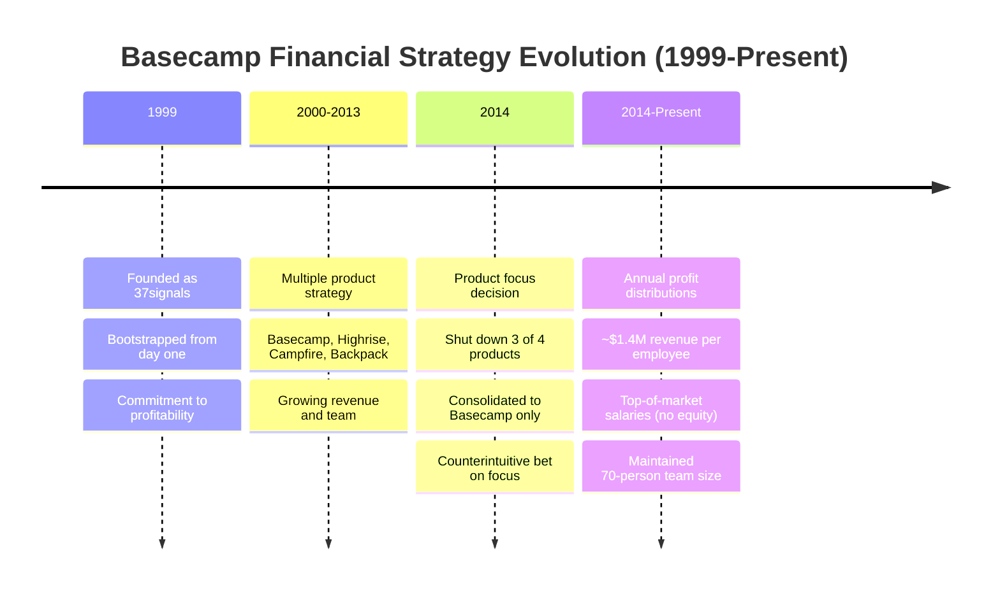
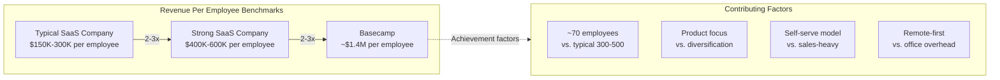
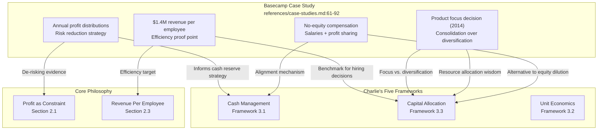
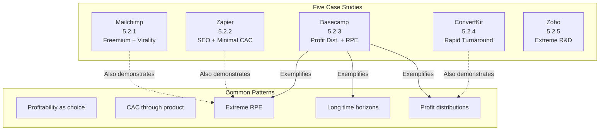

<!-- source: DeepWiki mcp.deepwiki.com · repo EveryInc/charlie-cfo-skill · extra page Basecamp: 25+ Years of Profitable Growth · fetched 2026-10-26 -->

# Basecamp: 25+ Years of Profitable Growth

<details>
<summary>Relevant source files</summary>

The following files were used as context for generating this wiki page:

- [references/case-studies.md](references/case-studies.md)

</details>


## Purpose and Scope

This page documents the Basecamp (formerly 37signals) case study as referenced in Charlie's knowledge base. Basecamp represents one of the most enduring examples of bootstrapped profitability, operating for 25+ years without external funding while distributing profits annually. This case study is used by Charlie to illustrate sustainable capital discipline, extreme efficiency (revenue per employee), and the counterintuitive value of focus over diversification.

For other bootstrapped company case studies, see:
- [Mailchimp](#5.2.1) - Freemium strategy and viral growth
- [Zapier](#5.2.2) - Near-zero CAC through SEO
- [ConvertKit](#5.2.4) - Rapid margin turnaround
- [Zoho](#5.2.5) - Extreme R&D investment
- [Common Patterns](#5.2.6) - Synthesized lessons across all cases

For how Charlie uses these case studies in advice generation, see [Knowledge Base Architecture](#6.2).

**Sources:** [references/case-studies.md:61-92]()

---

## Company Overview

Basecamp (formerly known as 37signals) is documented in Charlie's case study reference as a long-term bootstrapped success story. The company has maintained profitability since its founding without ever accepting external capital.

### Core Metrics

| Metric | Value | Significance |
|--------|-------|--------------|
| **Founded** | 1999 | 25+ years of continuous operation |
| **Annual Recurring Revenue** | ~$100M | Achieved without external funding |
| **Employee Count** | ~70 | Exceptionally lean for revenue scale |
| **Revenue Per Employee** | ~$1.4M | Among highest in software industry |
| **External Funding** | $0 | Zero capital raised across entire lifecycle |
| **Product Count** | 1 (after 2014 consolidation) | Reduced from 4 products to focus strategy |

**Sources:** [references/case-studies.md:63-66]()

---

## Key Financial Decisions Timeline

The Basecamp case study documents four major financial strategies that define their approach:



**Sources:** [references/case-studies.md:61-92]()

---

## Financial Strategy Details

### 1. Annual Profit Distributions

Basecamp's most distinctive financial decision is taking profit distributions annually rather than continuously reinvesting all earnings back into the business.

**Rationale (from case study):**
> "Take profit off table annually rather than endlessly reinvesting. Reduces risk with each distribution. 'Companies that continuously reinvest everything keep adding risk.'"

**Implementation:**
- After covering operating expenses and reserves, distribute excess profit to owners
- Annual rhythm de-risks the business over time
- Creates optionality without requiring exit/acquisition

**Contrast with Venture-Backed Model:**
| Aspect | Basecamp Approach | Typical VC-Backed |
|--------|-------------------|-------------------|
| Profit Treatment | Distributed annually | Reinvested aggressively |
| Risk Profile | Decreases over time | Accumulates over time |
| Exit Pressure | None | Required for returns |
| Time Horizon | Indefinite | 7-10 years |

**Sources:** [references/case-studies.md:70-73]()

---

### 2. Extreme Revenue Per Employee

Basecamp achieves approximately **$1.4M in annual revenue per employee**, significantly above industry averages.

**Benchmark Comparison:**


**Charlie's Usage:** This metric is cited when advising on hiring decisions (see [Evaluating Hiring Decisions](#4.1)) as evidence that extreme efficiency is achievable with discipline.

**Sources:** [references/case-studies.md:75-77]()

---

### 3. Product Focus (2014 Decision)

In 2014, Basecamp made the counterintuitive decision to shut down 3 of their 4 products (Highrise, Campfire, Backpack) to focus exclusively on Basecamp.

**Decision Context:**
- All four products were profitable
- Conventional wisdom favored diversification
- Management overhead of multiple products was increasing

**Outcome:**
- Increased overall profitability
- Reduced complexity and support burden
- Improved product quality through focus

**Lesson for Charlie's Framework:** This decision informs Charlie's [Capital Allocation Framework](#3.3) guidance that focus can be more valuable than diversification, even when all options are individually profitable.

**Sources:** [references/case-studies.md:79-81]()

---

### 4. Compensation Philosophy

Basecamp's compensation structure deliberately avoids equity-based compensation:

| Component | Basecamp Approach | Reasoning |
|-----------|-------------------|-----------|
| **Base Salary** | Top-of-market for location-independent roles | Attract/retain talent without equity |
| **Equity** | None offered | Reduces pressure to exit |
| **Profit Sharing** | Yes (via annual distributions) | Aligns incentives without dilution |
| **Benefits** | Comprehensive | Part of total compensation package |

**Quote from case study:**
> "Pay top-of-market for location-independent roles. No equity, strong salaries + profit sharing. Reduces pressure to exit."

**Charlie's Application:** When founders ask about equity compensation structures, Charlie may cite this as an alternative model that maintains owner control while still sharing upside.

**Sources:** [references/case-studies.md:83-86]()

---

## Integration with Charlie's Frameworks

The Basecamp case study provides evidence and examples that inform multiple frameworks within Charlie's advice system:



**Sources:** [references/case-studies.md:61-92]()

---

## Charlie's Usage Patterns

Charlie references the Basecamp case study in specific advisory contexts. This section documents when and how the case study is cited.

### Citation Trigger Conditions

**Query Type 1: Hiring and Team Size Questions**
- User asks: "Should we hire another engineer?"
- Charlie calculates: Revenue per employee metric
- Cites Basecamp: "Basecamp achieves ~$1.4M per employee with 70 people supporting $100M ARR"
- Implication: Team can stay smaller than expected

**Query Type 2: Profit Distribution vs. Reinvestment**
- User asks: "Should we reinvest all profits or take distributions?"
- Charlie references: Annual distribution strategy
- Cites quote: "Companies that continuously reinvest everything keep adding risk"
- Guidance: De-risking through distributions is valid strategy

**Query Type 3: Product Focus vs. Diversification**
- User asks: "Should we build a second product?"
- Charlie contrasts: Basecamp shut down 3 profitable products in 2014
- Outcome: Increased profitability through focus
- Recommendation: Focus often beats diversification

**Query Type 4: Compensation Structure**
- User asks: "How should we structure equity compensation?"
- Charlie presents alternative: Basecamp's no-equity model
- Structure: Top-of-market salaries + profit sharing
- Benefit: Maintains ownership, reduces exit pressure

### Code-Level Integration

The case study content is stored as markdown text that Charlie's natural language processing accesses during advice generation:

```
File Location: references/case-studies.md
Basecamp Section: Lines 61-92
Structured Data Extractable:
  - Company name: "Basecamp (37signals)"
  - Founded: 1999
  - Revenue: ~$100M ARR
  - Employees: ~70
  - Revenue per employee: ~$1.4M
  - External funding: $0
  - Key decisions: 4 documented strategies
  - Lessons: 3 synthesized patterns
```

When Charlie processes a query, the NLP layer determines relevance to this case study based on:
1. Keyword matching (e.g., "profit distribution", "team size", "focus")
2. Framework activation (e.g., Capital Allocation Framework triggers Basecamp's hiring efficiency)
3. Metric comparison (e.g., user's revenue per employee vs. Basecamp's $1.4M benchmark)

**Sources:** [references/case-studies.md:61-92]()

---

## Extracted Lessons

The case study documentation concludes with three synthesized lessons that Charlie incorporates into its advisory logic:

### Lesson 1: Profit Distributions Reduce Risk Over Time

**Concept:** Taking money off the table annually creates a ratchet effect where downside risk decreases with each distribution while retaining upside optionality.

**Charlie's Application:** 
- Used in [Cash Management Framework](#3.1) when discussing reserve strategies
- Counters the "reinvest everything" mentality common in venture-backed thinking
- Provides optionality without requiring exit

### Lesson 2: Focus Beats Diversification

**Concept:** Even when multiple products are individually profitable, consolidating to one can increase overall profitability and product quality.

**Charlie's Application:**
- Informs [Capital Allocation Framework](#3.3) advice on new product investments
- Used when founders ask about expanding product lines
- Challenges assumption that more products = more value

### Lesson 3: High Revenue Per Employee is Achievable with Discipline

**Concept:** $1.4M per employee proves that extreme efficiency is possible, not just aspirational. Requires saying no to easy hiring decisions.

**Charlie's Application:**
- Sets benchmark in [Revenue Per Employee](#2.3) philosophy section
- Used in [Evaluating Hiring Decisions](#4.1) to challenge headcount growth
- Evidence that small teams can build massive value

**Sources:** [references/case-studies.md:88-91]()

---

## Relationship to Other Case Studies

Basecamp is one of five detailed case studies in Charlie's knowledge base. The cross-references provide context:



**Basecamp's Unique Contributions:**
- **Longest timeline:** 25+ years vs. 20 years (Mailchimp), 10+ years (others)
- **Highest RPE:** $1.4M vs. $400K-800K range for others
- **Most explicit profit distribution:** Annual rhythm documented as core strategy
- **Product consolidation:** Only case with documented reduction from 4→1 products

**Sources:** [references/case-studies.md:61-92](), [references/case-studies.md:160-183]()

---

## Conclusion

The Basecamp case study serves as Charlie's primary reference for:
1. **Long-term sustainability** - Proof that bootstrapped companies can operate indefinitely at scale
2. **Efficiency benchmarks** - $1.4M revenue per employee as aspirational target
3. **Risk management** - Annual profit distributions as de-risking strategy
4. **Strategic focus** - Counterintuitive value of consolidation over diversification

Charlie cites this case study when founders need evidence that patience, discipline, and focus can build enduring value without external funding or exit pressure. The 25+ year track record provides credibility for Charlie's profit-as-constraint philosophy.

**Sources:** [references/case-studies.md:61-92]()

---

