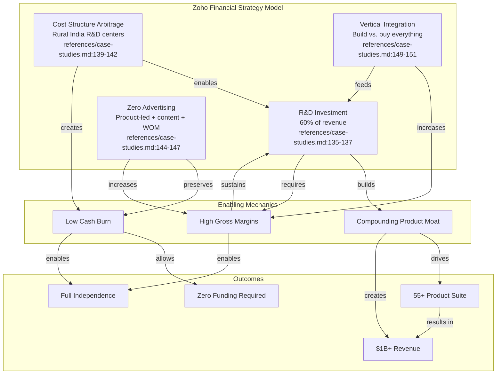
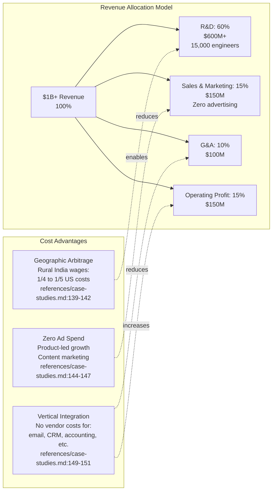
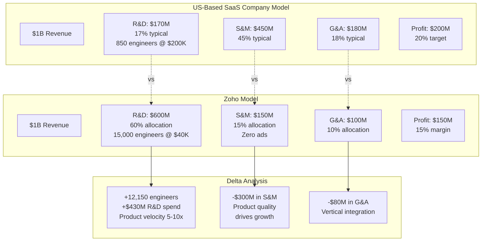
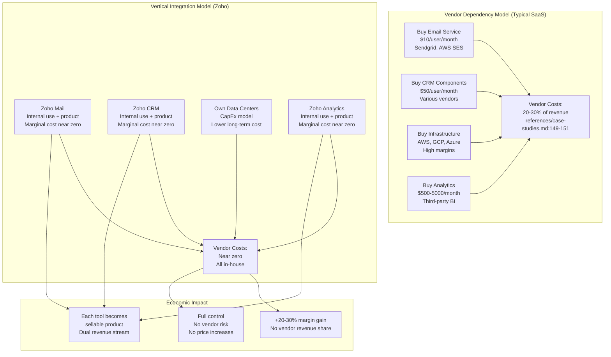
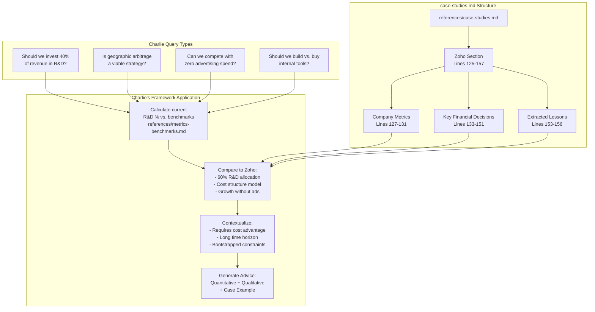
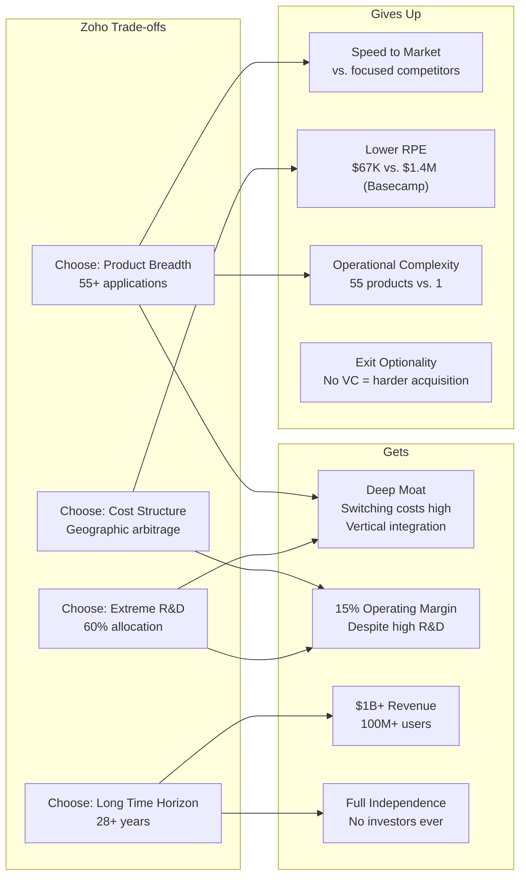

<!-- source: DeepWiki mcp.deepwiki.com · repo EveryInc/charlie-cfo-skill · extra page Zoho: $1B+ Revenue on Zero Funding · fetched 2026-10-26 -->

# Zoho: $1B+ Revenue on Zero Funding

<details>
<summary>Relevant source files</summary>

The following files were used as context for generating this wiki page:

- [references/case-studies.md](references/case-studies.md)

</details>


## Purpose and Scope

This page documents the Zoho case study as stored in Charlie's reference knowledge base at [references/case-studies.md:125-157](). The case study analyzes Zoho Corporation's unconventional path to $1B+ in revenue without any external funding, focusing on their 60% R&D investment strategy, geographic cost arbitrage, zero advertising approach, and vertical integration model. This case demonstrates that massive reinvestment in product development is sustainable under bootstrapped constraints when combined with structural cost advantages.

For other bootstrapped case studies, see: Mailchimp ([5.2.1](#5.2.1)), Zapier ([5.2.2](#5.2.2)), Basecamp ([5.2.3](#5.2.3)), ConvertKit ([5.2.4](#5.2.4)). For synthesized patterns across all cases, see [5.2.6](#5.2.6).

**Sources:** [references/case-studies.md:125-157]()

---

## Company Profile and Timeline

Zoho represents an extreme outlier in both scale and approach—achieving $1B+ revenue with zero external capital while violating conventional wisdom on focus, spending ratios, and geographic strategy.

| Metric | Value | Context |
|--------|-------|---------|
| **Founded** | 1996 | 28+ years bootstrapped |
| **Revenue** | $1B+ (estimated) | Largest fully bootstrapped SaaS company |
| **Products** | 55+ integrated applications | Suite spans CRM, email, accounting, HR, BI, etc. |
| **Users** | 100M+ | Global customer base |
| **Funding** | $0 external capital | Never raised VC, PE, or debt |
| **R&D Investment** | 60% of revenue | 3.5x SaaS industry average (17%) |
| **Advertising Spend** | $0 | Zero paid acquisition budget |
| **Employees** | ~15,000 | Primarily in R&D centers in rural India |

**Sources:** [references/case-studies.md:125-132]()

---

## Strategic Financial Decisions Architecture

### Financial Decision Framework

The following diagram maps Zoho's four core financial strategies and their interdependencies as documented in Charlie's knowledge base:



**Sources:** [references/case-studies.md:133-151]()

---

## R&D Investment Strategy: 60% Allocation

### Investment Ratio Analysis

Zoho's defining characteristic is allocating 60% of revenue to R&D—3.5x the SaaS industry average of 17%. This extreme allocation is documented at [references/case-studies.md:135-137]() and represents a conscious trade-off enabled by structural cost advantages.

| Category | Zoho | SaaS Industry Average | Delta |
|----------|------|----------------------|-------|
| **R&D % of Revenue** | 60% | 17% | +252% |
| **Sales & Marketing** | ~15% | 40-50% | -65% |
| **G&A** | ~10% | 15-20% | -40% |
| **Operating Margin** | ~15% | 5-15% | Competitive |

### Why 60% R&D is Sustainable

The following diagram illustrates how Zoho's cost structure enables extreme R&D investment while maintaining profitability:



**Formula from Charlie's Framework:**

If a company at typical US cost structure tried to allocate 60% to R&D:
- R&D: 60% × $1B = $600M at US wages → 3,000 engineers @ $200K fully loaded
- Sales & Marketing: 40% × $1B = $400M
- **Total: 100% → No profit**

Zoho's actual structure with geographic arbitrage:
- R&D: 60% × $1B = $600M at India wages → 15,000 engineers @ $40K fully loaded
- Sales & Marketing: 15% × $1B = $150M (product-led, no ads)
- G&A: 10% × $1B = $100M (vertical integration reduces vendor costs)
- **Operating Margin: 15% = $150M profit**

**Sources:** [references/case-studies.md:135-142]()

---

## Geographic Cost Arbitrage Model

### Implementation at File Level

The geographic arbitrage strategy is documented at [references/case-studies.md:139-142]() and represents a structural cost advantage rather than a one-time optimization.

| Component | Strategy | Financial Impact |
|-----------|----------|------------------|
| **R&D Centers** | Located in rural India (not just Bangalore) | Engineer costs: $40K vs. $200K US fully loaded |
| **Talent Pipeline** | Invests in local communities, creates sustainable recruiting | Retention higher than urban centers |
| **Wage Arbitrage** | 1/4 to 1/5 US costs | $600M buys 15,000 engineers vs. 3,000 |
| **Community Investment** | Infrastructure, education in rural areas | Long-term cost advantage + social impact |

### Cost Structure Comparison



**Sources:** [references/case-studies.md:139-142]()

---

## Zero Advertising Strategy

### Customer Acquisition Model

Zoho's growth strategy, documented at [references/case-studies.md:144-147](), achieves near-zero CAC through three mechanisms that compound over time rather than require continuous spend.

| Acquisition Channel | Mechanism | CAC Profile | Scalability |
|---------------------|-----------|-------------|-------------|
| **Product-Led Growth** | Free trials, freemium tiers, integrated suite | One-time setup cost, then marginal | Compounds with product breadth |
| **Content Marketing** | Educational content, SEO, domain authority | Content creation cost, then evergreen | Compounds with time |
| **Word of Mouth** | Customer referrals, integrations ecosystem | Zero direct cost | Compounds with user base |

### CAC Comparison Model

While exact CAC figures are not disclosed in [references/case-studies.md:144-147](), the allocation comparison reveals the magnitude:

**Typical SaaS CAC Math:**
- Sales & Marketing: 45% of revenue = $450M at $1B scale
- New ARR: ~$300M (30% growth at $1B base)
- **Blended CAC: $450M / $300M = $1.50 per $1 of new ARR**

**Zoho's Implied Model:**
- Sales & Marketing: 15% of revenue = $150M at $1B scale
- New ARR: ~$300M (estimated similar growth)
- **Blended CAC: $150M / $300M = $0.50 per $1 of new ARR**
- **3x more efficient than typical SaaS**

This efficiency gap allows Zoho to redirect $300M annually into R&D rather than customer acquisition.

**Sources:** [references/case-studies.md:144-147]()

---

## Vertical Integration Strategy

### Build vs. Buy Economics

Zoho's vertical integration approach, documented at [references/case-studies.md:149-151](), inverts conventional SaaS playbook advice to "focus on core competency and buy everything else."

**Products Built In-House (Partial List):**
- **Zoho CRM** - Customer relationship management
- **Zoho Mail** - Email hosting and management
- **Zoho Books** - Accounting and invoicing
- **Zoho People** - HR management system
- **Zoho Analytics** - Business intelligence platform
- **Zoho Creator** - Low-code application platform
- **Zoho Desk** - Customer support software
- **55+ total applications** in integrated suite

### Economic Rationale



**Long-Term Margin Math:**

Year 1-3 (Investment Phase):
- Higher R&D costs to build tools
- Lower margins temporarily
- But: No ongoing vendor payments

Year 4+ (Payback Phase):
- Marginal cost near zero for internal use
- Each tool sellable as product
- 20-30% margin advantage vs. competitors
- Compounding advantage over decades

This strategy requires long time horizons—impossible with VC-backed quarterly pressure.

**Sources:** [references/case-studies.md:149-151]()

---

## Integration with Charlie's Decision Framework

### Knowledge Base References

The Zoho case study at [references/case-studies.md:125-157]() is referenced by Charlie in specific decision contexts. The following diagram maps how this case data flows into Charlie's advice generation:



**Sources:** [references/case-studies.md:125-157]()

---

## Key Lessons and Pattern Extraction

### Synthesized Lessons from File

The lessons documented at [references/case-studies.md:153-156]() extract three core principles:

| Lesson | Mechanism | Applicability Constraints |
|--------|-----------|---------------------------|
| **Massive R&D investment sustainable when bootstrapped** | Geographic arbitrage + zero ads + vertical integration = 60% to R&D with 15% margins | Requires: (1) Cost structure advantage (2) Product-led growth (3) Long time horizon (4) No investor pressure |
| **Geographic arbitrage for sustainable cost advantage** | 1/4 to 1/5 wage costs → 4-5x engineer headcount at same spend | Requires: (1) Remote-capable work (2) Talent availability in low-cost regions (3) Management systems for distributed teams |
| **Product breadth can be moat** | 55+ integrated products create switching costs and cross-sell | Counterpoint to VC advice: "Focus wins." True IF: (1) Resources to maintain quality (2) Integration creates value (3) Not competing on speed-to-market |

### When Charlie Cites Zoho

Charlie references Zoho in the following decision contexts:

1. **High R&D Allocation Questions**
   - User asks: "Can we afford 40% R&D spend?"
   - Charlie calculates user's unit economics
   - If LTV:CAC ≥ 3:1 and payback < 12 months: Cites Zoho's 60% as proof extreme R&D is viable with right cost structure
   - If metrics don't support: Warns that high R&D requires either external funding or cost advantages

2. **Build vs. Buy Decisions**
   - User asks: "Should we build our own CRM?"
   - Charlie evaluates: (1) Strategic importance (2) Differentiation potential (3) Long-term costs
   - Cites Zoho vertical integration: Works if (a) tool becomes sellable product or (b) vendor lock-in risk high

3. **Geographic Strategy**
   - User asks: "Should we hire offshore?"
   - Charlie evaluates: Cost savings vs. coordination costs
   - Cites Zoho model: Not just offshore, but building entire R&D culture in low-cost region

4. **Zero Advertising Viability**
   - User asks: "Can we grow without paid ads?"
   - Charlie checks: Product-led growth potential, SEO strategy, integration ecosystem
   - Cites Zoho: $1B+ with $0 ads, but required 28 years and product excellence

**Sources:** [references/case-studies.md:153-156]()

---

## Comparative Analysis with Other Case Studies

### Cross-Case Pattern Recognition

The following table compares Zoho's strategy against other bootstrapped cases in [references/case-studies.md](). Charlie uses these comparisons to identify which patterns apply to a specific user's situation.

| Dimension | Zoho | Mailchimp | Zapier | Basecamp | ConvertKit |
|-----------|------|-----------|--------|----------|------------|
| **R&D % of Revenue** | 60% | ~25% | ~30% | ~40% | ~20% |
| **CAC Strategy** | Product-led + content | Freemium + viral loops | Programmatic SEO | Word of mouth | Direct sales + product-led |
| **Geographic Arbitrage** | Yes (rural India) | No (US-based) | Yes (fully remote) | Yes (location-independent) | No (US-focused) |
| **Product Strategy** | 55+ suite (breadth) | Single product (focus) | Single product (focus) | Single product (focus) | Single product (focus) |
| **Time to $100M ARR** | ~20 years | ~15 years | ~9 years | ~25 years | Not disclosed |
| **Revenue Per Employee** | ~$67K | ~$250K | ~$450K | ~$1.4M | Unknown |

### Strategic Trade-offs Analysis



**Key Insight from Charlie's Pattern Extraction:**

Zoho's strategy is an **existence proof** that conventional rules (focus, high RPE, speed-to-market) are not universal requirements. However, it requires:
1. **Structural cost advantage** (can't replicate at US wage scale)
2. **Infinite time horizon** (28 years to $1B, most founders can't wait)
3. **Acceptance of complexity** (55 products vs. singular focus)
4. **No exit pressure** (VC-backed companies can't do this)

Charlie uses Zoho to counter dogmatic advice ("you MUST focus on one product") but also warns about applicability constraints.

**Sources:** [references/case-studies.md:125-183]()

---

## Application Guidelines for Founders

### When to Reference Zoho in Decision-Making

Charlie's logic for citing Zoho (implemented via pattern matching in the case studies file):

**✅ Cite Zoho When:**
1. Founder has access to geographic cost arbitrage (offshore teams, low-cost markets)
2. Considering high R&D investment (>30% of revenue)
3. Evaluating build vs. buy for strategic tools
4. Questioning whether product-led growth can replace paid ads
5. Has long time horizon (10+ years) and no exit pressure

**❌ Don't Cite Zoho When:**
1. Founder needs rapid growth (3-5 year timeline to exit)
2. No structural cost advantage available
3. Optimizing for revenue per employee (Zoho's is low at $67K)
4. Single-product focus is strategic (most cases)
5. Complexity would overwhelm current team

### Decision Framework: R&D Investment Level

When a founder asks "How much should we invest in R&D?", Charlie combines quantitative benchmarks from [references/metrics-benchmarks.md]() with qualitative case examples:

**Standard Benchmark (from metrics-benchmarks.md):**
- Early-stage ($1-3M ARR): 30-40% R&D
- Growth-stage ($3-10M ARR): 25-35% R&D
- Scale-stage ($10M+ ARR): 20-25% R&D

**Zoho Exception Case:**
- All stages: 60% R&D
- Enabled by: 75-80% cost reduction via geographic arbitrage
- Enabled by: Zero ad spend (product-led growth)
- Enabled by: Vertical integration reducing vendor costs

**Charlie's Decision Logic:**
```
IF user_rd_percent > benchmark_rd_percent THEN
  CALCULATE cost_advantage = user_wages / market_avg_wages
  CALCULATE cac_efficiency = user_cac / market_avg_cac
  
  IF cost_advantage < 0.5 OR cac_efficiency < 0.5 THEN
    CITE Zoho case
    EXPLAIN "Zoho sustains 60% R&D via 75-80% cost advantage"
    RECOMMEND "Consider geographic arbitrage or restructure cost base"
  ELSE
    WARN "High R&D without cost advantage risks cash burn"
    RECOMMEND "Align R&D with stage benchmarks"
  END IF
END IF
```

**Sources:** [references/case-studies.md:135-156](), [references/metrics-benchmarks.md]()

---

## Limitations and Counterexamples

### What Zoho Does NOT Prove

The case study file at [references/case-studies.md]() documents success patterns, but Charlie must also interpret what each case does NOT prove to avoid misapplication.

**Zoho Does NOT Prove:**

1. **Product Breadth Always Wins**
   - Basecamp achieved $100M ARR with ONE product and $1.4M RPE
   - Zapier achieved $5B valuation with ONE product and $450K RPE
   - Breadth worked for Zoho because: (a) cost structure supported it, (b) integrated suite created network effects
   - **Default advice remains: Focus until proven otherwise**

2. **High R&D Guarantees Success**
   - Many companies spend 60%+ on R&D and fail
   - Zoho's success required: product-market fit + execution + time
   - **R&D % is input, not outcome**

3. **Geographic Arbitrage is Risk-Free**
   - Coordination costs increase with distribution
   - Cultural integration challenges
   - Talent retention in remote locations
   - **Trade-offs exist, not just benefits**

4. **Zero Advertising is Universal Strategy**
   - Zoho had 28 years to build brand and product
   - Network effects and integrations create moat
   - Many markets require paid acquisition to compete
   - **Product quality must be exceptional for zero-ad strategy**

### When Other Cases Provide Better Guidance

| User Situation | Better Reference Case | Reason |
|----------------|----------------------|--------|
| Need rapid growth (3-5 years) | Zapier ([5.2.2](#5.2.2)) | Programmatic SEO achieved faster growth |
| Optimizing for RPE | Basecamp ([5.2.3](#5.2.3)) | $1.4M RPE vs. Zoho's $67K |
| Crisis/turnaround situation | ConvertKit ([5.2.4](#5.2.4)) | 51% margins in 5 months |
| Freemium strategy | Mailchimp ([5.2.1](#5.2.1)) | Freemium drove 650% profit increase |

**Sources:** [references/case-studies.md:1-183]()

---

## File Structure and Maintenance

### Case Study Data Model in case-studies.md

The Zoho case follows a standardized structure at [references/case-studies.md:125-157]():

```
## [Company Name] — [Key Achievement]

**[Fact 1]:** [Value]
**[Fact 2]:** [Value]
...

### Key Financial Decisions

**[Decision 1]:** [Details]
- [Metric/Outcome 1]
- [Metric/Outcome 2]

**[Decision 2]:** [Details]
...

### Lessons
- [Lesson 1]
- [Lesson 2]
...
```

### Content Location Map

| Content Type | File Location | Purpose in Charlie's Logic |
|--------------|---------------|----------------------------|
| Company metrics | [references/case-studies.md:127-131]() | Quantitative context for comparisons |
| R&D strategy | [references/case-studies.md:135-137]() | Cited when evaluating R&D investment levels |
| Geographic arbitrage | [references/case-studies.md:139-142]() | Cited when discussing offshore/remote strategies |
| Zero advertising | [references/case-studies.md:144-147]() | Cited when evaluating CAC reduction strategies |
| Vertical integration | [references/case-studies.md:149-151]() | Cited for build vs. buy decisions |
| Synthesized lessons | [references/case-studies.md:153-156]() | High-level pattern extraction |

### Cross-Reference to Common Patterns

Zoho contributes to the following common patterns synthesized at [references/case-studies.md:160-183]():

1. **Profitability is a choice, not a destination** (line 162)
   - Zoho: 15% margins while investing 60% in R&D

2. **CAC efficiency through product, not paid acquisition** (line 166)
   - Zoho: $0 advertising, all product-led + content

3. **Long time horizons** (line 174)
   - Zoho: 28+ years, patience enables compounding

4. **Profit distribution, not endless reinvestment** (line 180)
   - Zoho: Counter-example—does NOT distribute profits
   - Reinvests all into R&D and expansion
   - Shows multiple paths exist within bootstrapped model

**Sources:** [references/case-studies.md:125-183]()

---

## Summary: Zoho's Role in Charlie's Knowledge Architecture

The Zoho case study at [references/case-studies.md:125-157]() serves specific functions in Charlie's decision framework:

1. **Existence Proof:** Demonstrates $1B+ scale achievable without funding
2. **Counter-Dogma:** Challenges "focus" and "high RPE" as universal rules
3. **Strategy Template:** Provides blueprint for extreme R&D + low CAC model
4. **Constraint Identification:** Illustrates what enablers are required (cost advantage, time horizon)
5. **Trade-offs Illustration:** Shows what's sacrificed (speed, RPE, simplicity) for breadth and independence

When Charlie cites Zoho, it's typically to:
- Validate unconventional strategies (high R&D%, zero ads, product breadth)
- Provide context for long time horizons (28 years is acceptable for right goals)
- Explain structural requirements (can't replicate without cost advantage)
- Counter blanket advice ("you MUST focus") with nuanced alternatives

For founders evaluating similar strategies, see the comparative analysis in [5.2.6](#5.2.6) Common Patterns Across Bootstrapped Success.

**Sources:** [references/case-studies.md:125-183]()

---

