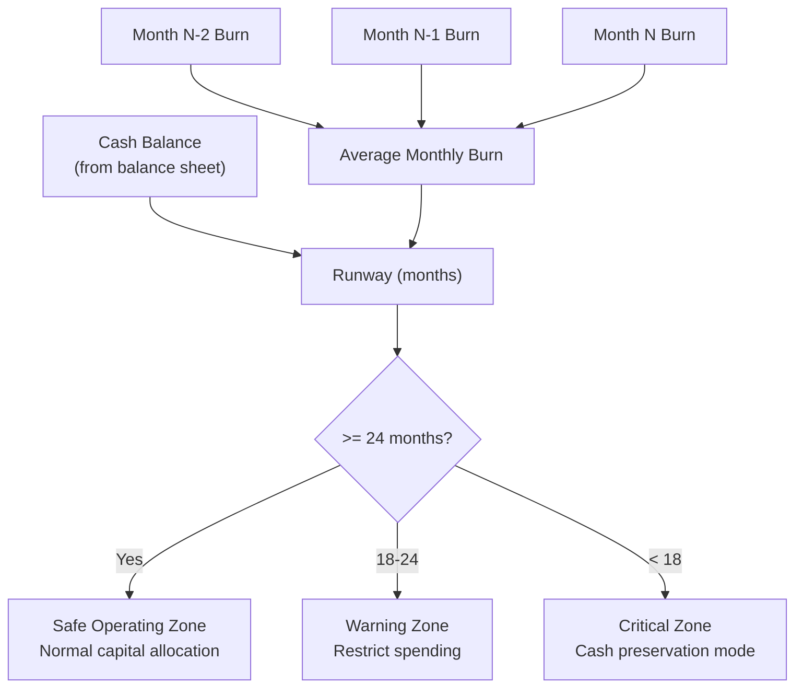
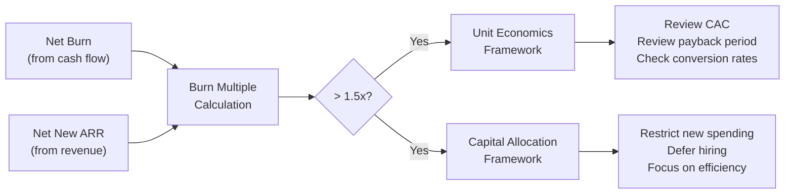
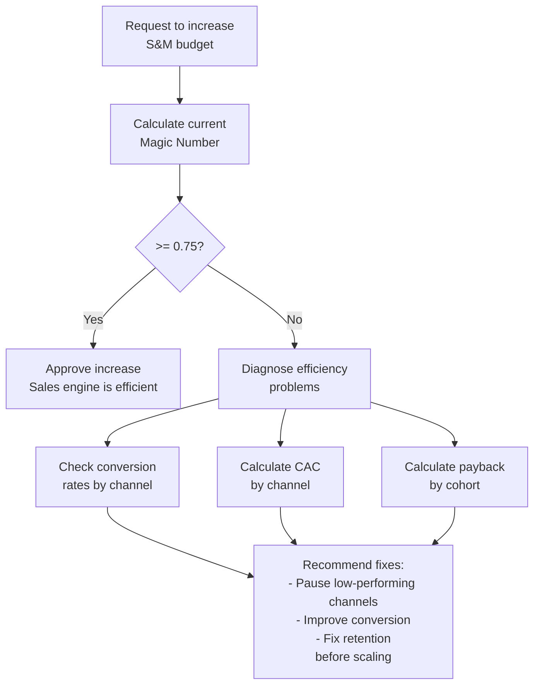
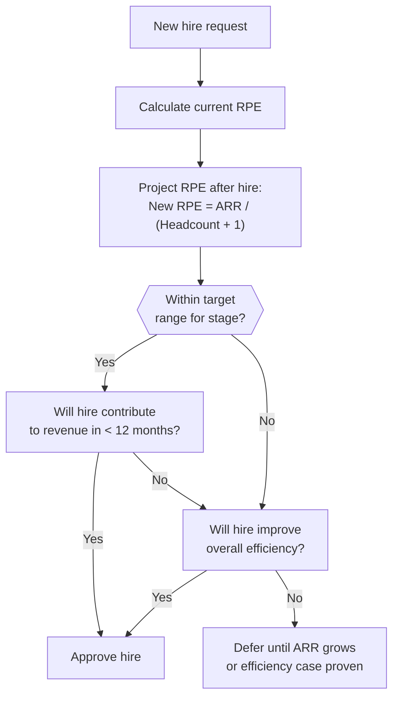
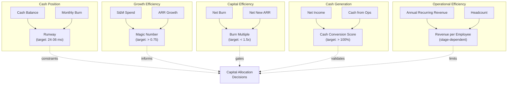

<!-- source: DeepWiki mcp.deepwiki.com · repo EveryInc/charlie-cfo-skill · extra page Cash Flow and Efficiency Metrics · fetched 2026-10-26 -->

# Cash Flow and Efficiency Metrics

<details>
<summary>Relevant source files</summary>

The following files were used as context for generating this wiki page:

- [references/metrics-benchmarks.md](references/metrics-benchmarks.md)

</details>


## Purpose and Scope

This document provides detailed calculation formulas, benchmarks, and interpretation guidance for cash flow and operational efficiency metrics that Charlie uses to assess startup financial health. These metrics focus on liquidity management and capital efficiency rather than unit economics or customer-level metrics.

**Covered in this document:**
- Runway calculations and cash burn analysis
- Burn Multiple as a growth efficiency measure
- Cash Conversion Score for operational cash generation
- Magic Number for sales efficiency assessment
- Revenue per Employee as an operational efficiency scorecard

**For related metrics, see:**
- Unit economics (LTV, CAC, payback) → [5.1.1](#5.1.1)
- SaaS-specific metrics (churn, NRR) → [5.1.2](#5.1.2)
- Working capital metrics (DSO, DPO, CCC) → [5.1.4](#5.1.4)

---

## Runway Calculation

### Formula and Methodology

Runway measures how many months a company can continue operating before depleting its cash reserves:

```
Runway (months) = Cash Balance / Monthly Burn Rate
```

**Best Practice:** Use the trailing 3-month average burn rate rather than a single month to smooth out seasonal variations and one-time expenses.

**Example Calculation:**
```
Cash Balance: $600,000
Month 1 Burn: $45,000
Month 2 Burn: $52,000
Month 3 Burn: $48,000
Average Monthly Burn: ($45k + $52k + $48k) / 3 = $48,333

Runway = $600,000 / $48,333 = 12.4 months
```

Sources: [references/metrics-benchmarks.md:66-70]()

### Target Thresholds and Decision Gates

Charlie enforces runway requirements as hard constraints in decision-making:

| Runway Range | Charlie's Interpretation | Decision Impact |
|--------------|-------------------------|-----------------|
| < 12 months | **Critical** | Blocks all non-essential spending, triggers cash preservation mode |
| 12-18 months | **Warning** | Restricts hiring, requires ROI justification for all investments |
| 18-24 months | **Minimum Acceptable** | Standard operating mode with capital discipline |
| 24-36 months | **Target Range** | Comfortable for strategic investments |
| > 36 months | **Excess Cushion** | May indicate underinvestment in growth |

The 24-36 month target aligns with Charlie's core philosophy that bootstrapped companies should prioritize survival over hypergrowth.

### Runway Calculation Flow



Sources: [references/metrics-benchmarks.md:66-70]()

---

## Burn Multiple

### Definition and Formula

The Burn Multiple measures how efficiently a company converts cash burn into ARR growth. Lower values indicate better capital efficiency:

```
Burn Multiple = Net Burn / Net New ARR
```

**Components:**
- **Net Burn:** Total cash spent minus revenue collected in the period (typically quarterly)
- **Net New ARR:** New annual recurring revenue added in the same period (new bookings - churn)

**Example:**
```
Q1 Net Burn: $150,000
Q1 Net New ARR: $120,000

Burn Multiple = $150,000 / $120,000 = 1.25x
```

This means the company spent $1.25 to acquire $1 of ARR.

Sources: [references/metrics-benchmarks.md:72-81]()

### Interpretation and Rating Scale

| Burn Multiple | Rating | Charlie's Guidance |
|---------------|--------|-------------------|
| < 1x | **Excellent** | Highly capital efficient, generating ARR faster than burning cash |
| 1.0 - 1.5x | **Good** | Acceptable efficiency, sustainable growth model |
| 1.5 - 2.0x | **Concerning** | Requires investigation, may need to improve unit economics |
| > 2.0x | **Inefficient** | Requires immediate correction, growth is too expensive |

**Key Insight:** Bootstrapped companies should target < 1.5x consistently. Values > 2x indicate the growth model is unsustainable without external funding.

### Burn Multiple in Framework Integration



When Burn Multiple exceeds 1.5x, Charlie automatically cross-references the Unit Economics Framework to diagnose whether the problem stems from high CAC, low conversion, or poor retention.

Sources: [references/metrics-benchmarks.md:72-81]()

---

## Cash Conversion Score

### Formula and Measurement

The Cash Conversion Score (CCS) measures how efficiently a company converts accounting profit into actual cash:

```
CCS = (Cash from Operations / Net Income) × 100
```

**Target:** > 100%, indicating the company generates more cash than accounting profit.

**Why This Matters:**
- Accounting profit includes non-cash items (depreciation, amortization)
- Cash from operations reflects actual cash generation after working capital changes
- A score > 100% means the business has favorable working capital dynamics

**Example:**
```
Net Income (accounting): $80,000
Cash from Operations: $95,000

CCS = ($95,000 / $80,000) × 100 = 118.75%
```

This company converts each dollar of accounting profit into $1.19 of operating cash, indicating efficient working capital management.

Sources: [references/metrics-benchmarks.md:83-87]()

### Interpretation Matrix

| CCS Range | Interpretation | Common Causes |
|-----------|----------------|---------------|
| > 120% | **Excellent** | Annual prepayments, tight AR collection, extended AP |
| 100-120% | **Good** | Healthy cash generation, standard working capital |
| 80-100% | **Acceptable** | Slight working capital drag, monitor AR/AP |
| 50-80% | **Concerning** | Significant working capital issues or revenue recognition timing |
| < 50% | **Problem** | Severe cash collection issues or premature revenue recognition |

**Bootstrap Context:** Charlie emphasizes CCS heavily because bootstrapped companies cannot rely on funding to paper over cash collection inefficiencies.

Sources: [references/metrics-benchmarks.md:83-87]()

---

## Magic Number (Sales Efficiency)

### Definition and Calculation

The Magic Number quantifies sales and marketing efficiency by measuring how much ARR growth is generated per dollar of S&M spend:

```
Magic Number = (Quarter-over-Quarter ARR Growth) / (Prior Quarter S&M Spend)
```

**Example:**
```
Q1 S&M Spend: $60,000
Q2 ARR Growth: $48,000 (Q2 ARR - Q1 ARR)

Magic Number = $48,000 / $60,000 = 0.8
```

This means the company generated $0.80 of new ARR for every $1.00 spent on sales and marketing.

Sources: [references/metrics-benchmarks.md:91-100]()

### Scoring and Action Framework

| Magic Number | Interpretation | Charlie's Recommendation |
|--------------|----------------|-------------------------|
| < 0.5 | **Inefficient** | Reduce S&M spend or improve conversion rates before scaling |
| 0.5 - 0.75 | **Acceptable** | Maintain current spend levels, optimize where possible |
| 0.75 - 1.0 | **Good** | Solid efficiency, can consider modest spend increases |
| > 1.0 | **Excellent** | High efficiency, may justify increasing S&M investment |

**Critical Decision Gate:** Charlie will block requests to increase S&M spending if Magic Number < 0.75 unless the requester can demonstrate specific improvements that will raise efficiency.

### Magic Number Decision Tree



Sources: [references/metrics-benchmarks.md:91-100]()

### Relationship to Unit Economics

The Magic Number is complementary to LTV:CAC but operates on a different timescale:

| Metric | Timescale | What It Measures |
|--------|-----------|------------------|
| **Magic Number** | Quarterly | Short-term sales efficiency and ROI on current spend |
| **LTV:CAC** | Customer lifetime | Long-term unit economics and total customer value |

A company can have a good Magic Number (efficient at acquiring customers) but poor LTV:CAC (customers don't stay long enough or generate enough revenue). Charlie requires both metrics to be healthy.

Sources: [references/metrics-benchmarks.md:91-100]()

---

## Revenue Per Employee (RPE)

### Benchmarks by ARR Stage

Revenue per Employee serves as Charlie's primary operational efficiency scorecard:

| ARR Stage | Target RPE | Typical Headcount |
|-----------|------------|-------------------|
| $1-5M | $110K-150K | 9-45 employees |
| $5-10M | $150K-200K | 25-67 employees |
| $10-50M | $200K-250K | 40-250 employees |
| $50M+ | $300K-400K+ | 125+ employees |

**Key Observation:** Bootstrapped companies typically achieve 40-70% higher RPE than VC-backed companies at the same stage because capital constraints force efficiency.

Sources: [references/metrics-benchmarks.md:102-110]()

### Calculation and Usage

```
Revenue per Employee = Annual Recurring Revenue / Total Headcount
```

**What to include in headcount:**
- Full-time employees
- Part-time employees (pro-rated)
- Contractors on retainer (exclude one-off contractors)

**Example:**
```
ARR: $3,000,000
Full-time: 18 employees
Part-time: 2 employees (0.5 FTE each)
Total Headcount: 18 + 1 = 19

RPE = $3,000,000 / 19 = $157,894
```

This company is in the $1-5M ARR range with an RPE of $158K, which is at the high end of the target range—indicating good efficiency.

Sources: [references/metrics-benchmarks.md:102-110]()

### RPE in Hiring Decisions

Charlie integrates RPE into the hiring decision framework (see [4.1](#4.1)). When evaluating a hire:



If a hire would push RPE below the target range for the company's ARR stage, Charlie requires explicit justification showing either direct revenue contribution or measurable efficiency gains.

Sources: [references/metrics-benchmarks.md:102-110]()

### RPE vs Headcount Growth Philosophies

This table contrasts Charlie's RPE-focused philosophy with typical VC-backed growth models:

| Dimension | Charlie's Approach (RPE-focused) | VC-Backed Approach |
|-----------|--------------------------------|-------------------|
| **Hiring trigger** | Revenue justifies it OR efficiency gain proven | Funding round closed |
| **Target metric** | Maximize RPE within stage band | Maximize growth rate |
| **Typical RPE** | $200K-400K at $10M+ ARR | $100K-180K at $10M+ ARR |
| **Headcount philosophy** | Hire when it hurts (Zapier model) | Hire ahead of need |
| **Risk profile** | Minimizes burn, maximizes runway | Tolerates burn for growth |

This RPE emphasis is derived from Charlie Munger's capital discipline principles and validated by the bootstrapped case studies (Basecamp at $1.4M RPE, Zapier's "hire when it hurts" philosophy).

Sources: [references/metrics-benchmarks.md:102-110]()

---

## Integrated Metrics Dashboard

Charlie monitors these five metrics in an integrated view to assess overall financial health:



**Integration Logic:**
- **Runway** acts as a hard constraint—decisions that reduce runway below 24 months are blocked
- **Magic Number** gates S&M spending increases
- **Burn Multiple** triggers unit economics reviews when > 1.5x
- **Cash Conversion Score** validates that accounting profits translate to actual cash
- **RPE** sets efficiency bars for hiring decisions

Sources: [references/metrics-benchmarks.md:64-110]()

---

## Metric Relationships and Cross-References

### How These Metrics Connect to Charlie's Frameworks

| Metric | Primary Framework | Secondary Framework | Usage Pattern |
|--------|------------------|-------------------|---------------|
| **Runway** | Cash Management (3.1) | Capital Allocation (3.3) | Hard constraint in all decisions |
| **Burn Multiple** | Unit Economics (3.2) | Capital Allocation (3.3) | Efficiency gate for growth spending |
| **Cash Conversion Score** | Working Capital (3.4) | Cash Management (3.1) | Validates cash collection efficiency |
| **Magic Number** | Capital Allocation (3.3) | Unit Economics (3.2) | Gates S&M investment decisions |
| **Revenue per Employee** | Capital Allocation (3.3) | Core Philosophy (2.3) | Efficiency scorecard for hiring |

These metrics are not isolated data points—they form an integrated system where each metric informs and constrains decisions across multiple frameworks.

Sources: [references/metrics-benchmarks.md:64-110]()

---

## Calculation Best Practices

### Data Quality Requirements

For accurate metric calculation, Charlie requires:

1. **Runway:** 3-month trailing average of burn, not single month
2. **Burn Multiple:** Consistent time periods (quarterly recommended)
3. **Cash Conversion Score:** Use actual cash flow statement data, not estimates
4. **Magic Number:** Use prior quarter S&M spend (accounts for sales cycle lag)
5. **RPE:** Include all FTE-equivalent headcount, pro-rate part-timers

### Common Calculation Errors

| Metric | Common Error | Correct Approach |
|--------|--------------|------------------|
| Runway | Using single-month burn | Use 3-month trailing average |
| Burn Multiple | Mixing time periods | Ensure Net Burn and Net New ARR cover same period |
| Magic Number | Using same-quarter S&M | Use prior quarter S&M (lag effect) |
| RPE | Excluding contractors | Include retainer contractors, exclude one-off projects |
| CCS | Using estimated cash flow | Use actual cash flow statement data |

Sources: [references/metrics-benchmarks.md:64-110]()

---

## Summary: Metric Thresholds and Decision Gates

Charlie enforces these thresholds in automated decision-making:

| Metric | Threshold | Decision Impact |
|--------|-----------|-----------------|
| **Runway** | < 24 months | Blocks non-essential spending, triggers warnings |
| **Burn Multiple** | > 1.5x | Triggers unit economics review, restricts growth spend |
| **Cash Conversion Score** | < 100% | Flags working capital issues, initiates AR/AP review |
| **Magic Number** | < 0.75 | Blocks S&M budget increases until efficiency improves |
| **RPE** | Below stage band | Requires revenue/efficiency justification for new hires |

These are not soft guidelines—they are hard gates in Charlie's decision framework, enforced automatically when queries involve capital allocation or hiring decisions.

Sources: [references/metrics-benchmarks.md:64-110]()

---

