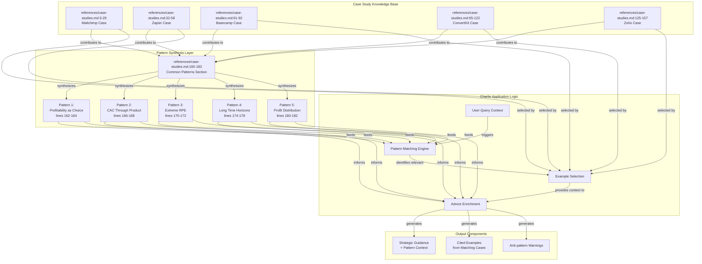
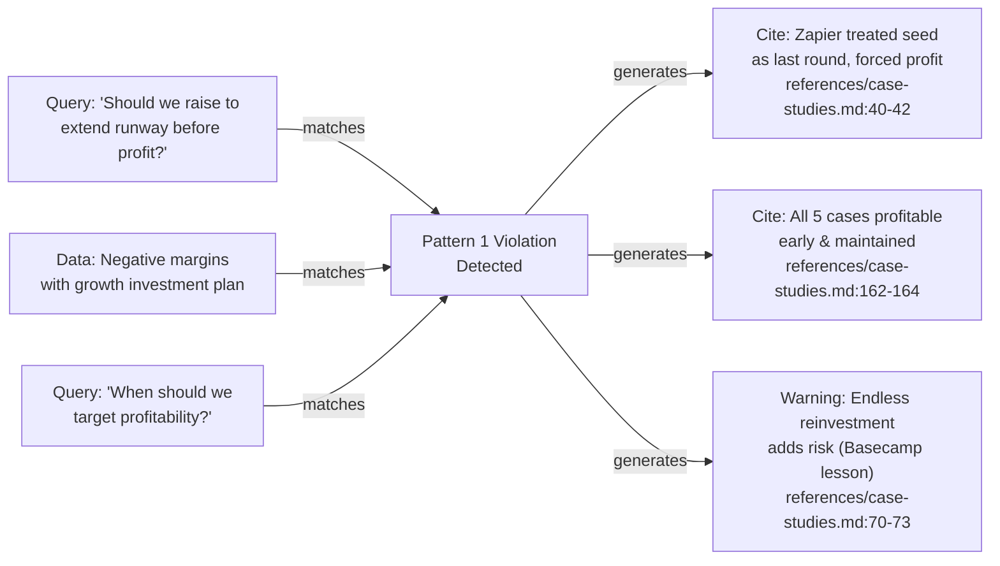
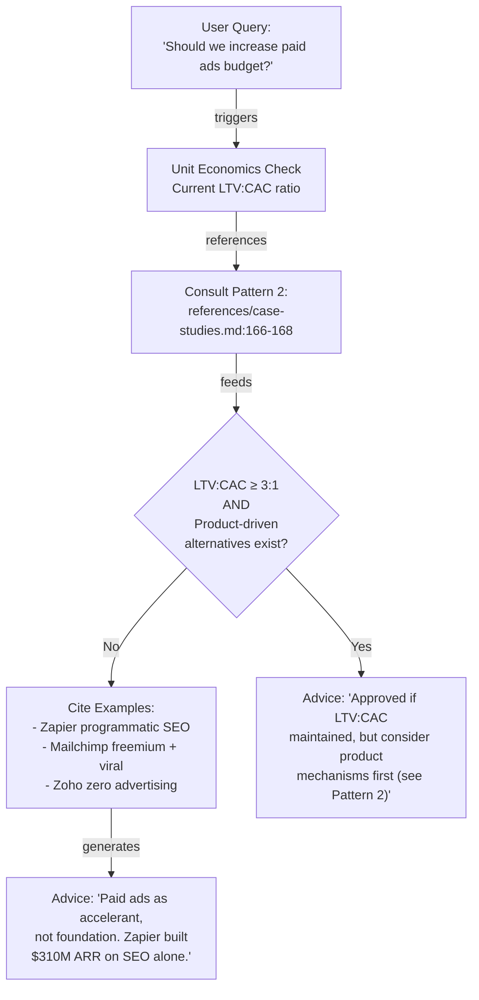
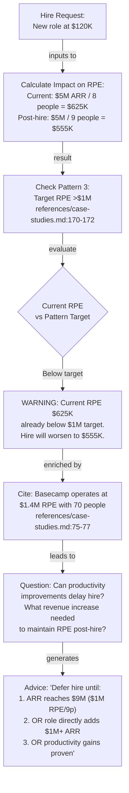
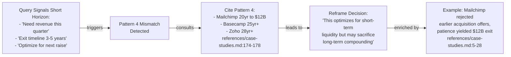
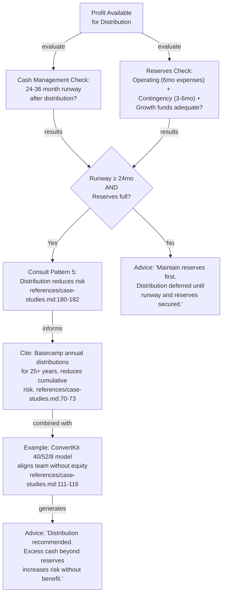
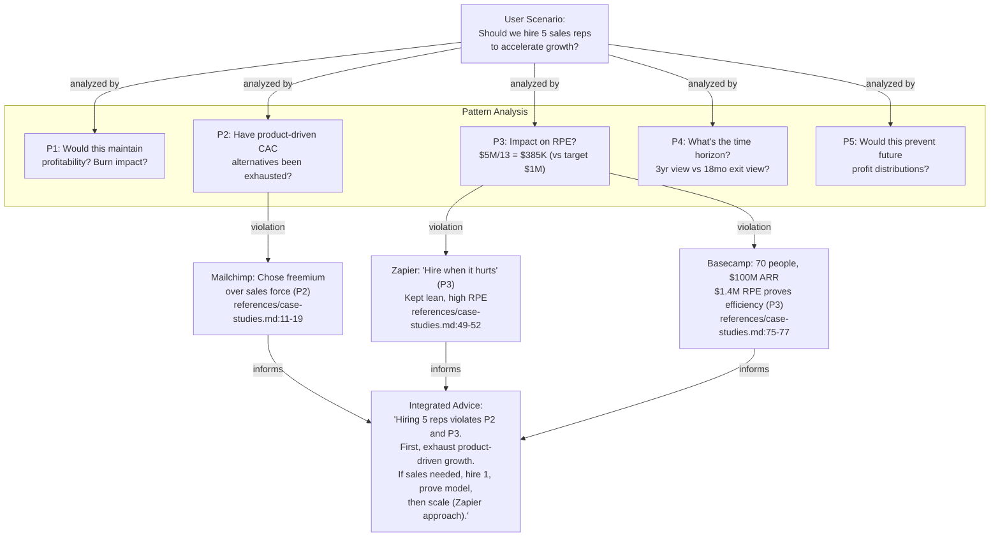
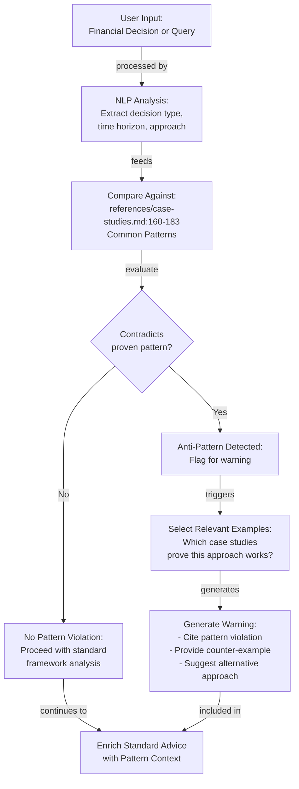
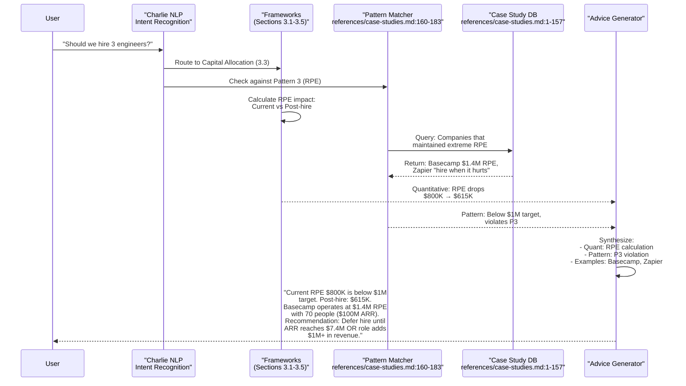
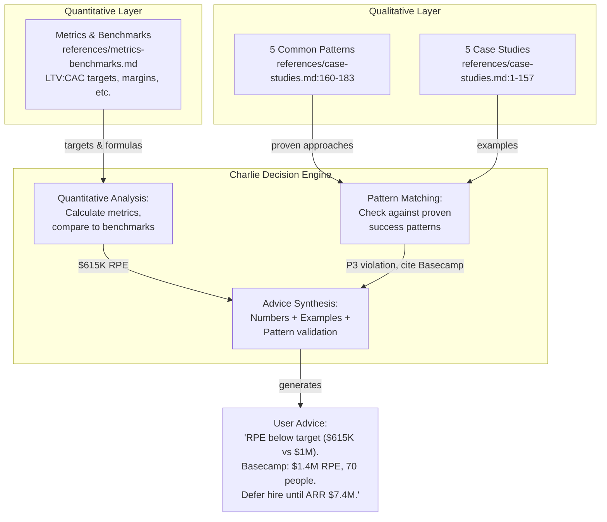

<!-- source: DeepWiki mcp.deepwiki.com · repo EveryInc/charlie-cfo-skill · extra page Common Patterns Across Bootstrapped Success · fetched 2026-10-26 -->

# Common Patterns Across Bootstrapped Success

Relevant source files

The following files were used as context for generating this wiki page:

- [references/case-studies.md](references/case-studies.md)

## Purpose and Scope

This document synthesizes the five recurring patterns observed across all successful bootstrapped companies documented in case studies [5.2.1](#5.2.1) through [5.2.5](#5.2.5). These patterns form a meta-level knowledge structure that Charlie uses to validate advice, provide contextual examples, and identify anti-patterns in user decisions.

For the individual company case studies that these patterns are derived from, see sections [5.2.1](#5.2.1) through [5.2.5](#5.2.5). For the quantitative benchmarks that complement these qualitative patterns, see [5.1](#5.1). For how Charlie's core philosophy relates to these patterns, see [2](#2).

**Sources:** [references/case-studies.md:160-183]()

---

## Pattern Extraction Architecture

The following diagram shows how Charlie extracts and applies the five common patterns from the case study knowledge base.

### Pattern Knowledge Flow from Case Studies to Advice Generation

**Sources:** [references/case-studies.md:1-183]()

---

## The Five Common Patterns

The following table summarizes the five patterns, their manifestation in the case studies, and their integration points with Charlie's frameworks.

| Pattern | Description | Evidence from Cases | Framework Integration |
|---------|-------------|---------------------|----------------------|
| **Profitability as Choice** | Companies achieved profitability early and maintained it as a constraint | All 5 companies profitable early; Zapier 2014, Mailchimp 2001 | Informs [2.1](#2.1) philosophy, gates [3.3](#3.3) capital allocation |
| **CAC Through Product** | Customer acquisition through product mechanisms, not paid ads | Mailchimp freemium, Zapier SEO, Zoho zero advertising | Validates [3.2](#3.2) unit economics, influences [3.3](#3.3) spending decisions |
| **Extreme RPE** | Revenue per employee 2-3x industry average | Basecamp $1.4M RPE, all cases >$1M RPE | Informs [2.3](#2.3) efficiency targets, validates hiring in [4.1](#4.1) |
| **Long Time Horizons** | Multi-decade patience enabling compounding | Mailchimp 20yr, Basecamp 25yr, Zoho 28yr | Shapes [3.5](#3.5) forecasting horizons, reduces pressure for fast exits |
| **Profit Distribution** | Taking risk off table annually vs. endless reinvestment | Basecamp annual distributions, ConvertKit 40%/52%/8% model | Validates cash use in [3.1](#3.1), informs [3.3](#3.3) allocation strategy |

**Sources:** [references/case-studies.md:160-183]()

---

## Pattern 1: Profitability as a Choice, Not a Destination

### Core Principle

This pattern asserts that profitability is achieved through deliberate decision-making, not as an eventual outcome of scale. All five case study companies reached profitability early and maintained it as a constraint on subsequent decisions.

### Evidence from Case Studies

| Company | Profitability Timeline | Key Decision |
|---------|----------------------|--------------|
| Mailchimp | 2001 (year founded) | Never raised capital despite offers [references/case-studies.md:21-23]() |
| Zapier | 2014 (2 years after seed) | "Treated seed as last round ever" [references/case-studies.md:40-42]() |
| Basecamp | 1999 (year founded) | Annual profit distributions since inception [references/case-studies.md:70-73]() |
| ConvertKit | Crisis turnaround | 51% margin achieved in 5 months [references/case-studies.md:109]() |
| Zoho | 1996 (year founded) | Zero external capital ever raised [references/case-studies.md:131]() |

### How Charlie Applies This Pattern

Charlie uses this pattern to:
1. **Validate the core philosophy** in [2.1](#2.1) that "profit as constraint" is not aspirational but proven
2. **Counter objections** to conservative capital allocation with real-world examples
3. **Set baseline expectations** that profitability should be achieved before scaling, not after
4. **Identify anti-patterns** when users plan to "get profitable later at scale"

### Pattern Recognition Triggers

Charlie identifies when user queries or data violate this pattern:

**Sources:** [references/case-studies.md:162-164](), [references/case-studies.md:21-23](), [references/case-studies.md:40-42](), [references/case-studies.md:70-73]()

---

## Pattern 2: CAC Efficiency Through Product, Not Paid Acquisition

### Core Principle

All successful bootstrapped companies achieved customer acquisition cost efficiency through product-driven mechanisms (freemium, SEO, virality, word-of-mouth) rather than paid advertising as the primary channel.

### Mechanisms by Company

| Company | Primary CAC Mechanism | CAC Result | Reference |
|---------|----------------------|------------|-----------|
| Mailchimp | Freemium + viral branding on emails | <$100 CAC | [references/case-studies.md:16-19]() |
| Zapier | Programmatic SEO (50% search traffic) | Near-zero CAC | [references/case-studies.md:44-47]() |
| Basecamp | Word-of-mouth + content marketing | High organic % | [references/case-studies.md:61-92]() |
| ConvertKit | Direct sales (crisis response) | Higher margin focus | [references/case-studies.md:103-108]() |
| Zoho | Zero advertising, all content/WOM | Zero ad spend | [references/case-studies.md:144-147]() |

### Integration with Unit Economics Framework

Charlie uses this pattern to validate decisions in the [Unit Economics Framework](#3.2):

1. **Investment evaluation**: When users propose paid acquisition spend, Charlie checks if product-driven alternatives exist
2. **CAC targets**: Pattern reinforces that CAC should decrease with scale, not increase
3. **Channel strategy**: Prioritizes investments in product virality and content over paid ads
4. **Benchmark comparison**: Uses Mailchimp's <$100 CAC and Zapier's near-zero CAC as reference points

### Application Logic

**Sources:** [references/case-studies.md:166-168](), [references/case-studies.md:16-19](), [references/case-studies.md:44-47](), [references/case-studies.md:144-147]()

---

## Pattern 3: Extreme Revenue Per Employee

### Core Principle

All five case study companies operate at 2-3x industry average revenue per employee (RPE), proving that small teams can deliver massive value when constrained by capital discipline.

### RPE Benchmarks from Cases

| Company | Estimated RPE | Team Size Context | Reference |
|---------|---------------|------------------|-----------|
| Basecamp | $1.4M | ~70 employees, $100M ARR | [references/case-studies.md:75-77]() |
| Mailchimp | ~$1.3M | ~600 employees at exit, $800M ARR | [references/case-studies.md:3-8]() |
| Zapier | ~$775K+ | 400+ employees, $310M ARR | [references/case-studies.md:35-36]() |
| All cases | >$1M average | 2-3x industry average | [references/case-studies.md:170-172]() |

### Integration with Hiring Decisions

Charlie applies this pattern in the [Hiring Decision Framework](#4.1) by:

1. **Setting RPE targets**: Uses $1M+ RPE as minimum threshold for efficiency
2. **Challenging headcount requests**: Cites Basecamp's $1.4M RPE when users propose headcount expansion
3. **Validating lean operations**: Confirms that high RPE is achievable, not aspirational
4. **Forcing productivity questions**: "Can existing team handle this with better tools/processes?"

### Pattern Application in Capital Allocation

**Sources:** [references/case-studies.md:170-172](), [references/case-studies.md:75-77]()

---

## Pattern 4: Long Time Horizons

### Core Principle

Successful bootstrapped companies operate with multi-decade time horizons, enabling patience, compounding effects, and avoidance of premature exit pressure.

### Timeline Evidence

| Company | Years Bootstrapped | Key Patience Payoff | Reference |
|---------|-------------------|---------------------|-----------|
| Mailchimp | 20 years | $12B exit vs. earlier lower offers | [references/case-studies.md:5]() |
| Basecamp | 25+ years | Ongoing profit distributions, no exit needed | [references/case-studies.md:63]() |
| Zoho | 28+ years | $1B+ revenue, 55+ products built | [references/case-studies.md:127-129]() |
| Zapier | 9+ years | $1.4M seed to $5B valuation | [references/case-studies.md:32-36]() |

### How Long Horizons Manifest in Charlie's Frameworks

#### Forecasting Framework ([3.5](#3.5))
- Charlie encourages 3-5 year strategic planning
- Scenario modeling extends beyond typical VC-backed 18-24 month windows
- Compounds interest calculations assume multi-year hold periods

#### Capital Allocation Framework ([3.3](#3.3))
- Reduces pressure for fast ROI on brand-building investments
- Validates R&D investments with 3+ year payback (like Zoho's 60% R&D spend)
- Justifies patience in product development vs. rushing to market

#### Cash Management Framework ([3.1](#3.1))
- Runway targets (24-36 months) support multi-year strategic initiatives
- Reserves can fund patient customer acquisition strategies
- Less pressure to optimize for quarterly metrics

### Pattern Recognition in User Queries

**Sources:** [references/case-studies.md:174-178](), [references/case-studies.md:5](), [references/case-studies.md:63](), [references/case-studies.md:127-129]()

---

## Pattern 5: Profit Distribution, Not Endless Reinvestment

### Core Principle

Bootstrapped companies de-risk over time by distributing profits annually rather than endlessly reinvesting all cash flow. This creates optionality and resilience.

### Distribution Models from Cases

| Company | Distribution Approach | Rationale | Reference |
|---------|----------------------|-----------|-----------|
| Basecamp | Annual profit distributions | "Companies that continuously reinvest everything keep adding risk" | [references/case-studies.md:70-73]() |
| ConvertKit | 40% owners / 52% team / 8% leadership | Alignment without equity dilution | [references/case-studies.md:111-116]() |
| All cases | Take risk off table annually | Reduces financial exposure each year | [references/case-studies.md:180-182]() |

### Integration with Cash Management Framework

Charlie applies this pattern in the [Cash Management Framework](#3.1) by:

1. **Reserve strategy**: Once Operating + Contingency + Growth reserves are full, excess can be distributed
2. **Runway validation**: Distributions permissible only when 24-36 month runway maintained
3. **Reinvestment scrutiny**: Questions whether "reinvestment" is truly necessary or just avoiding distribution
4. **Risk reduction**: Validates that distributions reduce founder risk over time

### Decision Logic for Profit Distribution

**Sources:** [references/case-studies.md:180-182](), [references/case-studies.md:70-73](), [references/case-studies.md:111-116]()

---

## Cross-Pattern Integration

The five patterns do not operate independently—they form an interconnected system that Charlie uses to evaluate decisions holistically.

### Pattern Dependency Matrix

| Pattern | Depends On | Enables |
|---------|-----------|---------|
| **P1: Profitability as Choice** | P2 (low CAC), P3 (high RPE) | P5 (distributions), P4 (long horizon) |
| **P2: CAC Through Product** | P4 (patience for compound), P1 (profit constraint forces efficiency) | P3 (enables lean teams), P1 (achieves profitability) |
| **P3: Extreme RPE** | P1 (profit forces efficiency), P2 (low CAC reduces hiring needs) | P5 (more profit per person to distribute) |
| **P4: Long Time Horizons** | P1 (profitability removes exit pressure) | P2 (content/SEO compounds), All (patience enables execution) |
| **P5: Profit Distribution** | P1 (must be profitable first), P3 (high margins enable distribution) | P4 (reduces need for exit) |

### Integrated Pattern Application Example

**Sources:** [references/case-studies.md:160-183]()

---

## Pattern-to-Framework Mapping

The following table shows how each pattern integrates with Charlie's five financial frameworks (see [3](#3) for framework details).

| Pattern | Cash Management ([3.1](#3.1)) | Unit Economics ([3.2](#3.2)) | Capital Allocation ([3.3](#3.3)) | Working Capital ([3.4](#3.4)) | Forecasting ([3.5](#3.5)) |
|---------|------------------|-----------------|---------------------|---------------------|---------------|
| **P1: Profitability as Choice** | Sets runway targets | Validates targets as survival thresholds | Gates investment decisions | Optimizes for cash preservation | Scenarios assume profitability |
| **P2: CAC Through Product** | Low CAC extends runway | Achieves LTV:CAC >3:1 targets | Prioritizes product investments over paid | N/A | Models organic growth curves |
| **P3: Extreme RPE** | Higher margins per person | Better unit economics from efficiency | Raises bar for hiring ROI | N/A | Revenue forecasts per headcount |
| **P4: Long Time Horizons** | 24-36mo runway enables patience | Longer payback periods acceptable | Multi-year investment view | Prepay strategies for stability | 3-5yr strategic forecasts |
| **P5: Profit Distribution** | Validates distribution decisions | Ensures distribution maintains margins | Alternatives to reinvestment | Optimizes before distribution | Projects distribution capacity |

**Sources:** [references/case-studies.md:160-183]()

---

## Anti-Pattern Detection

Charlie uses these patterns to identify anti-patterns—decision patterns that contradict proven success models. The following anti-patterns trigger warnings:

### Common Anti-Patterns

| Anti-Pattern | Violated Patterns | Warning Message Template | Example Citation |
|-------------|------------------|-------------------------|------------------|
| "We'll get profitable at scale" | P1 | "All 5 case studies achieved profitability early. Zapier profitable in year 2, maintained since." | [references/case-studies.md:40-42]() |
| "Need to spend big on paid ads" | P2 | "Mailchimp built $800M ARR with CAC <$100 through freemium. Zapier: 50% organic search. Consider product-driven alternatives." | [references/case-studies.md:16-19](), [references/case-studies.md:44-47]() |
| "Need 20-person sales team" | P3 | "Basecamp: $100M ARR with 70 total employees ($1.4M RPE). Have you exhausted product-led and content approaches?" | [references/case-studies.md:75-77]() |
| "Must exit in 3-5 years" | P4 | "Mailchimp: 20 years to $12B. Basecamp: 25+ years ongoing. Long horizons enable compounding." | [references/case-studies.md:174-178]() |
| "Reinvest all profits indefinitely" | P5 | "Basecamp: Annual distributions reduce risk. ConvertKit: 40/52/8 model aligns team without equity." | [references/case-studies.md:70-73](), [references/case-studies.md:111-116]() |

### Anti-Pattern Detection Logic

**Sources:** [references/case-studies.md:160-183]()

---

## Pattern Application in Query Processing

When Charlie processes a user query, pattern matching occurs in parallel with quantitative framework analysis. The following shows the integrated decision flow.

### Integrated Pattern and Framework Query Processing

**Sources:** [references/case-studies.md:160-183](), [references/case-studies.md:1-157]()

---

## Pattern Strength Validation

Not all patterns apply with equal strength to every situation. Charlie evaluates pattern relevance based on user context.

### Pattern Applicability Matrix

| User Context | P1: Profit | P2: CAC | P3: RPE | P4: Horizon | P5: Distribution |
|-------------|-----------|---------|---------|-------------|-----------------|
| **Pre-revenue** | Medium (plan for it) | High (build in product) | Low (too early) | High (long view) | N/A |
| **$0-1M ARR** | High (achieve early) | High (prove channels) | Medium (track) | High (patience) | Low (build reserves) |
| **$1-10M ARR** | High (maintain) | High (optimize) | High (enforce) | High (compound) | Medium (start planning) |
| **$10M+ ARR** | High (constraint) | Medium (mature) | High (core metric) | High (proven) | High (execute) |
| **Crisis mode** | Critical (survival) | Critical (cash efficient) | Medium (may sacrifice) | Low (immediate focus) | N/A |

**Sources:** [references/case-studies.md:160-183]()

---

## Summary: Pattern System in Charlie's Architecture

The five common patterns form a qualitative knowledge layer that complements Charlie's quantitative frameworks. Together, they provide:

1. **Validation**: Patterns prove that conservative targets are achievable, not aspirational
2. **Context**: Case studies enrich numerical advice with real-world examples
3. **Anti-pattern detection**: Identify decisions that contradict proven success models
4. **Multi-dimensional analysis**: Combine quantitative metrics with qualitative wisdom
5. **Confidence building**: Show users that extreme efficiency has been done before

### Pattern Integration Summary

**Sources:** [references/case-studies.md:160-183](), [references/case-studies.md:1-157]()

---

