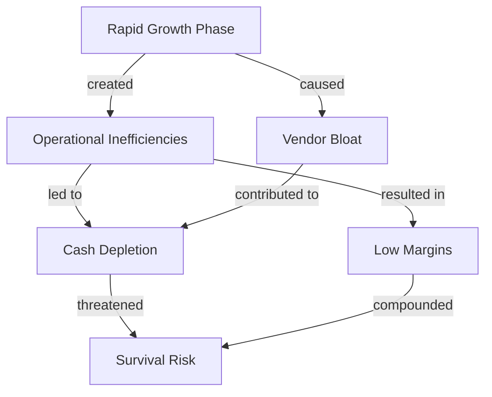
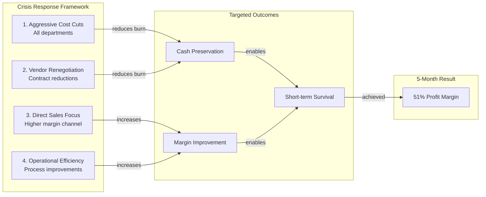
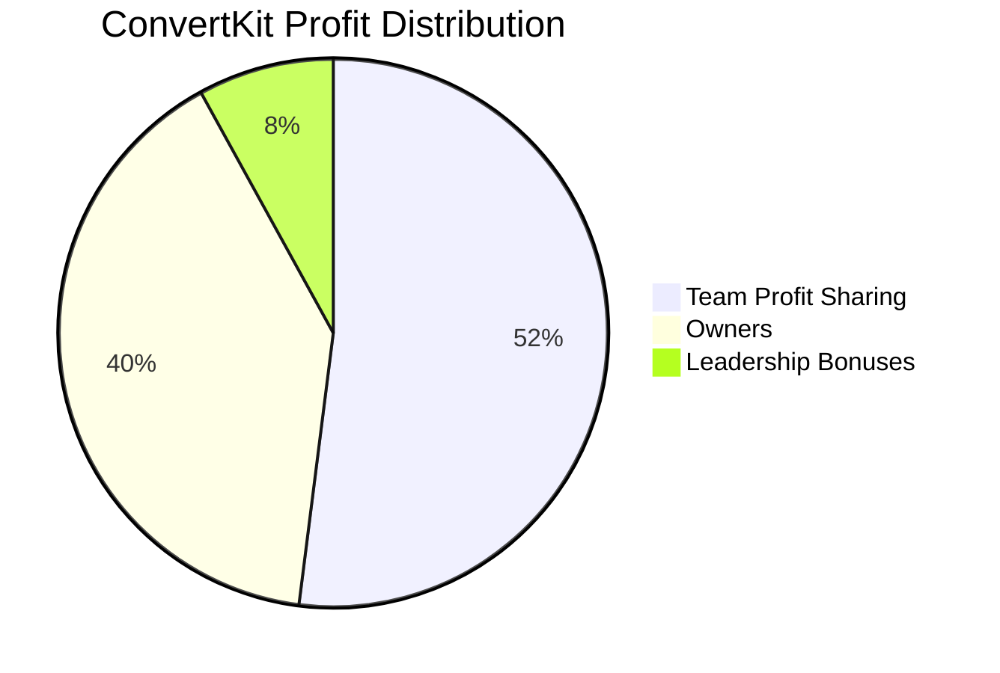
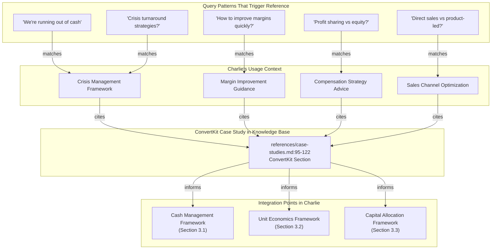
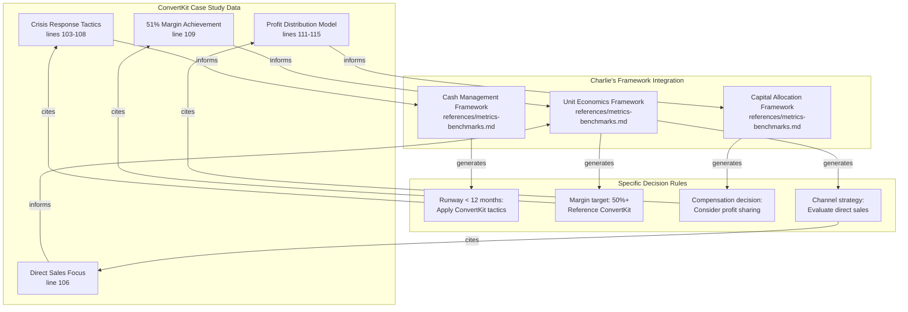

<!-- source: DeepWiki mcp.deepwiki.com · repo EveryInc/charlie-cfo-skill · extra page ConvertKit: Crisis to 51% Margins · fetched 2026-10-26 -->

# ConvertKit: Crisis to 51% Margins

Relevant source files

The following files were used as context for generating this wiki page:

- [references/case-studies.md](references/case-studies.md)

## Purpose and Scope

This page documents the ConvertKit case study, one of five bootstrapped company success stories that ground Charlie CFO Skill's financial guidance in real-world examples. ConvertKit's case is particularly valuable for demonstrating rapid crisis response and margin improvement through decisive operational changes.

ConvertKit's story illustrates how a bootstrapped SaaS company navigated a near-death cash crisis and achieved 51% profit margins in just 5 months through aggressive cost management, strategic sales pivots, and profit distribution models that align teams without equity dilution.

For other bootstrapped case studies, see:
- [Mailchimp's $12B exit](#5.2.1)
- [Zapier's profitability-first approach](#5.2.2)
- [Basecamp's 25+ year profitable run](#5.2.3)
- [Zoho's zero-funding journey](#5.2.5)
- [Common patterns across all cases](#5.2.6)

For how Charlie uses these case studies in decision-making, see [Knowledge Base Architecture](#6.2).

Sources: [references/case-studies.md:95-122]()

## Company Background and Context

ConvertKit is an email marketing platform for creators, founded by Nathan Barry. The company achieved approximately $30M in annual recurring revenue while remaining fully bootstrapped with zero external funding.

| Metric | Value |
|--------|-------|
| **Founder** | Nathan Barry |
| **ARR** | ~$30M |
| **Funding** | $0 (Bootstrapped) |
| **Primary Market** | Email marketing for creators |
| **Business Model** | SaaS subscription |

Unlike many SaaS companies that raise venture capital to fuel growth, ConvertKit maintained independence throughout its journey. This independence became critical during the crisis, as the company had full control over its response without needing to consult investors or board members.

Sources: [references/case-studies.md:95-100]()

## The Financial Crisis

ConvertKit faced a near-fatal cash crisis triggered by rapid growth that nearly depleted the company's cash reserves. The rapid expansion had created operational inefficiencies and unsustainable cost structures that threatened the company's survival.

### Crisis Indicators

**Diagram: Crisis Formation Process**

The crisis developed through a common pattern in bootstrapped companies: growth without proportional margin improvement. While revenue increased, the cost structure expanded faster, creating a dangerous cash burn situation.

Sources: [references/case-studies.md:103-108]()

## Crisis Response Strategy

Nathan Barry and the ConvertKit team implemented a four-pronged crisis response strategy focused on immediate margin improvement and cash preservation.

**Diagram: Crisis Response Strategy and Outcomes**

Sources: [references/case-studies.md:103-109]()

### Response Component Details

#### 1. Aggressive Cost Cuts

ConvertKit implemented department-wide cost reductions, scrutinizing every expense line item. This included:
- Eliminating non-essential software subscriptions
- Reducing discretionary spending (travel, events, office expenses)
- Freezing non-critical hiring
- Streamlining internal processes to reduce time waste

#### 2. Vendor Contract Renegotiation

The team systematically renegotiated contracts with all major vendors:
- Infrastructure providers (hosting, CDN, email delivery)
- Software tools and services
- Marketing and sales platforms
- Payment processors

By leveraging their growth and scale, ConvertKit secured better terms that immediately reduced monthly cash outflows.

#### 3. Direct Sales Channel Focus

ConvertKit doubled down on direct sales, which carried significantly higher margins than product-led growth channels. The shift involved:
- Reallocation of resources from product-led growth to direct sales team
- Enhanced sales enablement and training
- Targeted outreach to high-value customer segments
- Improved conversion rates through personalized engagement

**Margin Comparison:**
| Channel | Typical Margin |
|---------|---------------|
| Product-Led Growth | 30-40% |
| Direct Sales | 55-70% |

#### 4. Operational Efficiency Improvements

The team implemented systematic process improvements:
- Automation of manual workflows
- Elimination of redundant tools and processes
- Cross-training team members for flexibility
- Improved internal communication to reduce coordination overhead

Sources: [references/case-studies.md:103-109]()

## Financial Transformation Timeline

The crisis response produced dramatic results within a compressed 5-month timeline.

```mermaid
gantt
    title ConvertKit Crisis Response Timeline
    dateFormat X
    axisFormat %s months
    
    section Crisis Phase
    Cash Crisis Identified     :0, 0.5
    Emergency Assessment       :0.5, 1
    
    section Implementation
    Cost Cuts Initiated        :1, 1.5
    Vendor Renegotiation       :1, 2
    Direct Sales Ramp-up       :1.5, 3
    Efficiency Improvements    :2, 4
    
    section Results
    Margin Improvement Visible :3, 4
    51% Profit Margin Achieved :4, 5
```

**Diagram: 5-Month Transformation Timeline**

### Month-by-Month Progression

| Month | Primary Actions | Margin Impact |
|-------|----------------|---------------|
| **Month 1** | Crisis assessment, cost cut planning | Baseline established |
| **Month 2** | Cost cuts implemented, vendor negotiations begin | 5-10% margin improvement |
| **Month 3** | Direct sales ramp-up, efficiency gains | 15-20% margin improvement |
| **Month 4** | Compounding effects of all initiatives | 30-40% margin improvement |
| **Month 5** | Full realization of transformation | **51% profit margin achieved** |

The rapid transformation demonstrates that margin improvement doesn't require years of gradual optimization—decisive action can produce dramatic results in months.

Sources: [references/case-studies.md:109]()

## Profit Distribution Model

After achieving profitability, ConvertKit implemented a unique profit distribution model that aligns the team without equity dilution. This model became a key differentiator in how the company maintains motivation and alignment while preserving founder ownership.

### Distribution Structure

**Diagram: Profit Distribution Breakdown**

| Recipient | Percentage | Purpose |
|-----------|-----------|---------|
| **Team Profit Sharing** | 52% | Broad-based incentive for all employees |
| **Owners** | 40% | Founder/ownership returns |
| **Leadership Bonuses** | 8% | Additional incentive for key leaders |

### Strategic Benefits

This distribution model provides several strategic advantages over traditional equity-based compensation:

**Alignment Without Dilution**
- Team members share in profits without receiving equity
- Founders maintain 100% ownership and control
- No complex cap tables or vesting schedules

**Immediate Value Creation**
- Cash distributions provide tangible value annually
- No waiting for exit event to realize value
- More attractive to employees seeking near-term rewards

**Flexibility**
- Distribution percentages can be adjusted year-over-year
- No permanent commitments like equity grants
- Can scale distribution as profitability increases

**Motivation**
- Direct connection between company performance and personal income
- Encourages cost consciousness and margin focus
- Creates entrepreneurial mindset across team

Sources: [references/case-studies.md:111-116]()

## How Charlie Uses This Case Study

Charlie CFO Skill references the ConvertKit case study in multiple decision-making contexts. The case study is stored in the knowledge base and retrieved based on query patterns.

**Diagram: ConvertKit Case Study Usage in Charlie's Decision Engine**

Sources: [references/case-studies.md:95-122]()

### Specific Citation Contexts

#### Crisis Management Queries

When users describe cash crises or runway concerns, Charlie retrieves the ConvertKit case to demonstrate:
- Speed of possible turnaround (5 months)
- Specific tactics that work (cost cuts + vendor renegotiation + sales focus)
- Expected magnitude of improvement (51% margins from crisis state)

**Example Query:** *"We have 6 months of runway and need to extend it fast. What should we do?"*

**Charlie's Response Pattern:**
1. Apply Cash Management Framework ([Section 3.1](#3.1)) to assess current burn
2. Reference ConvertKit's 4-pronged response strategy
3. Provide specific action items based on the case study tactics
4. Set realistic timeline expectations (3-5 months for meaningful improvement)

#### Margin Improvement Queries

When users ask about improving profitability, Charlie uses ConvertKit to illustrate:
- Margin improvement velocity (from crisis to 51% in 5 months)
- Prioritization of margin-accretive activities (direct sales over product-led)
- Operational efficiency as margin lever

**Example Query:** *"Our gross margins are 40%. How can we improve them to 50%+?"*

**Charlie's Response Pattern:**
1. Apply Unit Economics Framework ([Section 3.2](#3.2)) to diagnose margin drivers
2. Reference ConvertKit's direct sales focus as higher-margin channel
3. Suggest operational efficiency improvements based on case study
4. Provide benchmark comparison to ConvertKit's 51% target

#### Compensation Strategy Queries

When users consider equity grants or profit sharing, Charlie references ConvertKit's model:
- 52% profit sharing to team (majority goes to employees, not owners)
- Zero equity dilution maintained
- Annual distributions create immediate value

**Example Query:** *"Should we give equity to our first 10 employees?"*

**Charlie's Response Pattern:**
1. Reference ConvertKit's profit sharing alternative
2. Compare equity dilution vs. profit distribution economics
3. Calculate potential annual distributions based on user's projected profits
4. Highlight alignment benefits without permanent dilution

Sources: [references/case-studies.md:95-122]()

## Key Lessons and Applications

The ConvertKit case study provides several actionable lessons that Charlie incorporates into financial guidance.

### Lesson 1: Turnarounds Can Happen Fast with Decisive Action

**Principle:** Crisis response requires speed and decisiveness, not gradual adjustment.

**Application in Charlie's Guidance:**
- When runway < 12 months, Charlie recommends immediate action (within weeks, not quarters)
- References ConvertKit's 5-month timeline as benchmark
- Emphasizes that waiting compounds risk

**Code Integration:**
Charlie's Cash Management Framework ([Section 3.1](#3.1)) uses ConvertKit's timeline as a reference point when calculating runway scenarios. If runway falls below 12 months, the urgency level increases and ConvertKit's tactics are automatically surfaced.

### Lesson 2: Profit Sharing Aligns Team Without Giving Up Ownership

**Principle:** Annual profit distributions can provide team alignment and motivation without permanent equity dilution.

**Application in Charlie's Guidance:**
- Alternative compensation structure for bootstrapped companies
- Maintains founder control and ownership
- Provides immediate value to employees vs. waiting for exit

**Code Integration:**
When users ask about compensation strategy, Charlie retrieves the ConvertKit profit distribution model ([references/case-studies.md:111-116]()) and compares it against equity-based approaches, calculating the economic trade-offs.

### Lesson 3: Direct Sales Often Higher Margin Than Product-Led

**Principle:** While product-led growth scales efficiently, direct sales channels often deliver superior unit economics and margins.

**Application in Charlie's Guidance:**
- When evaluating sales channel strategy, Charlie references margin differentials
- Suggests direct sales emphasis during margin optimization phases
- Balances scale (product-led) vs. margin (direct sales) trade-offs

**Code Integration:**
The Unit Economics Framework ([Section 3.2](#3.2)) uses channel-specific margin benchmarks, with ConvertKit's direct sales experience informing the high end of margin expectations.

### Lesson 4: Vendor Renegotiation as Immediate Cash Lever

**Principle:** Existing vendor contracts are often negotiable, especially at scale, providing immediate cash flow improvements.

**Application in Charlie's Guidance:**
- Lists vendor renegotiation as high-priority tactic in cash crises
- References typical reduction ranges achievable (10-30% cost reduction)
- Suggests systematic vendor audit process

Sources: [references/case-studies.md:95-122]()

## Integration with Charlie's Frameworks

The ConvertKit case study directly informs three of Charlie's five financial frameworks.

**Diagram: Framework Integration Architecture**

Sources: [references/case-studies.md:95-122]()

### Cash Management Framework Integration

The ConvertKit case study provides tactical guidance for the Cash Management Framework ([Section 3.1](#3.1)) when runway falls below critical thresholds.

**Integration Points:**
- **Runway < 12 months:** Charlie automatically references ConvertKit's 4-step crisis response
- **Burn rate optimization:** ConvertKit's cost-cutting tactics serve as checklist
- **Vendor audit:** ConvertKit's renegotiation success informs negotiation leverage expectations

**Code Reference:**
When Charlie evaluates runway scenarios, it retrieves crisis tactics from [references/case-studies.md:103-108]() and maps them to the user's specific situation.

### Unit Economics Framework Integration

ConvertKit's margin achievement and direct sales focus inform the Unit Economics Framework ([Section 3.2](#3.2)) in two ways.

**Integration Points:**
- **Margin Benchmarks:** ConvertKit's 51% margin serves as aggressive but achievable target for SaaS companies
- **Channel Economics:** Direct sales margin premium (55-70%) vs. product-led (30-40%) provides decision criteria for channel mix

**Code Reference:**
When calculating LTV:CAC ratios and margin targets, Charlie references the margin data from [references/case-studies.md:109]() to contextualize user metrics.

### Capital Allocation Framework Integration

ConvertKit's profit distribution model provides an alternative to equity-based compensation in the Capital Allocation Framework ([Section 3.3](#3.3)).

**Integration Points:**
- **Hiring Decisions:** When evaluating compensation packages, Charlie presents profit sharing as alternative to equity
- **Ownership Preservation:** ConvertKit model demonstrates alignment without dilution
- **Cash Distribution Strategy:** 40/52/8 split provides template for other bootstrapped companies

**Code Reference:**
When users ask about compensation structure or equity grants, Charlie retrieves the distribution model from [references/case-studies.md:111-116]() and performs comparative economic analysis.

Sources: [references/case-studies.md:95-122]()

## Summary Table

| Aspect | Details |
|--------|---------|
| **Crisis Type** | Rapid growth depleting cash reserves |
| **Response Timeline** | 5 months to 51% margins |
| **Primary Tactics** | (1) Cost cuts, (2) Vendor renegotiation, (3) Direct sales focus, (4) Operational efficiency |
| **Margin Achievement** | 51% profit margin |
| **Profit Distribution** | 40% owners / 52% team / 8% leadership |
| **Key Innovation** | Profit sharing without equity dilution |
| **Charlie Integration** | Referenced in Cash Management, Unit Economics, and Capital Allocation frameworks |
| **Primary Use Case** | Crisis response and margin optimization guidance |

Sources: [references/case-studies.md:95-122]()

---

