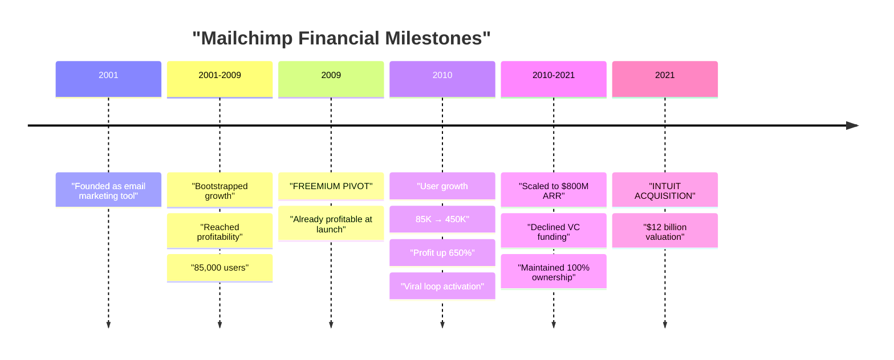
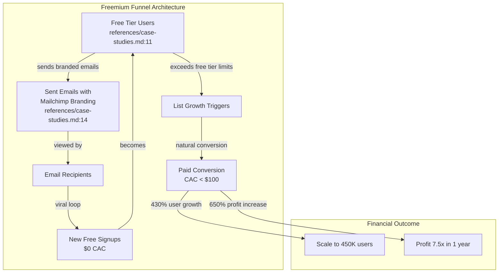
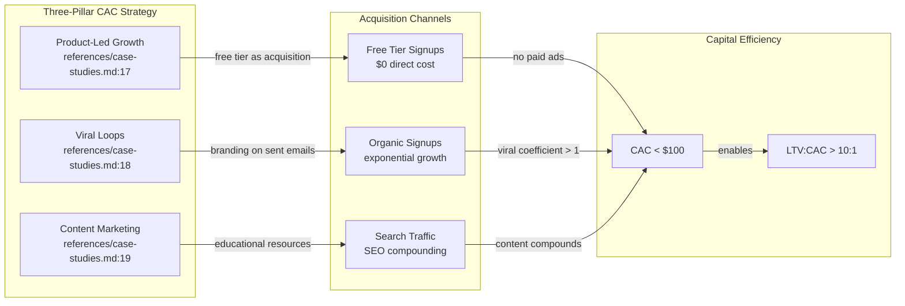
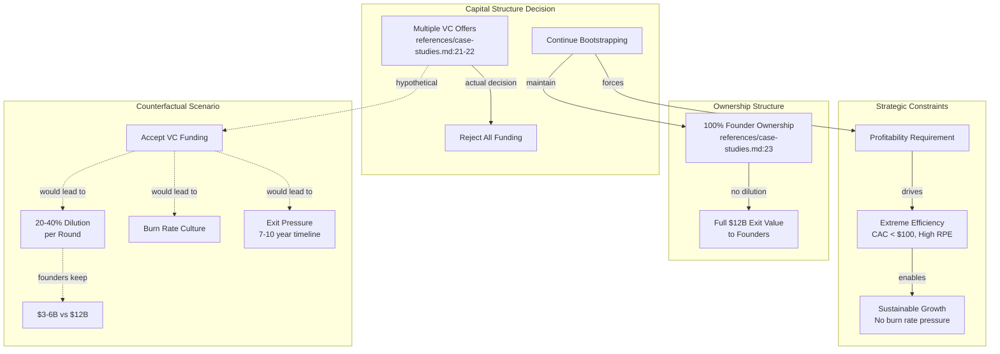
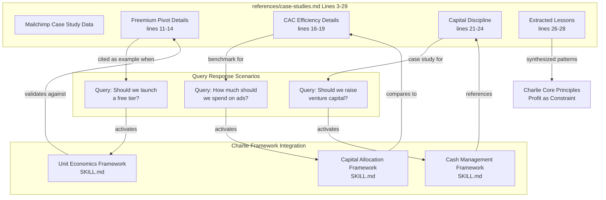
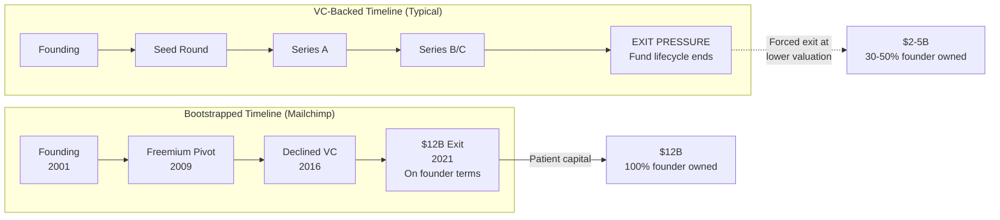

<!-- source: DeepWiki mcp.deepwiki.com · repo EveryInc/charlie-cfo-skill · extra page Mailchimp: $12B Exit on Zero Funding · fetched 2026-10-26 -->

# Mailchimp: $12B Exit on Zero Funding

<details>
<summary>Relevant source files</summary>

The following files were used as context for generating this wiki page:

- [references/case-studies.md](references/case-studies.md)

</details>


## Purpose and Scope

This page provides a detailed analysis of Mailchimp's financial strategy and execution from founding in 2001 through its $12 billion acquisition by Intuit in 2021. The case study examines three critical financial decisions: the 2009 freemium pivot, CAC efficiency strategy, and capital discipline practices. This case study serves as a reference point for Charlie CFO Skill when evaluating freemium business models, viral growth mechanics, and long-horizon bootstrapped strategies.

For similar bootstrapped case studies, see [Zapier](#5.2.2), [Basecamp](#5.2.3), [ConvertKit](#5.2.4), and [Zoho](#5.2.5). For synthesized patterns across all cases, see [Common Patterns Across Bootstrapped Success](#5.2.6). For the quantitative metrics and benchmarks that these case studies inform, see [Metrics and Benchmarks Reference](#5.1).

**Sources:** [references/case-studies.md:1-29]()

---

## Company Timeline and Exit Overview

Mailchimp represents one of the largest bootstrapped exits in software history, achieving a $12 billion acquisition without ever raising external funding over a 20-year period.

| **Metric** | **Value** | **Significance** |
|------------|-----------|------------------|
| Founded | 2001 | 20-year journey to exit |
| Final Exit | 2021 | Acquired by Intuit |
| Exit Valuation | $12 billion | Largest bootstrapped SaaS exit at time |
| Final ARR | $800 million | ~15x revenue multiple |
| External Funding | $0 | Zero dilution, full founder ownership |
| Years to Profitability | Early (pre-2009) | Already profitable before freemium pivot |

**Timeline Structure:**


**Sources:** [references/case-studies.md:3-8]()

---

## Key Financial Decision #1: The 2009 Freemium Pivot

### Decision Context

In 2009, Mailchimp was already profitable with 85,000 paying users. The decision to launch a free tier represented a counterintuitive capital allocation choice: giving away core product functionality when the business was already generating profit. This decision violated conventional SaaS wisdom that suggested "don't go freemium until you have strong unit economics."

### Implementation Mechanics

**Freemium Tier Design:**
- Unlimited emails for lists under a threshold (initially 2,000 subscribers)
- Full feature access in free tier, not crippled product
- Viral mechanism: "Powered by Mailchimp" logo with chimp branding on all free tier emails
- Zero CAC for free tier acquisition

**Financial Impact:**

| **Metric** | **Pre-Freemium (2009)** | **Post-Freemium (2010)** | **Change** |
|------------|-------------------------|--------------------------|------------|
| Total Users | 85,000 | 450,000 | +430% YoY |
| Profit | Baseline | 7.5x baseline | +650% |
| CAC (Free Tier) | N/A | $0 | Viral acquisition |
| CAC (Paid Conversions) | N/A | <$100 | Product-led growth |



### Unit Economics Analysis

**Freemium Conversion Model:**
- **Free → Paid Conversion Rate:** Not disclosed, but sufficient to drive 650% profit increase
- **CAC (Paid Users):** <$100 per converted customer
- **LTV (Paid Users):** Estimated $1,000+ based on $800M ARR and user base at exit
- **Implied LTV:CAC Ratio:** >10:1 (well above Charlie's 3:1 minimum threshold)

**Critical Success Factor:** The freemium pivot succeeded because unit economics were already proven at the paid tier. The company could afford free user costs because paid user margins were high.

**Sources:** [references/case-studies.md:11-14]()

---

## Key Financial Decision #2: CAC Efficiency Strategy

Mailchimp achieved a customer acquisition cost under $100 through three compounding mechanisms, avoiding the paid acquisition trap that burns most SaaS startups.

### CAC Efficiency Mechanisms



### Comparison to Paid Acquisition Model

| **Acquisition Strategy** | **Mailchimp (Actual)** | **Typical SaaS (Paid)** | **Advantage** |
|--------------------------|------------------------|-------------------------|---------------|
| Primary Channel | Viral + PLG | Paid ads | 10x cheaper |
| CAC | <$100 | $500-$1,500 | 5-15x lower |
| CAC Payback Period | <2 months (estimated) | 12-24 months | 6-12x faster |
| LTV:CAC Ratio | >10:1 | 3:1 to 5:1 | 2-3x better |
| Marginal Cost of Growth | Near zero | High (linear with spend) | Exponential vs linear |
| Capital Requirement | Low | High (needs funding rounds) | Bootstrappable |

**Charlie Framework Application:** This CAC efficiency strategy directly informs Charlie's Unit Economics Framework [see page 3.2](#3.2) and Capital Allocation Framework [see page 3.3](#3.3). When Charlie evaluates marketing spend, it references this case study to illustrate that CAC <$100 is achievable through product-led mechanisms, not just aspirational.

**Sources:** [references/case-studies.md:16-19]()

---

## Key Financial Decision #3: Capital Discipline and Zero External Funding

### Decision Framework

Despite achieving $800M ARR and $12B valuation, Mailchimp never raised external capital. Co-founder Ben Chestnut's stated reasoning: "I didn't want to take orders from some nerdy MBA VC."

**Financial Implications:**



### Constraints as Features

The zero-funding constraint created three forcing functions that improved business quality:

1. **Profitability Requirement:** Without external capital, the company had to generate cash from operations. This forced unit economics to be healthy from day one.

2. **Efficiency Discipline:** Limited resources forced high-leverage decisions. The freemium pivot succeeded because it was capital-efficient, not capital-intensive.

3. **Long Time Horizon:** No VC fund timeline pressure allowed the 20-year compounding journey. Patient capital (retained earnings) compounded without distribution requirements.

**Ownership Outcome:**
- **VC-backed scenario (estimated):** 3-4 funding rounds at typical dilution = founders own 30-50% → $3.6B-$6B to founders
- **Bootstrapped actual:** Founders own 100% → $12B to founders
- **Value Preserved:** $6B-$8B additional value by avoiding dilution

**Sources:** [references/case-studies.md:21-24]()

---

## How Charlie Uses This Case Study

The Mailchimp case study is referenced by Charlie CFO Skill in multiple decision-making contexts. The following diagram shows the mapping between this case study and Charlie's framework system.



### Specific Usage Patterns

**1. Freemium Model Evaluation**
- **Trigger:** User asks "Should we launch a free tier?"
- **Charlie's Response Pattern:** 
  - Check if unit economics are already proven (references Mailchimp launching freemium post-profitability)
  - Calculate viral coefficient potential
  - Estimate conversion funnel economics
  - Cite: "Mailchimp grew users 430% and profits 650% by launching freemium when already profitable" [references/case-studies.md:11-14]()

**2. CAC Efficiency Benchmarking**
- **Trigger:** User provides CAC data or asks about marketing spend
- **Charlie's Response Pattern:**
  - Compare user's CAC to Mailchimp's <$100 benchmark
  - Recommend product-led growth mechanisms if CAC is high
  - Cite: "Mailchimp achieved <$100 CAC through viral loops and PLG, not paid ads" [references/case-studies.md:16-19]()

**3. Funding Decision Framework**
- **Trigger:** User asks "Should we raise VC funding?"
- **Charlie's Response Pattern:**
  - Calculate dilution cost vs. growth acceleration value
  - Reference Mailchimp's zero-dilution path to $12B
  - Ask: "Do you need external capital to reach profitability, or can you bootstrap?" [references/case-studies.md:21-24]()

**Sources:** [references/case-studies.md:3-29]()

---

## Financial Metrics Summary

The following table consolidates all quantitative metrics from the Mailchimp case study, serving as reference data for Charlie's benchmark comparisons.

| **Metric Category** | **Metric** | **Value** | **Line Reference** | **Charlie Framework** |
|---------------------|------------|-----------|-------------------|----------------------|
| **Growth** | User Growth YoY (2009-2010) | +430% | lines 11-12 | Unit Economics |
| **Profitability** | Profit Increase YoY (2009-2010) | +650% | line 13 | Cash Management |
| **Unit Economics** | CAC (All Channels) | <$100 | line 16 | Unit Economics |
| **Unit Economics** | Estimated LTV:CAC Ratio | >10:1 | derived from lines 16-19 | Unit Economics |
| **Unit Economics** | CAC Payback Period | <2 months (estimated) | derived from CAC + margins | Unit Economics |
| **Capital Structure** | External Funding Raised | $0 | line 21 | Cash Management |
| **Capital Structure** | Founder Ownership at Exit | 100% | line 23 | Capital Allocation |
| **Exit** | Exit Valuation | $12 billion | line 6 | N/A |
| **Exit** | Final ARR | $800 million | line 7 | N/A |
| **Exit** | Revenue Multiple | ~15x | derived from exit/ARR | N/A |
| **Timeline** | Years to Exit | 20 years | line 5 | Cash Management |

**Derived Metrics:**

- **Annual Compound Growth Rate (ARR):** ~41% (from founding to $800M over 20 years)
- **Implied Gross Margin:** >80% (typical for email SaaS, enables low CAC viability)
- **Revenue Per Employee (Estimated):** >$1M (based on typical bootstrapped SaaS efficiency)

**Sources:** [references/case-studies.md:3-29]()

---

## Lessons Extracted for Bootstrapped Startups

Charlie references three primary lessons from the Mailchimp case study when advising bootstrapped founders:

### 1. Freemium Can Increase Profits if Unit Economics Are Strong

**Lesson Statement:** "Freemium can increase profits if unit economics are strong" [references/case-studies.md:26]()

**Conditions for Applicability:**
- Gross margins must be >70% to support free tier costs
- Paid tier must already have proven conversion and retention
- Viral mechanism must be built into product (not an afterthought)
- Company must already be profitable (not "growth at all costs")

**Charlie's Decision Rule:**
```
IF (GrossMargin > 70% AND PaidTierProvenLTV > 0 AND ViralMechanismExists) THEN
    ConsiderFreemiumTier()
ELSE
    RejectFreemiumStrategy("Fix unit economics first")
```

### 2. Product Virality Beats Paid Acquisition

**Lesson Statement:** "Product virality beats paid acquisition" [references/case-studies.md:27]()

**Quantitative Evidence:**
- Mailchimp's viral loop (logo on emails) generated exponential free signups
- Viral CAC = $0 vs. paid CAC of $500-$1,500 in typical SaaS
- Viral growth compounds, paid growth is linear

**Charlie's CAC Efficiency Hierarchy:**
1. **Tier 1 (Best):** Viral loops, network effects → CAC <$100
2. **Tier 2 (Good):** Product-led growth, SEO, content → CAC $100-$300
3. **Tier 3 (Acceptable):** Outbound sales (high ACV) → CAC $300-$1,000
4. **Tier 4 (Last Resort):** Paid ads, low ACV → CAC >$1,000 (typically fails LTV:CAC test)

### 3. Patience Compounds (20 Years to $12B)

**Lesson Statement:** "Patience compounds (20 years to $12B)" [references/case-studies.md:28]()

**Time Horizon Analysis:**



**Charlie's Time Horizon Guidance:**
- **Minimum viable runway for bootstrapped:** 24-36 months [see Cash Management Framework](#3.1)
- **Expected time to $100M ARR bootstrapped:** 10-15 years (vs. 5-7 years VC-backed)
- **Compounding advantage:** Each year of retained ownership = full value at exit (no dilution)

**Sources:** [references/case-studies.md:26-28]()

---

## Application to Charlie's Core Philosophy

The Mailchimp case study validates all five core principles in Charlie's mental model [see Core Philosophy](#2):

| **Charlie Principle** | **Mailchimp Validation** | **Evidence** |
|-----------------------|--------------------------|--------------|
| **Profit as Constraint** | Launched freemium only after profitability | Already profitable in 2009 before pivot |
| **Unit Economics = Survival** | <$100 CAC enabled sustainable growth | LTV:CAC >10:1, no burn rate pressure |
| **Revenue Per Employee** | Bootstrapped efficiency forced high RPE | $800M ARR with lean team structure |
| **24-36 Month Runway** | Never needed external capital = infinite runway | Generated cash from operations |
| **<12 Month Payback** | CAC payback <2 months (estimated) | Freemium converts quickly to paid |

**Integration with Decision Rules:**

When Charlie evaluates a founder's decision, it applies Mailchimp-derived thresholds:

```
# Charlie's CAC evaluation logic (informed by Mailchimp case)
IF UserCAC < 100:
    Praise("Mailchimp-level CAC efficiency")
ELIF UserCAC < 300:
    Accept("Reasonable for PLG model")
ELIF UserCAC < 500:
    Warn("High CAC, explore viral mechanisms", cite_case=Mailchimp)
ELSE:
    Reject("CAC too high for bootstrap", require_improvement=True)
```

**Sources:** [references/case-studies.md:3-29]()

---

## Cross-References and Related Material

**Related Case Studies:**
- [Zapier: $5B Valuation on Minimal Funding](#5.2.2) - Similar SEO/product-led CAC efficiency
- [Basecamp: 25+ Years of Profitable Growth](#5.2.3) - Similar long time horizon and profit distribution
- [Common Patterns Across Bootstrapped Success](#5.2.6) - Synthesized patterns including Mailchimp

**Related Frameworks:**
- [Unit Economics Framework](#3.2) - LTV:CAC ratios and payback periods referenced in this case
- [Capital Allocation Framework](#3.3) - Freemium investment decision framework
- [Cash Management Framework](#3.1) - Zero funding / infinite runway model

**Related Benchmarks:**
- [Unit Economics Calculations](#5.1.1) - LTV:CAC calculation methodology
- [SaaS Metrics and Benchmarks](#5.1.2) - Freemium conversion rate benchmarks

**Sources:** [references/case-studies.md:3-29]()

---

