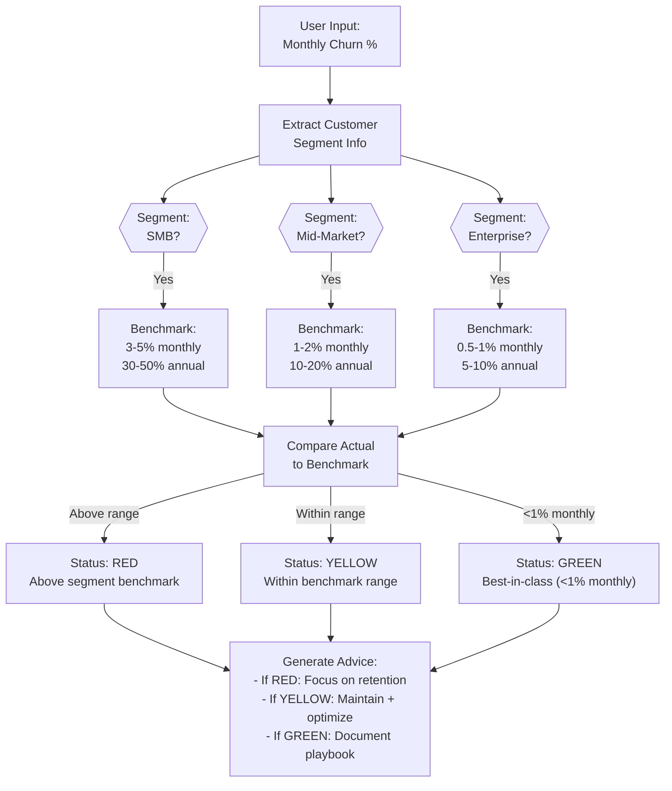
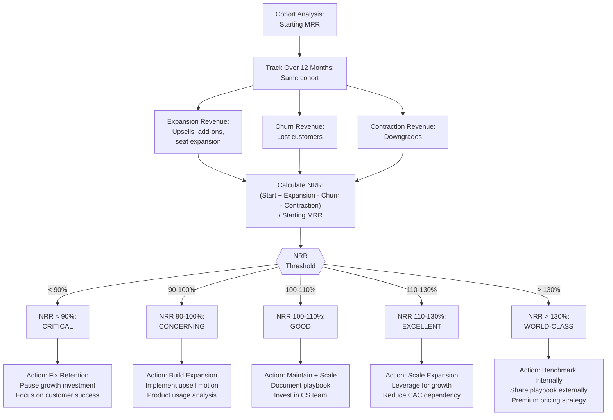
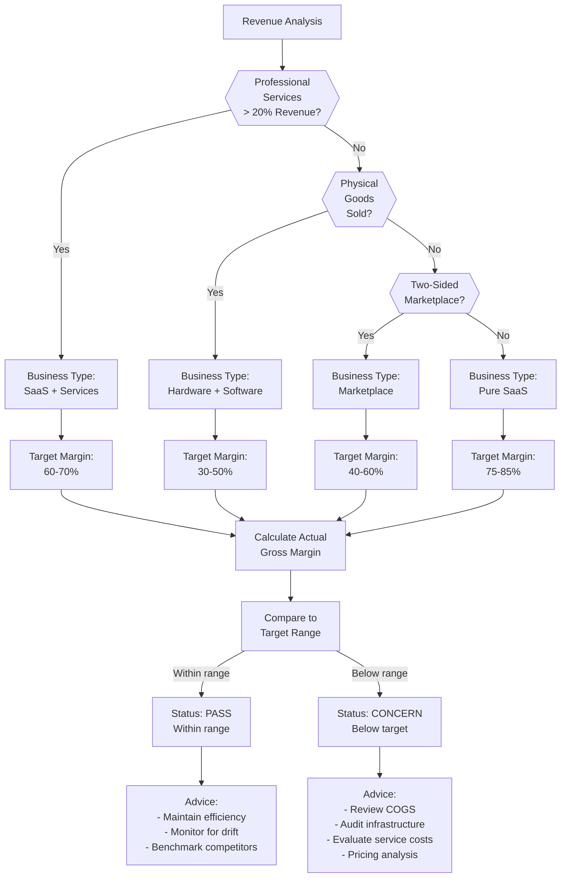
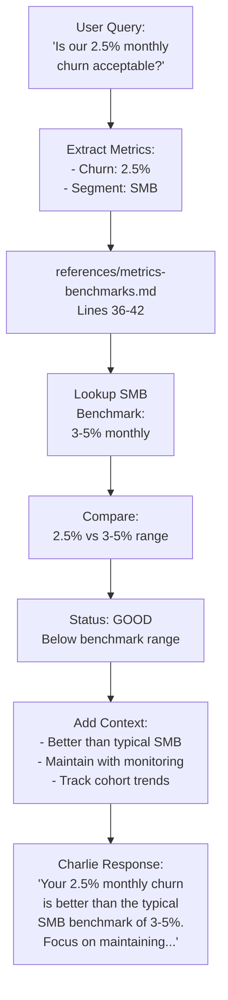

<!-- source: DeepWiki mcp.deepwiki.com · repo EveryInc/charlie-cfo-skill · extra page SaaS Metrics and Benchmarks · fetched 2026-10-26 -->

# SaaS Metrics and Benchmarks

<details>
<summary>Relevant source files</summary>

The following files were used as context for generating this wiki page:

- [references/metrics-benchmarks.md](references/metrics-benchmarks.md)

</details>


## Purpose and Scope

This document provides the SaaS-specific operational metrics and industry benchmarks that Charlie uses to assess recurring revenue business health. It focuses on customer retention metrics (churn, NRR), business model efficiency (gross margins), and segment-specific performance thresholds.

For unit economics calculations (LTV, CAC, payback periods), see [Unit Economics Calculations](#5.1.1). For cash flow metrics (runway, burn multiple, revenue per employee), see [Cash Flow and Efficiency Metrics](#5.1.3). For working capital optimization metrics, see [Working Capital and Rule of 40](#5.1.4).

Sources: [references/metrics-benchmarks.md:34-62]()

---

## Churn Rate Fundamentals

Churn rate measures the percentage of customers who cancel their subscription within a given period. Charlie treats churn as a critical survival metric because high churn creates a "leaky bucket" problem where new customer acquisition cannot outpace losses.

### Calculation Methodology

```
Monthly Churn Rate = (Customers Lost in Month) / (Customers at Start of Month) × 100

Annual Churn Rate = 1 - (1 - Monthly Churn)^12
```

**Important**: Do not simply multiply monthly churn by 12 to get annual churn. Use the compound formula above to account for the shrinking base.

### Segment-Specific Benchmarks

The acceptable churn rate varies dramatically by customer segment due to differences in contract value, switching costs, and business stability:

| Customer Segment | Monthly Churn | Annual Churn | Explanation |
|------------------|---------------|--------------|-------------|
| SMB | 3-5% | 30-50% | High volatility, business failures, lower switching costs |
| Mid-Market | 1-2% | 10-20% | More stable, higher implementation investment |
| Enterprise | 0.5-1% | 5-10% | Long sales cycles, deep integration, high switching costs |
| Best-in-class | <1% monthly | <10% annual | Product stickiness, strong customer success |

Sources: [references/metrics-benchmarks.md:36-42]()

### Churn Validation Flow



**Diagram**: Churn rate validation flow showing how Charlie compares user-reported churn against segment-specific benchmarks and generates status-based recommendations.

Sources: [references/metrics-benchmarks.md:36-42]()

---

## Net Revenue Retention (NRR)

Net Revenue Retention measures revenue retention from a cohort of customers over time, accounting for expansion (upsells, cross-sells), contraction (downgrades), and churn (cancellations). NRR above 100% indicates the cohort is growing revenue even without new customer acquisition.

### Formula and Components

```
NRR = (Starting MRR + Expansion - Churn - Contraction) / Starting MRR × 100
```

**Components breakdown:**
- **Starting MRR**: Monthly recurring revenue from a cohort at period start (typically measured annually)
- **Expansion**: Revenue from upsells, additional seats, feature upgrades within the cohort
- **Churn**: Revenue lost from customer cancellations
- **Contraction**: Revenue lost from downgrades (fewer seats, lower tier)

### Performance Thresholds

Charlie uses NRR as a growth sustainability indicator with the following interpretation framework:

| NRR Range | Status | Interpretation | Strategic Implication |
|-----------|--------|----------------|----------------------|
| <90% | Critical | Leaky bucket, growth unsustainable | Fix retention before investing in acquisition |
| 90-100% | Concerning | Acceptable but limited expansion | Need expansion revenue strategy |
| 100-110% | Good | Expansion offsetting churn | Solid foundation for growth |
| 110-130% | Excellent | Strong expansion motion | Efficient growth lever |
| >130% | World-class | Snowflake/Twilio territory | Expansion-led growth model |

Sources: [references/metrics-benchmarks.md:44-54]()

### NRR Analysis Framework



**Diagram**: Net Revenue Retention analysis framework showing how Charlie decomposes cohort revenue changes and applies threshold-based recommendations.

Sources: [references/metrics-benchmarks.md:44-54]()

### Relationship to Growth Sustainability

Charlie enforces a critical constraint: **if NRR < 90%, Capital Allocation Framework blocks new customer acquisition investment** until retention is fixed. This prevents the "leaky bucket" death spiral where companies burn capital acquiring customers faster than they lose them.

The logic is encoded in the framework dependencies: Unit Economics Framework (which includes NRR validation) must pass thresholds before Capital Allocation Framework approves growth spending.

Sources: [references/metrics-benchmarks.md:44-54]()

---

## Gross Margin Benchmarks

Gross margin measures the percentage of revenue retained after subtracting direct costs of delivering the product or service. For SaaS businesses, this includes hosting costs, customer support costs directly tied to delivery, and any variable fulfillment costs.

### Calculation

```
Gross Margin = (Revenue - COGS) / Revenue × 100

Where COGS includes:
- Infrastructure/hosting costs (AWS, GCP, Azure)
- Payment processing fees
- Direct customer success costs (if variable per customer)
- Third-party API costs (if significant)
- (For SaaS + Services) Professional services labor costs
```

### Business Model Benchmarks

Gross margin expectations vary dramatically by business model due to differences in variable cost structures:

| Business Type | Target Gross Margin | Key Cost Drivers |
|---------------|---------------------|------------------|
| Pure SaaS | 75-85% | Infrastructure scales sublinearly; minimal variable costs |
| SaaS + Services | 60-70% | Professional services labor reduces margin |
| Marketplace | 40-60% | Transaction costs, payment processing, support for two sides |
| Hardware + Software | 30-50% | Physical goods COGS, logistics, inventory risk |

Sources: [references/metrics-benchmarks.md:56-62]()

### Gross Margin Impact on Unit Economics

Gross margin directly constrains achievable LTV:CAC ratios and payback periods. Charlie uses gross margin as a multiplier in both calculations:

```
LTV = (ARPU × Gross Margin) / Monthly Churn Rate

CAC Payback (months) = CAC / (Monthly ARPU × Gross Margin)
```

**Critical implication**: A pure SaaS company with 80% gross margin can support 2.5x higher CAC than a SaaS+Services company with 60% gross margin for the same ARPU and churn rate, because the margin available to recover CAC is proportionally larger.

### Business Model Classification Logic



**Diagram**: Business model classification and gross margin validation logic showing how Charlie categorizes business types and applies model-specific margin benchmarks.

Sources: [references/metrics-benchmarks.md:56-62]()

---

## Integration with Charlie's Framework System

These SaaS metrics are not evaluated in isolation. Charlie integrates them across multiple frameworks to ensure holistic financial health assessment.

### Metric Usage Across Frameworks

| Metric | Primary Framework | Secondary Usage | Validation Gate |
|--------|-------------------|-----------------|-----------------|
| Churn Rate | Unit Economics | Forecasting (cohort decay), Customer Health (leading indicator) | LTV calculation input |
| NRR | Unit Economics | Forecasting (expansion assumptions), Capital Allocation (growth sustainability check) | <90% blocks growth investment |
| Gross Margin | Unit Economics | Capital Allocation (CAC payback calculation), Cash Management (contribution margin analysis) | Minimum 60% for SaaS businesses |

### Cross-Framework Validation Example

When evaluating a hiring decision for a sales role (Capital Allocation Framework), Charlie executes the following validation chain:

1. **Unit Economics Check**: Verify LTV:CAC ≥ 3:1 and CAC Payback < 12 months
2. **Churn Gate**: Ensure segment churn is within acceptable range (not actively leaking)
3. **NRR Gate**: Verify NRR ≥ 90% (not in critical retention crisis)
4. **Margin Check**: Confirm gross margin supports payback math at current ARPU levels
5. **Runway Impact**: Calculate burn increase and runway reduction (Cash Management Framework)

If any metric fails its threshold, the hiring decision is flagged as high-risk or blocked entirely.

Sources: [references/metrics-benchmarks.md:34-62]()

### Benchmark Retrieval Architecture



**Diagram**: Benchmark retrieval and validation flow showing how Charlie maps user metrics to segment-specific benchmarks from the metrics file and generates contextualized responses.

Sources: [references/metrics-benchmarks.md:36-42]()

---

## Practical Application Guidelines

### When Churn Exceeds Benchmarks

If reported churn exceeds segment benchmarks, Charlie provides a structured diagnostic framework:

1. **Cohort Analysis**: Break down churn by customer acquisition date to identify problematic cohorts
2. **Feature Usage**: Analyze correlation between feature adoption and churn risk
3. **NPS/CSAT**: Check if satisfaction scores predict churn (leading indicator)
4. **Onboarding Metrics**: Review time-to-value and activation rates for recent cohorts
5. **Support Ticket Volume**: High ticket volume often precedes churn

### When NRR Falls Below 100%

Charlie treats NRR < 100% as a critical growth constraint requiring immediate action:

**Immediate Actions**:
- Implement customer health scoring system
- Launch proactive customer success outreach
- Analyze reasons for contraction and churn (survey lost customers)
- Build upsell/cross-sell motion if lacking

**Investment Reallocation**:
- Shift budget from acquisition (S&M) to retention (CS)
- Pause aggressive growth targets until NRR recovers to 100%+
- Focus product development on stickiness features

### When Gross Margin Is Below Target

Low gross margins compress the margin available for CAC recovery, violating unit economics constraints:

**Cost Reduction Levers**:
- Audit cloud infrastructure for waste (rightsizing instances, reserved capacity)
- Negotiate enterprise agreements with cloud providers at scale
- Implement usage-based architecture to align costs with revenue
- Evaluate build vs buy for high-cost third-party APIs

**Revenue Enhancement Levers**:
- Value-based pricing to capture more from high-usage customers
- Usage-based pricing models to align revenue with costs
- Premium tier with differentiated features at higher margins

Sources: [references/metrics-benchmarks.md:34-62]()

---

## Summary Table: SaaS Metric Thresholds

| Metric | Segment/Type | Minimum Acceptable | Good | Best-in-Class | Action if Below Min |
|--------|--------------|-------------------|------|---------------|---------------------|
| Monthly Churn | SMB | 5% | 3-4% | <1% | Retention program |
| Monthly Churn | Mid-Market | 2% | 1-1.5% | <1% | Customer success expansion |
| Monthly Churn | Enterprise | 1% | 0.5-0.8% | <0.5% | Executive relationship mgmt |
| NRR | All SaaS | 90% | 100-110% | >130% | Fix retention before growth |
| Gross Margin | Pure SaaS | 70% | 75-80% | 85%+ | COGS optimization |
| Gross Margin | SaaS + Services | 55% | 60-65% | 70%+ | Service delivery efficiency |

Sources: [references/metrics-benchmarks.md:34-62]()

---

