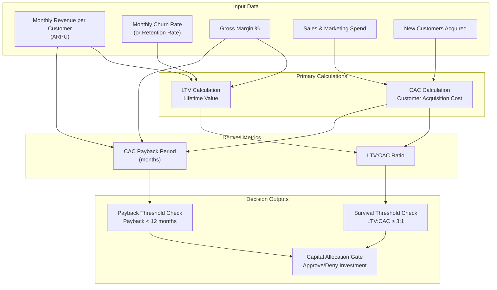
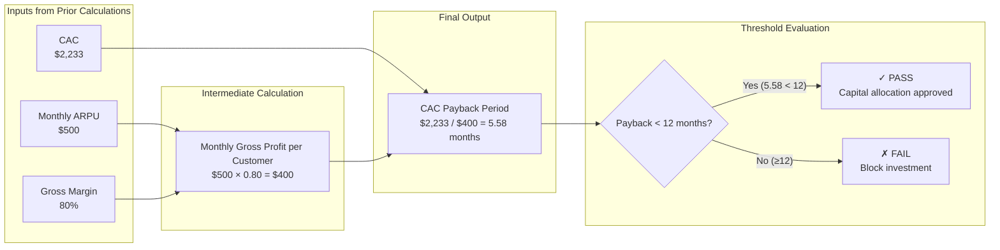
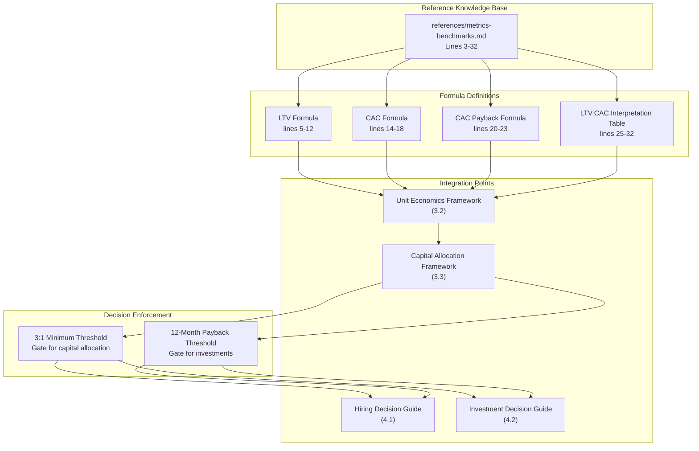
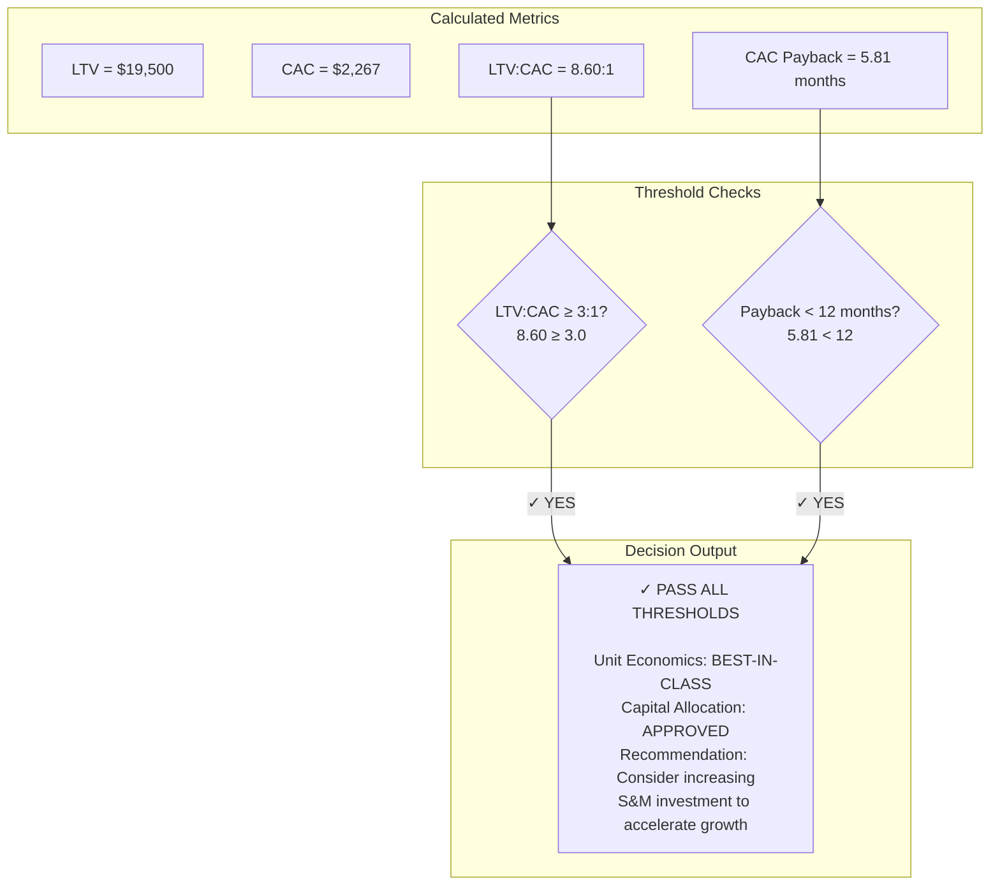
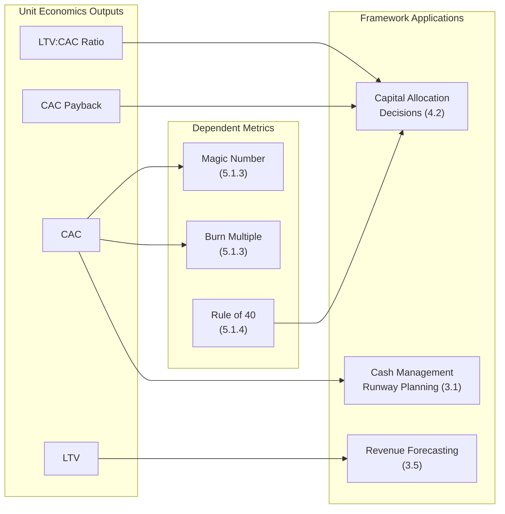

<!-- source: DeepWiki mcp.deepwiki.com · repo EveryInc/charlie-cfo-skill · extra page Unit Economics Calculations · fetched 2026-10-26 -->

# Unit Economics Calculations

<details>
<summary>Relevant source files</summary>

The following files were used as context for generating this wiki page:

- [references/metrics-benchmarks.md](references/metrics-benchmarks.md)

</details>


## Purpose and Scope

This document provides comprehensive technical documentation for calculating the four fundamental unit economics metrics that Charlie uses to assess business sustainability: **LTV (Lifetime Value)**, **CAC (Customer Acquisition Cost)**, **CAC Payback Period**, and **LTV:CAC Ratio**. These calculations form the quantitative foundation for the Unit Economics Framework and serve as survival thresholds that gate capital allocation decisions.

For broader context on how these metrics integrate with other financial frameworks, see [Unit Economics Framework](#3.2). For industry benchmarks and performance targets associated with these calculations, see [SaaS Metrics and Benchmarks](#5.1.2). For application of these metrics in decision-making, see [Investment and Spending Decisions](#4.2).

**Sources:** [references/metrics-benchmarks.md:1-33]()

---

## Unit Economics Metrics Relationships

The four core unit economics metrics form an interconnected calculation system where each metric either feeds into or validates others:



**Diagram: Unit Economics Calculation Flow and Dependencies**

This diagram illustrates how raw business metrics flow through primary calculations (LTV, CAC) to produce derived metrics (Payback, Ratio), which are then evaluated against hard thresholds defined in the Capital Allocation Framework. All formulas referenced here are defined in `references/metrics-benchmarks.md`.

**Sources:** [references/metrics-benchmarks.md:3-32]()

---

## LTV (Lifetime Value) Calculation

### Standard Formula

The primary LTV calculation method uses average revenue per user (ARPU), gross margin, and churn rate:

```
LTV = (ARPU × Gross Margin) / Monthly Churn Rate
```

**Component Definitions:**
- **ARPU**: Average Revenue Per User (monthly)
- **Gross Margin**: Revenue minus direct costs of service delivery, expressed as percentage
- **Monthly Churn Rate**: Percentage of customers who cancel per month

**Example Calculation:**
```
Given:
- ARPU = $500/month
- Gross Margin = 80% (0.80)
- Monthly Churn = 2% (0.02)

LTV = ($500 × 0.80) / 0.02
LTV = $400 / 0.02
LTV = $20,000
```

**Sources:** [references/metrics-benchmarks.md:5-8]()

### Cohort-Based Alternative Formula

For companies with more detailed data, a cohort-based calculation provides higher accuracy:

```
LTV = Sum of (Monthly Revenue × Retention Rate) over customer lifetime
```

This method calculates the actual revenue from a cohort month-by-month until the cohort is fully churned. It accounts for non-linear churn patterns and expansion revenue more accurately than the simplified formula.

**Example Calculation:**
```
Month 1: $500 × 100% = $500
Month 2: $500 × 98% = $490
Month 3: $500 × 96% = $480
...
[Sum continues until retention approaches 0%]
```

**Sources:** [references/metrics-benchmarks.md:9-12]()

### When to Use Each Method

| Method | Use Case | Accuracy | Data Requirements |
|--------|----------|----------|-------------------|
| Standard Formula | Quick assessments, stable churn | Approximation | Requires only ARPU, margin, churn |
| Cohort-Based | Annual planning, investor reporting | High precision | Requires cohort retention curves |

---

## CAC (Customer Acquisition Cost) Calculation

### Formula

```
CAC = (Sales + Marketing Spend) / New Customers Acquired
```

The CAC calculation aggregates all costs associated with acquiring customers and divides by the number of new customers added in the same period.

**Sources:** [references/metrics-benchmarks.md:14-18]()

### Included Cost Categories

The following table defines what costs **must be included** in the Sales + Marketing Spend numerator:

| Category | Included Items | Examples |
|----------|----------------|----------|
| **Personnel** | Salaries, commissions, benefits for sales & marketing teams | SDR salaries, AE commissions, marketing manager salaries |
| **Advertising** | All paid media spend | Google Ads, Facebook Ads, LinkedIn Ads, sponsorships |
| **Tools & Software** | Sales and marketing SaaS tools | CRM licenses (Salesforce), marketing automation (HubSpot), analytics tools |
| **Events & Conferences** | Booth costs, travel, materials | Trade show booth rental, conference sponsorships, promotional materials |
| **Content Production** | Costs of producing marketing content | Video production, copywriting services, design contractors |

**Important:** Include **fully-loaded costs** including benefits, taxes, and overhead allocation for personnel. Typical loading factor is 1.25-1.4× base salary.

**Sources:** [references/metrics-benchmarks.md:18]()

### Example Calculation

```
Monthly Calculation:
Sales Team Costs:
  - 2 SDRs @ $5,000/month each = $10,000
  - 1 AE @ $8,000/month = $8,000
  - Commissions paid = $3,000
  - Sales tools (CRM, dialers) = $500
  Subtotal: $21,500

Marketing Costs:
  - 1 Marketing Manager @ $6,000/month = $6,000
  - Paid advertising = $4,000
  - Marketing tools = $800
  - Content production = $1,200
  Subtotal: $12,000

Total S&M Spend: $33,500
New Customers Acquired: 15

CAC = $33,500 / 15 = $2,233.33
```

---

## CAC Payback Period Calculation

### Formula

```
CAC Payback (months) = CAC / (Monthly ARPU × Gross Margin)
```

The payback period measures how many months of gross profit from a customer are required to recover the acquisition cost. This is a **critical survival metric** — Charlie enforces a hard threshold of **< 12 months** for all capital allocation decisions.

**Sources:** [references/metrics-benchmarks.md:20-23]()

### Calculation Flow Diagram



**Diagram: CAC Payback Calculation and Threshold Validation**

This diagram shows the step-by-step calculation process and how the result is evaluated against the 12-month threshold enforced by the Capital Allocation Framework.

**Sources:** [references/metrics-benchmarks.md:20-23]()

### Example Calculation

Using the CAC calculated previously:

```
Given:
- CAC = $2,233.33 (from previous example)
- Monthly ARPU = $500
- Gross Margin = 80%

CAC Payback = $2,233.33 / ($500 × 0.80)
CAC Payback = $2,233.33 / $400
CAC Payback = 5.58 months

Interpretation: This customer will generate enough gross profit 
to pay back the acquisition cost in 5.58 months, which is well 
below the 12-month threshold.
```

---

## LTV:CAC Ratio Calculation and Interpretation

### Formula

```
LTV:CAC Ratio = LTV / CAC
```

This ratio expresses how many dollars of lifetime value are generated for each dollar spent on customer acquisition. It is the **primary survival threshold** in Charlie's unit economics framework.

**Sources:** [references/metrics-benchmarks.md:25-32]()

### Interpretation Thresholds

The following table defines the interpretation bands used throughout Charlie's decision-making logic:

| Ratio | Interpretation | Action Guidance | Status |
|-------|----------------|-----------------|--------|
| **< 1:1** | Losing money on every customer | Emergency: Stop all acquisition spend, fix unit economics | 🔴 Critical |
| **1-2:1** | Unsustainable economics | Cannot scale; improve pricing, reduce CAC, or increase retention | 🔴 Failing |
| **3:1** | **Healthy minimum threshold** | **Minimum required to approve capital allocation** | 🟡 Acceptable |
| **5:1+** | Excellent efficiency | Strong economics; may be underinvesting in growth | 🟢 Good |
| **7-8:1** | Best-in-class | World-class unit economics; aggressively fund growth | 🟢 Excellent |

**Critical Implementation Note:** Charlie's Capital Allocation Framework (see [Capital Allocation Framework](#3.3)) enforces a **hard gate** at 3:1. Any investment decision that would result in LTV:CAC < 3:1 is automatically rejected, regardless of other factors.

**Sources:** [references/metrics-benchmarks.md:25-32]()

### Example Calculation with Threshold Evaluation

```
Given:
- LTV = $20,000 (from first example)
- CAC = $2,233.33 (from second example)

LTV:CAC Ratio = $20,000 / $2,233.33
LTV:CAC Ratio = 8.96:1

Interpretation: This ratio of 8.96:1 indicates best-in-class unit 
economics. The company generates nearly $9 of lifetime value for 
every $1 spent on acquisition. This passes the 3:1 minimum threshold 
and suggests the company could potentially invest more aggressively 
in customer acquisition.
```

---

## Calculation Dependencies and Code Mapping

The following diagram maps the unit economics calculations to their storage location in the codebase and shows how they integrate with Charlie's framework system:



**Diagram: Code Entity Mapping for Unit Economics Calculations**

This diagram bridges natural language concepts to specific code locations. All formulas are defined in `references/metrics-benchmarks.md` lines 3-32, and these definitions are referenced by the various framework and decision guide modules throughout Charlie's system.

**Sources:** [references/metrics-benchmarks.md:3-32]()

---

## Comprehensive Worked Example

The following example demonstrates all four calculations in sequence for a realistic SaaS business:

### Company Profile: "TaskFlow" SaaS Product

**Monthly Operating Data:**
- Total monthly revenue: $75,000
- Active customers: 150
- New customers acquired this month: 15
- Customers churned this month: 3
- Gross margin: 78%

**Sales & Marketing Spend (Monthly):**
- Sales team salaries + commissions: $21,500
- Marketing team salaries: $6,000
- Paid advertising: $4,000
- Sales & marketing tools: $1,300
- Content production: $1,200
- **Total S&M Spend: $34,000**

### Step 1: Calculate ARPU and Churn Rate

```
ARPU = $75,000 / 150 customers = $500/month

Monthly Churn Rate = 3 churned / 150 active = 2.0%
```

### Step 2: Calculate LTV

```
LTV = (ARPU × Gross Margin) / Monthly Churn Rate
LTV = ($500 × 0.78) / 0.02
LTV = $390 / 0.02
LTV = $19,500
```

### Step 3: Calculate CAC

```
CAC = Total S&M Spend / New Customers Acquired
CAC = $34,000 / 15
CAC = $2,266.67
```

### Step 4: Calculate CAC Payback Period

```
CAC Payback = CAC / (Monthly ARPU × Gross Margin)
CAC Payback = $2,266.67 / ($500 × 0.78)
CAC Payback = $2,266.67 / $390
CAC Payback = 5.81 months
```

### Step 5: Calculate LTV:CAC Ratio

```
LTV:CAC Ratio = LTV / CAC
LTV:CAC Ratio = $19,500 / $2,266.67
LTV:CAC Ratio = 8.60:1
```

### Step 6: Evaluation Summary



**Diagram: TaskFlow Unit Economics Evaluation**

**Interpretation:** TaskFlow has best-in-class unit economics with an 8.60:1 LTV:CAC ratio and 5.81-month payback period. Both metrics exceed Charlie's thresholds. The company is generating $8.60 in lifetime value for every dollar spent on acquisition, and recovering acquisition costs in under 6 months. This profile would trigger Charlie's recommendation to **consider increasing S&M investment** to accelerate growth, as the strong unit economics indicate room for efficient scaling.

**Sources:** [references/metrics-benchmarks.md:3-32]()

---

## Common Calculation Pitfalls

### Pitfall 1: Mismatched Time Periods

**Error:** Using annual S&M spend with monthly new customer count.

```
❌ INCORRECT:
CAC = $408,000 (annual spend) / 15 (monthly customers) = $27,200

✓ CORRECT:
CAC = $34,000 (monthly spend) / 15 (monthly customers) = $2,267
```

**Solution:** Ensure numerator and denominator use the same time period. Typically calculate monthly and annualize results if needed.

### Pitfall 2: Incomplete Cost Inclusion

**Error:** Excluding tool costs or fully-loaded personnel costs.

```
❌ INCORRECT (missing tools and commissions):
CAC = $27,500 / 15 = $1,833

✓ CORRECT (all S&M costs included):
CAC = $34,000 / 15 = $2,267
```

**Solution:** Reference the included cost categories table in the CAC section. Include all sales and marketing personnel costs (with benefits loading), tools, advertising, events, and content production.

### Pitfall 3: Using Gross Revenue Instead of Gross Margin

**Error:** Calculating LTV or payback using revenue instead of gross profit.

```
❌ INCORRECT (using revenue):
LTV = $500 / 0.02 = $25,000

✓ CORRECT (using gross profit):
LTV = ($500 × 0.78) / 0.02 = $19,500
```

**Solution:** Always multiply ARPU by gross margin percentage before dividing by churn rate. Only the profit portion contributes to covering acquisition costs.

### Pitfall 4: Confusing Annual and Monthly Churn

**Error:** Using annual churn rate (20%) instead of monthly churn rate (≈1.85%).

```
❌ INCORRECT (using 20% annual churn):
LTV = $390 / 0.20 = $1,950

✓ CORRECT (using 1.85% monthly churn):
LTV = $390 / 0.0185 = $21,081
```

**Solution:** Ensure churn rate matches the ARPU time period. If ARPU is monthly, use monthly churn. To convert: `Monthly Churn ≈ 1 - (1 - Annual Churn)^(1/12)`.

---

## Formula Reference Table

This table consolidates all formulas for quick reference:

| Metric | Formula | Components | File Reference |
|--------|---------|------------|----------------|
| **LTV** | `(ARPU × Gross Margin) / Monthly Churn Rate` | ARPU: Average revenue per user/month<br/>Gross Margin: Revenue - COGS, as %<br/>Churn: Monthly cancellation rate | [references/metrics-benchmarks.md:5-8]() |
| **LTV (Cohort)** | `Sum of (Monthly Revenue × Retention Rate)` | Monthly Revenue: Per-customer revenue<br/>Retention Rate: % still active each month | [references/metrics-benchmarks.md:9-12]() |
| **CAC** | `(Sales + Marketing Spend) / New Customers` | S&M Spend: All acquisition costs<br/>New Customers: Count of new customers acquired | [references/metrics-benchmarks.md:14-18]() |
| **CAC Payback** | `CAC / (Monthly ARPU × Gross Margin)` | CAC: Customer acquisition cost<br/>Monthly ARPU: Average revenue per user/month<br/>Gross Margin: Revenue - COGS, as % | [references/metrics-benchmarks.md:20-23]() |
| **LTV:CAC Ratio** | `LTV / CAC` | LTV: Lifetime value<br/>CAC: Customer acquisition cost | [references/metrics-benchmarks.md:25-26]() |

**Sources:** [references/metrics-benchmarks.md:3-32]()

---

## Integration with Other Metrics

Unit economics calculations serve as **prerequisite inputs** for several other financial metrics and frameworks:



**Diagram: Unit Economics as Input to Other Systems**

The unit economics metrics calculated here propagate throughout Charlie's framework system. CAC feeds into the Magic Number (sales efficiency) and Burn Multiple calculations. The LTV:CAC ratio and CAC Payback are **direct inputs** to capital allocation decisions. LTV influences revenue forecasting models, and CAC impacts cash management planning (since acquisition spend affects burn rate).

**Sources:** [references/metrics-benchmarks.md:3-32]()

---

## Related Documentation

- **[Unit Economics Framework](#3.2)** - Explains how these calculations integrate into Charlie's strategic framework and decision-making philosophy
- **[SaaS Metrics and Benchmarks](#5.1.2)** - Provides industry benchmark targets for churn, NRR, and gross margin metrics used in these calculations
- **[Cash Flow and Efficiency Metrics](#5.1.3)** - Documents metrics that depend on unit economics outputs, including Magic Number and Burn Multiple
- **[Evaluating Hiring Decisions](#4.1)** - Shows practical application of unit economics thresholds in hiring ROI analysis
- **[Investment and Spending Decisions](#4.2)** - Details how the 3:1 LTV:CAC and 12-month payback thresholds gate capital allocation

---

