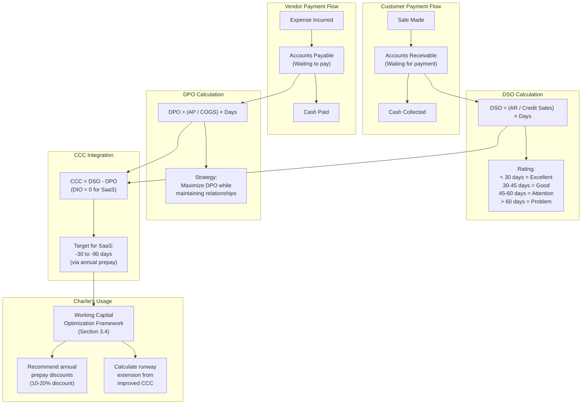
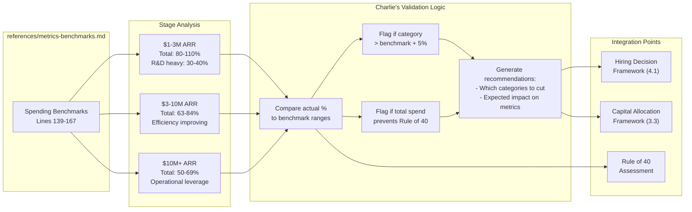
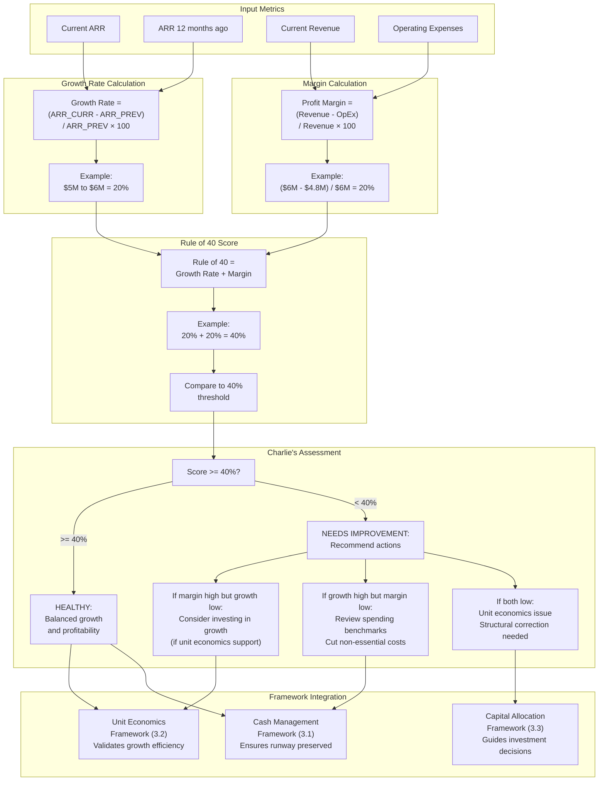
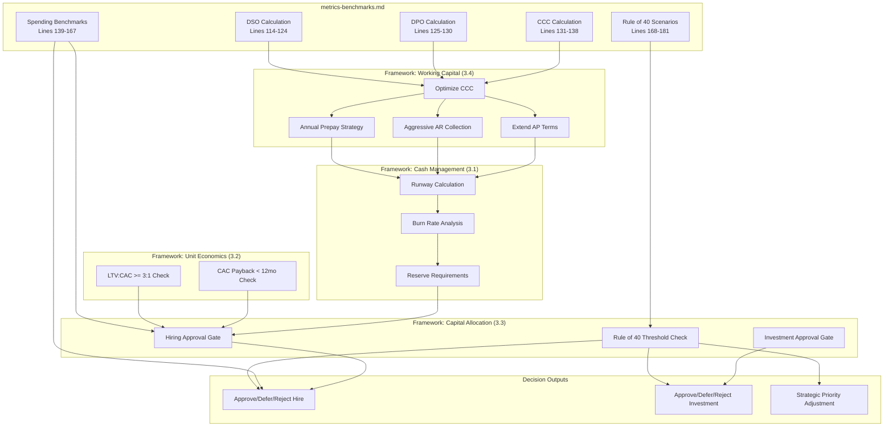

<!-- source: DeepWiki mcp.deepwiki.com · repo EveryInc/charlie-cfo-skill · extra page Working Capital and Rule of 40 · fetched 2026-10-26 -->

# Working Capital and Rule of 40

<details>
<summary>Relevant source files</summary>

The following files were used as context for generating this wiki page:

- [references/metrics-benchmarks.md](references/metrics-benchmarks.md)

</details>


## Purpose and Scope

This page documents the working capital metrics and Rule of 40 calculations that Charlie uses to assess operational efficiency and financial health. Working capital metrics (DSO, DPO, CCC) measure how effectively a company manages cash tied up in operations, while the Rule of 40 provides a unified health score balancing growth and profitability. These metrics complement the unit economics and cash management frameworks documented elsewhere.

For unit economics calculations (LTV, CAC, payback), see [5.1.1](#5.1.1). For cash flow metrics (runway, burn multiple), see [5.1.3](#5.1.3). For broader capital allocation decisions using these metrics, see [3.3](#3.3).

---

## Working Capital Metrics

Working capital metrics measure the efficiency of cash flow operations, focusing on how quickly a company converts operational activities into cash. For SaaS companies, these metrics are critical because annual prepayment strategies can create negative cash conversion cycles, effectively making customers fund operations.

### Days Sales Outstanding (DSO)

DSO measures the average number of days it takes to collect payment after a sale. Lower DSO indicates faster cash collection and better working capital management.

**Formula:**
```
DSO = (Accounts Receivable / Total Credit Sales) × Days in Period
```

**Interpretation Thresholds:**

| DSO Range | Rating | Action Required |
|-----------|--------|-----------------|
| < 30 days | Excellent | Standard monitoring |
| 30-45 days | Good | Track trends |
| 45-60 days | Needs attention | Review collections process |
| > 60 days | Problem | Immediate action required |

For bootstrapped SaaS companies, maintaining DSO below 45 days is critical to preserve runway. Charlie flags DSO > 60 days as requiring immediate intervention because it signals that AR is consuming capital that could extend runway by 1-2 months.

Sources: [references/metrics-benchmarks.md:112-124]()

### Days Payable Outstanding (DPO)

DPO measures how long a company takes to pay its vendors. Higher DPO (within contractual limits) improves cash position by delaying cash outflows.

**Formula:**
```
DPO = (Accounts Payable / COGS) × Days in Period
```

**Strategy:**
Charlie recommends negotiating the highest DPO possible while maintaining vendor relationships. For SaaS companies with low COGS, this metric is less impactful than for hardware or service companies. However, for operating expenses (hosting, tooling), negotiating 45-60 day payment terms instead of 30-day terms can improve cash position.

Sources: [references/metrics-benchmarks.md:125-130]()

### Cash Conversion Cycle (CCC)

The CCC integrates DSO, DPO, and inventory metrics to show the net time between cash outflows for operations and cash inflows from customers. For SaaS companies, this metric becomes powerful with annual prepayment strategies.

**Formula:**
```
CCC = DIO + DSO - DPO
```

Where:
- **DIO** (Days Inventory Outstanding) = typically 0 for pure SaaS
- **DSO** = Days Sales Outstanding
- **DPO** = Days Payable Outstanding

**SaaS-Specific Optimization:**

For SaaS companies offering annual prepayment discounts (typically 10-20% discount for paying 12 months upfront), the CCC can become significantly negative:

```
Target CCC = -30 to -90 days
```

A negative CCC means customers are paying before the company incurs costs to serve them, effectively providing interest-free working capital financing. Charlie recommends annual prepayment strategies specifically to achieve this outcome.

**Example Calculation:**
```
Company A (Monthly Billing):
  DSO = 35 days
  DPO = 30 days
  DIO = 0 (SaaS)
  CCC = 0 + 35 - 30 = 5 days

Company B (Annual Prepay with 15% discount):
  DSO = -300 days (received 12 months upfront)
  DPO = 30 days
  DIO = 0 (SaaS)
  CCC = 0 + (-300) - 30 = -330 days
```

Sources: [references/metrics-benchmarks.md:131-138]()

### Working Capital Metrics Integration Diagram



Sources: [references/metrics-benchmarks.md:112-138]()

---

## Spending Benchmarks by ARR Stage

Charlie uses spending benchmarks to assess whether a company's cost structure is appropriate for its revenue stage. These benchmarks differ significantly between bootstrapped and VC-backed companies, with bootstrapped companies typically running 20-30% leaner across all categories.

The spending categories tracked are:
- **Sales**: Direct sales team costs (salaries, commissions, travel)
- **Marketing**: Advertising, content, events, tools
- **R&D**: Engineering, product management, design
- **Customer Success**: Support, onboarding, account management
- **G&A**: Finance, HR, legal, facilities

### $1-3M ARR (Early Stage)

At this stage, companies are establishing product-market fit and building foundational processes. R&D typically consumes the largest percentage as the product is still being built out.

| Category | % of ARR | Notes |
|----------|----------|-------|
| Sales | 15-20% | Often founder-led sales |
| Marketing | 10-15% | Content and inbound focus |
| R&D | 30-40% | Building core product |
| Customer Success | 10-15% | High-touch onboarding |
| G&A | 15-20% | Establishing processes |
| **Total** | **80-110%** | Often unprofitable at this stage |

**Charlie's Interpretation:**
- If R&D > 40%, flags as potentially over-engineering before PMF
- If Sales + Marketing > 35%, flags as potentially spending ahead of validated CAC payback
- If G&A > 20%, flags for potential efficiency improvements

Sources: [references/metrics-benchmarks.md:141-149]()

### $3-10M ARR (Growth Stage)

At this stage, product-market fit is established and the company is scaling go-to-market. Spending ratios should decrease across all categories as revenue grows faster than headcount.

| Category | % of ARR | Notes |
|----------|----------|-------|
| Sales | 10-15% | Scaling sales team |
| Marketing | 8-12% | Proven channels scaling |
| R&D | 25-30% | Product expansion |
| Customer Success | 8-12% | More self-service |
| G&A | 12-15% | Operational leverage improving |
| **Total** | **63-84%** | Path to profitability visible |

**Charlie's Interpretation:**
- If total spend > 90%, flags concern about path to Rule of 40
- If R&D declining below 25%, questions investment in product differentiation
- If Customer Success > 12%, examines whether product needs improvement to reduce support load

Sources: [references/metrics-benchmarks.md:150-158]()

### $10M+ ARR (Scale Stage)

At scale, companies should demonstrate operational leverage with all spending categories as percentage of ARR continuing to decline.

| Category | % of ARR | Notes |
|----------|----------|-------|
| Sales | 8-12% | Efficient sales motion |
| Marketing | 6-10% | Brand and demand gen |
| R&D | 20-25% | Sustained innovation |
| Customer Success | 6-10% | Product-led retention |
| G&A | 10-12% | Full operational leverage |
| **Total** | **50-69%** | Strong profitability |

**Charlie's Interpretation:**
- If total spend > 70%, flags that company is not achieving scale efficiencies
- If R&D < 20%, concerns about long-term competitiveness
- Rule of 40 should be easily achievable at this stage with proper execution

Sources: [references/metrics-benchmarks.md:159-167]()

### Spending Benchmarks Comparison Diagram



Sources: [references/metrics-benchmarks.md:139-167]()

---

## Rule of 40

The Rule of 40 is a unified health metric for SaaS companies that balances growth and profitability. It states that a healthy SaaS company should have the sum of its growth rate and profit margin equal to or exceed 40%.

### Formula

```
Rule of 40 = Revenue Growth Rate (%) + Profit Margin (%)
```

Where:
- **Revenue Growth Rate** = YoY ARR or revenue growth percentage
- **Profit Margin** = Operating margin or free cash flow margin (be consistent)

### Interpretation

| Score | Interpretation | Typical Stage |
|-------|---------------|---------------|
| < 0% | Burning cash with no growth | Crisis situation |
| 0-20% | Weak performance | Needs correction |
| 20-40% | Below benchmark | Room for improvement |
| **40%+** | **Healthy benchmark** | **Target achieved** |
| 50%+ | Strong performance | Top quartile bootstrapped |
| 60%+ | Exceptional | Best-in-class |

**Industry Context:**
- **Median public SaaS**: 34% (most don't hit 40%)
- **Top quartile bootstrapped companies**: 50%+ (due to profitability focus)
- **High-growth VC-backed**: Often 20-30% (sacrificing margin for growth)

Sources: [references/metrics-benchmarks.md:168-181]()

### Rule of 40 Scenarios Matrix

The Rule of 40 allows for different combinations of growth and profitability to achieve the same score. This flexibility reflects different strategic choices.

| Growth Rate | Required Margin | Rule of 40 | Strategic Profile | Example Context |
|-------------|-----------------|------------|-------------------|-----------------|
| 50% | -10% (burning) | 40% | Hypergrowth mode | Land grab, strong unit economics |
| 40% | 0% (breakeven) | 40% | Aggressive growth | Reinvesting all profit |
| 30% | 10% (profitable) | 40% | Balanced | Sustainable scaling |
| 20% | 20% (profitable) | 40% | Profitable growth | Mature market position |
| 10% | 30% (profitable) | 40% | High margin | Market leader, stable |
| 0% | 40% (profitable) | 40% | Cash cow | Maximizing profit extraction |

**Charlie's Strategic Interpretation:**

1. **50% growth, -10% margin**: Only acceptable if:
   - LTV:CAC > 3:1 is maintained
   - CAC payback < 12 months
   - Runway > 24 months remains after burn
   - Clear path to profitability within 12-18 months

2. **30% growth, 10% margin**: The "balanced" target Charlie typically recommends for bootstrapped companies in $3-10M ARR stage

3. **20% growth, 20% margin**: Typical profile for bootstrapped companies > $10M ARR achieving operational leverage

4. **10% growth, 30% margin**: Often the profile of mature bootstrapped companies (Basecamp, Zoho) prioritizing profit over growth

Sources: [references/metrics-benchmarks.md:168-181]()

### Rule of 40 Calculation Flow



Sources: [references/metrics-benchmarks.md:168-181]()

---

## Integration with Charlie's Decision Frameworks

These metrics don't operate in isolation—they integrate across multiple frameworks to inform holistic financial decision-making.

### Working Capital → Cash Management

Working capital optimization directly extends runway by accelerating cash collection and delaying cash payments:

**Example:**
```
Current State:
  Runway: 18 months
  DSO: 60 days
  DPO: 30 days
  MRR: $400K
  
Improved State (annual prepay + negotiated terms):
  DSO: 15 days (90% annual prepay adoption)
  DPO: 45 days (renegotiated vendor terms)
  
Cash Flow Impact:
  Accelerated collections: 45 days × $400K/30 = $600K pulled forward
  Delayed payments: 15 days × $200K/30 = $100K delayed
  Total cash impact: $700K
  
New Runway: 18 months + ($700K / $80K burn) = 26.75 months
```

This is why Charlie's Working Capital Optimization framework [3.4](#3.4) emphasizes annual prepayment strategies for bootstrapped companies—it's often the fastest way to extend runway without raising capital.

### Rule of 40 → Capital Allocation

The Rule of 40 score directly influences investment decisions. Charlie uses it as a gate:

**Decision Logic:**
```
IF Rule of 40 < 40%:
  - Flag all new hiring requests for extra scrutiny
  - Require < 6 month payback for new investments (vs. standard 12 month)
  - Prioritize cost reduction over growth investment
  
IF Rule of 40 >= 40% AND Unit Economics healthy (LTV:CAC > 3:1):
  - Standard capital allocation thresholds apply
  - Can consider growth investments with 12 month payback
  
IF Rule of 40 >= 50%:
  - May be underinvesting in growth
  - Review if growth rate constraints are due to capital limitation or market
```

This logic is embedded in the Capital Allocation Framework [3.3](#3.3) and surfaces in hiring decisions [4.1](#4.1).

### Spending Benchmarks → Hiring Decisions

When evaluating a hiring request, Charlie cross-references spending benchmarks:

**Example Evaluation:**
```
Hiring Request: Senior Engineer ($160K fully loaded)
Company State:
  ARR: $4M (Growth Stage)
  Current R&D spend: $1.2M (30% of ARR)
  Benchmark: 25-30% for $3-10M ARR stage

Charlie's Analysis:
1. Check benchmark: 30% is at upper bound ✓
2. Calculate post-hire: ($1.2M + $160K) / $4M = 34% 
3. Flag: "This hire would push R&D to 34%, exceeding benchmark for stage"
4. Require demonstration of:
   - Direct revenue impact within 12 months, OR
   - Essential technical debt resolution, OR
   - Critical feature for retention/expansion
```

This prevents category spend creep that degrades the path to Rule of 40.

Sources: [references/metrics-benchmarks.md:112-181]()

### Cross-Framework Dependency Map



Sources: [references/metrics-benchmarks.md:112-181]()

---

## Practical Usage Examples

### Example 1: Working Capital Optimization

**Scenario:** SaaS company at $3M ARR, 15 months runway, wants to extend runway without cutting costs.

**Current State:**
```
Monthly Burn: $200K
Cash Balance: $3M
Runway: 15 months
DSO: 55 days (mostly net-30 invoices)
Annual prepay adoption: 10%
```

**Charlie's Recommendation:**
```
1. Implement aggressive annual prepay promotion:
   - Offer 15% discount for annual prepay
   - Target: 60% of customers convert
   
2. Impact calculation:
   Current MRR: $250K
   60% × $250K = $150K → annual ($1.8M)
   Discount cost: $1.8M × 15% = $270K
   Net cash accelerated: $1.8M - $270K = $1.53M received upfront
   
3. New financial position:
   Cash: $3M + $1.53M = $4.53M
   Monthly MRR drops to: $100K (40% remaining on monthly)
   But annual customers already paid: $1.8M covers 18 months
   Effective runway: 30+ months
   
4. DSO improvement:
   New blended DSO: (60% × -300 days) + (40% × 30 days) = -168 days
   Negative DSO means cash collected before service delivered
```

This is the canonical working capital optimization Charlie recommends for bootstrapped SaaS.

Sources: [references/metrics-benchmarks.md:131-138]()

### Example 2: Rule of 40 Health Check

**Scenario:** Company at $8M ARR evaluating strategic options.

**Current Metrics:**
```
ARR: $8M (up from $6M last year)
Growth Rate: ($8M - $6M) / $6M = 33.3%
Revenue: $8M
Operating Expenses: $6M
Operating Margin: ($8M - $6M) / $8M = 25%
Rule of 40: 33.3% + 25% = 58.3%
```

**Charlie's Assessment:**
```
Rule of 40: 58.3% - HEALTHY (well above 40% threshold)

Strategic Options Analysis:
1. Current trajectory: Balanced growth + profitability
2. Could accelerate growth by reinvesting margin:
   - If invest additional $1M in S&M (25% → 12.5% margin)
   - Would need to increase growth to 27.5% to maintain Rule of 40
   - Question: Can unit economics (LTV:CAC) support faster growth?
   
3. Could increase margin by reducing growth spend:
   - Typical for companies approaching $10M ARR
   - Would naturally improve as operational leverage kicks in
   
Recommendation: 
- Current 58.3% is strong performance
- Check if market opportunity supports maintaining 30%+ growth
- If yes: maintain current balance
- If market saturating: begin shifting to margin optimization (20% growth, 35% margin still hits 55%)
```

Sources: [references/metrics-benchmarks.md:168-181]()

### Example 3: Spending Benchmark Violation

**Scenario:** Startup at $2M ARR requests approval for marketing manager hire.

**Current State:**
```
ARR: $2M
Stage: $1-3M ARR (Early Stage)
Current Marketing Spend: $350K (17.5% of ARR)
Benchmark: 10-15% for stage
Proposed Hire: $120K fully loaded
Post-hire Marketing: $470K (23.5% of ARR)
```

**Charlie's Analysis:**
```
Category Benchmark Violation:
- Current: 17.5% (already 2.5% above benchmark ceiling)
- Post-hire: 23.5% (8.5% above benchmark)
- Flag: EXCEEDS BENCHMARK - REJECT

Questions to answer before approval:
1. What is current CAC payback period?
   - If < 9 months: May justify above-benchmark spend
   - If > 12 months: Must fix efficiency before adding headcount

2. What marketing channels are working?
   - If clear ROI-positive channels capacity-constrained: Consider
   - If still testing channels: Defer hire, optimize current spend

3. Impact on Rule of 40:
   Current path to Rule of 40: Would need 57.5% growth to offset 17.5% margin hit
   
Alternative Recommendation:
- Audit current $350K marketing spend
- Identify bottom 25% performing channels/tactics
- Reallocate $100K from low-ROI to high-ROI activities
- Revisit hiring request in 6 months if growth accelerates
```

This demonstrates how spending benchmarks gate hiring decisions and force capital efficiency.

Sources: [references/metrics-benchmarks.md:139-149]()

---

## Summary

This page documented the working capital and Rule of 40 metrics that Charlie uses for operational efficiency assessment:

**Working Capital Metrics:**
- **DSO** (Days Sales Outstanding): Target < 45 days for healthy AR management
- **DPO** (Days Payable Outstanding): Maximize within vendor relationship constraints
- **CCC** (Cash Conversion Cycle): Target -30 to -90 days for SaaS via annual prepay

**Spending Benchmarks:**
- Vary by ARR stage ($1-3M, $3-10M, $10M+)
- Used to gate hiring decisions and prevent category spend creep
- Integrated with Rule of 40 analysis to ensure path to profitability

**Rule of 40:**
- Formula: Growth Rate (%) + Profit Margin (%) ≥ 40%
- Balances growth and profitability in single health metric
- Drives capital allocation decisions and strategic priority setting

These metrics integrate across all five frameworks, with working capital optimization feeding into cash management, spending benchmarks gating capital allocation, and Rule of 40 scores determining strategic direction.

Sources: [references/metrics-benchmarks.md:112-181]()

---

