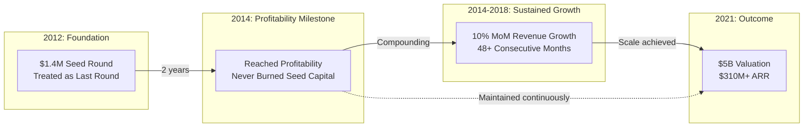
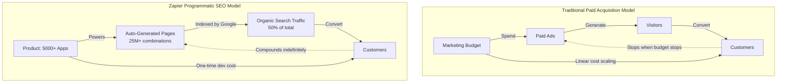
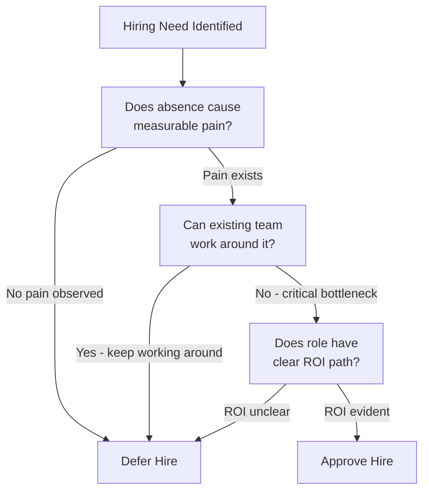
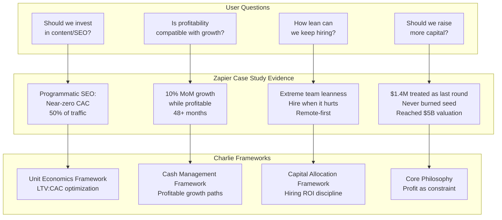
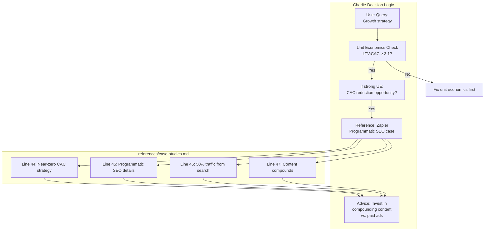

<!-- source: DeepWiki mcp.deepwiki.com · repo EveryInc/charlie-cfo-skill · extra page Zapier: $5B Valuation on Minimal Funding · fetched 2026-10-26 -->

# Zapier: $5B Valuation on Minimal Funding

<details>
<summary>Relevant source files</summary>

The following files were used as context for generating this wiki page:

- [references/case-studies.md](references/case-studies.md)

</details>


## Purpose and Scope

This document analyzes Zapier's bootstrapped growth strategy, examining how the company achieved a $5B valuation on only $1.4M in funding. The case study provides concrete examples of profitability-first growth, programmatic SEO as a CAC replacement strategy, and extreme capital efficiency. Charlie CFO Skill references this case study when advising on growth strategies that maintain unit economics, SEO investment decisions, and hiring discipline.

For other bootstrapped case studies, see: [Mailchimp](#5.2.1), [Basecamp](#5.2.3), [ConvertKit](#5.2.4), [Zoho](#5.2.5). For synthesized patterns across all cases, see [Common Patterns](#5.2.6). For the quantitative benchmarks that these cases exemplify, see [Metrics and Benchmarks Reference](#5.1).

**Sources:** [references/case-studies.md:32-58]()

---

## Financial Profile

| Metric | Value | Significance |
|--------|-------|--------------|
| Total Funding | $1.4M (2012 seed) | Treated as final round; never raised again |
| Current Valuation | $5B (2021) | 3,571x return on capital raised |
| ARR | $310M+ | Achieved through organic growth |
| Time to Profitability | 2 years (2014) | Maintained continuously since |
| Growth Rate | 10% MoM | Sustained for 48+ consecutive months |
| Capital Burned | $0 from seed | Never touched seed capital post-profitability |

Zapier demonstrates that venture-scale outcomes ($5B+ valuations) are achievable through bootstrapped discipline when unit economics and CAC efficiency are prioritized from inception. The company's $1.4M seed round served as runway insurance rather than growth fuel, never being depleted because profitability was reached before capital exhaustion.

**Sources:** [references/case-studies.md:32-43]()

---

## Timeline: Profitability-First Growth Model



**Zapier Timeline: Capital Efficiency Through Early Profitability**

The timeline reveals Zapier's core financial strategy: achieve profitability before seed capital depletion, then compound growth from cash flow rather than external funding. The 2-year path to profitability ensured the $1.4M seed remained unburned, providing permanent runway insurance. The subsequent 48+ months of 10% MoM growth (approximately 214% annual growth compounded) demonstrates that profitability and hypergrowth are not mutually exclusive when CAC efficiency is optimized.

**Sources:** [references/case-studies.md:40-42]()

---

## Near-Zero CAC Strategy: Programmatic SEO

### Strategy Components

Zapier's CAC efficiency stems from a programmatic SEO approach that leverages product architecture as a content generation engine:

| Component | Implementation | Financial Impact |
|-----------|----------------|------------------|
| **Auto-Generated Landing Pages** | Created pages for every integration combination (e.g., "Connect Gmail to Slack") | Exponential content growth without linear cost |
| **Search Traffic Dominance** | 50% of total traffic from organic search | Zero marginal acquisition cost per visitor |
| **Content Compounding** | Old pages continue generating traffic indefinitely | CAC decreases over time vs. paid ads |
| **Integration Ecosystem** | 5,000+ apps → 25M+ possible combinations | Network effects in content |

**Sources:** [references/case-studies.md:44-47]()

### CAC Efficiency Diagram



**Zapier CAC Strategy: Paid vs. Programmatic SEO Economics**

The diagram contrasts linear-cost paid acquisition (ongoing spend required) with Zapier's compounding SEO model (one-time development investment with perpetual returns). Traditional paid acquisition exhibits constant or increasing CAC as channels saturate. Zapier's programmatic approach exhibits decreasing CAC over time as the content library compounds and each new integration creates exponential landing page combinations.

**Mathematical implication:** If Zapier creates N integrations, programmatic landing pages grow at O(N²) complexity (every integration can connect to every other integration). A platform with 5,000 apps generates 5,000² = 25M potential landing pages, each targeting a specific long-tail search query with commercial intent.

**Sources:** [references/case-studies.md:44-47]()

---

## "Hire When It Hurts" Philosophy

### Capital Allocation Discipline

Zapier's hiring philosophy directly implements Charlie's Capital Allocation Framework principle that new hires must clear a high ROI threshold before approval.



**Zapier Hiring Decision Tree: "Hire When It Hurts" Implementation**

This decision tree codifies Zapier's hiring discipline. The philosophy requires three conditions before approval:
1. **Pain Test:** Absence creates measurable operational pain (missed SLAs, lost deals, customer churn)
2. **Workaround Exhaustion:** Existing team cannot mitigate through process changes or automation
3. **ROI Clarity:** Role has defined revenue contribution or cost avoidance pathway

This approach kept Zapier's team "extremely lean during growth phase," directly contributing to revenue per employee efficiency.

**Sources:** [references/case-studies.md:49-52]()

### Remote-First Cost Structure

Zapier's remote-first model implemented a fundamental cost structure arbitrage:

| Cost Category | Office-Based Model | Remote-First Model | Delta |
|---------------|-------------------|-------------------|-------|
| Real Estate | $50-100/sq ft × employee count | $0 | -100% |
| Geographic Wage Constraints | SF Bay Area salary bands required | Location-independent compensation | -20-40% average |
| Commute Time Waste | 2-3 hours/day × employee count | $0 | Productivity gain |
| Hiring Pool | Local market only | Global talent access | 100x expansion |

The remote-first strategy reduces fixed overhead (real estate) and enables geographic wage arbitrage while expanding the talent pool. This directly enhances the Capital Allocation Framework's ROI calculations by lowering the denominator (cost per hire) while maintaining or increasing the numerator (productivity).

**Sources:** [references/case-studies.md:49-52]()

---

## How Charlie Uses This Case Study

### Framework Mapping

Charlie references Zapier when users ask questions that map to these financial frameworks:



**Charlie Framework Mapping: Zapier Case Study Usage Patterns**

Charlie invokes Zapier evidence when:
1. **Unit Economics questions:** Programmatic SEO as CAC reduction strategy (maps to [Unit Economics Framework](#3.2))
2. **Growth-profitability tension:** Proof that 10% MoM growth and profitability can coexist (maps to [Cash Management Framework](#3.1))
3. **Hiring decisions:** "Hire when it hurts" as implementation of ROI discipline (maps to [Capital Allocation Framework](#3.3))
4. **Fundraising questions:** $1.4M → $5B trajectory proves capital efficiency (maps to [Core Philosophy](#2))

**Sources:** [references/case-studies.md:54-57]()

### Code Integration

The Zapier case study is stored in structured markdown and referenced by Charlie through pattern matching:

```
references/case-studies.md
├── Lines 32-58: Zapier section
│   ├── Lines 32-36: Financial profile data
│   ├── Lines 38-43: Key financial decisions
│   ├── Lines 44-52: Strategy breakdowns
│   └── Lines 54-57: Extracted lessons
```

When Charlie processes queries, it searches `case-studies.md` for relevant patterns. For example:
- Query mentions "SEO" or "content marketing" → Extract [references/case-studies.md:44-47]() (programmatic SEO strategy)
- Query mentions "hiring" or "lean team" → Extract [references/case-studies.md:49-52]() (hire when it hurts)
- Query mentions "profitability" + "growth" → Extract [references/case-studies.md:40-42]() (10% MoM while profitable)

**Sources:** [references/case-studies.md:32-58]()

---

## Key Lessons and Application

### Extracted Principles

From the Zapier case study, Charlie extracts three operational principles that inform financial advice:

| Principle | Zapier Evidence | Charlie Application | Relevant Framework |
|-----------|-----------------|---------------------|-------------------|
| **SEO at scale replaces paid acquisition** | 50% traffic from search, near-zero CAC | Recommend content/SEO investment over paid channels when LTV:CAC permits upfront investment | [Unit Economics Framework](#3.2) |
| **Seed as final round forces discipline** | Never burned $1.4M seed, treated as last capital | Recommend runway targets that assume no future funding (24-36 months) | [Cash Management Framework](#3.1) |
| **RPE matters more than headcount** | Kept team "extremely lean," remote-first efficiency | Evaluate hires on revenue/productivity contribution, not growth trajectory | [Capital Allocation Framework](#3.3) |

**Sources:** [references/case-studies.md:54-57]()

### When Charlie Cites Zapier

Charlie invokes Zapier in response patterns:

**Example 1: CAC Efficiency Question**
```
User: "Our CAC is $500 and LTV is $2,000. Should we invest in SEO?"

Charlie: "Your LTV:CAC of 4:1 is healthy (above 3:1 minimum). Zapier achieved 
near-zero CAC through programmatic SEO, with 50% of traffic from search. They 
created auto-generated landing pages for every integration combination, turning 
product architecture into a content engine. If you can structure SEO as a 
one-time development investment rather than ongoing spend, the content compounds 
indefinitely while paid ads stop when spend stops."
```

**Example 2: Growth-Profitability Tradeoff**
```
User: "Should we prioritize growth or profitability?"

Charlie: "False dichotomy. Zapier achieved 10% MoM revenue growth (214% annually 
compounded) for 48+ consecutive months WHILE maintaining profitability. They 
reached profitability in 2014 and never burned their seed round. This proves that 
extreme growth is compatible with profit discipline when unit economics are strong 
(LTV:CAC ≥ 3:1, payback < 12 months)."
```

**Example 3: Hiring Discipline**
```
User: "When should we make our next hire?"

Charlie: "Zapier's 'hire when it hurts' philosophy: only hire when (1) absence 
causes measurable pain, (2) existing team can't work around it, and (3) role has 
clear ROI. They kept their team extremely lean during hypergrowth by deferring 
non-critical hires. Test: what breaks if you don't hire for 3 more months?"
```

**Sources:** [references/case-studies.md:32-58]()

---

## Integration with Charlie's Decision Frameworks

### Zapier Patterns in Charlie's Logic



**Charlie Decision Logic: Zapier Case Study Integration**

This diagram maps how Charlie's query processing logic integrates the Zapier case study. The system first validates unit economics (LTV:CAC ≥ 3:1) before recommending growth investments. If UE is strong and user asks about CAC reduction, Charlie retrieves specific lines from the Zapier section:
- [references/case-studies.md:44]() - Near-zero CAC strategy overview
- [references/case-studies.md:45]() - Programmatic SEO implementation details
- [references/case-studies.md:46]() - Traffic source breakdown (50% search)
- [references/case-studies.md:47]() - Content compounding economics

These lines are synthesized into contextualized advice that combines Zapier's proven pattern with the user's specific metrics.

**Sources:** [references/case-studies.md:44-47]()

---

## Comparative Analysis: Zapier vs. Other Bootstrapped Models

Zapier's model differs from other case studies in capital deployment strategy:

| Company | Capital Raised | CAC Strategy | Growth Rate | Team Size Philosophy |
|---------|---------------|--------------|-------------|---------------------|
| **Zapier** | $1.4M (never burned) | Programmatic SEO | 10% MoM | Extreme lean |
| **Mailchimp** | $0 | Freemium virality | Moderate | Product-focused |
| **Basecamp** | $0 | Product-led + content | Stable | 52-person optimization |
| **Zoho** | $0 | Zero advertising | Steady | R&D-heavy |

Zapier uniquely combines:
1. **Minimal capital** (lowest absolute funding)
2. **Hypergrowth** (highest growth rate)
3. **Extreme lean team** (most aggressive hiring discipline)
4. **Programmatic content** (highest automation of CAC reduction)

This makes Zapier the exemplar case for "venture-scale outcomes through bootstrapped discipline" in Charlie's reference library.

For comparative analysis with other bootstrapped strategies, see [Mailchimp](#5.2.1) (freemium virality), [Basecamp](#5.2.3) (profit distribution), [ConvertKit](#5.2.4) (crisis turnaround), and [Zoho](#5.2.5) (R&D-first).

**Sources:** [references/case-studies.md:32-58](), [references/case-studies.md:3-28](), [references/case-studies.md:61-92]()

---

## Summary

Zapier's $1.4M → $5B trajectory proves that venture-scale outcomes are achievable through:
1. **Profitability-first discipline** (2 years to profitability, maintained continuously)
2. **Near-zero CAC through programmatic SEO** (50% traffic from search, content compounds)
3. **"Hire when it hurts" capital allocation** (extreme team leanness)
4. **Remote-first cost structure** (overhead reduction + talent pool expansion)

Charlie references Zapier when advising on:
- CAC reduction strategies (SEO investment decisions)
- Growth-profitability balance (proving they're compatible)
- Hiring ROI discipline (high threshold for approval)
- Runway planning (assuming no future fundraising)

The case study is stored in [references/case-studies.md:32-58]() and integrated into Charlie's [Unit Economics Framework](#3.2), [Cash Management Framework](#3.1), and [Capital Allocation Framework](#3.3).

**Sources:** [references/case-studies.md:32-58]()

---

