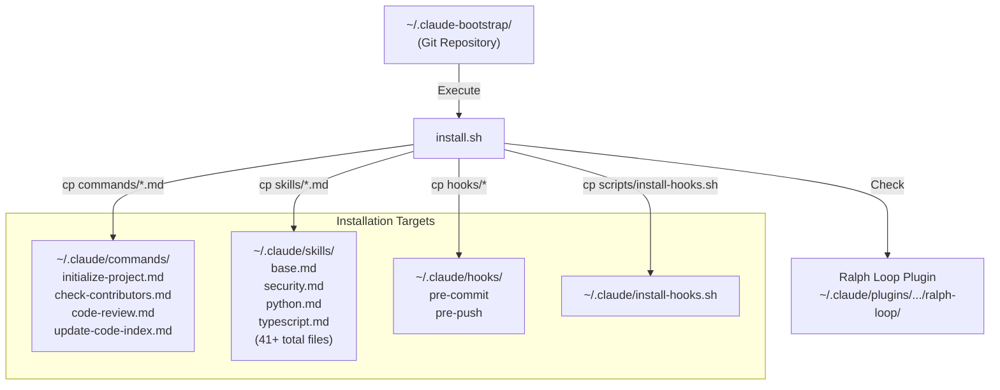
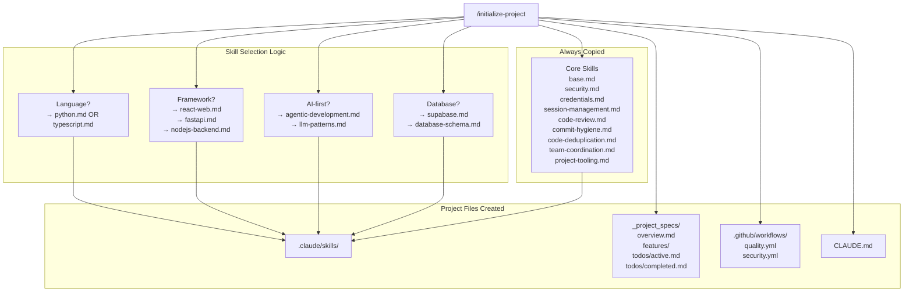
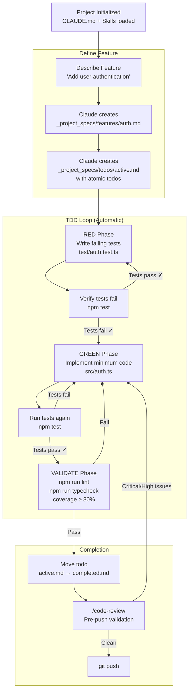

<!-- source: DeepWiki mcp.deepwiki.com · repo alinaqi/claude-bootstrap · page 2 Quick Start · fetched 2026-10-26 -->

# Quick Start

<details>
<summary>Relevant source files</summary>

The following files were used as context for generating this wiki page:

- [README.md](README.md)
- [install.sh](install.sh)

</details>


This page provides a streamlined path to installing Claude Bootstrap and initializing your first project. It covers the essential steps from cloning the repository to running your first TDD loop.

For detailed installation instructions, see [Installation](#2.1). For comprehensive project initialization guidance, see [Initializing Your First Project](#2.2). For understanding the underlying development philosophy, see [Core Concepts](#3).

---

## Prerequisites

Before installing Claude Bootstrap, ensure the following CLI tools are installed and authenticated:

| Tool | Installation | Authentication |
|------|--------------|----------------|
| **GitHub CLI** | `brew install gh` | `gh auth login` |
| **Vercel CLI** | `npm i -g vercel` | `vercel login` |
| **Supabase CLI** | `brew install supabase/tap/supabase` | `supabase login` |

The `/initialize-project` command validates these CLIs during project setup. Missing tools trigger warnings with installation instructions.

**Sources:** [README.md:499-513]()

---

## Installation Overview

### Step 1: Clone and Run Installer

```bash
git clone https://github.com/alinaqi/claude-bootstrap.git ~/.claude-bootstrap
cd ~/.claude-bootstrap && ./install.sh
```

The `install.sh` script copies files to `~/.claude/`:

| Source | Destination | Contents |
|--------|-------------|----------|
| `commands/*.md` | `~/.claude/commands/` | Command definitions |
| `skills/*.md` | `~/.claude/skills/` | 41+ skill files |
| `hooks/*` | `~/.claude/hooks/` | Git hook templates |
| `scripts/install-hooks.sh` | `~/.claude/install-hooks.sh` | Hook installer |

**Installation Flow Diagram**



After installation, commands become available globally in any Claude Code session via the `/` prefix (e.g., `/initialize-project`, `/check-contributors`).

**Sources:** [install.sh:1-66](), [README.md:54-63]()

---

## Project Initialization Overview

### Step 2: Initialize Project

In any project directory (new or existing):

```bash
claude
> /initialize-project
```

The initialization command executes a multi-phase setup process:

**Initialization Flow Diagram**

```mermaid
graph LR
    START["/initialize-project"]
    
    subgraph "Phase 1: Validation"
        CLI["Validate CLIs<br/>gh, vercel, supabase"]
        CREDS["Check Access.txt<br/>(Optional)"]
    end
    
    subgraph "Phase 2: Configuration"
        QUESTIONS["Interactive Questions<br/>Language?<br/>Framework?<br/>AI-first?<br/>Database?"]
        SELECT["Skill Selection<br/>Base on answers"]
    end
    
    subgraph "Phase 3: Repository"
        GHCHECK["GitHub Repo Check"]
        GHCREATE["Create/Connect Repo"]
    end
    
    subgraph "Phase 4: Structure"
        COPYSKILLS["Copy Skills<br/>~/.claude/skills/<br/>→ .claude/skills/"]
        CREATESPECS["Create _project_specs/<br/>features/<br/>todos/<br/>team/"]
        CREATECI["Create .github/workflows/<br/>quality.yml<br/>security.yml"]
        CREATEMD["Generate CLAUDE.md"]
    end
    
    START --> CLI
    CLI --> CREDS
    CREDS --> QUESTIONS
    QUESTIONS --> SELECT
    SELECT --> GHCHECK
    GHCHECK --> GHCREATE
    GHCREATE --> COPYSKILLS
    COPYSKILLS --> CREATESPECS
    CREATESPECS --> CREATECI
    CREATECI --> CREATEMD
```



**Sources:** [README.md:64-69]()

---

## Generated Project Structure

After initialization, the project contains:

```
your-project/
├── .claude/
│   └── skills/              # Project-specific skills
│       ├── base.md
│       ├── security.md
│       ├── credentials.md
│       ├── [language].md    # python.md or typescript.md
│       └── [framework].md   # react-web.md, fastapi.md, etc.
├── .github/
│   └── workflows/
│       ├── quality.yml      # Lint + Type + Test (80% coverage)
│       └── security.yml     # TruffleHog + Dependency audit
├── _project_specs/
│   ├── overview.md          # Project vision
│   ├── features/            # Feature specifications
│   ├── todos/
│   │   ├── active.md        # Current work items
│   │   └── completed.md     # Finished work items
│   └── team/                # Team coordination (if needed)
│       ├── state.md
│       ├── contributors.md
│       └── handoffs/
├── scripts/
│   ├── verify-tooling.sh    # CLI validation
│   └── security-check.sh    # Pre-commit security
└── CLAUDE.md                # Claude instructions
```

**Project Structure Creation Mapping**



**Sources:** [README.md:296-317]()

---

## Skill Loading by Project Type

The initialization command selects skills based on your answers:

| Question | Answer | Skills Loaded |
|----------|--------|---------------|
| **Language?** | Python | `python.md` |
| | TypeScript | `typescript.md` |
| **Framework?** | React | `react-web.md` + `ui-web.md` |
| | React Native | `react-native.md` + `ui-mobile.md` |
| | Next.js | `react-web.md` + `supabase-nextjs.md` |
| | FastAPI | `python.md` + `fastapi.md` + `supabase-python.md` |
| | Node.js Backend | `nodejs-backend.md` + `supabase-node.md` |
| **AI-first?** | Yes | `agentic-development.md` + `llm-patterns.md` + `ai-models.md` |
| **E2E Testing?** | Yes | `playwright-testing.md` + `ui-testing.md` |
| **Integrations?** | Stripe | `web-payments.md` |
| | PostHog | `posthog-analytics.md` |
| | Reddit Ads | `reddit-api.md` + `reddit-ads.md` |

All projects receive the 10 core skills: `base.md`, `security.md`, `credentials.md`, `session-management.md`, `code-review.md`, `commit-hygiene.md`, `code-deduplication.md`, `team-coordination.md`, `project-tooling.md`, `iterative-development.md`.

**Sources:** [README.md:397-466]()

---

## First Workflow: Feature Development

After initialization, start your first feature:

**First Feature Development Flow**



### Example First Request

After initialization, simply describe what you want:

```
Add email validation to the signup form
```

Claude automatically:
1. Creates feature spec in `_project_specs/features/signup-validation.md`
2. Generates atomic todos in `_project_specs/todos/active.md`
3. Runs `/ralph-loop` with TDD phases
4. Iterates until tests pass + lint clean + coverage ≥ 80%
5. Moves completed todos to `_project_specs/todos/completed.md`

You do **not** need to manually invoke `/ralph-loop`. The `iterative-development.md` skill configures Claude to automatically structure work as iterative TDD loops.

**Sources:** [README.md:71-100](), [README.md:321-343]()

---

## Verification Commands

After initialization, verify the setup:

| Check | Command | Expected Output |
|-------|---------|-----------------|
| **Skills loaded** | `ls .claude/skills/` | Lists 10+ skill files |
| **Commands available** | In Claude: `/` | Shows `/initialize-project`, `/code-review`, etc. |
| **GitHub connected** | `git remote -v` | Shows GitHub repository URL |
| **CI configured** | `ls .github/workflows/` | Shows `quality.yml`, `security.yml` |
| **Specs created** | `ls _project_specs/` | Shows `overview.md`, `features/`, `todos/` |

**Sources:** [README.md:296-317]()

---

## Next Steps

| Goal | Action |
|------|--------|
| **Start first feature** | Describe what you want Claude to build |
| **Understand TDD workflow** | See [TDD Workflow (RED-GREEN-VALIDATE)](#3.2) |
| **Learn Ralph loops** | See [Ralph Loop: Iterative Development](#4.1) |
| **Configure team coordination** | See [Multi-Developer Coordination](#8.1) |
| **Add integrations** | See [Integration Skills](#7) |
| **Customize skills** | See [Extending Claude Bootstrap](#9.3) |

For detailed installation troubleshooting, see [Installation](#2.1). For step-by-step project initialization, see [Initializing Your First Project](#2.2).

**Sources:** [README.md:467-496]()

---

