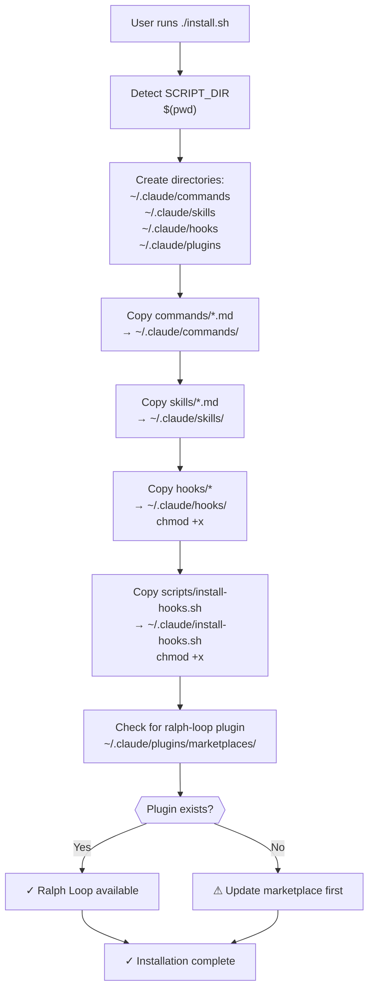
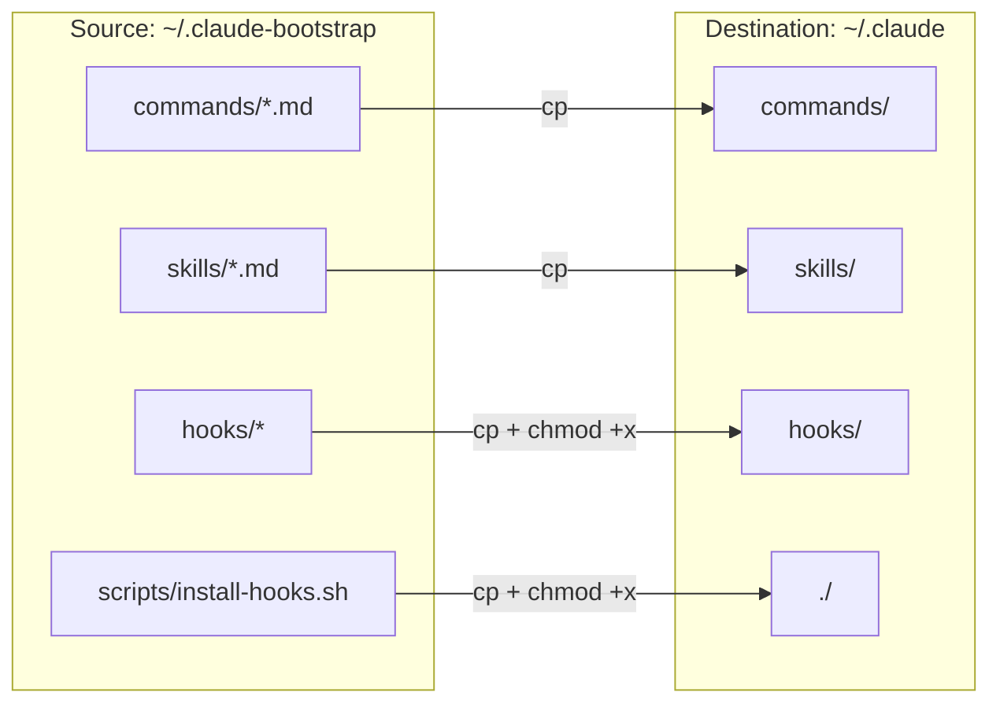

<!-- source: DeepWiki mcp.deepwiki.com · repo alinaqi/claude-bootstrap · page 2.1 Installation · fetched 2026-10-26 -->

# Installation

<details>
<summary>Relevant source files</summary>

The following files were used as context for generating this wiki page:

- [README.md](README.md)
- [install.sh](install.sh)

</details>


## Purpose and Scope

This document covers the installation of Claude Bootstrap's global files and commands onto your local system. Installation is a one-time setup that copies skills, commands, and git hooks to `~/.claude/` for use across all projects. For guidance on initializing individual projects after installation, see [Initializing Your First Project](#2.2).

---

## Prerequisites

Before running the installer, ensure the following CLI tools are installed and authenticated. Claude Bootstrap validates these during project initialization to configure deployments and repository management.

### Required CLI Tools

| Tool | Installation | Authentication | Purpose |
|------|-------------|----------------|---------|
| **GitHub CLI** (`gh`) | `brew install gh` | `gh auth login` | Repository creation, PR management |
| **Vercel CLI** | `npm i -g vercel` | `vercel login` | Frontend deployment automation |
| **Supabase CLI** | `brew install supabase/tap/supabase` | `supabase login` | Database migrations, Edge Functions |

The [scripts/verify-tooling.sh]() script checks for these tools during project initialization. Missing tools trigger warnings but do not block installation.

**Sources:** [README.md:497-513]()

---

## Installation Process

### Step 1: Clone Repository

```bash
git clone https://github.com/alinaqi/claude-bootstrap.git ~/.claude-bootstrap
cd ~/.claude-bootstrap
```

The repository must be cloned to `~/.claude-bootstrap` as the installer script uses this path as the source directory.

### Step 2: Run Installer

```bash
./install.sh
```

The installer is idempotent—running it multiple times is safe and overwrites existing files with the latest versions.

### Installation Flow Diagram



**Sources:** [install.sh:1-66]()

---

## Directory Structure Created

The installer creates the following structure in your home directory:

```
~/.claude/
├── commands/           # Custom slash commands
│   ├── initialize-project.md
│   ├── check-contributors.md
│   ├── code-review.md
│   ├── update-code-index.md
│   └── [additional commands]
├── skills/            # Global skill repository
│   ├── base.md
│   ├── security.md
│   ├── python.md
│   ├── typescript.md
│   └── [41 total skills]
├── hooks/             # Git hook templates
│   ├── pre-commit
│   └── pre-push
└── install-hooks.sh   # Per-project hook installer
```

### Commands Installed

The following slash commands become globally available in Claude Code after installation:

| Command | File | Purpose |
|---------|------|---------|
| `/initialize-project` | [commands/initialize-project.md]() | Project scaffolding and setup |
| `/check-contributors` | [commands/check-contributors.md]() | Team coordination state check |
| `/code-review` | [commands/code-review.md]() | Pre-push code analysis |
| `/update-code-index` | [commands/update-code-index.md]() | Regenerate semantic capability index |

**Sources:** [install.sh:19-22](), [README.md:58-62]()

### File Copy Operations



**Sources:** [install.sh:19-35]()

---

## Ralph Loop Plugin Installation

The Ralph Loop plugin provides the iterative TDD loop system. It is distributed separately through the Claude Code marketplace.

### Installation Steps

1. **Update Marketplace** (if first time):
   ```
   /update-marketplace
   ```

2. **Install Plugin**:
   ```
   /plugin install ralph-loop@claude-plugins-official
   ```

### Troubleshooting: Source Path Error

If you encounter `Source path does not exist: .../ralph-wiggum`, this indicates a cache mismatch between the old plugin name and the new marketplace name.

**Fix with symlink:**
```bash
ln -s ~/.claude/plugins/marketplaces/claude-plugins-official/plugins/ralph-loop \
      ~/.claude/plugins/marketplaces/claude-plugins-official/plugins/ralph-wiggum
```

Then retry the installation command.

**Sources:** [README.md:101-117]()

---

## Verification

After installation completes, verify the setup:

### 1. Check Directory Structure

```bash
ls -la ~/.claude/
# Should show: commands/, skills/, hooks/, install-hooks.sh
```

### 2. Count Installed Files

```bash
# Commands (8 expected)
ls -1 ~/.claude/commands/*.md | wc -l

# Skills (41 expected)
ls -1 ~/.claude/skills/*.md | wc -l
```

### 3. Verify Command Availability

Open Claude Code in any directory and type `/` to see available commands. You should see:
- `/initialize-project`
- `/check-contributors`
- `/code-review`
- `/update-code-index`

### 4. Check Hook Executability

```bash
test -x ~/.claude/install-hooks.sh && echo "✓ Hook installer executable"
test -x ~/.claude/hooks/pre-commit && echo "✓ Pre-commit hook executable"
test -x ~/.claude/hooks/pre-push && echo "✓ Pre-push hook executable"
```

**Sources:** [install.sh:21-31]()

---

## Updating Installation

To update Claude Bootstrap to the latest version:

```bash
cd ~/.claude-bootstrap
git pull
./install.sh
```

The installer overwrites existing files in `~/.claude/` with the latest versions. This does not affect existing project configurations—projects use their local `.claude/skills/` directories copied during initialization.

To propagate updates to existing projects, run `/initialize-project` again in each project directory. See [Initializing Your First Project](#2.2) for details on project-level setup.

**Sources:** [README.md:485-495]()

---

## Installation Output Example

Successful installation produces the following output:

```
Installing Claude Bootstrap...

✓ Installed commands:
  - /initialize-project
  - /check-contributors
  - /code-review
  - /update-code-index
  - /ralph-loop
  - /cancel-ralph
  - /audit-duplicates
  
✓ Installed 41 skills
✓ Installed git hooks (templates)

✓ Ralph Loop plugin available in marketplace
  To install: /install-plugin ralph-loop (in Claude Code)

════════════════════════════════════════════════════════════════
  Installation complete!
════════════════════════════════════════════════════════════════

Usage:
  1. Open any project folder
  2. Run: claude
  3. Type: /initialize-project

Commands installed:
  /initialize-project   - Full project setup
  /check-contributors   - Team coordination
  /update-code-index    - Regenerate code index

Git Hooks (per-project):
  cd your-project && ~/.claude/install-hooks.sh
```

**Sources:** [install.sh:48-65]()

---

## Next Steps

After successful installation:

1. **Initialize a project** - See [Initializing Your First Project](#2.2)
2. **Review core concepts** - See [Development Philosophy](#3.1)
3. **Understand TDD workflow** - See [TDD Workflow (RED-GREEN-VALIDATE)](#3.2)

The global installation is now complete. Commands and skills are available for use in any project through the `/initialize-project` command, which copies selected skills to individual project directories based on language, framework, and feature selections.

---

