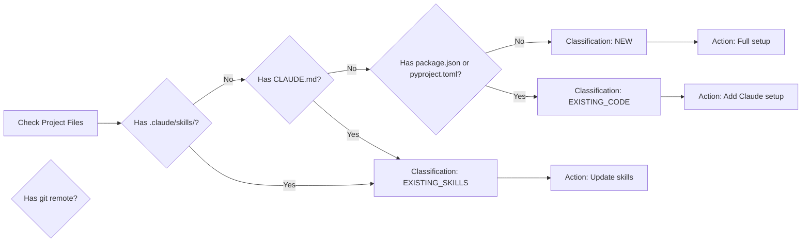
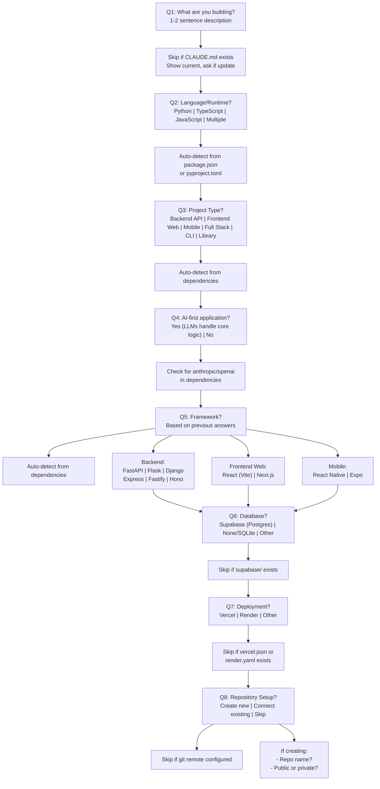
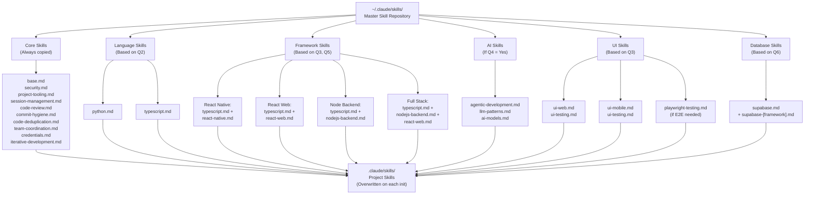
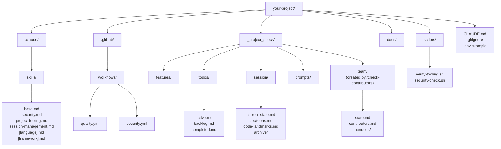

<!-- source: DeepWiki mcp.deepwiki.com · repo alinaqi/claude-bootstrap · page 2.2 Initializing Your First Project · fetched 2026-10-26 -->

# Initializing Your First Project

<details>
<summary>Relevant source files</summary>

The following files were used as context for generating this wiki page:

- [README.md](README.md)
- [commands/initialize-project.md](commands/initialize-project.md)

</details>


This document guides you through the `/initialize-project` command, which sets up Claude Bootstrap in any project directory. This command handles project detection, skill selection, security configuration, and repository setup. For information about installing Claude Bootstrap itself, see [Installation](#2.1). For the development philosophy and TDD workflow that govern initialized projects, see [Development Philosophy](#3.1) and [TDD Workflow](#3.2).

## Overview

The `/initialize-project` command is idempotent and works for both new and existing projects. It performs five main operations:

| Operation | New Project | Existing Project |
|-----------|-------------|------------------|
| **Project Detection** | Identifies as new, creates full structure | Detects existing setup, offers update |
| **CLI Validation** | Checks `gh`, `vercel`, `supabase` authentication | Checks authentication, skips if already configured |
| **Skill Selection** | Asks questions to determine skills | Auto-detects from existing files, asks for updates |
| **Structure Creation** | Creates `.claude/skills/`, `_project_specs/`, scripts | Adds missing directories, preserves existing files |
| **Repository Setup** | Creates GitHub repo, configures deployment | Skips if already configured |

**Sources:** [commands/initialize-project.md:1-30](), [README.md:52-69]()

## Prerequisites Verification

Before initialization begins, the command validates required CLI tools:

```bash
# GitHub CLI authentication check
gh auth status

# Vercel CLI authentication check
vercel whoami

# Supabase CLI authentication check
supabase projects list
```

If authentication fails, the command displays installation instructions and offers to skip that tool. This validation is implemented in [commands/initialize-project.md:40-57]().

**Validation Script Generated:** The initialization creates `scripts/verify-tooling.sh` which re-runs these checks on demand [commands/initialize-project.md:217-263]().

**Sources:** [commands/initialize-project.md:38-57](), [commands/initialize-project.md:217-263]()

## Initialization Flow

### Phase Execution Sequence

```mermaid
graph TB
    START["Start: /initialize-project"]
    
    DETECT["Phase 1: Detect Project State"]
    CHECK_CLAUDE["Check .claude/skills/"]
    CHECK_GIT["Check git remote"]
    CHECK_PKG["Check package.json / pyproject.toml"]
    CLASSIFY["Classify: New | Existing+Skills | Existing+Code"]
    
    VALIDATE["Phase 2: Validate CLI Tools"]
    GH_CHECK["gh auth status"]
    VERCEL_CHECK["vercel whoami"]
    SUPA_CHECK["supabase projects list"]
    
    QUESTIONS["Phase 3: Project Questions"]
    Q_DESC["What are you building?"]
    Q_LANG["Language/runtime?"]
    Q_TYPE["Project type?"]
    Q_AI["AI-first?"]
    Q_FW["Framework?"]
    Q_DB["Database?"]
    Q_DEPLOY["Deployment?"]
    Q_REPO["Repository setup?"]
    
    SETUP["Phase 4: Execute Setup"]
    DIRS["Create directory structure"]
    SKILLS["Copy skills from ~/.claude/skills/"]
    GITIGNORE["Create/update .gitignore"]
    ENV["Create .env.example"]
    SCRIPTS["Create verify-tooling.sh, security-check.sh"]
    CLAUDE_MD["Create/update CLAUDE.md"]
    SPECS["Create _project_specs/ files"]
    WORKFLOWS["Create GitHub Actions workflows"]
    HOOKS["Install pre-commit + pre-push hooks"]
    REPO_SETUP["GitHub repository setup"]
    DEPLOY_INIT["Initialize deployment (Vercel/Supabase)"]
    
    SUMMARY["Phase 5: Summary"]
    SHOW_CREATED["Display created files"]
    SHOW_UPDATED["Display updated files"]
    SHOW_UNCHANGED["Display preserved files"]
    
    NEXT["Phase 6: Next Steps"]
    NEW_PROMPT["Prompt for first feature"]
    EXISTING_PROMPT["Offer continue/review options"]
    
    START --> DETECT
    DETECT --> CHECK_CLAUDE --> CHECK_GIT --> CHECK_PKG --> CLASSIFY
    CLASSIFY --> VALIDATE
    
    VALIDATE --> GH_CHECK --> VERCEL_CHECK --> SUPA_CHECK --> QUESTIONS
    
    QUESTIONS --> Q_DESC --> Q_LANG --> Q_TYPE --> Q_AI --> Q_FW --> Q_DB --> Q_DEPLOY --> Q_REPO
    Q_REPO --> SETUP
    
    SETUP --> DIRS --> SKILLS --> GITIGNORE --> ENV --> SCRIPTS --> CLAUDE_MD --> SPECS --> WORKFLOWS --> HOOKS --> REPO_SETUP --> DEPLOY_INIT
    DEPLOY_INIT --> SUMMARY
    
    SUMMARY --> SHOW_CREATED --> SHOW_UPDATED --> SHOW_UNCHANGED --> NEXT
    
    NEXT --> NEW_PROMPT
    NEXT --> EXISTING_PROMPT
```



**Sources:** [commands/initialize-project.md:9-36](), [commands/initialize-project.md:60-128](), [commands/initialize-project.md:131-726]()

### Project State Detection

The command first determines the current project state by checking for existing files:



The command displays its classification to the user:

- **New project**: "Detected new project - will do full setup"
- **Existing with skills**: "Detected existing Claude project - will update skills and add any missing structure"
- **Existing codebase**: "Detected existing codebase - will add Claude setup while preserving your code"

**Sources:** [commands/initialize-project.md:9-35]()

## Project Configuration Questions

The command asks a series of questions to determine which skills and configurations to apply. For existing projects with `CLAUDE.md`, it reads current configuration first and asks what to update.

### Question Flow and Auto-Detection



**Sources:** [commands/initialize-project.md:60-128]()

### Skill Selection Logic

Based on the answers, the command copies specific skills from `~/.claude/skills/` to `.claude/skills/`:



**Key Behaviors:**
- Core skills are **always copied** and **overwritten** with latest versions
- Skills are copied based on logical combinations (e.g., React Native gets both `typescript.md` AND `react-native.md`)
- Full Stack projects receive multiple framework skills
- Skills in `.claude/skills/` are overwritten on each initialization to propagate updates

**Sources:** [commands/initialize-project.md:145-167](), [README.md:296-317]()

## Generated Project Structure

### Directory Structure

The command creates the following structure:



**Sources:** [commands/initialize-project.md:133-143](), [README.md:296-317]()

### Key Files and Their Purposes

| File Path | Purpose | When Created |
|-----------|---------|--------------|
| `.claude/skills/*.md` | Coding guardrails and patterns | Always copied from `~/.claude/skills/` |
| `CLAUDE.md` | Main instructions for Claude, skill references | Created if missing, updated if exists |
| `.gitignore` | Security-critical entries (`.env`, secrets) | Created if missing, appended if incomplete |
| `.env.example` | Template for environment variables | Created based on project type |
| `scripts/verify-tooling.sh` | CLI authentication verification | Always created/overwritten |
| `scripts/security-check.sh` | Pre-commit secret scanning | Always created/overwritten |
| `.github/workflows/quality.yml` | Lint, type-check, test, coverage enforcement | Created based on language |
| `.github/workflows/security.yml` | TruffleHog secret scan, dependency audit | Always created |
| `_project_specs/overview.md` | Project vision, goals, success metrics | Created if missing, never overwritten |
| `_project_specs/todos/active.md` | Current work in progress | Created if missing, never overwritten |
| `_project_specs/session/current-state.md` | Live session state tracking | Created if missing, never overwritten |
| `_project_specs/session/decisions.md` | Architectural decision log (append-only) | Created if missing, never overwritten |

**Preservation Policy:** Files in `_project_specs/` are **never overwritten**. Only missing files are created. This ensures your work is preserved when updating skills.

**Sources:** [commands/initialize-project.md:145-267](), [commands/initialize-project.md:439-617]()

### CLAUDE.md Structure

The generated `CLAUDE.md` file serves as the primary instruction file for Claude:

```markdown
# CLAUDE.md

## Skills
Read and follow these skills before writing any code:
- .claude/skills/base.md
- .claude/skills/security.md
- .claude/skills/project-tooling.md
- .claude/skills/session-management.md
- .claude/skills/[language].md
- .claude/skills/[framework].md (if applicable)
- .claude/skills/llm-patterns.md (if AI-first)

## Project Overview
[Description from question 1]

## Tech Stack
- Language: [X]
- Framework: [X]
- Database: [X]
- Deployment: [X]
- Testing: [X]

## Key Commands
[Language/framework-specific commands]

## Documentation
- `docs/` - Technical documentation
- `_project_specs/` - Project specifications and todos

## Atomic Todos
All work is tracked in `_project_specs/todos/`:
- `active.md` - Current work
- `backlog.md` - Future work
- `completed.md` - Done (for reference)

## Session Management
[Session management instructions from session-management.md skill]

## Project-Specific Patterns
[Any specific patterns for this project]
```

For existing projects, the command:
- Preserves **Project Overview**, **Tech Stack**, and **Project-Specific Patterns** sections
- Updates **Skills** list to reflect current `.claude/skills/` contents
- Updates **Key Commands** section with latest commands

**Sources:** [commands/initialize-project.md:320-438]()

### Security Configuration Files

#### .gitignore Security Entries

The command ensures these entries exist in `.gitignore` [commands/initialize-project.md:168-200]():

```gitignore
# Environment files - NEVER commit
.env
.env.*
!.env.example

# Secrets
*.pem
*.key
*.p12
credentials.json
secrets.json
service-account*.json

# Dependencies
node_modules/
__pycache__/
*.pyc
.venv/
venv/

# Build outputs
dist/
build/

# IDE
.idea/
.vscode/settings.json
.DS_Store
```

#### .env.example Template

Created based on project type [commands/initialize-project.md:202-214]():

```bash
# .env.example - Copy to .env and fill in values
# Server-side only (NEVER prefix with VITE_ or NEXT_PUBLIC_)
DATABASE_URL=
ANTHROPIC_API_KEY=

# Client-side safe (public, non-sensitive)
VITE_SUPABASE_URL=
VITE_SUPABASE_ANON_KEY=
```

**Sources:** [commands/initialize-project.md:168-214]()

### GitHub Actions Workflows

#### quality.yml

Created based on the selected language. Enforces:
- Linting with auto-fix
- Type checking
- Test suite execution
- **80% coverage minimum** (CI fails below threshold)

#### security.yml

Always created, runs [commands/initialize-project.md:619-668]():

```yaml
name: Security

on:
  push:
    branches: [main]
  pull_request:
    branches: [main]
  schedule:
    - cron: '0 9 * * 1'  # Weekly on Monday

jobs:
  secrets-scan:
    runs-on: ubuntu-latest
    steps:
      - uses: actions/checkout@v4
        with:
          fetch-depth: 0
      - name: Detect secrets
        uses: trufflesecurity/trufflehog@main
        with:
          path: ./

  dependency-audit:
    runs-on: ubuntu-latest
    steps:
      - uses: actions/checkout@v4
      - name: Setup Node
        if: hashFiles('package.json') != ''
        uses: actions/setup-node@v4
        with:
          node-version: '20'
      - name: NPM Audit
        if: hashFiles('package.json') != ''
        run: npm audit --audit-level=high
      - name: Setup Python
        if: hashFiles('pyproject.toml') != ''
        uses: actions/setup-python@v5
        with:
          python-version: '3.12'
      - name: Safety check
        if: hashFiles('pyproject.toml') != ''
        run: pip install safety && safety check
```

**Sources:** [commands/initialize-project.md:619-668]()

### Pre-Commit and Pre-Push Hooks

The initialization installs two types of hooks:

#### Pre-Commit Hooks

**For Python projects** [commands/initialize-project.md:670-676]():
- Creates `.pre-commit-config.yaml` with ruff, mypy, pytest

**For TypeScript/JavaScript projects** [commands/initialize-project.md:675-676]():
- Sets up Husky + lint-staged

#### Pre-Push Hook (Code Review)

**Always installed** [commands/initialize-project.md:678-698]():

```bash
# Copied from ~/.claude/hooks/pre-push to .git/hooks/pre-push
# Behavior:
# - Runs /code-review before every git push
# - Blocks push if Critical (🔴) or High (🟠) severity issues found
# - Allows push with advisory for Medium (🟡) and Low (🟢) issues
```

To disable: `rm .git/hooks/pre-push`

**Sources:** [commands/initialize-project.md:670-698](), [README.md:176-209]()

## Repository and Deployment Setup

### GitHub Repository Creation

If repository setup was selected and not already configured:

**Create new repository** [commands/initialize-project.md:700-707]():
```bash
git init  # if needed
git add .
git commit -m "Initial project setup"
gh repo create [repo-name] --[public|private] --source=. --remote=origin --push
```

**Connect to existing** [commands/initialize-project.md:709-713]():
```bash
git remote add origin https://github.com/[owner]/[repo].git
git push -u origin main
```

### Deployment Initialization

**Vercel** (if `vercel.json` missing) [commands/initialize-project.md:715-720]():
```bash
vercel link
```

**Supabase** (if `supabase/` directory missing) [commands/initialize-project.md:722-725]():
```bash
supabase init
```

**Sources:** [commands/initialize-project.md:699-726]()

## Understanding the Output

### Update Summary (Existing Project)

For projects that already have Claude Bootstrap setup:

```
Updated:
✓ Skills updated to latest versions
  - base.md (updated)
  - typescript.md (updated)
  - react-web.md (updated)
✓ Pre-push code review hook (installed/updated)

Added:
✓ llm-patterns.md (new skill added)
✓ _project_specs/prompts/ (new directory)

Unchanged:
- CLAUDE.md (preserved your customizations)
- _project_specs/todos/ (preserved your todos)
- Git repository (already configured)
```

### New Project Summary

For newly initialized projects:

```
Created:
✓ .claude/skills/ with 5 skill files
✓ CLAUDE.md
✓ _project_specs/ structure
✓ scripts/verify-tooling.sh
✓ .github/workflows/quality.yml
✓ Pre-commit hooks configured
✓ Pre-push code review hook (blocks on Critical/High issues)
✓ GitHub repository: https://github.com/[owner]/[repo]

Quick Start:
# Verify setup
./scripts/verify-tooling.sh

# Install dependencies
[appropriate command]

# Start development
[appropriate command]
```

**Sources:** [commands/initialize-project.md:729-775]()

## Next Steps After Initialization

The command provides different prompts based on project type:

### For New Projects

```
Project initialized! Ready to start building.

Would you like to start defining your first feature? I'll help you:
1. Create a feature spec in `_project_specs/features/`
2. Break it down into atomic todos with validation and test cases
3. Add them to `_project_specs/todos/active.md`

What's the first feature you want to build?
```

This transitions into the spec-driven development workflow. See [Atomic Todos and Project Specs](#3.4) for the todo format.

### For Existing Projects

```
Project updated with latest skills!

What would you like to do?
1. Review changes to skills (see what's new)
2. Add a new feature spec
3. Continue working on existing todos
4. Something else
```

**Sources:** [commands/initialize-project.md:777-798](), [README.md:52-69]()

## Updating Skills System-Wide

To update skills globally and propagate to all projects:

```bash
# Pull latest skills from repository
cd ~/.claude-bootstrap
git pull

# Reinstall to ~/.claude/
./install.sh
```

Then in any existing project:

```bash
claude
> /initialize-project
```

The command will:
- Overwrite all skills in `.claude/skills/` with latest versions from `~/.claude/skills/`
- Preserve `CLAUDE.md` customizations
- Preserve all `_project_specs/` files
- Add any new skills or directories introduced since last initialization

**Sources:** [commands/initialize-project.md:802-821](), [README.md:485-495]()

## Common Scenarios

### Scenario 1: Brand New Project

```bash
mkdir my-app && cd my-app
claude
> /initialize-project
```

Command performs:
1. Detects empty directory → classifies as NEW
2. Validates CLI tools
3. Asks all 8 configuration questions
4. Creates full directory structure
5. Copies skills based on answers
6. Creates GitHub repository
7. Initializes deployment
8. Prompts for first feature spec

### Scenario 2: Existing Codebase Without Claude

```bash
cd existing-app  # Has package.json, src/, etc.
claude
> /initialize-project
```

Command performs:
1. Detects code but no `.claude/` → classifies as EXISTING_CODE
2. Auto-detects language from `package.json`
3. Auto-detects framework from dependencies
4. Asks only non-detectable questions
5. Adds `.claude/skills/`, `_project_specs/`, scripts
6. Preserves all existing code and configuration
7. Offers to continue with existing todos or add new features

### Scenario 3: Updating Skills in Claude Project

```bash
cd my-claude-project  # Has .claude/skills/
claude
> /initialize-project
```

Command performs:
1. Detects `.claude/skills/` → classifies as EXISTING_SKILLS
2. Reads current `CLAUDE.md` configuration
3. Asks which configuration to update
4. **Overwrites all skills** in `.claude/skills/` with latest from `~/.claude/skills/`
5. Adds any new skills introduced since last init
6. Preserves `CLAUDE.md` customizations
7. Preserves all `_project_specs/` files
8. Updates hooks if changed

**Sources:** [commands/initialize-project.md:9-36](), [README.md:467-495]()

---

