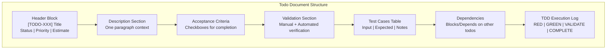
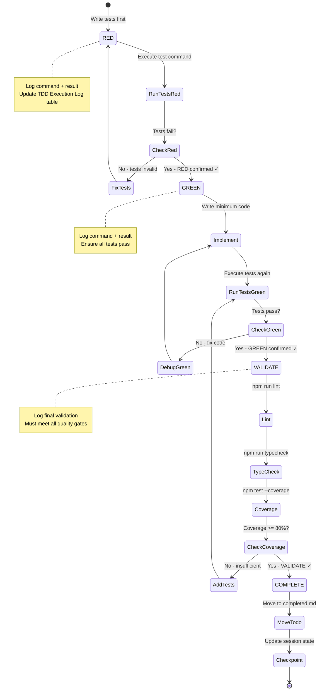
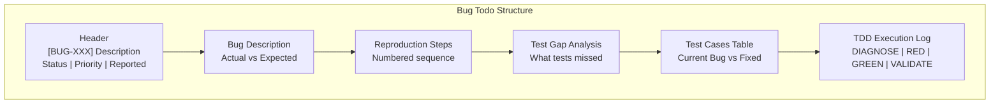
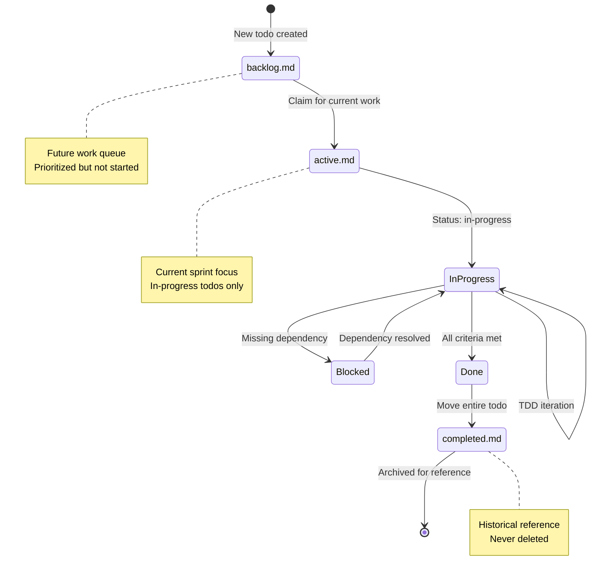

<!-- source: DeepWiki mcp.deepwiki.com · repo alinaqi/claude-bootstrap · page 3.4 Atomic Todos and Project Specs · fetched 2026-10-26 -->

# Atomic Todos and Project Specs

<details>
<summary>Relevant source files</summary>

The following files were used as context for generating this wiki page:

- [README.md](README.md)
- [skills/base.md](skills/base.md)
- [templates/CLAUDE.md](templates/CLAUDE.md)

</details>


## Purpose and Scope

This document explains the atomic todo system and project specifications structure in Claude Bootstrap. It covers the standardized todo format, the `_project_specs/` directory organization, the `active.md` → `completed.md` workflow, and TDD execution tracking.

For the TDD workflow mechanics (RED-GREEN-VALIDATE phases), see [TDD Workflow](#3.2). For team coordination features using these specs, see [Multi-Developer Coordination](#8.1).

---

## Project Specs Directory Structure

The `_project_specs/` directory separates business requirements from code documentation, providing a single source of truth for project state.

### Directory Anatomy

```
_project_specs/
├── overview.md              # Project vision and high-level goals
├── features/                # Feature specifications
│   ├── feature-auth.md      # Individual feature specs
│   ├── feature-payments.md
│   └── feature-analytics.md
├── todos/                   # Atomic work tracking
│   ├── active.md            # Current sprint/focus work
│   ├── backlog.md           # Future work queue
│   └── completed.md         # Archived completed work
├── session/                 # Session state management
│   ├── current-state.md     # Live session context
│   ├── decisions.md         # Architectural decisions log
│   ├── code-landmarks.md    # Key code location map
│   └── archive/             # Historical session summaries
├── team/                    # Multi-developer coordination
│   ├── state.md             # Active sessions and claims
│   ├── contributors.md      # Team member registry
│   └── handoffs/            # Context transfer notes
└── prompts/                 # LLM prompt specifications (AI-first projects)
```

**Sources:** [skills/base.md:99-135](), [README.md:296-317]()

---

## Separation of Concerns

The `_project_specs/` directory maintains strict separation between specifications and documentation:

| Location | Content Type | Purpose |
|----------|--------------|---------|
| `_project_specs/` | Business requirements, features, todos | What needs to be built |
| `docs/` | Technical documentation, API references | How the system works |
| `_project_specs/session/` | Session state, decisions, context | Current development state |
| `CLAUDE.md` | Claude-specific instructions | AI agent configuration |

This separation ensures that project requirements remain independent of implementation details, enabling easier refactoring and system rewrites while preserving business context.

**Sources:** [skills/base.md:126-135]()

---

## Atomic Todo Format

Each todo is a self-contained, testable unit of work with explicit validation criteria. The format enforces TDD discipline through structured execution logging.

### Todo Structure Diagram



**Sources:** [skills/base.md:138-178](), [README.md:531-558]()

---

### Required Fields

Every atomic todo must include these fields:

```markdown
## [TODO-001] Short descriptive title

**Status:** pending | in-progress | blocked | done
**Priority:** high | medium | low
**Estimate:** XS | S | M | L | XL

### Description
One paragraph describing what needs to be done.

### Acceptance Criteria
- [ ] Criterion 1 - specific, measurable
- [ ] Criterion 2 - specific, measurable

### Validation
How to verify this is complete:
- Manual: [steps to manually test]
- Automated: [test file/command that validates this]

### Test Cases
| Input | Expected Output | Notes |
|-------|-----------------|-------|
| ... | ... | ... |

### Dependencies
- Depends on: [TODO-xxx] (if any)
- Blocks: [TODO-yyy] (if any)

### TDD Execution Log
| Phase | Command | Result | Timestamp |
|-------|---------|--------|-----------|
| RED | `[test command]` | - | - |
| GREEN | `[test command]` | - | - |
| VALIDATE | `[lint && typecheck && test --coverage]` | - | - |
| COMPLETE | Moved to completed.md | - | - |
```

**Sources:** [skills/base.md:142-178]()

---

### Todo Sizing Guidelines

| Estimate | Scope | Max Duration | Decomposition Trigger |
|----------|-------|--------------|----------------------|
| **XS** | Single function, < 50 lines | 1 hour | - |
| **S** | Single file, 1-3 functions | 2-4 hours | - |
| **M** | 2-3 files, < 10 functions | 1 day | Split if dependencies grow |
| **L** | Multiple files, cross-cutting | 2-3 days | **Must decompose** |
| **XL** | Multiple modules | > 3 days | **Invalid - always split** |

**Rule:** If a todo is larger than "M", it must be broken into smaller todos before work begins. Large todos indicate insufficient planning.

**Sources:** [skills/base.md:180-185]()

---

## TDD Execution Log

The execution log provides an audit trail of the TDD workflow, proving that tests were written first and validating the development process.

### Execution Log Workflow Diagram



**Sources:** [skills/base.md:187-214](), [README.md:531-558]()

---

### Stack-Specific Execution Commands

The TDD Execution Log records the actual commands run at each phase:

#### Node.js/TypeScript Projects

```bash
# RED Phase - Expect failures
npm test -- --grep "todo-description"

# GREEN Phase - Expect pass
npm test -- --grep "todo-description"

# VALIDATE Phase - Full quality check
npm run lint && npm run typecheck && npm test -- --coverage
```

#### Python Projects

```bash
# RED Phase - Expect failures
pytest -k "todo_description" -v

# GREEN Phase - Expect pass
pytest -k "todo_description" -v

# VALIDATE Phase - Full quality check
ruff check . && mypy . && pytest --cov --cov-fail-under=80
```

#### React/Next.js Projects

```bash
# RED Phase - Expect failures
npm test -- --testPathPattern="ComponentName"

# GREEN Phase - Expect pass
npm test -- --testPathPattern="ComponentName"

# VALIDATE Phase - Full quality check
npm run lint && npm run typecheck && npm test -- --coverage --watchAll=false
```

**Sources:** [skills/base.md:216-253]()

---

## Complete Todo Example

This example shows a fully populated todo with all required sections:

```markdown
## [TODO-042] Add email validation to signup form

**Status:** pending
**Priority:** high
**Estimate:** S

### Description
Validate email format on the signup form before submission. Show inline error if invalid.

### Acceptance Criteria
- [ ] Email field shows error for invalid format
- [ ] Error clears when user fixes the email
- [ ] Form cannot submit with invalid email
- [ ] Valid emails pass through without error

### Validation
- Manual: Enter "notanemail" in signup form, verify error appears
- Automated: `npm test -- --grep "email validation"`

### Test Cases
| Input | Expected Output | Notes |
|-------|-----------------|-------|
| user@example.com | Valid, no error | Standard email |
| user@sub.example.com | Valid, no error | Subdomain |
| notanemail | Invalid, show error | No @ symbol |
| user@ | Invalid, show error | No domain |
| @example.com | Invalid, show error | No local part |

### Dependencies
- Depends on: [TODO-041] Signup form component
- Blocks: [TODO-045] Signup flow integration test

### TDD Execution Log
| Phase | Command | Result | Timestamp |
|-------|---------|--------|-----------|
| RED | `npm test -- --grep "email validation"` | 5 tests failed ✓ | 2024-01-15 10:23 |
| GREEN | `npm test -- --grep "email validation"` | 5 tests passed ✓ | 2024-01-15 10:45 |
| VALIDATE | `npm run lint && npm run typecheck && npm test -- --coverage` | Pass, 84% coverage ✓ | 2024-01-15 10:52 |
| COMPLETE | Moved to completed.md | ✓ | 2024-01-15 10:55 |
```

**Sources:** [skills/base.md:343-384](), [README.md:535-558]()

---

## Bug Fix Todo Format

Bug fixes follow a modified todo structure that emphasizes test gap analysis and reproduction steps.

### Bug Todo Structure Diagram



**Sources:** [skills/base.md:272-334](), [README.md:560-577]()

---

### Bug Fix Template

```markdown
## [BUG-001] Short description of the bug

**Status:** pending
**Priority:** high
**Reported:** [how user reported it / reproduction steps]

### Bug Description
What is happening vs. what should happen.

### Reproduction Steps
1. Step one
2. Step two
3. Observe: [incorrect behavior]
4. Expected: [correct behavior]

### Test Gap Analysis
- Existing test coverage: [list relevant test files]
- Gap identified: [what the tests missed]
- New test needed: [describe the test to add]

### Test Cases for Bug
| Input | Current (Bug) | Expected (Fixed) |
|-------|---------------|------------------|
| ... | ... | ... |

### TDD Execution Log
| Phase | Command | Result | Timestamp |
|-------|---------|--------|-----------|
| DIAGNOSE | `npm test` | All pass (gap!) | - |
| RED | `npm test -- --grep "bug description"` | 1 test failed ✓ | - |
| GREEN | `npm test -- --grep "bug description"` | 1 test passed ✓ | - |
| VALIDATE | `npm run lint && npm run typecheck && npm test -- --coverage` | Pass ✓ | - |
```

The **DIAGNOSE** phase is unique to bug fixes - it confirms that existing tests pass despite the bug, proving a test gap exists.

**Sources:** [skills/base.md:299-334]()

---

## Active to Completed Workflow

Todos move through a lifecycle from specification to completion, with state tracked in markdown files.

### Todo Lifecycle Diagram



**Sources:** [skills/base.md:180-185](), [README.md:393-395]()

---

### File Locations and Purposes

| File | Location | Purpose | Typical Size |
|------|----------|---------|--------------|
| `active.md` | `_project_specs/todos/` | Current sprint work | 3-10 todos |
| `backlog.md` | `_project_specs/todos/` | Prioritized future work | 20-50 todos |
| `completed.md` | `_project_specs/todos/` | Historical archive | Growing indefinitely |

**Sources:** [skills/base.md:109-117]()

---

### Workflow Rules

1. **Atomic Movement**: Move entire todo markdown block, including all sections
2. **Never Delete**: Completed todos archived to `completed.md`, never deleted
3. **Single Active File**: All current work tracked in single `active.md` file
4. **Backlog Priority**: Todos in `backlog.md` ordered by priority
5. **Status Updates**: Update status field before moving between files

**Sources:** [skills/base.md:180-185]()

---

## Blocking Conditions

Todos cannot be marked complete or moved to `completed.md` under these conditions:

### Blocking Scenarios

| Condition | Reason | Action Required |
|-----------|--------|-----------------|
| Tests not written first | Skipped RED phase | Write tests, verify they fail |
| Tests didn't fail initially | Invalid tests | Fix tests to catch requirement |
| Any test failing | Incomplete implementation | Fix code until tests pass |
| Linter errors present | Code quality violation | Fix lint errors (warnings acceptable) |
| Type checker errors | Type safety violation | Fix type errors |
| Coverage below threshold | Insufficient testing | Add tests until ≥80% coverage |

When blocked, add blocking information to the todo:

```markdown
## [TODO-042] - BLOCKED

**Blocking Reason:** Lint error in src/utils/validate.ts:42
**Action Required:** Fix undefined variable 'emailPattern'
```

**Sources:** [skills/base.md:254-271]()

---

## Todo Execution Anti-Patterns

These patterns violate the atomic todo discipline and must be avoided:

| Anti-Pattern | Why It's Wrong | Correct Approach |
|--------------|----------------|------------------|
| ❌ Fixing bugs without tests | Bug will likely return | Write failing test first (DIAGNOSE + RED) |
| ❌ Writing tests after code | Can't prove tests catch requirement | Write tests first, verify they fail |
| ❌ Skipping test gap analysis | Miss root cause of bug | Document what existing tests missed |
| ❌ Only testing the fix | May introduce regressions | Run full test suite (VALIDATE phase) |
| ❌ Marking done with failing tests | Incomplete work | Fix all failures before completion |
| ❌ Deleting completed todos | Loss of context | Archive to completed.md |

**Sources:** [skills/base.md:336-342]()

---

## Integration with Ralph Loop

Atomic todos integrate with the Ralph Wiggum iterative loop system. When using `/ralph-loop`, the todo structure provides:

1. **Completion Criteria**: Acceptance criteria define loop exit condition
2. **Validation Commands**: Test cases translate to test commands
3. **Execution Tracking**: Ralph loop updates TDD Execution Log automatically
4. **Error Classification**: Ralph loop determines if failures are fixable or blockers

The Ralph loop reads the todo structure and iterates until all acceptance criteria are met and validation passes.

For Ralph loop mechanics, see [Ralph Loop: Iterative Development](#4.1).

**Sources:** [skills/base.md:499-579](), [README.md:71-117]()

---

## Relationship to Session Management

Todos interact with session management through checkpoint triggers:

| Event | Session Action |
|-------|----------------|
| Todo moved to `completed.md` | Checkpoint to `current-state.md` |
| Todo blocked | Log blocker to `current-state.md` |
| Major todo completed | Archive session to `session/archive/` |
| Todo decision made | Log to `session/decisions.md` |

This ensures that todo progress is preserved across sessions and development can resume from last checkpoint.

For session management details, see [Session Management](#4.2).

**Sources:** [skills/base.md:457-478]()

---

## Summary

The atomic todo system provides:

- **Standardized Format**: Required fields ensure completeness
- **TDD Enforcement**: Execution log proves test-first discipline
- **Audit Trail**: Full history from specification to completion
- **State Tracking**: Clear workflow from backlog → active → completed
- **Integration**: Works with Ralph loops and session management
- **Team Coordination**: Todos can be claimed in multi-developer projects

This structure transforms vague requirements into verifiable, trackable work units that maintain quality through mandatory TDD and validation gates.

**Sources:** [skills/base.md:138-385](), [README.md:389-395](), [README.md:531-577]()

---

