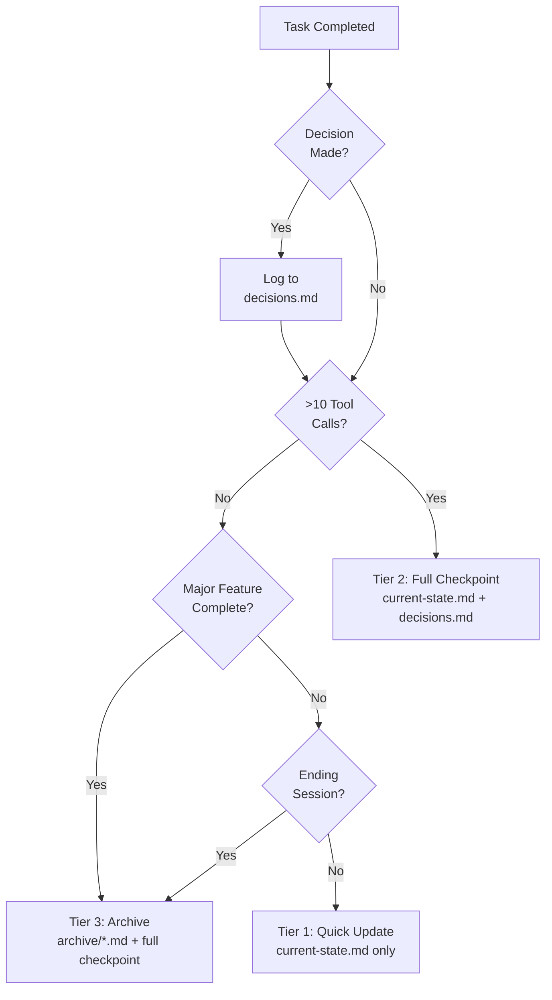
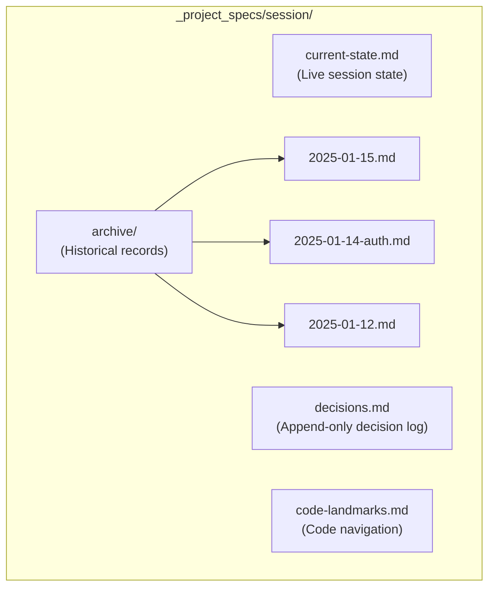
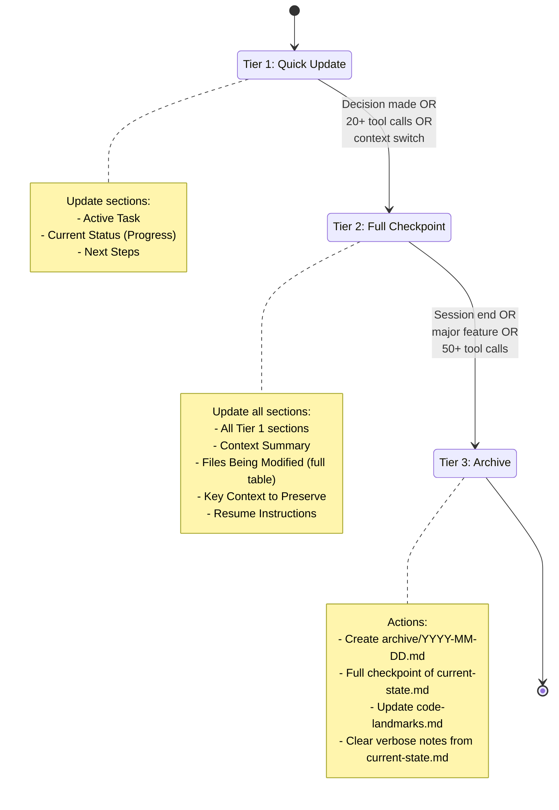
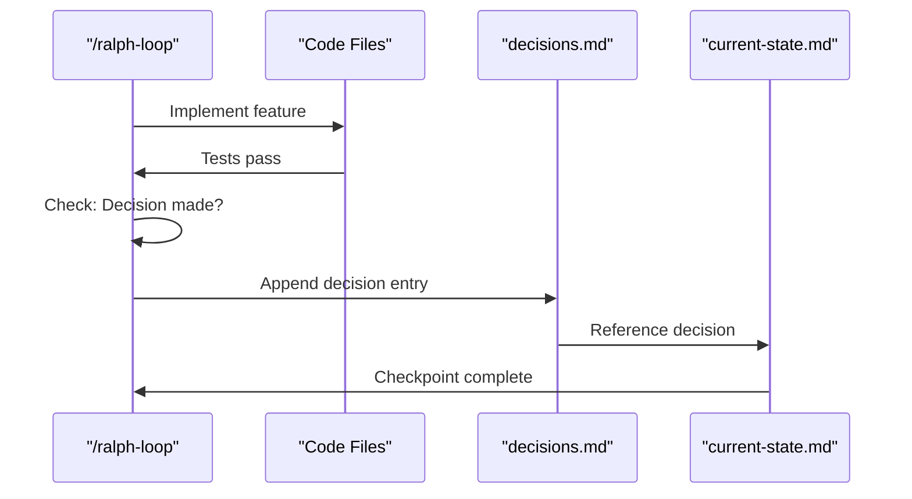
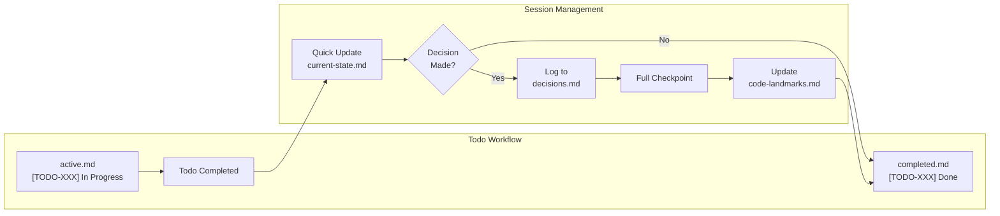
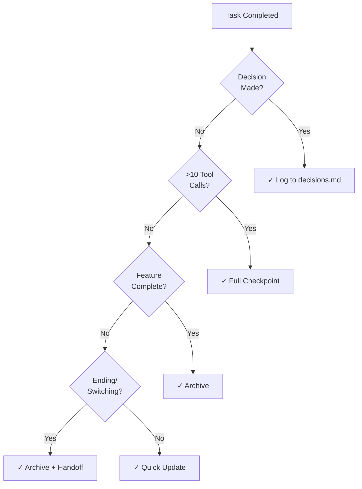
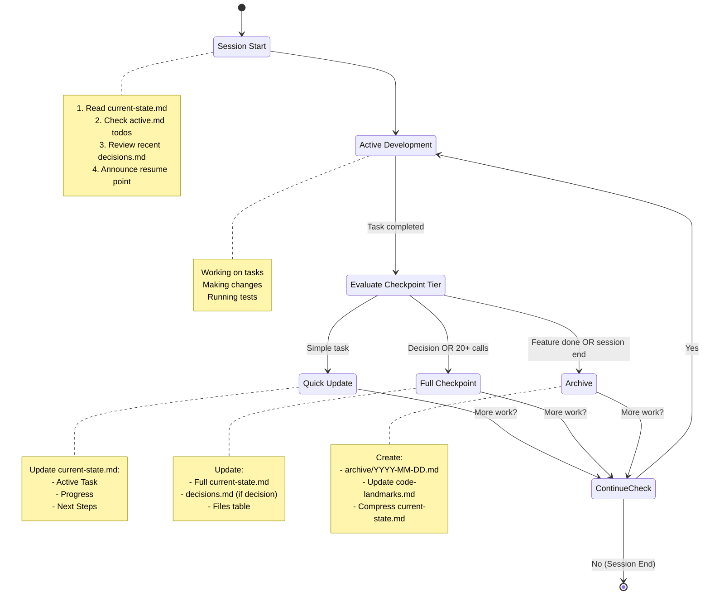

<!-- source: DeepWiki mcp.deepwiki.com · repo alinaqi/claude-bootstrap · page 4.2 Session Management · fetched 2026-10-26 -->

# Session Management

<details>
<summary>Relevant source files</summary>

The following files were used as context for generating this wiki page:

- [skills/base.md](skills/base.md)
- [skills/session-management.md](skills/session-management.md)
- [templates/CLAUDE.md](templates/CLAUDE.md)

</details>


## Purpose and Scope

Session Management provides context preservation across long development cycles and enables seamless resumption after breaks or context limit resets. This system maintains state through a structured file hierarchy in `_project_specs/session/`, implements a three-tier checkpoint strategy based on work significance, and integrates with the Ralph loop iteration system and atomic todo workflow.

For information about the Ralph loop's iterative development cycles, see [Ralph Loop: Iterative Development](#4.1). For details on atomic todos and the `_project_specs/` directory structure, see [Atomic Todos and Project Specs](#3.4).

**Sources:** [skills/session-management.md:1-14](), [skills/base.md:456-478]()

---

## Core Principle: Tiered Checkpointing

The session management system uses a three-tier checkpoint strategy that balances documentation overhead with context preservation needs. Each tier has specific triggers and update requirements.

### Checkpoint Decision Tree



**Sources:** [skills/session-management.md:17-60]()

### Tier Specifications

| Tier | Trigger Conditions | Files Updated | Time Cost |
|------|-------------------|---------------|-----------|
| **Tier 1: Quick Update** | After completing small task/todo | `current-state.md` (Active Task, Progress, Next Steps) | ~30 seconds |
| **Tier 2: Full Checkpoint** | After feature completion, architectural decision, ~20 tool calls, or context switch | `current-state.md` (all sections) + `decisions.md` | ~2-3 minutes |
| **Tier 3: Session Archive** | End of session, major milestone, or ~50+ tool calls | `archive/YYYY-MM-DD[-topic].md` + full checkpoint + `code-landmarks.md` | ~5 minutes |

**Sources:** [skills/session-management.md:17-48]()

---

## Session State Files

The session management system maintains four primary file types in the `_project_specs/session/` directory.

### Directory Structure



**Sources:** [skills/session-management.md:64-76](), [skills/base.md:118-122]()

### File Purposes

| File | Update Frequency | Purpose | Format |
|------|------------------|---------|--------|
| `current-state.md` | Every task completion (Tier 1+) | Live session state, active task tracking, next steps | Structured markdown with status tables |
| `decisions.md` | When architectural/library decisions made (Tier 2+) | Append-only decision log with reasoning and trade-offs | Dated entries with context and references |
| `code-landmarks.md` | When new patterns introduced (Tier 3) | Navigation map for important code locations and patterns | Tables of entry points, core logic, configurations |
| `archive/*.md` | End of session or major feature (Tier 3) | Historical record of completed work | Session summary with tasks, changes, stats |

**Sources:** [skills/session-management.md:514-521]()

---

## Current State File Format

The `current-state.md` file is the primary live state document, updated at every checkpoint tier. It uses a structured format optimized for quick scanning and resumption.

### Template Structure

```markdown
# Current Session State

*Last updated: 2025-01-15 14:32*

## Active Task
[One sentence: what are we working on right now]

## Current Status
- **Phase**: [exploring | planning | implementing | testing | debugging | refactoring]
- **Progress**: [X of Y steps complete, or percentage]
- **Blocking Issues**: [None, or describe blockers]

## Context Summary
[2-3 sentences summarizing the current state of work]

## Files Being Modified
| File | Status | Notes |
|------|--------|-------|
| src/auth/middleware.ts | Done | JWT verification |
| src/auth/refresh.ts | In Progress | Token rotation |

## Next Steps
1. [ ] Complete refresh token rotation in refresh.ts
2. [ ] Add token blacklist for logout
3. [ ] Write integration tests for auth flow

## Key Context to Preserve
- Using RS256 algorithm (not HS256) per security requirements
- Refresh tokens stored in HttpOnly cookies
- Access tokens: 15 min, Refresh tokens: 7 days

## Resume Instructions
To continue this work:
1. Read src/auth/refresh.ts - currently at line 45
2. The rotateRefreshToken() function needs error handling
3. Check decisions.md for why we chose RS256 over HS256
```

**Sources:** [skills/session-management.md:80-128]()

### Update Requirements by Tier



**Sources:** [skills/session-management.md:17-48]()

---

## Decision Log Format

The `decisions.md` file is an append-only log of architectural and implementation decisions. This file never has entries removed, preserving the full decision history.

### Entry Template

```markdown
## [YYYY-MM-DD] Decision Title

**Decision**: Brief statement of the choice made

**Context**: What situation prompted this decision

**Options Considered**:
1. Option A - Description
2. Option B - Description
3. Option C - Description

**Choice**: Option B

**Reasoning**:
- Reason 1 for this choice
- Reason 2 for this choice
- Reason 3 for this choice

**Trade-offs**:
- Negative aspect 1
- Negative aspect 2

**References**:
- src/path/to/implementation - Implementation location
- docs/architecture.md - Related documentation
```

**Sources:** [skills/session-management.md:132-191]()

### Integration with Ralph Loop

When the Ralph loop makes architectural decisions during iterative development, those decisions are logged to `decisions.md` as part of the Tier 2 checkpoint triggered by significant progress.



**Sources:** [skills/session-management.md:407-410](), [skills/base.md:462-466]()

---

## Code Landmarks File

The `code-landmarks.md` file provides a navigation map for the codebase, updated when new patterns are introduced (typically during Tier 3 archives).

### Structure

The file is organized into sections that map conceptual areas to concrete file locations:

| Section | Purpose | Example Entries |
|---------|---------|-----------------|
| **Entry Points** | Main application entry locations | `src/index.ts`, `src/api/routes.ts`, `src/workers/index.ts` |
| **Core Business Logic** | Primary domain logic locations | `src/core/auth/`, `src/core/billing/`, `src/core/workflows/` |
| **Configuration** | Configuration file locations | `src/config/index.ts`, `drizzle.config.ts` |
| **Key Patterns** | Architectural pattern implementations | Service layer, Repository pattern, Middleware |
| **Testing** | Test organization | `tests/unit/`, `tests/integration/`, `tests/e2e/` |
| **Gotchas & Non-Obvious Behavior** | Important caveats | Timezone handling, auth bypass rules, connection limits |

**Sources:** [skills/session-management.md:195-246]()

### Example Entry Format

```markdown
## Core Business Logic
| Location | Purpose |
|----------|---------|
| src/core/auth/ | Authentication system |
| src/core/billing/ | Payment processing |
| src/core/workflows/ | Main workflow engine |

## Gotchas & Non-Obvious Behavior
| Location | Issue | Notes |
|----------|-------|-------|
| src/utils/date.ts | Timezone handling | Always use UTC internally |
| src/api/middleware.ts:45 | Auth bypass | Skip auth for health checks |
```

**Sources:** [skills/session-management.md:211-246]()

---

## Session Archive Format

Session archives are created during Tier 3 checkpoints and stored in `_project_specs/session/archive/`. The filename format is `YYYY-MM-DD[-optional-topic].md`.

### Archive Template

```markdown
# Session Archive: [Date] - [Topic]

## Summary
[Paragraph summarizing what was accomplished]

## Tasks Completed
- [TODO-XXX] Description - Done
- [TODO-YYY] Description - Done

## Key Decisions
- [Reference decisions.md entries made this session]

## Code Changes
| File | Change Type | Description |
|------|-------------|-------------|
| src/auth/login.ts | Created | Login endpoint |
| src/auth/types.ts | Modified | Added RefreshToken type |

## Tests Added
- tests/auth/login.test.ts - Login flow tests
- tests/auth/refresh.test.ts - Token refresh tests

## Open Items Carried Forward
- [Anything not finished, now in active.md]

## Session Stats
- Duration: ~3 hours
- Tool calls: ~120
- Files modified: 8
- Tests added: 12
```

**Sources:** [skills/session-management.md:345-383]()

### Compression Strategy

When creating archives, verbose details are compressed while preserving actionable information:

| Keep in Active Context | Archive/Summarize |
|------------------------|-------------------|
| Current task and immediate next steps | Exploration paths that didn't work |
| Active file list with status | Detailed debugging traces (keep conclusion) |
| Blocking issues | Verbose error messages (keep root cause) |
| Key decisions affecting current work | Research notes (keep recommendations) |

**Sources:** [skills/session-management.md:298-342]()

---

## Checkpoint Trigger Integration

Session management integrates with multiple system components to trigger checkpoints at appropriate times.

### Integration with Todo System



**Sources:** [skills/session-management.md:387-410](), [skills/base.md:209-213]()

### Integration with Ralph Loop

The Ralph loop automatically triggers checkpoints based on iteration count and completion status:

| Ralph Loop Event | Session Management Action |
|------------------|--------------------------|
| Every 10 iterations | Check if ~20 tool calls → Tier 2 checkpoint if threshold reached |
| Decision made during iteration | Log to `decisions.md` + Tier 2 checkpoint |
| Loop completion (promise fulfilled) | Tier 2 checkpoint + update `active.md` |
| Loop max iterations reached | Tier 3 archive (session likely ending due to complexity) |

**Sources:** [skills/session-management.md:24-30]()

### Integration with CLAUDE.md

The `CLAUDE.md` file includes session management rules that Claude reads at project initialization:

```markdown
## Session Management

**IMPORTANT**: Follow session-management.md skill. Update session state at natural breakpoints.

### After Every Task Completion
Ask yourself:
1. Was a decision made? → Log to `decisions.md`
2. Did this take >10 tool calls? → Full checkpoint to `current-state.md`
3. Is a major feature complete? → Create archive entry
4. Otherwise → Quick update to `current-state.md`

### Session Start Protocol
When beginning work:
1. Read `_project_specs/session/current-state.md`
2. Check `_project_specs/todos/active.md`
3. Review recent `decisions.md` entries if needed
4. Continue from "Next Steps"
```

**Sources:** [skills/session-management.md:250-294](), [templates/CLAUDE.md:108-113]()

---

## Enforcement Mechanisms

The session management system uses multiple enforcement mechanisms to ensure checkpoints occur reliably.

### Self-Check Protocol

After completing any task, Claude executes this self-check:



**Sources:** [skills/session-management.md:455-463]()

### File Header Reminders

Session files include enforcement reminders in their headers:

```markdown
<!--
CHECKPOINT RULES (from session-management.md):
- Quick update: After any todo completion
- Full checkpoint: After ~20 tool calls or decisions
- Archive: End of session or major feature complete
-->
```

**Sources:** [skills/session-management.md:443-454]()

### Session Start Verification

When starting a session, Claude must verify state files exist and report their contents:

1. Check if `current-state.md` exists
2. Read and parse the file
3. Announce: "Resuming from: [last state summary]"
4. Confirm next steps before proceeding

**Sources:** [skills/session-management.md:465-469]()

### Periodic Self-Audit

Every ~20 tool calls during active development, Claude performs a self-audit:

- Is `current-state.md` up to date?
- Are there unlogged decisions?
- Is context getting heavy (approaching 50+ tool calls)?
- Should compression/archiving occur?

**Sources:** [skills/session-management.md:471-475]()

---

## Session Lifecycle

The complete session lifecycle from initialization through archival demonstrates how all components work together.

### Session Flow



**Sources:** [skills/session-management.md:280-294]()

---

## Anti-Patterns and Common Mistakes

The session management skill documents anti-patterns to avoid:

| Anti-Pattern | Consequence | Correct Approach |
|-------------|-------------|------------------|
| No state tracking | Can't resume sessions, context lost | Always maintain `current-state.md` |
| Overly verbose state | Files become unreadable | Keep scannable, use archives for detail |
| Stale state files | Files become useless, misleading | Update at every checkpoint tier |
| Missing decisions | Future sessions don't understand "why" | Log all decisions to `decisions.md` |
| No code landmarks | Time wasted re-discovering code structure | Update landmarks when patterns change |
| Never archiving | Session files become cluttered | Archive at Tier 3 triggers |
| Ignoring compression signals | Context overload degrades quality | Archive when approaching 50+ tool calls |
| Skipping checkpoint after decisions | Key context lost forever | Decisions always trigger Tier 2 |
| No handoff at session end | Next session starts blind | Always create archive at session end |

**Sources:** [skills/session-management.md:486-497]()

---

## Command Aliases

The session management skill recommends adding command aliases for quick access:

```bash
# Show current session state
alias session-status="cat _project_specs/session/current-state.md"

# Quick edit session state
alias session-edit="$EDITOR _project_specs/session/current-state.md"

# View recent decisions
alias decisions="tail -100 _project_specs/session/decisions.md"

# Create session archive
session-archive() {
  cp _project_specs/session/current-state.md \
     "_project_specs/session/archive/$(date +%Y-%m-%d).md"
  echo "Archived to _project_specs/session/archive/$(date +%Y-%m-%d).md"
}
```

**Sources:** [skills/session-management.md:413-434]()

---

