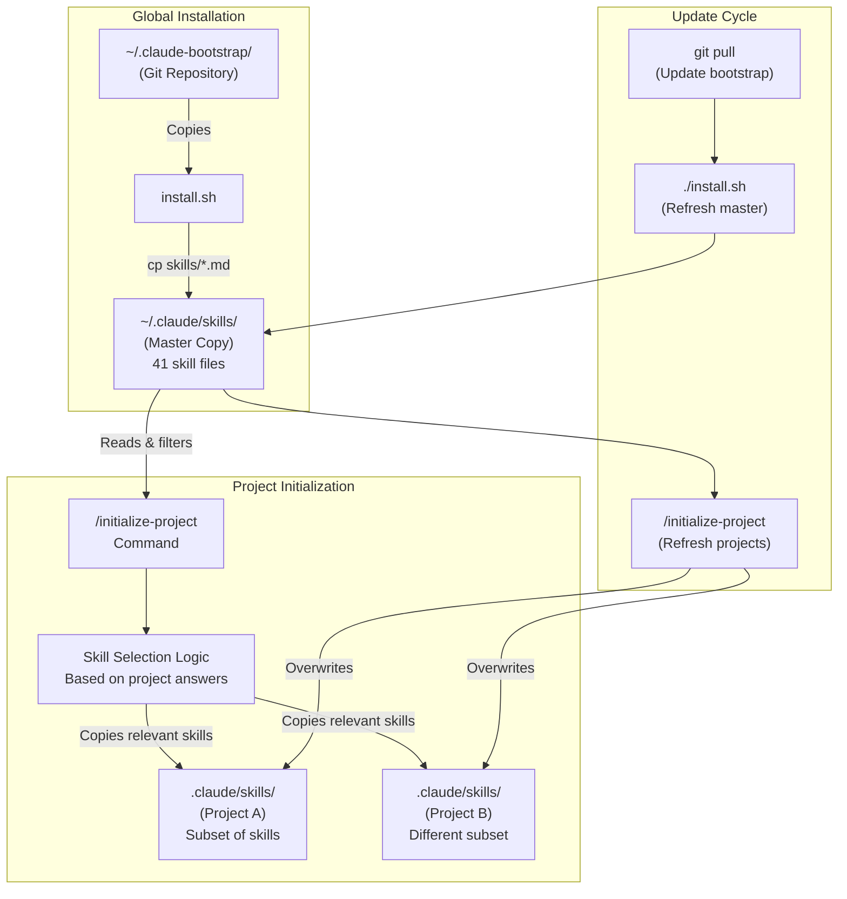
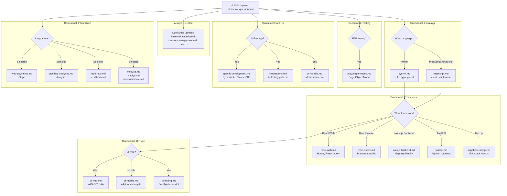
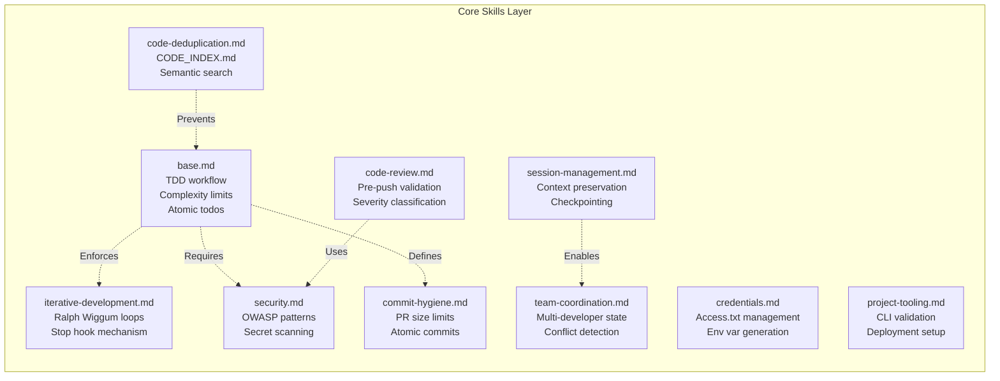
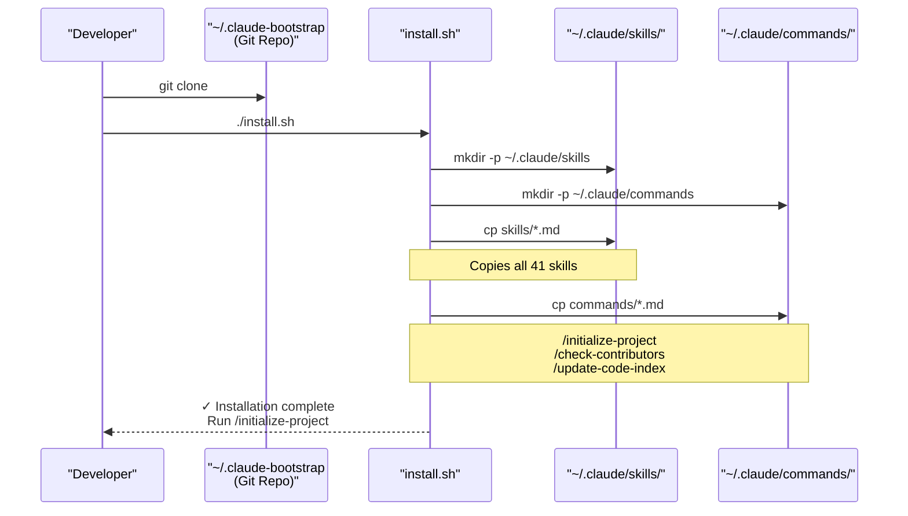
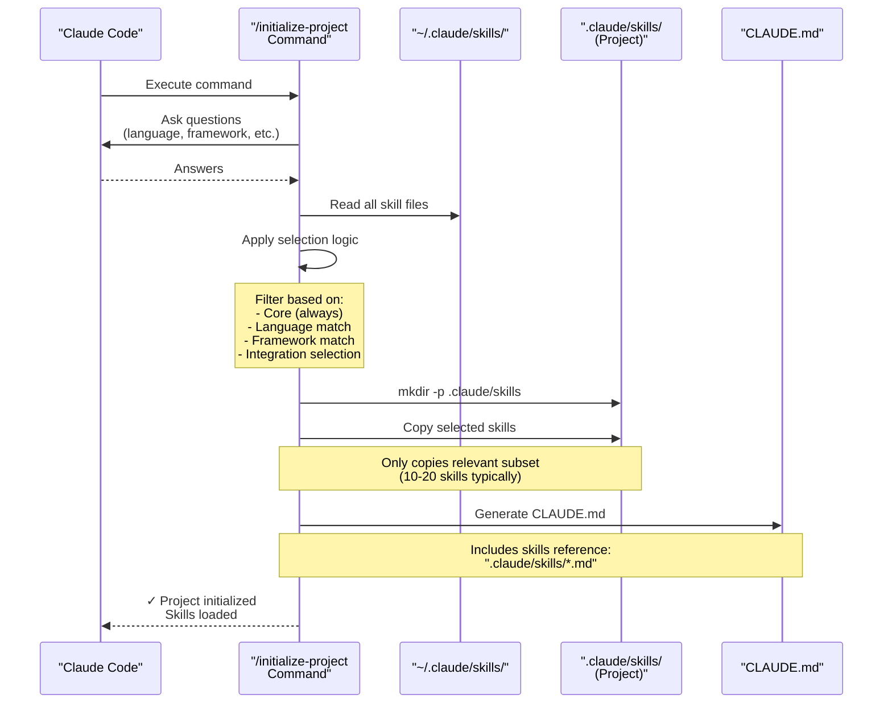
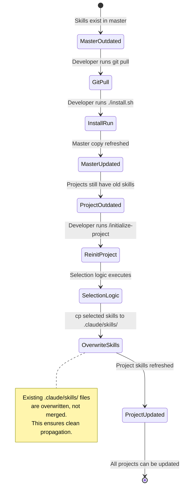

<!-- source: DeepWiki mcp.deepwiki.com · repo alinaqi/claude-bootstrap · page 5 Skills System · fetched 2026-10-26 -->

# Skills System

<details>
<summary>Relevant source files</summary>

The following files were used as context for generating this wiki page:

- [README.md](README.md)
- [install.sh](install.sh)

</details>


## Purpose and Scope

The Skills System is the modular knowledge architecture that powers Claude Bootstrap. It provides domain-specific coding patterns, tooling configurations, and development guardrails through a library of 41+ markdown files that Claude Code reads as contextual instructions. This document explains how skills are organized, stored, loaded, and applied to projects based on technology stack and project requirements.

For implementation details of specific skill categories, see:
- Core skills implementation: [Core Skills](#5.2)
- Language and framework-specific patterns: [Language and Framework Skills](#5.3)
- UI development patterns: [UI Development and Testing](#5.4)
- E2E testing configuration: [E2E Testing with Playwright](#5.5)
- AI-native development patterns: [AI and Agentic Development](#5.6)

For the integration skills (Stripe, PostHog, etc.), see [Integration Skills](#7).

---

## Skills Architecture Overview

Skills are markdown files containing structured instructions that Claude Code reads as contextual knowledge. The system implements a **two-tier storage model** with a master repository and project-specific copies, enabling centralized updates while maintaining project isolation.

### Master-Copy Distribution Model



**Diagram: Skills distribution flow from repository to projects**

**Sources:** [install.sh:1-66](), [README.md:52-62](), [README.md:486-495]()

### Storage Locations and Purposes

| Location | Purpose | Persistence | Modified By |
|----------|---------|-------------|-------------|
| `~/.claude-bootstrap/skills/` | Source repository | Git-controlled | Developer (via git) |
| `~/.claude/skills/` | Master copy (all skills) | Persists across projects | `install.sh` |
| `.claude/skills/` | Project-specific skills | Project-local | `/initialize-project` |

The master copy at `~/.claude/skills/` contains all 41 skills and serves as the source of truth for skill selection. Each project receives only the skills relevant to its technology stack.

**Sources:** [install.sh:8-26](), [README.md:299-317]()

---

## Skills Selection and Loading

### Selection Logic During Initialization

Skills are conditionally loaded based on answers to the `/initialize-project` questionnaire. The selection follows a hierarchical pattern: core skills always load, then language-specific skills, then framework skills, and finally integration skills.



**Diagram: Skills selection decision tree during project initialization**

**Sources:** [README.md:396-466](), [README.md:64-69]()

### Skill File Format

Each skill is a markdown file with a consistent structure:

```markdown
# Skill Name

## Purpose
Brief description of what this skill provides

## Patterns
Code patterns and best practices

## Tooling
Required tools and configurations

## Examples
Working code examples

## Anti-patterns
What to avoid
```

Skills use declarative language (rules, constraints, patterns) rather than imperative instructions. Claude Code interprets these as contextual knowledge when generating code.

**Sources:** [README.md:299-317](), [README.md:652-663]()

---

## Skills Categories and Organization

The 41 skills are organized into 7 categories, each serving a distinct purpose in the development workflow.

### Category Overview Table

| Category | Skill Count | Selection Criteria | Purpose |
|----------|-------------|-------------------|---------|
| **Core** | 10 | Always loaded | Universal patterns, TDD, security, session management |
| **Language** | 2+ | Language selection | Language-specific tooling and patterns |
| **Framework** | 5+ | Framework selection | Framework-specific architecture and patterns |
| **UI** | 5+ | UI type selection | Platform-specific UI patterns and accessibility |
| **AI & Agentic** | 3 | AI-first flag | AI agent development patterns |
| **Database & Backend** | 5+ | Database selection | Schema management, ORM patterns |
| **Integration** | 10+ | Integration selection | Third-party service patterns |

**Sources:** [README.md:396-466]()

### Core Skills (Always Loaded)

Core skills provide foundational patterns that apply to all projects regardless of technology stack:



**Diagram: Core skills and their relationships**

**Sources:** [README.md:398-410]()

### Conditional Skills Loading Pattern

Conditional skills only load when their trigger criteria are met:

| Skill File | Trigger Question | Condition | Related Files |
|-----------|------------------|-----------|---------------|
| `python.md` | "What language?" | Answer: Python | `ruff.toml`, `pyproject.toml` |
| `typescript.md` | "What language?" | Answer: TypeScript | `tsconfig.json`, `.eslintrc.json` |
| `react-web.md` | "What framework?" | Answer: React (Web) | `package.json`, React components |
| `react-native.md` | "What framework?" | Answer: React Native | `app.json`, native modules |
| `playwright-testing.md` | "E2E testing?" | Answer: Yes | `playwright.config.ts` |
| `agentic-development.md` | "AI-first app?" | Answer: Yes | AI agent implementations |
| `web-payments.md` | "Integrations?" | Stripe selected | Stripe SDK integration |

**Sources:** [README.md:412-466]()

---

## Skills Lifecycle Management

### Installation Flow



**Diagram: Skills installation sequence**

**Sources:** [install.sh:1-66]()

### Project Initialization Flow

When `/initialize-project` runs, it reads from the master copy and writes a filtered subset to the project:



**Diagram: Skills selection and project initialization sequence**

**Sources:** [README.md:52-62](), [README.md:64-69]()

### Update and Propagation Pattern

The overwrite-on-init pattern ensures all projects can receive skill updates:



**Diagram: Skills update propagation workflow**

**Sources:** [README.md:486-495]()

---

## Skills and Project Configuration Integration

### CLAUDE.md Skills Reference

When `/initialize-project` generates `CLAUDE.md`, it includes a reference to the skills directory:

```markdown
# Project Instructions for Claude

## Skills
Reference the following skills for coding patterns:
- .claude/skills/*.md

## Project Specifics
[Project-specific instructions]
```

Claude Code automatically loads all `.md` files referenced in `CLAUDE.md`, making skills available as contextual knowledge throughout the session.

**Sources:** [README.md:316]()

### Skills Directory Structure

```
.claude/
├── skills/                      # Project-specific skills
│   ├── base.md                 # Always present
│   ├── security.md             # Always present
│   ├── typescript.md           # If TypeScript project
│   ├── react-web.md           # If React web project
│   └── playwright-testing.md   # If E2E testing enabled
└── commands/                    # Not project-specific
    └── [managed globally]
```

The `.claude/skills/` directory is project-local and can be committed to version control, allowing team members to share the same skill configuration.

**Sources:** [README.md:299-317]()

---

## Skills Count by Category

The following table shows the complete skill distribution across all categories:

| Category | Skills | Files |
|----------|--------|-------|
| **Core Skills** | 10 | `base.md`, `iterative-development.md`, `security.md`, `credentials.md`, `session-management.md`, `code-review.md`, `commit-hygiene.md`, `code-deduplication.md`, `team-coordination.md`, `project-tooling.md` |
| **Language Skills** | 2 | `python.md`, `typescript.md` |
| **Framework Skills** | 5 | `nodejs-backend.md`, `react-web.md`, `react-native.md`, FastAPI (mentioned), Next.js (in `supabase-nextjs.md`) |
| **UI Skills** | 5 | `ui-web.md`, `ui-mobile.md`, `ui-testing.md`, `playwright-testing.md`, `user-journeys.md`, `pwa-development.md` |
| **AI & Agentic Skills** | 3 | `agentic-development.md`, `llm-patterns.md`, `ai-models.md` |
| **Database & Backend Skills** | 5 | `database-schema.md`, `supabase.md`, `supabase-nextjs.md`, `supabase-python.md`, `supabase-node.md` |
| **Content & SEO Skills** | 3 | `aeo-optimization.md`, `web-content.md`, `site-architecture.md` |
| **Integration Skills** | 10 | `web-payments.md`, `reddit-api.md`, `reddit-ads.md`, `ms-teams-apps.md`, `posthog-analytics.md`, `shopify-apps.md`, `woocommerce.md`, `medusa.md`, `klaviyo.md` |
| **Total** | 41+ | |

**Sources:** [README.md:396-466](), [install.sh:25-26]()

---

## Extending the Skills System

### Adding Custom Skills

Developers can add custom skills in two ways:

**1. Project-Local Skills** (not propagated):
- Add `.md` files to `.claude/skills/`
- Reference in `CLAUDE.md` if needed
- Persists only in this project

**2. Global Skills** (propagated to all projects):
- Add `.md` file to `~/.claude-bootstrap/skills/`
- Run `git commit` and `git push` to share
- Run `./install.sh` to copy to master
- Modify `/initialize-project` selection logic if conditional

**Sources:** [README.md:652-663]()

### Skills Validation

The `install.sh` script provides basic validation:

```bash
# Counts skills after installation
ls -1 "$CLAUDE_DIR/skills/"*.md | wc -l
```

This verifies that skills were successfully copied from the repository to the master location.

**Sources:** [install.sh:25-26]()

---

## Technical Implementation Details

### Installation Script Logic

The `install.sh` script implements the master copy creation:

```bash
# Key implementation from install.sh
CLAUDE_DIR="$HOME/.claude"
SCRIPT_DIR="$(cd "$(dirname "${BASH_SOURCE[0]}")" && pwd)"

mkdir -p "$CLAUDE_DIR/skills"
cp "$SCRIPT_DIR/skills/"*.md "$CLAUDE_DIR/skills/"
```

This copies all `.md` files from the repository's `skills/` directory to the global `~/.claude/skills/` location.

**Sources:** [install.sh:7-26]()

### Skills Persistence Model

| Operation | Effect on Master | Effect on Project |
|-----------|------------------|-------------------|
| `git pull` | No change | No change |
| `./install.sh` | Overwritten | No change |
| `/initialize-project` (new) | No change | Created |
| `/initialize-project` (existing) | No change | Overwritten |

This model ensures:
- Master copy stays synchronized with repository
- Projects can be refreshed independently
- No automatic propagation (explicit opt-in via re-init)

**Sources:** [README.md:486-495]()

---

## Skills System Benefits

### Modularity and Composability

The skills system enables precise knowledge loading:
- **Small projects**: ~10-12 skills (core + language + basic framework)
- **Full-stack projects**: ~20-25 skills (core + language + multiple frameworks + UI + testing)
- **Enterprise projects**: ~30-35 skills (all of the above + integrations + team coordination)

This prevents context bloat while ensuring relevant patterns are always available.

### Update Propagation

The master-copy architecture enables:
1. **Immediate availability**: New skills added to master are available to all new projects
2. **Opt-in updates**: Existing projects update only when re-initialized
3. **Consistent versioning**: All projects using same skill version after update

**Sources:** [README.md:486-495]()

### Team Synchronization

Since `.claude/skills/` is project-local, teams can:
- Commit skills to version control
- Share exact skill configuration
- Ensure all developers use same patterns

**Sources:** [README.md:299-317]()

---

## Summary

The Skills System provides modular, selectable coding knowledge through 41+ markdown files organized in a two-tier architecture. Skills are stored globally at `~/.claude/skills/` and copied selectively to `.claude/skills/` during project initialization based on technology stack. This architecture enables centralized updates, project-specific skill sets, and team synchronization while preventing context overload.

For detailed information about specific skill categories:
- [Core Skills](#5.2) - TDD, security, session management patterns
- [Language and Framework Skills](#5.3) - Language/framework-specific patterns
- [UI Development and Testing](#5.4) - UI patterns and accessibility
- [E2E Testing with Playwright](#5.5) - End-to-end testing configuration
- [AI and Agentic Development](#5.6) - AI agent development patterns

**Sources:** [README.md:1-713](), [install.sh:1-66]()

---

