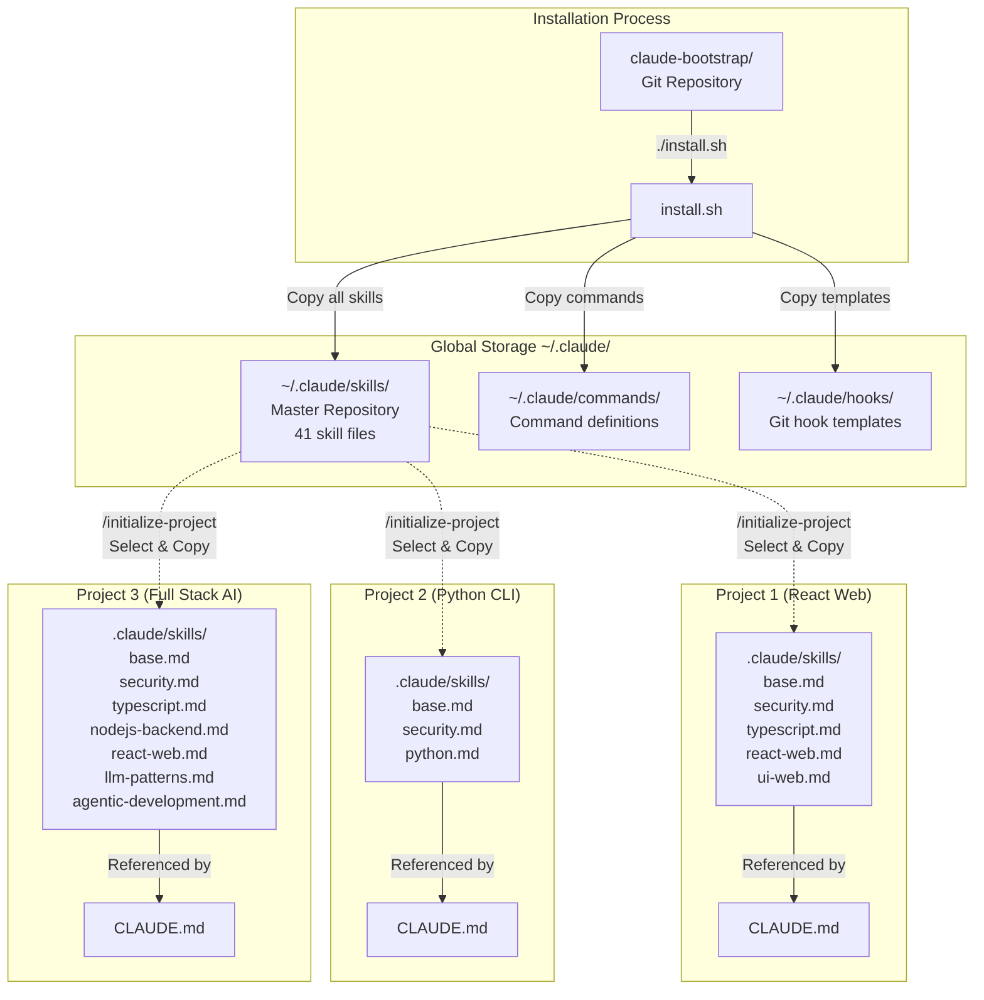
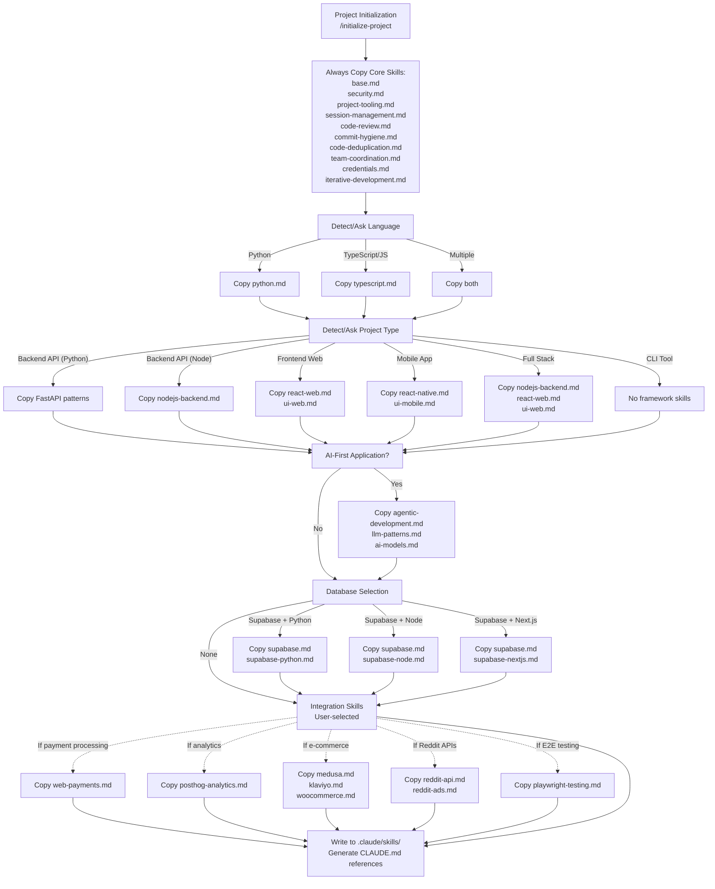
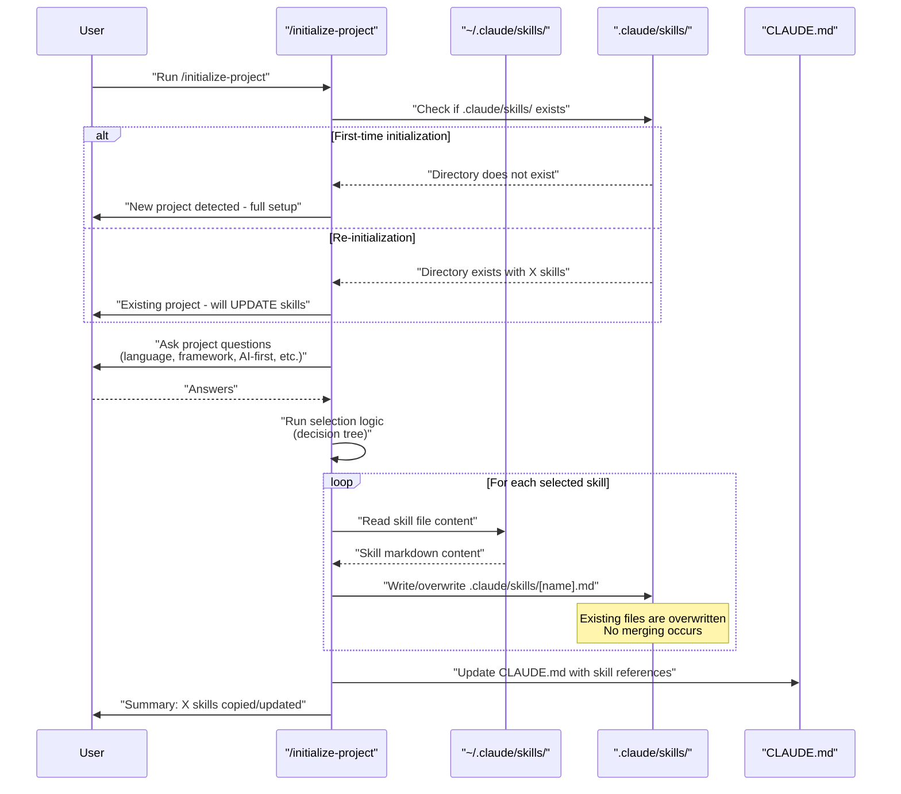
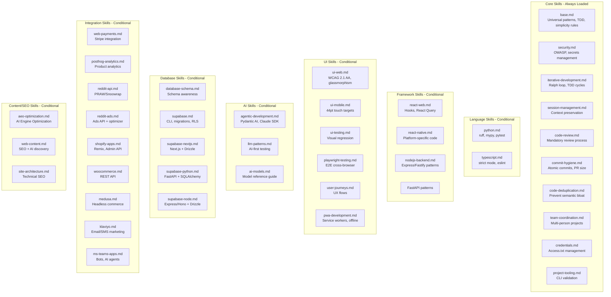
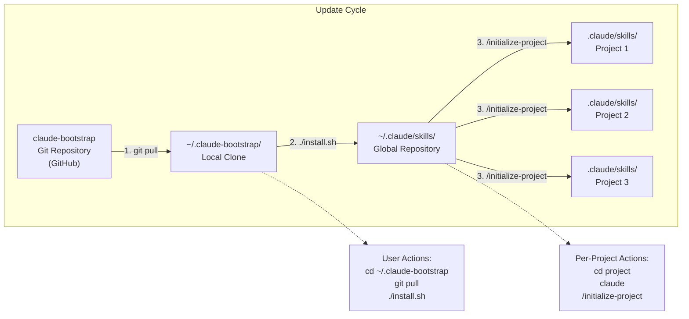

<!-- source: DeepWiki mcp.deepwiki.com · repo alinaqi/claude-bootstrap · page 5.1 Skills Architecture · fetched 2026-10-26 -->

# Skills Architecture

<details>
<summary>Relevant source files</summary>

The following files were used as context for generating this wiki page:

- [README.md](README.md)
- [commands/initialize-project.md](commands/initialize-project.md)
- [install.sh](install.sh)

</details>


This document explains the technical architecture of the skills system: how skills are stored in two locations, the selection logic that determines which skills are copied to a project, and the overwrite-on-init pattern that ensures updates propagate automatically. For information about the content of specific skills, see [Core Skills](#5.2), [Language and Framework Skills](#5.3), [UI Development and Testing](#5.4), [E2E Testing with Playwright](#5.5), and [AI and Agentic Development](#5.6).

---

## Overview

The skills system implements a two-tier architecture with a master repository and project-local copies. Skills are markdown files that provide coding guardrails, patterns, and constraints. The system automatically selects and copies relevant skills during project initialization based on language, framework, and project type.

**Key architectural principles:**

| Principle | Implementation |
|-----------|----------------|
| **Single Source of Truth** | `~/.claude/skills/` is the master repository |
| **Project Isolation** | Each project has its own `.claude/skills/` copy |
| **Overwrite on Init** | Skills are always copied fresh, never merged |
| **Conditional Loading** | Only relevant skills are copied to each project |
| **Update Propagation** | Re-running `/initialize-project` updates all skills |

Sources: [README.md:1-713](), [install.sh:1-66](), [commands/initialize-project.md:1-821]()

---

## Two-Tier Storage Architecture

The skills system maintains skills in two distinct locations with different purposes.

### Storage Hierarchy Diagram



**Two-Tier Storage Locations and Purposes**

Sources: [install.sh:8-26](), [commands/initialize-project.md:146-166]()

### Global Storage: `~/.claude/`

The global storage serves as the master repository for all skills, commands, and templates.

**Directory Structure:**

```
~/.claude/
├── skills/                    # Master skill repository (41 files)
│   ├── base.md
│   ├── security.md
│   ├── python.md
│   ├── typescript.md
│   ├── react-web.md
│   ├── react-native.md
│   ├── nodejs-backend.md
│   ├── llm-patterns.md
│   ├── agentic-development.md
│   └── [38 more skills]
├── commands/                  # Command definitions
│   ├── initialize-project.md
│   ├── check-contributors.md
│   ├── code-review.md
│   └── update-code-index.md
├── hooks/                     # Git hook templates
│   └── pre-push
└── install-hooks.sh           # Hook installer script
```

**Installation Process:**

The global repository is populated by [install.sh:1-66]():
- Line 14-17: Creates directory structure
- Line 20: Copies all commands from source
- Line 25: Copies all skill files from source
- Line 29-30: Copies hook templates

**Update Mechanism:**

```bash
# Update global skills repository
cd ~/.claude-bootstrap
git pull
./install.sh
```

This overwrites all files in `~/.claude/skills/` with the latest versions.

Sources: [install.sh:1-66](), [README.md:486-495]()

### Project Storage: `.claude/skills/`

Each project receives a curated subset of skills copied from the global repository.

**Directory Structure (Example React Web Project):**

```
project-root/.claude/skills/
├── base.md                    # Universal patterns, TDD, atomic todos
├── security.md                # Security requirements, OWASP patterns
├── project-tooling.md         # CLI tools (gh, vercel, supabase)
├── session-management.md      # Context preservation
├── typescript.md              # TypeScript-specific patterns
├── react-web.md               # React web patterns
└── ui-web.md                  # Web UI, accessibility
```

**Characteristics:**

| Property | Behavior |
|----------|----------|
| **Selective** | Only skills relevant to the project are copied |
| **Overwritten** | Never merged; always replaced on `/initialize-project` |
| **Referenced** | Listed in `CLAUDE.md` for Claude to read |
| **Versioned** | Can be committed to git for project-specific history |

**Copy Trigger:**

Skills are copied from `~/.claude/skills/` to `.claude/skills/` when:
1. Running `/initialize-project` for the first time (new project)
2. Running `/initialize-project` in an existing project (update)

Sources: [commands/initialize-project.md:134-166](), [README.md:299-317]()

---

## Skill Selection Logic

The system selects which skills to copy based on project configuration. Selection happens during `/initialize-project` based on user responses or auto-detection.

### Selection Decision Tree



**Skill Selection Decision Tree**

Sources: [commands/initialize-project.md:60-166]()

### Selection Implementation

The selection logic is implemented in [commands/initialize-project.md:146-166]():

**Core Skills (Always Copied):**

```markdown
Always copy (overwrite with latest):
- base.md → .claude/skills/base.md
- security.md → .claude/skills/security.md
- project-tooling.md → .claude/skills/project-tooling.md
- session-management.md → .claude/skills/session-management.md
```

**Language-Based Selection:**

```markdown
Based on language:
- Python → copy python.md
- TypeScript/JavaScript → copy typescript.md
```

**Project Type Selection:**

```markdown
Based on project type:
- React Native → copy typescript.md AND react-native.md
- React Web → copy typescript.md AND react-web.md
- Node Backend → copy typescript.md AND nodejs-backend.md
- Full Stack (Node + React) → copy typescript.md, nodejs-backend.md, AND react-web.md
```

**Conditional Features:**

```markdown
If AI-first:
- Copy llm-patterns.md
```

Sources: [commands/initialize-project.md:146-166]()

### Auto-Detection Logic

The system attempts to auto-detect project configuration before asking questions:

| Detection Method | Code Location | What it Detects |
|------------------|---------------|-----------------|
| **package.json presence** | Line 23 | TypeScript/JavaScript project |
| **pyproject.toml presence** | Line 23 | Python project |
| **dependencies scan** | Line 76 | Framework (react, fastapi, express, etc.) |
| **anthropic/openai in deps** | Line 92 | AI-first application |
| **supabase/ directory** | Line 112 | Supabase already configured |
| **vercel.json presence** | Line 119 | Vercel deployment configured |
| **git remote -v** | Line 20 | GitHub repository connected |

Sources: [commands/initialize-project.md:9-130]()

---

## Copy and Update Mechanism

Skills are copied using an overwrite strategy, ensuring projects always receive the latest skill versions.

### Copy Flow During Initialization



**Copy Flow During Project Initialization**

Sources: [commands/initialize-project.md:132-166]()

### Overwrite-on-Init Pattern

The system uses a strict overwrite strategy with no merging:

**Behavior:**

| Scenario | Action | Rationale |
|----------|--------|-----------|
| **Skill exists in project** | Overwrite completely | Ensures latest patterns propagate |
| **Skill removed from global** | Remains in project | Preserves backward compatibility |
| **New skill added to global** | Not copied until re-init | Explicit opt-in for new patterns |
| **User edits project skill** | Edits lost on re-init | Skills are source code, not config |

**Implementation:**

From [commands/initialize-project.md:146-166]():

```
Step 2: Update skill files from ~/.claude/skills/

Always copy (overwrite with latest):
- base.md → .claude/skills/base.md
- security.md → .claude/skills/security.md
...

Note: Skills are always overwritten with the latest version from ~/.claude/skills/.
This ensures updates propagate when user updates their global skills.
```

**Implications for Users:**

- ✅ Run `/initialize-project` anytime to get latest skill updates
- ✅ Can commit `.claude/skills/` to git for project history
- ❌ Don't edit skills in `.claude/skills/` (edits will be lost)
- ✅ Add project-specific patterns to `CLAUDE.md` instead

Sources: [commands/initialize-project.md:146-166](), [commands/initialize-project.md:320-325]()

---

## Skill Categories and Organization

The 41 skills are organized into 7 functional categories, each serving a distinct purpose in the development workflow.

### Category Overview



**Seven Skill Categories and Their Members**

Sources: [README.md:396-466]()

### Category Loading Rules

| Category | When Loaded | Example Trigger |
|----------|-------------|-----------------|
| **Core Skills (10)** | Always | Every project |
| **Language Skills (2)** | Based on language | `pyproject.toml` detected → `python.md` |
| **Framework Skills (4+)** | Based on framework | `"react"` in dependencies → `react-web.md` |
| **UI Skills (6)** | Based on project type | "Frontend Web" selected → `ui-web.md` |
| **AI Skills (3)** | Based on AI-first flag | "AI-first: Yes" → `agentic-development.md` |
| **Database Skills (5)** | Based on database | "Supabase" selected → `supabase.md` |
| **Integration Skills (9)** | User-selected | "PostHog" selected → `posthog-analytics.md` |
| **Content/SEO Skills (3)** | User-selected | Content site project → `web-content.md` |

Sources: [README.md:396-466](), [commands/initialize-project.md:146-166]()

---

## Update Propagation

The system provides a straightforward mechanism for propagating skill updates from the global repository to all projects.

### Update Flow



**Update Propagation Flow from Upstream to Projects**

Sources: [README.md:486-495](), [commands/initialize-project.md:802-821]()

### Update Commands

**Step 1: Update Global Repository**

```bash
# Navigate to local clone
cd ~/.claude-bootstrap

# Pull latest from GitHub
git pull

# Reinstall to ~/.claude/
./install.sh
```

This updates `~/.claude/skills/` with the latest versions from the repository.

**Step 2: Update Individual Projects**

```bash
# Navigate to any project
cd ~/projects/my-app

# Open Claude Code
claude

# Run initialization command
/initialize-project
```

This copies the latest skills from `~/.claude/skills/` to `.claude/skills/`, overwriting existing files.

Sources: [README.md:486-495](), [commands/initialize-project.md:802-821]()

### Preservation During Updates

When running `/initialize-project` on an existing project, certain elements are preserved:

| Element | Update Behavior | Rationale |
|---------|----------------|-----------|
| **Skills in `.claude/skills/`** | Overwritten completely | Skills are source code, not configuration |
| **CLAUDE.md** | Skill list updated, custom sections preserved | Allows project-specific documentation |
| **`_project_specs/` contents** | Fully preserved | Todos, features, and sessions are user data |
| **Source code** | Never touched | Initialization only affects Claude configuration |
| **Git configuration** | Preserved | Repository connection maintained |
| **`.env` files** | Preserved | Credentials never overwritten |

From [commands/initialize-project.md:320-325]():

```markdown
If CLAUDE.md exists:
- Preserve Project Overview, Tech Stack, and Project-Specific Patterns sections
- Update Skills list to reference current .claude/skills/ contents
- Update Key Commands section with latest
```

Sources: [commands/initialize-project.md:320-438](), [commands/initialize-project.md:732-750]()

---

## CLAUDE.md Integration

The `CLAUDE.md` file serves as the entry point that references skills, providing Claude with the instruction to read them before coding.

### CLAUDE.md Structure

From [commands/initialize-project.md:327-438]():

```markdown
# CLAUDE.md

## Skills
Read and follow these skills before writing any code:
- .claude/skills/base.md
- .claude/skills/security.md
- .claude/skills/project-tooling.md
- .claude/skills/session-management.md
- .claude/skills/[language].md
- .claude/skills/[framework].md (if applicable)
- .claude/skills/llm-patterns.md (if AI-first)

## Project Overview
[Description]

## Tech Stack
[Stack details]

## Project-Specific Patterns
[Custom patterns]
```

**Skill Loading Mechanism:**

1. Claude reads `CLAUDE.md` as the project instruction file
2. `CLAUDE.md` lists all skills in `.claude/skills/` to read
3. Claude loads and internalizes each skill before coding
4. Skills provide guardrails that Claude follows during development

Sources: [commands/initialize-project.md:320-438](), [README.md:299-317]()

### Reference Generation

During initialization, the skill reference list in `CLAUDE.md` is automatically generated based on which skills were copied to `.claude/skills/`:

```markdown
## Skills
Read and follow these skills before writing any code:
```

For each file in `.claude/skills/`:
```markdown
- .claude/skills/[filename].md
```

This ensures the reference list always matches the actual skills present in the project.

Sources: [commands/initialize-project.md:327-339]()

---

## File System Layout

### Complete Directory Structure

```
~/.claude-bootstrap/          # Git clone of repository
├── install.sh                # Global installer
├── commands/
│   ├── initialize-project.md
│   ├── check-contributors.md
│   ├── code-review.md
│   └── update-code-index.md
├── skills/                   # Master skill files (41 files)
│   ├── base.md
│   ├── security.md
│   ├── [39 more skills]
└── hooks/
    └── pre-push

~/.claude/                    # Global installation
├── skills/                   # Copy of all skills
│   └── [41 .md files]
├── commands/                 # Copy of all commands
│   └── [4 .md files]
├── hooks/                    # Git hook templates
│   └── pre-push
└── install-hooks.sh          # Per-project hook installer

project-root/                 # Individual project
├── .claude/
│   └── skills/               # Subset of skills (4-15 files typically)
│       ├── base.md
│       ├── security.md
│       ├── [language].md
│       ├── [framework].md
│       └── [integration].md
├── CLAUDE.md                 # References .claude/skills/
└── _project_specs/           # Project specs (preserved during updates)
    ├── overview.md
    ├── features/
    ├── todos/
    └── session/
```

Sources: [install.sh:1-66](), [commands/initialize-project.md:134-143](), [README.md:296-317]()

---

## Summary

The skills architecture implements a three-layer system:

1. **Source Layer:** Git repository (`claude-bootstrap/`) contains authoritative skill files
2. **Global Layer:** User installation (`~/.claude/skills/`) provides master copy for all projects
3. **Project Layer:** Individual projects (`.claude/skills/`) receive curated subsets

The overwrite-on-init pattern ensures that running `/initialize-project` always updates projects with the latest skill versions from the global repository, while preserving project-specific configuration and user data. Skill selection is conditional based on project type, enabling the system to adapt from simple CLI tools to complex full-stack AI applications by loading only relevant skills.

Sources: [README.md:1-713](), [install.sh:1-66](), [commands/initialize-project.md:1-821]()

---

