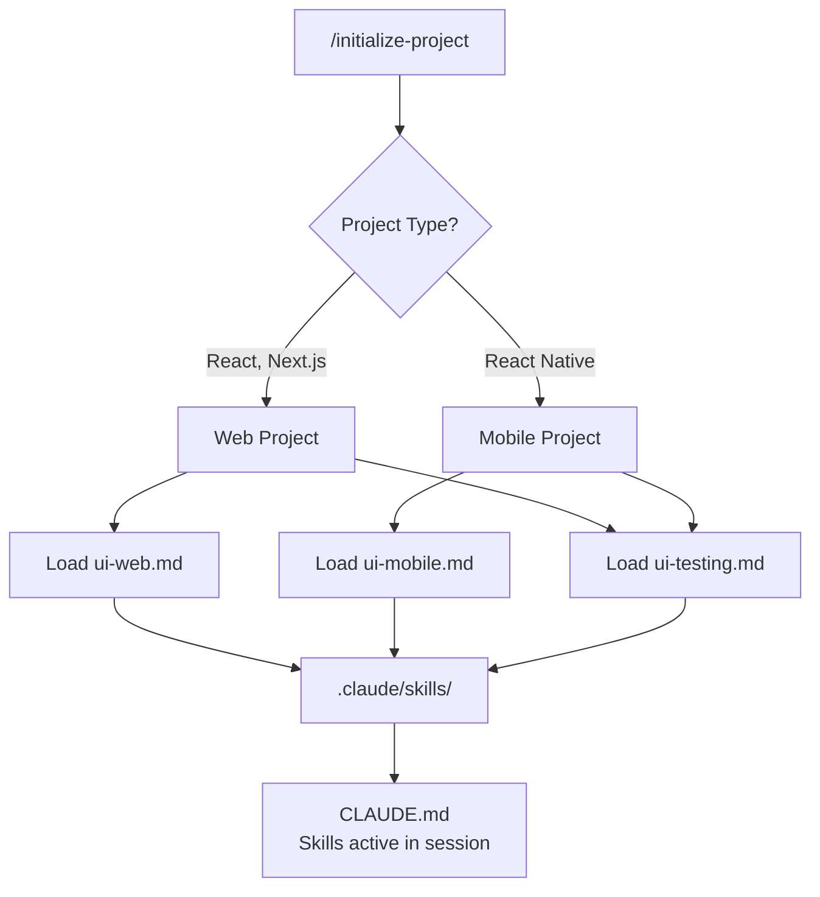
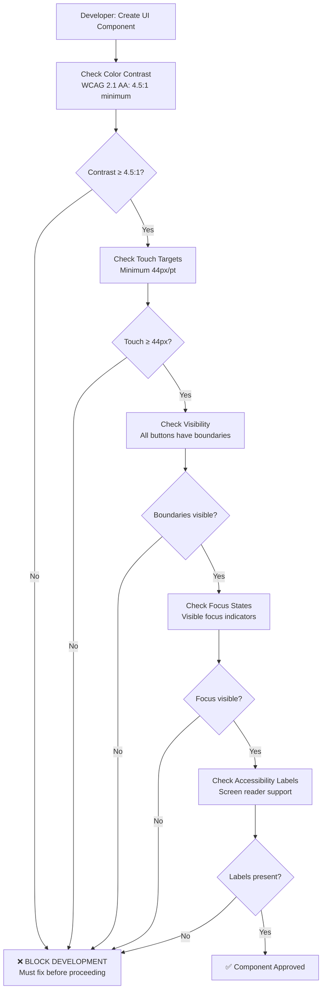
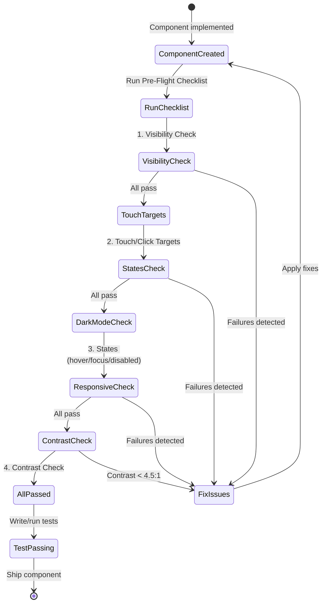
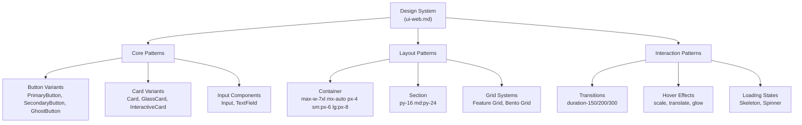
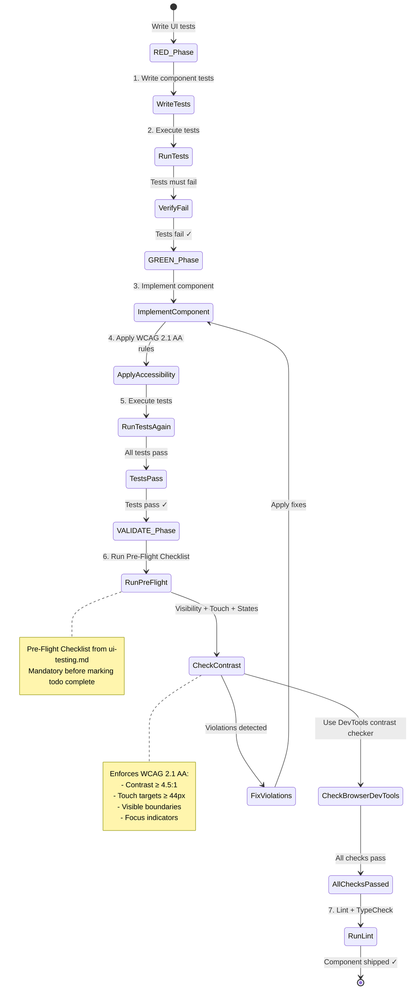

<!-- source: DeepWiki mcp.deepwiki.com · repo alinaqi/claude-bootstrap · page 5.4 UI Development and Testing · fetched 2026-10-26 -->

# UI Development and Testing

<details>
<summary>Relevant source files</summary>

The following files were used as context for generating this wiki page:

- [README.md](README.md)
- [skills/ui-mobile.md](skills/ui-mobile.md)
- [skills/ui-testing.md](skills/ui-testing.md)
- [skills/ui-web.md](skills/ui-web.md)

</details>


## Purpose and Scope

This page documents the UI development and testing system within Claude Bootstrap's skills architecture. It covers the mandatory WCAG 2.1 AA accessibility standards, platform-specific patterns for web and mobile interfaces, and the pre-flight checklist workflow that ensures UI compliance before shipping.

**Scope**: This page focuses on UI design patterns, accessibility enforcement, and visual verification. For end-to-end testing with Playwright, see [5.5](#5.5). For framework-specific implementation details, see [5.3](#5.3).

---

## UI Skills Architecture

Claude Bootstrap provides three UI-focused skill files that load conditionally based on project type:

| Skill File | Loads When | Purpose |
|------------|------------|---------|
| `ui-web.md` | Web projects (React, Next.js) | WCAG 2.1 AA compliance, Tailwind patterns, glassmorphism, dark mode |
| `ui-mobile.md` | Mobile projects (React Native) | Touch targets (44pt minimum), platform differences (iOS/Android), native patterns |
| `ui-testing.md` | Any project with UI | Pre-flight checklist, contrast verification, common fix patterns |

**Skills Loading Diagram**



Sources: [README.md:420-429](), [skills/ui-web.md:1-3](), [skills/ui-mobile.md:1-3](), [skills/ui-testing.md:1-3]()

---

## Mandatory Accessibility Standards (NON-NEGOTIABLE)

### WCAG 2.1 AA Requirements

Both `ui-web.md` and `ui-mobile.md` enforce identical mandatory rules that block development if violated. These are marked as **CRITICAL** and **NON-NEGOTIABLE** in the skill files.

**WCAG 2.1 AA Enforcement Flow**



Sources: [skills/ui-web.md:7-47](), [skills/ui-mobile.md:7-106]()

### Color Contrast Standards

The skills define specific forbidden and safe color combinations with exact contrast ratios:

**Forbidden Combinations** (from [skills/ui-web.md:19-23]()):
- `gray-400` on `white` (#9CA3AF on #FFFFFF = 2.6:1) - **FAILS**
- `gray-500` on `white` (#6B7280 on #FFFFFF = 4.6:1) - **BARELY PASSES**
- White on yellow - **FAILS**
- Light blue on white - **USUALLY FAILS**

**Safe Combinations** (from [skills/ui-web.md:25-29]()):
- `gray-700` on `white` (#374151 on #FFFFFF = 9.2:1)
- `gray-600` on `white` (#4B5563 on #FFFFFF = 6.4:1)
- `gray-900` on `white` (#111827 on #FFFFFF = 16:1)
- White on `gray-900`, `blue-600`, `green-700`

**Tailwind Color Contrast Reference** (from [skills/ui-testing.md:62-79]()):

| Light Mode (on white bg) | Contrast Ratio | Status |
|--------------------------|----------------|---------|
| `text-gray-900` (#111827) | 16:1 | ✓ Safe |
| `text-gray-800` (#1F2937) | 12:1 | ✓ Safe |
| `text-gray-700` (#374151) | 9:1 | ✓ Safe |
| `text-gray-600` (#4B5563) | 6:1 | ✓ Safe |
| `text-gray-500` (#6B7280) | 4.6:1 | ✗ Barely passes |
| `text-gray-400` (#9CA3AF) | 2.6:1 | ✗ **FAILS** |

| Dark Mode (on gray-900 bg) | Contrast Ratio | Status |
|----------------------------|----------------|---------|
| `text-white` (#FFFFFF) | 16:1 | ✓ Safe |
| `text-gray-100` (#F3F4F6) | 13:1 | ✓ Safe |
| `text-gray-200` (#E5E7EB) | 11:1 | ✓ Safe |
| `text-gray-300` (#D1D5DB) | 8:1 | ✓ Safe |
| `text-gray-400` (#9CA3AF) | 5:1 | ✗ Barely passes |
| `text-gray-500` (#6B7280) | 3:1 | ✗ **FAILS** |

Sources: [skills/ui-testing.md:62-79](), [skills/ui-web.md:11-30]()

### Touch Target Requirements

**Minimum Touch Target Sizes** (from [skills/ui-mobile.md:12-35]()):

```typescript
// MANDATORY: 44x44 points for ALL interactive elements
const MINIMUM_TOUCH_SIZE = 44;

// EVERY button, link, icon button must meet this
const styles = StyleSheet.create({
  button: {
    minHeight: MINIMUM_TOUCH_SIZE,
    minWidth: MINIMUM_TOUCH_SIZE,
    paddingVertical: 12,
    paddingHorizontal: 16,
  },
  iconButton: {
    width: MINIMUM_TOUCH_SIZE,
    height: MINIMUM_TOUCH_SIZE,
    justifyContent: 'center',
    alignItems: 'center',
  },
});

// NEVER DO THIS:
style={{ height: 30 }}  // ✗ TOO SMALL
style={{ padding: 4 }}  // ✗ RESULTS IN TINY TARGET
```

For web, the equivalent minimum is 44px height with adequate padding ([skills/ui-web.md:37-38]()).

Sources: [skills/ui-mobile.md:11-35](), [skills/ui-web.md:37-38]()

### Visibility Rules

**All Interactive Elements Must Have Visible Boundaries**

From [skills/ui-web.md:49-68]() and [skills/ui-mobile.md:59-105]():

```tsx
// PRIMARY: Solid background with contrasting text
<button className="bg-gray-900 text-white px-4 py-3 rounded-lg">
  Primary
</button>

// SECONDARY: Visible background
<button className="bg-gray-100 text-gray-900 px-4 py-3 rounded-lg">
  Secondary
</button>

// GHOST: MUST have visible border
<button className="border border-gray-300 text-gray-700 px-4 py-3 rounded-lg">
  Ghost
</button>

// ✗ FORBIDDEN: No visible boundary
<button className="text-gray-500">Invisible Button</button>
```

Sources: [skills/ui-web.md:49-68](), [skills/ui-mobile.md:59-105]()

### Focus State Requirements

Every interactive element requires visible focus indicators ([skills/ui-web.md:71-78]()):

```tsx
// EVERY interactive element needs visible focus
className="focus:outline-none focus-visible:ring-2 focus-visible:ring-blue-500 focus-visible:ring-offset-2"

// ✗ NEVER remove focus without replacement
className="outline-none" // FORBIDDEN
```

Sources: [skills/ui-web.md:71-78](), [skills/ui-testing.md:109-118]()

---

## Pre-Flight Checklist System

The `ui-testing.md` skill provides a systematic checklist that runs **before shipping ANY UI component**. This checklist integrates with the TDD workflow to catch accessibility violations during development.

**Pre-Flight Checklist Execution Flow**



Sources: [skills/ui-testing.md:10-43]()

### Checklist Contents

From [skills/ui-testing.md:15-43]():

```markdown
## Visibility Check
- [ ] All buttons have visible background OR border
- [ ] No text is same color as its background
- [ ] All text meets 4.5:1 contrast ratio
- [ ] Ghost/text buttons have visible borders

## Touch/Click Targets
- [ ] All buttons are minimum 44px height
- [ ] Icon buttons are minimum 44x44px
- [ ] Adequate spacing between clickable elements

## States
- [ ] Hover states visible (web)
- [ ] Pressed states visible (mobile)
- [ ] Focus rings on keyboard navigation
- [ ] Disabled states visually distinct (opacity 0.5)
- [ ] Loading states show indicators

## Dark Mode (if applicable)
- [ ] Text readable on dark backgrounds
- [ ] Borders visible in dark mode
- [ ] No gray-400 text on dark backgrounds

## Responsive (web)
- [ ] No horizontal scroll on mobile (320px)
- [ ] Content readable at all breakpoints
- [ ] Touch targets adequate on mobile
```

Sources: [skills/ui-testing.md:15-43]()

### Quick Contrast Verification

The skill provides browser DevTools instructions and online tool recommendations ([skills/ui-testing.md:48-79]()):

**Browser DevTools Method**:
1. Right-click element → Inspect
2. In Styles panel, click on color value
3. Look for contrast ratio display
4. Must show ✓ for AA compliance (4.5:1 for text)

**Online Tools**:
- https://webaim.org/resources/contrastchecker/
- https://coolors.co/contrast-checker

Sources: [skills/ui-testing.md:48-79]()

### Common Fixes

The skill documents fix patterns for frequent violations ([skills/ui-testing.md:83-137]()):

**Fix Pattern: Invisible Button**
```tsx
// PROBLEM: No visible boundary
<button className="text-gray-500">Click</button>

// FIX: Add background OR border
<button className="bg-gray-100 text-gray-900 px-4 py-3 rounded-lg">
  Click
</button>
```

**Fix Pattern: Low Contrast Text**
```tsx
// PROBLEM: Light gray on white
<p className="text-gray-400">Secondary text</p>

// FIX: Use darker gray
<p className="text-gray-600">Secondary text</p>
```

**Fix Pattern: Small Touch Target**
```tsx
// PROBLEM: Too small for fingers
<button className="p-1 text-sm">×</button>

// FIX: Minimum 44px
<button className="w-11 h-11 flex items-center justify-center">×</button>
```

Sources: [skills/ui-testing.md:83-137]()

---

## Web UI Patterns

The `ui-web.md` skill ([skills/ui-web.md:1-629]()) defines comprehensive patterns for web applications using Tailwind CSS.

### Component Pattern Hierarchy



Sources: [skills/ui-web.md:1-629]()

### Button Implementations

From [skills/ui-web.md:262-318]():

**`PrimaryButton`** - Bold, high-contrast primary action:
```tsx
const PrimaryButton = ({ children, ...props }) => (
  <button
    className="
      px-6 py-3
      bg-gray-900 dark:bg-white
      text-white dark:text-gray-900
      font-medium
      rounded-xl
      transition-all duration-200
      hover:bg-gray-800 dark:hover:bg-gray-100
      hover:shadow-lg hover:shadow-gray-900/20
      active:scale-[0.98]
      disabled:opacity-50 disabled:cursor-not-allowed
    "
    {...props}
  >
    {children}
  </button>
);
```

**`SecondaryButton`** - Subtle, lower-contrast secondary action:
```tsx
const SecondaryButton = ({ children, ...props }) => (
  <button
    className="
      px-6 py-3
      bg-gray-100 dark:bg-gray-800
      text-gray-900 dark:text-white
      font-medium
      rounded-xl
      transition-all duration-200
      hover:bg-gray-200 dark:hover:bg-gray-700
      active:scale-[0.98]
    "
    {...props}
  >
    {children}
  </button>
);
```

**`GhostButton`** - Minimal, text-style action with visible hover state:
```tsx
const GhostButton = ({ children, ...props }) => (
  <button
    className="
      px-4 py-2
      text-gray-600 dark:text-gray-400
      font-medium
      rounded-lg
      transition-colors duration-200
      hover:text-gray-900 dark:hover:text-white
      hover:bg-gray-100 dark:hover:bg-gray-800
    "
    {...props}
  >
    {children}
  </button>
);
```

Sources: [skills/ui-web.md:260-318]()

### Glassmorphism Implementation

From [skills/ui-web.md:144-197]():

**`GlassCard` Base Component**:
```tsx
const GlassCard = ({ children, className = '' }) => (
  <div className={`
    backdrop-blur-xl
    bg-white/10
    border border-white/20
    rounded-2xl
    shadow-xl
    shadow-black/5
    ${className}
  `}>
    {children}
  </div>
);
```

**Usage Guidelines** ([skills/ui-web.md:199-211]()):
- ✓ Hero sections with image backgrounds
- ✓ Floating cards over gradients
- ✓ Modal overlays
- ✗ Every card (overuse kills the effect)
- ✗ Forms (reduces contrast)
- ✗ Data tables

Sources: [skills/ui-web.md:144-211]()

### Spacing and Typography Systems

**8px Grid Spacing System** ([skills/ui-web.md:114-127]()):

| Tailwind Class | Pixels | Usage |
|----------------|--------|-------|
| `p-1` | 4px | Tight internal spacing |
| `p-2` | 8px | Compact spacing |
| `p-4` | 16px | Default spacing |
| `p-6` | 24px | Comfortable spacing |
| `p-8` | 32px | Spacious spacing |
| `p-12` | 48px | Section gaps |

**Typography Scale** ([skills/ui-web.md:129-141]()):

| Name | Classes | Usage |
|------|---------|-------|
| `hero` | `text-4xl md:text-5xl font-bold tracking-tight` | Landing page headlines |
| `heading` | `text-2xl md:text-3xl font-semibold` | Section headers |
| `subheading` | `text-lg md:text-xl font-medium` | Card titles |
| `body` | `text-base leading-relaxed` | Body text |
| `caption` | `text-sm text-gray-500` | Metadata, timestamps |

Sources: [skills/ui-web.md:114-141]()

---

## Mobile UI Patterns

The `ui-mobile.md` skill ([skills/ui-mobile.md:1-947]()) provides React Native-specific patterns with iOS and Android platform differences.

### Platform-Specific Implementations

**Platform Detection and Styling** ([skills/ui-mobile.md:172-193]()):

```typescript
import { Platform } from 'react-native';

// Platform-specific values
const styles = StyleSheet.create({
  shadow: Platform.select({
    ios: {
      shadowColor: '#000',
      shadowOffset: { width: 0, height: 2 },
      shadowOpacity: 0.1,
      shadowRadius: 8,
    },
    android: {
      elevation: 4,
    },
  }),
  
  // iOS uses SF Pro, Android uses Roboto
  text: {
    fontFamily: Platform.OS === 'ios' ? 'System' : 'Roboto',
  },
});
```

**Design Language Differences** ([skills/ui-mobile.md:196-213]()):

| iOS (Human Interface Guidelines) | Android (Material Design 3) |
|----------------------------------|----------------------------|
| Flat design with subtle depth | Material You dynamic color |
| SF Symbols for icons | Outlined/filled icons |
| Large titles (34pt) | Medium titles (22pt) |
| Rounded corners (10-14pt) | Rounded corners (12-28pt) |
| Blue as default tint | Primary color from theme |

Sources: [skills/ui-mobile.md:169-213]()

### React Native Component Patterns

**Touch Feedback Implementation** ([skills/ui-mobile.md:407-436]()):

```tsx
import { Pressable } from 'react-native';

// iOS-style opacity feedback
const Button = ({ children, onPress }) => (
  <Pressable
    onPress={onPress}
    style={({ pressed }) => [
      styles.button,
      pressed && { opacity: 0.7 },
    ]}
  >
    {children}
  </Pressable>
);

// Android-style ripple
const AndroidButton = ({ children, onPress }) => (
  <Pressable
    onPress={onPress}
    android_ripple={{
      color: 'rgba(0, 0, 0, 0.1)',
      borderless: false,
    }}
    style={styles.button}
  >
    {children}
  </Pressable>
);
```

**Card with Platform-Specific Shadow** ([skills/ui-mobile.md:442-466]()):

```tsx
const Card = ({ children, style }) => (
  <View style={[styles.card, style]}>
    {children}
  </View>
);

const styles = StyleSheet.create({
  card: {
    backgroundColor: '#FFFFFF',
    borderRadius: 12,
    padding: 16,
    ...Platform.select({
      ios: {
        shadowColor: '#000',
        shadowOffset: { width: 0, height: 2 },
        shadowOpacity: 0.08,
        shadowRadius: 8,
      },
      android: {
        elevation: 2,
      },
    }),
  },
});
```

Sources: [skills/ui-mobile.md:407-466]()

### Accessibility Implementation

**VoiceOver / TalkBack Support** ([skills/ui-mobile.md:107-137]()):

```tsx
// Button with full accessibility
<Pressable
  accessible={true}
  accessibilityRole="button"
  accessibilityLabel="Submit form"
  accessibilityHint="Double tap to submit your information"
>
  <Text>Submit</Text>
</Pressable>

// Icon button (NO visible text = MUST have label)
<Pressable
  accessible={true}
  accessibilityRole="button"
  accessibilityLabel="Close menu"
>
  <CloseIcon />
</Pressable>

// Image with description
<Image
  accessible={true}
  accessibilityRole="image"
  accessibilityLabel="User profile photo"
  source={...}
/>
```

**Dynamic Type Support** ([skills/ui-mobile.md:868-880]()):

```tsx
import { PixelRatio } from 'react-native';

// Scale fonts with system settings
const fontScale = PixelRatio.getFontScale();
const scaledFontSize = (size: number) => size * fontScale;

// Or use allowFontScaling
<Text allowFontScaling={true} style={{ fontSize: 17 }}>
  This text scales with system settings
</Text>
```

Sources: [skills/ui-mobile.md:107-137](), [skills/ui-mobile.md:868-880]()

### Safe Area Handling

**Safe Area Implementation** ([skills/ui-mobile.md:239-257]()):

```tsx
import { useSafeAreaInsets } from 'react-native-safe-area-context';

const Screen = ({ children }) => {
  const insets = useSafeAreaInsets();
  
  return (
    <View style={{
      flex: 1,
      paddingTop: insets.top,
      paddingBottom: insets.bottom,
      paddingLeft: Math.max(insets.left, 16),
      paddingRight: Math.max(insets.right, 16),
    }}>
      {children}
    </View>
  );
};
```

Sources: [skills/ui-mobile.md:239-257]()

---

## Integration with TDD Workflow

The UI development system integrates with Claude Bootstrap's core TDD workflow ([README.md:319-342]()) to enforce quality gates at each phase.

**UI Development TDD Integration**



Sources: [README.md:319-342](), [skills/ui-testing.md:10-43]()

### Example TDD Execution Log

From [README.md:534-558](), adapted for UI development:

```markdown
## [TODO-042] Add accessible login form

**Status:** in-progress
**Priority:** high
**Estimate:** S

### Acceptance Criteria
- [ ] Email and password inputs with visible labels
- [ ] Submit button meets 44px minimum height
- [ ] Form error states have 4.5:1 contrast
- [ ] Focus indicators visible on all inputs
- [ ] Works with keyboard navigation

### Test Cases
| Input | Expected |
|-------|----------|
| Valid credentials | Form submits |
| Invalid email | Error with sufficient contrast |
| Tab navigation | Focus visible on all elements |

### TDD Execution Log
| Phase | Command | Result |
|-------|---------|--------|
| RED | `npm test -- LoginForm.test.tsx` | 5 tests failed ✓ |
| GREEN | `npm test -- LoginForm.test.tsx` | 5 tests passed ✓ |
| VALIDATE | Pre-Flight Checklist (ui-testing.md) | All checks passed ✓ |
| VALIDATE | `npm run lint && npm test -- --coverage` | Pass, 87% ✓ |
```

Sources: [README.md:534-558]()

---

## Automated Accessibility Checks (Optional)

While the pre-flight checklist is the primary enforcement mechanism, `ui-testing.md` documents optional automated tools for larger projects.

### ESLint Integration

From [skills/ui-testing.md:142-152]():

```bash
npm install -D eslint-plugin-jsx-a11y
```

```json
// .eslintrc
{
  "extends": ["plugin:jsx-a11y/recommended"]
}
```

### Playwright Quick Test

From [skills/ui-testing.md:154-165]():

```typescript
// e2e/accessibility.spec.ts
import { test, expect } from '@playwright/test';
import AxeBuilder from '@axe-core/playwright';

test('no accessibility violations', async ({ page }) => {
  await page.goto('/');
  const results = await new AxeBuilder({ page }).analyze();
  expect(results.violations).toEqual([]);
});
```

**When to Use Full Testing** ([skills/ui-testing.md:169-177]()):
- Building a component library
- Multiple developers on UI
- Frequent UI changes
- Design system enforcement needed

For solo projects or MVPs, the pre-flight checklist is sufficient.

Sources: [skills/ui-testing.md:140-177]()

---

## Anti-Patterns and Common Mistakes

### Web Anti-Patterns

From [skills/ui-web.md:573-603]():

**Never Do**:
- More than 3 font sizes on a page
- Random spacing values (use 8px grid)
- Pure black (#000) on pure white (#fff)
- Colored text on colored backgrounds without checking contrast
- Animations longer than 500ms for UI elements
- Glassmorphism everywhere
- Removing focus indicators
- Gray text below 4.5:1 contrast
- Tiny click targets (< 44px)

**Common Mistakes**:
```tsx
// ✗ Too many shadows
className="shadow-sm shadow-md shadow-lg" // Pick ONE

// ✗ Inconsistent rounding
className="rounded-sm rounded-lg rounded-2xl" // Use system

// ✗ Competing focal points
// One primary CTA per viewport
```

Sources: [skills/ui-web.md:573-603]()

### Mobile Anti-Patterns

From [skills/ui-mobile.md:883-920]():

**Never Do**:
- Touch targets smaller than 44pt
- Text smaller than 12pt
- Hover states (no hover on mobile)
- Fixed heights that break with large text
- Ignoring safe areas
- Heavy shadows on Android (use elevation)
- White text on light backgrounds without checking contrast
- Non-native animations (JS-driven transforms)
- Ignoring platform conventions (iOS vs Android)

**Common Mistakes**:
```tsx
// ✗ Hardcoded dimensions that break accessibility
style={{ height: 40 }}  // Text might be larger

// ✓ Minimum height with padding
style={{ minHeight: 44, paddingVertical: 12 }}

// ✗ Shadow on Android (won't render)
shadowColor: '#000'

// ✓ Platform-specific
...Platform.select({
  ios: { shadowColor: '#000', ... },
  android: { elevation: 4 },
})
```

Sources: [skills/ui-mobile.md:883-920]()

---

## Quick Reference

### Web Defaults

From [skills/ui-web.md:607-615]():

- Border radius: 12-16px (`rounded-xl` to `rounded-2xl`)
- Shadow: subtle (`shadow-sm` to `shadow-md`)
- Font: Inter, SF Pro, system-ui
- Primary: Near-black or brand color
- Transitions: 200ms ease-out
- Spacing: 8px grid (Tailwind default)

### Mobile Defaults

From [skills/ui-mobile.md:924-932]():

- Touch targets: 44pt minimum
- Font sizes: 12pt min, 17pt body, 34pt large title
- Border radius: 10-14pt (iOS), 12-28pt (Android)
- Spacing: 4/8/16/24/32 grid
- Animations: 200-300ms, native driver
- Shadow: iOS shadowOpacity 0.08-0.15, Android elevation 2-8

### Premium Feel Checklist

Combined from [skills/ui-web.md:617-628]() and [skills/ui-mobile.md:934-946]():

- [ ] All touch targets 44pt/px+
- [ ] Consistent spacing (8px/4pt grid)
- [ ] Platform-appropriate styling
- [ ] Safe area handling
- [ ] Smooth transitions on all interactions
- [ ] Proper loading states
- [ ] Dark mode support
- [ ] Accessibility labels
- [ ] High-quality imagery
- [ ] Micro-interactions on hover/focus

Sources: [skills/ui-web.md:606-628](), [skills/ui-mobile.md:922-946]()

---

