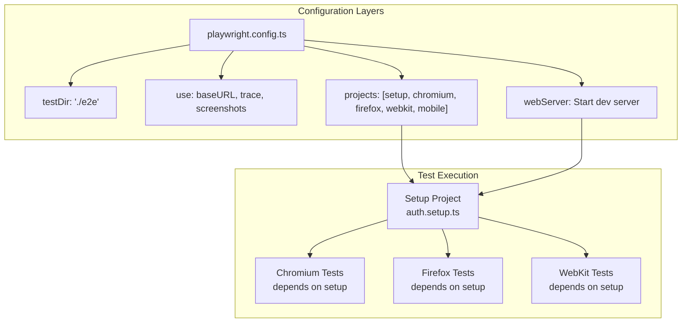
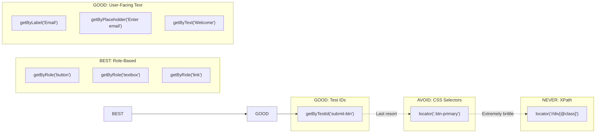
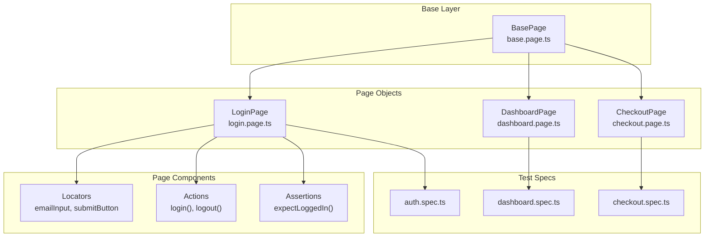
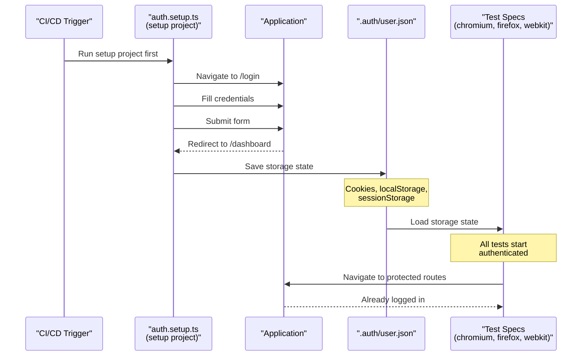
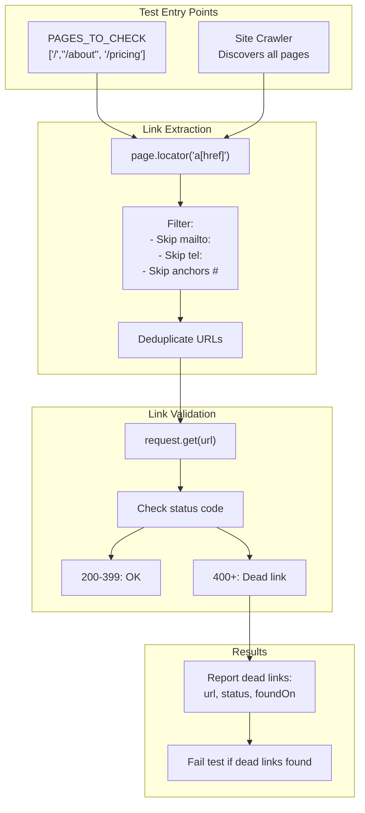
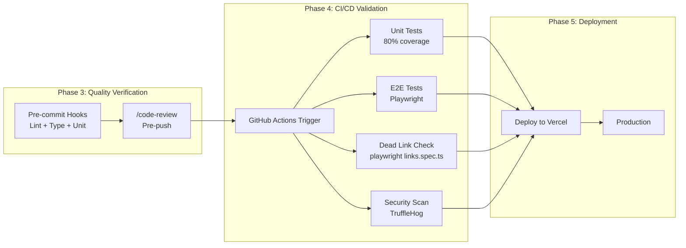
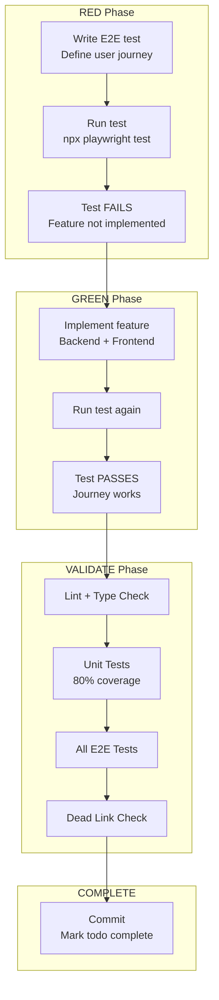

<!-- source: DeepWiki mcp.deepwiki.com · repo alinaqi/claude-bootstrap · page 5.5 E2E Testing with Playwright · fetched 2026-10-26 -->

# E2E Testing with Playwright

<details>
<summary>Relevant source files</summary>

The following files were used as context for generating this wiki page:

- [README.md](README.md)
- [skills/playwright-testing.md](skills/playwright-testing.md)
- [skills/react-web.md](skills/react-web.md)

</details>


## Purpose

This document covers end-to-end testing with Playwright in Claude Bootstrap projects. Playwright provides cross-browser automated testing that validates complete user journeys from the browser perspective. Unlike unit tests that verify individual components, E2E tests verify that all system layers work together correctly.

For component-level testing patterns, see [UI Development and Testing](#5.4). For the overall TDD workflow that E2E tests integrate into, see [TDD Workflow (RED-GREEN-VALIDATE)](#3.2).

**Sources:** [skills/playwright-testing.md:1-10]()

---

## When to Use E2E Tests

E2E tests serve specific purposes in the testing pyramid:

| Test Type | Validates | Speed | When to Use |
|-----------|-----------|-------|-------------|
| Unit | Component logic | Fast (ms) | Business logic, edge cases |
| Integration | API contracts | Medium (100ms) | Service boundaries |
| E2E | User journeys | Slow (seconds) | Critical flows, cross-browser |

**E2E tests are mandatory for:**
- Authentication flows (login, logout, session)
- Payment/checkout processes
- Multi-step wizards
- Dead link detection (every project)
- Critical user paths (signup → activation → first use)

**Sources:** [skills/playwright-testing.md:1-10](), [README.md:423-428]()

---

## Setup and Configuration

### Installation

```bash
# New project
npm init playwright@latest

# Existing project
npm install -D @playwright/test
npx playwright install
```

**Sources:** [skills/playwright-testing.md:14-22]()

### Configuration Structure

The `playwright.config.ts` file defines test execution behavior:



**Key configuration sections:**

| Section | Purpose | Example |
|---------|---------|---------|
| `testDir` | Test file location | `./e2e` |
| `fullyParallel` | Run tests in parallel | `true` |
| `retries` | Retry flaky tests in CI | `process.env.CI ? 2 : 0` |
| `use.baseURL` | Default navigation URL | `http://localhost:3000` |
| `use.trace` | Record execution traces | `'on-first-retry'` |
| `projects` | Browser configurations | chromium, firefox, webkit, mobile |
| `webServer` | Start app before tests | `npm run dev` |

**Sources:** [skills/playwright-testing.md:24-89]()

### Project Structure

```
project/
├── e2e/
│   ├── fixtures/
│   │   ├── auth.fixture.ts      # Auth state fixtures
│   │   └── test.fixture.ts      # Extended test context
│   ├── pages/
│   │   ├── base.page.ts         # Base Page Object
│   │   ├── login.page.ts        # Login Page Object
│   │   ├── dashboard.page.ts    # Dashboard Page Object
│   │   └── index.ts             # Barrel exports
│   ├── tests/
│   │   ├── auth.spec.ts         # Authentication tests
│   │   ├── dashboard.spec.ts    # Dashboard tests
│   │   └── checkout.spec.ts     # Checkout flow tests
│   ├── utils/
│   │   ├── helpers.ts           # Test utilities
│   │   └── test-data.ts         # Data factories
│   └── auth.setup.ts            # Global auth setup
├── playwright.config.ts
└── .auth/                        # Stored auth state (gitignored)
```

**Sources:** [skills/playwright-testing.md:93-117]()

---

## Locator Strategy

Playwright uses a priority-based locator strategy that mirrors how users interact with the page. This makes tests resilient to implementation changes while catching accessibility issues.

### Locator Priority Order



**Examples:**

```typescript
// ✅ BEST: Role-based (accessible, resilient)
page.getByRole('button', { name: 'Submit' })
page.getByRole('textbox', { name: 'Email' })

// ✅ GOOD: User-facing text
page.getByLabel('Email address')
page.getByPlaceholder('Enter your email')

// ✅ GOOD: Test IDs (stable, explicit)
page.getByTestId('submit-button')

// ⚠️ AVOID: CSS selectors (brittle)
page.locator('.btn-primary')

// ❌ NEVER: XPath (extremely brittle)
page.locator('//div[@class="container"]/button[1]')
```

**Sources:** [skills/playwright-testing.md:119-162]()

---

## Page Object Model

The Page Object Model (POM) encapsulates page structure and interactions into reusable classes. This prevents duplication and makes tests readable.

### Architecture



### Base Page Pattern

The `BasePage` class provides shared functionality for all pages:

```typescript
// e2e/pages/base.page.ts
export abstract class BasePage {
  constructor(protected page: Page) {}

  async navigate(path: string = '/') {
    await this.page.goto(path);
  }

  async waitForPageLoad() {
    await this.page.waitForLoadState('networkidle');
  }

  // Common elements
  get header() {
    return this.page.getByRole('banner');
  }

  get footer() {
    return this.page.getByRole('contentinfo');
  }

  // Common actions
  async clickNavLink(name: string) {
    await this.header.getByRole('link', { name }).click();
  }
}
```

**Sources:** [skills/playwright-testing.md:165-198]()

### Page Implementation

Each page extends `BasePage` and defines its specific locators and actions:

```typescript
// e2e/pages/login.page.ts
export class LoginPage extends BasePage {
  readonly emailInput: Locator;
  readonly passwordInput: Locator;
  readonly submitButton: Locator;
  readonly errorMessage: Locator;

  constructor(page: Page) {
    super(page);
    this.emailInput = page.getByLabel('Email');
    this.passwordInput = page.getByLabel('Password');
    this.submitButton = page.getByRole('button', { name: 'Sign in' });
    this.errorMessage = page.getByRole('alert');
  }

  async goto() {
    await this.navigate('/login');
  }

  async login(email: string, password: string) {
    await this.emailInput.fill(email);
    await this.passwordInput.fill(password);
    await this.submitButton.click();
  }

  async expectError(message: string) {
    await expect(this.errorMessage).toContainText(message);
  }

  async expectLoggedIn() {
    await expect(this.page).toHaveURL(/.*dashboard/);
  }
}
```

**Page Object Structure:**

| Component | Purpose | Example |
|-----------|---------|---------|
| `readonly` locators | Define page elements in constructor | `this.emailInput = page.getByLabel('Email')` |
| `goto()` method | Navigate to page | `await this.navigate('/login')` |
| Action methods | Encapsulate interactions | `async login(email, password)` |
| Assertion methods | Verify page state | `async expectLoggedIn()` |

**Sources:** [skills/playwright-testing.md:200-281]()

### Usage in Tests

```typescript
// e2e/tests/auth.spec.ts
import { test, expect } from '@playwright/test';
import { LoginPage } from '../pages';

test.describe('Authentication', () => {
  test('successful login redirects to dashboard', async ({ page }) => {
    const loginPage = new LoginPage(page);

    await loginPage.goto();
    await loginPage.login('user@example.com', 'password123');
    await loginPage.expectLoggedIn();
  });

  test('invalid credentials show error', async ({ page }) => {
    const loginPage = new LoginPage(page);

    await loginPage.goto();
    await loginPage.login('wrong@example.com', 'wrongpass');
    await loginPage.expectError('Invalid email or password');
  });
});
```

**Sources:** [skills/playwright-testing.md:350-389]()

---

## Authentication

Authentication state management prevents tests from logging in repeatedly. The setup project runs once before all tests and stores authentication state.

### Global Authentication Flow



### Implementation

**Setup file:**

```typescript
// e2e/auth.setup.ts
import { test as setup, expect } from '@playwright/test';
import path from 'path';

const authFile = path.join(__dirname, '../.auth/user.json');

setup('authenticate', async ({ page }) => {
  // Go to login page
  await page.goto('/login');

  // Login with test credentials
  await page.getByLabel('Email').fill(process.env.TEST_USER_EMAIL!);
  await page.getByLabel('Password').fill(process.env.TEST_USER_PASSWORD!);
  await page.getByRole('button', { name: 'Sign in' }).click();

  // Wait for auth to complete
  await expect(page).toHaveURL(/.*dashboard/);

  // Save auth state for reuse
  await page.context().storageState({ path: authFile });
});
```

**Configuration:**

```typescript
// playwright.config.ts
export default defineConfig({
  projects: [
    { name: 'setup', testMatch: /.*\.setup\.ts/ },
    {
      name: 'chromium',
      use: {
        ...devices['Desktop Chrome'],
        storageState: '.auth/user.json',  // Load saved state
      },
      dependencies: ['setup'],  // Run setup first
    },
  ],
});
```

**Tests without auth (public pages):**

```typescript
// e2e/tests/public.spec.ts
test.use({ storageState: { cookies: [], origins: [] } });

test('homepage loads for anonymous users', async ({ page }) => {
  await page.goto('/');
  await expect(page.getByRole('heading', { name: 'Welcome' })).toBeVisible();
});
```

**Sources:** [skills/playwright-testing.md:284-344]()

---

## Writing Test Patterns

### Basic Test Structure

Tests follow the Arrange-Act-Assert pattern:

```typescript
test.describe('Feature Name', () => {
  test.beforeEach(async ({ page }) => {
    // Setup: Navigate, clear state, etc.
  });

  test('describes expected behavior', async ({ page }) => {
    // Arrange: Setup test data
    const loginPage = new LoginPage(page);

    // Act: Perform actions
    await loginPage.goto();
    await loginPage.login('user@example.com', 'password123');

    // Assert: Verify outcome
    await loginPage.expectLoggedIn();
  });
});
```

**Sources:** [skills/playwright-testing.md:350-389]()

### User Flow Tests

Complex flows test multiple steps in sequence:

```typescript
// e2e/tests/checkout.spec.ts
test('complete purchase flow', async ({ page }) => {
  // 1. Browse products
  await page.goto('/products');
  await page.getByTestId('product-card')
    .filter({ hasText: 'Pro Plan' })
    .getByRole('button', { name: 'Add to cart' })
    .click();

  // 2. View cart
  await page.getByRole('link', { name: 'Cart' }).click();
  await expect(page.getByText('Pro Plan')).toBeVisible();
  await expect(page.getByTestId('cart-total')).toContainText('$29.99');

  // 3. Checkout
  await page.getByRole('button', { name: 'Checkout' }).click();

  // 4. Fill payment (Stripe test card)
  const stripeFrame = page.frameLocator('iframe[name*="stripe"]');
  await stripeFrame.getByPlaceholder('Card number').fill('4242424242424242');
  await stripeFrame.getByPlaceholder('MM / YY').fill('12/30');
  await stripeFrame.getByPlaceholder('CVC').fill('123');

  // 5. Complete purchase
  await page.getByRole('button', { name: 'Pay now' }).click();

  // 6. Verify success
  await expect(page).toHaveURL(/.*success/);
  await expect(page.getByRole('heading', { name: 'Thank you' })).toBeVisible();
});
```

**Sources:** [skills/playwright-testing.md:391-428]()

### Assertions

Playwright assertions auto-wait and retry:

```typescript
// ✅ Web-first assertions (auto-wait)
await expect(page.getByRole('button')).toBeVisible();
await expect(page.getByRole('button')).toBeEnabled();
await expect(page.getByRole('button')).toHaveText('Submit');
await expect(page).toHaveURL('/dashboard');
await expect(page).toHaveTitle(/Dashboard/);

// ❌ Avoid manual waits
await page.waitForTimeout(3000);  // NEVER do this
```

**Common assertions:**

| Category | Assertion | Use Case |
|----------|-----------|----------|
| Visibility | `toBeVisible()`, `toBeHidden()` | Element visibility |
| Text | `toHaveText()`, `toContainText()` | Content verification |
| State | `toBeEnabled()`, `toBeDisabled()`, `toBeChecked()` | Input state |
| URL | `toHaveURL()`, `toHaveTitle()` | Navigation verification |
| Count | `toHaveCount(n)` | List length |

**Sources:** [skills/playwright-testing.md:430-484]()

### Network Mocking

Mock API responses for controlled testing:

```typescript
test('shows error when API fails', async ({ page }) => {
  // Mock API to return error
  await page.route('**/api/users', (route) => {
    route.fulfill({
      status: 500,
      body: JSON.stringify({ error: 'Server error' }),
    });
  });

  await page.goto('/users');
  await expect(page.getByText('Failed to load users')).toBeVisible();
});

test('wait for API call', async ({ page }) => {
  await page.goto('/contact');
  
  // Fill form
  await page.getByLabel('Name').fill('John');
  
  // Wait for API response
  const responsePromise = page.waitForResponse('**/api/contact');
  await page.getByRole('button', { name: 'Send' }).click();
  
  const response = await responsePromise;
  expect(response.status()).toBe(200);
});
```

**Sources:** [skills/playwright-testing.md:486-546]()

---

## Dead Link Detection (REQUIRED)

**Every Claude Bootstrap project MUST include dead link detection tests.** Dead links harm user experience and SEO. These tests run on every deployment to catch broken links before users do.

### Why Dead Link Detection is Mandatory

| Problem | Impact | Solution |
|---------|--------|----------|
| External links break | Users hit 404s, bounce rate increases | Automated link checking |
| Internal routes change | Site navigation breaks | Crawl entire site |
| Images 404 | Visual design fails | Validate image URLs |
| CDN failures | Assets don't load | Check external resources |

### Detection Architecture



### Basic Link Validator

```typescript
// e2e/tests/links.spec.ts
import { test, expect } from '@playwright/test';

const PAGES_TO_CHECK = ['/', '/about', '/pricing', '/blog', '/contact'];

test.describe('Dead Link Detection', () => {
  for (const pagePath of PAGES_TO_CHECK) {
    test(`no dead links on ${pagePath}`, async ({ page, request }) => {
      await page.goto(pagePath);

      // Get all links on the page
      const links = await page.locator('a[href]').all();
      const hrefs = await Promise.all(
        links.map(link => link.getAttribute('href'))
      );

      // Filter to internal and absolute external links
      const uniqueLinks = [...new Set(hrefs.filter(Boolean))] as string[];

      for (const href of uniqueLinks) {
        // Skip mailto, tel, and anchor links
        if (href.startsWith('mailto:') || href.startsWith('tel:') || href.startsWith('#')) {
          continue;
        }

        // Build full URL
        const url = href.startsWith('http') ? href : new URL(href, page.url()).href;

        // Check link status
        const response = await request.get(url, {
          timeout: 10000,
          ignoreHTTPSErrors: true,
        });

        expect(
          response.ok(),
          `Dead link found on ${pagePath}: ${href} returned ${response.status()}`
        ).toBeTruthy();
      }
    });
  }
});
```

**Sources:** [skills/playwright-testing.md:708-757]()

### Site Crawler

For comprehensive coverage, crawl the entire site and check every discovered link:

```typescript
// e2e/tests/site-links.spec.ts
interface LinkResult {
  url: string;
  status: number;
  foundOn: string;
}

async function checkAllLinks(
  page: Page,
  request: APIRequestContext,
  startUrl: string
): Promise<LinkResult[]> {
  const visited = new Set<string>();
  const results: LinkResult[] = [];
  const toVisit = [startUrl];
  const baseUrl = new URL(startUrl).origin;

  while (toVisit.length > 0) {
    const currentUrl = toVisit.pop()!;
    if (visited.has(currentUrl)) continue;
    visited.add(currentUrl);

    try {
      await page.goto(currentUrl);
      const links = await page.locator('a[href]').all();

      for (const link of links) {
        const href = await link.getAttribute('href');
        if (!href || href.startsWith('#') || href.startsWith('mailto:')) {
          continue;
        }

        const fullUrl = href.startsWith('http') ? href : new URL(href, currentUrl).href;

        // Check link
        const response = await request.get(fullUrl, {
          timeout: 10000,
          ignoreHTTPSErrors: true,
        });

        results.push({
          url: fullUrl,
          status: response.status(),
          foundOn: currentUrl,
        });

        // Add internal links to queue
        if (fullUrl.startsWith(baseUrl) && !visited.has(fullUrl)) {
          toVisit.push(fullUrl);
        }
      }
    } catch (error) {
      results.push({
        url: currentUrl,
        status: 0,
        foundOn: 'navigation',
      });
    }
  }

  return results;
}

test('no dead links on entire site', async ({ page, request, baseURL }) => {
  const results = await checkAllLinks(page, request, baseURL!);
  const deadLinks = results.filter(r => r.status >= 400 || r.status === 0);

  if (deadLinks.length > 0) {
    console.error('Dead links found:');
    deadLinks.forEach(link => {
      console.error(`  ${link.url} (${link.status}) - found on ${link.foundOn}`);
    });
  }

  expect(deadLinks, `Found ${deadLinks.length} dead links`).toHaveLength(0);
});
```

**Sources:** [skills/playwright-testing.md:759-840]()

### Image Link Validation

Verify that all images load and are actually images:

```typescript
// e2e/tests/images.spec.ts
test('no broken images on homepage', async ({ page, request }) => {
  await page.goto('/');

  const images = await page.locator('img[src]').all();

  for (const img of images) {
    const src = await img.getAttribute('src');
    if (!src) continue;

    const url = src.startsWith('http') ? src : new URL(src, page.url()).href;

    // Skip data URLs
    if (url.startsWith('data:')) continue;

    const response = await request.get(url);
    expect(response.ok(), `Broken image: ${src}`).toBeTruthy();

    // Verify it's actually an image
    const contentType = response.headers()['content-type'];
    expect(
      contentType?.startsWith('image/'),
      `${src} is not an image (${contentType})`
    ).toBeTruthy();
  }
});
```

**Sources:** [skills/playwright-testing.md:842-876]()

---

## CI/CD Integration

Playwright integrates into the quality gates enforcement pipeline. Tests run automatically on every push and pull request.

### CI/CD Pipeline Position



### GitHub Actions Workflow

```yaml
# .github/workflows/e2e.yml
name: E2E Tests

on:
  push:
    branches: [main]
  pull_request:
    branches: [main]

jobs:
  test:
    runs-on: ubuntu-latest
    steps:
      - uses: actions/checkout@v4

      - uses: actions/setup-node@v4
        with:
          node-version: 20
          cache: 'npm'

      - name: Install dependencies
        run: npm ci

      - name: Install Playwright browsers
        run: npx playwright install --with-deps chromium

      - name: Run E2E tests
        run: npx playwright test --project=chromium
        env:
          BASE_URL: ${{ secrets.STAGING_URL }}
          TEST_USER_EMAIL: ${{ secrets.TEST_USER_EMAIL }}
          TEST_USER_PASSWORD: ${{ secrets.TEST_USER_PASSWORD }}

      - uses: actions/upload-artifact@v4
        if: failure()
        with:
          name: playwright-report
          path: playwright-report/
          retention-days: 7
```

**Sources:** [skills/playwright-testing.md:567-611]()

### Scheduled Link Checking

Run dead link detection weekly to catch external link rot:

```yaml
# .github/workflows/link-check.yml
name: Link Check

on:
  schedule:
    - cron: '0 6 * * 1'  # Weekly on Monday
  push:
    branches: [main]

jobs:
  link-check:
    runs-on: ubuntu-latest
    steps:
      - uses: actions/checkout@v4
      - uses: actions/setup-node@v4
        with:
          node-version: 20
      - run: npm ci
      - run: npx playwright install chromium
      - run: npx playwright test e2e/tests/links.spec.ts --project=chromium
        env:
          BASE_URL: ${{ secrets.PRODUCTION_URL }}
```

**Sources:** [skills/playwright-testing.md:878-904]()

### Running Tests Locally

| Command | Purpose |
|---------|---------|
| `npx playwright test` | Run all tests |
| `npx playwright test --headed` | Run with visible browser |
| `npx playwright test --project=chromium` | Run specific browser |
| `npx playwright test --grep @critical` | Run tagged tests |
| `npx playwright test --debug` | Debug mode with inspector |
| `npx playwright show-report` | View HTML report |
| `npx playwright show-trace trace.zip` | View execution trace |
| `npx playwright codegen localhost:3000` | Generate test code |

**Sources:** [skills/playwright-testing.md:613-636]()

---

## TDD Integration

E2E tests integrate into the RED-GREEN-VALIDATE workflow as validation gates:

### TDD Phase Mapping



**E2E tests in the TDD workflow:**

| Phase | E2E Test Role | Example |
|-------|---------------|---------|
| RED | Define acceptance criteria | Write checkout flow test that fails |
| GREEN | Verify feature works end-to-end | Test passes after implementation |
| VALIDATE | Regression prevention | Full suite confirms no breakage |

**When to write E2E tests:**

- **Before implementation:** For new critical user journeys (checkout, signup)
- **After bug fix:** When bug affected multi-step flows
- **For dead links:** Always, on every page

**Sources:** [README.md:321-342](), [skills/playwright-testing.md:1-10]()

---

## Anti-Patterns

Avoid these common E2E testing mistakes:

| Anti-Pattern | Problem | Solution |
|--------------|---------|----------|
| Hardcoded waits | `await page.waitForTimeout(3000)` | Use auto-waiting assertions |
| CSS/XPath selectors | Brittle, breaks on styling changes | Use role/text/testid locators |
| Testing third-party sites | Unreliable, slow | Mock external dependencies |
| Shared state between tests | Tests depend on execution order | Each test must be isolated |
| Missing awaits | Race conditions, flaky tests | Use ESLint `no-floating-promises` |
| Flaky time-based tests | Fail randomly | Mock dates/times |
| Testing implementation details | Couples tests to code structure | Test user-visible behavior |
| Huge test files | Hard to maintain | Split by feature/page |
| No error messages | Hard to debug failures | Include descriptive expect messages |

**Sources:** [skills/playwright-testing.md:907-918]()

---

## Quick Reference

### Essential Commands

```bash
# Install
npm init playwright@latest

# Run tests
npx playwright test                    # All tests
npx playwright test --headed           # Visible browser
npx playwright test --project=chromium # Specific browser
npx playwright test --grep @smoke      # Tagged tests

# Debug
npx playwright test --debug            # Debug mode
npx playwright show-report             # HTML report
npx playwright show-trace trace.zip    # Trace viewer

# Generate tests
npx playwright codegen localhost:3000  # Record actions
```

### Package.json Scripts

```json
{
  "scripts": {
    "test:e2e": "playwright test",
    "test:e2e:headed": "playwright test --headed",
    "test:e2e:debug": "playwright test --debug",
    "test:e2e:report": "playwright show-report",
    "test:e2e:codegen": "playwright codegen"
  }
}
```

**Sources:** [skills/playwright-testing.md:920-954]()

---

