<!-- source: DeepWiki mcp.deepwiki.com · repo alinaqi/claude-bootstrap · page 6.3 Secret Scanning and Prevention · fetched 2026-10-26 -->

# Secret Scanning and Prevention

<details>
<summary>Relevant source files</summary>

The following files were used as context for generating this wiki page:

- [README.md](README.md)
- [skills/credentials.md](skills/credentials.md)
- [skills/posthog-analytics.md](skills/posthog-analytics.md)
- [skills/web-payments.md](skills/web-payments.md)

</details>


**Purpose**: This document covers the technical implementation of secret detection and prevention mechanisms in Claude Bootstrap. It details pattern-based detection for API keys, client-side environment variable validation, pre-commit hooks, TruffleHog integration, and the blocker mechanisms that prevent secrets from entering the codebase.

**Related pages**: For the overall security architecture, see [Security Architecture](#6.1). For credentials management and Access.txt configuration, see [Credentials Management](#6.2).

---

## Overview: Multi-Layer Secret Detection

Claude Bootstrap implements a defense-in-depth approach to prevent secrets from entering version control. Detection occurs at four distinct layers, each with progressively broader scope and enforcement.

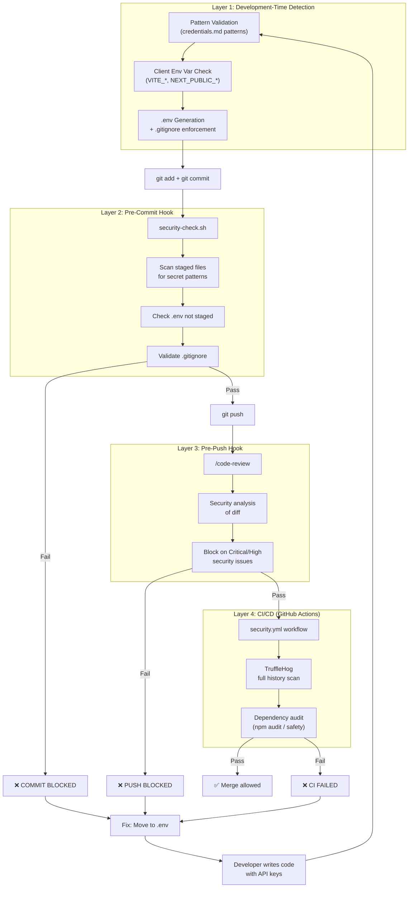

**Sources**: [README.md:520-530](), [README.md:29-32](), [Diagram 5 from system overview]()

---

## Pattern-Based Secret Detection

### Supported Secret Patterns

Claude Bootstrap detects secrets using regex patterns that match known API key formats. These patterns are used across all detection layers.

| Service | Pattern | Example Match | Env Variable |
|---------|---------|---------------|--------------|
| OpenAI | `sk-proj-[A-Za-z0-9_-]+` | `sk-proj-abc123...` | `OPENAI_API_KEY` |
| Anthropic/Claude | `sk-ant-[A-Za-z0-9_-]+` | `sk-ant-xyz789...` | `ANTHROPIC_API_KEY` |
| Render | `rnd_[A-Za-z0-9]+` | `rnd_12345...` | `RENDER_API_KEY` |
| Replicate | `r8_[A-Za-z0-9]+` | `r8_abcde...` | `REPLICATE_API_TOKEN` |
| Eleven Labs | `sk_[a-f0-9]{40,}` | `sk_abc123def456...` | `ELEVEN_LABS_API_KEY` |
| GitHub | `ghp_[A-Za-z0-9]+` | `ghp_token123...` | `GITHUB_TOKEN` |
| Stripe (Test) | `sk_test_[A-Za-z0-9]+` | `sk_test_4eC39...` | `STRIPE_SECRET_KEY` |
| Stripe (Live) | `sk_live_[A-Za-z0-9]+` | `sk_live_4eC39...` | `STRIPE_SECRET_KEY` |
| Stripe Webhook | `whsec_[A-Za-z0-9]+` | `whsec_abc123...` | `STRIPE_WEBHOOK_SECRET` |
| PostHog | `phc_[A-Za-z0-9]+` | `phc_project123...` | `POSTHOG_API_KEY` |
| Supabase JWT | `eyJ[A-Za-z0-9_-]+\.[A-Za-z0-9_-]+\.[A-Za-z0-9_-]+` | `eyJhbGc...` | `SUPABASE_ANON_KEY` |
| Reddit Client ID | `[A-Za-z0-9_-]{14,}` | `Y1FgKALKmb6f6U...` | `REDDIT_CLIENT_ID` |
| Reddit Secret | `[A-Za-z0-9_-]{27,}` | `-QLoYdxMqOJkYr...` | `REDDIT_CLIENT_SECRET` |

**Sources**: [credentials.md:59-80](), [credentials.md:99-138]()

### Pattern Detection Flow

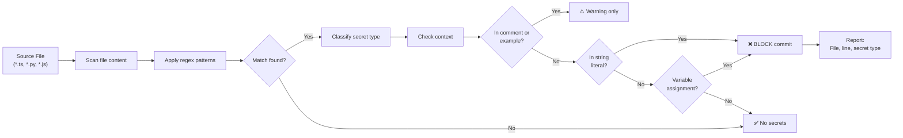

**Sources**: [credentials.md:88-138](), [credentials.md:307-314]()

### Implementation Example

The pattern detection logic follows this structure:

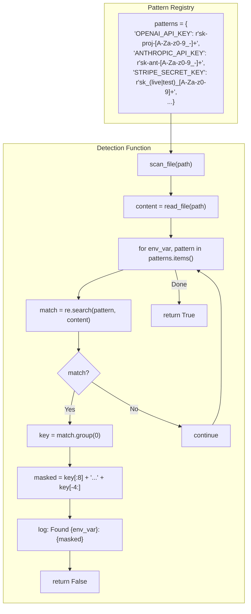

**Sources**: [credentials.md:88-172]()

---

## Client-Side Environment Variable Protection

### The Client-Side Secret Problem

Build tools like Vite and Next.js expose environment variables with specific prefixes to the client bundle. This creates a critical security risk: secrets in these variables become publicly accessible in the browser.

| Framework | Client-Exposed Prefix | Server-Only |
|-----------|----------------------|-------------|
| Next.js | `NEXT_PUBLIC_*` | All others |
| Vite | `VITE_*` | All others |
| Create React App | `REACT_APP_*` | All others |

**Critical rule**: Secret keys (API keys, database credentials, webhook secrets) must **never** use client-exposed prefixes.

**Sources**: [posthog-analytics.md:203-217](), [web-payments.md:18-28]()

### Safe vs Unsafe Environment Variables

```mermaid
graph TB
    subgraph "✅ SAFE: Client-Exposed (Public)"
        SAFE1["NEXT_PUBLIC_POSTHOG_KEY=phc_xxx<br/>✅ Analytics tracking ID"]
        SAFE2["NEXT_PUBLIC_STRIPE_PUBLISHABLE_KEY=pk_test_xxx<br/>✅ Stripe publishable key"]
        SAFE3["VITE_API_URL=https://api.example.com<br/>✅ Public API endpoint"]
        SAFE4["NEXT_PUBLIC_SUPABASE_URL=https://xxx.supabase.co<br/>✅ Public database URL"]
        SAFE5["NEXT_PUBLIC_SUPABASE_ANON_KEY=eyJ...<br/>✅ Row-level security enforced"]
    end
    
    subgraph "❌ UNSAFE: Server-Only (Secret)"
        UNSAFE1["NEXT_PUBLIC_OPENAI_API_KEY=sk-proj-xxx<br/>❌ API key exposed to browser"]
        UNSAFE2["VITE_STRIPE_SECRET_KEY=sk_test_xxx<br/>❌ Payment processing secret"]
        UNSAFE3["NEXT_PUBLIC_DATABASE_URL=postgresql://...<br/>❌ Database credentials"]
        UNSAFE4["VITE_WEBHOOK_SECRET=whsec_xxx<br/>❌ Webhook signature key"]
        UNSAFE5["NEXT_PUBLIC_ANTHROPIC_API_KEY=sk-ant-xxx<br/>❌ LLM API key"]
    end
    
    SAFE1 --> BROWSER["Compiled into<br/>client bundle"]
    SAFE2 --> BROWSER
    SAFE3 --> BROWSER
    SAFE4 --> BROWSER
    SAFE5 --> BROWSER
    
    UNSAFE1 --> EXPOSED["⚠️ SECURITY BREACH<br/>Anyone can extract<br/>from JS bundle"]
    UNSAFE2 --> EXPOSED
    UNSAFE3 --> EXPOSED
    UNSAFE4 --> EXPOSED
    UNSAFE5 --> EXPOSED
```

**Sources**: [posthog-analytics.md:203-217](), [web-payments.md:18-28](), [README.md:359-365]()

### Client-Side Variable Validation

The validation process checks for patterns indicating secrets in client-exposed variables:

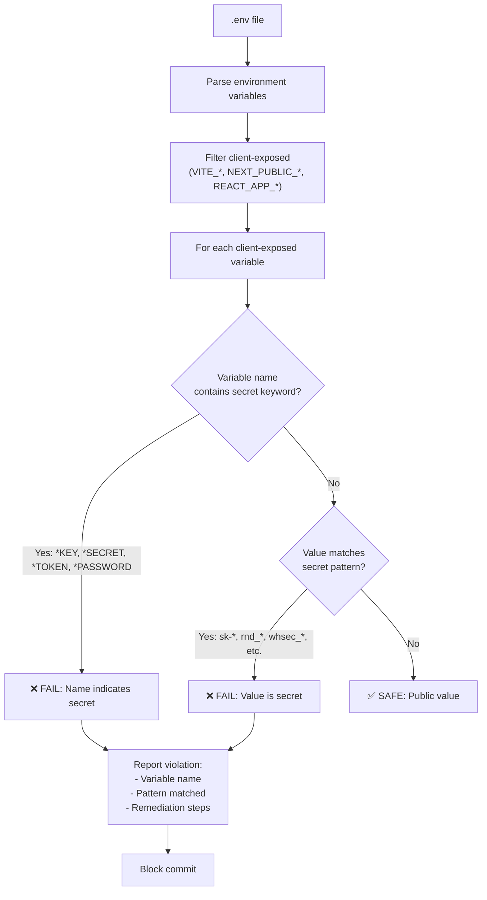

**Sources**: [credentials.md:59-80](), [README.md:359-365]()

---

## Pre-Commit Secret Scanning

### security-check.sh Script

The pre-commit hook executes `security-check.sh` to scan staged files before commit. This script is the first blocker mechanism.

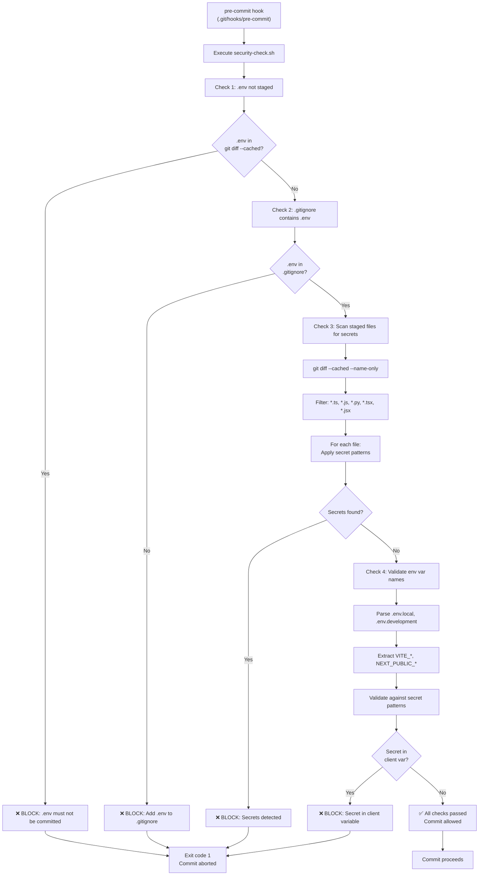

**Sources**: [README.md:520-523](), [Diagram 5 from system overview]()

### Pre-Commit Hook Installation

The hook is installed via `~/.claude/install-hooks.sh`:

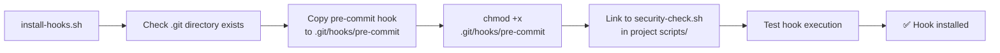

**Sources**: [README.md:189-192]()

---

## CI/CD Secret Scanning with TruffleHog

### TruffleHog Integration

TruffleHog performs deep secret scanning in the CI/CD pipeline, checking the entire git history for secrets. This catches secrets that may have bypassed local checks.

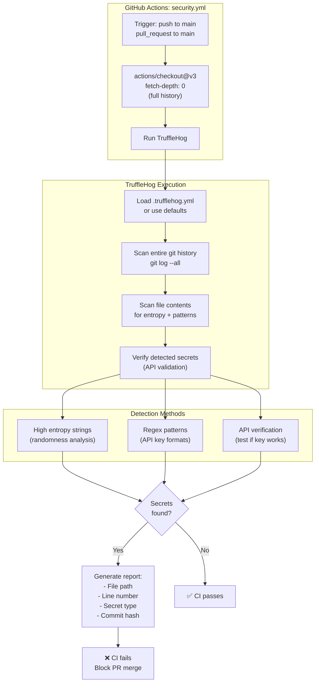

**Sources**: [README.md:528](), [Diagram 5 from system overview]()

### TruffleHog Configuration

TruffleHog uses pattern matching and entropy analysis to detect secrets:

| Detection Method | Description | False Positive Rate |
|------------------|-------------|---------------------|
| **Regex patterns** | Matches known API key formats (sk-*, ghp_*, etc.) | Low |
| **Entropy analysis** | Detects high-randomness strings (base64, hex) | Medium |
| **API verification** | Tests if detected key works against actual API | Very Low |

**Sources**: [README.md:528]()

### GitHub Actions Workflow

The `security.yml` workflow configuration:

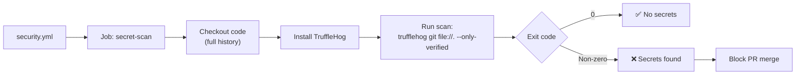

**Sources**: [README.md:525-530]()

---

## Blocker Mechanisms

### Commit Blocker (Pre-Commit)

When the pre-commit hook detects secrets, it prevents the commit with detailed error output:

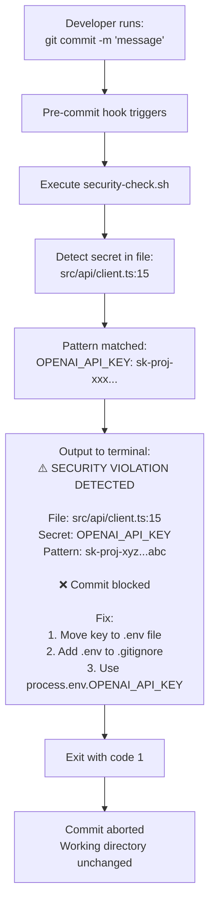

**Sources**: [README.md:520-523]()

### Push Blocker (Pre-Push + Code Review)

The `/code-review` command analyzes security issues before push:

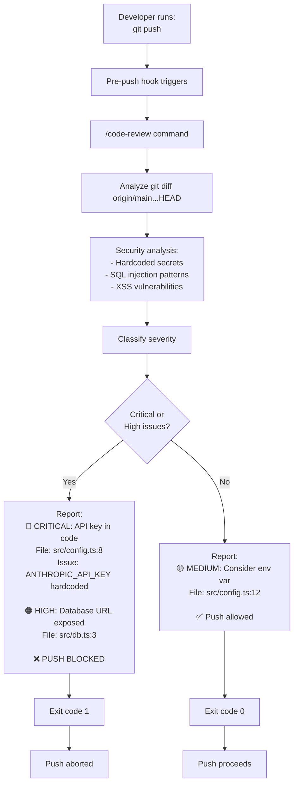

**Sources**: [README.md:176-209](), [Diagram 5 from system overview]()

### CI Blocker (GitHub Actions)

The CI/CD pipeline blocks PR merges when secrets are detected:

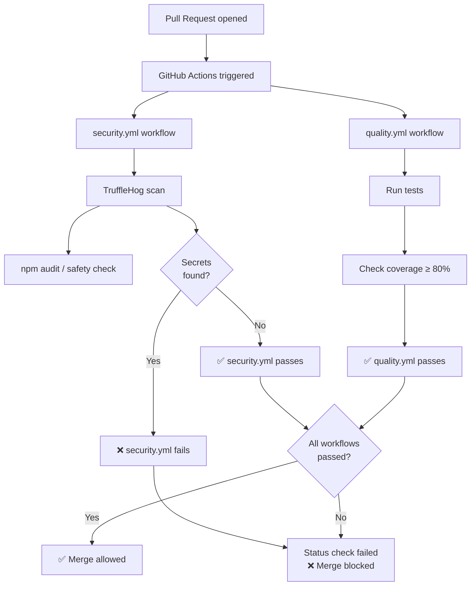

**Sources**: [README.md:525-530](), [Diagram 5 from system overview]()

---

## Common Secret Detection Scenarios

### Scenario 1: Hardcoded API Key in Source Code

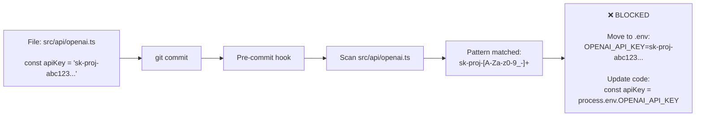

**Sources**: [credentials.md:59-80]()

### Scenario 2: Secret in Client-Exposed Variable

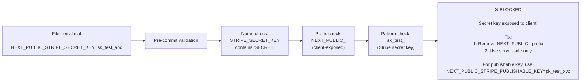

**Sources**: [web-payments.md:18-28](), [posthog-analytics.md:203-217]()

### Scenario 3: .env File Accidentally Staged

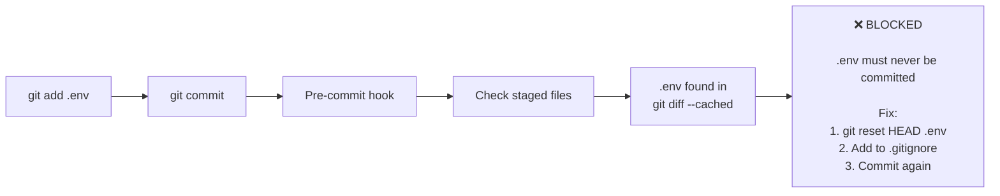

**Sources**: [README.md:520-523]()

### Scenario 4: Secret in Git History

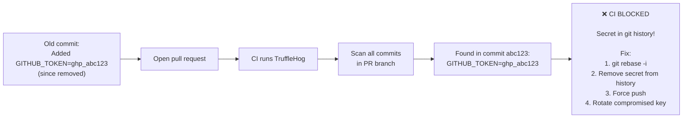

**Sources**: [README.md:528]()

---

## Anti-Patterns and Remediation

### Common Mistakes

| Anti-Pattern | Why It's Wrong | Correct Pattern |
|--------------|----------------|-----------------|
| `const key = "sk-proj-abc123"` | Hardcoded secret in source | `const key = process.env.OPENAI_API_KEY` |
| `NEXT_PUBLIC_API_KEY="secret"` | Secret exposed to client | `API_KEY="secret"` (server-only) |
| Committing `.env` file | Secrets in git history | Add `.env` to `.gitignore` |
| Commented-out secrets | Still detectable by scanners | Remove entirely, use examples |
| Secrets in test files | Test code gets committed | Use mocks or test-specific keys |
| Rotating key, not history | Old key still in git | Rewrite history with `git filter-branch` |

**Sources**: [credentials.md:307-314](), [README.md:359-365]()

### Remediation Workflow

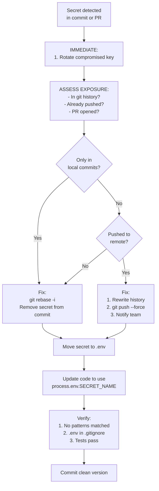

**Sources**: [credentials.md:307-314]()

---

## Quick Reference

### Secret Pattern Regex

```markdown
| Service | Regex Pattern |
|---------|---------------|
| OpenAI | `sk-proj-[A-Za-z0-9_-]+` |
| Anthropic | `sk-ant-[A-Za-z0-9_-]+` |
| GitHub | `ghp_[A-Za-z0-9]+` |
| Stripe Secret | `sk_(live|test)_[A-Za-z0-9]+` |
| Stripe Webhook | `whsec_[A-Za-z0-9]+` |
```

**Sources**: [credentials.md:59-80]()

### Client-Exposed Prefixes (NEVER for secrets)

- `NEXT_PUBLIC_*` (Next.js)
- `VITE_*` (Vite)
- `REACT_APP_*` (Create React App)

**Sources**: [posthog-analytics.md:203-217]()

### Validation Commands

```bash
# Check for secrets in staged files
git diff --cached | grep -E "sk-proj-|sk-ant-|ghp_|whsec_"

# Check for .env in staging area
git diff --cached --name-only | grep "^\.env$"

# Scan with TruffleHog locally
trufflehog git file://. --only-verified

# Test pre-commit hook
.git/hooks/pre-commit
```

**Sources**: [credentials.md:175-223]()

### Hook Installation

```bash
# Install pre-commit and pre-push hooks
~/.claude/install-hooks.sh

# Verify installation
ls -la .git/hooks/pre-commit .git/hooks/pre-push
```

**Sources**: [README.md:189-192]()

---

