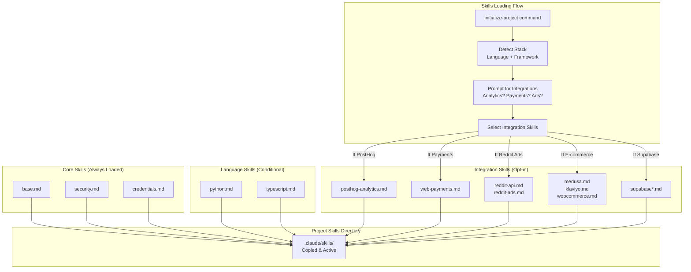
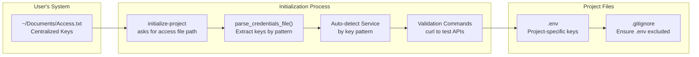
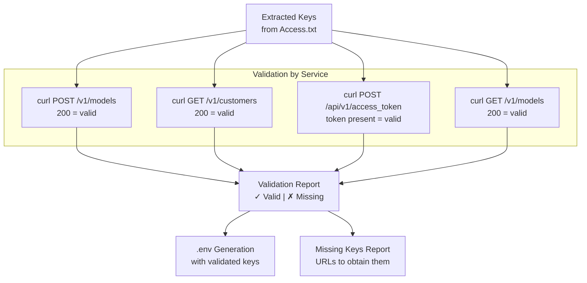
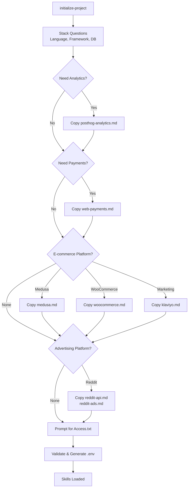
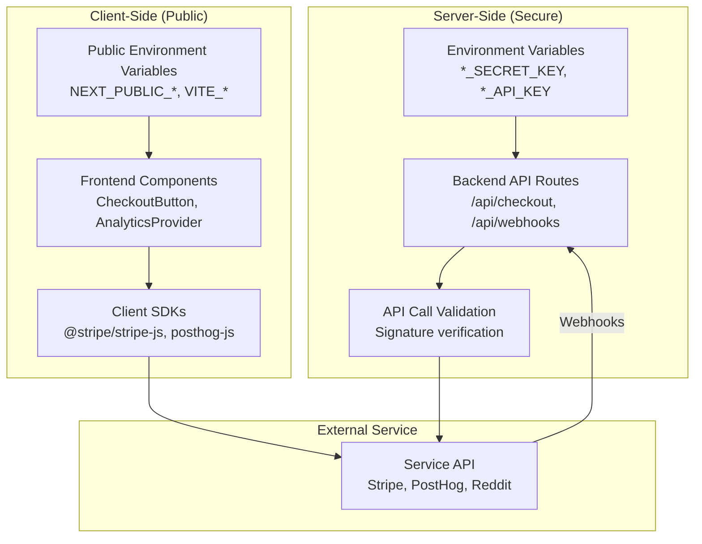

<!-- source: DeepWiki mcp.deepwiki.com · repo alinaqi/claude-bootstrap · page 7 Integration Skills · fetched 2026-10-26 -->

# Integration Skills

<details>
<summary>Relevant source files</summary>

The following files were used as context for generating this wiki page:

- [README.md](README.md)
- [skills/credentials.md](skills/credentials.md)
- [skills/posthog-analytics.md](skills/posthog-analytics.md)
- [skills/web-payments.md](skills/web-payments.md)

</details>


## Purpose and Scope

Integration Skills provide standardized patterns for connecting Claude Bootstrap projects to external services. These skills cover API authentication, error handling, testing strategies, and service-specific best practices for analytics platforms, payment processors, e-commerce systems, and advertising APIs.

This page provides an overview of the integration skills architecture and credential management system. For detailed implementation guides, see:
- [Analytics with PostHog](#7.1)
- [Payment Processing with Stripe](#7.2)
- [E-commerce Platforms](#7.3)
- [Reddit Ads Integration](#7.4)

For general skills system architecture, see [Skills Architecture](#5.1).

---

## Integration Skills in the Skills System

Integration skills are conditionally loaded during project initialization based on user selections and detected project requirements. Unlike core skills (which load for every project) or language skills (which load based on technology stack), integration skills are opt-in selections for specific third-party services.

**Skills Hierarchy: Integration Skills Layer**



**Sources:** [README.md:396-466](), [skills/credentials.md:1-349]()

---

## Centralized Credential Management

Integration skills rely on the centralized credential system defined in `credentials.md`. Instead of manually creating `.env` files, users maintain a single access file (typically `~/Documents/Access.txt`) containing all API keys.

**Credential Flow: Access.txt to Project .env**



**Sources:** [skills/credentials.md:9-27](), [skills/credentials.md:59-139]()

### Key Identification Patterns

The credential parsing system uses regex patterns to auto-detect services:

| Service | Pattern | Environment Variable |
|---------|---------|---------------------|
| **PostHog** | `phc_[A-Za-z0-9]+` | `POSTHOG_API_KEY`, `NEXT_PUBLIC_POSTHOG_KEY` |
| **Stripe (Test)** | `sk_test_*`, `pk_test_*` | `STRIPE_SECRET_KEY`, `STRIPE_PUBLISHABLE_KEY` |
| **Stripe (Live)** | `sk_live_*`, `pk_live_*` | `STRIPE_SECRET_KEY`, `STRIPE_PUBLISHABLE_KEY` |
| **Stripe Webhook** | `whsec_*` | `STRIPE_WEBHOOK_SECRET` |
| **Reddit** | client_id + secret pair | `REDDIT_CLIENT_ID`, `REDDIT_CLIENT_SECRET` |
| **OpenAI** | `sk-proj-*` or `sk-*` | `OPENAI_API_KEY` |
| **Anthropic/Claude** | `sk-ant-*` | `ANTHROPIC_API_KEY` |
| **Supabase** | URL + `eyJ*` (JWT) | `SUPABASE_URL`, `SUPABASE_ANON_KEY` |

**Sources:** [skills/credentials.md:59-81](), [skills/posthog-analytics.md:213-217](), [skills/web-payments.md:19-28]()

### Validation Workflow

After extracting keys, the system validates them before generating `.env`:



**Sources:** [skills/credentials.md:175-223](), [skills/credentials.md:226-280]()

---

## Available Integration Skills

Claude Bootstrap includes integration skills across four categories:

### Analytics

| Skill | Service | Key Features |
|-------|---------|--------------|
| `posthog-analytics.md` | PostHog | Event tracking, feature flags, user identification, dashboards |

**Core capabilities:**
- Client/server-side event tracking
- User lifecycle analytics (acquisition → activation → retention → revenue)
- A/B testing with feature flags
- Project-specific dashboard templates
- GDPR compliance patterns

**Sources:** [skills/posthog-analytics.md:1-950](), [README.md:461]()

### Payments

| Skill | Service | Key Features |
|-------|---------|--------------|
| `web-payments.md` | Stripe | Checkout, subscriptions, webhooks, customer portal |

**Core capabilities:**
- Stripe Checkout (hosted and embedded)
- Subscription management with trials
- Webhook verification and idempotency
- Customer billing portal
- Test card patterns

**Sources:** [skills/web-payments.md:1-659](), [README.md:457]()

### E-commerce

| Skill | Service | Key Features |
|-------|---------|--------------|
| `medusa.md` | Medusa | Headless commerce, modules, workflows |
| `klaviyo.md` | Klaviyo | Email/SMS marketing, profiles, events, flows |
| `woocommerce.md` | WooCommerce | REST API, products, orders, webhooks |
| `shopify-apps.md` | Shopify | App development, Remix, Admin API, GDPR |

**Core capabilities:**
- Product and order management APIs
- Webhook handling for order events
- Customer segmentation and marketing automation
- Cart abandonment flows
- GDPR data export/deletion

**Sources:** [README.md:462-465]()

### Advertising

| Skill | Service | Key Features |
|-------|---------|--------------|
| `reddit-api.md` | Reddit API | PRAW (Python), Snoowrap (Node.js), OAuth |
| `reddit-ads.md` | Reddit Ads API | Campaigns, targeting, conversions, agentic optimizer |

**Core capabilities:**
- Campaign hierarchy (Account → Campaign → Ad Group → Ad)
- Audience targeting and conversion tracking
- Automated bid optimization
- Agentic service for multi-campaign management
- Budget pacing and creative rotation

**Sources:** [README.md:458-459](), [README.md:149-174]()

---

## Integration Skill Selection

During `initialize-project`, Claude prompts for integration needs and copies relevant skills to `.claude/skills/`:

**Integration Selection Decision Flow**



**Sources:** [README.md:64-69](), [skills/credentials.md:226-280]()

---

## Common Integration Patterns

Integration skills share architectural patterns for authentication, error handling, testing, and security.

### Authentication Architecture

All integration skills follow a consistent authentication pattern:



**Key principles:**
- Secret keys (`STRIPE_SECRET_KEY`, `POSTHOG_API_KEY`) only on server
- Public keys (`NEXT_PUBLIC_*`, `VITE_*`) safe for client
- All critical operations server-side with validation
- Webhook signature verification mandatory

**Sources:** [skills/web-payments.md:19-28](), [skills/posthog-analytics.md:203-217](), [skills/credentials.md:308-315]()

### Error Classification

Integration skills implement consistent error handling:

| Error Type | Examples | Auto-Retry? | Action |
|------------|----------|-------------|--------|
| **Transient** | Rate limit, network timeout | Yes | Exponential backoff |
| **Client Error** | Invalid parameters, malformed request | No | Fix and retry |
| **Auth Error** | Invalid key, expired token | No | Validate credentials |
| **Service Error** | API down, maintenance | Yes | Alert and queue |

**Sources:** [README.md:579-612](), [skills/web-payments.md:613-622]()

### Testing Patterns

#### Test Mode Keys

All integrations provide test mode credentials:

```bash
# Stripe
STRIPE_SECRET_KEY=sk_test_xxx  # Server
STRIPE_PUBLISHABLE_KEY=pk_test_xxx  # Client

# PostHog
POSTHOG_API_KEY=phc_xxx  # Same key, filter by environment
```

**Sources:** [skills/web-payments.md:455-477](), [skills/posthog-analytics.md:809-817]()

#### Integration Test Patterns

```typescript
// Mock external service in E2E tests
test.extend({
  page: async ({ page }, use) => {
    await page.addInitScript(() => {
      window.posthog = {
        capture: (event, props) => {
          window.capturedEvents.push({ event, props });
        },
      };
    });
    await use(page);
  },
});
```

**Sources:** [skills/posthog-analytics.md:820-854]()

#### Webhook Testing

```bash
# Stripe CLI for local webhook testing
stripe listen --forward-to localhost:3000/api/webhooks/stripe
stripe trigger checkout.session.completed
```

**Sources:** [skills/web-payments.md:463-477]()

### Security Requirements

Integration skills enforce these non-negotiable security rules:

1. **No secrets in client environment variables**
   - ❌ `VITE_STRIPE_SECRET_KEY` (never expose)
   - ✅ `VITE_STRIPE_PUBLISHABLE_KEY` (safe, intended for client)

2. **Always verify webhooks**
   ```typescript
   // Verify signature before processing
   const event = stripe.webhooks.constructEvent(
     body, 
     signature, 
     webhookSecret
   );
   ```

3. **Idempotent webhook handlers**
   - Store processed event IDs
   - Skip duplicate deliveries
   - Use database transactions

4. **Input sanitization**
   ```typescript
   const SENSITIVE_KEYS = ['password', 'token', 'secret'];
   function sanitizeProperties(props: Record<string, any>) {
     return Object.fromEntries(
       Object.entries(props).filter(([key]) =>
         !SENSITIVE_KEYS.some(s => key.toLowerCase().includes(s))
       )
     );
   }
   ```

**Sources:** [skills/web-payments.md:508-533](), [skills/posthog-analytics.md:766-803](), [skills/credentials.md:308-315]()

---

## Integration Skill File Structure

Integration skill files follow a consistent format:

```markdown
# [Service Name] Skill

*Load with: base.md + [framework].md*

Purpose statement and official docs links

---

## Setup
- Installation commands
- Environment variables
- Initial configuration

## Core Patterns
- Authentication
- Common operations
- Error handling

## Testing
- Test mode setup
- Test data/cards
- E2E patterns

## Security
- Secret management
- Validation requirements
- Common vulnerabilities

## Quick Reference
- Command cheat sheet
- Key endpoints/methods
- Troubleshooting
```

**Example files:**
- [skills/posthog-analytics.md:1-950]()
- [skills/web-payments.md:1-659]()

---

## Adding New Integration Skills

To add a new integration skill to Claude Bootstrap:

### 1. Create Skill File

Create `skills/[service-name].md` following the standard structure:

```markdown
# [Service] Integration Skill

*Load with: base.md + [framework].md*

For integrating [service] - [brief description].

**Sources:** [Official Docs Link]

---

## Setup
[Installation and configuration]

## Authentication
[How to get and use API keys]

## Core Patterns
[Common use cases with code examples]

## Testing
[Test mode, fixtures, E2E]

## Security
[Service-specific security rules]

## Quick Reference
[Command/API cheat sheet]
```

### 2. Add Credential Patterns

Update `credentials.md` to auto-detect the service's API keys:

```python
# Add to patterns dict
patterns = {
    'SERVICE_API_KEY': r'service-key-pattern',
}
```

**Sources:** [skills/credentials.md:88-138]()

### 3. Add Validation Command

Add validation endpoint check:

```bash
curl -s -o /dev/null -w "%{http_code}" \
  -H "Authorization: Bearer $SERVICE_API_KEY" \
  https://api.service.com/v1/verify
```

**Sources:** [skills/credentials.md:175-223]()

### 4. Update Initialization Prompt

Add service to integration selection prompts in initialization workflow.

### 5. Document in README

Add to the Integration Skills table:

```markdown
| `[service].md` | [Service] | [Key features] |
```

**Sources:** [README.md:454-466]()

---

## Quick Reference

### Integration Skills by Category

| Category | Skills | API Key Pattern |
|----------|--------|-----------------|
| **Analytics** | `posthog-analytics.md` | `phc_*` |
| **Payments** | `web-payments.md` | `sk_test_*`, `pk_test_*`, `whsec_*` |
| **E-commerce** | `medusa.md`, `klaviyo.md`, `woocommerce.md`, `shopify-apps.md` | Service-specific |
| **Advertising** | `reddit-api.md`, `reddit-ads.md` | client_id + secret |

### Common Commands

```bash
# Update integration skills globally
cd ~/.claude-bootstrap && git pull && ./install.sh

# Re-initialize project with new integrations
claude
> /initialize-project

# Validate credentials
ls -la ~/Documents/Access.txt

# Test webhooks locally (Stripe)
stripe listen --forward-to localhost:3000/api/webhooks/stripe
```

### Environment Variable Prefixes

| Prefix | Exposure | Use Case |
|--------|----------|----------|
| `NEXT_PUBLIC_*` | Client-safe | Next.js public keys |
| `VITE_*` | Client-safe | Vite public keys |
| `REACT_APP_*` | Client-safe | CRA public keys |
| _(no prefix)_ | Server-only | Secret keys, tokens |

**Sources:** [skills/credentials.md:308-315](), [skills/posthog-analytics.md:203-217](), [skills/web-payments.md:19-28]()

---

