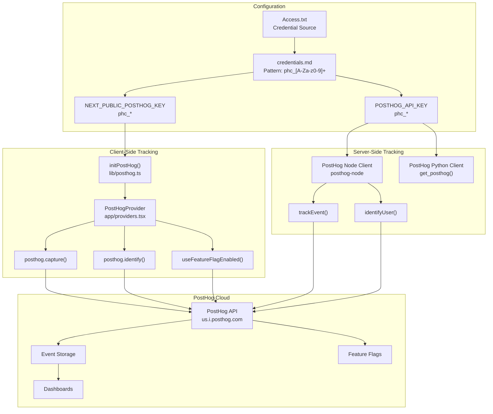
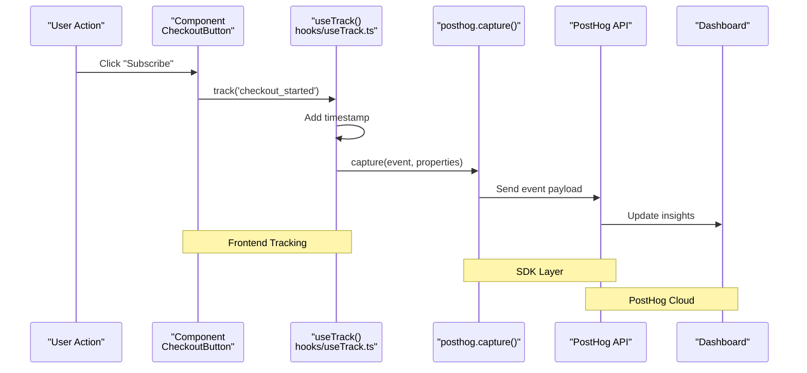
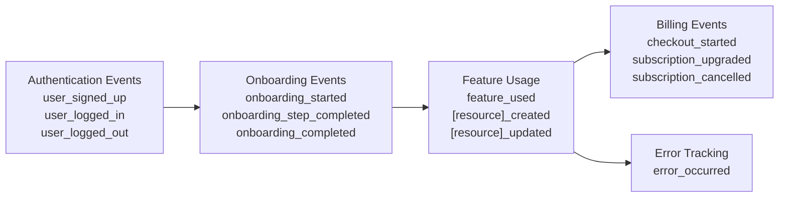
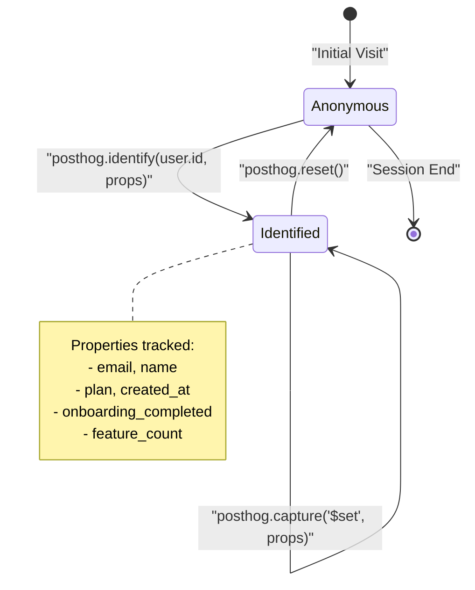
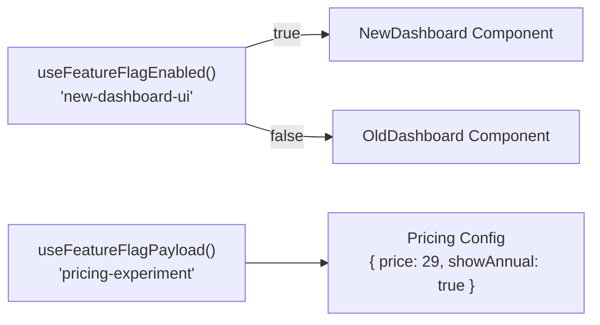
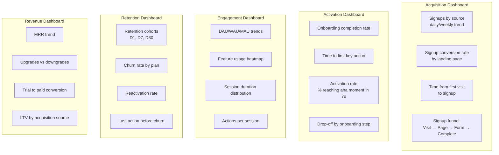
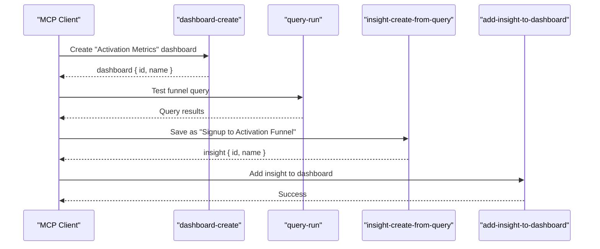
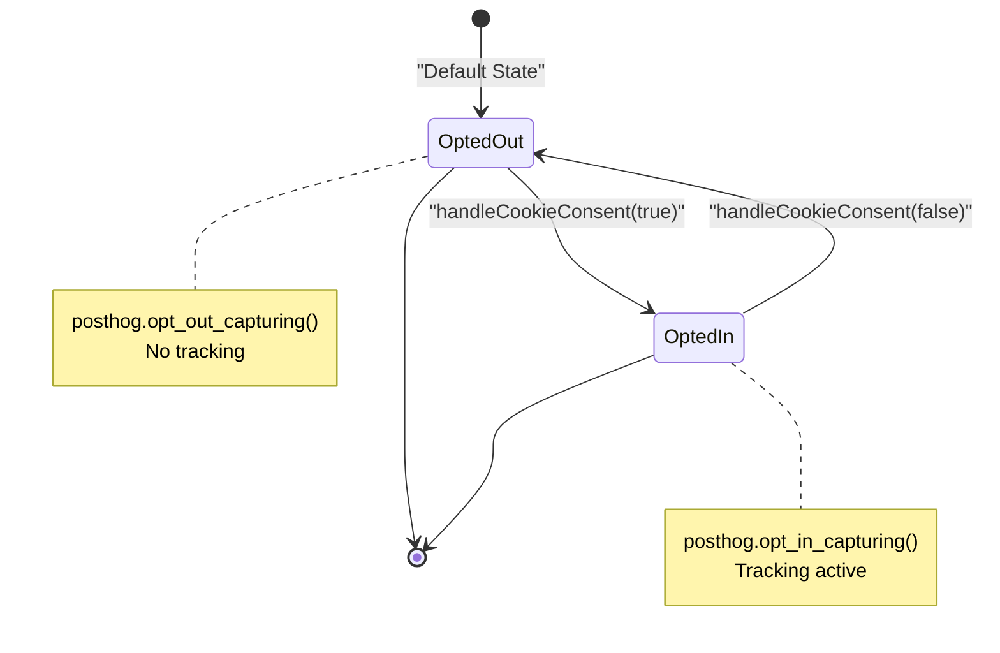

<!-- source: DeepWiki mcp.deepwiki.com · repo alinaqi/claude-bootstrap · page 7.1 Analytics with PostHog · fetched 2026-10-26 -->

# Analytics with PostHog

<details>
<summary>Relevant source files</summary>

The following files were used as context for generating this wiki page:

- [skills/credentials.md](skills/credentials.md)
- [skills/posthog-analytics.md](skills/posthog-analytics.md)
- [skills/web-payments.md](skills/web-payments.md)

</details>


## Purpose and Scope

This document covers PostHog analytics integration within Claude Bootstrap projects. PostHog provides product analytics, feature flags, and session replay capabilities. The skill enforces event tracking conventions, privacy-first defaults, and project-specific dashboard creation patterns.

For payment analytics integration, see [Payment Processing with Stripe](#7.2). For general credentials management including PostHog API keys, see [Credentials Management](#6.2).

**Sources:** [skills/posthog-analytics.md:1-950]()

---

## Integration Architecture

PostHog integrates as both a client-side tracker (for user interactions) and server-side tracker (for backend events). The system supports Next.js App Router, React (Vite/CRA), Python (FastAPI), and Node.js backends.

### PostHog System Overview



**Sources:** [skills/posthog-analytics.md:27-103](), [skills/posthog-analytics.md:131-197](), [skills/credentials.md:80]()

---

## Installation and Configuration

### Package Installation

PostHog requires different packages depending on the environment:

| Environment | Package | Purpose |
|-------------|---------|---------|
| Next.js/React | `posthog-js` | Client-side tracking |
| Python | `posthog` | Server-side tracking |
| Node.js | `posthog-node` | Server-side tracking |

**Sources:** [skills/posthog-analytics.md:27-31](), [skills/posthog-analytics.md:132-135](), [skills/posthog-analytics.md:164-167]()

### Environment Variables

The system requires separate API keys for client and server contexts:

```bash
# Client-side (SAFE - meant to be public)
NEXT_PUBLIC_POSTHOG_KEY=phc_xxxxxxxxxxxxxxxxxxxx
NEXT_PUBLIC_POSTHOG_HOST=https://us.i.posthog.com

# Server-side (PRIVATE)
POSTHOG_API_KEY=phc_xxxxxxxxxxxxxxxxxxxx
POSTHOG_HOST=https://us.i.posthog.com
```

The credential pattern `phc_[A-Za-z0-9]+` is recognized by the credentials management system and can be auto-extracted from `Access.txt`.

**Sources:** [skills/posthog-analytics.md:203-217](), [skills/credentials.md:80](), [skills/credentials.md:109]()

### Next.js Initialization

The initialization pattern uses a singleton client with manual pageview tracking for SPA routing:

```typescript
// lib/posthog.ts structure
export function initPostHog() {
  if (typeof window !== 'undefined' && !posthog.__loaded) {
    posthog.init(process.env.NEXT_PUBLIC_POSTHOG_KEY!, {
      api_host: process.env.NEXT_PUBLIC_POSTHOG_HOST || 'https://us.i.posthog.com',
      person_profiles: 'identified_only',  // GDPR-friendly: only track identified users
      capture_pageview: false,             // Manual control for SPA
      capture_pageleave: true,
      loaded: (posthog) => {
        if (process.env.NODE_ENV === 'development') {
          posthog.debug();
        }
      },
    });
  }
  return posthog;
}
```

The `PostHogProvider` component handles automatic pageview tracking on route changes using Next.js navigation hooks.

**Sources:** [skills/posthog-analytics.md:34-103]()

### Backend Initialization

Server-side clients require explicit shutdown handling:

| Backend | Initialization Pattern | Shutdown |
|---------|----------------------|----------|
| **Python** | `@lru_cache()` decorator on `get_posthog()` | Automatic |
| **Node.js** | Singleton with `new PostHog()` | `process.on('SIGTERM')` |

**Sources:** [skills/posthog-analytics.md:137-161](), [skills/posthog-analytics.md:169-196]()

---

## Event Tracking System

### Event Flow Architecture



**Sources:** [skills/posthog-analytics.md:414-451]()

### Event Naming Convention

The system enforces `[object]_[action]` format with snake_case and past tense:

| ✅ Valid | ❌ Invalid | Reason |
|---------|-----------|---------|
| `user_signed_up` | `click` | Too vague |
| `feature_created` | `ButtonClick` | Not snake_case |
| `subscription_upgraded` | `user signup` | Contains spaces |
| `onboarding_completed` | `creatingFeature` | Not past tense |

**Sources:** [skills/posthog-analytics.md:296-317]()

### Core Event Categories

The skill defines standard events by user lifecycle stage:



**Sources:** [skills/posthog-analytics.md:319-410]()

### React Tracking Hook

The `useTrack()` hook provides a consistent interface with automatic timestamp enrichment:

```typescript
// hooks/useTrack.ts pattern
export function useTrack() {
  const track = useCallback((event: string, properties?: Record<string, any>) => {
    posthog.capture(event, {
      ...properties,
      timestamp: new Date().toISOString(),
    });
  }, []);
  return { track };
}
```

Usage in components follows try-catch pattern with error tracking:

```typescript
const { track } = useTrack();

const handleCreate = async () => {
  track('project_creation_started');
  try {
    const project = await createProject();
    track('project_created', { project_id: project.id });
  } catch (error) {
    track('project_creation_failed', { error_message: error.message });
  }
};
```

**Sources:** [skills/posthog-analytics.md:414-451]()

---

## User Identification

### Identification Lifecycle



The system identifies users at three critical points:

| Trigger | Action | Properties |
|---------|--------|------------|
| **Signup** | `posthog.identify(user.id, {...})` | `email`, `name`, `created_at`, `plan: 'free'`, `signup_method` |
| **Login** | `posthog.identify(user.id, {...})` | `email`, `name`, `plan`, `last_login` |
| **Logout** | `posthog.reset()` | Clears identity |

**Sources:** [skills/posthog-analytics.md:220-289]()

### Property Updates

User properties are updated using the `$set` event:

```typescript
// Update properties when they change
posthog.capture('$set', {
  $set: { plan: 'pro' },
});
```

The `UserProperties` interface defines standard trackable properties:

- **Identity**: `email`, `name`
- **Lifecycle**: `created_at`, `plan`
- **Engagement**: `onboarding_completed`, `feature_count`
- **Business**: `company_name`, `company_size`, `industry`

**Sources:** [skills/posthog-analytics.md:262-289]()

---

## Feature Flags

### Client-Side Flag Usage

PostHog feature flags enable A/B testing and gradual rollouts:



**Sources:** [skills/posthog-analytics.md:456-481]()

### Server-Side Flags (Next.js)

Server components can evaluate flags before rendering:

```typescript
// app/dashboard/page.tsx pattern
async function getFeatureFlags(userId: string) {
  const posthog = new PostHog(process.env.POSTHOG_API_KEY!);
  const flags = await posthog.getAllFlags(userId);
  await posthog.shutdown();  // Critical: prevent memory leaks
  return flags;
}
```

**Sources:** [skills/posthog-analytics.md:485-512]()

### A/B Testing Pattern

Experiments must track exposure events:

```typescript
const variant = useFeatureFlagEnabled('checkout-experiment');

useEffect(() => {
  posthog.capture('experiment_viewed', {
    experiment: 'checkout-experiment',
    variant: variant ? 'test' : 'control',
  });
}, [variant]);
```

**Sources:** [skills/posthog-analytics.md:514-530]()

---

## Dashboard Creation

### Project-Specific Dashboard Templates

The skill provides dashboard blueprints for different project types:

| Project Type | Essential Dashboards |
|--------------|---------------------|
| **SaaS** | Acquisition, Activation, Engagement, Retention, Revenue |
| **E-Commerce** | Conversion Funnel, Product Performance, Customer LTV |
| **Content/Media** | Consumption, Engagement, Growth |
| **AI/LLM** | Usage, Quality, Cost |
| **Mobile App** | Installs, Onboarding, DAU/MAU, Crashes |

**Sources:** [skills/posthog-analytics.md:927-934]()

### SaaS Dashboard Blueprint



**Sources:** [skills/posthog-analytics.md:536-589]()

### Dashboard Creation Workflow

The PostHog MCP (Model Context Protocol) enables programmatic dashboard creation:



Example workflow:

```typescript
// 1. Create dashboard
const dashboard = await mcp_posthog_dashboard_create({
  name: "Activation Metrics",
  description: "Track new user activation and onboarding",
  tags: ["saas", "activation"],
});

// 2. Create funnel query
const signupFunnel = await mcp_posthog_query_run({
  query: {
    kind: "InsightVizNode",
    source: {
      kind: "FunnelsQuery",
      series: [
        { kind: "EventsNode", event: "user_signed_up", name: "Signed Up" },
        { kind: "EventsNode", event: "onboarding_started", name: "Started Onboarding" },
        { kind: "EventsNode", event: "onboarding_completed", name: "Completed Onboarding" },
      ],
      dateRange: { date_from: "-30d" },
    },
  },
});

// 3. Save and add to dashboard
const insight = await mcp_posthog_insight_create_from_query({
  name: "Signup to Activation Funnel",
  query: signupFunnel.query,
});

await mcp_posthog_add_insight_to_dashboard({
  insightId: insight.id,
  dashboardId: dashboard.id,
});
```

**Sources:** [skills/posthog-analytics.md:673-737]()

---

## Privacy and GDPR Compliance

### Privacy-First Configuration

The initialization uses `person_profiles: 'identified_only'` to comply with GDPR by default:

```typescript
posthog.init(key, {
  person_profiles: 'identified_only',      // Only track identified users
  opt_out_capturing_by_default: true,      // Require explicit opt-in
  respect_dnt: true,                        // Respect Do Not Track
});
```

**Sources:** [skills/posthog-analytics.md:38-43](), [skills/posthog-analytics.md:759-762]()

### Consent Management



The consent handling function:

```typescript
export function handleCookieConsent(consent: boolean) {
  if (consent) {
    posthog.opt_in_capturing();
  } else {
    posthog.opt_out_capturing();
  }
}
```

**Sources:** [skills/posthog-analytics.md:744-763]()

### Property Sanitization

The system blocks sensitive data from tracking:

| ❌ Never Track | ✅ Safe to Track |
|---------------|-----------------|
| `password`, `token`, `secret` | `country`, `plan` |
| `credit_card`, `ssn` | `feature_used` |
| `medical_info` | `product_category` |
| `full_address` | General usage metrics |

Sanitization function:

```typescript
const SENSITIVE_KEYS = ['password', 'token', 'secret', 'credit', 'ssn'];

function sanitizeProperties(props: Record<string, any>): Record<string, any> {
  return Object.fromEntries(
    Object.entries(props).filter(([key]) =>
      !SENSITIVE_KEYS.some(sensitive => key.toLowerCase().includes(sensitive))
    )
  );
}

export function safeCapture(event: string, properties?: Record<string, any>) {
  posthog.capture(event, sanitizeProperties(properties || {}));
}
```

**Sources:** [skills/posthog-analytics.md:766-802]()

---

## Testing Analytics

### Development Mode Handling

PostHog tracking is disabled in development to prevent test data pollution:

```typescript
if (process.env.NODE_ENV === 'development') {
  posthog.opt_out_capturing();
  // Or use debug mode to see events without sending
  posthog.debug();
}
```

**Sources:** [skills/posthog-analytics.md:809-817]()

### E2E Testing with Playwright

Tests mock PostHog to capture events without external API calls:

```typescript
// playwright/fixtures.ts pattern
export const test = base.extend({
  page: async ({ page }, use) => {
    await page.addInitScript(() => {
      window.capturedEvents = [];
      window.posthog = {
        capture: (event, props) => {
          window.capturedEvents.push({ event, props });
        },
        identify: () => {},
        reset: () => {},
      };
    });
    await use(page);
  },
});

// Test assertion
test('tracks signup event', async ({ page }) => {
  await page.goto('/signup');
  await page.fill('[name=email]', 'test@example.com');
  await page.click('button[type=submit]');

  const events = await page.evaluate(() => window.capturedEvents);
  expect(events).toContainEqual({
    event: 'user_signed_up',
    props: expect.objectContaining({ signup_method: 'email' }),
  });
});
```

**Sources:** [skills/posthog-analytics.md:819-854]()

### Event Debugging

The `_onCapture` callback logs events in development:

```typescript
posthog.init(key, {
  _onCapture: (eventName, eventData) => {
    if (process.env.NODE_ENV === 'development') {
      console.log('PostHog Event:', eventName, eventData);
    }
  },
});
```

**Sources:** [skills/posthog-analytics.md:876-886]()

---

## Quick Reference

### Must-Track Events by Lifecycle

| Stage | Events |
|-------|--------|
| **Acquisition** | `page_viewed`, `user_signed_up`, `user_logged_in` |
| **Activation** | `onboarding_started`, `onboarding_step_completed`, `onboarding_completed`, `first_[key_action]` |
| **Engagement** | `[feature]_used`, `[resource]_created`, `search_performed`, `invite_sent` |
| **Revenue** | `pricing_page_viewed`, `checkout_started`, `subscription_upgraded`, `subscription_cancelled` |
| **Retention** | `session_started`, `feature_[x]_used` |

**Sources:** [skills/posthog-analytics.md:893-923]()

### Auto-Enriched Properties

PostHog automatically adds these properties to all events:

- `$current_url` - Current page URL
- `$browser` - Browser type
- `$device_type` - Desktop/mobile/tablet
- `$os` - Operating system

Custom properties to always include:

- `user_plan` - `'free'` | `'pro'` | `'enterprise'`
- `user_role` - `'admin'` | `'member'`
- `company_id` - For B2B products
- `feature_context` - Where in the app the action occurred

**Sources:** [skills/posthog-analytics.md:936-949]()

### Environment Variable Checklist

```bash
# Client-side (public)
NEXT_PUBLIC_POSTHOG_KEY=phc_xxxxxxxxxxxxxxxxxxxx
NEXT_PUBLIC_POSTHOG_HOST=https://us.i.posthog.com

# Server-side (private)
POSTHOG_API_KEY=phc_xxxxxxxxxxxxxxxxxxxx
POSTHOG_HOST=https://us.i.posthog.com

# Vite projects
VITE_POSTHOG_KEY=phc_xxxxxxxxxxxxxxxxxxxx
VITE_POSTHOG_HOST=https://us.i.posthog.com
```

**Sources:** [skills/posthog-analytics.md:203-217]()

### Key API Methods

| Method | Purpose | Context |
|--------|---------|---------|
| `posthog.init(key, options)` | Initialize client | Client-side once |
| `posthog.capture(event, props)` | Track event | Any time |
| `posthog.identify(userId, props)` | Set user identity | Signup/login |
| `posthog.reset()` | Clear identity | Logout |
| `posthog.opt_in_capturing()` | Enable tracking | After consent |
| `posthog.opt_out_capturing()` | Disable tracking | Reject consent |
| `useFeatureFlagEnabled(flag)` | Check flag | React components |
| `posthog.getAllFlags(userId)` | Get all flags | Server-side |

**Sources:** [skills/posthog-analytics.md:34-55](), [skills/posthog-analytics.md:224-260](), [skills/posthog-analytics.md:461-512](), [skills/posthog-analytics.md:744-763]()

---

