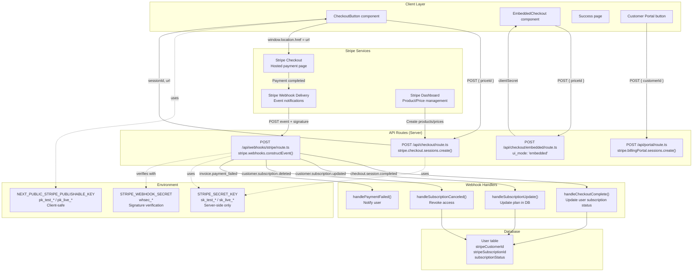
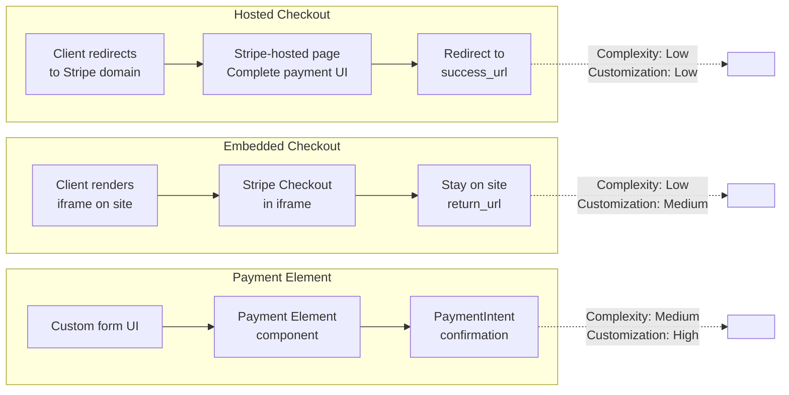
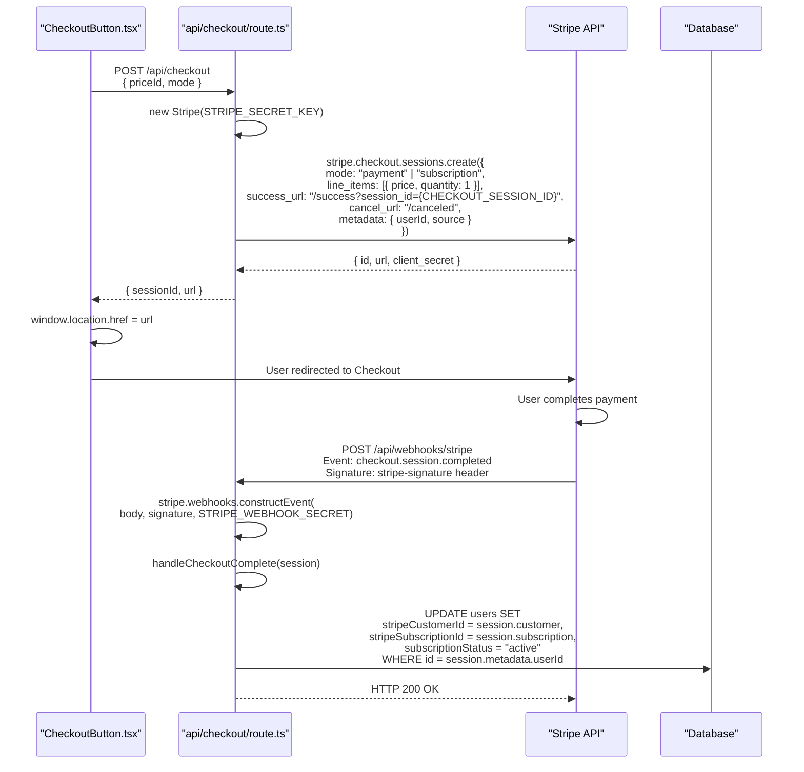
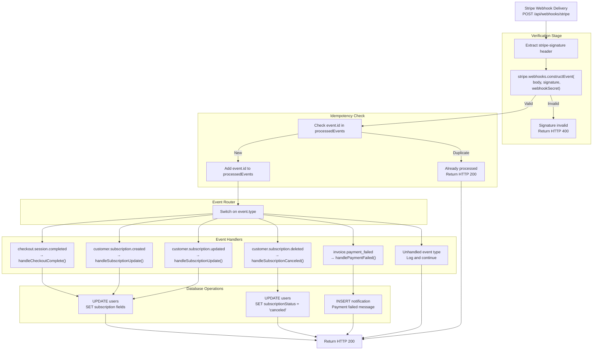

<!-- source: DeepWiki mcp.deepwiki.com · repo alinaqi/claude-bootstrap · page 7.2 Payment Processing with Stripe · fetched 2026-10-26 -->

# Payment Processing with Stripe

<details>
<summary>Relevant source files</summary>

The following files were used as context for generating this wiki page:

- [skills/credentials.md](skills/credentials.md)
- [skills/posthog-analytics.md](skills/posthog-analytics.md)
- [skills/web-payments.md](skills/web-payments.md)

</details>


This document covers integration patterns for Stripe payment processing in web applications, including one-time payments, subscriptions, webhook handling, and security best practices. The Stripe integration skill (`web-payments.md`) provides patterns for both hosted Checkout flows and embedded payment forms, with emphasis on server-side verification and idempotent webhook processing.

For general credentials management including Stripe API key patterns, see [Credentials Management](#6.2). For tracking payment conversion events, see [Analytics with PostHog](#7.1). For e-commerce platform integrations that use Stripe, see [E-commerce Platforms](#7.3).

---

## Integration Architecture

The Stripe integration follows a server-side-first architecture where all payment creation and verification occurs on the backend, with client-side components only handling UI rendering and redirects. This ensures API secrets never reach the browser and all payment state changes are verified via cryptographically signed webhooks.

**Stripe Integration Architecture**



**Sources:** [skills/web-payments.md:1-659]()

---

## Credential Management

Stripe requires three types of API credentials, each with distinct security requirements and usage patterns. The credentials system automatically detects and extracts these keys from the centralized access file.

### API Key Types

| Key Type | Pattern | Environment Variable | Scope |
|----------|---------|---------------------|-------|
| Secret Key (Test) | `sk_test_*` | `STRIPE_SECRET_KEY` | Server-side only |
| Secret Key (Live) | `sk_live_*` | `STRIPE_SECRET_KEY` | Server-side only |
| Publishable Key (Test) | `pk_test_*` | `NEXT_PUBLIC_STRIPE_PUBLISHABLE_KEY` | Client-safe |
| Publishable Key (Live) | `pk_live_*` | `NEXT_PUBLIC_STRIPE_PUBLISHABLE_KEY` | Client-safe |
| Webhook Secret | `whsec_*` | `STRIPE_WEBHOOK_SECRET` | Server-side only |

### Automatic Detection

The credentials parsing system identifies Stripe keys using regex patterns:

```python
patterns = {
    'STRIPE_SECRET_KEY': r'sk_(live|test)_[A-Za-z0-9]+',
    'STRIPE_PUBLISHABLE_KEY': r'pk_(live|test)_[A-Za-z0-9]+',
    'STRIPE_WEBHOOK_SECRET': r'whsec_[A-Za-z0-9]+',
}
```

The system reads the centralized `Access.txt` file and automatically extracts Stripe credentials, generating appropriate `.env` entries for both server-side (`STRIPE_SECRET_KEY`) and client-side (`NEXT_PUBLIC_STRIPE_PUBLISHABLE_KEY`) usage.

**Sources:** [skills/credentials.md:59-81](), [skills/credentials.md:99-138]()

---

## Integration Options

The Stripe integration skill supports three primary integration methods, each with different tradeoffs between ease of implementation and customization.

**Integration Method Comparison**



The recommended approach is **Hosted Checkout** for initial implementations, migrating to Embedded Checkout or Payment Element only when specific customization requirements emerge. Hosted Checkout requires minimal code and provides automatic PCI compliance, fraud prevention, and support for multiple payment methods.

**Sources:** [skills/web-payments.md:40-51]()

---

## Checkout Session Creation

The checkout flow begins server-side with session creation, which generates a secure payment URL or client secret. The server validates the request, retrieves pricing information, and configures the session with success/cancel URLs and metadata for tracking.

**Checkout Session Flow (Code Entities)**



### Server-Side Implementation

The session creation route (`app/api/checkout/route.ts`) creates a Stripe Checkout session with line items, URLs, and metadata:

```typescript
const session = await stripe.checkout.sessions.create({
  mode: mode as "payment" | "subscription",
  payment_method_types: ["card"],
  line_items: [{ price: priceId, quantity: 1 }],
  success_url: `${process.env.NEXT_PUBLIC_URL}/success?session_id={CHECKOUT_SESSION_ID}`,
  cancel_url: `${process.env.NEXT_PUBLIC_URL}/canceled`,
  metadata: { userId: "user_123", source: "pricing_page" },
});
```

### Client-Side Redirect

The client component (`CheckoutButton.tsx`) calls the API route and redirects to the returned Checkout URL:

```typescript
const response = await fetch("/api/checkout", {
  method: "POST",
  headers: { "Content-Type": "application/json" },
  body: JSON.stringify({ priceId }),
});
const { url } = await response.json();
window.location.href = url;
```

**Sources:** [skills/web-payments.md:59-98](), [skills/web-payments.md:139-166]()

---

## Webhook Event Processing

Webhooks are the primary mechanism for verifying payment state changes. The webhook endpoint must verify event signatures to prevent spoofing, implement idempotency to prevent duplicate processing, and handle events asynchronously to return HTTP 200 quickly.

**Webhook Processing Pipeline**



### Signature Verification

The webhook route (`app/api/webhooks/stripe/route.ts`) verifies the signature before processing:

```typescript
const body = await request.text();
const signature = headers().get("stripe-signature")!;

let event: Stripe.Event;
try {
  event = stripe.webhooks.constructEvent(body, signature, webhookSecret);
} catch (err) {
  console.error("Webhook signature verification failed");
  return new Response("Invalid signature", { status: 400 });
}
```

### Event Handler Dispatch

The webhook router switches on `event.type` to dispatch to specific handlers:

```typescript
switch (event.type) {
  case "checkout.session.completed": {
    const session = event.data.object as Stripe.Checkout.Session;
    await handleCheckoutComplete(session);
    break;
  }
  case "customer.subscription.deleted": {
    const subscription = event.data.object as Stripe.Subscription;
    await handleSubscriptionCanceled(subscription);
    break;
  }
}
```

### Critical Events

| Event | Trigger | Required Action |
|-------|---------|-----------------|
| `checkout.session.completed` | Payment successful | Store `customer` and `subscription` IDs, set status to `active` |
| `customer.subscription.created` | New subscription | Store `subscription` ID and plan details |
| `customer.subscription.updated` | Plan change or renewal | Update plan and `current_period_end` in database |
| `customer.subscription.deleted` | Cancellation or non-payment | Set status to `canceled`, revoke access |
| `invoice.payment_failed` | Payment method declined | Notify user, attempt retry logic |
| `invoice.paid` | Successful renewal | Extend access, update `current_period_end` |

### Idempotency Pattern

The webhook handler must track processed event IDs to prevent duplicate processing:

```typescript
const processedEvents = new Set<string>(); // Use Redis in production

export async function POST(request: Request) {
  const event = stripe.webhooks.constructEvent(/*...*/);
  
  if (processedEvents.has(event.id)) {
    return new Response("Already processed", { status: 200 });
  }
  processedEvents.add(event.id);
  
  // Process event...
}
```

**Sources:** [skills/web-payments.md:229-303](), [skills/web-payments.md:305-349](), [skills/web-payments.md:517-532]()

---

## Subscription Management

The subscription system manages recurring billing cycles, trials, plan changes, and cancellations. Subscriptions are created during checkout with optional trial periods and are updated via webhooks as billing events occur.

### Creating Subscriptions with Trials

The checkout session can include trial configuration:

```typescript
const session = await stripe.checkout.sessions.create({
  mode: "subscription",
  line_items: [{ price: priceId, quantity: 1 }],
  subscription_data: {
    trial_period_days: 14,
    trial_settings: {
      end_behavior: { missing_payment_method: "cancel" },
    },
  },
  success_url: successUrl,
  cancel_url: cancelUrl,
});
```

### Subscription Status Checking

The `getSubscriptionStatus()` helper retrieves the current subscription state:

```typescript
export async function getSubscriptionStatus(customerId: string) {
  const subscriptions = await stripe.subscriptions.list({
    customer: customerId,
    status: "all",
    limit: 1,
  });
  
  const subscription = subscriptions.data[0];
  return {
    status: subscription.status,
    plan: subscription.items.data[0].price.id,
    currentPeriodEnd: new Date(subscription.current_period_end * 1000),
    cancelAtPeriodEnd: subscription.cancel_at_period_end,
  };
}
```

### Customer Portal

The Customer Portal allows users to manage their subscriptions without custom UI:

```typescript
// app/api/portal/route.ts
export async function POST(request: Request) {
  const { customerId } = await request.json();
  
  const session = await stripe.billingPortal.sessions.create({
    customer: customerId,
    return_url: `${process.env.NEXT_PUBLIC_URL}/settings`,
  });
  
  return NextResponse.json({ url: session.url });
}
```

Configure portal features at `https://dashboard.stripe.com/settings/billing/portal`.

**Sources:** [skills/web-payments.md:408-449](), [skills/web-payments.md:387-405]()

---

## Testing Patterns

Stripe provides test mode credentials, test card numbers, and a CLI for local webhook testing. All testing should occur in test mode (keys prefixed with `sk_test_` and `pk_test_`) to prevent accidental charges.

### Test Card Numbers

| Card Number | Scenario |
|-------------|----------|
| `4242424242424242` | Successful payment |
| `4000000000000002` | Card declined |
| `4000002500003155` | Requires 3D Secure authentication |
| `4000000000009995` | Insufficient funds error |

### Local Webhook Testing

The Stripe CLI forwards webhook events to local development servers:

```bash
# Install CLI
brew install stripe/stripe-cli/stripe

# Authenticate
stripe login

# Forward webhooks to local server
stripe listen --forward-to localhost:3000/api/webhooks/stripe

# Trigger specific test events
stripe trigger checkout.session.completed
stripe trigger customer.subscription.deleted
stripe trigger invoice.payment_failed
```

The CLI outputs a webhook signing secret (`whsec_*`) for local testing, which should be set as `STRIPE_WEBHOOK_SECRET` in development `.env`.

### Analytics Integration

Payment events should be tracked in PostHog for conversion funnel analysis:

```typescript
import { posthog } from '@/lib/posthog';

async function handleCheckoutComplete(session: Stripe.Checkout.Session) {
  // Update database...
  
  // Track conversion event
  posthog.capture('subscription_upgraded', {
    from_plan: 'free',
    to_plan: 'pro',
    mrr_change: 29,
  });
}
```

**Sources:** [skills/web-payments.md:453-478](), [skills/posthog-analytics.md:374-401]()

---

## Security Best Practices

The Stripe integration enforces multiple security layers to prevent credential exposure, payment fraud, and duplicate processing. These patterns are non-negotiable for production deployments.

### Security Requirements

1. **Server-side secrets only**: `STRIPE_SECRET_KEY` must never be exposed to client-side code. Only `STRIPE_PUBLISHABLE_KEY` (prefixed with `NEXT_PUBLIC_` or `VITE_`) can be used in browsers.

2. **Webhook signature verification**: Every webhook must verify the `stripe-signature` header using `stripe.webhooks.constructEvent()` before processing. Unsigned webhooks must return HTTP 400.

3. **Idempotency enforcement**: Track processed webhook event IDs (using Redis in production, in-memory for development) to prevent duplicate processing if Stripe retries delivery.

4. **Metadata tracking**: Include `userId` and `source` in session metadata for debugging and associating payments with users.

5. **Cents-based arithmetic**: Always use integer cents for amounts to avoid floating-point precision errors:

```typescript
const toCents = (dollars: number) => Math.round(dollars * 100);
const toDollars = (cents: number) => cents / 100;

const priceInCents = 2999; // $29.99
```

### Credential Storage

The credentials system handles Stripe API key detection and `.env` generation:

- **Test mode**: Keys automatically extracted from `Access.txt` during initialization
- **Production mode**: Use environment variables configured in deployment platform
- **Webhook secret**: Generated by Stripe CLI for local development, configured in Stripe Dashboard for production

### Route Protection

Subscription status should gate access to premium features:

```typescript
// middleware.ts
export async function middleware(request: NextRequest) {
  if (request.nextUrl.pathname.startsWith("/pro")) {
    const { status } = await getSubscriptionStatus(session.stripeCustomerId);
    
    if (status !== "active" && status !== "trialing") {
      return NextResponse.redirect(new URL("/pricing", request.url));
    }
  }
}
```

**Sources:** [skills/web-payments.md:508-549](), [skills/web-payments.md:593-609](), [skills/credentials.md:308-315]()

---

## Project Structure

The recommended file organization separates API routes, webhook handlers, client components, and utility functions:

```
project/
├── app/
│   ├── api/
│   │   ├── checkout/
│   │   │   ├── route.ts              # stripe.checkout.sessions.create()
│   │   │   └── embedded/
│   │   │       └── route.ts          # Embedded checkout sessions
│   │   ├── portal/
│   │   │   └── route.ts              # stripe.billingPortal.sessions.create()
│   │   └── webhooks/
│   │       └── stripe/
│   │           └── route.ts          # stripe.webhooks.constructEvent()
│   ├── pricing/
│   │   └── page.tsx                  # Pricing page with CheckoutButton
│   ├── success/
│   │   └── page.tsx                  # Post-checkout success handler
│   └── settings/
│       └── page.tsx                  # Subscription management
├── components/
│   ├── CheckoutButton.tsx            # Triggers checkout flow
│   └── EmbeddedCheckout.tsx          # Embedded checkout form
├── lib/
│   ├── stripe.ts                     # Stripe client initialization
│   └── subscription.ts               # getSubscriptionStatus() helper
└── .env.local                        # STRIPE_SECRET_KEY, etc.
```

### Handler Organization

Webhook handlers should be extracted into separate functions:

```typescript
// app/api/webhooks/stripe/route.ts
async function handleCheckoutComplete(session: Stripe.Checkout.Session) {
  const userId = session.metadata?.userId;
  await db.user.update({
    where: { id: userId },
    data: {
      stripeCustomerId: session.customer as string,
      stripeSubscriptionId: session.subscription as string,
      subscriptionStatus: "active",
    },
  });
}

async function handleSubscriptionCanceled(subscription: Stripe.Subscription) {
  const customerId = subscription.customer as string;
  await db.user.update({
    where: { stripeCustomerId: customerId },
    data: { subscriptionStatus: "canceled" },
  });
}
```

**Sources:** [skills/web-payments.md:480-504](), [skills/web-payments.md:287-303]()

---

## Anti-Patterns

The following patterns violate security requirements and must be avoided:

| Anti-Pattern | Risk | Correct Approach |
|--------------|------|------------------|
| Hardcoding API keys in code | Keys committed to git | Use environment variables |
| Client-side PaymentIntent creation | Secret key exposure | Create on server, return client secret |
| Skipping webhook signature verification | Spoofed payment events | Always call `constructEvent()` |
| No idempotency tracking | Duplicate database updates | Track event IDs |
| Floating-point currency math | Precision errors ($29.999) | Use integer cents (2999) |
| Trusting client-submitted prices | User sets price to $0.01 | Fetch price from Stripe/database |
| Ignoring `invoice.payment_failed` | Silent subscription lapses | Send notification, attempt recovery |
| No error handling on Stripe API calls | Crashes on network errors | Wrap in try-catch, return error responses |

**Sources:** [skills/web-payments.md:612-622]()

---

## Quick Reference

### Installation

```bash
npm install stripe @stripe/stripe-js @stripe/react-stripe-js
```

### Environment Variables

```bash
# Server-side only
STRIPE_SECRET_KEY=sk_test_xxx
STRIPE_WEBHOOK_SECRET=whsec_xxx

# Client-safe (Next.js)
NEXT_PUBLIC_STRIPE_PUBLISHABLE_KEY=pk_test_xxx

# Client-safe (Vite)
VITE_STRIPE_PUBLISHABLE_KEY=pk_test_xxx
```

### Key API Routes

| Route | Purpose | Method |
|-------|---------|--------|
| `/api/checkout` | Create checkout session | `stripe.checkout.sessions.create()` |
| `/api/checkout/embedded` | Create embedded session | `stripe.checkout.sessions.create({ ui_mode: 'embedded' })` |
| `/api/portal` | Customer billing portal | `stripe.billingPortal.sessions.create()` |
| `/api/webhooks/stripe` | Handle webhook events | `stripe.webhooks.constructEvent()` |

### Stripe CLI Commands

```bash
stripe login                        # Authenticate
stripe listen --forward-to URL      # Forward webhooks to local server
stripe trigger EVENT_TYPE           # Trigger test events
stripe products list                # List products
stripe prices list                  # List prices
```

**Sources:** [skills/web-payments.md:625-659](), [skills/credentials.md:74-76]()

---

