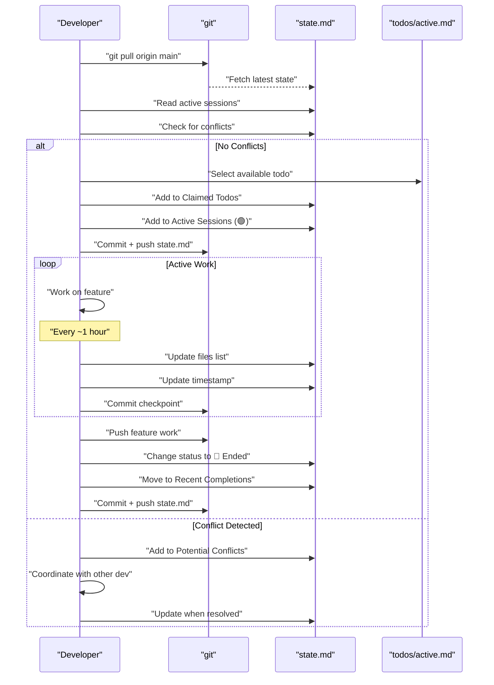
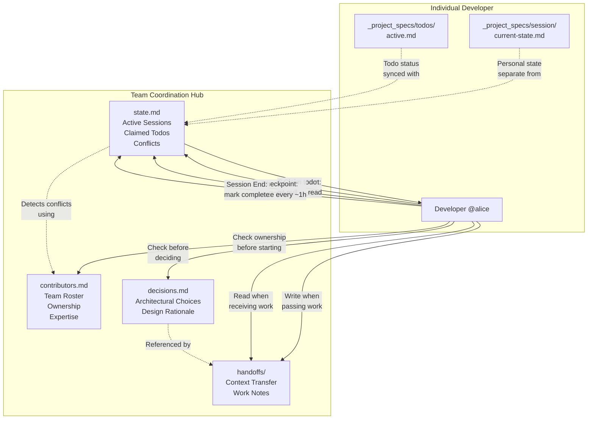
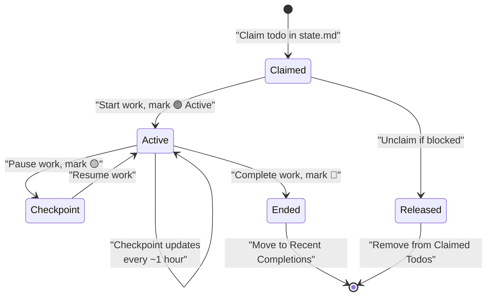
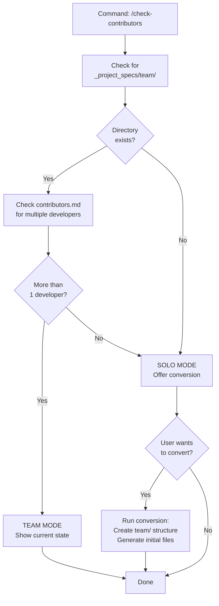
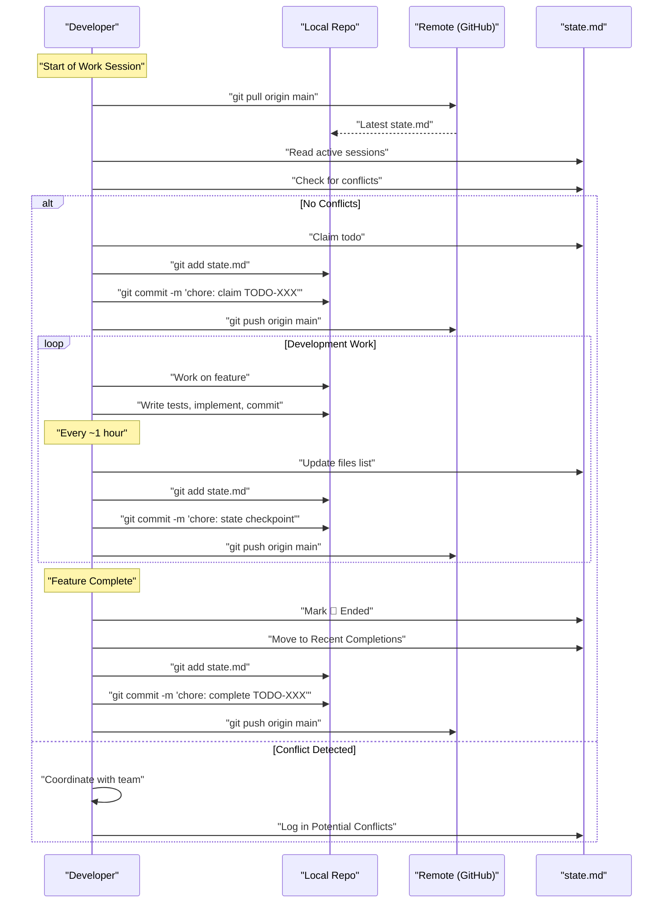

<!-- source: DeepWiki mcp.deepwiki.com · repo alinaqi/claude-bootstrap · page 8.2 Shared State Management · fetched 2026-10-26 -->

# Shared State Management

<details>
<summary>Relevant source files</summary>

The following files were used as context for generating this wiki page:

- [README.md](README.md)
- [skills/session-management.md](skills/session-management.md)

</details>


## Purpose and Scope

This page documents the shared state management system that enables multiple developers to coordinate when using Claude Code on the same repository. It covers the file structures, formats, and update patterns for team coordination state.

For information about the `/check-contributors` command and overall coordination patterns, see [Multi-Developer Coordination](#8.1). For single-developer session state tracking, see [Session Management](#4.2).

---

## Team State Directory Structure

When a project is converted to team mode (either manually or via `/check-contributors --team`), Claude Bootstrap creates a dedicated team state directory:

```
_project_specs/
└── team/
    ├── state.md           # Active sessions, claimed todos, conflicts
    ├── contributors.md    # Team member profiles and ownership
    ├── decisions.md       # Shared architectural decisions
    └── handoffs/          # Context transfer notes
        ├── 2025-01-15-auth-refactor.md
        └── 2025-01-16-api-migration.md
```

**Sources:** [README.md:225-231]()

### Directory Purpose Table

| File | Update Frequency | Primary Purpose | Read By |
|------|------------------|-----------------|---------|
| `state.md` | Every session start/end + checkpoints | Track who's working on what right now | All team members before claiming work |
| `contributors.md` | On team member changes | Team roster and ownership areas | All team members at session start |
| `decisions.md` | When architectural decisions made | Log shared design choices | Team members before making similar decisions |
| `handoffs/*.md` | When passing work between developers | Preserve context across handoffs | Developer receiving work |

**Sources:** [README.md:225-242]()

---

## state.md Format and Updates

The `state.md` file is the central coordination point for active development sessions. It tracks who is currently working on what, which todos are claimed, and potential conflicts.

### File Structure

```markdown
# Team State

*Last updated: 2025-01-15 16:45 by @alice*

## Active Sessions

| Developer | Status | Working On | Files Being Modified | Started |
|-----------|--------|------------|---------------------|---------|
| @alice | 🟢 Active | [TODO-042] Email validation | src/auth/validate.ts, src/auth/types.ts | 2025-01-15 14:00 |
| @bob | 🟡 Checkpoint | [TODO-038] API rate limiting | src/middleware/ratelimit.ts | 2025-01-15 09:30 |
| @carol | 🔴 Ended | [TODO-035] User profile page | Complete - pushed to main | 2025-01-15 11:00 |

## Claimed Todos

| Todo ID | Claimed By | Claimed At | Status | Notes |
|---------|------------|------------|--------|-------|
| TODO-042 | @alice | 2025-01-15 14:00 | in-progress | Email validation, ETA 2h |
| TODO-043 | @bob | 2025-01-15 15:30 | claimed | Starting after rate limiting done |
| TODO-044 | - | - | available | Needs PostHog integration skill |

## Potential Conflicts

| Warning | Developers | Files | Detected | Resolution |
|---------|-----------|-------|----------|------------|
| ⚠️ Overlap | @alice, @bob | src/auth/types.ts | 2025-01-15 15:00 | Coordinating in Slack |

## Recent Completions

| Todo ID | Completed By | Completed At | Pushed To |
|---------|--------------|--------------|-----------|
| TODO-035 | @carol | 2025-01-15 13:45 | main |
| TODO-037 | @alice | 2025-01-15 10:30 | main |
```

**Sources:** [README.md:228-229]()

### Session Status Indicators

| Status | Symbol | Meaning | Update Required |
|--------|--------|---------|-----------------|
| Active | 🟢 | Currently working, making changes | Update every 30-60 minutes |
| Checkpoint | 🟡 | Paused, preserved state, may resume | Update when pausing work |
| Ended | 🔴 | Session complete, work pushed | Update immediately after push |

### Update Triggers

The `state.md` file must be updated at these points in the workflow:

**At Session Start:**
```markdown
1. git pull origin main
2. Read _project_specs/team/state.md
3. Check for conflicts with your planned work
4. Claim todo by adding row to "Claimed Todos"
5. Add yourself to "Active Sessions"
6. git add _project_specs/team/state.md
7. git commit -m "chore: claim TODO-XXX"
8. git push origin main
```

**During Active Work (every ~1 hour or after significant changes):**
```markdown
1. Update "Files Being Modified" column
2. Update timestamp in header
3. Commit: "chore: update team state checkpoint"
```

**At Session End:**
```markdown
1. Change status to 🔴 Ended
2. Move todo from "Claimed" to "Recent Completions"
3. Remove potential conflicts if resolved
4. Commit: "chore: end session TODO-XXX"
```

**Sources:** [README.md:244-246]()

---

## State Update Workflow Diagram



**Sources:** [README.md:244-246]()

---

## contributors.md Format

The `contributors.md` file maintains team member information, ownership areas, and focus patterns. It's less frequently updated than `state.md` but provides essential context for coordination.

### File Structure

```markdown
# Contributors

## Team Members

| GitHub Handle | Name | Role | Primary Focus | Join Date |
|---------------|------|------|---------------|-----------|
| @alice | Alice Chen | Full Stack | Auth, API | 2025-01-10 |
| @bob | Bob Smith | Backend | Database, Workers | 2025-01-10 |
| @carol | Carol Lee | Frontend | UI, Components | 2025-01-12 |

## Ownership Areas

| Area | Primary Owner | Secondary | Notes |
|------|---------------|-----------|-------|
| Authentication | @alice | @bob | OAuth, JWT, session management |
| Database Schema | @bob | @alice | Migrations, RLS, indexes |
| UI Components | @carol | - | Design system, accessibility |
| API Layer | @alice | @bob | REST endpoints, validation |
| Background Jobs | @bob | - | Cron, queues, workers |
| Frontend State | @carol | - | Zustand, React Query |

## Communication

| Channel | Purpose | Members |
|---------|---------|---------|
| #claude-dev | Daily coordination | All |
| #architecture | Design discussions | All |
| Slack DM | Conflict resolution | As needed |

## Working Hours (UTC)

| Developer | Timezone | Typical Hours | Availability |
|-----------|----------|---------------|--------------|
| @alice | UTC-5 | 13:00-21:00 UTC | Weekdays |
| @bob | UTC+1 | 08:00-16:00 UTC | Weekdays |
| @carol | UTC-8 | 16:00-00:00 UTC | Weekdays |

## Expertise Matrix

| Skill | @alice | @bob | @carol |
|-------|--------|------|--------|
| TypeScript | ⭐⭐⭐ | ⭐⭐ | ⭐⭐⭐ |
| Python | ⭐⭐ | ⭐⭐⭐ | ⭐ |
| React | ⭐⭐ | ⭐ | ⭐⭐⭐ |
| PostgreSQL | ⭐⭐ | ⭐⭐⭐ | ⭐ |
| Supabase | ⭐⭐⭐ | ⭐⭐ | ⭐⭐ |
```

**Sources:** [README.md:229]()

### When to Update contributors.md

| Trigger | Update Required | Example |
|---------|-----------------|---------|
| New team member joins | Add to Team Members table | Developer onboarding |
| Ownership changes | Update Ownership Areas | Primary owner leaves |
| Expertise grows | Update Expertise Matrix | Team member learns new skill |
| Communication channels change | Update Communication table | New Slack channel created |

---

## Team State File Relationships Diagram



**Sources:** [README.md:225-242](), [skills/session-management.md:66-76]()

---

## Handoffs Directory

The `handoffs/` directory contains context transfer notes created when passing work between developers. Each handoff file preserves the mental model, open questions, and continuation points.

### When to Create Handoffs

| Scenario | Handoff Required | Reason |
|----------|------------------|--------|
| Mid-feature transition | ✅ Yes | Preserve context for next developer |
| Work blocked by external dependency | ✅ Yes | Document blocker and next steps |
| Developer going on leave | ✅ Yes | Enable others to continue |
| Feature complete but needs follow-up | ⚠️ Optional | Use if future work likely |
| Bug investigation incomplete | ✅ Yes | Document findings and hypotheses |

### Handoff File Naming Convention

```
handoffs/YYYY-MM-DD-brief-description.md

Examples:
handoffs/2025-01-15-auth-refactor.md
handoffs/2025-01-16-payment-webhook-debug.md
handoffs/2025-01-17-mobile-navigation-blocked.md
```

### Handoff File Structure

```markdown
# Handoff: [Feature/Bug Name]

**From:** @alice  
**To:** @bob (or "Team - Anyone can pick up")  
**Date:** 2025-01-15  
**Related Todo:** [TODO-042]  
**Status:** In Progress - ~60% complete  

## Context

[2-3 paragraphs explaining what this work is about, why it's being done, 
and what the current state is]

Example: We're refactoring the authentication system to use RS256 JWT instead 
of HS256. This provides better security for token verification across 
microservices. Currently completed the token generation side, but refresh 
token rotation is incomplete.

## What's Complete

- ✅ JWT token generation with RS256
- ✅ Public/private key pair management in src/auth/keys/
- ✅ Login endpoint updated to use new tokens
- ✅ Unit tests for token signing

## What's Remaining

- [ ] Refresh token rotation logic in src/auth/refresh.ts
- [ ] Token blacklist for logout (prevent replay attacks)
- [ ] Integration tests for full auth flow
- [ ] Update API middleware to verify RS256 tokens

## Current Blocker (if any)

None - Ready to continue

OR

Blocked: Waiting for infrastructure team to provision key storage service. 
Expected resolution: 2025-01-17

## Key Decisions & Context

- **Why RS256?** See _project_specs/team/decisions.md entry [2025-01-15]
- **Token expiry times:** Access 15 min, Refresh 7 days
- **Storage:** Refresh tokens in HttpOnly cookies (NOT localStorage)

## Code Locations

| File | Status | Notes |
|------|--------|-------|
| src/auth/keys/generate.ts | Complete | Key pair generation |
| src/auth/tokens.ts | Complete | Token signing functions |
| src/auth/refresh.ts | 60% done | Lines 1-45 done, need 46-end |
| src/auth/middleware.ts | Not started | Token verification |
| src/auth/types.ts | Complete | TokenPayload interface |

## Test Files

| File | Status | Coverage |
|------|--------|----------|
| tests/auth/tokens.test.ts | Complete | 95% |
| tests/auth/refresh.test.ts | Incomplete | 40% - need rotation tests |
| tests/integration/auth.test.ts | Not started | 0% |

## How to Continue

1. Start with src/auth/refresh.ts line 46
2. Implement `rotateRefreshToken()` function
3. Add error handling for expired refresh tokens
4. Write tests in tests/auth/refresh.test.ts
5. Refer to decisions.md for token expiry policy

## Questions & Uncertainties

- Should we implement token fingerprinting? (device tracking)
- Do we need rate limiting on refresh endpoint?
- What's the policy for concurrent sessions per user?

## Related PRs/Issues

- PR #123 (merged) - Initial RS256 setup
- Issue #456 - Parent issue for auth refactor

## Local Dev Setup

```bash
# Generate test keys
npm run generate-keys:dev

# Run auth tests
npm test -- tests/auth

# Start with refresh tokens enabled
ENABLE_REFRESH=true npm run dev
```

## Additional Resources

- Documentation: docs/auth-architecture.md
- Slack thread: #architecture (search "RS256 migration")
- Design doc: https://notion.so/auth-refactor-spec
```

**Sources:** [README.md:230]()

### Handoff Update Protocol

1. **Creating handoff:** Developer A creates file before ending session
2. **Claiming handoff:** Developer B adds comment at top: `**Claimed by:** @bob on 2025-01-16`
3. **During work:** Developer B updates progress in comments
4. **Completing handoff:** Developer B adds final comment: `**Completed:** 2025-01-17 - Merged in PR #789`

---

## Active Session Tracking

Active session tracking in `state.md` provides real-time visibility into who is working on what, enabling conflict prevention and coordination.

### Session Lifecycle States



**Sources:** [README.md:236-241]()

### Session Information Tracked

For each active session, `state.md` maintains:

| Field | Purpose | Update Frequency | Example |
|-------|---------|------------------|---------|
| Developer | Who is working | Once at claim | `@alice` |
| Status | Current state | Every checkpoint | `🟢 Active` |
| Working On | Todo being addressed | Once at claim | `[TODO-042] Email validation` |
| Files Being Modified | Conflict detection | Every checkpoint | `src/auth/validate.ts` |
| Started | Session start time | Once at start | `2025-01-15 14:00` |

### Conflict Detection Logic

The system detects potential conflicts by comparing file lists across active sessions:

```
IF Developer A files ∩ Developer B files ≠ ∅
THEN Add to "Potential Conflicts" table
```

**Example scenario:**
- @alice working on `src/auth/validate.ts, src/auth/types.ts`
- @bob starts work on `src/auth/types.ts, src/auth/middleware.ts`
- System detects overlap on `src/auth/types.ts`
- Adds warning to Potential Conflicts table

**Sources:** [README.md:238]()

---

## Converting Solo to Team Projects

The `/check-contributors` command automatically detects whether a project is solo or team-based and offers conversion.

### Detection Logic



**Sources:** [README.md:219-222]()

### Conversion Process

When converting from solo to team, the system:

1. **Creates team directory structure:**
```bash
mkdir -p _project_specs/team/handoffs
```

2. **Generates initial state.md:**
```markdown
# Team State

*Last updated: [timestamp] by [username]*

## Active Sessions

| Developer | Status | Working On | Files Being Modified | Started |
|-----------|--------|------------|---------------------|---------|

## Claimed Todos

| Todo ID | Claimed By | Claimed At | Status | Notes |
|---------|------------|------------|--------|-------|

## Potential Conflicts

| Warning | Developers | Files | Detected | Resolution |
|---------|-----------|-------|----------|------------|

## Recent Completions

| Todo ID | Completed By | Completed At | Pushed To |
|---------|--------------|--------------|-----------|
```

3. **Generates contributors.md:**
```markdown
# Contributors

## Team Members

| GitHub Handle | Name | Role | Primary Focus | Join Date |
|---------------|------|------|---------------|-----------|
| @[current-user] | [from git config] | Developer | Full Stack | [today] |

## Ownership Areas

[To be filled in by team]
```

4. **Migrates relevant decisions:**
   - If `_project_specs/session/decisions.md` exists
   - Copy to `_project_specs/team/decisions.md`
   - Add note about source

5. **Updates CLAUDE.md:**
   - Adds team coordination instructions
   - References state.md update requirements

**Sources:** [README.md:249-253]()

---

## Workflow Integration with Git

The team state system integrates tightly with the git workflow to ensure state synchronization.

### Standard Team Workflow



**Sources:** [README.md:244-246]()

### Handling Merge Conflicts in state.md

Since `state.md` is frequently updated, merge conflicts can occur. Resolution pattern:

```bash
# If pull fails due to conflict
git pull origin main
# CONFLICT in _project_specs/team/state.md

# Manual resolution:
# 1. Keep both active sessions (merge the tables)
# 2. Keep all claimed todos (merge the tables)
# 3. Resolve "Last updated" to latest timestamp
# 4. Keep all potential conflicts

# After manual edit:
git add _project_specs/team/state.md
git commit -m "chore: merge team state"
git push origin main
```

### Race Condition Handling

| Scenario | Risk | Mitigation |
|----------|------|------------|
| Two developers claim same todo | 🔴 High | First push wins, second sees error and picks different todo |
| Two developers update state simultaneously | 🟡 Medium | Git merge conflict forces manual resolution |
| Developer forgets to update end state | 🟢 Low | Stale sessions visible in state.md, team cleanup periodically |

**Best practice:** Always `git pull` before claiming todos and before updating state.

---

## State File Synchronization Patterns

### Pull-Before-Claim Protocol

```markdown
ALWAYS follow this sequence:

1. git pull origin main                    # Get latest state
2. cat _project_specs/team/state.md        # Read current state
3. Choose available todo                   # From active.md
4. Update state.md (claim todo)            # Add to Claimed Todos
5. git add _project_specs/team/state.md
6. git commit -m "chore: claim TODO-XXX"
7. git push origin main                    # Publish claim

IF push fails:
  - Someone else pushed state changes
  - git pull --rebase origin main
  - Verify your claim is still valid
  - git push origin main
```

### Checkpoint Commit Pattern

```bash
# Every ~1 hour or after significant progress
git add _project_specs/team/state.md
git commit -m "chore: update team state checkpoint"
git push origin main

# Separate from feature commits
git add src/auth/validate.ts tests/auth/validate.test.ts
git commit -m "feat: add email validation"
git push origin main
```

### State Cleanup Protocol

Teams should periodically clean stale entries:

```markdown
Weekly cleanup (assign to rotating team member):

1. Review "Active Sessions" table
   - Sessions >24 hours old with no updates → Mark as 🔴 Ended
   - Contact developer if unclear

2. Review "Claimed Todos" table
   - Claims >48 hours old with no progress → Release
   - Contact developer before releasing

3. Review "Potential Conflicts" table
   - Resolved conflicts → Remove from table
   - Update resolution notes

4. Archive "Recent Completions"
   - Keep last 10 completions
   - Move older to _project_specs/team/archive/completions-YYYY-MM.md
```

**Sources:** [README.md:244-246]()

---

## Integration with Session Management

The team state system (page 8.2) works alongside individual session management (see [Session Management](#4.2)) but serves different purposes:

| Aspect | Team State (_project_specs/team/) | Session State (_project_specs/session/) |
|--------|-----------------------------------|----------------------------------------|
| **Purpose** | Coordinate between multiple developers | Track individual developer's work state |
| **Audience** | Entire team | Single developer + future self |
| **Update Trigger** | Session start/end, checkpoints | After tasks, decisions, context shifts |
| **Scope** | What files/todos are claimed | Detailed progress, decisions, next steps |
| **Conflict Focus** | Prevent overlapping work | Preserve mental model across sessions |

### When Both Exist

For team projects, developers maintain both:

```
_project_specs/
├── session/                 # Personal state
│   ├── current-state.md     # "I'm 60% done with email validation"
│   └── decisions.md         # "I chose Zod because..."
└── team/                    # Shared state
    ├── state.md             # "@alice working on email validation"
    └── contributors.md      # "@alice owns auth system"
```

**Update pattern:**
1. Start session → Update `team/state.md` (claim todo)
2. Work → Update `session/current-state.md` (personal progress)
3. Make decision → Log to both `session/decisions.md` AND `team/decisions.md` if architectural
4. Checkpoint → Update both `session/current-state.md` and `team/state.md`
5. End session → Update `team/state.md` (mark complete)

**Sources:** [README.md:228-229](), [skills/session-management.md:66-76]()

---

## Command Reference

### /check-contributors Flags

```bash
# Check status and offer conversion if solo
/check-contributors

# Show quick status without prompts
/check-contributors --status

# Force conversion to team mode
/check-contributors --team
```

**Output example (solo project):**
```
📊 Project Status: SOLO MODE

_project_specs/team/ does not exist.

Would you like to convert this to a team project?
This will create:
  - _project_specs/team/state.md
  - _project_specs/team/contributors.md
  - _project_specs/team/handoffs/

[y/n]
```

**Output example (team project):**
```
📊 Project Status: TEAM MODE

Active Sessions:
  🟢 @alice: [TODO-042] Email validation (started 2h ago)
  🟡 @bob: [TODO-038] API rate limiting (checkpoint 1h ago)

Claimed Todos: 2
Potential Conflicts: 0

Recent Activity:
  ✅ @carol completed [TODO-035] User profile page (30m ago)
```

**Sources:** [README.md:249-253]()

---

## Anti-Patterns and Common Mistakes

| Anti-Pattern | Problem | Solution |
|--------------|---------|----------|
| **Not pulling before claiming** | Claim same todo as someone else | Always `git pull` then read state.md first |
| **Never updating state** | Team blind to your work | Update state.md at session start/checkpoints/end |
| **Claiming multiple todos** | Blocks others unnecessarily | Claim one at a time, only claim next when current done |
| **Ignoring conflict warnings** | Duplicate work or merge nightmares | Coordinate immediately when conflict detected |
| **Not writing handoffs** | Context loss on transition | Create handoff before ending incomplete work |
| **Stale session status** | Team can't tell if you're active | Mark 🔴 Ended when done or 🟡 Checkpoint when pausing |
| **Committing state with feature code** | Makes state changes less visible | Separate commits for state.md updates |
| **Not reading contributors.md** | Work on someone else's area without asking | Check ownership before starting work in new area |

---

## Quick Reference

### State Update Checklist

```markdown
✅ At Session Start:
- [ ] git pull origin main
- [ ] Read _project_specs/team/state.md
- [ ] Check for conflicts with planned work
- [ ] Claim todo in state.md
- [ ] Add to Active Sessions (🟢)
- [ ] Commit and push state.md

✅ During Work (every ~1 hour):
- [ ] Update "Files Being Modified"
- [ ] Update timestamp in header
- [ ] Commit state.md separately

✅ At Session End:
- [ ] Change status to 🔴 Ended
- [ ] Move todo to Recent Completions
- [ ] Remove from Claimed Todos
- [ ] Create handoff if work incomplete
- [ ] Commit and push state.md
```

### File Location Summary

| File | Location | Purpose |
|------|----------|---------|
| Team state | `_project_specs/team/state.md` | Active coordination |
| Contributors | `_project_specs/team/contributors.md` | Team roster |
| Shared decisions | `_project_specs/team/decisions.md` | Architectural choices |
| Handoffs | `_project_specs/team/handoffs/*.md` | Context transfer |
| Personal state | `_project_specs/session/current-state.md` | Individual progress |
| Personal decisions | `_project_specs/session/decisions.md` | Personal choices |

**Sources:** [README.md:225-231](), [skills/session-management.md:66-76]()

---

