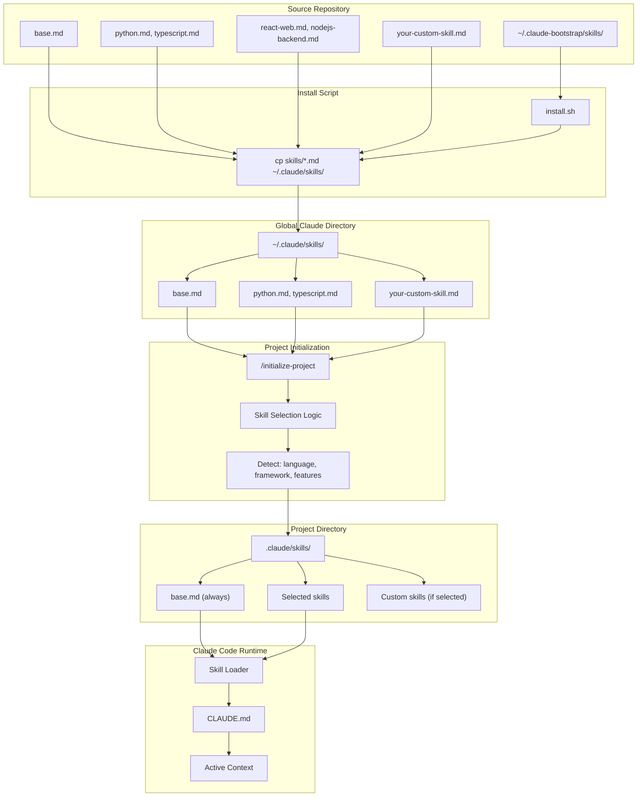
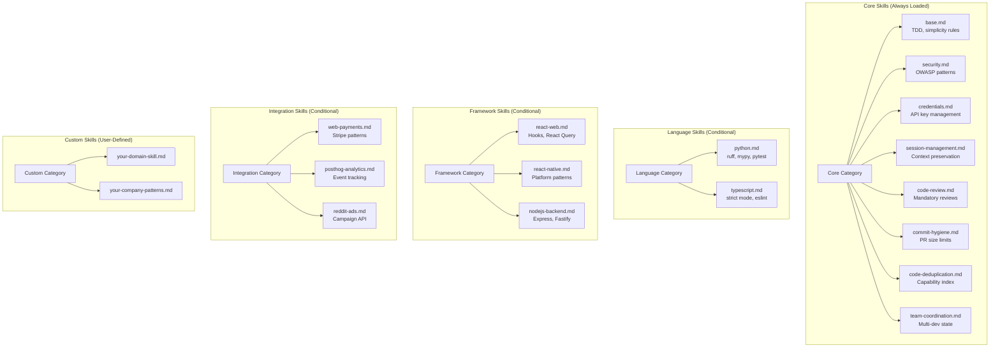
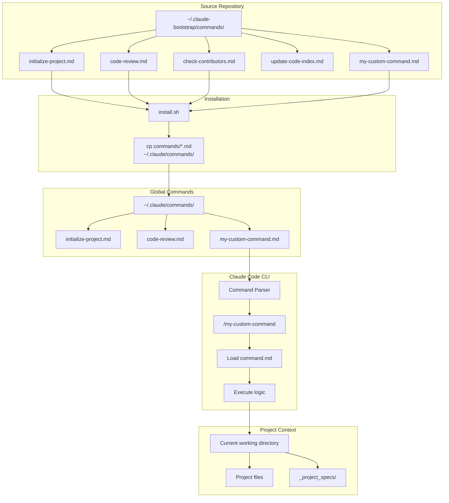
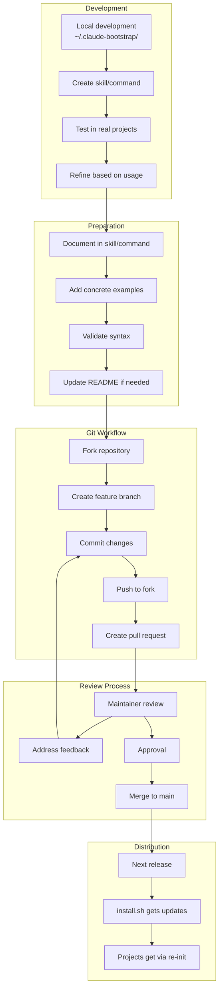

<!-- source: DeepWiki mcp.deepwiki.com · repo alinaqi/claude-bootstrap · page 9.3 Extending Claude Bootstrap · fetched 2026-10-26 -->

# Extending Claude Bootstrap

<details>
<summary>Relevant source files</summary>

The following files were used as context for generating this wiki page:

- [README.md](README.md)
- [install.sh](install.sh)
- [skills/base.md](skills/base.md)
- [templates/CLAUDE.md](templates/CLAUDE.md)

</details>


## Purpose and Scope

This page documents how advanced users can extend Claude Bootstrap to meet custom needs: creating new skills, adding commands, modifying initialization behavior, and contributing changes back to the project. For information about using the existing skills system, see [Skills Architecture](#5.1). For details on the standard commands, see [Commands Reference](#9.1).

---

## Skills System Architecture

### Skill File Structure

Skills are markdown files that follow a standardized format. Every skill must be self-contained and declarative.

**Core Structure:**

```markdown
# Skill Name - Brief Description

## Core Principle
High-level philosophy

## Patterns
Specific implementation patterns

## Anti-Patterns
What to avoid

## Validation
How to verify compliance
```

**Sources:** [skills/base.md:1-580]()

### Skill Loading Flow

**Diagram: Skill Installation and Loading Pipeline**



**Key Points:**

| Stage | Location | Purpose |
|-------|----------|---------|
| **Source** | `~/.claude-bootstrap/skills/` | Master repository of all available skills |
| **Installation** | `~/.claude/skills/` | Global Claude directory, skills available for all projects |
| **Project Copy** | `.claude/skills/` | Project-specific copy, overwritten on re-initialization |
| **Runtime** | `CLAUDE.md` references | Skills actively loaded in Claude context |

**Sources:** [install.sh:1-66](), [skills/base.md:99-135]()

---

## Creating Custom Skills

### Skill File Format

Custom skills follow the same format as core skills. The structure ensures consistency and discoverability.

**Minimal Skill Template:**

```markdown
# Custom Skill Name - One-Line Description

## Core Principle
What this skill enforces or enables.

## When to Use
Specific scenarios where this skill applies.

## Patterns

### Pattern 1: Name
Description of the pattern.

```[language]
// Example code
```

### Pattern 2: Name
Description of the pattern.

## Validation
How Claude (or developer) can verify compliance.

## Anti-Patterns
What NOT to do.
```

**Sources:** [skills/base.md:1-20]()

### Skill Categories

Skills are organized by category. Custom skills should align with existing categories or define new ones.

**Diagram: Skill Category Hierarchy**



**Sources:** [README.md:396-466]()

### Creating a Custom Skill: Step-by-Step

**1. Create Skill File**

Place your skill in the source repository:

```bash
cd ~/.claude-bootstrap/skills/
touch my-custom-skill.md
```

**2. Define Skill Content**

Example custom skill for GraphQL best practices:

```markdown
# GraphQL API Skill - Type-Safe Query Development

## Core Principle
GraphQL APIs must maintain strict type safety from schema to resolver to client.

## Patterns

### Schema-First Development
Define schema before implementing resolvers.

```graphql
type User {
  id: ID!
  email: String!
  posts: [Post!]!
}

type Query {
  user(id: ID!): User
}
```

### Resolver Pattern
```typescript
// resolvers/user.ts
export const userResolver = {
  Query: {
    user: async (_: any, { id }: { id: string }, ctx: Context) => {
      return ctx.db.user.findUnique({ where: { id } });
    },
  },
};
```

### Client Code Generation
Always generate types from schema.

```bash
# Generate TypeScript types
npm run graphql-codegen
```

## Validation
- [ ] Schema valid: `npm run validate-schema`
- [ ] Types generated: Check `src/generated/graphql.ts`
- [ ] Resolvers typed: No `any` types in resolver signatures

## Anti-Patterns
- ❌ Resolver logic without types
- ❌ Manual type definitions (schema is source of truth)
- ❌ Ignoring N+1 query issues (use DataLoader)
```

**3. Install Globally**

```bash
cd ~/.claude-bootstrap
./install.sh
```

This copies your custom skill to `~/.claude/skills/`.

**4. Include in Projects**

Skills are copied to projects during initialization. To include your custom skill:

**Option A: Always include (add to core set)**

Edit the initialization command logic to always copy your skill.

**Option B: Conditional include (based on project type)**

Add detection logic to `/initialize-project` command that copies your skill when specific conditions are met (e.g., when GraphQL is detected).

**Option C: Manual include**

Copy skill to project manually:
```bash
cp ~/.claude/skills/my-custom-skill.md .claude/skills/
```

Update `CLAUDE.md` to reference it:
```markdown
## Skills Loaded
- base.md
- my-custom-skill.md (GraphQL best practices)
```

**Sources:** [install.sh:19-31](), [templates/CLAUDE.md:1-113]()

### Skill Best Practices

| Principle | Implementation |
|-----------|----------------|
| **Self-contained** | Each skill stands alone, no dependencies on other skills (except `base.md`) |
| **Actionable** | Provide concrete patterns, not vague guidance |
| **Verifiable** | Include validation criteria that Claude or developer can check |
| **Examples-driven** | Show code examples for every pattern |
| **Anti-patterns explicit** | Document what NOT to do as clearly as what to do |

**Sources:** [skills/base.md:1-20]()

---

## Adding Custom Commands

### Command File Structure

Commands are markdown files placed in `~/.claude/commands/` that define custom slash commands for Claude Code.

**Command Format:**

```markdown
# Command Name

## Description
Brief description of what this command does.

## Usage
```bash
/command-name [arguments]
```

## Implementation
[Command implementation details]

## Examples
```bash
/command-name --example
```
```

**Sources:** [install.sh:19-22]()

### Command Installation Flow

**Diagram: Command Installation and Execution**



**Sources:** [install.sh:19-22](), [README.md:52-70]()

### Creating a Custom Command

**Example: Audit Command for Code Quality**

**File:** `~/.claude-bootstrap/commands/audit-quality.md`

```markdown
# /audit-quality - Comprehensive Code Quality Audit

## Description
Analyzes codebase for complexity violations, test coverage gaps, and security issues. Generates actionable report.

## Usage
```bash
/audit-quality [options]

Options:
  --strict     Fail on any violations (exit code 1)
  --fix        Auto-fix violations where possible
  --report     Generate detailed markdown report
```

## Implementation

### Detection Logic

1. **Complexity Analysis**
   - Scan all files for function length violations (>20 lines)
   - Check parameter counts (>3 params)
   - Identify nesting depth violations (>2 levels)

2. **Coverage Analysis**
   - Run test suite with coverage
   - Identify files below 80% threshold
   - List untested functions

3. **Security Scan**
   - Check for hardcoded secrets
   - Verify `.env` in `.gitignore`
   - Scan for client-exposed secrets (`VITE_*`, `NEXT_PUBLIC_*`)

### Output Format

```markdown
# Code Quality Audit Report

## Complexity Violations (5 found)

| File | Function | Lines | Max | Action |
|------|----------|-------|-----|--------|
| src/api/users.ts | fetchUser | 32 | 20 | Split into helper functions |

## Coverage Gaps (12 files below 80%)

| File | Coverage | Target | Uncovered Lines |
|------|----------|--------|-----------------|
| src/utils/format.ts | 65% | 80% | 45-67, 89-102 |

## Security Issues (2 critical)

| Issue | Severity | File | Line | Fix |
|-------|----------|------|------|-----|
| API key in code | Critical | src/config.ts | 12 | Move to .env |
```

### Error Handling

If no issues found:
```
✅ Code quality audit passed
   - All files under 200 lines
   - All functions under 20 lines
   - Coverage above 80%
   - No security issues
```

If issues found without `--strict`:
```
⚠️ Code quality issues found (see report above)
   Run with --fix to auto-fix or --strict to fail CI
```

If issues found with `--strict`:
```
❌ Code quality audit failed
   5 violations found
   Exit code: 1
```

## Examples

```bash
# Basic audit
/audit-quality

# Generate report file
/audit-quality --report > audit-report.md

# Auto-fix violations
/audit-quality --fix

# Strict mode (for CI)
/audit-quality --strict
```

## Integration

### Pre-commit Hook
```bash
#!/bin/bash
# .git/hooks/pre-commit

if ! claude /audit-quality --strict; then
  echo "Fix quality issues before committing"
  exit 1
fi
```

### CI/CD
```yaml
# .github/workflows/quality.yml
- name: Code Quality Audit
  run: |
    claude /audit-quality --strict --report
    cat audit-report.md >> $GITHUB_STEP_SUMMARY
```
```

**Install the command:**

```bash
cd ~/.claude-bootstrap
./install.sh
```

**Sources:** [install.sh:19-22]()

### Command Conventions

| Convention | Rule |
|------------|------|
| **Naming** | Use kebab-case: `/my-command-name` |
| **Parameters** | Support `--flags` for options, avoid positional args |
| **Output** | Clear success/failure indicators (✅ ❌ ⚠️) |
| **Error handling** | Graceful failures with actionable error messages |
| **Idempotency** | Safe to run multiple times without side effects |

**Sources:** [README.md:248-253]()

---

## Modifying Initialization Workflow

### Initialization Command Structure

The `/initialize-project` command orchestrates project setup. Understanding its flow enables customization.

**Diagram: /initialize-project Execution Flow**

```mermaid
graph TB
    START["/initialize-project invoked"]
    
    subgraph "Phase 1: Validation"
        CHECK_DIR["Check if valid directory"]
        CHECK_CLI["Validate CLIs:<br/>gh, vercel, supabase"]
        REPORT_MISSING["Report missing CLIs"]
    end
    
    subgraph "Phase 2: Project Discovery"
        DETECT_EXISTING["Check for existing files"]
        GIT_STATUS["Git status: new vs existing"]
        DETECT_LANG["Detect language:<br/>package.json, requirements.txt"]
        DETECT_FRAME["Detect framework:<br/>next.config, vite.config"]
    end
    
    subgraph "Phase 3: User Input"
        ASK_LANG["Ask: Language?<br/>(Python, TypeScript)"]
        ASK_FRAME["Ask: Framework?<br/>(React, FastAPI, etc)"]
        ASK_DB["Ask: Database?<br/>(Supabase, PostgreSQL)"]
        ASK_AI["Ask: AI-first?<br/>(yes/no)"]
        ASK_INTEGRATIONS["Ask: Integrations?<br/>(Stripe, PostHog, etc)"]
    end
    
    subgraph "Phase 4: Skill Selection"
        SELECT_CORE["Select core skills:<br/>base.md, security.md"]
        SELECT_LANG["Select language skills"]
        SELECT_FRAME["Select framework skills"]
        SELECT_INTEGRATIONS["Select integration skills"]
    end
    
    subgraph "Phase 5: File Generation"
        COPY_SKILLS["Copy selected skills<br/>to .claude/skills/"]
        GEN_CLAUDE_MD["Generate CLAUDE.md"]
        GEN_GITIGNORE["Generate/update .gitignore"]
        GEN_WORKFLOWS["Generate GitHub Actions"]
        GEN_SPECS["Create _project_specs/"]
        GEN_SCRIPTS["Copy scripts/<br/>security-check.sh"]
    end
    
    subgraph "Phase 6: Repository Setup"
        CHECK_GH["Check GitHub repo"]
        CREATE_REPO["Create repo if needed"]
        INIT_GIT["git init if needed"]
        FIRST_COMMIT["Initial commit"]
    end
    
    subgraph "Phase 7: External Config"
        VERCEL["Vercel project setup"]
        SUPABASE["Supabase project link"]
        CREDS["Read Access.txt"]
        GEN_ENV["Generate .env"]
    end
    
    subgraph "Phase 8: Completion"
        SUMMARY["Print setup summary"]
        NEXT_STEPS["Show next steps"]
        PROMPT_SPECS["Prompt: Define first feature"]
    end
    
    START --> CHECK_DIR
    CHECK_DIR --> CHECK_CLI
    CHECK_CLI --> REPORT_MISSING
    REPORT_MISSING --> DETECT_EXISTING
    
    DETECT_EXISTING --> GIT_STATUS
    GIT_STATUS --> DETECT_LANG
    DETECT_LANG --> DETECT_FRAME
    
    DETECT_FRAME --> ASK_LANG
    ASK_LANG --> ASK_FRAME
    ASK_FRAME --> ASK_DB
    ASK_DB --> ASK_AI
    ASK_AI --> ASK_INTEGRATIONS
    
    ASK_INTEGRATIONS --> SELECT_CORE
    SELECT_CORE --> SELECT_LANG
    SELECT_LANG --> SELECT_FRAME
    SELECT_FRAME --> SELECT_INTEGRATIONS
    
    SELECT_INTEGRATIONS --> COPY_SKILLS
    COPY_SKILLS --> GEN_CLAUDE_MD
    GEN_CLAUDE_MD --> GEN_GITIGNORE
    GEN_GITIGNORE --> GEN_WORKFLOWS
    GEN_WORKFLOWS --> GEN_SPECS
    GEN_SPECS --> GEN_SCRIPTS
    
    GEN_SCRIPTS --> CHECK_GH
    CHECK_GH --> CREATE_REPO
    CREATE_REPO --> INIT_GIT
    INIT_GIT --> FIRST_COMMIT
    
    FIRST_COMMIT --> VERCEL
    VERCEL --> SUPABASE
    SUPABASE --> CREDS
    CREDS --> GEN_ENV
    
    GEN_ENV --> SUMMARY
    SUMMARY --> NEXT_STEPS
    NEXT_STEPS --> PROMPT_SPECS
```



**Sources:** [README.md:64-70]()

### Customizing Skill Selection Logic

To add custom logic that automatically includes specific skills based on project characteristics:

**1. Add Detection Logic**

Detect custom conditions in Phase 2 (Project Discovery):

```markdown
### Custom Detection: E-Commerce Project

Check for indicators:
- `package.json` contains `@shopify/*` or `@medusajs/*`
- Files: `shopify.config.js`, `medusa-config.js`
- Directory: `src/ecommerce/`, `plugins/`

If detected, set flag: `is_ecommerce = true`
```

**2. Expand Selection Rules**

In Phase 4 (Skill Selection), add conditional logic:

```markdown
### E-Commerce Skill Selection

If `is_ecommerce` and Shopify detected:
  - Copy `shopify-apps.md`
  - Copy `web-payments.md` (Stripe likely needed)
  - Copy `posthog-analytics.md` (tracking likely needed)

If `is_ecommerce` and Medusa detected:
  - Copy `medusa.md`
  - Copy `web-payments.md`
```

**3. Update Template Generation**

Modify `CLAUDE.md` generation to reference custom skills:

```markdown
## Skills Loaded
- base.md
- typescript.md
- react-web.md
- shopify-apps.md (E-commerce patterns)
- web-payments.md (Stripe integration)
```

**Sources:** [templates/CLAUDE.md:1-113]()

### Adding Custom Project Templates

To support new project types (e.g., Chrome extension, CLI tool):

**1. Create Template Directory**

```bash
mkdir ~/.claude-bootstrap/templates/chrome-extension/
```

**2. Define Template Structure**

```
templates/chrome-extension/
├── manifest.json.template
├── popup.html.template
├── background.js.template
├── CLAUDE.md.template
└── tsconfig.json.template
```

**3. Add Template Logic to Initialization**

Extend Phase 3 (User Input) to detect/ask for Chrome extension:

```markdown
### Chrome Extension Detection

Ask: "Is this a Chrome extension? (y/n)"

If yes:
  - Copy chrome-extension templates
  - Select chrome-extension.md skill (if exists)
  - Generate manifest.json with proper structure
  - Set up webpack/vite for extension bundling
```

**Sources:** [templates/CLAUDE.md:1-113]()

### Modifying File Generation

Customize what files get generated in Phase 5:

**Example: Custom GitHub Actions Workflow**

**File:** `~/.claude-bootstrap/templates/workflows/custom-quality.yml`

```yaml
name: Custom Quality Checks
on: [push, pull_request]
jobs:
  quality:
    runs-on: ubuntu-latest
    steps:
      - uses: actions/checkout@v3
      - name: Custom Audit
        run: |
          npm install
          claude /audit-quality --strict
```

**Include in initialization:**

```markdown
### Workflow Generation (Phase 5)

Copy workflows:
- quality.yml (standard)
- security.yml (standard)
- custom-quality.yml (if custom flag set)
```

**Sources:** [README.md:296-317]()

---

## Testing Custom Extensions

### Testing Custom Skills

**Validation checklist:**

| Test | Method |
|------|--------|
| **Syntax** | Ensure markdown is valid, no broken formatting |
| **References** | Verify all file paths in examples exist |
| **Commands** | Test example commands actually work |
| **Integration** | Install skill, initialize project, verify Claude loads it |

**Test procedure:**

```bash
# 1. Install custom skill
cd ~/.claude-bootstrap
./install.sh

# 2. Create test project
mkdir /tmp/test-custom-skill
cd /tmp/test-custom-skill

# 3. Initialize with custom skill
claude
> /initialize-project

# 4. Verify skill is loaded
cat .claude/skills/my-custom-skill.md

# 5. Verify CLAUDE.md references it
cat CLAUDE.md | grep "my-custom-skill"

# 6. Test skill patterns work
# (Try implementing something using the skill's patterns)
```

**Sources:** [install.sh:1-66]()

### Testing Custom Commands

**Command test checklist:**

| Test | Expected Result |
|------|-----------------|
| **Invocation** | `/my-command` executes without error |
| **Help text** | Command shows usage when invoked incorrectly |
| **Error handling** | Graceful failures with clear messages |
| **Output format** | Consistent with other commands (✅ ❌ ⚠️) |
| **Idempotency** | Running twice produces same result |

**Test procedure:**

```bash
# 1. Install command
cd ~/.claude-bootstrap
./install.sh

# 2. Test invocation
cd /tmp/test-project
claude
> /my-custom-command

# 3. Test with flags
> /my-custom-command --help
> /my-custom-command --strict

# 4. Test error cases
> /my-custom-command --invalid-flag  # Should show error

# 5. Test idempotency
> /my-custom-command
> /my-custom-command  # Should produce same output
```

**Sources:** [install.sh:19-22]()

---

## Contributing Extensions Back

### Contribution Workflow

**Diagram: Contributing Custom Extensions**



### Contribution Guidelines

**Before contributing:**

1. **Test extensively** - Use the skill/command in real projects for at least a week
2. **Document thoroughly** - Include clear examples and anti-patterns
3. **Follow conventions** - Match existing skill/command structure
4. **Provide rationale** - Explain why this extension is needed

**Skill contribution requirements:**

| Requirement | Details |
|-------------|---------|
| **Format** | Follow standard skill structure (see [Creating Custom Skills](#creating-custom-skills)) |
| **Examples** | Include working code examples for every pattern |
| **Anti-patterns** | Document what NOT to do |
| **Validation** | Provide concrete validation criteria |
| **Self-contained** | No dependencies on other skills (except `base.md`) |

**Command contribution requirements:**

| Requirement | Details |
|-------------|---------|
| **Format** | Follow standard command structure |
| **Usage section** | Clear syntax with all flags documented |
| **Examples** | Multiple usage examples covering common cases |
| **Error handling** | Graceful failures with actionable messages |
| **Testing** | Demonstrate command works in clean project |

**Sources:** [README.md:692-700]()

### Pull Request Template

When submitting a pull request for a custom extension:

**PR Title Format:**
```
[SKILL] Add GraphQL best practices skill
[COMMAND] Add /audit-quality command
```

**PR Description Template:**
```markdown
## Extension Type
- [ ] New skill
- [ ] New command
- [ ] Modification to existing skill/command
- [ ] New template

## Description
Brief description of what this adds/changes.

## Motivation
Why is this extension needed? What problem does it solve?

## Testing
- [ ] Tested in real project for 1+ week
- [ ] All examples verified working
- [ ] Installed via install.sh and tested
- [ ] No breaking changes to existing behavior

## Documentation
- [ ] README updated (if needed)
- [ ] Examples provided
- [ ] Anti-patterns documented

## Validation
Describe how this extension can be validated:
- [ ] Validation criteria 1
- [ ] Validation criteria 2
```

**Sources:** [README.md:692-700]()

---

## Advanced Customization

### Skill Composition Patterns

For complex domains, compose multiple focused skills rather than one large skill.

**Example: E-Commerce Domain**

Instead of:
```
❌ ecommerce-everything.md (500 lines)
```

Use composition:
```
✅ ecommerce-catalog.md (Product management patterns)
✅ ecommerce-cart.md (Shopping cart patterns)
✅ ecommerce-checkout.md (Checkout flow patterns)
✅ ecommerce-fulfillment.md (Order processing patterns)
```

**Benefits:**

| Benefit | Impact |
|---------|--------|
| **Focused** | Each skill addresses one concern |
| **Reusable** | Catalog patterns work for any e-commerce platform |
| **Maintainable** | Updates to checkout don't affect catalog |
| **Selective loading** | Only load skills needed for the project |

**Sources:** [skills/base.md:54-68]()

### Integration with CI/CD

Custom commands can integrate with CI/CD pipelines:

**Example: GitHub Actions Integration**

```yaml
# .github/workflows/custom-audit.yml
name: Custom Quality Audit
on: [push, pull_request]

jobs:
  audit:
    runs-on: ubuntu-latest
    steps:
      - uses: actions/checkout@v3
      
      - name: Setup Claude
        run: |
          git clone https://github.com/alinaqi/claude-bootstrap.git ~/.claude-bootstrap
          cd ~/.claude-bootstrap && ./install.sh
      
      - name: Run Custom Audit
        run: claude /audit-quality --strict --report
      
      - name: Upload Report
        if: failure()
        uses: actions/upload-artifact@v3
        with:
          name: audit-report
          path: audit-report.md
```

**Sources:** [README.md:515-530]()

### Skill Override Patterns

Projects can override global skills with project-specific versions:

**Override mechanism:**

1. Global skill: `~/.claude/skills/react-web.md`
2. Project override: `.claude/skills/react-web.md` (custom version)
3. Claude loads project version first (takes precedence)

**Use cases:**

| Use Case | Pattern |
|----------|---------|
| **Company standards** | Override `base.md` with company-specific limits |
| **Client requirements** | Override `security.md` with client security policies |
| **Legacy projects** | Override framework skills for older versions |

**Implementation:**

```bash
# Copy global skill to project
cp ~/.claude/skills/base.md .claude/skills/

# Edit project version
vim .claude/skills/base.md

# Modify limits for this specific project
# (e.g., 30 lines per function instead of 20)

# Commit project-specific skill
git add .claude/skills/base.md
git commit -m "Add project-specific complexity limits"
```

**Sources:** [skills/base.md:1-20]()

---

## Summary Table: Extension Points

| Extension Type | File Location | Update Method | Distribution |
|----------------|---------------|---------------|--------------|
| **Core skill** | `~/.claude-bootstrap/skills/` | `./install.sh` | Copied to all projects on init |
| **Custom skill** | `~/.claude-bootstrap/skills/` | `./install.sh` | Copied to projects on init (if selected) |
| **Project skill override** | `.claude/skills/` | Manual copy + edit | Project-specific, committed to repo |
| **Global command** | `~/.claude-bootstrap/commands/` | `./install.sh` | Available in all projects |
| **Project template** | `~/.claude-bootstrap/templates/` | `./install.sh` | Used during initialization |
| **Workflow template** | `~/.claude-bootstrap/templates/workflows/` | `./install.sh` | Copied to `.github/workflows/` on init |

**Sources:** [install.sh:1-66](), [README.md:296-317](), [skills/base.md:99-135]()