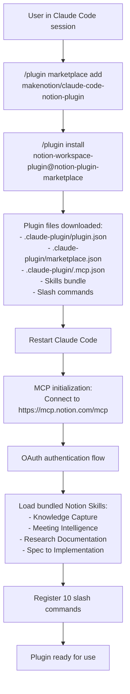
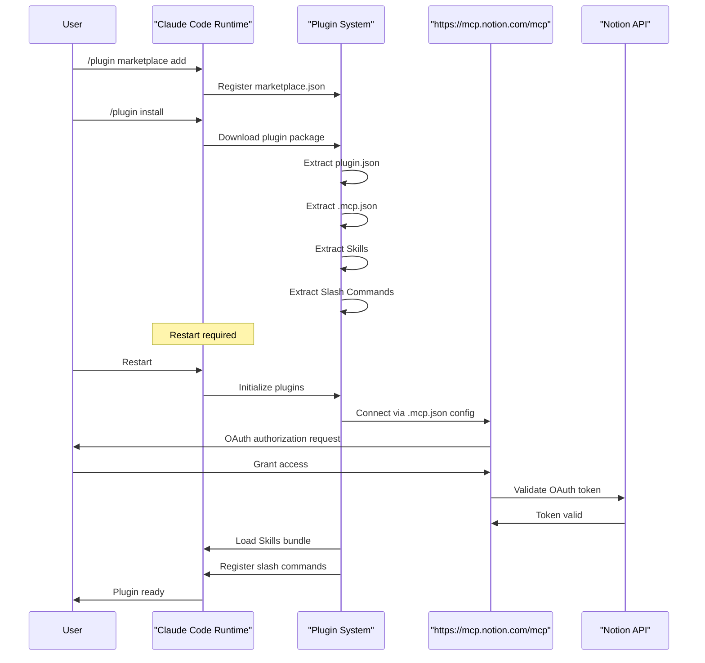
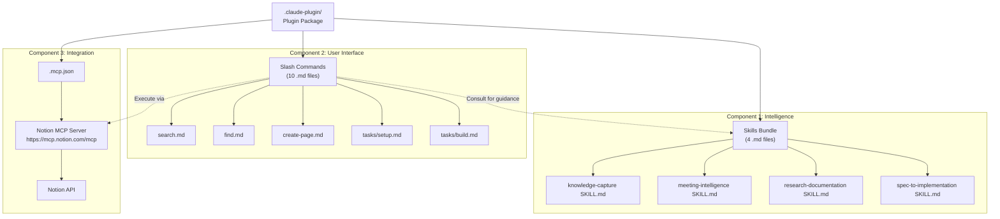

<!-- source: DeepWiki mcp.deepwiki.com · repo makenotion/claude-code-notion-plugin · page 2 Getting Started · fetched 2026-10-26 -->

# Getting Started

<details>
<summary>Relevant source files</summary>

The following files were used as context for generating this wiki page:

- [.claude-plugin/marketplace.json](.claude-plugin/marketplace.json)
- [.claude-plugin/plugin.json](.claude-plugin/plugin.json)
- [README.md](README.md)

</details>


## Purpose and Scope

This document provides a practical guide to installing and configuring the Notion Plugin for Claude Code. It covers the complete installation workflow, from adding the plugin marketplace to verifying that all components are operational. 

For detailed installation steps and troubleshooting, see [Installation](#2.1). For MCP server configuration options, see [MCP Server Configuration](#2.2). For an architectural overview of the plugin's components, see [Core Components](#3.1).

**Sources:** [README.md:61-92]()

---

## Prerequisites

Before installing the plugin, ensure you have:

| Requirement | Description |
|------------|-------------|
| **Claude Code** | A running instance of Claude Code with plugin support enabled |
| **Notion Account** | An active Notion workspace with content you want to integrate |
| **OAuth Permissions** | Ability to authorize Claude Code to access your Notion workspace |
| **Restart Capability** | Ability to restart Claude Code (required for MCP server initialization) |

The plugin requires no external dependencies beyond Claude Code itself. All components (Skills, Slash Commands, and MCP server configuration) are bundled in the plugin package.

**Sources:** [README.md:61-78]()

---

## Installation Overview

The plugin installation follows a three-phase process: marketplace registration, plugin installation, and runtime initialization. The key architectural constraint is that the MCP server connection cannot be established until Claude Code restarts, as MCP servers are registered during the initialization phase.

### Installation Workflow



**Sources:** [README.md:61-78](), [plugin.json:1-11](), [marketplace.json:1-18]()

---

## Quick Start Guide

### Step 1: Add the Plugin Marketplace

Execute the following command in Claude Code to register the Notion plugin marketplace:

```bash
/plugin marketplace add makenotion/claude-code-notion-plugin
```

This command registers the marketplace defined in [marketplace.json:1-18](). The marketplace contains metadata about the `notion-workspace-plugin` package, including its GitHub source repository and owner information.

### Step 2: Install the Plugin

Install the plugin from the registered marketplace:

```bash
/plugin install notion-workspace-plugin@notion-plugin-marketplace
```

This downloads the plugin package, which includes:
- Plugin manifest ([plugin.json:1-11]())
- Marketplace configuration ([marketplace.json:1-18]())
- MCP server configuration (`.mcp.json`)
- Four bundled Notion Skills
- Ten slash commands

### Step 3: Restart Claude Code

**This step is mandatory.** The MCP server connection is established during Claude Code's initialization phase, not during plugin installation. Without a restart, the plugin will be installed but non-functional.

### Step 4: Complete OAuth Authentication

On first use of any Notion command or skill, you will be prompted to authenticate via OAuth. This grants Claude Code permission to access your Notion workspace through the MCP server at `https://mcp.notion.com/mcp`.

**Sources:** [README.md:61-84](), [plugin.json:1-11](), [marketplace.json:1-18]()

---

## Component Initialization Sequence

The following diagram shows the initialization sequence and dependencies between plugin components:



**Sources:** [README.md:26-30](), [README.md:76-84](), [plugin.json:1-11]()

---

## Verifying Installation

After completing the installation and restart, verify the plugin is working correctly:

### 1. Check Available Commands

Type `/Notion:` in Claude Code and verify the autocomplete shows 10 commands:

| Command Category | Commands |
|-----------------|----------|
| **Search & Discovery** | `/Notion:search`, `/Notion:find` |
| **Content Creation** | `/Notion:create-page`, `/Notion:create-task`, `/Notion:create-database-row` |
| **Database Operations** | `/Notion:database-query` |
| **Task Management** | `/Notion:tasks:setup`, `/Notion:tasks:plan`, `/Notion:tasks:build`, `/Notion:tasks:explain-diff` |

### 2. Test MCP Server Connection

Execute a simple search command:

```bash
/Notion:search <query>
```

If the MCP server is connected and authenticated, this will search your Notion workspace. If OAuth is not yet complete, you will be prompted to authenticate.

### 3. Verify Skills Are Loaded

Ask Claude to "capture this conversation to Notion". If the Knowledge Capture skill is loaded, Claude will understand how to structure the conversation into appropriate Notion content types (FAQ, decision record, how-to guide, etc.).

**Sources:** [README.md:42-56]()

---

## Plugin Architecture at a Glance

The plugin bundles three distinct components that work together:



- **Skills** provide instructions that guide Claude's behavior when working with Notion content
- **Slash Commands** expose specific workflows to users with pre-defined prompts
- **MCP Server** provides secure API access to Notion through OAuth-authenticated tools

**Sources:** [README.md:3-9](), [README.md:15-23](), [README.md:26-40](), [README.md:42-56]()

---

## What's Included in the Plugin

The plugin package defined in [plugin.json:1-11]() contains:

| Component | Count | Purpose |
|-----------|-------|---------|
| **Notion Skills** | 4 | Teach Claude how to structure, write, and maintain Notion content |
| **Slash Commands** | 10 | Pre-built workflows for common Notion operations |
| **MCP Server Config** | 1 | Connection configuration for `https://mcp.notion.com/mcp` |
| **Plugin Metadata** | 3 | `plugin.json`, `marketplace.json`, `.mcp.json` |

All components are versioned together as a single package (version 0.1.0) and maintained by Notion Labs.

**Sources:** [plugin.json:1-11](), [README.md:3-9](), [README.md:15-23](), [README.md:42-56]()

---

## Next Steps

After verifying the plugin installation:

1. **Set up a task board** - Run `/Notion:tasks:setup` to configure a Notion database for task management. See [Task Board Setup](#4.1) for details.

2. **Explore slash commands** - Review the [Slash Commands Reference](#5) to understand all available workflows.

3. **Learn the task workflow** - The task management commands (`/Notion:tasks:plan`, `/Notion:tasks:build`) implement an autonomous agent system. See [Task Management Workflow](#4) for the complete lifecycle.

4. **Understand the communication protocol** - Task commands use asynchronous communication through Notion itself. See [Communication Protocol](#3.2) to understand how agents interact with users.

5. **Use Knowledge Capture** - Ask Claude to capture conversations, decisions, or meetings to Notion. See [Knowledge Capture Skill](#6.1) for supported content types.

**Sources:** [README.md:42-56]()

---

## Troubleshooting Common Issues

| Issue | Likely Cause | Solution |
|-------|--------------|----------|
| Commands not appearing | Plugin not loaded | Restart Claude Code |
| OAuth prompt loops | Permissions denied | Check Notion workspace permissions |
| MCP connection fails | .mcp.json not loaded | Verify restart occurred after installation |
| Skills not working | Restart not performed | Complete full restart cycle |

For detailed MCP server configuration and troubleshooting, see [MCP Server Configuration](#2.2).

**Sources:** [README.md:76-78](), [README.md:82-84]()

---

