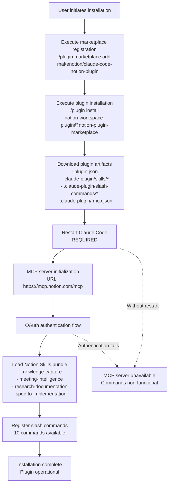
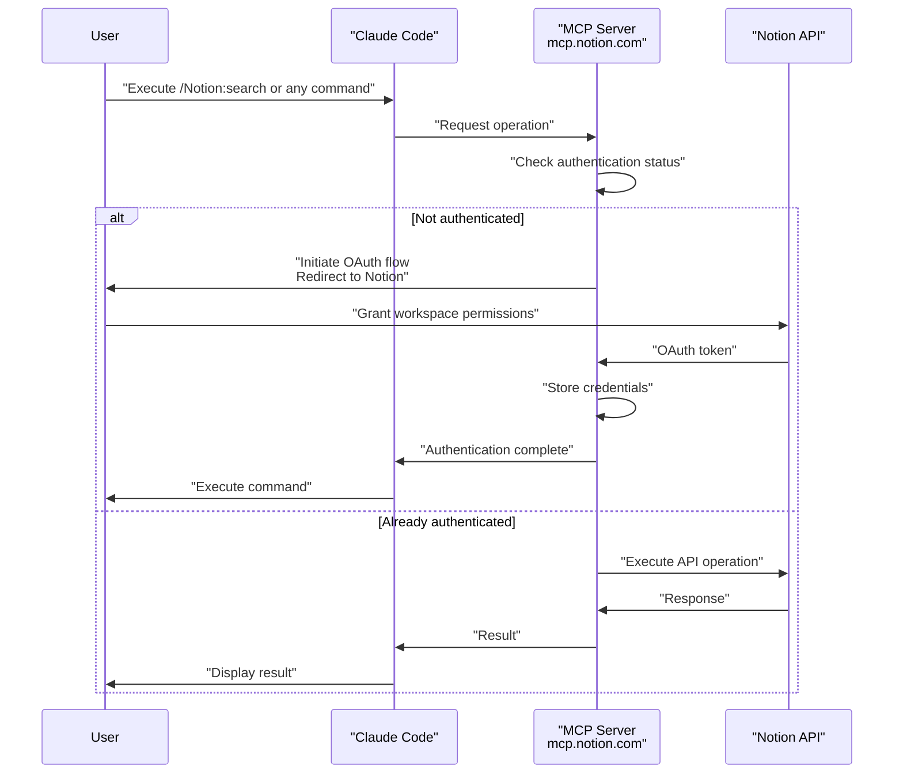
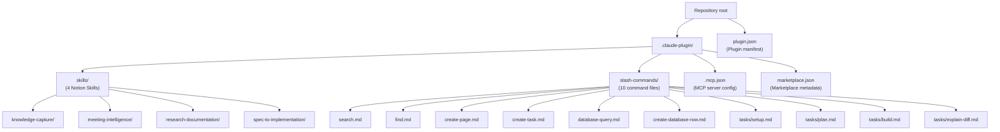

<!-- source: DeepWiki mcp.deepwiki.com · repo makenotion/claude-code-notion-plugin · page 2.1 Installation · fetched 2026-10-26 -->

# Installation

<details>
<summary>Relevant source files</summary>

The following files were used as context for generating this wiki page:

- [.claude-plugin/marketplace.json](.claude-plugin/marketplace.json)
- [README.md](README.md)

</details>


This page provides step-by-step instructions for installing the Notion Plugin for Claude Code via the plugin marketplace system. It covers marketplace registration, plugin installation, the mandatory restart requirement, and OAuth authentication setup.

For information about the MCP server configuration file loaded during installation, see [MCP Server Configuration](#2.2). For details on the installed components themselves, see [Core Components](#3.1).

---

## Overview

The installation process consists of four sequential steps that configure the plugin and establish connectivity to the Notion MCP Server. The process requires a Claude Code restart to initialize the MCP server connection, followed by OAuth authentication to grant workspace access.

**Sources:** [README.md:61-84]()

---

## Installation Architecture

### Component Installation Flow



**Diagram: Installation Sequence and Dependencies**

This diagram illustrates the critical dependency chain in the installation process. The restart step is mandatory because the MCP server connection is established during Claude Code's initialization phase, not during plugin installation. Without this restart, commands will be registered but non-functional due to missing MCP server connectivity.

**Sources:** [README.md:61-84](), [.claude-plugin/marketplace.json:1-18]()

---

## Prerequisites

Before beginning installation, ensure:

- Claude Code is installed and running
- Network access to `https://mcp.notion.com/mcp` is available
- A Notion workspace with appropriate permissions for OAuth integration

---

## Installation Steps

### Step 1: Register the Plugin Marketplace

Execute the following command in Claude Code to register the Notion plugin marketplace:

```bash
/plugin marketplace add makenotion/claude-code-notion-plugin
```

This command configures Claude Code to recognize the marketplace defined in [.claude-plugin/marketplace.json:1-18](). The marketplace metadata includes:

| Field | Value |
|-------|-------|
| **Marketplace name** | `notion-plugin-marketplace` |
| **Owner** | Notion Labs, Inc. |
| **Owner URL** | https://www.notion.so |
| **Source type** | GitHub repository |
| **Repository** | makenotion/claude-code-notion-plugin |

**Sources:** [README.md:63-68](), [.claude-plugin/marketplace.json:2-6]()

---

### Step 2: Install the Plugin

Execute the installation command:

```bash
/plugin install notion-workspace-plugin@notion-plugin-marketplace
```

This command triggers the download of all plugin artifacts from the GitHub repository specified in [.claude-plugin/marketplace.json:11-14](). The `@notion-plugin-marketplace` suffix references the marketplace name registered in Step 1.

#### Downloaded Artifacts

The installation downloads the following components:

| Component | Location | Purpose |
|-----------|----------|---------|
| **Plugin manifest** | `plugin.json` | Defines plugin metadata and component references |
| **Skills bundle** | `.claude-plugin/skills/` | Four Notion Skills from Notion Cookbook |
| **Slash commands** | `.claude-plugin/slash-commands/` | 10 command implementations |
| **MCP configuration** | `.claude-plugin/.mcp.json` | MCP server connection settings |

**Sources:** [README.md:70-74](), [.claude-plugin/marketplace.json:9-16]()

---

### Step 3: Restart Claude Code (Critical)

**This step is mandatory.** Exit and restart Claude Code completely.

#### Why Restart is Required

The MCP server connection defined in `.claude-plugin/.mcp.json` is initialized during Claude Code's startup sequence. Specifically:

1. Claude Code reads `.mcp.json` during initialization
2. Establishes persistent connection to `https://mcp.notion.com/mcp`
3. Registers MCP tools for use by slash commands

Without a restart, the MCP server remains uninitialized, causing all slash commands to fail when attempting MCP operations. The connection cannot be established post-initialization through the plugin installation process.

**Sources:** [README.md:76-77](), [README.md:26-30]()

---

### Step 4: OAuth Authentication

After restart, the first interaction with a Notion-related command triggers the OAuth authentication flow.

#### Authentication Process



**Diagram: OAuth Authentication Sequence**

The OAuth flow is handled entirely by the Notion MCP Server at `https://mcp.notion.com/mcp`. Claude Code does not store Notion credentials; all authentication state is managed server-side by the MCP server.

**Sources:** [README.md:81-84](), [README.md:26-30]()

---

## Post-Installation Verification

### Verify MCP Server Connection

After restart and authentication, verify the installation by checking MCP tool availability:

1. The MCP server provides tools for Notion operations
2. Slash commands can invoke these tools
3. The connection to `https://mcp.notion.com/mcp` is persistent

### Verify Skills Loading

Confirm that all four Notion Skills are loaded:

- **knowledge-capture** - Guides content structuring and documentation
- **meeting-intelligence** - Handles meeting notes and summaries
- **research-documentation** - Manages research workflows
- **spec-to-implementation** - Bridges specifications to code

These skills are referenced by slash commands to provide intelligent Notion workflows. See [Notion Skills](#6) for detailed documentation.

### Verify Slash Commands

Confirm that all 10 slash commands are registered and functional:

| Command Category | Commands |
|------------------|----------|
| **Search & Discovery** | `/Notion:search`, `/Notion:find` |
| **Content Creation** | `/Notion:create-page`, `/Notion:create-task`, `/Notion:create-database-row` |
| **Database Operations** | `/Notion:database-query` |
| **Task Management** | `/Notion:tasks:setup`, `/Notion:tasks:plan`, `/Notion:tasks:build`, `/Notion:tasks:explain-diff` |

See [Slash Commands Reference](#5) for complete command documentation.

**Sources:** [README.md:15-22](), [README.md:42-56]()

---

## File Structure After Installation



**Diagram: Installed Plugin Directory Structure**

This diagram maps the physical file structure created by the installation process. All plugin components reside in the `.claude-plugin/` directory, with `plugin.json` at the repository root serving as the entry point.

**Sources:** [.claude-plugin/marketplace.json:11-14]()

---

## Troubleshooting

### MCP Server Connection Fails

**Symptom:** Slash commands execute but fail with "MCP server not available" errors.

**Cause:** Claude Code was not restarted after installation.

**Resolution:** Exit Claude Code completely and restart. The MCP server connection is established only during startup.

---

### OAuth Authentication Does Not Trigger

**Symptom:** Commands fail without prompting for authentication.

**Cause:** Network connectivity issues to `https://mcp.notion.com/mcp`.

**Resolution:** 
1. Verify network access to the MCP server URL
2. Check firewall settings
3. Confirm no proxy interference with HTTPS connections

---

### Commands Registered but Non-Functional

**Symptom:** Slash commands appear in autocomplete but fail when executed.

**Cause:** Incomplete installation or missing OAuth authentication.

**Resolution:**
1. Verify restart was performed (Step 3)
2. Execute any Notion command to trigger OAuth flow
3. Grant workspace permissions when prompted

**Sources:** [README.md:76-77](), [README.md:81-84]()

---

## Next Steps

After successful installation:

1. Configure your first task board using `/Notion:tasks:setup` - see [Task Board Setup](#4.1)
2. Review available slash commands - see [Slash Commands Reference](#5)
3. Understand the MCP server configuration - see [MCP Server Configuration](#2.2)
4. Explore the Communication Protocol for task management - see [Communication Protocol](#3.2)

**Sources:** [README.md:52-56]()

---

